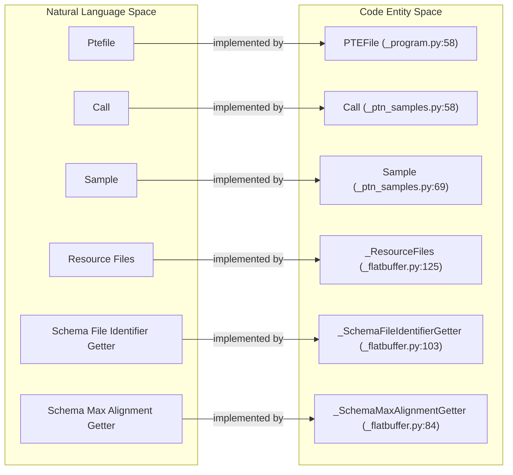
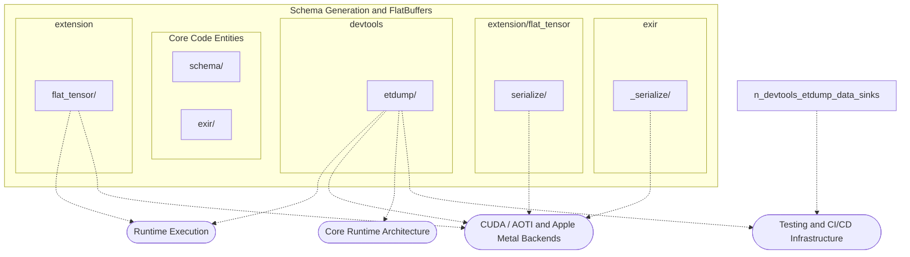
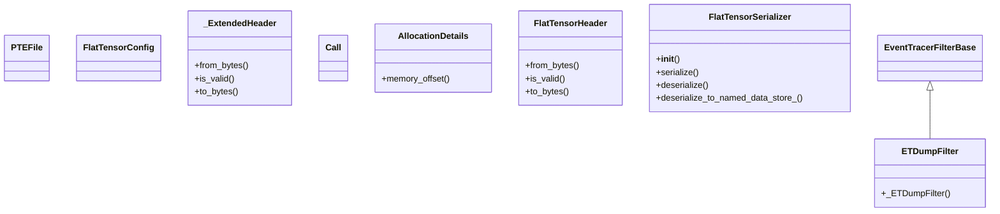
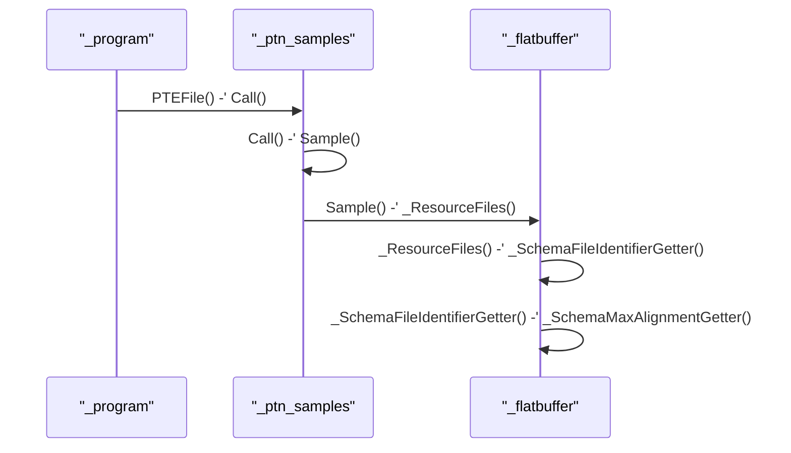

# Schema Generation and FlatBuffers

↑ [[2-build-system-and-infrastructure|Build System and Infrastructure]]

> Architectural specification and implementation reference for Schema Generation and FlatBuffers (36 relevant source files). Primary code entities: `Call`, `Sample`, `SampleSet`, `_SetDecoder`, `PTEFile`.

<details>
<summary>Relevant source files</summary>

The following files were used as context for generating this wiki page:

- [exir/_serialize/_ptn_samples.py](exir/_serialize/_ptn_samples.py)
- [exir/_serialize/_program.py](exir/_serialize/_program.py)
- [exir/_serialize/_named_data_store.py](exir/_serialize/_named_data_store.py)
- [exir/_serialize/_flatbuffer.py](exir/_serialize/_flatbuffer.py)
- [exir/_serialize/_flatbuffer_program.py](exir/_serialize/_flatbuffer_program.py)
- [exir/_serialize/_cord.py](exir/_serialize/_cord.py)
- [schema/extended_header.h](schema/extended_header.h)
- [exir/_serialize/_dataclass.py](exir/_serialize/_dataclass.py)
- [exir/_serialize/data_serializer.py](exir/_serialize/data_serializer.py)
- [schema/CMakeLists.txt](schema/CMakeLists.txt)
- [schema/extended_header.cpp](schema/extended_header.cpp)
- [schema/targets.bzl](schema/targets.bzl)
- [exir/_serialize/_ptn.py](exir/_serialize/_ptn.py)
- [exir/_serialize/__init__.py](exir/_serialize/__init__.py)
- [exir/_serialize/generate_program.py](exir/_serialize/generate_program.py)
- [exir/_serialize/_serialize.py](exir/_serialize/_serialize.py)
- [exir/_serialize/bindings.cpp](exir/_serialize/bindings.cpp)
- [extension/flat_tensor/serialize/serialize.py](extension/flat_tensor/serialize/serialize.py)
- [devtools/etdump/etdump_flatcc.cpp](devtools/etdump/etdump_flatcc.cpp)
- [exir/schema.py](exir/schema.py)
- [devtools/etdump/schema_flatcc.py](devtools/etdump/schema_flatcc.py)
- [extension/flat_tensor/flat_tensor_data_map.cpp](extension/flat_tensor/flat_tensor_data_map.cpp)
- [devtools/etdump/etdump_flatcc.h](devtools/etdump/etdump_flatcc.h)
- [extension/flat_tensor/flat_tensor_data_map.h](extension/flat_tensor/flat_tensor_data_map.h)
- [devtools/etdump/etdump_filter.h](devtools/etdump/etdump_filter.h)
- [devtools/etdump/data_sinks/buffer_data_sink.h](devtools/etdump/data_sinks/buffer_data_sink.h)
- [devtools/etdump/data_sinks/file_data_sink.h](devtools/etdump/data_sinks/file_data_sink.h)
- [extension/flat_tensor/serialize/flat_tensor_schema.py](extension/flat_tensor/serialize/flat_tensor_schema.py)
- [schema/README.md](schema/README.md)
- [extension/flat_tensor/README.md](extension/flat_tensor/README.md)
- [schema/BUCK](schema/BUCK)
- [schema/program.fbs](schema/program.fbs)
- [schema/scalar_type.fbs](schema/scalar_type.fbs)
- [exir/_serialize/BUCK](exir/_serialize/BUCK)
- [devtools/etdump/BUCK](devtools/etdump/BUCK)

</details>

## Purpose and Scope

Architectural specification and implementation reference for Schema Generation and FlatBuffers (36 relevant source files). Primary code entities: `Call`, `Sample`, `SampleSet`, `_SetDecoder`, `PTEFile`.

Primary code entities analyzed on this page include `PTEFile` ([exir/_serialize/_program.py:58-67]()), `Call` ([exir/_serialize/_ptn_samples.py:58-65]()), `Sample` ([exir/_serialize/_ptn_samples.py:69-73]()), `_ResourceFiles` ([exir/_serialize/_flatbuffer.py:125-153]()), `_SchemaFileIdentifierGetter` ([exir/_serialize/_flatbuffer.py:103-122]()).

For the parent architectural layer, see [[2-build-system-and-infrastructure|Build System and Infrastructure]]. Related sibling subsystems: [[2.1-cmake-configuration-and-targets|CMake Configuration and Targets]], [[2.2-kernel-libraries-and-selective-build|Kernel Libraries and Selective Build]], [[2.4-python-bindings-and-dependencies|Python Bindings and Dependencies]], [[2.5-buck2-and-shim-build-layer|Buck2 and Shim Build Layer]].

Sources: [exir/_serialize/_program.py:58-67](), [exir/_serialize/_ptn_samples.py:58-65](), [exir/_serialize/_ptn_samples.py:69-73](), [exir/_serialize/_flatbuffer.py:125-153]()

---

## 1. High-Level Architecture and Data Flow

### Natural Language Space to Code Entity Space Mapping

The following diagram maps domain concepts in this subsystem to their concrete code entities:



### Subsystem Component & Dependency Flow



Cross-subsystem call and import edges connect **Schema Generation and FlatBuffers** with [[8.1-core-runtime-architecture|Core Runtime Architecture]] (coupling `32.0`), [[8-runtime-execution|Runtime Execution]] (coupling `26.0`), [[7.3-performance-benchmarking-and-profiling|Performance Benchmarking and Profiling]] (coupling `20.0`), [[8.3-developer-tools-devtools|Developer Tools (DevTools: ETDump, ETRecord, Inspector)]] (coupling `20.0`), [[7-testing-and-cicd-infrastructure|Testing and CI/CD Infrastructure]] (coupling `15.0`).

| Module Directory | Files | Primary Code Entities | Source Citations |
|---|---|---|---|
| `exir/_serialize` | 14 | `PTEFile`, `Call`, `Sample`, `_ResourceFiles` | [exir/_serialize/_program.py:58-67]() [exir/_serialize/_ptn_samples.py:58-65]() |
| `schema` | 8 | `ExtendedHeader`, `Parse`, `GetUInt32LE`, `GetUInt64LE` | [schema/extended_header.h:22-82]() [schema/extended_header.cpp:69-112]() |
| `devtools/etdump` | 6 | `ETDumpFilter`, `PROFILE_EVENT_ENUM`, `AllocationEvent`, `Allocator` | [devtools/etdump/etdump_filter.h:32-101]() [devtools/etdump/schema_flatcc.py:105-109]() |
| `extension/flat_tensor` | 3 | `FlatTensorDataMap`, `load_data_into`, `FlatTensorDataMap`, `create_tensor_layout` | [extension/flat_tensor/flat_tensor_data_map.h:35-139]() [extension/flat_tensor/flat_tensor_data_map.cpp:196-249]() |
| `devtools/etdump/data_sinks` | 2 | `BufferDataSink`, `FileDataSink`, `BufferDataSink`, `FileDataSink` | [devtools/etdump/data_sinks/buffer_data_sink.h:24-124]() [devtools/etdump/data_sinks/file_data_sink.h:28-92]() |
| `extension/flat_tensor/serialize` | 2 | `FlatTensorSerializer`, `FlatTensorConfig`, `FlatTensorHeader`, `DataSegment` | [extension/flat_tensor/serialize/serialize.py:259-429]() [extension/flat_tensor/serialize/serialize.py:105-106]() |
| `exir` | 1 | `ExtraTensorInfo`, `NonConstBufferDevice`, `TensorShapeDynamism`, `AllocationDetails` | [exir/schema.py:57-66]() [exir/schema.py:279-287]() |

Sources: [exir/_serialize/_program.py:58-67](), [exir/_serialize/_ptn_samples.py:58-65](), [exir/_serialize/_ptn_samples.py:69-73](), [exir/_serialize/_flatbuffer.py:125-153](), [exir/_serialize/_flatbuffer.py:103-122]()

---

## 2. Core Data Structures and Implementation Details

### Class and Entity Relationship Diagram



### `PTEFile` (Class)

- **Source Location**: [exir/_serialize/_program.py:58-67]()
- **Declaration**: `Class PTEFile`
- **Graph Centrality**: fan-in `10` callers, fan-out `0` callees
- **Responsibility**: Wraps together the data required to serialize into a PTE file.

```python
// exir/_serialize/_program.py:58-67
class PTEFile:
    """
    Wraps together the data required to serialize into a PTE file.
    """

    program: Program
    # TODO(lfq): add constant data (currently restored in the program)
    # TODO(lfq): update this to List[bytes]
    mutable_data: Optional[List[Buffer]] = None
    named_data: Optional[NamedDataStoreOutput] = None
```

### `Call` (Class)

- **Source Location**: [exir/_serialize/_ptn_samples.py:58-65]()
- **Declaration**: `Class Call`
- **Graph Centrality**: fan-in `2` callers, fan-out `0` callees
- **Responsibility**: One call of a method: positional inputs, and optionally what it produced.

```python
// exir/_serialize/_ptn_samples.py:58-65
class Call:
    """One call of a method: positional inputs, and optionally what it produced."""

    method: str
    inputs: list[Value]
    outputs: list[Value] | None = None
    intermediates: dict[str, torch.Tensor] | None = None
    tol: Tolerance | None = None
```

### `Sample` (Class)

- **Source Location**: [exir/_serialize/_ptn_samples.py:69-73]()
- **Declaration**: `Class Sample`
- **Graph Centrality**: fan-in `1` callers, fan-out `0` callees
- **Responsibility**: Calls run in order from the program's initial state, with no reset between.

```python
// exir/_serialize/_ptn_samples.py:69-73
class Sample:
    """Calls run in order from the program's initial state, with no reset between."""

    calls: list[Call]
    tol: Tolerance | None = None
```

### `_ResourceFiles` (Class)

- **Source Location**: [exir/_serialize/_flatbuffer.py:125-153]()
- **Declaration**: `Class _ResourceFiles`
- **Graph Centrality**: fan-in `1` callers, fan-out `0` callees
- **Responsibility**: Manages a collection of python resources that will be written to files.

### `_SchemaFileIdentifierGetter` (Class)

- **Source Location**: [exir/_serialize/_flatbuffer.py:103-122]()
- **Declaration**: `Class _SchemaFileIdentifierGetter`
- **Graph Centrality**: fan-in `1` callers, fan-out `0` callees
- **Responsibility**: Finds the file_identifier value in flatbuffer schemas.

### `serialize_pte_binary` (Function)

- **Source Location**: [exir/_serialize/_program.py:383-564]()
- **Declaration**: `( pte_file: PTEFile, *, extract_delegate_segments: bool = False, segment_alignment: int = 128, constant_tensor_alignment: Optional[int] = No`
- **Graph Centrality**: fan-in `8` callers, fan-out `7` callees
- **Responsibility**: Returns the runtime binary representation of the given Program. Args: pte_file: PTEFile class containing the program and segments. extract_delegate_segments: Whether to move delegate data blobs from the Program into separate segments, rather than encoding those blobs in the flatbuffer data. When true, will also: - Add 

Sources: [exir/_serialize/_program.py:58-67](), [exir/_serialize/_ptn_samples.py:58-65](), [exir/_serialize/_ptn_samples.py:69-73](), [exir/_serialize/_flatbuffer.py:125-153](), [exir/_serialize/_flatbuffer.py:103-122]()

---

## 3. Execution and Call Flow

The sequence diagram below traces the runtime/compile-time call chain across components in this module:



Sources: [exir/_serialize/_program.py:58-67](), [exir/_serialize/_ptn_samples.py:58-65](), [exir/_serialize/_ptn_samples.py:69-73](), [exir/_serialize/_flatbuffer.py:125-153](), [exir/_serialize/_flatbuffer.py:103-122]()

---

## 4. Key API and Symbol Reference

| Code Entity | Kind | Location | Fan-In / Out | Role & Signature |
|---|---|---|---|---|
| `PTEFile` | Class | [exir/_serialize/_program.py:58-67]() | `10` / `0` | Wraps together the data required to serialize into a PTE file. |
| `Call` | Class | [exir/_serialize/_ptn_samples.py:58-65]() | `2` / `0` | One call of a method: positional inputs, and optionally what it produced. |
| `Sample` | Class | [exir/_serialize/_ptn_samples.py:69-73]() | `1` / `0` | Calls run in order from the program's initial state, with no reset between. |
| `_ResourceFiles` | Class | [exir/_serialize/_flatbuffer.py:125-153]() | `1` / `0` | Manages a collection of python resources that will be written to files. |
| `_SchemaFileIdentifierGetter` | Class | [exir/_serialize/_flatbuffer.py:103-122]() | `1` / `0` | Finds the file_identifier value in flatbuffer schemas. |
| `_SchemaMaxAlignmentGetter` | Class | [exir/_serialize/_flatbuffer.py:84-100]() | `1` / `0` | Finds the largest (force_align: N) N value in flatbuffer schemas. |
| `NamedDataStore` | Class | [exir/_serialize/_named_data_store.py:57-358]() | `1` / `0` | NamedDataStore manages the data that delegates want to share. Backends add |
| `NamedDataStoreOutput` | Class | [exir/_serialize/_named_data_store.py:39-54]() | `1` / `0` | Holds named data for serialization. Note: a DataEntry contains the index into |
| `Cord` | Class | [exir/_serialize/_cord.py:94-140]() | `0` / `0` | A `bytes`-like sequence of bytes, stored non-contiguously. |
| `FileBackedData` | Class | [exir/_serialize/_cord.py:16-88]() | `0` / `0` | A byte buffer that stays on disk until explicitly closed. |
| `AlignedData` | Class | [exir/_serialize/data_serializer.py:45-53]() | `1` / `0` | Data and its required alignment for serialization. |
| `ExtendedHeader` | Class | [schema/extended_header.h:22-82]() | `0` / `0` | /** |
| `DataEntry` | Class | [exir/_serialize/data_serializer.py:11-24]() | `0` / `0` | Represents a single blob in `DataPayload`, specifying its location |
| `DataPayload` | Class | [exir/_serialize/data_serializer.py:28-41]() | `0` / `0` | Contains the data and metadata required for serialization. |
| `DataSerializer` | Class | [exir/_serialize/data_serializer.py:83-120]() | `0` / `0` | Serializes and deserializes data. Data can be referenced by a unique key. |
| `FlatTensorSerializer` | Class | [extension/flat_tensor/serialize/serialize.py:259-429]() | `2` / `0` | A concrete implementation of the DataSerializer interface that |
| `_ExtendedHeader` | Class | [exir/_serialize/_program.py:130-245]() | `2` / `0` | — |
| `ExtraTensorInfo` | Class | [exir/schema.py:57-66]() | `1` / `0` | Check program.fbs for explanations of this enum. |
| `SampleSet` | Class | [exir/_serialize/_ptn_samples.py:77-81]() | `1` / `0` | — |
| `_SetDecoder` | Class | [exir/_serialize/_ptn_samples.py:251-323]() | `1` / `0` | — |
| `_SchemaInfo` | Class | [exir/_serialize/_flatbuffer.py:157-173]() | `1` / `0` | — |
| `NonConstBufferDevice` | Class | [exir/schema.py:279-287]() | `0` / `0` | Maps a non-constant buffer to the device where it should be allocated. |

Sources: [exir/_serialize/_program.py:58-67](), [exir/_serialize/_ptn_samples.py:58-65](), [exir/_serialize/_ptn_samples.py:69-73](), [exir/_serialize/_flatbuffer.py:125-153](), [exir/_serialize/_flatbuffer.py:103-122](), [exir/_serialize/_flatbuffer.py:84-100]()

---

## 5. Official Documentation and Design Context

The following linked documentation sections from `llm-wiki` (`raw/`) provide additional architectural context, tutorials, and design invariants for this subsystem:

- **Program Emission and Serialization** ([wiki/3.4-program-emission-and-serialization.md](), score `130.5051`) (sections: `Program Emission and Serialization`, `Purpose and Scope`, `1. High-Level Architecture and Data Flow`, `Natural Language Space to Code Entity Space Mapping`): # Program Emission and Serialization ↑ [[3-exir-core-system|EXIR Core System]] > Architectural specification and implementation reference for Program Emission and Serialization (35 relevant source files). Primary code entities: `_AbstractValue`, `_Emitter`, `__init__`, `_add_debug_handle`, `Call`. <details> <summary>Relevant source files</summary> The following files were used as context for generating this wiki page
- **Build System and Infrastructure** ([wiki/2-build-system-and-infrastructure.md](), score `70.0415`) (sections: `Build System and Infrastructure`, `Purpose and Scope`, `System Mapping: Natural Language Space to Code Entity Space`, `1. CMake Configuration and Targets`): # Build System and Infrastructure > Architectural specification and implementation reference for Build System and Infrastructure (38 relevant source files). Primary code entities: `CMakeCache`, `__post_init__`, `_is_truthy`, `get`, `_executorch_add_windows_anchor`. <details> <summary>Relevant source files</summary> The following files were used as context for generating this wiki page: - [tools/cmake/cmake_cache.py](
- **ExecuTorch DeepWiki** ([wiki/index.md](), score `68.4858`) (sections: `ExecuTorch DeepWiki`, `Pages`): # ExecuTorch DeepWiki Generated from `home-jason-Project-deepwiki-executorch` at commit `b3b565b5b62f` (2026-11-15T15:02:11+00:00). ## Pages - [[1-overview|Overview]] — Architectural specification and implementation reference for Overview (10 relevant source files). Primary code entities: `Module`, `MethodHolder`, `PlannedMemory`, `EdgeProgramManager`, `__init__`. - [[1.1-getting-started|Getting Started]] — Architect
- **Performance Benchmarking and Profiling** ([wiki/7.3-performance-benchmarking-and-profiling.md](), score `65.2328`) (sections: `Performance Benchmarking and Profiling`, `Purpose and Scope`, `1. High-Level Architecture and Data Flow`, `Natural Language Space to Code Entity Space Mapping`): # Performance Benchmarking and Profiling ↑ [[7-testing-and-cicd-infrastructure|Testing and CI/CD Infrastructure]] > Architectural specification and implementation reference for Performance Benchmarking and Profiling (36 relevant source files). Primary code entities: `Allocator`, `MemAllocation`, `MemEvent`, `ProfileData`, `ETDumpGen`. <details> <summary>Relevant source files</summary> The following files were used as

Sources: [wiki/3.4-program-emission-and-serialization.md](), [wiki/2-build-system-and-infrastructure.md](), [wiki/index.md](), [wiki/7.3-performance-benchmarking-and-profiling.md]()

## Related pages

- [[2-build-system-and-infrastructure|Build System and Infrastructure]]
- [[1.1-getting-started|Getting Started]]
- [[1.2-export-api-and-recipe-system|Export API and Recipe System]]
- [[2.2-kernel-libraries-and-selective-build|Kernel Libraries and Selective Build]]
- [[3-exir-core-system|EXIR Core System]]
- [[3.1-program-structure-and-compilation-flow|Program Structure and Compilation Flow]]
- [[3.2-graph-transformation-pass-system|Graph Transformation Pass System]]
- [[3.3-memory-planning-and-allocation|Memory Planning and Allocation]]

## Related documents

- `wiki/3.4-program-emission-and-serialization.md` — Program Emission and Serialization (score 130.5051, via bm25)
- `wiki/2-build-system-and-infrastructure.md` — Build System and Infrastructure (score 70.0415, via bm25)
- `wiki/index.md` — ExecuTorch DeepWiki (score 68.4858, via bm25)
- `wiki/7.3-performance-benchmarking-and-profiling.md` — Performance Benchmarking and Profiling (score 65.2328, via bm25)
- `wiki/8.1-core-runtime-architecture.md` — Core Runtime Architecture (score 62.9377, via bm25)

## Sources

- [`exir/_serialize/_ptn_samples.py`](https://github.com/pytorch/executorch/blob/main/exir/_serialize/_ptn_samples.py)
- [`exir/_serialize/_program.py`](https://github.com/pytorch/executorch/blob/main/exir/_serialize/_program.py)
- [`exir/_serialize/_named_data_store.py`](https://github.com/pytorch/executorch/blob/main/exir/_serialize/_named_data_store.py)
- [`exir/_serialize/_flatbuffer.py`](https://github.com/pytorch/executorch/blob/main/exir/_serialize/_flatbuffer.py)
- [`exir/_serialize/_flatbuffer_program.py`](https://github.com/pytorch/executorch/blob/main/exir/_serialize/_flatbuffer_program.py)
- [`exir/_serialize/_cord.py`](https://github.com/pytorch/executorch/blob/main/exir/_serialize/_cord.py)
- [`schema/extended_header.h`](https://github.com/pytorch/executorch/blob/main/schema/extended_header.h)
- [`exir/_serialize/_dataclass.py`](https://github.com/pytorch/executorch/blob/main/exir/_serialize/_dataclass.py)
- [`exir/_serialize/data_serializer.py`](https://github.com/pytorch/executorch/blob/main/exir/_serialize/data_serializer.py)
- [`schema/CMakeLists.txt`](https://github.com/pytorch/executorch/blob/main/schema/CMakeLists.txt)
- [`schema/extended_header.cpp`](https://github.com/pytorch/executorch/blob/main/schema/extended_header.cpp)
- [`schema/targets.bzl`](https://github.com/pytorch/executorch/blob/main/schema/targets.bzl)
- [`exir/_serialize/_ptn.py`](https://github.com/pytorch/executorch/blob/main/exir/_serialize/_ptn.py)
- [`exir/_serialize/__init__.py`](https://github.com/pytorch/executorch/blob/main/exir/_serialize/__init__.py)
- [`exir/_serialize/generate_program.py`](https://github.com/pytorch/executorch/blob/main/exir/_serialize/generate_program.py)
- [`exir/_serialize/_serialize.py`](https://github.com/pytorch/executorch/blob/main/exir/_serialize/_serialize.py)
- [`exir/_serialize/bindings.cpp`](https://github.com/pytorch/executorch/blob/main/exir/_serialize/bindings.cpp)
- [`extension/flat_tensor/serialize/serialize.py`](https://github.com/pytorch/executorch/blob/main/extension/flat_tensor/serialize/serialize.py)
- [`devtools/etdump/etdump_flatcc.cpp`](https://github.com/pytorch/executorch/blob/main/devtools/etdump/etdump_flatcc.cpp)
- [`exir/schema.py`](https://github.com/pytorch/executorch/blob/main/exir/schema.py)
- [`devtools/etdump/schema_flatcc.py`](https://github.com/pytorch/executorch/blob/main/devtools/etdump/schema_flatcc.py)
- [`extension/flat_tensor/flat_tensor_data_map.cpp`](https://github.com/pytorch/executorch/blob/main/extension/flat_tensor/flat_tensor_data_map.cpp)
- [`devtools/etdump/etdump_flatcc.h`](https://github.com/pytorch/executorch/blob/main/devtools/etdump/etdump_flatcc.h)
- [`extension/flat_tensor/flat_tensor_data_map.h`](https://github.com/pytorch/executorch/blob/main/extension/flat_tensor/flat_tensor_data_map.h)
- [`devtools/etdump/etdump_filter.h`](https://github.com/pytorch/executorch/blob/main/devtools/etdump/etdump_filter.h)
- [`devtools/etdump/data_sinks/buffer_data_sink.h`](https://github.com/pytorch/executorch/blob/main/devtools/etdump/data_sinks/buffer_data_sink.h)
- [`devtools/etdump/data_sinks/file_data_sink.h`](https://github.com/pytorch/executorch/blob/main/devtools/etdump/data_sinks/file_data_sink.h)
- [`extension/flat_tensor/serialize/flat_tensor_schema.py`](https://github.com/pytorch/executorch/blob/main/extension/flat_tensor/serialize/flat_tensor_schema.py)
- [`schema/README.md`](https://github.com/pytorch/executorch/blob/main/schema/README.md)
- [`extension/flat_tensor/README.md`](https://github.com/pytorch/executorch/blob/main/extension/flat_tensor/README.md)
- [`schema/BUCK`](https://github.com/pytorch/executorch/blob/main/schema/BUCK)
- [`schema/program.fbs`](https://github.com/pytorch/executorch/blob/main/schema/program.fbs)
- [`schema/scalar_type.fbs`](https://github.com/pytorch/executorch/blob/main/schema/scalar_type.fbs)
- [`exir/_serialize/BUCK`](https://github.com/pytorch/executorch/blob/main/exir/_serialize/BUCK)
- [`devtools/etdump/BUCK`](https://github.com/pytorch/executorch/blob/main/devtools/etdump/BUCK)
- [`devtools/etdump/CMakeLists.txt`](https://github.com/pytorch/executorch/blob/main/devtools/etdump/CMakeLists.txt)


## Dynamic Knowledge Links (Code Graph ↔ LLM-Wiki / RAG)

### Linked Architecture & Design Documents

| Document | Match Channel | Score | Shared Code Symbols |
|---|---|---|---|
| [[3.4-program-emission-and-serialization|Program Emission and Serialization]] | `bm25+entity(4)` | `136.505` | `BackendDelegateDataReference`, `ExtraTensorInfo`, `PTEFile`, `Tensor` |
| [[2.2-kernel-libraries-and-selective-build|Kernel Libraries and Selective Build]] | `wikilink:2.3-schema-generation-and-flatbuffers+entity(3)` | `81.555` | `Bool`, `Call`, `Tensor` |
| [[2.1-cmake-configuration-and-targets|CMake Configuration and Targets]] | `wikilink:2.3-schema-generation-and-flatbuffers+entity(1)` | `78.555` | `Call` |
| [[2.4-python-bindings-and-dependencies|Python Bindings and Dependencies]] | `wikilink:2.3-schema-generation-and-flatbuffers+entity(1)` | `78.555` | `Tensor` |
| [[2-build-system-and-infrastructure|Build System and Infrastructure]] | `bm25+entity(2)` | `73.041` | `PTEFile`, `Tensor` |
| [[index|ExecuTorch DeepWiki]] | `bm25` | `68.486` | *(lexical/graph match)* |

### High-Centrality Bridge Symbols (CBM Graph)

| Symbol | Kind | Source Location | Fan-In / Fan-Out |
|---|---|---|---|
| `PTEFile` | Class | [exir/_serialize/_program.py:58-67]() | in: `10` / out: `0` |
| `Call` | Class | [exir/_serialize/_ptn_samples.py:58-65]() | in: `2` / out: `0` |
| `Sample` | Class | [exir/_serialize/_ptn_samples.py:69-73]() | in: `1` / out: `0` |
| `_ResourceFiles` | Class | [exir/_serialize/_flatbuffer.py:125-153]() | in: `1` / out: `0` |
| `_SchemaFileIdentifierGetter` | Class | [exir/_serialize/_flatbuffer.py:103-122]() | in: `1` / out: `0` |
| `_SchemaMaxAlignmentGetter` | Class | [exir/_serialize/_flatbuffer.py:84-100]() | in: `1` / out: `0` |

Sources: [exir/_serialize/_program.py:58-67](), [exir/_serialize/_ptn_samples.py:58-65](), [exir/_serialize/_ptn_samples.py:69-73](), [exir/_serialize/_flatbuffer.py:125-153]()

### Cross-Subsystem Coupling

- [[8.1-core-runtime-architecture|Core Runtime Architecture]] — call/import coupling weight `32.0`
- [[8-runtime-execution|Runtime Execution]] — call/import coupling weight `26.0`
- [[7.3-performance-benchmarking-and-profiling|Performance Benchmarking and Profiling]] — call/import coupling weight `20.0`
- [[8.3-developer-tools-devtools|Developer Tools (DevTools: ETDump, ETRecord, Inspector)]] — call/import coupling weight `20.0`
- [[7-testing-and-cicd-infrastructure|Testing and CI/CD Infrastructure]] — call/import coupling weight `15.0`
- [[5.7-cuda-aoti-and-apple-metal-backends|CUDA / AOTI and Apple Metal Backends]] — call/import coupling weight `14.0`
