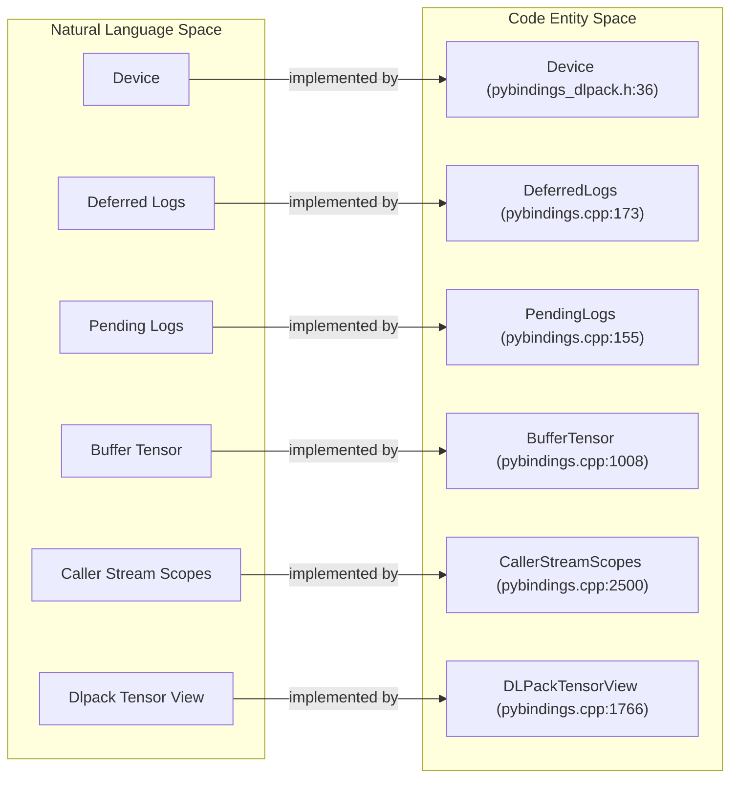
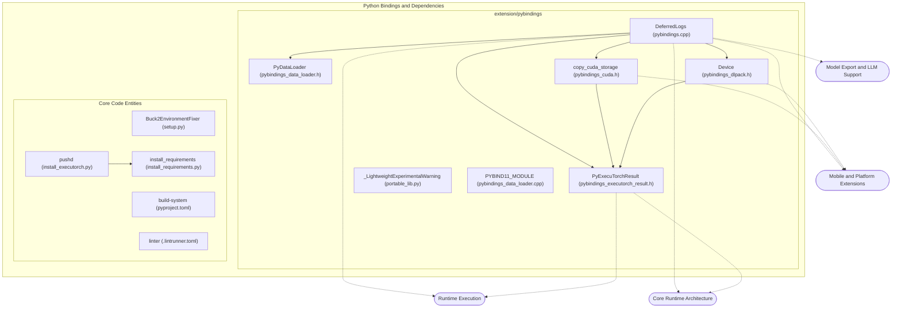
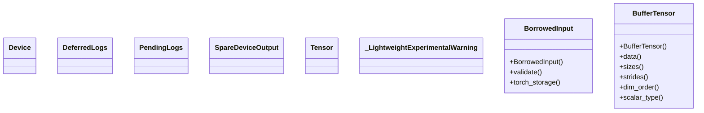
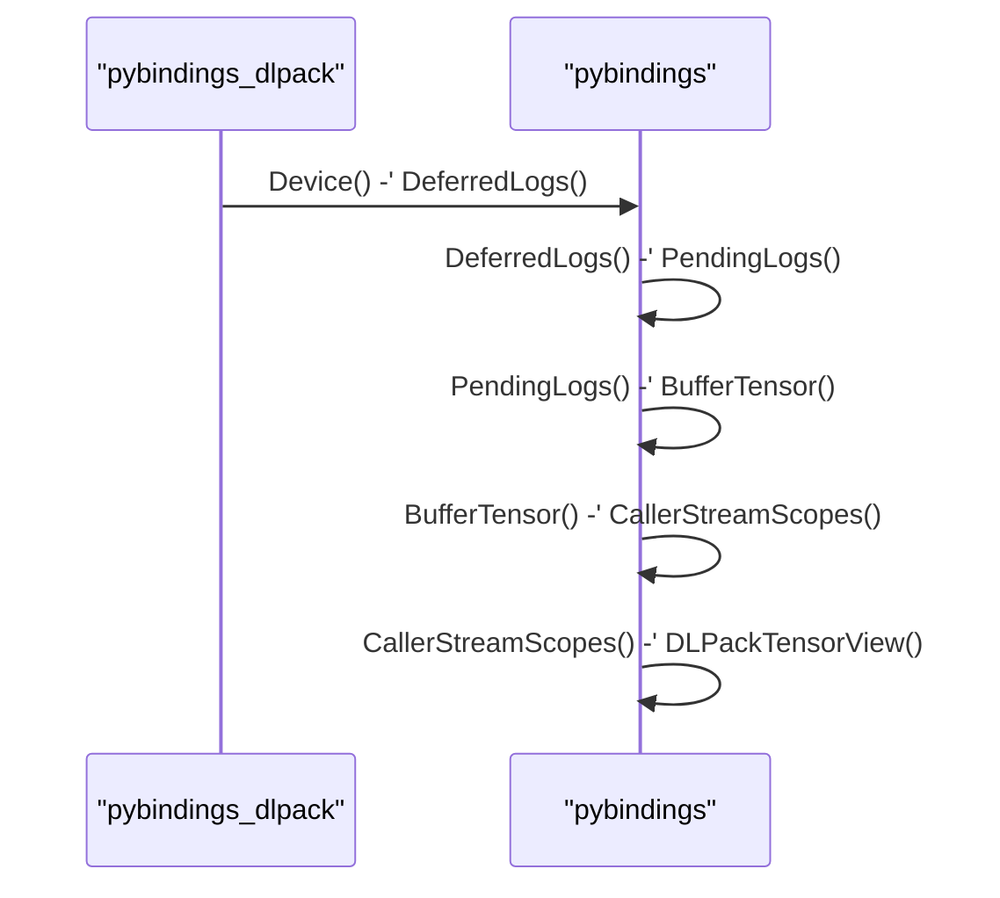

# Python Bindings and Dependencies

↑ [[2-build-system-and-infrastructure|Build System and Infrastructure]]

> Architectural specification and implementation reference for Python Bindings and Dependencies (15 relevant source files). Primary code entities: `BorrowedInput`, `torch_storage`, `validate`, `PyExecuTorchResult`, `DLPackHolder`.

<details>
<summary>Relevant source files</summary>

The following files were used as context for generating this wiki page:

- [extension/pybindings/pybindings.cpp](extension/pybindings/pybindings.cpp)
- [extension/pybindings/pybindings_executorch_result.h](extension/pybindings/pybindings_executorch_result.h)
- [extension/pybindings/pybindings_data_loader.h](extension/pybindings/pybindings_data_loader.h)
- [extension/pybindings/pybindings_dlpack.h](extension/pybindings/pybindings_dlpack.h)
- [extension/pybindings/portable_lib.py](extension/pybindings/portable_lib.py)
- [extension/pybindings/pybindings_cuda.h](extension/pybindings/pybindings_cuda.h)
- [setup.py](setup.py)
- [pyproject.toml](pyproject.toml)
- [install_requirements.py](install_requirements.py)
- [.lintrunner.toml](.lintrunner.toml)
- [extension/pybindings/pybindings_data_loader.cpp](extension/pybindings/pybindings_data_loader.cpp)
- [install_executorch.py](install_executorch.py)
- [extension/pybindings/README.md](extension/pybindings/README.md)
- [docs/source/runtime-python-api-reference.rst](docs/source/runtime-python-api-reference.rst)
- [extension/pybindings/BUCK](extension/pybindings/BUCK)

</details>

## Purpose and Scope

Architectural specification and implementation reference for Python Bindings and Dependencies (15 relevant source files). Primary code entities: `BorrowedInput`, `torch_storage`, `validate`, `PyExecuTorchResult`, `DLPackHolder`.

Primary code entities analyzed on this page include `Device` ([extension/pybindings/pybindings_dlpack.h:36-39]()), `DeferredLogs` ([extension/pybindings/pybindings.cpp:173-189]()), `PendingLogs` ([extension/pybindings/pybindings.cpp:155-160]()), `BufferTensor` ([extension/pybindings/pybindings.cpp:1008-1338]()), `CallerStreamScopes` ([extension/pybindings/pybindings.cpp:2500-2530]()).

For the parent architectural layer, see [[2-build-system-and-infrastructure|Build System and Infrastructure]]. Related sibling subsystems: [[2.1-cmake-configuration-and-targets|CMake Configuration and Targets]], [[2.2-kernel-libraries-and-selective-build|Kernel Libraries and Selective Build]], [[2.3-schema-generation-and-flatbuffers|Schema Generation and FlatBuffers]], [[2.5-buck2-and-shim-build-layer|Buck2 and Shim Build Layer]].

Sources: [extension/pybindings/pybindings_dlpack.h:36-39](), [extension/pybindings/pybindings.cpp:173-189](), [extension/pybindings/pybindings.cpp:155-160](), [extension/pybindings/pybindings.cpp:1008-1338]()

---

## 1. High-Level Architecture and Data Flow

### Natural Language Space to Code Entity Space Mapping

The following diagram maps domain concepts in this subsystem to their concrete code entities:



### Subsystem Component & Dependency Flow



Cross-subsystem call and import edges connect **Python Bindings and Dependencies** with [[8.1-core-runtime-architecture|Core Runtime Architecture]] (coupling `176.0`), [[8-runtime-execution|Runtime Execution]] (coupling `104.0`), [[6-model-export-and-llm-support|Model Export and LLM Support]] (coupling `60.0`), [[9-mobile-and-platform-extensions|Mobile and Platform Extensions]] (coupling `55.0`), [[9.3-high-level-module-and-on-device-training|High-Level Module API, Tensor & On-Device Training]] (coupling `49.0`).

| Module Directory | Files | Primary Code Entities | Source Citations |
|---|---|---|---|
| `extension/pybindings` | 9 | `Device`, `DeferredLogs`, `PendingLogs`, `BufferTensor` | [extension/pybindings/pybindings_dlpack.h:36-39]() [extension/pybindings/pybindings.cpp:173-189]() |
| `.` | 5 | `Buck2EnvironmentFixer`, `BuiltExtension`, `BuiltFile`, `CustomBuildPy` | [setup.py:2543-2565]() [setup.py:1634-1715]() |

Sources: [extension/pybindings/pybindings_dlpack.h:36-39](), [extension/pybindings/pybindings.cpp:173-189](), [extension/pybindings/pybindings.cpp:155-160](), [extension/pybindings/pybindings.cpp:1008-1338](), [extension/pybindings/pybindings.cpp:2500-2530]()

---

## 2. Core Data Structures and Implementation Details

### Class and Entity Relationship Diagram



### `Device` (Class)

- **Source Location**: [extension/pybindings/pybindings_dlpack.h:36-39]()
- **Declaration**: `Class Device`
- **Graph Centrality**: fan-in `11` callers, fan-out `0` callees

```cpp
// extension/pybindings/pybindings_dlpack.h:36-39
struct Device {
  DeviceType device_type;
  int32_t device_id;
};
```

### `DeferredLogs` (Class)

- **Source Location**: [extension/pybindings/pybindings.cpp:173-189]()
- **Declaration**: `Class DeferredLogs`
- **Graph Centrality**: fan-in `2` callers, fan-out `0` callees
- **Responsibility**: // Lines that Python's stderr must show but that were logged where Python cannot // be called: outside any binding call, or on a daemon thread. Python's main // thread writes the lines it logged itself at its next chance. A thread of // their own writes the others, since the main thread may be in the middle of a // sys

```cpp
// extension/pybindings/pybindings.cpp:173-188
struct DeferredLogs final {
  std::mutex mutex;
  std::condition_variable writer_changed;
  PendingLogs logs;
  PendingLogs main_thread_logs;
  bool main_thread_write_scheduled = false;
  // Numbers the writer's batches, so that a thread can tell whether the lines
  // it handed over are written.
  uint64_t batch = 1;
  uint64_t batches_written = 0;
  bool writer_running = false;
  // Exit waits while the writer takes the GIL, since a Python that has
  // finished exiting crashes on a new thread state and may have freed the
  // writer's saved one.
  bool writer_entering = false;
  bool exiting = false;
```

### `PendingLogs` (Class)

- **Source Location**: [extension/pybindings/pybindings.cpp:155-160]()
- **Declaration**: `Class PendingLogs`
- **Graph Centrality**: fan-in `1` callers, fan-out `0` callees
- **Responsibility**: // The lines kept for the current binding call; emit_log_message says when a // line is kept. Past the capacity the oldest are counted rather than kept, // since the newest are the closest to a failure.

```cpp
// extension/pybindings/pybindings.cpp:155-160
struct PendingLogs final {
  bool direct = false;
  bool daemon = false;
  std::string lines;
  size_t dropped = 0;
};
```

### `BufferTensor` (Class)

- **Source Location**: [extension/pybindings/pybindings.cpp:1008-1338]()
- **Declaration**: `Class BufferTensor`
- **Graph Centrality**: fan-in `0` callers, fan-out `0` callees
- **Responsibility**: /** Holds a Python buffer export and presents its metadata to ExecuTorch. */

### `CallerStreamScopes` (Class)

- **Source Location**: [extension/pybindings/pybindings.cpp:2500-2530]()
- **Declaration**: `Class CallerStreamScopes`
- **Graph Centrality**: fan-in `0` callers, fan-out `0` callees
- **Responsibility**: // A thread's active stream scopes, innermost last. They live here rather than // in the scope objects, so a scope that ends out of order, or is dropped on // another thread, never restores the wrong selection.

### `scalar_type` (Method)

- **Source Location**: [extension/pybindings/pybindings.cpp:1086-1088]()
- **Declaration**: `()`
- **Graph Centrality**: fan-in `269` callers, fan-out `0` callees

Sources: [extension/pybindings/pybindings_dlpack.h:36-39](), [extension/pybindings/pybindings.cpp:173-189](), [extension/pybindings/pybindings.cpp:155-160](), [extension/pybindings/pybindings.cpp:1008-1338](), [extension/pybindings/pybindings.cpp:2500-2530]()

---

## 3. Execution and Call Flow

The sequence diagram below traces the runtime/compile-time call chain across components in this module:



Sources: [extension/pybindings/pybindings_dlpack.h:36-39](), [extension/pybindings/pybindings.cpp:173-189](), [extension/pybindings/pybindings.cpp:155-160](), [extension/pybindings/pybindings.cpp:1008-1338](), [extension/pybindings/pybindings.cpp:2500-2530]()

---

## 4. Key API and Symbol Reference

| Code Entity | Kind | Location | Fan-In / Out | Role & Signature |
|---|---|---|---|---|
| `Device` | Class | [extension/pybindings/pybindings_dlpack.h:36-39]() | `11` / `0` | — |
| `DeferredLogs` | Class | [extension/pybindings/pybindings.cpp:173-189]() | `2` / `0` | // Lines that Python's stderr must show but that were logged where Python cannot |
| `PendingLogs` | Class | [extension/pybindings/pybindings.cpp:155-160]() | `1` / `0` | // The lines kept for the current binding call; emit_log_message says when a |
| `BufferTensor` | Class | [extension/pybindings/pybindings.cpp:1008-1338]() | `0` / `0` | /** Holds a Python buffer export and presents its metadata to ExecuTorch. */ |
| `CallerStreamScopes` | Class | [extension/pybindings/pybindings.cpp:2500-2530]() | `0` / `0` | // A thread's active stream scopes, innermost last. They live here rather than |
| `DLPackTensorView` | Class | [extension/pybindings/pybindings.cpp:1766-2139]() | `0` / `0` | /** A borrowed tensor view obtained through the producer's DLPack protocol, |
| `ObjectLock` | Class | [extension/pybindings/pybindings.cpp:883-893]() | `0` / `0` | // Python tensor adapters can release the GIL while holding native state. |
| `ProgramMemory` | Class | [extension/pybindings/pybindings.cpp:4171-4321]() | `0` / `0` | /// A wrapper/util class for executorch memory allocations/manager. |
| `ProgramState` | Class | [extension/pybindings/pybindings.cpp:3072-3107]() | `0` / `0` | // Program points to DataLoader so bundle them up into a struct to ensure that |
| `PyCallerStreamScope` | Class | [extension/pybindings/pybindings.cpp:2535-2673]() | `0` / `0` | // Selects a CUDA stream for the delegates of a Python with-block. Scopes are |
| `PyCudaStream` | Class | [extension/pybindings/pybindings.cpp:2418-2495]() | `0` / `0` | // A stream made by executorch.runtime.cuda.Stream. Selection and destruction |
| `PyMethodMeta` | Class | [extension/pybindings/pybindings.cpp:3188-3282]() | `0` / `0` | /// Expose a subset of MethodMeta information to python. |
| `PyTensorInfo` | Class | [extension/pybindings/pybindings.cpp:3110-3185]() | `0` / `0` | /// Expose a subset of TensorInfo information to python. |
| `RuntimeErrorScope` | Class | [extension/pybindings/pybindings.cpp:707-729]() | `0` / `0` | // Starts every binding call with no runtime errors recorded, and gives an |
| `TorchTensorView` | Class | [extension/pybindings/pybindings.cpp:1501-1667]() | `0` / `0` | /** A torch.Tensor input read through its public Python API, copied only to |
| `PyExecuTorchResult` | Class | [extension/pybindings/pybindings_executorch_result.h:153-703]() | `0` / `0` | /** Tensor result returned by portable Python bindings. */ |
| `PyExecuTorchResultFlatBuffer` | Class | [extension/pybindings/pybindings_executorch_result.h:706-718]() | `0` / `0` | /** Contiguous buffer facade used to construct a strided torch.Tensor result. */ |
| `PyDataLoader` | Class | [extension/pybindings/pybindings_data_loader.h:53-73]() | `0` / `0` | /// Pybind11 wrapper for DataLoader. Use shared_ptr holder type in pybind11. |
| `SharedPtrDataLoader` | Class | [extension/pybindings/pybindings_data_loader.h:24-50]() | `0` / `0` | /// DataLoader wrapper holding a shared_ptr, allowing sharing between Python |
| `ManagedTensorVersioned` | Class | [extension/pybindings/pybindings_dlpack.h:69-75]() | `0` / `0` | // DLPack 1.0 capsules carry this struct, named "dltensor_versioned". |
| `Buck2EnvironmentFixer` | Class | [setup.py:2543-2565]() | `0` / `0` | Removes HOME from the environment when running as root. |
| `BuiltExtension` | Class | [setup.py:1634-1715]() | `0` / `0` | An extension that installs a python extension that was built by cmake. |

Sources: [extension/pybindings/pybindings_dlpack.h:36-39](), [extension/pybindings/pybindings.cpp:173-189](), [extension/pybindings/pybindings.cpp:155-160](), [extension/pybindings/pybindings.cpp:1008-1338](), [extension/pybindings/pybindings.cpp:2500-2530](), [extension/pybindings/pybindings.cpp:1766-2139]()

---

## 5. Official Documentation and Design Context

The following linked documentation sections from `llm-wiki` (`raw/`) provide additional architectural context, tutorials, and design invariants for this subsystem:

- **Build System and Infrastructure** ([wiki/2-build-system-and-infrastructure.md](), score `124.2421`) (sections: `Build System and Infrastructure`, `Purpose and Scope`, `System Mapping: Natural Language Space to Code Entity Space`, `1. CMake Configuration and Targets`): # Build System and Infrastructure > Architectural specification and implementation reference for Build System and Infrastructure (38 relevant source files). Primary code entities: `CMakeCache`, `__post_init__`, `_is_truthy`, `get`, `_executorch_add_windows_anchor`. <details> <summary>Relevant source files</summary> The following files were used as context for generating this wiki page: - [tools/cmake/cmake_cache.py](
- **ExecuTorch DeepWiki** ([wiki/index.md](), score `69.0071`) (sections: `ExecuTorch DeepWiki`, `Pages`): # ExecuTorch DeepWiki Generated from `home-jason-Project-deepwiki-executorch` at commit `b3b565b5b62f` (2026-11-15T15:02:11+00:00). ## Pages - [[1-overview|Overview]] — Architectural specification and implementation reference for Overview (10 relevant source files). Primary code entities: `Module`, `MethodHolder`, `PlannedMemory`, `EdgeProgramManager`, `__init__`. - [[1.1-getting-started|Getting Started]] — Architect
- **Embedded (Zephyr, ESP32, Pico2) and WebAssembly/WebGPU Targets** ([wiki/9.4-embedded-and-web-targets.md](), score `68.1551`) (sections: `Embedded (Zephyr, ESP32, Pico2) and WebAssembly/WebGPU Targets`, `Purpose and Scope`, `1. High-Level Architecture and Data Flow`, `Natural Language Space to Code Entity Space Mapping`): # Embedded (Zephyr, ESP32, Pico2) and WebAssembly/WebGPU Targets ↑ [[9-mobile-and-platform-extensions|Mobile and Platform Extensions]] > Architectural specification and implementation reference for Embedded (Zephyr, ESP32, Pico2) and WebAssembly/WebGPU Targets (40 relevant source files). Primary code entities: `BindingSpec`, `ComputePipelineBundle`, `operator=`, `acquire_scratch`, `add_compute_dispatch`. <details> <s
- **Mobile and Platform Extensions** ([wiki/9-mobile-and-platform-extensions.md](), score `65.6179`) (sections: `Mobile and Platform Extensions`, `Purpose and Scope`, `System Mapping: Natural Language Space to Code Entity Space`, `1. Android Extension (Java/Kotlin & JNI)`): # Mobile and Platform Extensions > Architectural specification and implementation reference for Mobile and Platform Extensions (40 relevant source files). Primary code entities: `BindingSpec`, `ComputePipelineBundle`, `operator=`, `Storage`, `~Storage`. <details> <summary>Relevant source files</summary> The following files were used as context for generating this wiki page: - [backends/webgpu/runtime/WebGPUUtils.h](b

Sources: [wiki/2-build-system-and-infrastructure.md](), [wiki/index.md](), [wiki/9.4-embedded-and-web-targets.md](), [wiki/9-mobile-and-platform-extensions.md]()

## Related pages

- [[2-build-system-and-infrastructure|Build System and Infrastructure]]
- [[1.1-getting-started|Getting Started]]
- [[1.2-export-api-and-recipe-system|Export API and Recipe System]]
- [[2.2-kernel-libraries-and-selective-build|Kernel Libraries and Selective Build]]
- [[2.3-schema-generation-and-flatbuffers|Schema Generation and FlatBuffers]]
- [[3.4-program-emission-and-serialization|Program Emission and Serialization]]
- [[3.5-verification-and-dialect-system|Verification and Dialect System]]
- [[4-quantization-systems|Quantization Systems]]

## Related documents

- `wiki/2-build-system-and-infrastructure.md` — Build System and Infrastructure (score 124.2421, via bm25)
- `wiki/index.md` — ExecuTorch DeepWiki (score 69.0071, via bm25)
- `wiki/9.4-embedded-and-web-targets.md` — Embedded (Zephyr, ESP32, Pico2) and WebAssembly/WebGPU Targets (score 68.1551, via bm25)
- `wiki/9-mobile-and-platform-extensions.md` — Mobile and Platform Extensions (score 65.6179, via bm25)
- `wiki/9.3-high-level-module-and-on-device-training.md` — High-Level Module API, Tensor & On-Device Training (score 62.3724, via bm25)

## Sources

- [`extension/pybindings/pybindings.cpp`](https://github.com/pytorch/executorch/blob/main/extension/pybindings/pybindings.cpp)
- [`extension/pybindings/pybindings_executorch_result.h`](https://github.com/pytorch/executorch/blob/main/extension/pybindings/pybindings_executorch_result.h)
- [`extension/pybindings/pybindings_data_loader.h`](https://github.com/pytorch/executorch/blob/main/extension/pybindings/pybindings_data_loader.h)
- [`extension/pybindings/pybindings_dlpack.h`](https://github.com/pytorch/executorch/blob/main/extension/pybindings/pybindings_dlpack.h)
- [`extension/pybindings/portable_lib.py`](https://github.com/pytorch/executorch/blob/main/extension/pybindings/portable_lib.py)
- [`extension/pybindings/pybindings_cuda.h`](https://github.com/pytorch/executorch/blob/main/extension/pybindings/pybindings_cuda.h)
- [`setup.py`](https://github.com/pytorch/executorch/blob/main/setup.py)
- [`pyproject.toml`](https://github.com/pytorch/executorch/blob/main/pyproject.toml)
- [`install_requirements.py`](https://github.com/pytorch/executorch/blob/main/install_requirements.py)
- [`.lintrunner.toml`](https://github.com/pytorch/executorch/blob/main/.lintrunner.toml)
- [`extension/pybindings/pybindings_data_loader.cpp`](https://github.com/pytorch/executorch/blob/main/extension/pybindings/pybindings_data_loader.cpp)
- [`install_executorch.py`](https://github.com/pytorch/executorch/blob/main/install_executorch.py)
- [`extension/pybindings/README.md`](https://github.com/pytorch/executorch/blob/main/extension/pybindings/README.md)
- [`docs/source/runtime-python-api-reference.rst`](https://github.com/pytorch/executorch/blob/main/docs/source/runtime-python-api-reference.rst)
- [`extension/pybindings/BUCK`](https://github.com/pytorch/executorch/blob/main/extension/pybindings/BUCK)


## Dynamic Knowledge Links (Code Graph ↔ LLM-Wiki / RAG)

### Linked Architecture & Design Documents

| Document | Match Channel | Score | Shared Code Symbols |
|---|---|---|---|
| [[2-build-system-and-infrastructure|Build System and Infrastructure]] | `bm25+entity(1)` | `125.742` | `Tensor` |
| [[2.2-kernel-libraries-and-selective-build|Kernel Libraries and Selective Build]] | `wikilink:2.4-python-bindings-and-dependencies+entity(2)` | `83.929` | `PyExecuTorchResult`, `Tensor` |
| [[2.3-schema-generation-and-flatbuffers|Schema Generation and FlatBuffers]] | `wikilink:2.4-python-bindings-and-dependencies+entity(2)` | `83.929` | `PyExecuTorchResult`, `Tensor` |
| [[2.1-cmake-configuration-and-targets|CMake Configuration and Targets]] | `wikilink:2.4-python-bindings-and-dependencies+entity(1)` | `82.429` | `PyExecuTorchResult` |
| [[9.4-embedded-and-web-targets|Embedded (Zephyr, ESP32, Pico2) and WebAssembly/WebGPU Targets]] | `bm25+entity(1)` | `69.655` | `Tensor` |
| [[index|ExecuTorch DeepWiki]] | `bm25` | `69.007` | *(lexical/graph match)* |

### High-Centrality Bridge Symbols (CBM Graph)

| Symbol | Kind | Source Location | Fan-In / Fan-Out |
|---|---|---|---|
| `Device` | Class | [extension/pybindings/pybindings_dlpack.h:36-39]() | in: `11` / out: `0` |
| `DeferredLogs` | Class | [extension/pybindings/pybindings.cpp:173-189]() | in: `2` / out: `0` |
| `PendingLogs` | Class | [extension/pybindings/pybindings.cpp:155-160]() | in: `1` / out: `0` |
| `BufferTensor` | Class | [extension/pybindings/pybindings.cpp:1008-1338]() | in: `0` / out: `0` |
| `CallerStreamScopes` | Class | [extension/pybindings/pybindings.cpp:2500-2530]() | in: `0` / out: `0` |
| `DLPackTensorView` | Class | [extension/pybindings/pybindings.cpp:1766-2139]() | in: `0` / out: `0` |

Sources: [extension/pybindings/pybindings_dlpack.h:36-39](), [extension/pybindings/pybindings.cpp:173-189](), [extension/pybindings/pybindings.cpp:155-160](), [extension/pybindings/pybindings.cpp:1008-1338]()

### Cross-Subsystem Coupling

- [[8.1-core-runtime-architecture|Core Runtime Architecture]] — call/import coupling weight `176.0`
- [[8-runtime-execution|Runtime Execution]] — call/import coupling weight `104.0`
- [[6-model-export-and-llm-support|Model Export and LLM Support]] — call/import coupling weight `60.0`
- [[9-mobile-and-platform-extensions|Mobile and Platform Extensions]] — call/import coupling weight `55.0`
- [[9.3-high-level-module-and-on-device-training|High-Level Module API, Tensor & On-Device Training]] — call/import coupling weight `49.0`
- [[6.3-custom-operators-and-extensions|Custom Operators and Extensions]] — call/import coupling weight `33.0`
