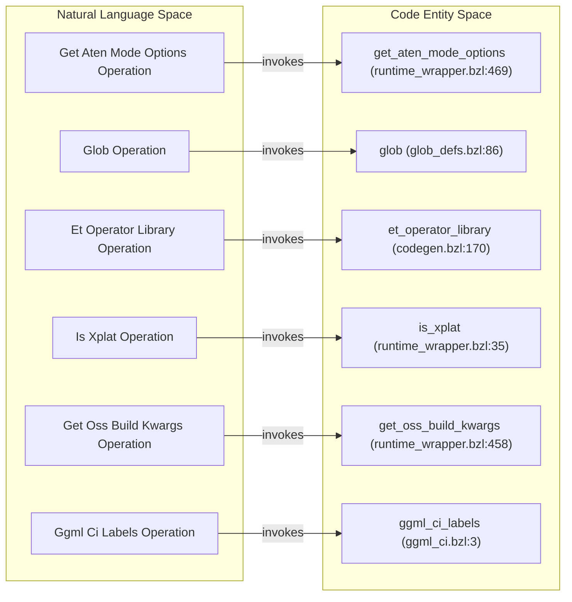
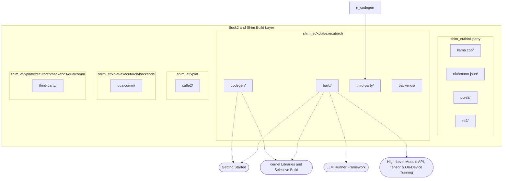
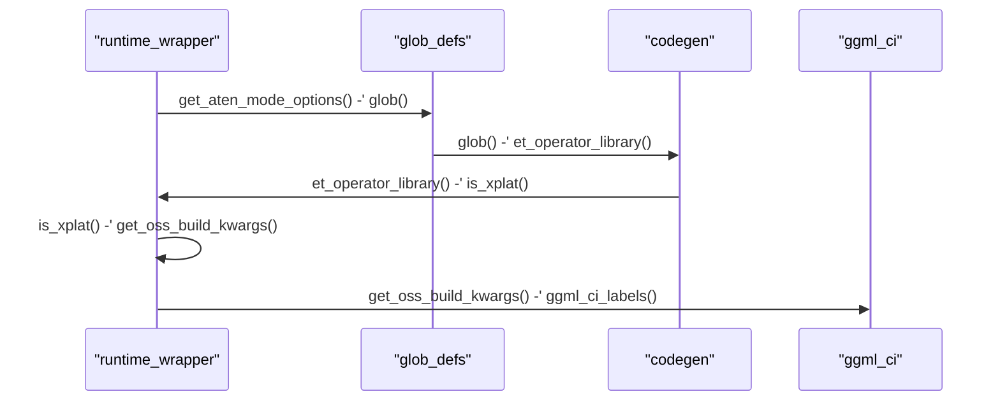

# Buck2 and Shim Build Layer

↑ [[2-build-system-and-infrastructure|Build System and Infrastructure]]

> Architectural specification and implementation reference for Buck2 and Shim Build Layer (30 relevant source files). Primary code entities: `ggml_ci_labels`, `define_common_targets`, `_extract_prim_ops_from_lists`, `_get_headers`, `_get_prim_ops_registry_target`.

<details>
<summary>Relevant source files</summary>

The following files were used as context for generating this wiki page:

- [shim_et/third-party/llama.cpp/ggml_ci.bzl](shim_et/third-party/llama.cpp/ggml_ci.bzl)
- [shim_et/third-party/nlohmann-json/targets.bzl](shim_et/third-party/nlohmann-json/targets.bzl)
- [shim_et/third-party/pcre2/targets.bzl](shim_et/third-party/pcre2/targets.bzl)
- [shim_et/third-party/re2/targets.bzl](shim_et/third-party/re2/targets.bzl)
- [shim_et/xplat/executorch/codegen/codegen.bzl](shim_et/xplat/executorch/codegen/codegen.bzl)
- [shim_et/xplat/caffe2/pt_defs.bzl](shim_et/xplat/caffe2/pt_defs.bzl)
- [shim_et/xplat/executorch/build/runtime_wrapper.bzl](shim_et/xplat/executorch/build/runtime_wrapper.bzl)
- [shim_et/xplat/executorch/build/env_interface.bzl](shim_et/xplat/executorch/build/env_interface.bzl)
- [shim_et/xplat/executorch/third-party/glob_defs.bzl](shim_et/xplat/executorch/third-party/glob_defs.bzl)
- [shim_et/xplat/executorch/backends/backends.bzl](shim_et/xplat/executorch/backends/backends.bzl)
- [shim_et/xplat/executorch/build/type_defs.bzl](shim_et/xplat/executorch/build/type_defs.bzl)
- [shim_et/xplat/executorch/build/selects.bzl](shim_et/xplat/executorch/build/selects.bzl)
- [shim_et/xplat/executorch/backends/qualcomm/qnn_version.bzl](shim_et/xplat/executorch/backends/qualcomm/qnn_version.bzl)
- [shim_et/xplat/executorch/backends/qualcomm/third-party/third_party_libs.bzl](shim_et/xplat/executorch/backends/qualcomm/third-party/third_party_libs.bzl)
- [shim_et/xplat/executorch/backends/xnnpack/third-party/third_party_libs.bzl](shim_et/xplat/executorch/backends/xnnpack/third-party/third_party_libs.bzl)
- [shim_et/xplat/executorch/kernels/optimized/lib_defs.bzl](shim_et/xplat/executorch/kernels/optimized/lib_defs.bzl)
- [shim_et/xplat/executorch/extension/pybindings/pybindings.bzl](shim_et/xplat/executorch/extension/pybindings/pybindings.bzl)
- [shim_et/xplat/executorch/runtime/core/targets.bzl](shim_et/xplat/executorch/runtime/core/targets.bzl)
- [shim_et/xplat/executorch/kernels/prim_ops/selective_build.bzl](shim_et/xplat/executorch/kernels/prim_ops/selective_build.bzl)
- [shim_et/xplat/executorch/kernels/optimized/op_registration_util.bzl](shim_et/xplat/executorch/kernels/optimized/op_registration_util.bzl)
- [shim_et/xplat/executorch/kernels/portable/op_registration_util.bzl](shim_et/xplat/executorch/kernels/portable/op_registration_util.bzl)
- [codegen/targets.bzl](codegen/targets.bzl)
- [shim_et/README.md](shim_et/README.md)
- [runtime/core/portable_type/c10/README.md](runtime/core/portable_type/c10/README.md)
- [shim_et/BUCK](shim_et/BUCK)
- [shim_et/third-party/nlohmann-json/BUCK](shim_et/third-party/nlohmann-json/BUCK)
- [shim_et/third-party/pcre2/BUCK](shim_et/third-party/pcre2/BUCK)
- [shim_et/third-party/re2/BUCK](shim_et/third-party/re2/BUCK)
- [shim_et/xplat/caffe2/android/BUCK](shim_et/xplat/caffe2/android/BUCK)
- [runtime/core/portable_type/c10/c10/BUCK](runtime/core/portable_type/c10/c10/BUCK)

</details>

## Purpose and Scope

Architectural specification and implementation reference for Buck2 and Shim Build Layer (30 relevant source files). Primary code entities: `ggml_ci_labels`, `define_common_targets`, `_extract_prim_ops_from_lists`, `_get_headers`, `_get_prim_ops_registry_target`.

Primary code entities analyzed on this page include `get_aten_mode_options` ([shim_et/xplat/executorch/build/runtime_wrapper.bzl:469-470]()), `glob` ([shim_et/xplat/executorch/third-party/glob_defs.bzl:86-92]()), `et_operator_library` ([shim_et/xplat/executorch/codegen/codegen.bzl:170-258]()), `is_xplat` ([shim_et/xplat/executorch/build/runtime_wrapper.bzl:35-36]()), `get_oss_build_kwargs` ([shim_et/xplat/executorch/build/runtime_wrapper.bzl:458-467]()).

For the parent architectural layer, see [[2-build-system-and-infrastructure|Build System and Infrastructure]]. Related sibling subsystems: [[2.1-cmake-configuration-and-targets|CMake Configuration and Targets]], [[2.2-kernel-libraries-and-selective-build|Kernel Libraries and Selective Build]], [[2.3-schema-generation-and-flatbuffers|Schema Generation and FlatBuffers]], [[2.4-python-bindings-and-dependencies|Python Bindings and Dependencies]].

Sources: [shim_et/xplat/executorch/build/runtime_wrapper.bzl:469-470](), [shim_et/xplat/executorch/third-party/glob_defs.bzl:86-92](), [shim_et/xplat/executorch/codegen/codegen.bzl:170-258](), [shim_et/xplat/executorch/build/runtime_wrapper.bzl:35-36]()

---

## 1. High-Level Architecture and Data Flow

### Natural Language Space to Code Entity Space Mapping

The following diagram maps domain concepts in this subsystem to their concrete code entities:



### Subsystem Component & Dependency Flow



Cross-subsystem call and import edges connect **Buck2 and Shim Build Layer** with [[2.2-kernel-libraries-and-selective-build|Kernel Libraries and Selective Build]] (coupling `6.0`), [[1.1-getting-started|Getting Started]] (coupling `5.0`), [[6.2-llm-runner-framework|LLM Runner Framework]] (coupling `3.0`), [[9.3-high-level-module-and-on-device-training|High-Level Module API, Tensor & On-Device Training]] (coupling `2.0`), [[7.3-performance-benchmarking-and-profiling|Performance Benchmarking and Profiling]] (coupling `1.0`).

| Module Directory | Files | Primary Code Entities | Source Citations |
|---|---|---|---|
| `shim_et/xplat/executorch/build` | 4 | `get_aten_mode_options`, `is_xplat`, `get_oss_build_kwargs`, `_patch_executorch_genrule_cmd` | [shim_et/xplat/executorch/build/runtime_wrapper.bzl:469-470]() [shim_et/xplat/executorch/build/runtime_wrapper.bzl:35-36]() |
| `shim_et` | 2 | *(build / config)* | [shim_et/README.md]() |
| `shim_et/third-party/nlohmann-json` | 2 | `define_common_targets` | [shim_et/third-party/nlohmann-json/targets.bzl:3-10]() |
| `shim_et/third-party/pcre2` | 2 | `define_common_targets` | [shim_et/third-party/pcre2/targets.bzl:3-9]() |
| `shim_et/third-party/re2` | 2 | `define_common_targets` | [shim_et/third-party/re2/targets.bzl:3-9]() |
| `shim_et/xplat/executorch/kernels/optimized` | 2 | `define_libs`, `get_vec_preprocessor_flags`, `get_vec_cxx_preprocessor_flags`, `get_vec_deps` | [shim_et/xplat/executorch/kernels/optimized/lib_defs.bzl:77-154]() [shim_et/xplat/executorch/kernels/optimized/lib_defs.bzl:19-35]() |
| `codegen` | 1 | `define_common_targets` | [codegen/targets.bzl:3-82]() |
| `runtime/core/portable_type/c10` | 1 | *(build / config)* | [runtime/core/portable_type/c10/README.md]() |

Sources: [shim_et/xplat/executorch/build/runtime_wrapper.bzl:469-470](), [shim_et/xplat/executorch/third-party/glob_defs.bzl:86-92](), [shim_et/xplat/executorch/codegen/codegen.bzl:170-258](), [shim_et/xplat/executorch/build/runtime_wrapper.bzl:35-36](), [shim_et/xplat/executorch/build/runtime_wrapper.bzl:458-467]()

---

## 2. Core Data Structures and Implementation Details

### `get_aten_mode_options` (Function)

- **Source Location**: [shim_et/xplat/executorch/build/runtime_wrapper.bzl:469-470]()
- **Declaration**: `()`
- **Graph Centrality**: fan-in `24` callers, fan-out `0` callees

### `glob` (Function)

- **Source Location**: [shim_et/xplat/executorch/third-party/glob_defs.bzl:86-92]()
- **Declaration**: `(include, exclude = (), **kwargs)`
- **Graph Centrality**: fan-in `23` callers, fan-out `0` callees

```python
// shim_et/xplat/executorch/third-party/glob_defs.bzl:86-92
def glob(include, exclude = (), **kwargs):
    buildfile = native.read_config("buildfile", "name", "BUCK")
    subpkgs = [
        target[:-len(buildfile)] + "**/*"
        for target in native.glob(["*/**/" + buildfile])
    ]
    return native.glob(include, exclude = list(exclude) + subpkgs, **kwargs)
```

### `et_operator_library` (Function)

- **Source Location**: [shim_et/xplat/executorch/codegen/codegen.bzl:170-258]()
- **Declaration**: `( name, ops = [], ops_dict = {}, model = None, include_all_operators = False, ops_schema_yaml_target = None, server_generated_yaml_target = `
- **Graph Centrality**: fan-in `5` callers, fan-out `0` callees
- **Responsibility**: # Hide the dependency to caffe2 internally.

```python
// shim_et/xplat/executorch/codegen/codegen.bzl:170-185
def et_operator_library(
        name,
        ops = [],
        ops_dict = {},
        model = None,
        include_all_operators = False,
        ops_schema_yaml_target = None,
        server_generated_yaml_target = None,
        **kwargs):
    # Check if we should extract prim ops from the operator lists
    # Note that selective build for prim ops doesnt support model or ops_schema_yaml_target or server_generated_yaml_target
    # TODO: Add support for selective build for prim ops with model or ops_schema_yaml_target or server_generated_yaml_target
    should_extract_prim_ops = (ops or ops_dict) and not (model or ops_schema_yaml_target or server_generated_yaml_target or include_all_operators)

    if should_extract_prim_ops:
        # Extract prim ops from ops and ops_dict
```

### `is_xplat` (Function)

- **Source Location**: [shim_et/xplat/executorch/build/runtime_wrapper.bzl:35-36]()
- **Declaration**: `()`
- **Graph Centrality**: fan-in `10` callers, fan-out `0` callees

Sources: [shim_et/xplat/executorch/build/runtime_wrapper.bzl:469-470](), [shim_et/xplat/executorch/third-party/glob_defs.bzl:86-92](), [shim_et/xplat/executorch/codegen/codegen.bzl:170-258](), [shim_et/xplat/executorch/build/runtime_wrapper.bzl:35-36]()

---

## 3. Execution and Call Flow

The sequence diagram below traces the runtime/compile-time call chain across components in this module:



Sources: [shim_et/xplat/executorch/build/runtime_wrapper.bzl:469-470](), [shim_et/xplat/executorch/third-party/glob_defs.bzl:86-92](), [shim_et/xplat/executorch/codegen/codegen.bzl:170-258](), [shim_et/xplat/executorch/build/runtime_wrapper.bzl:35-36](), [shim_et/xplat/executorch/build/runtime_wrapper.bzl:458-467]()

---

## 4. Key API and Symbol Reference

| Code Entity | Kind | Location | Fan-In / Out | Role & Signature |
|---|---|---|---|---|
| `get_aten_mode_options` | Function | [shim_et/xplat/executorch/build/runtime_wrapper.bzl:469-470]() | `24` / `0` | () |
| `glob` | Function | [shim_et/xplat/executorch/third-party/glob_defs.bzl:86-92]() | `23` / `0` | (include, exclude = (), **kwargs) |
| `et_operator_library` | Function | [shim_et/xplat/executorch/codegen/codegen.bzl:170-258]() | `5` / `0` | # Hide the dependency to caffe2 internally. |
| `is_xplat` | Function | [shim_et/xplat/executorch/build/runtime_wrapper.bzl:35-36]() | `10` / `0` | () |
| `get_oss_build_kwargs` | Function | [shim_et/xplat/executorch/build/runtime_wrapper.bzl:458-467]() | `9` / `0` | () |
| `ggml_ci_labels` | Function | [shim_et/third-party/llama.cpp/ggml_ci.bzl:3-4]() | `1` / `0` | # Open-source builds have no Meta CI configuration, so targets that link a ggml |
| `executorch_generated_lib` | Function | [shim_et/xplat/executorch/codegen/codegen.bzl:814-1138]() | `7` / `0` | ( name, functions_yaml_target = None, custom_ops_yaml_target = None, fallback_yaml_target = None, define_stati |
| `qnn_third_party_dep` | Function | [shim_et/xplat/executorch/backends/qualcomm/third-party/third_party_libs.bzl:30-33]() | `7` / `0` | (name) |
| `executorch_ops_check` | Function | [shim_et/xplat/executorch/codegen/codegen.bzl:1148-1166]() | `0` / `0` | # Util macro that takes in a binary or a shared library, find targets ending with `_et_oplist` in the transiti |
| `_patch_executorch_genrule_cmd` | Function | [shim_et/xplat/executorch/build/env_interface.bzl:175-206]() | `0` / `0` | # buildifier: disable=unused-variable |
| `glob_private_headers` | Function | [shim_et/xplat/executorch/third-party/glob_defs.bzl:79-84]() | `0` / `0` | # Using a flat list will trigger build errors on Android. |
| `third_party_dep` | Function | [shim_et/xplat/executorch/backends/xnnpack/third-party/third_party_libs.bzl:22-30]() | `6` / `0` | (name) |
| `define_libs` | Function | [shim_et/xplat/executorch/kernels/optimized/lib_defs.bzl:77-154]() | `0` / `0` | # TODO(ssjia): Enable -DCPU_CAPABILITY_AVX2 in fbcode, which requires sleef. |
| `get_vec_preprocessor_flags` | Function | [shim_et/xplat/executorch/kernels/optimized/lib_defs.bzl:19-35]() | `0` / `0` | # This oopy from kernels/optimized/lib_defs.bzl is not necessary. |
| `define_common_targets` | Function | [shim_et/third-party/nlohmann-json/targets.bzl:3-10]() | `0` / `0` | () |
| `exir_custom_ops_aot_lib` | Function | [shim_et/xplat/executorch/codegen/codegen.bzl:440-512]() | `1` / `0` | ( name, yaml_target = None, visibility = [], kernels = [], deps = [], compiler_flags = [], define_static_targe |
| `subdir_glob` | Function | [shim_et/xplat/executorch/third-party/glob_defs.bzl:8-42]() | `2` / `0` | (glob_specs, exclude = None, prefix = \"\") |
| `define_common_targets` | Function | [shim_et/third-party/pcre2/targets.bzl:3-9]() | `0` / `0` | () |
| `define_common_targets` | Function | [shim_et/third-party/re2/targets.bzl:3-9]() | `0` / `0` | () |
| `get_pt_ops_deps` | Function | [shim_et/xplat/caffe2/pt_defs.bzl:1-2]() | `0` / `0` | (name, train, deps) |
| `get_qnn_library_version` | Function | [shim_et/xplat/executorch/backends/qualcomm/qnn_version.bzl:1-2]() | `2` / `0` | () |
| `_extract_prim_ops_from_lists` | Function | [shim_et/xplat/executorch/codegen/codegen.bzl:117-167]() | `0` / `0` | (ops, ops_dict) |

Sources: [shim_et/xplat/executorch/build/runtime_wrapper.bzl:469-470](), [shim_et/xplat/executorch/third-party/glob_defs.bzl:86-92](), [shim_et/xplat/executorch/codegen/codegen.bzl:170-258](), [shim_et/xplat/executorch/build/runtime_wrapper.bzl:35-36](), [shim_et/xplat/executorch/build/runtime_wrapper.bzl:458-467](), [shim_et/third-party/llama.cpp/ggml_ci.bzl:3-4]()

---

## 5. Official Documentation and Design Context

The following linked documentation sections from `llm-wiki` (`raw/`) provide additional architectural context, tutorials, and design invariants for this subsystem:

- **Build System and Infrastructure** ([wiki/2-build-system-and-infrastructure.md](), score `169.7878`) (sections: `Build System and Infrastructure`, `Purpose and Scope`, `System Mapping: Natural Language Space to Code Entity Space`, `1. CMake Configuration and Targets`): # Build System and Infrastructure > Architectural specification and implementation reference for Build System and Infrastructure (38 relevant source files). Primary code entities: `CMakeCache`, `__post_init__`, `_is_truthy`, `get`, `_executorch_add_windows_anchor`. <details> <summary>Relevant source files</summary> The following files were used as context for generating this wiki page: - [tools/cmake/cmake_cache.py](
- **ExecuTorch DeepWiki** ([wiki/index.md](), score `136.4783`) (sections: `ExecuTorch DeepWiki`, `Pages`): # ExecuTorch DeepWiki Generated from `home-jason-Project-deepwiki-executorch` at commit `b3b565b5b62f` (2026-11-15T15:02:11+00:00). ## Pages - [[1-overview|Overview]] — Architectural specification and implementation reference for Overview (10 relevant source files). Primary code entities: `Module`, `MethodHolder`, `PlannedMemory`, `EdgeProgramManager`, `__init__`. - [[1.1-getting-started|Getting Started]] — Architect
- **CMake Configuration and Targets** ([wiki/2.1-cmake-configuration-and-targets.md](), score `115.5573`) (sections: `CMake Configuration and Targets`, `Purpose and Scope`, `1. High-Level Architecture and Data Flow`, `Natural Language Space to Code Entity Space Mapping`): # CMake Configuration and Targets ↑ [[2-build-system-and-infrastructure|Build System and Infrastructure]] > Architectural specification and implementation reference for CMake Configuration and Targets (17 relevant source files). Primary code entities: `CMakeCache`, `__post_init__`, `_is_truthy`, `get`, `_executorch_add_windows_anchor`. <details> <summary>Relevant source files</summary> The following files were used a
- **Kernel Libraries and Selective Build** ([wiki/2.2-kernel-libraries-and-selective-build.md](), score `114.9114`) (sections: `Kernel Libraries and Selective Build`, `Purpose and Scope`, `1. High-Level Architecture and Data Flow`, `Natural Language Space to Code Entity Space Mapping`): # Kernel Libraries and Selective Build ↑ [[2-build-system-and-infrastructure|Build System and Infrastructure]] > Architectural specification and implementation reference for Kernel Libraries and Selective Build (31 relevant source files). Primary code entities: `KernelType`, `ScalarType`, `_dump_yaml`, `_get_et_kernel_metadata_from_ops_yaml`, `IOMetaData`. <details> <summary>Relevant source files</summary> The follow

Sources: [wiki/2-build-system-and-infrastructure.md](), [wiki/index.md](), [wiki/2.1-cmake-configuration-and-targets.md](), [wiki/2.2-kernel-libraries-and-selective-build.md]()

## Related pages

- [[2-build-system-and-infrastructure|Build System and Infrastructure]]
- [[1.1-getting-started|Getting Started]]
- [[1.2-export-api-and-recipe-system|Export API and Recipe System]]
- [[2.2-kernel-libraries-and-selective-build|Kernel Libraries and Selective Build]]
- [[2.3-schema-generation-and-flatbuffers|Schema Generation and FlatBuffers]]
- [[3.4-program-emission-and-serialization|Program Emission and Serialization]]
- [[3.5-verification-and-dialect-system|Verification and Dialect System]]
- [[4-quantization-systems|Quantization Systems]]

## Related documents

- `wiki/2-build-system-and-infrastructure.md` — Build System and Infrastructure (score 169.7878, via bm25)
- `wiki/index.md` — ExecuTorch DeepWiki (score 136.4783, via bm25)
- `wiki/2.1-cmake-configuration-and-targets.md` — CMake Configuration and Targets (score 115.5573, via bm25)
- `wiki/2.2-kernel-libraries-and-selective-build.md` — Kernel Libraries and Selective Build (score 114.9114, via bm25)
- `wiki/1-overview.md` — Overview (score 104.0666, via bm25)

## Sources

- [`shim_et/third-party/llama.cpp/ggml_ci.bzl`](https://github.com/pytorch/executorch/blob/main/shim_et/third-party/llama.cpp/ggml_ci.bzl)
- [`shim_et/third-party/nlohmann-json/targets.bzl`](https://github.com/pytorch/executorch/blob/main/shim_et/third-party/nlohmann-json/targets.bzl)
- [`shim_et/third-party/pcre2/targets.bzl`](https://github.com/pytorch/executorch/blob/main/shim_et/third-party/pcre2/targets.bzl)
- [`shim_et/third-party/re2/targets.bzl`](https://github.com/pytorch/executorch/blob/main/shim_et/third-party/re2/targets.bzl)
- [`shim_et/xplat/executorch/codegen/codegen.bzl`](https://github.com/pytorch/executorch/blob/main/shim_et/xplat/executorch/codegen/codegen.bzl)
- [`shim_et/xplat/caffe2/pt_defs.bzl`](https://github.com/pytorch/executorch/blob/main/shim_et/xplat/caffe2/pt_defs.bzl)
- [`shim_et/xplat/executorch/build/runtime_wrapper.bzl`](https://github.com/pytorch/executorch/blob/main/shim_et/xplat/executorch/build/runtime_wrapper.bzl)
- [`shim_et/xplat/executorch/build/env_interface.bzl`](https://github.com/pytorch/executorch/blob/main/shim_et/xplat/executorch/build/env_interface.bzl)
- [`shim_et/xplat/executorch/third-party/glob_defs.bzl`](https://github.com/pytorch/executorch/blob/main/shim_et/xplat/executorch/third-party/glob_defs.bzl)
- [`shim_et/xplat/executorch/backends/backends.bzl`](https://github.com/pytorch/executorch/blob/main/shim_et/xplat/executorch/backends/backends.bzl)
- [`shim_et/xplat/executorch/build/type_defs.bzl`](https://github.com/pytorch/executorch/blob/main/shim_et/xplat/executorch/build/type_defs.bzl)
- [`shim_et/xplat/executorch/build/selects.bzl`](https://github.com/pytorch/executorch/blob/main/shim_et/xplat/executorch/build/selects.bzl)
- [`shim_et/xplat/executorch/backends/qualcomm/qnn_version.bzl`](https://github.com/pytorch/executorch/blob/main/shim_et/xplat/executorch/backends/qualcomm/qnn_version.bzl)
- [`shim_et/xplat/executorch/backends/qualcomm/third-party/third_party_libs.bzl`](https://github.com/pytorch/executorch/blob/main/shim_et/xplat/executorch/backends/qualcomm/third-party/third_party_libs.bzl)
- [`shim_et/xplat/executorch/backends/xnnpack/third-party/third_party_libs.bzl`](https://github.com/pytorch/executorch/blob/main/shim_et/xplat/executorch/backends/xnnpack/third-party/third_party_libs.bzl)
- [`shim_et/xplat/executorch/kernels/optimized/lib_defs.bzl`](https://github.com/pytorch/executorch/blob/main/shim_et/xplat/executorch/kernels/optimized/lib_defs.bzl)
- [`shim_et/xplat/executorch/extension/pybindings/pybindings.bzl`](https://github.com/pytorch/executorch/blob/main/shim_et/xplat/executorch/extension/pybindings/pybindings.bzl)
- [`shim_et/xplat/executorch/runtime/core/targets.bzl`](https://github.com/pytorch/executorch/blob/main/shim_et/xplat/executorch/runtime/core/targets.bzl)
- [`shim_et/xplat/executorch/kernels/prim_ops/selective_build.bzl`](https://github.com/pytorch/executorch/blob/main/shim_et/xplat/executorch/kernels/prim_ops/selective_build.bzl)
- [`shim_et/xplat/executorch/kernels/optimized/op_registration_util.bzl`](https://github.com/pytorch/executorch/blob/main/shim_et/xplat/executorch/kernels/optimized/op_registration_util.bzl)
- [`shim_et/xplat/executorch/kernels/portable/op_registration_util.bzl`](https://github.com/pytorch/executorch/blob/main/shim_et/xplat/executorch/kernels/portable/op_registration_util.bzl)
- [`codegen/targets.bzl`](https://github.com/pytorch/executorch/blob/main/codegen/targets.bzl)
- [`shim_et/README.md`](https://github.com/pytorch/executorch/blob/main/shim_et/README.md)
- [`runtime/core/portable_type/c10/README.md`](https://github.com/pytorch/executorch/blob/main/runtime/core/portable_type/c10/README.md)
- [`shim_et/BUCK`](https://github.com/pytorch/executorch/blob/main/shim_et/BUCK)
- [`shim_et/third-party/nlohmann-json/BUCK`](https://github.com/pytorch/executorch/blob/main/shim_et/third-party/nlohmann-json/BUCK)
- [`shim_et/third-party/pcre2/BUCK`](https://github.com/pytorch/executorch/blob/main/shim_et/third-party/pcre2/BUCK)
- [`shim_et/third-party/re2/BUCK`](https://github.com/pytorch/executorch/blob/main/shim_et/third-party/re2/BUCK)
- [`shim_et/xplat/caffe2/android/BUCK`](https://github.com/pytorch/executorch/blob/main/shim_et/xplat/caffe2/android/BUCK)
- [`runtime/core/portable_type/c10/c10/BUCK`](https://github.com/pytorch/executorch/blob/main/runtime/core/portable_type/c10/c10/BUCK)


## Dynamic Knowledge Links (Code Graph ↔ LLM-Wiki / RAG)

### Linked Architecture & Design Documents

| Document | Match Channel | Score | Shared Code Symbols |
|---|---|---|---|
| [[2-build-system-and-infrastructure|Build System and Infrastructure]] | `bm25+entity(4)` | `175.788` | `et_operator_library`, `get_aten_mode_options`, `glob`, `is_xplat` |
| [[2.3-schema-generation-and-flatbuffers|Schema Generation and FlatBuffers]] | `wikilink:2.5-buck2-and-shim-build-layer` | `159.98` | *(lexical/graph match)* |
| [[2.4-python-bindings-and-dependencies|Python Bindings and Dependencies]] | `wikilink:2.5-buck2-and-shim-build-layer` | `159.98` | *(lexical/graph match)* |
| [[1.1-getting-started|Getting Started]] | `wikilink:2.5-buck2-and-shim-build-layer` | `159.98` | *(lexical/graph match)* |
| [[index|ExecuTorch DeepWiki]] | `bm25` | `136.478` | *(lexical/graph match)* |
| [[2.1-cmake-configuration-and-targets|CMake Configuration and Targets]] | `bm25` | `115.557` | *(lexical/graph match)* |

### High-Centrality Bridge Symbols (CBM Graph)

| Symbol | Kind | Source Location | Fan-In / Fan-Out |
|---|---|---|---|
| `get_aten_mode_options` | Function | [shim_et/xplat/executorch/build/runtime_wrapper.bzl:469-470]() | in: `24` / out: `0` |
| `glob` | Function | [shim_et/xplat/executorch/third-party/glob_defs.bzl:86-92]() | in: `23` / out: `0` |
| `et_operator_library` | Function | [shim_et/xplat/executorch/codegen/codegen.bzl:170-258]() | in: `5` / out: `0` |
| `is_xplat` | Function | [shim_et/xplat/executorch/build/runtime_wrapper.bzl:35-36]() | in: `10` / out: `0` |
| `get_oss_build_kwargs` | Function | [shim_et/xplat/executorch/build/runtime_wrapper.bzl:458-467]() | in: `9` / out: `0` |
| `ggml_ci_labels` | Function | [shim_et/third-party/llama.cpp/ggml_ci.bzl:3-4]() | in: `1` / out: `0` |

Sources: [shim_et/xplat/executorch/build/runtime_wrapper.bzl:469-470](), [shim_et/xplat/executorch/third-party/glob_defs.bzl:86-92](), [shim_et/xplat/executorch/codegen/codegen.bzl:170-258](), [shim_et/xplat/executorch/build/runtime_wrapper.bzl:35-36]()

### Cross-Subsystem Coupling

- [[2.2-kernel-libraries-and-selective-build|Kernel Libraries and Selective Build]] — call/import coupling weight `6.0`
- [[1.1-getting-started|Getting Started]] — call/import coupling weight `5.0`
- [[6.2-llm-runner-framework|LLM Runner Framework]] — call/import coupling weight `3.0`
- [[9.3-high-level-module-and-on-device-training|High-Level Module API, Tensor & On-Device Training]] — call/import coupling weight `2.0`
- [[7.3-performance-benchmarking-and-profiling|Performance Benchmarking and Profiling]] — call/import coupling weight `1.0`
- [[8.3-developer-tools-devtools|Developer Tools (DevTools: ETDump, ETRecord, Inspector)]] — call/import coupling weight `1.0`
