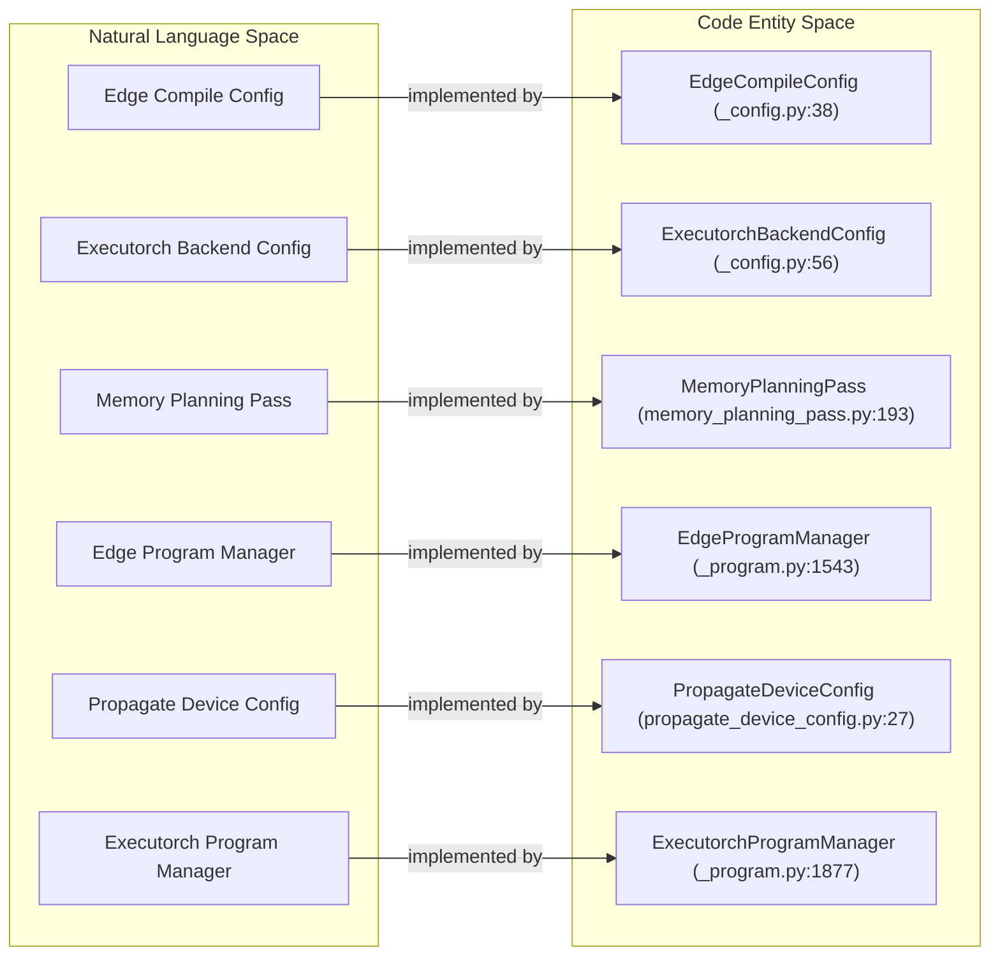
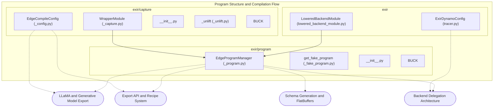
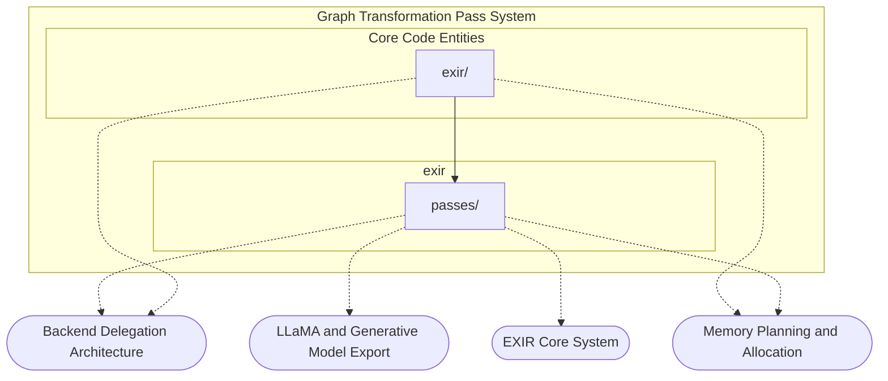
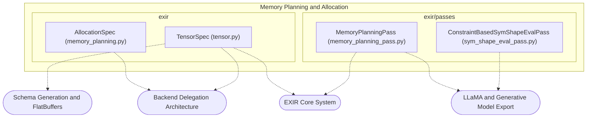
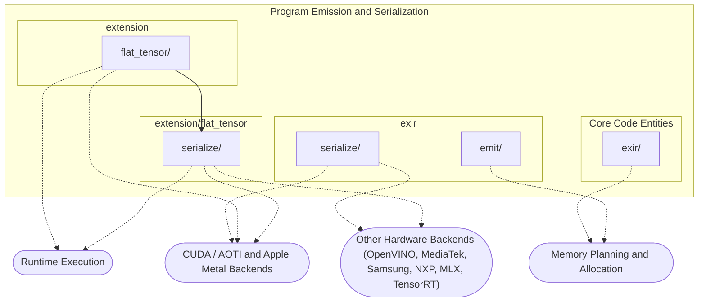
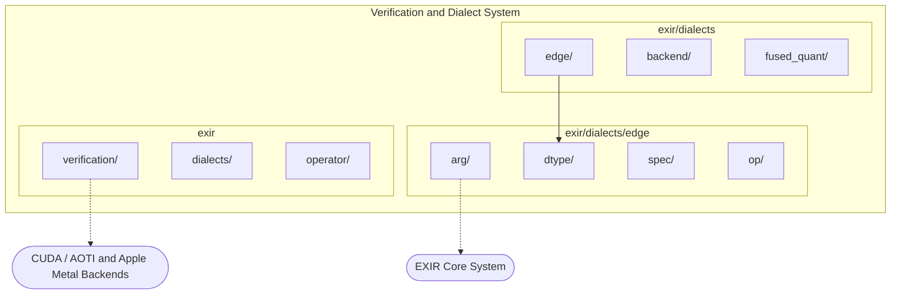

# EXIR Core System

> Architectural specification and implementation reference for EXIR Core System (40 relevant source files). Primary code entities: `EdgeProgramManager`, `__init__`, `config_methods`, `exported_program`, `MemoryPlanningPass`.

Relevant source files

The following files were used as context for generating this wiki page:

- [exir/program/_program.py](exir/program/_program.py)
- [exir/passes/memory_planning_pass.py](exir/passes/memory_planning_pass.py)
- [exir/passes/dynamic_shape_prop_pass.py](exir/passes/dynamic_shape_prop_pass.py)
- [exir/passes/propagate_device_pass.py](exir/passes/propagate_device_pass.py)
- [exir/passes/insert_write_back_for_buffers_pass.py](exir/passes/insert_write_back_for_buffers_pass.py)
- [exir/passes/__init__.py](exir/passes/__init__.py)
- [exir/capture/_config.py](exir/capture/_config.py)
- [exir/passes/constant_prop_pass.py](exir/passes/constant_prop_pass.py)
- [exir/passes/cse_pass.py](exir/passes/cse_pass.py)
- [exir/passes/_quant_patterns_and_replacements.py](exir/passes/_quant_patterns_and_replacements.py)
- [exir/passes/replace_complex_with_real_pass.py](exir/passes/replace_complex_with_real_pass.py)
- [exir/passes/delegate_scratch_pass.py](exir/passes/delegate_scratch_pass.py)
- [exir/passes/const_prop_pass.py](exir/passes/const_prop_pass.py)
- [exir/emit/_emitter.py](exir/emit/_emitter.py)
- [exir/passes/legalize_portable_dim_order_pass.py](exir/passes/legalize_portable_dim_order_pass.py)
- [exir/passes/quantize_io_pass.py](exir/passes/quantize_io_pass.py)
- [exir/passes/debug_handle_generator_pass.py](exir/passes/debug_handle_generator_pass.py)
- [exir/passes/memory_format_ops_pass.py](exir/passes/memory_format_ops_pass.py)
- [exir/passes/fold_redundant_qdq_pass.py](exir/passes/fold_redundant_qdq_pass.py)
- [exir/program/_fake_program.py](exir/program/_fake_program.py)
- [exir/passes/init_mutable_pass.py](exir/passes/init_mutable_pass.py)
- [exir/program/__init__.py](exir/program/__init__.py)
- [exir/passes/executorch_prim_ops_registry.py](exir/passes/executorch_prim_ops_registry.py)
- [exir/passes/propagate_device_config.py](exir/passes/propagate_device_config.py)
- [exir/passes/pass_registry.py](exir/passes/pass_registry.py)
- [exir/passes/replace_view_copy_with_view_pass.py](exir/passes/replace_view_copy_with_view_pass.py)
- [exir/passes/normalize_view_copy_base_pass.py](exir/passes/normalize_view_copy_base_pass.py)
- [exir/passes/quant_fusion_pass.py](exir/passes/quant_fusion_pass.py)
- [docs/source/compiler-backend-dialect.md](docs/source/compiler-backend-dialect.md)
- [docs/source/compiler-custom-compiler-passes.md](docs/source/compiler-custom-compiler-passes.md)
- [docs/source/compiler-delegate-and-partitioner.md](docs/source/compiler-delegate-and-partitioner.md)
- [docs/source/compiler-entry-points.md](docs/source/compiler-entry-points.md)
- [docs/source/compiler-ir-advanced.md](docs/source/compiler-ir-advanced.md)
- [docs/source/compiler-memory-planning.md](docs/source/compiler-memory-planning.md)
- [exir/program/BUCK](exir/program/BUCK)

## Purpose and Scope

This chapter covers **EXIR Core System** across the repository, detailing the core abstractions, data structures, transformation pipelines, and runtime/build integrations that implement this layer.

**Scope**: This document provides an architectural hub for the following child subsystems:
- **Program Structure and Compilation Flow**: See [[3.1-program-structure-and-compilation-flow|Program Structure and Compilation Flow]].
- **Graph Transformation Pass System**: See [[3.2-graph-transformation-pass-system|Graph Transformation Pass System]].
- **Memory Planning and Allocation**: See [[3.3-memory-planning-and-allocation|Memory Planning and Allocation]].
- **Program Emission and Serialization**: See [[3.4-program-emission-and-serialization|Program Emission and Serialization]].
- **Verification and Dialect System**: See [[3.5-verification-and-dialect-system|Verification and Dialect System]].

Sources: [exir/capture/_config.py:38-51](), [exir/capture/_config.py:56-140](), [exir/passes/memory_planning_pass.py:193-372](), [exir/program/_program.py:1543-1874]()

---

## System Mapping: Natural Language Space to Code Entity Space

Sources: [exir/capture/_config.py:38-51](), [exir/capture/_config.py:56-140](), [exir/passes/memory_planning_pass.py:193-372](), [exir/program/_program.py:1543-1874](), [exir/passes/propagate_device_config.py:27-133]()

---

## 1. Program Structure and Compilation Flow

Architectural specification and implementation reference for Program Structure and Compilation Flow (12 relevant source files). Primary code entities: `CaptureConfig`, `EdgeCompileConfig`, `ExecutorchBackendConfig`, `EdgeProgramManager`, `__init__`. [exir/capture/_config.py:38-51](), [exir/capture/_config.py:56-140](), [exir/program/_program.py:1543-1874]()

### Primary Code Entities

- **`EdgeCompileConfig`** (Class in [exir/capture/_config.py:38-51]()): Core implementation entity.
- **`ExecutorchBackendConfig`** (Class in [exir/capture/_config.py:56-140]()): Core implementation entity.
- **`EdgeProgramManager`** (Class in [exir/program/_program.py:1543-1874]()): Package of one or more `ExportedPrograms` in Edge dialect. Designed to simplify lowering to ExecuTorch. See: https://pytorch.org/executorch/main/ir-exir Allows easy applications of
- **`ExecutorchProgramManager`** (Class in [exir/program/_program.py:1877-2072]()): Package of one or more `ExportedPrograms` in Execution dialect. Designed to simplify lowering to ExecuTorch. See: https://pytorch.org/executorch/main/ir-exir When the ExecutorchPro
- **`to_edge_transform_and_lower`** (Function in [exir/program/_program.py:1317-1455]()): :func:`to_edge_transform_and_lower` constructs an EdgeProgramManager from a set of exported programs in ATen dialect. It differs fundamentally from to_edge in that it combines the 
- **`graph_module`** (Method in [exir/program/_program.py:612-613]()): (self)

### Program Structure and Compilation Flow Architecture Flow

For details, see [[3.1-program-structure-and-compilation-flow|Program Structure and Compilation Flow]].

Sources: [exir/capture/_config.py:38-51](), [exir/capture/_config.py:56-140](), [exir/program/_program.py:1543-1874](), [exir/program/_program.py:1877-2072]()

---

## 2. Graph Transformation Pass System

Architectural specification and implementation reference for Graph Transformation Pass System (30 relevant source files). Primary code entities: `MemoryPlanningPass`, `__init__`, `_set_alloc_node_spec`, `call`, `DSInfo`. [exir/passes/memory_planning_pass.py:193-372](), [exir/passes/propagate_device_config.py:27-133](), [exir/pass_base.py:232-233]()

### Primary Code Entities

- **`MemoryPlanningPass`** (Class in [exir/passes/memory_planning_pass.py:193-372]()): Core implementation entity.
- **`PropagateDeviceConfig`** (Class in [exir/passes/propagate_device_config.py:27-133]()): Controls whether the runtime copies method inputs, outputs and constants across the device boundary. Memory planning reserves buffers for graph inputs and outputs by default. A pro
- **`ExportPassBaseError`** (Class in [exir/pass_base.py:232-233]()): Core implementation entity.
- **`DSInfo`** (Class in [exir/passes/dynamic_shape_prop_pass.py:32-40]()): Dynamic shape information we are tracking for each dynamic shape symbol.
- **`_set_device_on_spec`** (Function in [exir/passes/propagate_device_pass.py:115-122]()): Set the device attribute on a TensorSpec.
- **`call`** (Method in [exir/passes/replace_complex_with_real_pass.py:184-206]()): A new node in the program's dialect that calls the Edge op ``target``.

### Graph Transformation Pass System Architecture Flow

For details, see [[3.2-graph-transformation-pass-system|Graph Transformation Pass System]].

Sources: [exir/passes/memory_planning_pass.py:193-372](), [exir/passes/propagate_device_config.py:27-133](), [exir/pass_base.py:232-233](), [exir/passes/dynamic_shape_prop_pass.py:32-40]()

---

## 3. Memory Planning and Allocation

Architectural specification and implementation reference for Memory Planning and Allocation (5 relevant source files). Primary code entities: `MemoryPlanningPass`, `__init__`, `_set_alloc_node_spec`, `call`, `AddressSpaceOverflowException`. [exir/passes/memory_planning_pass.py:193-372](), [exir/memory_planning.py:613-621](), [exir/memory_planning.py:665-673]()

### Primary Code Entities

- **`MemoryPlanningPass`** (Class in [exir/passes/memory_planning_pass.py:193-372]()): Core implementation entity.
- **`AllocationSpec`** (Class in [exir/memory_planning.py:613-621]()): AllocationSpec is used to represent the allocation of a tensor.
- **`MemoryAlgoResult`** (Class in [exir/memory_planning.py:665-673]()): This is the result returned by a memory planning algorithm that is invoked by memory_planning_algorithm_suite. It contains the allocation decisions of that algorithm for all the sp
- **`SpecAllocResult`** (Class in [exir/memory_planning.py:652-661]()): These are the values that a memory plannig algorithm assigns to a spec. These are not directly written back into the spec object, but are used to track the allocation decisions and
- **`from_tensor`** (Method in [exir/tensor.py:232-252]()): (cls, tensor: torch.Tensor, const: bool = False)
- **`collect_specs_from_nodes`** (Function in [exir/memory_planning.py:464-567]()): r""" Collect specs from the passed in nodes. Do filtering as controlled by arguments. Arguments: ignore_graph_input: ignore graph input tensors from placeholder nodes ignore_const:

### Memory Planning and Allocation Architecture Flow

For details, see [[3.3-memory-planning-and-allocation|Memory Planning and Allocation]].

Sources: [exir/passes/memory_planning_pass.py:193-372](), [exir/memory_planning.py:613-621](), [exir/memory_planning.py:665-673](), [exir/memory_planning.py:652-661]()

---

## 4. Program Emission and Serialization

Architectural specification and implementation reference for Program Emission and Serialization (35 relevant source files). Primary code entities: `_AbstractValue`, `_Emitter`, `__init__`, `_add_debug_handle`, `Call`. [exir/_serialize/_program.py:58-67](), [exir/emit/_emitter.py:168-175](), [exir/emit/_emitter.py:217-1964]()

### Primary Code Entities

- **`PTEFile`** (Class in [exir/_serialize/_program.py:58-67]()): Wraps together the data required to serialize into a PTE file.
- **`_AbstractValue`** (Class in [exir/emit/_emitter.py:168-175]()): Represents an already emitted EValue
- **`_Emitter`** (Class in [exir/emit/_emitter.py:217-1964]()): An abstract interpreter (https://wiki.mozilla.org/Abstract_Interpretation) used to emit the given traced torch.fx.GraphModule to the flatbuffer schema.
- **`Call`** (Class in [exir/_serialize/_ptn_samples.py:58-65]()): One call of a method: positional inputs, and optionally what it produced.
- **`_emit_node_specific_error`** (Method in [exir/emit/_emitter.py:266-271]()): Returns 'err_msg' with node specific information attached.
- **`serialize_pte_binary`** (Function in [exir/_serialize/_program.py:383-564]()): Returns the runtime binary representation of the given Program. Args: pte_file: PTEFile class containing the program and segments. extract_delegate_segments: Whether to move delega

### Program Emission and Serialization Architecture Flow

For details, see [[3.4-program-emission-and-serialization|Program Emission and Serialization]].

Sources: [exir/_serialize/_program.py:58-67](), [exir/emit/_emitter.py:168-175](), [exir/emit/_emitter.py:217-1964](), [exir/_serialize/_ptn_samples.py:58-65]()

---

## 5. Verification and Dialect System

Architectural specification and implementation reference for Verification and Dialect System (34 relevant source files). Primary code entities: `Interpreter`, `__init__`, `call_kernel`, `get_constant_tensors`, `EdgeOpArgValidator`. [exir/verification/arg_validator.py:17-25](), [exir/dialects/_ops.py:122-143](), [exir/dialects/_ops.py:74-119]()

### Primary Code Entities

- **`RunHigherOrderOperatorError`** (Class in [exir/verification/arg_validator.py:17-25]()): Raised when an we try to run delegate or other HigherOrderOperator in a graph module. E.g., %executorch_call_delegate : [#users=1] = call_function[ target=torch.ops.higher_order.ex
- **`_DialectNamespace`** (Class in [exir/dialects/_ops.py:122-143]()): Dialect namespace. Currently the dialects are: - ATen Dialect: core ATen ops and overloads, see torch._ops._OpNamespace - Edge Dialect: ATen ops with explicit Tensor dtype - Backen
- **`_OpNamespace`** (Class in [exir/dialects/_ops.py:74-119]()): EXIR Dialect op namespace object. Contains ops and overloads registered into PyTorch dispatcher.
- **`AllowedDtypeSet`** (Class in [exir/dialects/edge/_ops.py:23-65]()): All legal dtypes for current type alias. This class is a wrapper of Set[torch.dtype]. Normally it is a set of all legal types listed in edge/edge.yaml file for each type alias. If 
- **`_make_qp`** (Function in [exir/dialects/fused_quant/ops.py:293-302]()): ( scale: Optional[torch.Tensor], zero_point: Optional[torch.Tensor], dtype: torch.dtype, quant_min: int, quant_max: int, )
- **`_validate_qparams`** (Function in [exir/dialects/fused_quant/ops.py:248-252]()): Validate every qparams block that is present.

### Verification and Dialect System Architecture Flow

For details, see [[3.5-verification-and-dialect-system|Verification and Dialect System]].

Sources: [exir/verification/arg_validator.py:17-25](), [exir/dialects/_ops.py:122-143](), [exir/dialects/_ops.py:74-119](), [exir/dialects/edge/_ops.py:23-65]()

---

## Official Documentation & Architectural References

- **Graph Transformation Pass System** ([wiki/3.2-graph-transformation-pass-system.md]()): # Graph Transformation Pass System ↑ [[3-exir-core-system|EXIR Core System]] > Architectural specification and implementation reference for Graph Transformation Pass System (30 relevant source files). Primary code entities: `MemoryPlanningPass`, `__init__`, `_set_alloc_node_spec`, `call`, `DSInfo`. 
 
Relevant source files
 The follo
- **Program Structure and Compilation Flow** ([wiki/3.1-program-structure-and-compilation-flow.md]()): # Program Structure and Compilation Flow ↑ [[3-exir-core-system|EXIR Core System]] > Architectural specification and implementation reference for Program Structure and Compilation Flow (12 relevant source files). Primary code entities: `CaptureConfig`, `EdgeCompileConfig`, `ExecutorchBackendConfig`, `EdgeProgramManager`, `__init__`. 
 
Releva
- **ExecuTorch DeepWiki** ([wiki/index.md]()): # ExecuTorch DeepWiki Generated from `home-jason-Project-deepwiki-executorch` at commit `b3b565b5b62f` (2026-11-15T15:02:11+00:00). ## Pages - [[1-overview|Overview]] — Architectural specification and implementation reference for Overview (10 relevant source files). Primary code entities: `Module`, `MethodHolder`, `PlannedMemory`, `EdgeProgramManager`, `__in
- **Program Emission and Serialization** ([wiki/3.4-program-emission-and-serialization.md]()): # Program Emission and Serialization ↑ [[3-exir-core-system|EXIR Core System]] > Architectural specification and implementation reference for Program Emission and Serialization (35 relevant source files). Primary code entities: `_AbstractValue`, `_Emitter`, `__init__`, `_add_debug_handle`, `Call`. 
 
Relevant source files
 The follow

Sources: [wiki/3.2-graph-transformation-pass-system.md](), [wiki/3.1-program-structure-and-compilation-flow.md](), [wiki/index.md](), [wiki/3.4-program-emission-and-serialization.md]()

## Sub-pages

- [[3.1-program-structure-and-compilation-flow|Program Structure and Compilation Flow]]
- [[3.2-graph-transformation-pass-system|Graph Transformation Pass System]]
- [[3.3-memory-planning-and-allocation|Memory Planning and Allocation]]
- [[3.4-program-emission-and-serialization|Program Emission and Serialization]]
- [[3.5-verification-and-dialect-system|Verification and Dialect System]]

## Related pages

- [[1-overview|Overview]]
- [[3.1-program-structure-and-compilation-flow|Program Structure and Compilation Flow]]
- [[3.2-graph-transformation-pass-system|Graph Transformation Pass System]]
- [[3.3-memory-planning-and-allocation|Memory Planning and Allocation]]
- [[3.4-program-emission-and-serialization|Program Emission and Serialization]]
- [[3.5-verification-and-dialect-system|Verification and Dialect System]]
- [[1.1-getting-started|Getting Started]]
- [[1.2-export-api-and-recipe-system|Export API and Recipe System]]

## Related documents

- `wiki/3.2-graph-transformation-pass-system.md` — Graph Transformation Pass System (score 110.6212, via bm25)
- `wiki/3.1-program-structure-and-compilation-flow.md` — Program Structure and Compilation Flow (score 95.982, via bm25)
- `wiki/index.md` — ExecuTorch DeepWiki (score 94.0672, via bm25)
- `wiki/3.4-program-emission-and-serialization.md` — Program Emission and Serialization (score 78.2925, via bm25)
- `wiki/3.3-memory-planning-and-allocation.md` — Memory Planning and Allocation (score 75.2773, via bm25)

## Sources

- [`exir/program/_program.py`](https://github.com/pytorch/executorch/blob/main/exir/program/_program.py)
- [`exir/passes/memory_planning_pass.py`](https://github.com/pytorch/executorch/blob/main/exir/passes/memory_planning_pass.py)
- [`exir/passes/dynamic_shape_prop_pass.py`](https://github.com/pytorch/executorch/blob/main/exir/passes/dynamic_shape_prop_pass.py)
- [`exir/passes/propagate_device_pass.py`](https://github.com/pytorch/executorch/blob/main/exir/passes/propagate_device_pass.py)
- [`exir/passes/insert_write_back_for_buffers_pass.py`](https://github.com/pytorch/executorch/blob/main/exir/passes/insert_write_back_for_buffers_pass.py)
- [`exir/passes/__init__.py`](https://github.com/pytorch/executorch/blob/main/exir/passes/__init__.py)
- [`exir/capture/_config.py`](https://github.com/pytorch/executorch/blob/main/exir/capture/_config.py)
- [`exir/passes/constant_prop_pass.py`](https://github.com/pytorch/executorch/blob/main/exir/passes/constant_prop_pass.py)
- [`exir/passes/cse_pass.py`](https://github.com/pytorch/executorch/blob/main/exir/passes/cse_pass.py)
- [`exir/passes/_quant_patterns_and_replacements.py`](https://github.com/pytorch/executorch/blob/main/exir/passes/_quant_patterns_and_replacements.py)
- [`exir/passes/replace_complex_with_real_pass.py`](https://github.com/pytorch/executorch/blob/main/exir/passes/replace_complex_with_real_pass.py)
- [`exir/passes/delegate_scratch_pass.py`](https://github.com/pytorch/executorch/blob/main/exir/passes/delegate_scratch_pass.py)
- [`exir/passes/const_prop_pass.py`](https://github.com/pytorch/executorch/blob/main/exir/passes/const_prop_pass.py)
- [`exir/emit/_emitter.py`](https://github.com/pytorch/executorch/blob/main/exir/emit/_emitter.py)
- [`exir/passes/legalize_portable_dim_order_pass.py`](https://github.com/pytorch/executorch/blob/main/exir/passes/legalize_portable_dim_order_pass.py)
- [`exir/passes/quantize_io_pass.py`](https://github.com/pytorch/executorch/blob/main/exir/passes/quantize_io_pass.py)
- [`exir/passes/debug_handle_generator_pass.py`](https://github.com/pytorch/executorch/blob/main/exir/passes/debug_handle_generator_pass.py)
- [`exir/passes/memory_format_ops_pass.py`](https://github.com/pytorch/executorch/blob/main/exir/passes/memory_format_ops_pass.py)
- [`exir/passes/fold_redundant_qdq_pass.py`](https://github.com/pytorch/executorch/blob/main/exir/passes/fold_redundant_qdq_pass.py)
- [`exir/program/_fake_program.py`](https://github.com/pytorch/executorch/blob/main/exir/program/_fake_program.py)
- [`exir/passes/init_mutable_pass.py`](https://github.com/pytorch/executorch/blob/main/exir/passes/init_mutable_pass.py)
- [`exir/program/__init__.py`](https://github.com/pytorch/executorch/blob/main/exir/program/__init__.py)
- [`exir/passes/executorch_prim_ops_registry.py`](https://github.com/pytorch/executorch/blob/main/exir/passes/executorch_prim_ops_registry.py)
- [`exir/passes/propagate_device_config.py`](https://github.com/pytorch/executorch/blob/main/exir/passes/propagate_device_config.py)
- [`exir/passes/pass_registry.py`](https://github.com/pytorch/executorch/blob/main/exir/passes/pass_registry.py)
- [`exir/passes/replace_view_copy_with_view_pass.py`](https://github.com/pytorch/executorch/blob/main/exir/passes/replace_view_copy_with_view_pass.py)
- [`exir/passes/normalize_view_copy_base_pass.py`](https://github.com/pytorch/executorch/blob/main/exir/passes/normalize_view_copy_base_pass.py)
- [`exir/passes/quant_fusion_pass.py`](https://github.com/pytorch/executorch/blob/main/exir/passes/quant_fusion_pass.py)
- [`docs/source/compiler-backend-dialect.md`](https://github.com/pytorch/executorch/blob/main/docs/source/compiler-backend-dialect.md)
- [`docs/source/compiler-custom-compiler-passes.md`](https://github.com/pytorch/executorch/blob/main/docs/source/compiler-custom-compiler-passes.md)
- [`docs/source/compiler-delegate-and-partitioner.md`](https://github.com/pytorch/executorch/blob/main/docs/source/compiler-delegate-and-partitioner.md)
- [`docs/source/compiler-entry-points.md`](https://github.com/pytorch/executorch/blob/main/docs/source/compiler-entry-points.md)
- [`docs/source/compiler-ir-advanced.md`](https://github.com/pytorch/executorch/blob/main/docs/source/compiler-ir-advanced.md)
- [`docs/source/compiler-memory-planning.md`](https://github.com/pytorch/executorch/blob/main/docs/source/compiler-memory-planning.md)
- [`exir/program/BUCK`](https://github.com/pytorch/executorch/blob/main/exir/program/BUCK)
- [`exir/passes/BUCK`](https://github.com/pytorch/executorch/blob/main/exir/passes/BUCK)
- [`exir/emit/BUCK`](https://github.com/pytorch/executorch/blob/main/exir/emit/BUCK)
- [`exir/capture/BUCK`](https://github.com/pytorch/executorch/blob/main/exir/capture/BUCK)
- [`exir/dialects/BUCK`](https://github.com/pytorch/executorch/blob/main/exir/dialects/BUCK)
- [`exir/verification/BUCK`](https://github.com/pytorch/executorch/blob/main/exir/verification/BUCK)

## Dynamic Knowledge Links (Code Graph ↔ LLM-Wiki / RAG)

### Linked Architecture & Design Documents

| Document | Match Channel | Score | Shared Code Symbols |
|---|---|---|---|
| [[3.2-graph-transformation-pass-system|Graph Transformation Pass System]] | `bm25+entity(5)` | `118.121` | `EdgeCompileConfig`, `EdgeProgramManager`, `ExecutorchBackendConfig`, `MemoryPlanningPass`, `PropagateDeviceConfig` |
| [[3.1-program-structure-and-compilation-flow|Program Structure and Compilation Flow]] | `bm25+entity(8)` | `107.982` | `EdgeCompileConfig`, `EdgeProgramManager`, `ExecutorchBackendConfig`, `ExirExportedProgram`, `MemoryPlanningPass` |
| [[index|ExecuTorch DeepWiki]] | `bm25` | `94.067` | *(lexical/graph match)* |
| [[3.3-memory-planning-and-allocation|Memory Planning and Allocation]] | `bm25+entity(6)` | `84.277` | `EdgeCompileConfig`, `EdgeProgramManager`, `ExecutorchBackendConfig`, `MemoryPlanningPass`, `_AbstractValue` |
| [[3.4-program-emission-and-serialization|Program Emission and Serialization]] | `bm25+entity(3)` | `82.793` | `EdgeCompileConfig`, `EdgeProgramManager`, `ExecutorchBackendConfig` |
| [[3.5-verification-and-dialect-system|Verification and Dialect System]] | `wikilink:3-exir-core-system+entity(6)` | `67.897` | `EdgeCompileConfig`, `EdgeProgramManager`, `ExecutorchBackendConfig`, `MemoryPlanningPass`, `_AbstractValue` |

### High-Centrality Bridge Symbols (CBM Graph)

| Symbol | Kind | Source Location | Fan-In / Fan-Out |
|---|---|---|---|
| `EdgeCompileConfig` | Class | [exir/capture/_config.py:38-51]() | in: `58` / out: `0` |
| `ExecutorchBackendConfig` | Class | [exir/capture/_config.py:56-140]() | in: `31` / out: `0` |
| `MemoryPlanningPass` | Class | [exir/passes/memory_planning_pass.py:193-372]() | in: `25` / out: `0` |
| `EdgeProgramManager` | Class | [exir/program/_program.py:1543-1874]() | in: `4` / out: `0` |
| `PropagateDeviceConfig` | Class | [exir/passes/propagate_device_config.py:27-133]() | in: `9` / out: `0` |
| `ExecutorchProgramManager` | Class | [exir/program/_program.py:1877-2072]() | in: `1` / out: `0` |

Sources: [exir/capture/_config.py:38-51](), [exir/capture/_config.py:56-140](), [exir/passes/memory_planning_pass.py:193-372](), [exir/program/_program.py:1543-1874]()

### Cross-Subsystem Coupling

- [[6.1-llama-model-export|LLaMA and Generative Model Export]] — call/import coupling weight `16.0`
- [[5-backend-delegation-architecture|Backend Delegation Architecture]] — call/import coupling weight `8.0`
- [[5.4-arm-tosa-and-ethos-u-backend|ARM TOSA and Ethos-U Backend]] — call/import coupling weight `7.0`
- [[2.3-schema-generation-and-flatbuffers|Schema Generation and FlatBuffers]] — call/import coupling weight `5.0`
- [[3.4-program-emission-and-serialization|Program Emission and Serialization]] — call/import coupling weight `5.0`
- [[3.1-program-structure-and-compilation-flow|Program Structure and Compilation Flow]] — call/import coupling weight `5.0`
