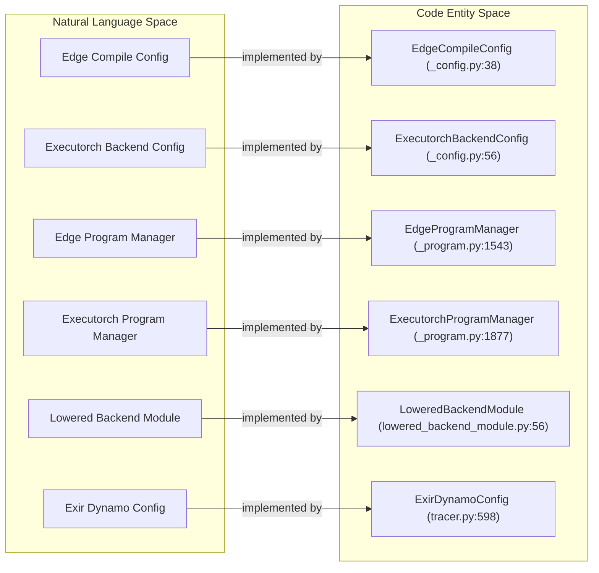
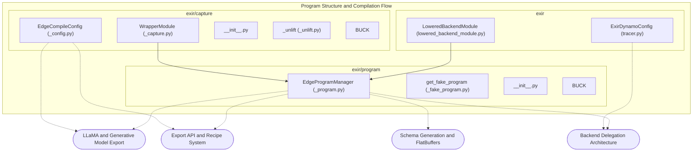
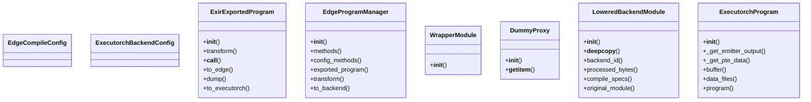
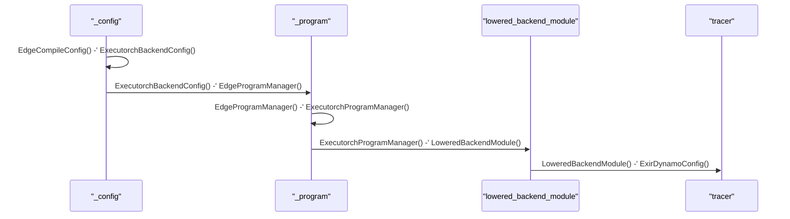

# Program Structure and Compilation Flow

↑ [[3-exir-core-system|EXIR Core System]]

> Architectural specification and implementation reference for Program Structure and Compilation Flow (12 relevant source files). Primary code entities: `CaptureConfig`, `EdgeCompileConfig`, `ExecutorchBackendConfig`, `EdgeProgramManager`, `__init__`.

<details>
<summary>Relevant source files</summary>

The following files were used as context for generating this wiki page:

- [exir/capture/_config.py](exir/capture/_config.py)
- [exir/program/_program.py](exir/program/_program.py)
- [exir/lowered_backend_module.py](exir/lowered_backend_module.py)
- [exir/tracer.py](exir/tracer.py)
- [exir/capture/_capture.py](exir/capture/_capture.py)
- [exir/program/_fake_program.py](exir/program/_fake_program.py)
- [exir/program/__init__.py](exir/program/__init__.py)
- [exir/capture/__init__.py](exir/capture/__init__.py)
- [exir/capture/_unlift.py](exir/capture/_unlift.py)
- [docs/source/ir-exir.md](docs/source/ir-exir.md)
- [exir/program/BUCK](exir/program/BUCK)
- [exir/capture/BUCK](exir/capture/BUCK)

</details>

## Purpose and Scope

Architectural specification and implementation reference for Program Structure and Compilation Flow (12 relevant source files). Primary code entities: `CaptureConfig`, `EdgeCompileConfig`, `ExecutorchBackendConfig`, `EdgeProgramManager`, `__init__`.

Primary code entities analyzed on this page include `EdgeCompileConfig` ([exir/capture/_config.py:38-51]()), `ExecutorchBackendConfig` ([exir/capture/_config.py:56-140]()), `EdgeProgramManager` ([exir/program/_program.py:1543-1874]()), `ExecutorchProgramManager` ([exir/program/_program.py:1877-2072]()), `LoweredBackendModule` ([exir/lowered_backend_module.py:56-389]()).

For the parent architectural layer, see [[3-exir-core-system|EXIR Core System]]. Related sibling subsystems: [[3.2-graph-transformation-pass-system|Graph Transformation Pass System]], [[3.3-memory-planning-and-allocation|Memory Planning and Allocation]], [[3.4-program-emission-and-serialization|Program Emission and Serialization]], [[3.5-verification-and-dialect-system|Verification and Dialect System]].

Sources: [exir/capture/_config.py:38-51](), [exir/capture/_config.py:56-140](), [exir/program/_program.py:1543-1874](), [exir/program/_program.py:1877-2072]()

---

## 1. High-Level Architecture and Data Flow

### Natural Language Space to Code Entity Space Mapping

The following diagram maps domain concepts in this subsystem to their concrete code entities:



### Subsystem Component & Dependency Flow



Cross-subsystem call and import edges connect **Program Structure and Compilation Flow** with [[6.1-llama-model-export|LLaMA and Generative Model Export]] (coupling `12.0`), [[5.4-arm-tosa-and-ethos-u-backend|ARM TOSA and Ethos-U Backend]] (coupling `5.0`), [[5-backend-delegation-architecture|Backend Delegation Architecture]] (coupling `5.0`), [[2.3-schema-generation-and-flatbuffers|Schema Generation and FlatBuffers]] (coupling `5.0`), [[3.4-program-emission-and-serialization|Program Emission and Serialization]] (coupling `5.0`).

| Module Directory | Files | Primary Code Entities | Source Citations |
|---|---|---|---|
| `exir/capture` | 5 | `EdgeCompileConfig`, `ExecutorchBackendConfig`, `WrapperModule`, `CaptureConfig` | [exir/capture/_config.py:38-51]() [exir/capture/_config.py:56-140]() |
| `exir/program` | 4 | `EdgeProgramManager`, `ExecutorchProgramManager`, `ExirExportedProgram`, `ExecutorchProgram` | [exir/program/_program.py:1543-1874]() [exir/program/_program.py:1877-2072]() |
| `exir` | 2 | `LoweredBackendModule`, `ExirDynamoConfig`, `PythonTensor`, `DummyProxy` | [exir/lowered_backend_module.py:56-389]() [exir/tracer.py:598-605]() |

Sources: [exir/capture/_config.py:38-51](), [exir/capture/_config.py:56-140](), [exir/program/_program.py:1543-1874](), [exir/program/_program.py:1877-2072](), [exir/lowered_backend_module.py:56-389]()

---

## 2. Core Data Structures and Implementation Details

### Class and Entity Relationship Diagram



### `EdgeCompileConfig` (Class)

- **Source Location**: [exir/capture/_config.py:38-51]()
- **Declaration**: `Class EdgeCompileConfig`
- **Graph Centrality**: fan-in `58` callers, fan-out `0` callees

```python
// exir/capture/_config.py:38-51
class EdgeCompileConfig:
    # TODO(qihan): remove ability to opt out
    _check_ir_validity: bool = True
    # TODO(gasoonjia): remove this
    _skip_dim_order: bool = False
    # Allow core ATen ops check to be skipped for certain ops, but continue with the rest of the checks.
    # Note: only use this for core ATen ops that are missing decompositions. This is temporary,
    # enabling verification on the rest of the program until decomposition coverage is improved.
    _core_aten_ops_exception_list: List[torch._ops.OpOverload] = field(
        default_factory=list
    )
    # Allow ops to be preserved in the graph, i.e., prevent them from being decomposed.
    # These may be core or non-core ATen ops; custom ops should not be here.
    preserve_ops: List[torch.torch._ops.OpOverload] = field(default_factory=list)
```

### `ExecutorchBackendConfig` (Class)

- **Source Location**: [exir/capture/_config.py:56-140]()
- **Declaration**: `Class ExecutorchBackendConfig`
- **Graph Centrality**: fan-in `31` callers, fan-out `0` callees

```python
// exir/capture/_config.py:56-71
class ExecutorchBackendConfig:
    passes: List[PassType] = field(default_factory=list)

    # A single memory planning pass can be defined for all the programs in the
    # EdgeProgramManager or can be defined per program.
    memory_planning_pass: Union[PassType, Dict[str, PassType]] = MemoryPlanningPass()

    # A single propagate device config can be defined for all the programs in the
    # EdgeProgramManager or can be defined per program.
    propagate_device_config: Union[
        PropagateDeviceConfig, Dict[str, PropagateDeviceConfig]
    ] = field(default_factory=PropagateDeviceConfig)

    to_out_var_pass: PassType = ToOutVarPass(ignore_to_out_var_failure=False)
    dynamic_memory_planning_mode: DynamicMemoryPlanningMode = (
        DynamicMemoryPlanningMode.UPPER_BOUND
```

### `EdgeProgramManager` (Class)

- **Source Location**: [exir/program/_program.py:1543-1874]()
- **Declaration**: `Class EdgeProgramManager`
- **Graph Centrality**: fan-in `4` callers, fan-out `0` callees
- **Responsibility**: Package of one or more `ExportedPrograms` in Edge dialect. Designed to simplify lowering to ExecuTorch. See: https://pytorch.org/executorch/main/ir-exir Allows easy applications of transforms across a collection of exported programs including the delegation of subgraphs. Manages the second link in the lowering chain of

```python
// exir/program/_program.py:1543-1558
class EdgeProgramManager:
    """
    Package of one or more `ExportedPrograms` in Edge dialect. Designed to simplify
    lowering to ExecuTorch. See: https://pytorch.org/executorch/main/ir-exir

    Allows easy applications of transforms across a collection of exported programs
    including the delegation of subgraphs.

    Manages the second link in the lowering chain of ATen -> Edge -> ExecuTorch.
    """

    def __init__(
        self,
        edge_programs: Union[ExportedProgram, Dict[str, ExportedProgram]],
        constant_methods: Optional[Dict[str, Any]] = None,
        compile_config: Optional[EdgeCompileConfig] = None,
```

### `ExecutorchProgramManager` (Class)

- **Source Location**: [exir/program/_program.py:1877-2072]()
- **Declaration**: `Class ExecutorchProgramManager`
- **Graph Centrality**: fan-in `1` callers, fan-out `0` callees
- **Responsibility**: Package of one or more `ExportedPrograms` in Execution dialect. Designed to simplify lowering to ExecuTorch. See: https://pytorch.org/executorch/main/ir-exir When the ExecutorchProgramManager is constructed the ExportedPrograms in execution dialect are used to form the executorch binary (in a process called emission) a

### `LoweredBackendModule` (Class)

- **Source Location**: [exir/lowered_backend_module.py:56-389]()
- **Declaration**: `Class LoweredBackendModule`
- **Graph Centrality**: fan-in `1` callers, fan-out `0` callees
- **Responsibility**: A subclass of nn.Module that is generated for modules containing delegated functions. This is can be created by calling `to_backend`.

### `to_edge_transform_and_lower` (Function)

- **Source Location**: [exir/program/_program.py:1317-1455]()
- **Declaration**: `( # noqa: C901 programs: Union[ExportedProgram, Dict[str, ExportedProgram]], transform_passes: Optional[ Union[ Sequence[PassType], Dict[str`
- **Graph Centrality**: fan-in `38` callers, fan-out `6` callees
- **Responsibility**: :func:`to_edge_transform_and_lower` constructs an EdgeProgramManager from a set of exported programs in ATen dialect. It differs fundamentally from to_edge in that it combines the conversion of the ATen dialect to the edge dialect program, then running the transformation passes and then subsequently lowering the progra

Sources: [exir/capture/_config.py:38-51](), [exir/capture/_config.py:56-140](), [exir/program/_program.py:1543-1874](), [exir/program/_program.py:1877-2072](), [exir/lowered_backend_module.py:56-389]()

---

## 3. Execution and Call Flow

The sequence diagram below traces the runtime/compile-time call chain across components in this module:



Sources: [exir/capture/_config.py:38-51](), [exir/capture/_config.py:56-140](), [exir/program/_program.py:1543-1874](), [exir/program/_program.py:1877-2072](), [exir/lowered_backend_module.py:56-389]()

---

## 4. Key API and Symbol Reference

| Code Entity | Kind | Location | Fan-In / Out | Role & Signature |
|---|---|---|---|---|
| `EdgeCompileConfig` | Class | [exir/capture/_config.py:38-51]() | `58` / `0` | — |
| `ExecutorchBackendConfig` | Class | [exir/capture/_config.py:56-140]() | `31` / `0` | — |
| `EdgeProgramManager` | Class | [exir/program/_program.py:1543-1874]() | `4` / `0` | Package of one or more `ExportedPrograms` in Edge dialect. Designed to simplify |
| `ExecutorchProgramManager` | Class | [exir/program/_program.py:1877-2072]() | `1` / `0` | Package of one or more `ExportedPrograms` in Execution dialect. Designed to simplify |
| `LoweredBackendModule` | Class | [exir/lowered_backend_module.py:56-389]() | `1` / `0` | A subclass of nn.Module that is generated for modules containing |
| `ExirDynamoConfig` | Class | [exir/tracer.py:598-605]() | `1` / `0` | Manage Exir-specific configurations of Dynamo. |
| `PythonTensor` | Class | [exir/tracer.py:229-385]() | `1` / `0` | A wrapper tensor subclass used in the DispatchTracer to keep track of |
| `ExirExportedProgram` | Class | [exir/program/_program.py:410-494]() | `5` / `0` | — |
| `WrapperModule` | Class | [exir/capture/_capture.py:163-166]() | `3` / `0` | — |
| `DummyProxy` | Class | [exir/tracer.py:217-226]() | `2` / `0` | — |
| `ExecutorchProgram` | Class | [exir/program/_program.py:498-639]() | `1` / `0` | — |
| `HackedUpExportedProgramDONOTUSE` | Class | [exir/program/_program.py:325-406]() | `1` / `0` | — |
| `DispatchTracer` | Class | [exir/tracer.py:407-558]() | `1` / `0` | — |
| `CaptureConfig` | Class | [exir/capture/_config.py:24-33]() | `0` / `0` | — |
| `to_edge_transform_and_lower` | Function | [exir/program/_program.py:1317-1455]() | `38` / `6` | :func:`to_edge_transform_and_lower` constructs an EdgeProgramManager from a set of |
| `graph_module` | Method | [exir/program/_program.py:612-613]() | `31` / `0` | (self) |
| `original_module` | Method | [exir/lowered_backend_module.py:151-155]() | `17` / `0` | Returns the original EXIR module |
| `to_edge` | Method | [exir/program/_program.py:432-440]() | `11` / `1` | # TODO(ycao): Change this to a composable function. |
| `get_lowered_submodules` | Function | [exir/lowered_backend_module.py:990-1005]() | `8` / `0` | Returns a list of lowered modules that are in the given graph (does not look |
| `_transform` | Function | [exir/program/_program.py:140-164]() | `6` / `1` | Transforms the program according to the provided passes. |
| `_gen_edge_manager_for_partitioners` | Function | [exir/program/_program.py:1151-1286]() | `1` / `8` | Generates EdgeProgramManager for subsequent lowering to the |
| `_generate_edge_program` | Function | [exir/program/_program.py:809-894]() | `2` / `3` | Args: |

Sources: [exir/capture/_config.py:38-51](), [exir/capture/_config.py:56-140](), [exir/program/_program.py:1543-1874](), [exir/program/_program.py:1877-2072](), [exir/lowered_backend_module.py:56-389](), [exir/tracer.py:598-605]()

---

## 5. Official Documentation and Design Context

The following linked documentation sections from `llm-wiki` (`raw/`) provide additional architectural context, tutorials, and design invariants for this subsystem:

- **EXIR Core System** ([wiki/3-exir-core-system.md](), score `95.0634`) (sections: `EXIR Core System`, `Purpose and Scope`, `System Mapping: Natural Language Space to Code Entity Space`, `1. Program Structure and Compilation Flow`): # EXIR Core System > Architectural specification and implementation reference for EXIR Core System (40 relevant source files). Primary code entities: `EdgeProgramManager`, `__init__`, `config_methods`, `exported_program`, `MemoryPlanningPass`. <details> <summary>Relevant source files</summary> The following files were used as context for generating this wiki page: - [exir/program/_program.py](exir/program/_program.py
- **Overview** ([wiki/1-overview.md](), score `89.2734`) (sections: `Overview`, `1. Architecture Overview & System Component Map`, `Core Concept to Code Entity Mapping`, `Architectural Principles (from Official Documentation)`): # Overview > Architectural specification and implementation reference for Overview (10 relevant source files). Primary code entities: `Module`, `MethodHolder`, `PlannedMemory`, `EdgeProgramManager`, `__init__`. <details> <summary>Relevant source files</summary> The following files were used as context for generating this wiki page: - [extension/module/module.h](extension/module/module.h) - [exir/program/_program.py](
- **ExecuTorch DeepWiki** ([wiki/index.md](), score `83.171`) (sections: `ExecuTorch DeepWiki`, `Pages`): # ExecuTorch DeepWiki Generated from `home-jason-Project-deepwiki-executorch` at commit `b3b565b5b62f` (2026-11-15T15:02:11+00:00). ## Pages - [[1-overview|Overview]] — Architectural specification and implementation reference for Overview (10 relevant source files). Primary code entities: `Module`, `MethodHolder`, `PlannedMemory`, `EdgeProgramManager`, `__init__`. - [[1.1-getting-started|Getting Started]] — Architect
- **Glossary** ([wiki/10-glossary.md](), score `79.2114`) (sections: `Glossary`, `Purpose and Scope`, `1. Core Compilation, IR & Graph Concepts`, ``Tensor` (Tensor)`): # Glossary > Architectural specification and implementation reference for Glossary (10 relevant source files). Primary code entities: `CaptureConfig`, `EdgeCompileConfig`, `ExecutorchBackendConfig`, `BoxedEvalueList`, `checkUnwrappedVals`. <details> <summary>Relevant source files</summary> The following files were used as context for generating this wiki page: - [exir/capture/_config.py](exir/capture/_config.py) - [r

Sources: [wiki/3-exir-core-system.md](), [wiki/1-overview.md](), [wiki/index.md](), [wiki/10-glossary.md]()

## Related pages

- [[3-exir-core-system|EXIR Core System]]
- [[1.1-getting-started|Getting Started]]
- [[1.2-export-api-and-recipe-system|Export API and Recipe System]]
- [[2.2-kernel-libraries-and-selective-build|Kernel Libraries and Selective Build]]
- [[2.3-schema-generation-and-flatbuffers|Schema Generation and FlatBuffers]]
- [[3.4-program-emission-and-serialization|Program Emission and Serialization]]
- [[3.5-verification-and-dialect-system|Verification and Dialect System]]
- [[4-quantization-systems|Quantization Systems]]

## Related documents

- `wiki/3-exir-core-system.md` — EXIR Core System (score 95.0634, via bm25)
- `wiki/1-overview.md` — Overview (score 89.2734, via bm25)
- `wiki/index.md` — ExecuTorch DeepWiki (score 83.171, via bm25)
- `wiki/10-glossary.md` — Glossary (score 79.2114, via bm25)
- `wiki/3.2-graph-transformation-pass-system.md` — Graph Transformation Pass System (score 75.9768, via bm25)

## Sources

- [`exir/capture/_config.py`](https://github.com/pytorch/executorch/blob/main/exir/capture/_config.py)
- [`exir/program/_program.py`](https://github.com/pytorch/executorch/blob/main/exir/program/_program.py)
- [`exir/lowered_backend_module.py`](https://github.com/pytorch/executorch/blob/main/exir/lowered_backend_module.py)
- [`exir/tracer.py`](https://github.com/pytorch/executorch/blob/main/exir/tracer.py)
- [`exir/capture/_capture.py`](https://github.com/pytorch/executorch/blob/main/exir/capture/_capture.py)
- [`exir/program/_fake_program.py`](https://github.com/pytorch/executorch/blob/main/exir/program/_fake_program.py)
- [`exir/program/__init__.py`](https://github.com/pytorch/executorch/blob/main/exir/program/__init__.py)
- [`exir/capture/__init__.py`](https://github.com/pytorch/executorch/blob/main/exir/capture/__init__.py)
- [`exir/capture/_unlift.py`](https://github.com/pytorch/executorch/blob/main/exir/capture/_unlift.py)
- [`docs/source/ir-exir.md`](https://github.com/pytorch/executorch/blob/main/docs/source/ir-exir.md)
- [`exir/program/BUCK`](https://github.com/pytorch/executorch/blob/main/exir/program/BUCK)
- [`exir/capture/BUCK`](https://github.com/pytorch/executorch/blob/main/exir/capture/BUCK)


## Dynamic Knowledge Links (Code Graph ↔ LLM-Wiki / RAG)

### Linked Architecture & Design Documents

| Document | Match Channel | Score | Shared Code Symbols |
|---|---|---|---|
| [[3-exir-core-system|EXIR Core System]] | `bm25+entity(4)` | `101.063` | `EdgeCompileConfig`, `ExecutorchBackendConfig`, `to_edge`, `to_edge_transform_and_lower` |
| [[1-overview|Overview]] | `bm25+entity(7)` | `99.773` | `EdgeCompileConfig`, `EdgeProgramManager`, `ExecutorchBackendConfig`, `ExirExportedProgram`, `to_edge` |
| [[10-glossary|Glossary]] | `bm25+entity(4)` | `85.211` | `EdgeCompileConfig`, `ExecutorchBackendConfig`, `to_edge`, `to_edge_transform_and_lower` |
| [[index|ExecuTorch DeepWiki]] | `bm25` | `83.171` | *(lexical/graph match)* |
| [[3.2-graph-transformation-pass-system|Graph Transformation Pass System]] | `bm25+entity(3)` | `80.477` | `EdgeCompileConfig`, `EdgeProgramManager`, `ExecutorchBackendConfig` |
| [[3.3-memory-planning-and-allocation|Memory Planning and Allocation]] | `wikilink:3.1-program-structure-and-compilation-flow+entity(3)` | `65.646` | `EdgeCompileConfig`, `EdgeProgramManager`, `ExecutorchBackendConfig` |

### High-Centrality Bridge Symbols (CBM Graph)

| Symbol | Kind | Source Location | Fan-In / Fan-Out |
|---|---|---|---|
| `EdgeCompileConfig` | Class | [exir/capture/_config.py:38-51]() | in: `58` / out: `0` |
| `ExecutorchBackendConfig` | Class | [exir/capture/_config.py:56-140]() | in: `31` / out: `0` |
| `EdgeProgramManager` | Class | [exir/program/_program.py:1543-1874]() | in: `4` / out: `0` |
| `ExecutorchProgramManager` | Class | [exir/program/_program.py:1877-2072]() | in: `1` / out: `0` |
| `LoweredBackendModule` | Class | [exir/lowered_backend_module.py:56-389]() | in: `1` / out: `0` |
| `ExirDynamoConfig` | Class | [exir/tracer.py:598-605]() | in: `1` / out: `0` |

Sources: [exir/capture/_config.py:38-51](), [exir/capture/_config.py:56-140](), [exir/program/_program.py:1543-1874](), [exir/program/_program.py:1877-2072]()

### Cross-Subsystem Coupling

- [[6.1-llama-model-export|LLaMA and Generative Model Export]] — call/import coupling weight `12.0`
- [[5.4-arm-tosa-and-ethos-u-backend|ARM TOSA and Ethos-U Backend]] — call/import coupling weight `5.0`
- [[5-backend-delegation-architecture|Backend Delegation Architecture]] — call/import coupling weight `5.0`
- [[2.3-schema-generation-and-flatbuffers|Schema Generation and FlatBuffers]] — call/import coupling weight `5.0`
- [[3.4-program-emission-and-serialization|Program Emission and Serialization]] — call/import coupling weight `5.0`
- [[1.2-export-api-and-recipe-system|Export API and Recipe System]] — call/import coupling weight `4.0`
