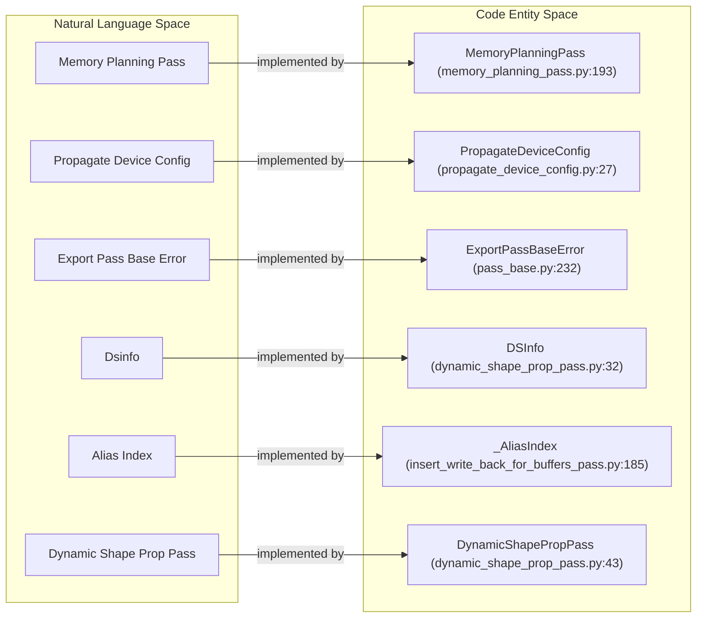
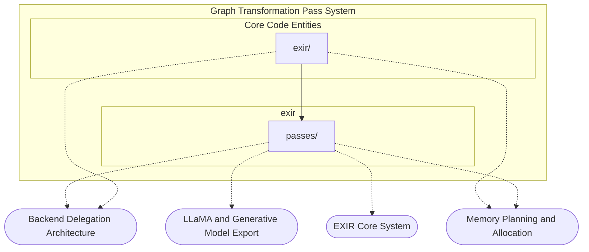
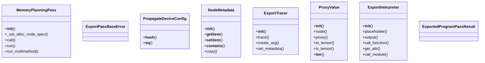
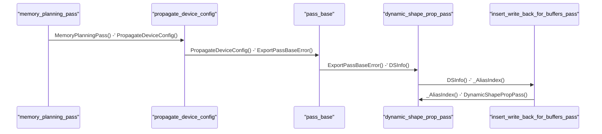

# Graph Transformation Pass System

↑ [[3-exir-core-system|EXIR Core System]]

> Architectural specification and implementation reference for Graph Transformation Pass System (30 relevant source files). Primary code entities: `MemoryPlanningPass`, `__init__`, `_set_alloc_node_spec`, `call`, `DSInfo`.

<details>
<summary>Relevant source files</summary>

The following files were used as context for generating this wiki page:

- [exir/passes/memory_planning_pass.py](exir/passes/memory_planning_pass.py)
- [exir/passes/dynamic_shape_prop_pass.py](exir/passes/dynamic_shape_prop_pass.py)
- [exir/passes/propagate_device_pass.py](exir/passes/propagate_device_pass.py)
- [exir/passes/insert_write_back_for_buffers_pass.py](exir/passes/insert_write_back_for_buffers_pass.py)
- [exir/passes/__init__.py](exir/passes/__init__.py)
- [exir/passes/constant_prop_pass.py](exir/passes/constant_prop_pass.py)
- [exir/passes/cse_pass.py](exir/passes/cse_pass.py)
- [exir/passes/_quant_patterns_and_replacements.py](exir/passes/_quant_patterns_and_replacements.py)
- [exir/passes/replace_complex_with_real_pass.py](exir/passes/replace_complex_with_real_pass.py)
- [exir/passes/delegate_scratch_pass.py](exir/passes/delegate_scratch_pass.py)
- [exir/passes/const_prop_pass.py](exir/passes/const_prop_pass.py)
- [exir/passes/legalize_portable_dim_order_pass.py](exir/passes/legalize_portable_dim_order_pass.py)
- [exir/passes/quantize_io_pass.py](exir/passes/quantize_io_pass.py)
- [exir/passes/debug_handle_generator_pass.py](exir/passes/debug_handle_generator_pass.py)
- [exir/passes/memory_format_ops_pass.py](exir/passes/memory_format_ops_pass.py)
- [exir/passes/fold_redundant_qdq_pass.py](exir/passes/fold_redundant_qdq_pass.py)
- [exir/passes/init_mutable_pass.py](exir/passes/init_mutable_pass.py)
- [exir/pass_base.py](exir/pass_base.py)
- [exir/passes/executorch_prim_ops_registry.py](exir/passes/executorch_prim_ops_registry.py)
- [exir/passes/propagate_device_config.py](exir/passes/propagate_device_config.py)
- [exir/passes/pass_registry.py](exir/passes/pass_registry.py)
- [exir/passes/replace_view_copy_with_view_pass.py](exir/passes/replace_view_copy_with_view_pass.py)
- [exir/passes/normalize_view_copy_base_pass.py](exir/passes/normalize_view_copy_base_pass.py)
- [exir/passes/quant_fusion_pass.py](exir/passes/quant_fusion_pass.py)
- [exir/passes/convert_constant_dim_order_pass.py](exir/passes/convert_constant_dim_order_pass.py)
- [exir/passes/normalize_transpose_pass.py](exir/passes/normalize_transpose_pass.py)
- [exir/passes/_device_copy_ops_registry.py](exir/passes/_device_copy_ops_registry.py)
- [exir/passes/dim_order_ops_registry.py](exir/passes/dim_order_ops_registry.py)
- [docs/source/compiler-custom-compiler-passes.md](docs/source/compiler-custom-compiler-passes.md)
- [exir/passes/BUCK](exir/passes/BUCK)

</details>

## Purpose and Scope

Architectural specification and implementation reference for Graph Transformation Pass System (30 relevant source files). Primary code entities: `MemoryPlanningPass`, `__init__`, `_set_alloc_node_spec`, `call`, `DSInfo`.

Primary code entities analyzed on this page include `MemoryPlanningPass` ([exir/passes/memory_planning_pass.py:193-372]()), `PropagateDeviceConfig` ([exir/passes/propagate_device_config.py:27-133]()), `ExportPassBaseError` ([exir/pass_base.py:232-233]()), `DSInfo` ([exir/passes/dynamic_shape_prop_pass.py:32-40]()), `_AliasIndex` ([exir/passes/insert_write_back_for_buffers_pass.py:185-217]()).

For the parent architectural layer, see [[3-exir-core-system|EXIR Core System]]. Related sibling subsystems: [[3.1-program-structure-and-compilation-flow|Program Structure and Compilation Flow]], [[3.3-memory-planning-and-allocation|Memory Planning and Allocation]], [[3.4-program-emission-and-serialization|Program Emission and Serialization]], [[3.5-verification-and-dialect-system|Verification and Dialect System]].

Sources: [exir/passes/memory_planning_pass.py:193-372](), [exir/passes/propagate_device_config.py:27-133](), [exir/pass_base.py:232-233](), [exir/passes/dynamic_shape_prop_pass.py:32-40]()

---

## 1. High-Level Architecture and Data Flow

### Natural Language Space to Code Entity Space Mapping

The following diagram maps domain concepts in this subsystem to their concrete code entities:



### Subsystem Component & Dependency Flow



Cross-subsystem call and import edges connect **Graph Transformation Pass System** with [[5-backend-delegation-architecture|Backend Delegation Architecture]] (coupling `7.0`), [[5.4-arm-tosa-and-ethos-u-backend|ARM TOSA and Ethos-U Backend]] (coupling `7.0`), [[6.1-llama-model-export|LLaMA and Generative Model Export]] (coupling `4.0`), [[3.3-memory-planning-and-allocation|Memory Planning and Allocation]] (coupling `2.0`), [[3.5-verification-and-dialect-system|Verification and Dialect System]] (coupling `1.0`).

| Module Directory | Files | Primary Code Entities | Source Citations |
|---|---|---|---|
| `exir/passes` | 28 | `MemoryPlanningPass`, `PropagateDeviceConfig`, `DSInfo`, `_AliasIndex` | [exir/passes/memory_planning_pass.py:193-372]() [exir/passes/propagate_device_config.py:27-133]() |
| `exir` | 1 | `ExportPassBaseError`, `ExportInterpreter`, `NodeMetadata`, `ExportedProgramPassBase` | [exir/pass_base.py:232-233]() [exir/pass_base.py:999-1047]() |

Sources: [exir/passes/memory_planning_pass.py:193-372](), [exir/passes/propagate_device_config.py:27-133](), [exir/pass_base.py:232-233](), [exir/passes/dynamic_shape_prop_pass.py:32-40](), [exir/passes/insert_write_back_for_buffers_pass.py:185-217]()

---

## 2. Core Data Structures and Implementation Details

### Class and Entity Relationship Diagram



### `MemoryPlanningPass` (Class)

- **Source Location**: [exir/passes/memory_planning_pass.py:193-372]()
- **Declaration**: `Class MemoryPlanningPass`
- **Graph Centrality**: fan-in `25` callers, fan-out `0` callees

```python
// exir/passes/memory_planning_pass.py:193-208
class MemoryPlanningPass(PassBase):
    def __init__(
        self,
        memory_planning_algo: Optional[Callable[..., List[int]]] = None,
        allow_lifetime_and_storage_overlap: bool = False,
        alloc_graph_input: bool = True,
        alloc_graph_output: bool = True,
        alloc_mutable_buffers: bool = True,
        share_mutable_buffers: bool = False,
        alignment: int = ALIGNMENT,
    ) -> None:
        r"""
        alloc_graph_input/alloc_graph_output will have 4 different combinations
        to control if the memory planning algorithm need allocate memory for
        the graph input/output. The default behavior is the algorithm will allocate
        memory for both graph input and output.
```

### `PropagateDeviceConfig` (Class)

- **Source Location**: [exir/passes/propagate_device_config.py:27-133]()
- **Declaration**: `Class PropagateDeviceConfig`
- **Graph Centrality**: fan-in `9` callers, fan-out `0` callees
- **Responsibility**: Controls whether the runtime copies method inputs, outputs and constants across the device boundary. Memory planning reserves buffers for graph inputs and outputs by default. A program that skips the input copy must use ``alloc_graph_input=False``. Unplanning the outputs as well, as below, copies the least:: Executorch

```python
// exir/passes/propagate_device_config.py:27-42
class PropagateDeviceConfig:
    """Controls whether the runtime copies method inputs, outputs and constants across the device boundary.

    Memory planning reserves buffers for graph inputs and outputs by default. A program that skips
    the input copy must use ``alloc_graph_input=False``. Unplanning the outputs as well, as below,
    copies the least::

        ExecutorchBackendConfig(
            propagate_device_config=PropagateDeviceConfig(
                skip_h2d_for_method_inputs=True,
                skip_d2h_for_method_outputs=True,
            ),
            enable_non_cpu_memory_planning=True,
            memory_planning_pass=MemoryPlanningPass(
                alloc_graph_input=False, alloc_graph_output=False
            ),
```

### `ExportPassBaseError` (Class)

- **Source Location**: [exir/pass_base.py:232-233]()
- **Declaration**: `Class ExportPassBaseError`
- **Graph Centrality**: fan-in `12` callers, fan-out `0` callees

### `DSInfo` (Class)

- **Source Location**: [exir/passes/dynamic_shape_prop_pass.py:32-40]()
- **Declaration**: `Class DSInfo`
- **Graph Centrality**: fan-in `1` callers, fan-out `0` callees
- **Responsibility**: Dynamic shape information we are tracking for each dynamic shape symbol.

```python
// exir/passes/dynamic_shape_prop_pass.py:32-40
class DSInfo:
    """
    Dynamic shape information we are tracking for each dynamic shape symbol.
    """

    # the output of format_node() for the node introducing the symbol
    node_debug_str: str
    # upper bound value or None for fully dynamic memory planning
    ubval: Optional[int]
```

### `_AliasIndex` (Class)

- **Source Location**: [exir/passes/insert_write_back_for_buffers_pass.py:185-217]()
- **Declaration**: `Class _AliasIndex`
- **Graph Centrality**: fan-in `1` callers, fan-out `0` callees
- **Responsibility**: Alias closures over the graph. The undirected adjacency (each node joined to the inputs its value may alias) is built once, and each closure is a breadth-first walk cached per seed. The closure is symmetric on purpose: the base of a view must count as an alias of the view's value, since a mutation of the base is a muta

### `_set_device_on_spec` (Function)

- **Source Location**: [exir/passes/propagate_device_pass.py:115-122]()
- **Declaration**: `( spec: TensorSpec, device_type: schema.DeviceType, device_index: int = 0, )`
- **Graph Centrality**: fan-in `6` callers, fan-out `0` callees
- **Responsibility**: Set the device attribute on a TensorSpec.

Sources: [exir/passes/memory_planning_pass.py:193-372](), [exir/passes/propagate_device_config.py:27-133](), [exir/pass_base.py:232-233](), [exir/passes/dynamic_shape_prop_pass.py:32-40](), [exir/passes/insert_write_back_for_buffers_pass.py:185-217]()

---

## 3. Execution and Call Flow

The sequence diagram below traces the runtime/compile-time call chain across components in this module:



Sources: [exir/passes/memory_planning_pass.py:193-372](), [exir/passes/propagate_device_config.py:27-133](), [exir/pass_base.py:232-233](), [exir/passes/dynamic_shape_prop_pass.py:32-40](), [exir/passes/insert_write_back_for_buffers_pass.py:185-217]()

---

## 4. Key API and Symbol Reference

| Code Entity | Kind | Location | Fan-In / Out | Role & Signature |
|---|---|---|---|---|
| `MemoryPlanningPass` | Class | [exir/passes/memory_planning_pass.py:193-372]() | `25` / `0` | — |
| `PropagateDeviceConfig` | Class | [exir/passes/propagate_device_config.py:27-133]() | `9` / `0` | Controls whether the runtime copies method inputs, outputs and constants across the device boundary. |
| `ExportPassBaseError` | Class | [exir/pass_base.py:232-233]() | `12` / `0` | — |
| `DSInfo` | Class | [exir/passes/dynamic_shape_prop_pass.py:32-40]() | `1` / `0` | Dynamic shape information we are tracking for each dynamic shape symbol. |
| `_AliasIndex` | Class | [exir/passes/insert_write_back_for_buffers_pass.py:185-217]() | `1` / `0` | Alias closures over the graph. The undirected adjacency (each node joined |
| `DynamicShapePropPass` | Class | [exir/passes/dynamic_shape_prop_pass.py:43-301]() | `0` / `0` | In general, for each op, this pass propagate dynamic shape information from |
| `PropagateDevicePass` | Class | [exir/passes/propagate_device_pass.py:282-890]() | `0` / `0` | After to_backend, walk the graph and insert H2D/D2H copy ops at delegate |
| `_Rewriter` | Class | [exir/passes/replace_complex_with_real_pass.py:161-216]() | `1` / `0` | Builds, in graph order, the real replacement of every node that reads |
| `CSEPass` | Class | [exir/passes/cse_pass.py:16-201]() | `0` / `0` | Common Subexpression Elimination using structural hashing (value numbering). |
| `DelegateScratchSpecPass` | Class | [exir/passes/delegate_scratch_pass.py:40-100]() | `0` / `0` | Materializes the scratch buffers a backend asked for in ``preprocess``. |
| `ReplaceComplexWithRealPass` | Class | [exir/passes/replace_complex_with_real_pass.py:426-482]() | `0` / `0` | Replace complex tensors with real tensors that hold their real and |
| `ConstPropPass` | Class | [exir/passes/const_prop_pass.py:22-84]() | `0` / `0` | Performs constant folding and constant propagation. |
| `LegalizePortableDimOrderPass` | Class | [exir/passes/legalize_portable_dim_order_pass.py:74-173]() | `0` / `0` | Insert dim-order copies before portable ops that need another layout. |
| `ExportInterpreter` | Class | [exir/pass_base.py:999-1047]() | `1` / `0` | Interpreter to callback on any ExportPassBase functions |
| `NodeMetadata` | Class | [exir/pass_base.py:151-167]() | `6` / `0` | — |
| `FoldRedundantDequantizeQuantizePass` | Class | [exir/passes/fold_redundant_qdq_pass.py:14-36]() | `0` / `0` | Fold adjacent ``dequantize -> quantize`` pairs using the shared qparam matcher. |
| `DimOrderOpsRevertPass` | Class | [exir/passes/memory_format_ops_pass.py:142-187]() | `0` / `0` | This pass is to revert the dim_order ops back to the memory format ops. |
| `MemoryFormatOpsPass` | Class | [exir/passes/memory_format_ops_pass.py:72-139]() | `0` / `0` | This pass replaces ops which takes torch.memory_format as an argument with |
| `ReplaceEmptyLikePass` | Class | [exir/passes/memory_format_ops_pass.py:25-69]() | `0` / `0` | Replaces aten.empty_like with aten.empty.memory_format. |
| `ExportedProgramPassBase` | Class | [exir/pass_base.py:301-373]() | `0` / `0` | Base interface for implementing passes that operate on ExportedProgram. |
| `_ExportPassBase` | Class | [exir/pass_base.py:376-985]() | `0` / `0` | Interpreter-based pass class to help users maintain the IR spec while writing |
| `InitializedMutableBufferPass` | Class | [exir/passes/init_mutable_pass.py:13-32]() | `0` / `0` | If a buffer has a name that within a specified list, set meta["et_init_buffer"] |

Sources: [exir/passes/memory_planning_pass.py:193-372](), [exir/passes/propagate_device_config.py:27-133](), [exir/pass_base.py:232-233](), [exir/passes/dynamic_shape_prop_pass.py:32-40](), [exir/passes/insert_write_back_for_buffers_pass.py:185-217](), [exir/passes/dynamic_shape_prop_pass.py:43-301]()

---

## 5. Official Documentation and Design Context

The following linked documentation sections from `llm-wiki` (`raw/`) provide additional architectural context, tutorials, and design invariants for this subsystem:

- **EXIR Core System** ([wiki/3-exir-core-system.md](), score `152.8943`) (sections: `EXIR Core System`, `Purpose and Scope`, `System Mapping: Natural Language Space to Code Entity Space`, `1. Program Structure and Compilation Flow`): # EXIR Core System > Architectural specification and implementation reference for EXIR Core System (40 relevant source files). Primary code entities: `EdgeProgramManager`, `__init__`, `config_methods`, `exported_program`, `MemoryPlanningPass`. <details> <summary>Relevant source files</summary> The following files were used as context for generating this wiki page: - [exir/program/_program.py](exir/program/_program.py
- **ExecuTorch DeepWiki** ([wiki/index.md](), score `101.7435`) (sections: `ExecuTorch DeepWiki`, `Pages`): # ExecuTorch DeepWiki Generated from `home-jason-Project-deepwiki-executorch` at commit `b3b565b5b62f` (2026-11-15T15:02:11+00:00). ## Pages - [[1-overview|Overview]] — Architectural specification and implementation reference for Overview (10 relevant source files). Primary code entities: `Module`, `MethodHolder`, `PlannedMemory`, `EdgeProgramManager`, `__init__`. - [[1.1-getting-started|Getting Started]] — Architect
- **Memory Planning and Allocation** ([wiki/3.3-memory-planning-and-allocation.md](), score `95.6128`) (sections: `Memory Planning and Allocation`, `Purpose and Scope`, `1. High-Level Architecture and Data Flow`, `Natural Language Space to Code Entity Space Mapping`): # Memory Planning and Allocation ↑ [[3-exir-core-system|EXIR Core System]] > Architectural specification and implementation reference for Memory Planning and Allocation (5 relevant source files). Primary code entities: `MemoryPlanningPass`, `__init__`, `_set_alloc_node_spec`, `call`, `AddressSpaceOverflowException`. <details> <summary>Relevant source files</summary> The following files were used as context for genera
- **Verification and Dialect System** ([wiki/3.5-verification-and-dialect-system.md](), score `83.4675`) (sections: `Verification and Dialect System`, `Purpose and Scope`, `1. High-Level Architecture and Data Flow`, `Natural Language Space to Code Entity Space Mapping`): # Verification and Dialect System ↑ [[3-exir-core-system|EXIR Core System]] > Architectural specification and implementation reference for Verification and Dialect System (34 relevant source files). Primary code entities: `Interpreter`, `__init__`, `call_kernel`, `get_constant_tensors`, `EdgeOpArgValidator`. <details> <summary>Relevant source files</summary> The following files were used as context for generating thi

Sources: [wiki/3-exir-core-system.md](), [wiki/index.md](), [wiki/3.3-memory-planning-and-allocation.md](), [wiki/3.5-verification-and-dialect-system.md]()

## Related pages

- [[3-exir-core-system|EXIR Core System]]
- [[1.1-getting-started|Getting Started]]
- [[1.2-export-api-and-recipe-system|Export API and Recipe System]]
- [[2.2-kernel-libraries-and-selective-build|Kernel Libraries and Selective Build]]
- [[2.3-schema-generation-and-flatbuffers|Schema Generation and FlatBuffers]]
- [[3.4-program-emission-and-serialization|Program Emission and Serialization]]
- [[3.5-verification-and-dialect-system|Verification and Dialect System]]
- [[4-quantization-systems|Quantization Systems]]

## Related documents

- `wiki/3-exir-core-system.md` — EXIR Core System (score 152.8943, via bm25)
- `wiki/index.md` — ExecuTorch DeepWiki (score 101.7435, via bm25)
- `wiki/3.3-memory-planning-and-allocation.md` — Memory Planning and Allocation (score 95.6128, via bm25)
- `wiki/3.5-verification-and-dialect-system.md` — Verification and Dialect System (score 83.4675, via bm25)
- `wiki/3.1-program-structure-and-compilation-flow.md` — Program Structure and Compilation Flow (score 79.8088, via bm25)

## Sources

- [`exir/passes/memory_planning_pass.py`](https://github.com/pytorch/executorch/blob/main/exir/passes/memory_planning_pass.py)
- [`exir/passes/dynamic_shape_prop_pass.py`](https://github.com/pytorch/executorch/blob/main/exir/passes/dynamic_shape_prop_pass.py)
- [`exir/passes/propagate_device_pass.py`](https://github.com/pytorch/executorch/blob/main/exir/passes/propagate_device_pass.py)
- [`exir/passes/insert_write_back_for_buffers_pass.py`](https://github.com/pytorch/executorch/blob/main/exir/passes/insert_write_back_for_buffers_pass.py)
- [`exir/passes/__init__.py`](https://github.com/pytorch/executorch/blob/main/exir/passes/__init__.py)
- [`exir/passes/constant_prop_pass.py`](https://github.com/pytorch/executorch/blob/main/exir/passes/constant_prop_pass.py)
- [`exir/passes/cse_pass.py`](https://github.com/pytorch/executorch/blob/main/exir/passes/cse_pass.py)
- [`exir/passes/_quant_patterns_and_replacements.py`](https://github.com/pytorch/executorch/blob/main/exir/passes/_quant_patterns_and_replacements.py)
- [`exir/passes/replace_complex_with_real_pass.py`](https://github.com/pytorch/executorch/blob/main/exir/passes/replace_complex_with_real_pass.py)
- [`exir/passes/delegate_scratch_pass.py`](https://github.com/pytorch/executorch/blob/main/exir/passes/delegate_scratch_pass.py)
- [`exir/passes/const_prop_pass.py`](https://github.com/pytorch/executorch/blob/main/exir/passes/const_prop_pass.py)
- [`exir/passes/legalize_portable_dim_order_pass.py`](https://github.com/pytorch/executorch/blob/main/exir/passes/legalize_portable_dim_order_pass.py)
- [`exir/passes/quantize_io_pass.py`](https://github.com/pytorch/executorch/blob/main/exir/passes/quantize_io_pass.py)
- [`exir/passes/debug_handle_generator_pass.py`](https://github.com/pytorch/executorch/blob/main/exir/passes/debug_handle_generator_pass.py)
- [`exir/passes/memory_format_ops_pass.py`](https://github.com/pytorch/executorch/blob/main/exir/passes/memory_format_ops_pass.py)
- [`exir/passes/fold_redundant_qdq_pass.py`](https://github.com/pytorch/executorch/blob/main/exir/passes/fold_redundant_qdq_pass.py)
- [`exir/passes/init_mutable_pass.py`](https://github.com/pytorch/executorch/blob/main/exir/passes/init_mutable_pass.py)
- [`exir/pass_base.py`](https://github.com/pytorch/executorch/blob/main/exir/pass_base.py)
- [`exir/passes/executorch_prim_ops_registry.py`](https://github.com/pytorch/executorch/blob/main/exir/passes/executorch_prim_ops_registry.py)
- [`exir/passes/propagate_device_config.py`](https://github.com/pytorch/executorch/blob/main/exir/passes/propagate_device_config.py)
- [`exir/passes/pass_registry.py`](https://github.com/pytorch/executorch/blob/main/exir/passes/pass_registry.py)
- [`exir/passes/replace_view_copy_with_view_pass.py`](https://github.com/pytorch/executorch/blob/main/exir/passes/replace_view_copy_with_view_pass.py)
- [`exir/passes/normalize_view_copy_base_pass.py`](https://github.com/pytorch/executorch/blob/main/exir/passes/normalize_view_copy_base_pass.py)
- [`exir/passes/quant_fusion_pass.py`](https://github.com/pytorch/executorch/blob/main/exir/passes/quant_fusion_pass.py)
- [`exir/passes/convert_constant_dim_order_pass.py`](https://github.com/pytorch/executorch/blob/main/exir/passes/convert_constant_dim_order_pass.py)
- [`exir/passes/normalize_transpose_pass.py`](https://github.com/pytorch/executorch/blob/main/exir/passes/normalize_transpose_pass.py)
- [`exir/passes/_device_copy_ops_registry.py`](https://github.com/pytorch/executorch/blob/main/exir/passes/_device_copy_ops_registry.py)
- [`exir/passes/dim_order_ops_registry.py`](https://github.com/pytorch/executorch/blob/main/exir/passes/dim_order_ops_registry.py)
- [`docs/source/compiler-custom-compiler-passes.md`](https://github.com/pytorch/executorch/blob/main/docs/source/compiler-custom-compiler-passes.md)
- [`exir/passes/BUCK`](https://github.com/pytorch/executorch/blob/main/exir/passes/BUCK)


## Dynamic Knowledge Links (Code Graph ↔ LLM-Wiki / RAG)

### Linked Architecture & Design Documents

| Document | Match Channel | Score | Shared Code Symbols |
|---|---|---|---|
| [[3-exir-core-system|EXIR Core System]] | `bm25+entity(3)` | `157.394` | `ExportPassBaseError`, `MemoryPlanningPass`, `PropagateDeviceConfig` |
| [[index|ExecuTorch DeepWiki]] | `bm25` | `101.743` | *(lexical/graph match)* |
| [[3.3-memory-planning-and-allocation|Memory Planning and Allocation]] | `bm25+entity(1)` | `97.113` | `MemoryPlanningPass` |
| [[3.4-program-emission-and-serialization|Program Emission and Serialization]] | `wikilink:3.2-graph-transformation-pass-system` | `90.488` | *(lexical/graph match)* |
| [[5-backend-delegation-architecture|Backend Delegation Architecture]] | `wikilink:3.2-graph-transformation-pass-system` | `90.488` | *(lexical/graph match)* |
| [[5.4-arm-tosa-and-ethos-u-backend|ARM TOSA and Ethos-U Backend]] | `wikilink:3.2-graph-transformation-pass-system` | `90.488` | *(lexical/graph match)* |

### High-Centrality Bridge Symbols (CBM Graph)

| Symbol | Kind | Source Location | Fan-In / Fan-Out |
|---|---|---|---|
| `MemoryPlanningPass` | Class | [exir/passes/memory_planning_pass.py:193-372]() | in: `25` / out: `0` |
| `PropagateDeviceConfig` | Class | [exir/passes/propagate_device_config.py:27-133]() | in: `9` / out: `0` |
| `ExportPassBaseError` | Class | [exir/pass_base.py:232-233]() | in: `12` / out: `0` |
| `DSInfo` | Class | [exir/passes/dynamic_shape_prop_pass.py:32-40]() | in: `1` / out: `0` |
| `_AliasIndex` | Class | [exir/passes/insert_write_back_for_buffers_pass.py:185-217]() | in: `1` / out: `0` |
| `DynamicShapePropPass` | Class | [exir/passes/dynamic_shape_prop_pass.py:43-301]() | in: `0` / out: `0` |

Sources: [exir/passes/memory_planning_pass.py:193-372](), [exir/passes/propagate_device_config.py:27-133](), [exir/pass_base.py:232-233](), [exir/passes/dynamic_shape_prop_pass.py:32-40]()

### Cross-Subsystem Coupling

- [[5-backend-delegation-architecture|Backend Delegation Architecture]] — call/import coupling weight `7.0`
- [[5.4-arm-tosa-and-ethos-u-backend|ARM TOSA and Ethos-U Backend]] — call/import coupling weight `7.0`
- [[6.1-llama-model-export|LLaMA and Generative Model Export]] — call/import coupling weight `4.0`
- [[3.3-memory-planning-and-allocation|Memory Planning and Allocation]] — call/import coupling weight `2.0`
- [[3.5-verification-and-dialect-system|Verification and Dialect System]] — call/import coupling weight `1.0`
- [[3-exir-core-system|EXIR Core System]] — call/import coupling weight `1.0`
