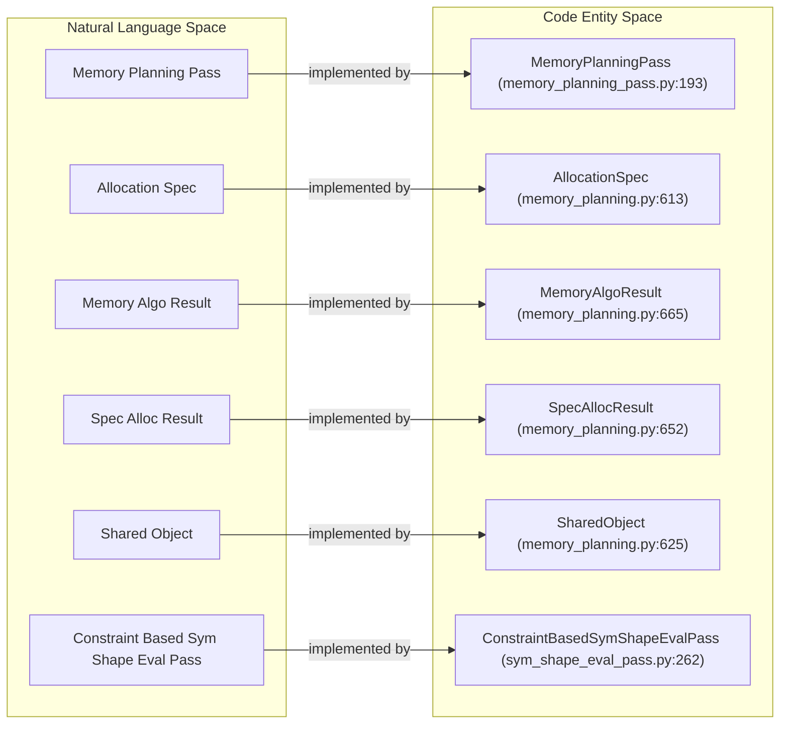
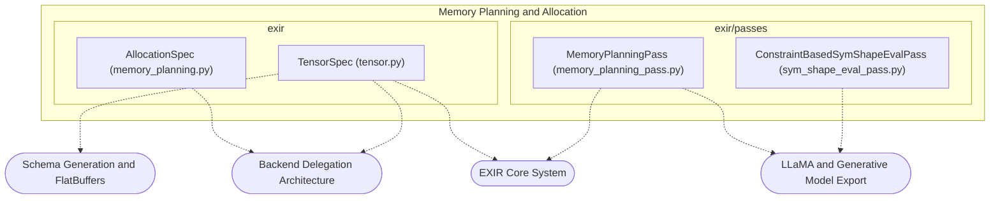
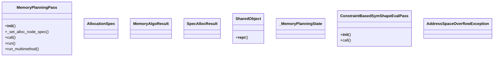
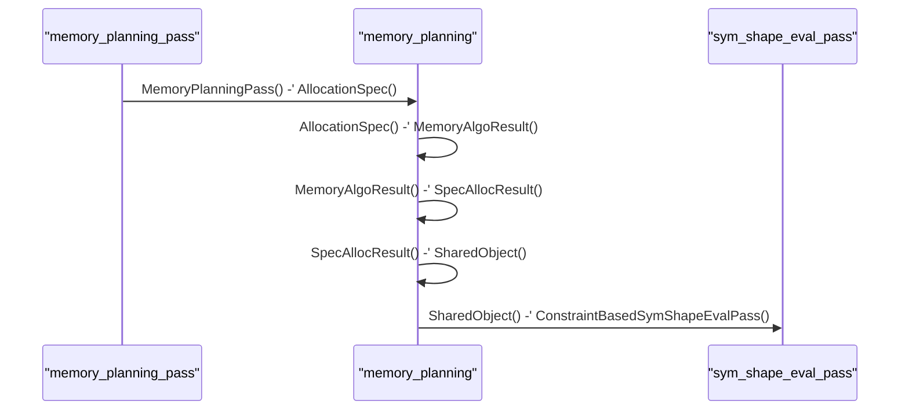

# Memory Planning and Allocation

↑ [[3-exir-core-system|EXIR Core System]]

> Architectural specification and implementation reference for Memory Planning and Allocation (5 relevant source files). Primary code entities: `MemoryPlanningPass`, `__init__`, `_set_alloc_node_spec`, `call`, `AddressSpaceOverflowException`.

<details>
<summary>Relevant source files</summary>

The following files were used as context for generating this wiki page:

- [exir/passes/memory_planning_pass.py](exir/passes/memory_planning_pass.py)
- [exir/tensor.py](exir/tensor.py)
- [exir/memory_planning.py](exir/memory_planning.py)
- [exir/passes/sym_shape_eval_pass.py](exir/passes/sym_shape_eval_pass.py)
- [docs/source/compiler-memory-planning.md](docs/source/compiler-memory-planning.md)

</details>

## Purpose and Scope

Architectural specification and implementation reference for Memory Planning and Allocation (5 relevant source files). Primary code entities: `MemoryPlanningPass`, `__init__`, `_set_alloc_node_spec`, `call`, `AddressSpaceOverflowException`.

Primary code entities analyzed on this page include `MemoryPlanningPass` ([exir/passes/memory_planning_pass.py:193-372]()), `AllocationSpec` ([exir/memory_planning.py:613-621]()), `MemoryAlgoResult` ([exir/memory_planning.py:665-673]()), `SpecAllocResult` ([exir/memory_planning.py:652-661]()), `SharedObject` ([exir/memory_planning.py:625-648]()).

For the parent architectural layer, see [[3-exir-core-system|EXIR Core System]]. Related sibling subsystems: [[3.1-program-structure-and-compilation-flow|Program Structure and Compilation Flow]], [[3.2-graph-transformation-pass-system|Graph Transformation Pass System]], [[3.4-program-emission-and-serialization|Program Emission and Serialization]], [[3.5-verification-and-dialect-system|Verification and Dialect System]].

Sources: [exir/passes/memory_planning_pass.py:193-372](), [exir/memory_planning.py:613-621](), [exir/memory_planning.py:665-673](), [exir/memory_planning.py:652-661]()

---

## 1. High-Level Architecture and Data Flow

### Natural Language Space to Code Entity Space Mapping

The following diagram maps domain concepts in this subsystem to their concrete code entities:



### Subsystem Component & Dependency Flow



Cross-subsystem call and import edges connect **Memory Planning and Allocation** with [[5-backend-delegation-architecture|Backend Delegation Architecture]] (coupling `14.0`), [[5.4-arm-tosa-and-ethos-u-backend|ARM TOSA and Ethos-U Backend]] (coupling `14.0`), [[3.4-program-emission-and-serialization|Program Emission and Serialization]] (coupling `6.0`), [[6.1-llama-model-export|LLaMA and Generative Model Export]] (coupling `5.0`), [[3-exir-core-system|EXIR Core System]] (coupling `4.0`).

| Module Directory | Files | Primary Code Entities | Source Citations |
|---|---|---|---|
| `exir` | 2 | `AllocationSpec`, `MemoryAlgoResult`, `SpecAllocResult`, `SharedObject` | [exir/memory_planning.py:613-621]() [exir/memory_planning.py:665-673]() |
| `exir/passes` | 2 | `MemoryPlanningPass`, `ConstraintBasedSymShapeEvalPass`, `HintBasedSymShapeEvalPass`, `_MemoryPlanningState` | [exir/passes/memory_planning_pass.py:193-372]() [exir/passes/sym_shape_eval_pass.py:262-312]() |

Sources: [exir/passes/memory_planning_pass.py:193-372](), [exir/memory_planning.py:613-621](), [exir/memory_planning.py:665-673](), [exir/memory_planning.py:652-661](), [exir/memory_planning.py:625-648]()

---

## 2. Core Data Structures and Implementation Details

### Class and Entity Relationship Diagram



### `MemoryPlanningPass` (Class)

- **Source Location**: [exir/passes/memory_planning_pass.py:193-372]()
- **Declaration**: `Class MemoryPlanningPass`
- **Graph Centrality**: fan-in `25` callers, fan-out `0` callees

```python
// exir/passes/memory_planning_pass.py:193-208
class MemoryPlanningPass(PassBase):
    def __init__(
        self,
        memory_planning_algo: Optional[Callable[..., List[int]]] = None,
        allow_lifetime_and_storage_overlap: bool = False,
        alloc_graph_input: bool = True,
        alloc_graph_output: bool = True,
        alloc_mutable_buffers: bool = True,
        share_mutable_buffers: bool = False,
        alignment: int = ALIGNMENT,
    ) -> None:
        r"""
        alloc_graph_input/alloc_graph_output will have 4 different combinations
        to control if the memory planning algorithm need allocate memory for
        the graph input/output. The default behavior is the algorithm will allocate
        memory for both graph input and output.
```

### `AllocationSpec` (Class)

- **Source Location**: [exir/memory_planning.py:613-621]()
- **Declaration**: `Class AllocationSpec`
- **Graph Centrality**: fan-in `2` callers, fan-out `0` callees
- **Responsibility**: AllocationSpec is used to represent the allocation of a tensor.

```python
// exir/memory_planning.py:613-621
class AllocationSpec:
    """
    AllocationSpec is used to represent the allocation of a tensor.
    """

    # The offset of the tensor in the shared object/pool.
    offset: int
    # TensorSpec
    spec: TensorSpec
```

### `MemoryAlgoResult` (Class)

- **Source Location**: [exir/memory_planning.py:665-673]()
- **Declaration**: `Class MemoryAlgoResult`
- **Graph Centrality**: fan-in `2` callers, fan-out `0` callees
- **Responsibility**: This is the result returned by a memory planning algorithm that is invoked by memory_planning_algorithm_suite. It contains the allocation decisions of that algorithm for all the specs, and the size of the buffer that was used for different memory hierarchies.

```python
// exir/memory_planning.py:665-673
class MemoryAlgoResult:
    """This is the result returned by a memory planning algorithm that is
    invoked by memory_planning_algorithm_suite. It contains the allocation
    decisions of that algorithm for all the specs, and the size of the buffer
    that was used for different memory hierarchies.
    """

    spec_dict: Dict[TensorSpec, SpecAllocResult]
    bufsizes: List[int]
```

### `SpecAllocResult` (Class)

- **Source Location**: [exir/memory_planning.py:652-661]()
- **Declaration**: `Class SpecAllocResult`
- **Graph Centrality**: fan-in `2` callers, fan-out `0` callees
- **Responsibility**: These are the values that a memory plannig algorithm assigns to a spec. These are not directly written back into the spec object, but are used to track the allocation decisions and assigned back to the spec object in the end, based on which algorithm is picked as the best performing one.

### `SharedObject` (Class)

- **Source Location**: [exir/memory_planning.py:625-648]()
- **Declaration**: `Class SharedObject`
- **Graph Centrality**: fan-in `1` callers, fan-out `0` callees
- **Responsibility**: r""" We define the concept of shared object, which represents a segment in the memory buffer that can be shared by multiple tensors. In order to check if a shared object is available for a tensor, we maintain the last_used_index attribute. The shared object will be available for nodes with index greater than last_used_

### `from_tensor` (Method)

- **Source Location**: [exir/tensor.py:232-252]()
- **Declaration**: `(cls, tensor: torch.Tensor, const: bool = False)`
- **Graph Centrality**: fan-in `19` callers, fan-out `2` callees

Sources: [exir/passes/memory_planning_pass.py:193-372](), [exir/memory_planning.py:613-621](), [exir/memory_planning.py:665-673](), [exir/memory_planning.py:652-661](), [exir/memory_planning.py:625-648]()

---

## 3. Execution and Call Flow

The sequence diagram below traces the runtime/compile-time call chain across components in this module:



Sources: [exir/passes/memory_planning_pass.py:193-372](), [exir/memory_planning.py:613-621](), [exir/memory_planning.py:665-673](), [exir/memory_planning.py:652-661](), [exir/memory_planning.py:625-648]()

---

## 4. Key API and Symbol Reference

| Code Entity | Kind | Location | Fan-In / Out | Role & Signature |
|---|---|---|---|---|
| `MemoryPlanningPass` | Class | [exir/passes/memory_planning_pass.py:193-372]() | `25` / `0` | — |
| `AllocationSpec` | Class | [exir/memory_planning.py:613-621]() | `2` / `0` | AllocationSpec is used to represent the allocation of a tensor. |
| `MemoryAlgoResult` | Class | [exir/memory_planning.py:665-673]() | `2` / `0` | This is the result returned by a memory planning algorithm that is |
| `SpecAllocResult` | Class | [exir/memory_planning.py:652-661]() | `2` / `0` | These are the values that a memory plannig algorithm assigns to a spec. |
| `SharedObject` | Class | [exir/memory_planning.py:625-648]() | `1` / `0` | r""" |
| `ConstraintBasedSymShapeEvalPass` | Class | [exir/passes/sym_shape_eval_pass.py:262-312]() | `1` / `0` | If we enable dynamic shape tracing, a tensor's shape may become a symbolic |
| `TensorSpec` | Class | [exir/tensor.py:183-333]() | `0` / `0` | Captures the metadata for a given Tensor (ex. scalar type, storage, etc.). |
| `Verifier` | Class | [exir/memory_planning.py:50-325]() | `0` / `0` | Verify if the outcome of a memory planning algorithm makes sense. |
| `HintBasedSymShapeEvalPass` | Class | [exir/passes/sym_shape_eval_pass.py:180-259]() | `0` / `0` | .. warning:: |
| `_MemoryPlanningState` | Class | [exir/passes/memory_planning_pass.py:187-190]() | `1` / `0` | — |
| `AddressSpaceOverflowException` | Class | [exir/tensor.py:24-25]() | `1` / `0` | — |
| `MemoryPlanningAlgorithmSuite` | Class | [exir/memory_planning.py:1058-1135]() | `0` / `0` | — |
| `from_tensor` | Method | [exir/tensor.py:232-252]() | `19` / `2` | (cls, tensor: torch.Tensor, const: bool = False) |
| `collect_specs_from_nodes` | Function | [exir/memory_planning.py:464-567]() | `3` / `7` | r""" |
| `_is_mutable_buffer` | Function | [exir/memory_planning.py:377-393]() | `5` / `0` | Check if the node is mutable buffer according to the provided graph signature. |
| `apply_algo` | Function | [exir/memory_planning.py:1464-1598]() | `1` / `8` | Recursively apply algo to graph_module and its submodules for control flow. |
| `get_node_tensor_specs` | Function | [exir/memory_planning.py:799-831]() | `5` / `0` | r""" |
| `pick_shared_obj` | Function | [exir/memory_planning.py:703-796]() | `1` / `6` | r""" |
| `update_all_tensors_lifetime` | Function | [exir/memory_planning.py:570-609]() | `1` / `6` | r""" |
| `run` | Method | [exir/passes/memory_planning_pass.py:280-344]() | `1` / `4` | A pass for memory planning. The actual algorithm used will be picked by |
| `verify_graph_input_output` | Method | [exir/memory_planning.py:236-325]() | `0` / `6` | r""" |
| `verify_storage_reuse` | Method | [exir/memory_planning.py:169-234]() | `0` / `6` | 'allow_lifetime_and_storage_overlap' allows tensors to overlap in both |

Sources: [exir/passes/memory_planning_pass.py:193-372](), [exir/memory_planning.py:613-621](), [exir/memory_planning.py:665-673](), [exir/memory_planning.py:652-661](), [exir/memory_planning.py:625-648](), [exir/passes/sym_shape_eval_pass.py:262-312]()

---

## 5. Official Documentation and Design Context

The following linked documentation sections from `llm-wiki` (`raw/`) provide additional architectural context, tutorials, and design invariants for this subsystem:

- **EXIR Core System** ([wiki/3-exir-core-system.md](), score `143.703`) (sections: `EXIR Core System`, `Purpose and Scope`, `System Mapping: Natural Language Space to Code Entity Space`, `1. Program Structure and Compilation Flow`): # EXIR Core System > Architectural specification and implementation reference for EXIR Core System (40 relevant source files). Primary code entities: `EdgeProgramManager`, `__init__`, `config_methods`, `exported_program`, `MemoryPlanningPass`. <details> <summary>Relevant source files</summary> The following files were used as context for generating this wiki page: - [exir/program/_program.py](exir/program/_program.py
- **Graph Transformation Pass System** ([wiki/3.2-graph-transformation-pass-system.md](), score `129.157`) (sections: `Graph Transformation Pass System`, `Purpose and Scope`, `1. High-Level Architecture and Data Flow`, `Natural Language Space to Code Entity Space Mapping`): # Graph Transformation Pass System ↑ [[3-exir-core-system|EXIR Core System]] > Architectural specification and implementation reference for Graph Transformation Pass System (30 relevant source files). Primary code entities: `MemoryPlanningPass`, `__init__`, `_set_alloc_node_spec`, `call`, `DSInfo`. <details> <summary>Relevant source files</summary> The following files were used as context for generating this wiki pag
- **ExecuTorch DeepWiki** ([wiki/index.md](), score `128.8969`) (sections: `ExecuTorch DeepWiki`, `Pages`): # ExecuTorch DeepWiki Generated from `home-jason-Project-deepwiki-executorch` at commit `b3b565b5b62f` (2026-11-15T15:02:11+00:00). ## Pages - [[1-overview|Overview]] — Architectural specification and implementation reference for Overview (10 relevant source files). Primary code entities: `Module`, `MethodHolder`, `PlannedMemory`, `EdgeProgramManager`, `__init__`. - [[1.1-getting-started|Getting Started]] — Architect
- **Memory Planning** ([compiler-memory-planning.md](), score `112.6266`) (sections: `Memory Planning`, `Overview`, `Algorithms`, `Method Inputs and Outputs`): # Memory Planning Audience: Backend integrators and embedded developers who are interested in customizing the regions of memory ExecuTorch programs operate in. ## Overview MemoryPlanning is the very last action taken before taking an `ExportedProgram` and undergoing emission to an ExecuTorch program. During this process, ExecuTorch takes the size and lifespan of each mutable tensor, and plans out their location in fi

Sources: [wiki/3-exir-core-system.md](), [wiki/3.2-graph-transformation-pass-system.md](), [wiki/index.md](), [compiler-memory-planning.md]()

## Related pages

- [[3-exir-core-system|EXIR Core System]]
- [[1.1-getting-started|Getting Started]]
- [[1.2-export-api-and-recipe-system|Export API and Recipe System]]
- [[2.2-kernel-libraries-and-selective-build|Kernel Libraries and Selective Build]]
- [[2.3-schema-generation-and-flatbuffers|Schema Generation and FlatBuffers]]
- [[3.4-program-emission-and-serialization|Program Emission and Serialization]]
- [[3.5-verification-and-dialect-system|Verification and Dialect System]]
- [[4-quantization-systems|Quantization Systems]]

## Related documents

- `wiki/3-exir-core-system.md` — EXIR Core System (score 143.703, via bm25)
- `wiki/3.2-graph-transformation-pass-system.md` — Graph Transformation Pass System (score 129.157, via bm25)
- `wiki/index.md` — ExecuTorch DeepWiki (score 128.8969, via bm25)
- `raw/executorch/compiler-memory-planning.md` — Memory Planning (score 112.6266, via bm25)
- `wiki/3.5-verification-and-dialect-system.md` — Verification and Dialect System (score 93.8587, via bm25)

## Sources

- [`exir/passes/memory_planning_pass.py`](https://github.com/pytorch/executorch/blob/main/exir/passes/memory_planning_pass.py)
- [`exir/tensor.py`](https://github.com/pytorch/executorch/blob/main/exir/tensor.py)
- [`exir/memory_planning.py`](https://github.com/pytorch/executorch/blob/main/exir/memory_planning.py)
- [`exir/passes/sym_shape_eval_pass.py`](https://github.com/pytorch/executorch/blob/main/exir/passes/sym_shape_eval_pass.py)
- [`docs/source/compiler-memory-planning.md`](https://github.com/pytorch/executorch/blob/main/docs/source/compiler-memory-planning.md)


## Dynamic Knowledge Links (Code Graph ↔ LLM-Wiki / RAG)

### Linked Architecture & Design Documents

| Document | Match Channel | Score | Shared Code Symbols |
|---|---|---|---|
| [[3-exir-core-system|EXIR Core System]] | `bm25+entity(2)` | `146.703` | `MemoryPlanningPass`, `from_tensor` |
| [[3.2-graph-transformation-pass-system|Graph Transformation Pass System]] | `bm25+entity(1)` | `130.657` | `MemoryPlanningPass` |
| [[index|ExecuTorch DeepWiki]] | `bm25` | `128.897` | *(lexical/graph match)* |
| `raw/executorch/compiler-memory-planning.md` (Memory Planning) | `bm25+entity(1)` | `114.127` | `MemoryPlanningPass` |
| [[3.1-program-structure-and-compilation-flow|Program Structure and Compilation Flow]] | `wikilink:3.3-memory-planning-and-allocation+entity(1)` | `106.728` | `MemoryPlanningPass` |
| [[3.4-program-emission-and-serialization|Program Emission and Serialization]] | `wikilink:3.3-memory-planning-and-allocation` | `105.228` | *(lexical/graph match)* |

### High-Centrality Bridge Symbols (CBM Graph)

| Symbol | Kind | Source Location | Fan-In / Fan-Out |
|---|---|---|---|
| `MemoryPlanningPass` | Class | [exir/passes/memory_planning_pass.py:193-372]() | in: `25` / out: `0` |
| `AllocationSpec` | Class | [exir/memory_planning.py:613-621]() | in: `2` / out: `0` |
| `MemoryAlgoResult` | Class | [exir/memory_planning.py:665-673]() | in: `2` / out: `0` |
| `SpecAllocResult` | Class | [exir/memory_planning.py:652-661]() | in: `2` / out: `0` |
| `SharedObject` | Class | [exir/memory_planning.py:625-648]() | in: `1` / out: `0` |
| `ConstraintBasedSymShapeEvalPass` | Class | [exir/passes/sym_shape_eval_pass.py:262-312]() | in: `1` / out: `0` |

Sources: [exir/passes/memory_planning_pass.py:193-372](), [exir/memory_planning.py:613-621](), [exir/memory_planning.py:665-673](), [exir/memory_planning.py:652-661]()

### Cross-Subsystem Coupling

- [[5-backend-delegation-architecture|Backend Delegation Architecture]] — call/import coupling weight `14.0`
- [[5.4-arm-tosa-and-ethos-u-backend|ARM TOSA and Ethos-U Backend]] — call/import coupling weight `14.0`
- [[3.4-program-emission-and-serialization|Program Emission and Serialization]] — call/import coupling weight `6.0`
- [[6.1-llama-model-export|LLaMA and Generative Model Export]] — call/import coupling weight `5.0`
- [[3-exir-core-system|EXIR Core System]] — call/import coupling weight `4.0`
- [[2.3-schema-generation-and-flatbuffers|Schema Generation and FlatBuffers]] — call/import coupling weight `3.0`
