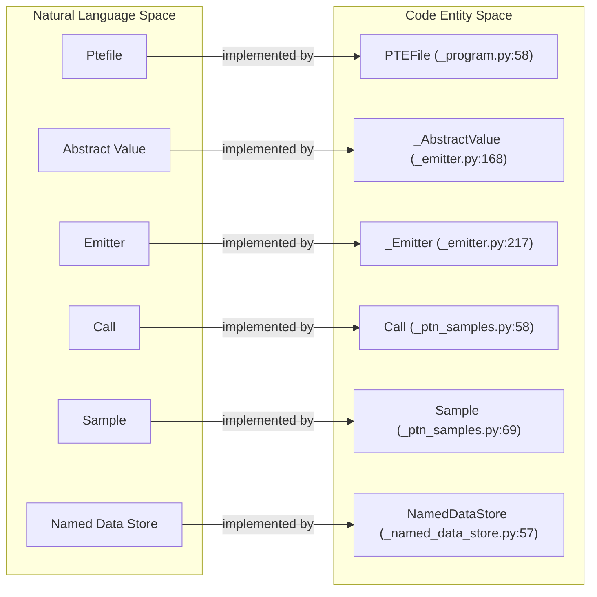
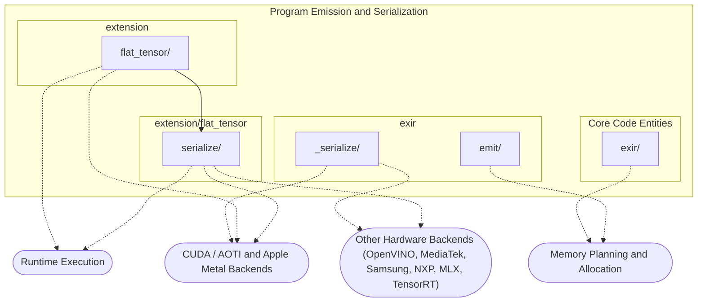
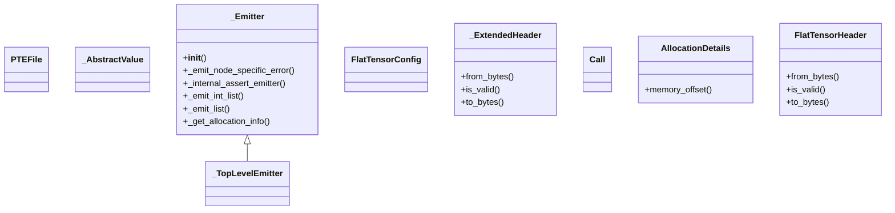
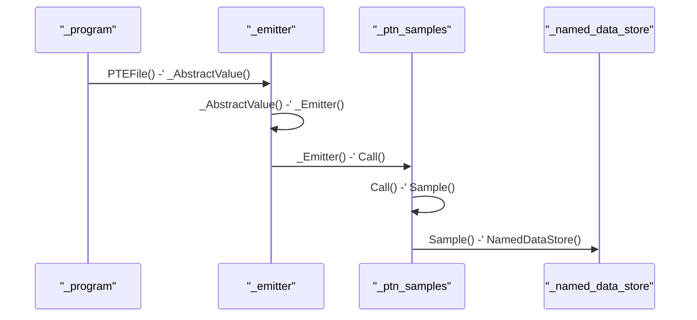

# Program Emission and Serialization

↑ [[3-exir-core-system|EXIR Core System]]

> Architectural specification and implementation reference for Program Emission and Serialization (35 relevant source files). Primary code entities: `_AbstractValue`, `_Emitter`, `__init__`, `_add_debug_handle`, `Call`.

<details>
<summary>Relevant source files</summary>

The following files were used as context for generating this wiki page:

- [exir/emit/_emitter.py](exir/emit/_emitter.py)
- [exir/_serialize/_ptn_samples.py](exir/_serialize/_ptn_samples.py)
- [exir/_serialize/_program.py](exir/_serialize/_program.py)
- [exir/_serialize/_named_data_store.py](exir/_serialize/_named_data_store.py)
- [exir/_serialize/_flatbuffer.py](exir/_serialize/_flatbuffer.py)
- [exir/_serialize/_flatbuffer_program.py](exir/_serialize/_flatbuffer_program.py)
- [exir/_serialize/_cord.py](exir/_serialize/_cord.py)
- [exir/emit/_emit_program.py](exir/emit/_emit_program.py)
- [exir/_serialize/_dataclass.py](exir/_serialize/_dataclass.py)
- [exir/_serialize/data_serializer.py](exir/_serialize/data_serializer.py)
- [exir/emit/__init__.py](exir/emit/__init__.py)
- [exir/_serialize/_ptn.py](exir/_serialize/_ptn.py)
- [exir/_serialize/__init__.py](exir/_serialize/__init__.py)
- [exir/_serialize/generate_program.py](exir/_serialize/generate_program.py)
- [exir/_serialize/_serialize.py](exir/_serialize/_serialize.py)
- [exir/_serialize/bindings.cpp](exir/_serialize/bindings.cpp)
- [extension/flat_tensor/serialize/serialize.py](extension/flat_tensor/serialize/serialize.py)
- [exir/schema.py](exir/schema.py)
- [extension/flat_tensor/flat_tensor_data_map.cpp](extension/flat_tensor/flat_tensor_data_map.cpp)
- [extension/flat_tensor/flat_tensor_data_map.h](extension/flat_tensor/flat_tensor_data_map.h)
- [extension/flat_tensor/serialize/flat_tensor_schema.py](extension/flat_tensor/serialize/flat_tensor_schema.py)
- [extension/flat_tensor/serialize/flat_tensor_header.h](extension/flat_tensor/serialize/flat_tensor_header.h)
- [extension/flat_tensor/serialize/serialize.cpp](extension/flat_tensor/serialize/serialize.cpp)
- [exir/_serialize/padding.py](exir/_serialize/padding.py)
- [extension/flat_tensor/targets.bzl](extension/flat_tensor/targets.bzl)
- [extension/flat_tensor/__init__.py](extension/flat_tensor/__init__.py)
- [extension/flat_tensor/serialize/flat_tensor_header.cpp](extension/flat_tensor/serialize/flat_tensor_header.cpp)
- [extension/flat_tensor/serialize/CMakeLists.txt](extension/flat_tensor/serialize/CMakeLists.txt)
- [extension/flat_tensor/README.md](extension/flat_tensor/README.md)
- [exir/emit/BUCK](exir/emit/BUCK)
- [exir/_serialize/BUCK](exir/_serialize/BUCK)
- [extension/flat_tensor/BUCK](extension/flat_tensor/BUCK)
- [extension/flat_tensor/CMakeLists.txt](extension/flat_tensor/CMakeLists.txt)
- [extension/flat_tensor/serialize/BUCK](extension/flat_tensor/serialize/BUCK)
- [extension/flat_tensor/serialize/flat_tensor.fbs](extension/flat_tensor/serialize/flat_tensor.fbs)

</details>

## Purpose and Scope

Architectural specification and implementation reference for Program Emission and Serialization (35 relevant source files). Primary code entities: `_AbstractValue`, `_Emitter`, `__init__`, `_add_debug_handle`, `Call`.

Primary code entities analyzed on this page include `PTEFile` ([exir/_serialize/_program.py:58-67]()), `_AbstractValue` ([exir/emit/_emitter.py:168-175]()), `_Emitter` ([exir/emit/_emitter.py:217-1964]()), `Call` ([exir/_serialize/_ptn_samples.py:58-65]()), `Sample` ([exir/_serialize/_ptn_samples.py:69-73]()).

For the parent architectural layer, see [[3-exir-core-system|EXIR Core System]]. Related sibling subsystems: [[3.1-program-structure-and-compilation-flow|Program Structure and Compilation Flow]], [[3.2-graph-transformation-pass-system|Graph Transformation Pass System]], [[3.3-memory-planning-and-allocation|Memory Planning and Allocation]], [[3.5-verification-and-dialect-system|Verification and Dialect System]].

Sources: [exir/_serialize/_program.py:58-67](), [exir/emit/_emitter.py:168-175](), [exir/emit/_emitter.py:217-1964](), [exir/_serialize/_ptn_samples.py:58-65]()

---

## 1. High-Level Architecture and Data Flow

### Natural Language Space to Code Entity Space Mapping

The following diagram maps domain concepts in this subsystem to their concrete code entities:



### Subsystem Component & Dependency Flow



Cross-subsystem call and import edges connect **Program Emission and Serialization** with [[8.1-core-runtime-architecture|Core Runtime Architecture]] (coupling `12.0`), [[8-runtime-execution|Runtime Execution]] (coupling `11.0`), [[5.7-cuda-aoti-and-apple-metal-backends|CUDA / AOTI and Apple Metal Backends]] (coupling `6.0`), [[3-exir-core-system|EXIR Core System]] (coupling `6.0`), [[3.3-memory-planning-and-allocation|Memory Planning and Allocation]] (coupling `6.0`).

| Module Directory | Files | Primary Code Entities | Source Citations |
|---|---|---|---|
| `exir/_serialize` | 15 | `PTEFile`, `Call`, `Sample`, `NamedDataStore` | [exir/_serialize/_program.py:58-67]() [exir/_serialize/_ptn_samples.py:58-65]() |
| `extension/flat_tensor/serialize` | 8 | `FlatTensorSerializer`, `FlatTensorHeader`, `FlatTensorConfig`, `FlatTensorHeader` | [extension/flat_tensor/serialize/serialize.py:259-429]() [extension/flat_tensor/serialize/flat_tensor_header.h:19-87]() |
| `extension/flat_tensor` | 7 | `FlatTensorDataMap`, `load_data_into`, `FlatTensorDataMap`, `create_tensor_layout` | [extension/flat_tensor/flat_tensor_data_map.h:35-139]() [extension/flat_tensor/flat_tensor_data_map.cpp:196-249]() |
| `exir/emit` | 4 | `_AbstractValue`, `_Emitter`, `_EmitterState`, `_ProgramState` | [exir/emit/_emitter.py:168-175]() [exir/emit/_emitter.py:217-1964]() |
| `exir` | 1 | `ExtraTensorInfo`, `NonConstBufferDevice`, `TensorShapeDynamism`, `AllocationDetails` | [exir/schema.py:57-66]() [exir/schema.py:279-287]() |

Sources: [exir/_serialize/_program.py:58-67](), [exir/emit/_emitter.py:168-175](), [exir/emit/_emitter.py:217-1964](), [exir/_serialize/_ptn_samples.py:58-65](), [exir/_serialize/_ptn_samples.py:69-73]()

---

## 2. Core Data Structures and Implementation Details

### Class and Entity Relationship Diagram



### `PTEFile` (Class)

- **Source Location**: [exir/_serialize/_program.py:58-67]()
- **Declaration**: `Class PTEFile`
- **Graph Centrality**: fan-in `10` callers, fan-out `0` callees
- **Responsibility**: Wraps together the data required to serialize into a PTE file.

```python
// exir/_serialize/_program.py:58-67
class PTEFile:
    """
    Wraps together the data required to serialize into a PTE file.
    """

    program: Program
    # TODO(lfq): add constant data (currently restored in the program)
    # TODO(lfq): update this to List[bytes]
    mutable_data: Optional[List[Buffer]] = None
    named_data: Optional[NamedDataStoreOutput] = None
```

### `_AbstractValue` (Class)

- **Source Location**: [exir/emit/_emitter.py:168-175]()
- **Declaration**: `Class _AbstractValue`
- **Graph Centrality**: fan-in `3` callers, fan-out `0` callees
- **Responsibility**: Represents an already emitted EValue

```python
// exir/emit/_emitter.py:168-175
class _AbstractValue:
    """Represents an already emitted EValue"""

    # Index in the values table of this EValue.
    id: int

    # Used for sanity checks for functions that expect to only receive AbstractValues.
    tensor: Optional[Tensor]
```

### `_Emitter` (Class)

- **Source Location**: [exir/emit/_emitter.py:217-1964]()
- **Declaration**: `Class _Emitter`
- **Graph Centrality**: fan-in `3` callers, fan-out `0` callees
- **Responsibility**: An abstract interpreter (https://wiki.mozilla.org/Abstract_Interpretation) used to emit the given traced torch.fx.GraphModule to the flatbuffer schema.

```python
// exir/emit/_emitter.py:217-232
class _Emitter(torch.fx.Interpreter):
    """An abstract interpreter (https://wiki.mozilla.org/Abstract_Interpretation) used to emit the
    given traced torch.fx.GraphModule to the flatbuffer schema."""

    # pyre-ignore[13]: Attribute `node` is never initialized.
    node: torch.fx.Node

    def __init__(
        self,
        graph_module: torch.fx.GraphModule,
        emitter_state: _EmitterState,
        program_state: _ProgramState,
        instruction_start_offset: int = 0,
        binding_input_values: Optional[List[_AbstractValue]] = None,
        binding_output_values: Optional[List[_AbstractValue]] = None,
    ) -> None:
```

### `Call` (Class)

- **Source Location**: [exir/_serialize/_ptn_samples.py:58-65]()
- **Declaration**: `Class Call`
- **Graph Centrality**: fan-in `2` callers, fan-out `0` callees
- **Responsibility**: One call of a method: positional inputs, and optionally what it produced.

### `Sample` (Class)

- **Source Location**: [exir/_serialize/_ptn_samples.py:69-73]()
- **Declaration**: `Class Sample`
- **Graph Centrality**: fan-in `1` callers, fan-out `0` callees
- **Responsibility**: Calls run in order from the program's initial state, with no reset between.

### `_emit_node_specific_error` (Method)

- **Source Location**: [exir/emit/_emitter.py:266-271]()
- **Declaration**: `(self, node: torch.fx.Node, err_msg: str)`
- **Graph Centrality**: fan-in `14` callers, fan-out `0` callees
- **Responsibility**: Returns 'err_msg' with node specific information attached.

Sources: [exir/_serialize/_program.py:58-67](), [exir/emit/_emitter.py:168-175](), [exir/emit/_emitter.py:217-1964](), [exir/_serialize/_ptn_samples.py:58-65](), [exir/_serialize/_ptn_samples.py:69-73]()

---

## 3. Execution and Call Flow

The sequence diagram below traces the runtime/compile-time call chain across components in this module:



Sources: [exir/_serialize/_program.py:58-67](), [exir/emit/_emitter.py:168-175](), [exir/emit/_emitter.py:217-1964](), [exir/_serialize/_ptn_samples.py:58-65](), [exir/_serialize/_ptn_samples.py:69-73]()

---

## 4. Key API and Symbol Reference

| Code Entity | Kind | Location | Fan-In / Out | Role & Signature |
|---|---|---|---|---|
| `PTEFile` | Class | [exir/_serialize/_program.py:58-67]() | `10` / `0` | Wraps together the data required to serialize into a PTE file. |
| `_AbstractValue` | Class | [exir/emit/_emitter.py:168-175]() | `3` / `0` | Represents an already emitted EValue |
| `_Emitter` | Class | [exir/emit/_emitter.py:217-1964]() | `3` / `0` | An abstract interpreter (https://wiki.mozilla.org/Abstract_Interpretation) used to emit the |
| `Call` | Class | [exir/_serialize/_ptn_samples.py:58-65]() | `2` / `0` | One call of a method: positional inputs, and optionally what it produced. |
| `Sample` | Class | [exir/_serialize/_ptn_samples.py:69-73]() | `1` / `0` | Calls run in order from the program's initial state, with no reset between. |
| `NamedDataStore` | Class | [exir/_serialize/_named_data_store.py:57-358]() | `1` / `0` | NamedDataStore manages the data that delegates want to share. Backends add |
| `NamedDataStoreOutput` | Class | [exir/_serialize/_named_data_store.py:39-54]() | `1` / `0` | Holds named data for serialization. Note: a DataEntry contains the index into |
| `_ResourceFiles` | Class | [exir/_serialize/_flatbuffer.py:125-153]() | `1` / `0` | Manages a collection of python resources that will be written to files. |
| `_SchemaFileIdentifierGetter` | Class | [exir/_serialize/_flatbuffer.py:103-122]() | `1` / `0` | Finds the file_identifier value in flatbuffer schemas. |
| `_SchemaMaxAlignmentGetter` | Class | [exir/_serialize/_flatbuffer.py:84-100]() | `1` / `0` | Finds the largest (force_align: N) N value in flatbuffer schemas. |
| `_EmitterState` | Class | [exir/emit/_emitter.py:139-164]() | `0` / `0` | State of a single emitter. |
| `_ProgramState` | Class | [exir/emit/_emitter.py:104-135]() | `0` / `0` | State shared between all methods of a program and the graph module it represents. |
| `_TopLevelEmitter` | Class | [exir/emit/_emitter.py:1967-2235]() | `0` / `0` | An emitter that manages the root level operations within a graph module. |
| `EmitterOutput` | Class | [exir/emit/_emit_program.py:28-60]() | `1` / `0` | The outputs of program emission. Contains the executorch program object as well as |
| `AlignedData` | Class | [exir/_serialize/data_serializer.py:45-53]() | `1` / `0` | Data and its required alignment for serialization. |
| `Cord` | Class | [exir/_serialize/_cord.py:94-140]() | `0` / `0` | A `bytes`-like sequence of bytes, stored non-contiguously. |
| `FileBackedData` | Class | [exir/_serialize/_cord.py:16-88]() | `0` / `0` | A byte buffer that stays on disk until explicitly closed. |
| `DataEntry` | Class | [exir/_serialize/data_serializer.py:11-24]() | `0` / `0` | Represents a single blob in `DataPayload`, specifying its location |
| `DataPayload` | Class | [exir/_serialize/data_serializer.py:28-41]() | `0` / `0` | Contains the data and metadata required for serialization. |
| `DataSerializer` | Class | [exir/_serialize/data_serializer.py:83-120]() | `0` / `0` | Serializes and deserializes data. Data can be referenced by a unique key. |
| `FlatTensorSerializer` | Class | [extension/flat_tensor/serialize/serialize.py:259-429]() | `2` / `0` | A concrete implementation of the DataSerializer interface that |
| `ExtraTensorInfo` | Class | [exir/schema.py:57-66]() | `1` / `0` | Check program.fbs for explanations of this enum. |

Sources: [exir/_serialize/_program.py:58-67](), [exir/emit/_emitter.py:168-175](), [exir/emit/_emitter.py:217-1964](), [exir/_serialize/_ptn_samples.py:58-65](), [exir/_serialize/_ptn_samples.py:69-73](), [exir/_serialize/_named_data_store.py:57-358]()

---

## 5. Official Documentation and Design Context

The following linked documentation sections from `llm-wiki` (`raw/`) provide additional architectural context, tutorials, and design invariants for this subsystem:

- **Schema Generation and FlatBuffers** ([wiki/2.3-schema-generation-and-flatbuffers.md](), score `124.7044`) (sections: `Schema Generation and FlatBuffers`, `Purpose and Scope`, `1. High-Level Architecture and Data Flow`, `Natural Language Space to Code Entity Space Mapping`): # Schema Generation and FlatBuffers ↑ [[2-build-system-and-infrastructure|Build System and Infrastructure]] > Architectural specification and implementation reference for Schema Generation and FlatBuffers (36 relevant source files). Primary code entities: `Call`, `Sample`, `SampleSet`, `_SetDecoder`, `PTEFile`. <details> <summary>Relevant source files</summary> The following files were used as context for generating 
- **EXIR Core System** ([wiki/3-exir-core-system.md](), score `82.7859`) (sections: `EXIR Core System`, `Purpose and Scope`, `System Mapping: Natural Language Space to Code Entity Space`, `1. Program Structure and Compilation Flow`): # EXIR Core System > Architectural specification and implementation reference for EXIR Core System (40 relevant source files). Primary code entities: `EdgeProgramManager`, `__init__`, `config_methods`, `exported_program`, `MemoryPlanningPass`. <details> <summary>Relevant source files</summary> The following files were used as context for generating this wiki page: - [exir/program/_program.py](exir/program/_program.py
- **ExecuTorch DeepWiki** ([wiki/index.md](), score `80.8309`) (sections: `ExecuTorch DeepWiki`, `Pages`): # ExecuTorch DeepWiki Generated from `home-jason-Project-deepwiki-executorch` at commit `b3b565b5b62f` (2026-11-15T15:02:11+00:00). ## Pages - [[1-overview|Overview]] — Architectural specification and implementation reference for Overview (10 relevant source files). Primary code entities: `Module`, `MethodHolder`, `PlannedMemory`, `EdgeProgramManager`, `__init__`. - [[1.1-getting-started|Getting Started]] — Architect
- **Performance Benchmarking and Profiling** ([wiki/7.3-performance-benchmarking-and-profiling.md](), score `68.9246`) (sections: `Performance Benchmarking and Profiling`, `Purpose and Scope`, `1. High-Level Architecture and Data Flow`, `Natural Language Space to Code Entity Space Mapping`): # Performance Benchmarking and Profiling ↑ [[7-testing-and-cicd-infrastructure|Testing and CI/CD Infrastructure]] > Architectural specification and implementation reference for Performance Benchmarking and Profiling (36 relevant source files). Primary code entities: `Allocator`, `MemAllocation`, `MemEvent`, `ProfileData`, `ETDumpGen`. <details> <summary>Relevant source files</summary> The following files were used as

Sources: [wiki/2.3-schema-generation-and-flatbuffers.md](), [wiki/3-exir-core-system.md](), [wiki/index.md](), [wiki/7.3-performance-benchmarking-and-profiling.md]()

## Related pages

- [[3-exir-core-system|EXIR Core System]]
- [[1.1-getting-started|Getting Started]]
- [[1.2-export-api-and-recipe-system|Export API and Recipe System]]
- [[2.2-kernel-libraries-and-selective-build|Kernel Libraries and Selective Build]]
- [[2.3-schema-generation-and-flatbuffers|Schema Generation and FlatBuffers]]
- [[3.1-program-structure-and-compilation-flow|Program Structure and Compilation Flow]]
- [[3.2-graph-transformation-pass-system|Graph Transformation Pass System]]
- [[3.3-memory-planning-and-allocation|Memory Planning and Allocation]]

## Related documents

- `wiki/2.3-schema-generation-and-flatbuffers.md` — Schema Generation and FlatBuffers (score 124.7044, via bm25)
- `wiki/3-exir-core-system.md` — EXIR Core System (score 82.7859, via bm25)
- `wiki/index.md` — ExecuTorch DeepWiki (score 80.8309, via bm25)
- `wiki/7.3-performance-benchmarking-and-profiling.md` — Performance Benchmarking and Profiling (score 68.9246, via bm25)
- `wiki/8.3-developer-tools-devtools.md` — Developer Tools (DevTools: ETDump, ETRecord, Inspector) (score 61.4411, via bm25)

## Sources

- [`exir/emit/_emitter.py`](https://github.com/pytorch/executorch/blob/main/exir/emit/_emitter.py)
- [`exir/_serialize/_ptn_samples.py`](https://github.com/pytorch/executorch/blob/main/exir/_serialize/_ptn_samples.py)
- [`exir/_serialize/_program.py`](https://github.com/pytorch/executorch/blob/main/exir/_serialize/_program.py)
- [`exir/_serialize/_named_data_store.py`](https://github.com/pytorch/executorch/blob/main/exir/_serialize/_named_data_store.py)
- [`exir/_serialize/_flatbuffer.py`](https://github.com/pytorch/executorch/blob/main/exir/_serialize/_flatbuffer.py)
- [`exir/_serialize/_flatbuffer_program.py`](https://github.com/pytorch/executorch/blob/main/exir/_serialize/_flatbuffer_program.py)
- [`exir/_serialize/_cord.py`](https://github.com/pytorch/executorch/blob/main/exir/_serialize/_cord.py)
- [`exir/emit/_emit_program.py`](https://github.com/pytorch/executorch/blob/main/exir/emit/_emit_program.py)
- [`exir/_serialize/_dataclass.py`](https://github.com/pytorch/executorch/blob/main/exir/_serialize/_dataclass.py)
- [`exir/_serialize/data_serializer.py`](https://github.com/pytorch/executorch/blob/main/exir/_serialize/data_serializer.py)
- [`exir/emit/__init__.py`](https://github.com/pytorch/executorch/blob/main/exir/emit/__init__.py)
- [`exir/_serialize/_ptn.py`](https://github.com/pytorch/executorch/blob/main/exir/_serialize/_ptn.py)
- [`exir/_serialize/__init__.py`](https://github.com/pytorch/executorch/blob/main/exir/_serialize/__init__.py)
- [`exir/_serialize/generate_program.py`](https://github.com/pytorch/executorch/blob/main/exir/_serialize/generate_program.py)
- [`exir/_serialize/_serialize.py`](https://github.com/pytorch/executorch/blob/main/exir/_serialize/_serialize.py)
- [`exir/_serialize/bindings.cpp`](https://github.com/pytorch/executorch/blob/main/exir/_serialize/bindings.cpp)
- [`extension/flat_tensor/serialize/serialize.py`](https://github.com/pytorch/executorch/blob/main/extension/flat_tensor/serialize/serialize.py)
- [`exir/schema.py`](https://github.com/pytorch/executorch/blob/main/exir/schema.py)
- [`extension/flat_tensor/flat_tensor_data_map.cpp`](https://github.com/pytorch/executorch/blob/main/extension/flat_tensor/flat_tensor_data_map.cpp)
- [`extension/flat_tensor/flat_tensor_data_map.h`](https://github.com/pytorch/executorch/blob/main/extension/flat_tensor/flat_tensor_data_map.h)
- [`extension/flat_tensor/serialize/flat_tensor_schema.py`](https://github.com/pytorch/executorch/blob/main/extension/flat_tensor/serialize/flat_tensor_schema.py)
- [`extension/flat_tensor/serialize/flat_tensor_header.h`](https://github.com/pytorch/executorch/blob/main/extension/flat_tensor/serialize/flat_tensor_header.h)
- [`extension/flat_tensor/serialize/serialize.cpp`](https://github.com/pytorch/executorch/blob/main/extension/flat_tensor/serialize/serialize.cpp)
- [`exir/_serialize/padding.py`](https://github.com/pytorch/executorch/blob/main/exir/_serialize/padding.py)
- [`extension/flat_tensor/targets.bzl`](https://github.com/pytorch/executorch/blob/main/extension/flat_tensor/targets.bzl)
- [`extension/flat_tensor/__init__.py`](https://github.com/pytorch/executorch/blob/main/extension/flat_tensor/__init__.py)
- [`extension/flat_tensor/serialize/flat_tensor_header.cpp`](https://github.com/pytorch/executorch/blob/main/extension/flat_tensor/serialize/flat_tensor_header.cpp)
- [`extension/flat_tensor/serialize/CMakeLists.txt`](https://github.com/pytorch/executorch/blob/main/extension/flat_tensor/serialize/CMakeLists.txt)
- [`extension/flat_tensor/README.md`](https://github.com/pytorch/executorch/blob/main/extension/flat_tensor/README.md)
- [`exir/emit/BUCK`](https://github.com/pytorch/executorch/blob/main/exir/emit/BUCK)
- [`exir/_serialize/BUCK`](https://github.com/pytorch/executorch/blob/main/exir/_serialize/BUCK)
- [`extension/flat_tensor/BUCK`](https://github.com/pytorch/executorch/blob/main/extension/flat_tensor/BUCK)
- [`extension/flat_tensor/CMakeLists.txt`](https://github.com/pytorch/executorch/blob/main/extension/flat_tensor/CMakeLists.txt)
- [`extension/flat_tensor/serialize/BUCK`](https://github.com/pytorch/executorch/blob/main/extension/flat_tensor/serialize/BUCK)
- [`extension/flat_tensor/serialize/flat_tensor.fbs`](https://github.com/pytorch/executorch/blob/main/extension/flat_tensor/serialize/flat_tensor.fbs)


## Dynamic Knowledge Links (Code Graph ↔ LLM-Wiki / RAG)

### Linked Architecture & Design Documents

| Document | Match Channel | Score | Shared Code Symbols |
|---|---|---|---|
| [[2.3-schema-generation-and-flatbuffers|Schema Generation and FlatBuffers]] | `bm25+entity(5)` | `132.204` | `BackendDelegateDataReference`, `ExtraTensorInfo`, `FlatTensorConfig`, `PTEFile`, `Tensor` |
| [[3-exir-core-system|EXIR Core System]] | `bm25+entity(2)` | `85.786` | `PTEFile`, `Tensor` |
| [[index|ExecuTorch DeepWiki]] | `bm25` | `80.831` | *(lexical/graph match)* |
| [[3.3-memory-planning-and-allocation|Memory Planning and Allocation]] | `wikilink:3.4-program-emission-and-serialization+entity(3)` | `74.692` | `Tensor`, `_AbstractValue`, `_Emitter` |
| [[3.1-program-structure-and-compilation-flow|Program Structure and Compilation Flow]] | `wikilink:3.4-program-emission-and-serialization+entity(2)` | `73.192` | `_AbstractValue`, `_Emitter` |
| [[7.3-performance-benchmarking-and-profiling|Performance Benchmarking and Profiling]] | `bm25+entity(1)` | `70.425` | `PTEFile` |

### High-Centrality Bridge Symbols (CBM Graph)

| Symbol | Kind | Source Location | Fan-In / Fan-Out |
|---|---|---|---|
| `PTEFile` | Class | [exir/_serialize/_program.py:58-67]() | in: `10` / out: `0` |
| `_AbstractValue` | Class | [exir/emit/_emitter.py:168-175]() | in: `3` / out: `0` |
| `_Emitter` | Class | [exir/emit/_emitter.py:217-1964]() | in: `3` / out: `0` |
| `Call` | Class | [exir/_serialize/_ptn_samples.py:58-65]() | in: `2` / out: `0` |
| `Sample` | Class | [exir/_serialize/_ptn_samples.py:69-73]() | in: `1` / out: `0` |
| `NamedDataStore` | Class | [exir/_serialize/_named_data_store.py:57-358]() | in: `1` / out: `0` |

Sources: [exir/_serialize/_program.py:58-67](), [exir/emit/_emitter.py:168-175](), [exir/emit/_emitter.py:217-1964](), [exir/_serialize/_ptn_samples.py:58-65]()

### Cross-Subsystem Coupling

- [[8.1-core-runtime-architecture|Core Runtime Architecture]] — call/import coupling weight `12.0`
- [[8-runtime-execution|Runtime Execution]] — call/import coupling weight `11.0`
- [[5.7-cuda-aoti-and-apple-metal-backends|CUDA / AOTI and Apple Metal Backends]] — call/import coupling weight `6.0`
- [[3-exir-core-system|EXIR Core System]] — call/import coupling weight `6.0`
- [[3.3-memory-planning-and-allocation|Memory Planning and Allocation]] — call/import coupling weight `6.0`
- [[1.2-export-api-and-recipe-system|Export API and Recipe System]] — call/import coupling weight `5.0`
