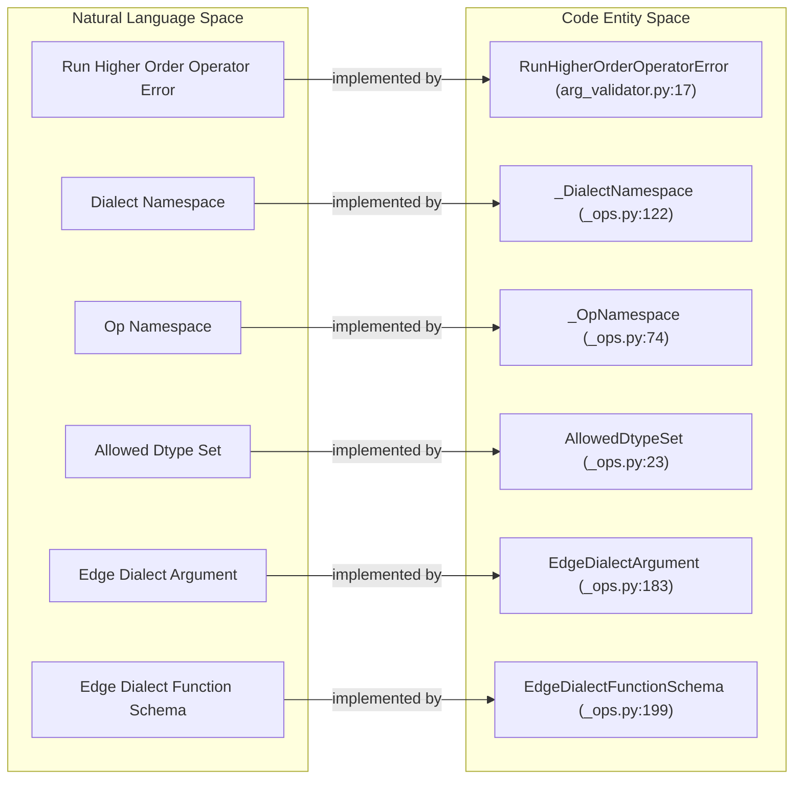
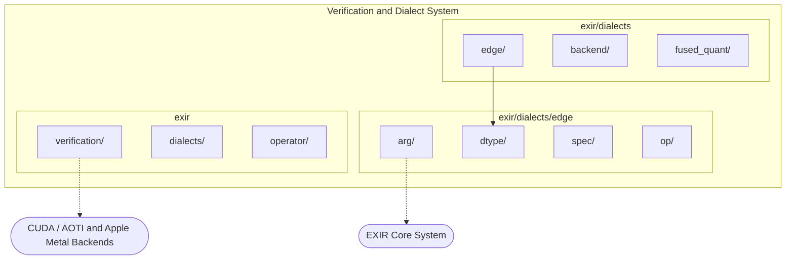
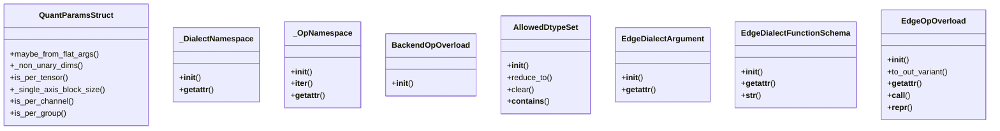
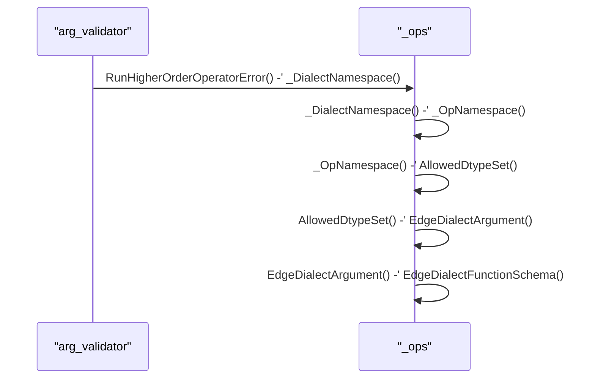

# Verification and Dialect System

↑ [[3-exir-core-system|EXIR Core System]]

> Architectural specification and implementation reference for Verification and Dialect System (34 relevant source files). Primary code entities: `Interpreter`, `__init__`, `call_kernel`, `get_constant_tensors`, `EdgeOpArgValidator`.

<details>
<summary>Relevant source files</summary>

The following files were used as context for generating this wiki page:

- [exir/verification/interpreter.py](exir/verification/interpreter.py)
- [exir/verification/arg_validator.py](exir/verification/arg_validator.py)
- [exir/verification/verifier.py](exir/verification/verifier.py)
- [exir/verification/bindings.cpp](exir/verification/bindings.cpp)
- [exir/dialects/_ops.py](exir/dialects/_ops.py)
- [exir/dialects/edge/_ops.py](exir/dialects/edge/_ops.py)
- [exir/dialects/edge/arg/model.py](exir/dialects/edge/arg/model.py)
- [exir/dialects/backend/_ops.py](exir/dialects/backend/_ops.py)
- [exir/dialects/fused_quant/ops.py](exir/dialects/fused_quant/ops.py)
- [exir/verification/dev_html.py](exir/verification/dev_html.py)
- [exir/verification/targets.bzl](exir/verification/targets.bzl)
- [exir/dialects/edge/dtype/runner.py](exir/dialects/edge/dtype/runner.py)
- [exir/dialects/edge/arg/type.py](exir/dialects/edge/arg/type.py)
- [exir/dialects/edge/spec/gen.py](exir/dialects/edge/spec/gen.py)
- [exir/dialects/__init__.py](exir/dialects/__init__.py)
- [exir/operator/convert.py](exir/operator/convert.py)
- [exir/dialects/edge/spec/utils.py](exir/dialects/edge/spec/utils.py)
- [exir/operator/manip.py](exir/operator/manip.py)
- [exir/dialects/edge/dtype/supported.py](exir/dialects/edge/dtype/supported.py)
- [exir/dialects/edge/op/api.py](exir/dialects/edge/op/api.py)
- [exir/dialects/edge/dtype/utils.py](exir/dialects/edge/dtype/utils.py)
- [exir/dialects/edge/op/sample_input.py](exir/dialects/edge/op/sample_input.py)
- [exir/dialects/fused_quant/__init__.py](exir/dialects/fused_quant/__init__.py)
- [exir/dialects/fused_quant/ops_utils.py](exir/dialects/fused_quant/ops_utils.py)
- [exir/dialects/edge/spec/targets.bzl](exir/dialects/edge/spec/targets.bzl)
- [exir/dialects/fused_quant/targets.bzl](exir/dialects/fused_quant/targets.bzl)
- [exir/operator/util.py](exir/operator/util.py)
- [docs/source/ir-exir.md](docs/source/ir-exir.md)
- [exir/verification/BUCK](exir/verification/BUCK)
- [exir/dialects/BUCK](exir/dialects/BUCK)
- [exir/dialects/backend/BUCK](exir/dialects/backend/BUCK)
- [exir/dialects/edge/BUCK](exir/dialects/edge/BUCK)
- [exir/dialects/edge/arg/BUCK](exir/dialects/edge/arg/BUCK)
- [exir/dialects/edge/dtype/BUCK](exir/dialects/edge/dtype/BUCK)

</details>

## Purpose and Scope

Architectural specification and implementation reference for Verification and Dialect System (34 relevant source files). Primary code entities: `Interpreter`, `__init__`, `call_kernel`, `get_constant_tensors`, `EdgeOpArgValidator`.

Primary code entities analyzed on this page include `RunHigherOrderOperatorError` ([exir/verification/arg_validator.py:17-25]()), `_DialectNamespace` ([exir/dialects/_ops.py:122-143]()), `_OpNamespace` ([exir/dialects/_ops.py:74-119]()), `AllowedDtypeSet` ([exir/dialects/edge/_ops.py:23-65]()), `EdgeDialectArgument` ([exir/dialects/edge/_ops.py:183-196]()).

For the parent architectural layer, see [[3-exir-core-system|EXIR Core System]]. Related sibling subsystems: [[3.1-program-structure-and-compilation-flow|Program Structure and Compilation Flow]], [[3.2-graph-transformation-pass-system|Graph Transformation Pass System]], [[3.3-memory-planning-and-allocation|Memory Planning and Allocation]], [[3.4-program-emission-and-serialization|Program Emission and Serialization]].

Sources: [exir/verification/arg_validator.py:17-25](), [exir/dialects/_ops.py:122-143](), [exir/dialects/_ops.py:74-119](), [exir/dialects/edge/_ops.py:23-65]()

---

## 1. High-Level Architecture and Data Flow

### Natural Language Space to Code Entity Space Mapping

The following diagram maps domain concepts in this subsystem to their concrete code entities:



### Subsystem Component & Dependency Flow



Cross-subsystem call and import edges connect **Verification and Dialect System** with [[5.7-cuda-aoti-and-apple-metal-backends|CUDA / AOTI and Apple Metal Backends]] (coupling `2.0`), [[3-exir-core-system|EXIR Core System]] (coupling `1.0`), [[3.2-graph-transformation-pass-system|Graph Transformation Pass System]] (coupling `1.0`).

| Module Directory | Files | Primary Code Entities | Source Citations |
|---|---|---|---|
| `exir/verification` | 7 | `RunHigherOrderOperatorError`, `EdgeOpArgValidator`, `Uninitialized`, `Interpreter` | [exir/verification/arg_validator.py:17-25]() [exir/verification/arg_validator.py:29-148]() |
| `exir/dialects/edge/dtype` | 4 | `DtypeRunner`, `run`, `_get_args_kwargs`, `_get_types` | [exir/dialects/edge/dtype/runner.py:18-122]() [exir/dialects/edge/dtype/runner.py:108-122]() |
| `exir/dialects/fused_quant` | 4 | `QuantParamsStruct`, `_make_qp`, `_validate_qparams`, `dequantized_dtype` | [exir/dialects/fused_quant/ops.py:51-240]() [exir/dialects/fused_quant/ops.py:293-302]() |
| `exir/dialects` | 3 | `_DialectNamespace`, `_OpNamespace`, `_Ops`, `bind_pattern_to_op` | [exir/dialects/_ops.py:122-143]() [exir/dialects/_ops.py:74-119]() |
| `exir/dialects/edge/arg` | 3 | `Return`, `OutArg`, `ArgMode`, `BaseArg` | [exir/dialects/edge/arg/model.py:213-238]() [exir/dialects/edge/arg/model.py:203-210]() |
| `exir/dialects/edge/spec` | 3 | `EdgeOpYamlInfo`, `EdgeYamlInfo`, `test_case_generator`, `gen_edge_yaml` | [exir/dialects/edge/spec/gen.py:238-327]() [exir/dialects/edge/spec/gen.py:330-377]() |
| `exir/operator` | 3 | `ScratchTensorMetadata`, `get_op_overload`, `set_mapping_for_op`, `_pybind_schema_to_native_schema` | [exir/operator/manip.py:20-25]() [exir/operator/convert.py:183-192]() |
| `exir/dialects/backend` | 2 | `BackendOpOverload`, `BackendOpOverloadPacket`, `op`, `__getattr__` | [exir/dialects/backend/_ops.py:18-73]() [exir/dialects/backend/_ops.py:76-123]() |

Sources: [exir/verification/arg_validator.py:17-25](), [exir/dialects/_ops.py:122-143](), [exir/dialects/_ops.py:74-119](), [exir/dialects/edge/_ops.py:23-65](), [exir/dialects/edge/_ops.py:183-196]()

---

## 2. Core Data Structures and Implementation Details

### Class and Entity Relationship Diagram



### `RunHigherOrderOperatorError` (Class)

- **Source Location**: [exir/verification/arg_validator.py:17-25]()
- **Declaration**: `Class RunHigherOrderOperatorError`
- **Graph Centrality**: fan-in `1` callers, fan-out `0` callees
- **Responsibility**: Raised when an we try to run delegate or other HigherOrderOperator in a graph module. E.g., %executorch_call_delegate : [#users=1] = call_function[ target=torch.ops.higher_order.executorch_call_delegate](args = (%lowered_module_0, %arg0_1), kwargs = {})

```python
// exir/verification/arg_validator.py:17-25
class RunHigherOrderOperatorError(Exception):
    """
    Raised when an we try to run delegate or other HigherOrderOperator in a graph module.
    E.g., %executorch_call_delegate : [#users=1] = call_function[
        target=torch.ops.higher_order.executorch_call_delegate](args = (%lowered_module_0, %arg0_1), kwargs = {})
    """

    def __init__(self, message: str) -> None:
        super().__init__(message)
```

### `_DialectNamespace` (Class)

- **Source Location**: [exir/dialects/_ops.py:122-143]()
- **Declaration**: `Class _DialectNamespace`
- **Graph Centrality**: fan-in `1` callers, fan-out `0` callees
- **Responsibility**: Dialect namespace. Currently the dialects are: - ATen Dialect: core ATen ops and overloads, see torch._ops._OpNamespace - Edge Dialect: ATen ops with explicit Tensor dtype - Backend Dialect: backend ops only meaningful to the backend we are lowering into - Execution Dialect: memory planning ready, all out-variants

```python
// exir/dialects/_ops.py:122-137
class _DialectNamespace(types.ModuleType):
    """
    Dialect namespace. Currently the dialects are:
    - ATen Dialect: core ATen ops and overloads, see torch._ops._OpNamespace
    - Edge Dialect: ATen ops with explicit Tensor dtype
    - Backend Dialect: backend ops only meaningful to the backend we are lowering into
    - Execution Dialect: memory planning ready, all out-variants
    """

    def __init__(self, dialect_name):
        super().__init__("exir.ops" + "." + dialect_name)
        self._dialect_name = dialect_name
        self._dir = []

    def __getattr__(self, name):
        if name in self.__dict__:
```

### `_OpNamespace` (Class)

- **Source Location**: [exir/dialects/_ops.py:74-119]()
- **Declaration**: `Class _OpNamespace`
- **Graph Centrality**: fan-in `1` callers, fan-out `0` callees
- **Responsibility**: EXIR Dialect op namespace object. Contains ops and overloads registered into PyTorch dispatcher.

```python
// exir/dialects/_ops.py:74-89
class _OpNamespace(types.ModuleType):
    """
    EXIR Dialect op namespace object. Contains ops and overloads registered into PyTorch dispatcher.
    """

    def __init__(self, dialect, name):
        super().__init__(f"exir.ops.{dialect}.{name}")
        self._dialect = dialect
        if dialect == "backend" and name not in _BACKEND_OP_LIB:
            raise RuntimeError(f"{name} op library does not belong to backend ops.")
        self._name = name
        self._dir = []
        self._op_namespace = getattr(torch.ops, name)

    def __iter__(self):
        return iter(self._dir)
```

### `AllowedDtypeSet` (Class)

- **Source Location**: [exir/dialects/edge/_ops.py:23-65]()
- **Declaration**: `Class AllowedDtypeSet`
- **Graph Centrality**: fan-in `1` callers, fan-out `0` callees
- **Responsibility**: All legal dtypes for current type alias. This class is a wrapper of Set[torch.dtype]. Normally it is a set of all legal types listed in edge/edge.yaml file for each type alias. If one of the argument under the type alias receiving its actual type, AllowedDtypeSet will be degenerated to the set of only the actual type. 

### `EdgeDialectArgument` (Class)

- **Source Location**: [exir/dialects/edge/_ops.py:183-196]()
- **Declaration**: `Class EdgeDialectArgument`
- **Graph Centrality**: fan-in `1` callers, fan-out `0` callees
- **Responsibility**: Argument class for EdgeDialect ops. Wraps around torch._C.Argument with dtype constraints. Redirects all `getattr` calls to torch._C.Argument.

### `_make_qp` (Function)

- **Source Location**: [exir/dialects/fused_quant/ops.py:293-302]()
- **Declaration**: `( scale: Optional[torch.Tensor], zero_point: Optional[torch.Tensor], dtype: torch.dtype, quant_min: int, quant_max: int, )`
- **Graph Centrality**: fan-in `50` callers, fan-out `1` callees

Sources: [exir/verification/arg_validator.py:17-25](), [exir/dialects/_ops.py:122-143](), [exir/dialects/_ops.py:74-119](), [exir/dialects/edge/_ops.py:23-65](), [exir/dialects/edge/_ops.py:183-196]()

---

## 3. Execution and Call Flow

The sequence diagram below traces the runtime/compile-time call chain across components in this module:



Sources: [exir/verification/arg_validator.py:17-25](), [exir/dialects/_ops.py:122-143](), [exir/dialects/_ops.py:74-119](), [exir/dialects/edge/_ops.py:23-65](), [exir/dialects/edge/_ops.py:183-196]()

---

## 4. Key API and Symbol Reference

| Code Entity | Kind | Location | Fan-In / Out | Role & Signature |
|---|---|---|---|---|
| `RunHigherOrderOperatorError` | Class | [exir/verification/arg_validator.py:17-25]() | `1` / `0` | Raised when an we try to run delegate or other HigherOrderOperator in a graph module. |
| `_DialectNamespace` | Class | [exir/dialects/_ops.py:122-143]() | `1` / `0` | Dialect namespace. Currently the dialects are: |
| `_OpNamespace` | Class | [exir/dialects/_ops.py:74-119]() | `1` / `0` | EXIR Dialect op namespace object. Contains ops and overloads registered into PyTorch dispatcher. |
| `AllowedDtypeSet` | Class | [exir/dialects/edge/_ops.py:23-65]() | `1` / `0` | All legal dtypes for current type alias. |
| `EdgeDialectArgument` | Class | [exir/dialects/edge/_ops.py:183-196]() | `1` / `0` | Argument class for EdgeDialect ops. |
| `EdgeDialectFunctionSchema` | Class | [exir/dialects/edge/_ops.py:199-288]() | `1` / `0` | FunctionSchema class for EdgeDialect ops. |
| `EdgeOpOverload` | Class | [exir/dialects/edge/_ops.py:291-339]() | `1` / `0` | OpOverload for edge ops. |
| `FunctionDtypeConstraint` | Class | [exir/dialects/edge/_ops.py:68-164]() | `1` / `0` | Dtype constraint for each EdgeDialect ops. |
| `QuantParamsStruct` | Class | [exir/dialects/fused_quant/ops.py:51-240]() | `2` / `0` | Quantization parameters as a dataclass for convenient access. |
| `EdgeOpArgValidator` | Class | [exir/verification/arg_validator.py:29-148]() | `0` / `0` | # pyre-ignore[13]: Attribute `node` is never initialized. |
| `BackendOpOverload` | Class | [exir/dialects/backend/_ops.py:18-73]() | `1` / `0` | OpOverload for backend ops. |
| `EdgeOpOverloadPacket` | Class | [exir/dialects/edge/_ops.py:342-405]() | `0` / `0` | OpOverloadPacket for edge ops. |
| `BackendOpOverloadPacket` | Class | [exir/dialects/backend/_ops.py:76-123]() | `0` / `0` | OpOverloadPacket for backend ops. |
| `Return` | Class | [exir/dialects/edge/arg/model.py:213-238]() | `0` / `0` | Model for returns of operators |
| `Uninitialized` | Class | [exir/verification/interpreter.py:45-46]() | `1` / `0` | — |
| `Interpreter` | Class | [exir/verification/interpreter.py:128-425]() | `0` / `0` | — |
| `OutArg` | Class | [exir/dialects/edge/arg/model.py:203-210]() | `1` / `0` | — |
| `DataBuffer` | Class | [exir/verification/bindings.cpp:24-46]() | `0` / `0` | — |
| `EXIRATenDialectVerifierBase` | Class | [exir/verification/verifier.py:84-104]() | `0` / `0` | — |
| `_Ops` | Class | [exir/dialects/_ops.py:146-162]() | `0` / `0` | — |
| `ArgMode` | Class | [exir/dialects/edge/arg/model.py:16-18]() | `0` / `0` | — |
| `BaseArg` | Class | [exir/dialects/edge/arg/model.py:21-174]() | `0` / `0` | — |

Sources: [exir/verification/arg_validator.py:17-25](), [exir/dialects/_ops.py:122-143](), [exir/dialects/_ops.py:74-119](), [exir/dialects/edge/_ops.py:23-65](), [exir/dialects/edge/_ops.py:183-196](), [exir/dialects/edge/_ops.py:199-288]()

---

## 5. Official Documentation and Design Context

The following linked documentation sections from `llm-wiki` (`raw/`) provide additional architectural context, tutorials, and design invariants for this subsystem:

- **EXIR Core System** ([wiki/3-exir-core-system.md](), score `125.6488`) (sections: `EXIR Core System`, `Purpose and Scope`, `System Mapping: Natural Language Space to Code Entity Space`, `1. Program Structure and Compilation Flow`): # EXIR Core System > Architectural specification and implementation reference for EXIR Core System (40 relevant source files). Primary code entities: `EdgeProgramManager`, `__init__`, `config_methods`, `exported_program`, `MemoryPlanningPass`. <details> <summary>Relevant source files</summary> The following files were used as context for generating this wiki page: - [exir/program/_program.py](exir/program/_program.py
- **ExecuTorch DeepWiki** ([wiki/index.md](), score `96.4989`) (sections: `ExecuTorch DeepWiki`, `Pages`): # ExecuTorch DeepWiki Generated from `home-jason-Project-deepwiki-executorch` at commit `b3b565b5b62f` (2026-11-15T15:02:11+00:00). ## Pages - [[1-overview|Overview]] — Architectural specification and implementation reference for Overview (10 relevant source files). Primary code entities: `Module`, `MethodHolder`, `PlannedMemory`, `EdgeProgramManager`, `__init__`. - [[1.1-getting-started|Getting Started]] — Architect
- **Export IR Specification** ([ir-exir.md](), score `93.2278`) (sections: `Export IR Specification`, `ATen Dialect`, `ATen Dialect Properties`, `ATen Operator Definition`): # Export IR Specification Export IR is an intermediate representation (IR) for the result of `torch.export`. To read more on the details of Export IR, please read this [document](https://pytorch.org/docs/stable/export/ir_spec.html). The Exported IR is a specification that consists of the following parts: 1. A definition of computation graph model. 2. Set of operators allowed in the graph. A **dialect** is an Exported
- **Kernel Registration** ([kernel-library-custom-aten-kernel.md](), score `84.7863`) (sections: `Kernel Registration`, `Overview`, `Kernel Libraries`, `First-party kernel libraries:`): # Kernel Registration ## Overview At the last stage of [ExecuTorch model exporting](export-overview.md), we lower the operators in the dialect to the _out variants_ of the [core ATen operators](ir-ops-set-definition.md). Then we serialize these operator names into the model artifact. During runtime execution, for each operator name we will need to find the actual _kernels_, i.e., the C++ functions that do the heavy-l

Sources: [wiki/3-exir-core-system.md](), [wiki/index.md](), [ir-exir.md](), [kernel-library-custom-aten-kernel.md]()

## Related pages

- [[3-exir-core-system|EXIR Core System]]
- [[1.1-getting-started|Getting Started]]
- [[1.2-export-api-and-recipe-system|Export API and Recipe System]]
- [[2.2-kernel-libraries-and-selective-build|Kernel Libraries and Selective Build]]
- [[2.3-schema-generation-and-flatbuffers|Schema Generation and FlatBuffers]]
- [[3.4-program-emission-and-serialization|Program Emission and Serialization]]
- [[3.1-program-structure-and-compilation-flow|Program Structure and Compilation Flow]]
- [[3.2-graph-transformation-pass-system|Graph Transformation Pass System]]

## Related documents

- `wiki/3-exir-core-system.md` — EXIR Core System (score 125.6488, via bm25)
- `wiki/index.md` — ExecuTorch DeepWiki (score 96.4989, via bm25)
- `raw/executorch/ir-exir.md` — Export IR Specification (score 93.2278, via bm25)
- `raw/executorch/kernel-library-custom-aten-kernel.md` — Kernel Registration (score 84.7863, via bm25)
- `wiki/3.2-graph-transformation-pass-system.md` — Graph Transformation Pass System (score 83.6232, via bm25)

## Sources

- [`exir/verification/interpreter.py`](https://github.com/pytorch/executorch/blob/main/exir/verification/interpreter.py)
- [`exir/verification/arg_validator.py`](https://github.com/pytorch/executorch/blob/main/exir/verification/arg_validator.py)
- [`exir/verification/verifier.py`](https://github.com/pytorch/executorch/blob/main/exir/verification/verifier.py)
- [`exir/verification/bindings.cpp`](https://github.com/pytorch/executorch/blob/main/exir/verification/bindings.cpp)
- [`exir/dialects/_ops.py`](https://github.com/pytorch/executorch/blob/main/exir/dialects/_ops.py)
- [`exir/dialects/edge/_ops.py`](https://github.com/pytorch/executorch/blob/main/exir/dialects/edge/_ops.py)
- [`exir/dialects/edge/arg/model.py`](https://github.com/pytorch/executorch/blob/main/exir/dialects/edge/arg/model.py)
- [`exir/dialects/backend/_ops.py`](https://github.com/pytorch/executorch/blob/main/exir/dialects/backend/_ops.py)
- [`exir/dialects/fused_quant/ops.py`](https://github.com/pytorch/executorch/blob/main/exir/dialects/fused_quant/ops.py)
- [`exir/verification/dev_html.py`](https://github.com/pytorch/executorch/blob/main/exir/verification/dev_html.py)
- [`exir/verification/targets.bzl`](https://github.com/pytorch/executorch/blob/main/exir/verification/targets.bzl)
- [`exir/dialects/edge/dtype/runner.py`](https://github.com/pytorch/executorch/blob/main/exir/dialects/edge/dtype/runner.py)
- [`exir/dialects/edge/arg/type.py`](https://github.com/pytorch/executorch/blob/main/exir/dialects/edge/arg/type.py)
- [`exir/dialects/edge/spec/gen.py`](https://github.com/pytorch/executorch/blob/main/exir/dialects/edge/spec/gen.py)
- [`exir/dialects/__init__.py`](https://github.com/pytorch/executorch/blob/main/exir/dialects/__init__.py)
- [`exir/operator/convert.py`](https://github.com/pytorch/executorch/blob/main/exir/operator/convert.py)
- [`exir/dialects/edge/spec/utils.py`](https://github.com/pytorch/executorch/blob/main/exir/dialects/edge/spec/utils.py)
- [`exir/operator/manip.py`](https://github.com/pytorch/executorch/blob/main/exir/operator/manip.py)
- [`exir/dialects/edge/dtype/supported.py`](https://github.com/pytorch/executorch/blob/main/exir/dialects/edge/dtype/supported.py)
- [`exir/dialects/edge/op/api.py`](https://github.com/pytorch/executorch/blob/main/exir/dialects/edge/op/api.py)
- [`exir/dialects/edge/dtype/utils.py`](https://github.com/pytorch/executorch/blob/main/exir/dialects/edge/dtype/utils.py)
- [`exir/dialects/edge/op/sample_input.py`](https://github.com/pytorch/executorch/blob/main/exir/dialects/edge/op/sample_input.py)
- [`exir/dialects/fused_quant/__init__.py`](https://github.com/pytorch/executorch/blob/main/exir/dialects/fused_quant/__init__.py)
- [`exir/dialects/fused_quant/ops_utils.py`](https://github.com/pytorch/executorch/blob/main/exir/dialects/fused_quant/ops_utils.py)
- [`exir/dialects/edge/spec/targets.bzl`](https://github.com/pytorch/executorch/blob/main/exir/dialects/edge/spec/targets.bzl)
- [`exir/dialects/fused_quant/targets.bzl`](https://github.com/pytorch/executorch/blob/main/exir/dialects/fused_quant/targets.bzl)
- [`exir/operator/util.py`](https://github.com/pytorch/executorch/blob/main/exir/operator/util.py)
- [`docs/source/ir-exir.md`](https://github.com/pytorch/executorch/blob/main/docs/source/ir-exir.md)
- [`exir/verification/BUCK`](https://github.com/pytorch/executorch/blob/main/exir/verification/BUCK)
- [`exir/dialects/BUCK`](https://github.com/pytorch/executorch/blob/main/exir/dialects/BUCK)
- [`exir/dialects/backend/BUCK`](https://github.com/pytorch/executorch/blob/main/exir/dialects/backend/BUCK)
- [`exir/dialects/edge/BUCK`](https://github.com/pytorch/executorch/blob/main/exir/dialects/edge/BUCK)
- [`exir/dialects/edge/arg/BUCK`](https://github.com/pytorch/executorch/blob/main/exir/dialects/edge/arg/BUCK)
- [`exir/dialects/edge/dtype/BUCK`](https://github.com/pytorch/executorch/blob/main/exir/dialects/edge/dtype/BUCK)


## Dynamic Knowledge Links (Code Graph ↔ LLM-Wiki / RAG)

### Linked Architecture & Design Documents

| Document | Match Channel | Score | Shared Code Symbols |
|---|---|---|---|
| [[3-exir-core-system|EXIR Core System]] | `bm25+entity(2)` | `128.649` | `_make_qp`, `_validate_qparams` |
| [[3.1-program-structure-and-compilation-flow|Program Structure and Compilation Flow]] | `wikilink:3.5-verification-and-dialect-system` | `97.858` | *(lexical/graph match)* |
| [[3.3-memory-planning-and-allocation|Memory Planning and Allocation]] | `wikilink:3.5-verification-and-dialect-system` | `97.858` | *(lexical/graph match)* |
| [[3.4-program-emission-and-serialization|Program Emission and Serialization]] | `wikilink:3.5-verification-and-dialect-system` | `97.858` | *(lexical/graph match)* |
| [[index|ExecuTorch DeepWiki]] | `bm25` | `96.499` | *(lexical/graph match)* |
| `raw/executorch/ir-exir.md` (Export IR Specification) | `bm25` | `93.228` | *(lexical/graph match)* |

### High-Centrality Bridge Symbols (CBM Graph)

| Symbol | Kind | Source Location | Fan-In / Fan-Out |
|---|---|---|---|
| `RunHigherOrderOperatorError` | Class | [exir/verification/arg_validator.py:17-25]() | in: `1` / out: `0` |
| `_DialectNamespace` | Class | [exir/dialects/_ops.py:122-143]() | in: `1` / out: `0` |
| `_OpNamespace` | Class | [exir/dialects/_ops.py:74-119]() | in: `1` / out: `0` |
| `AllowedDtypeSet` | Class | [exir/dialects/edge/_ops.py:23-65]() | in: `1` / out: `0` |
| `EdgeDialectArgument` | Class | [exir/dialects/edge/_ops.py:183-196]() | in: `1` / out: `0` |
| `EdgeDialectFunctionSchema` | Class | [exir/dialects/edge/_ops.py:199-288]() | in: `1` / out: `0` |

Sources: [exir/verification/arg_validator.py:17-25](), [exir/dialects/_ops.py:122-143](), [exir/dialects/_ops.py:74-119](), [exir/dialects/edge/_ops.py:23-65]()

### Cross-Subsystem Coupling

- [[5.7-cuda-aoti-and-apple-metal-backends|CUDA / AOTI and Apple Metal Backends]] — call/import coupling weight `2.0`
- [[3-exir-core-system|EXIR Core System]] — call/import coupling weight `1.0`
- [[3.2-graph-transformation-pass-system|Graph Transformation Pass System]] — call/import coupling weight `1.0`
