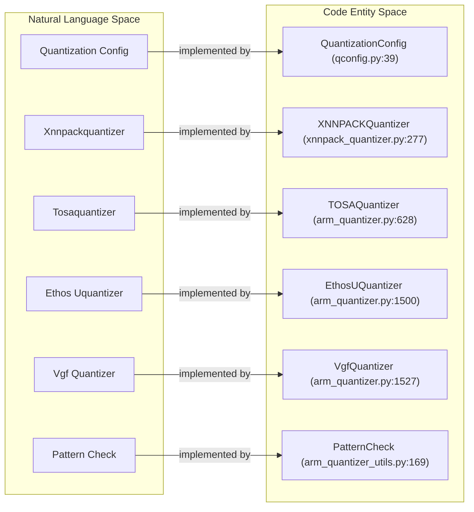
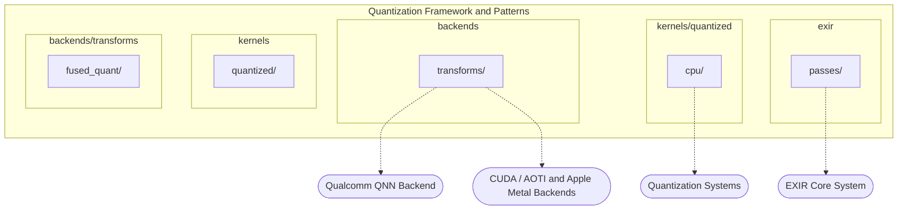
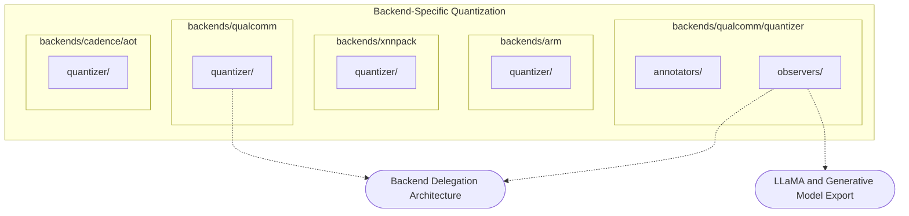

# Quantization Systems

> Architectural specification and implementation reference for Quantization Systems (38 relevant source files). Primary code entities: `NeonQuantizeTraits<int8_t>`, `clamp_scalar`, `narrow_and_saturate`, `store`, `QuantizeInputs`.

Relevant source files

The following files were used as context for generating this wiki page:

- [kernels/quantized/cpu/op_quantize.cpp](kernels/quantized/cpu/op_quantize.cpp)
- [exir/passes/quantize_io_pass.py](exir/passes/quantize_io_pass.py)
- [backends/arm/quantizer/arm_quantizer_utils.py](backends/arm/quantizer/arm_quantizer_utils.py)
- [backends/arm/quantizer/arm_quantizer.py](backends/arm/quantizer/arm_quantizer.py)
- [kernels/quantized/__init__.py](kernels/quantized/__init__.py)
- [backends/xnnpack/quantizer/xnnpack_quantizer.py](backends/xnnpack/quantizer/xnnpack_quantizer.py)
- [exir/passes/quant_fusion_pass.py](exir/passes/quant_fusion_pass.py)
- [backends/arm/quantizer/quantization_annotator.py](backends/arm/quantizer/quantization_annotator.py)
- [kernels/quantized/cpu/embeddingxb.cpp](kernels/quantized/cpu/embeddingxb.cpp)
- [kernels/quantized/cpu/op_dequantize.cpp](kernels/quantized/cpu/op_dequantize.cpp)
- [backends/arm/quantizer/quantization_config.py](backends/arm/quantizer/quantization_config.py)
- [kernels/quantized/cpu/op_add.cpp](kernels/quantized/cpu/op_add.cpp)
- [kernels/quantized/cpu/op_choose_qparams.cpp](kernels/quantized/cpu/op_choose_qparams.cpp)
- [kernels/quantized/cpu/embeddingxb.h](kernels/quantized/cpu/embeddingxb.h)
- [kernels/quantized/cpu/op_embedding.cpp](kernels/quantized/cpu/op_embedding.cpp)
- [backends/qualcomm/quantizer/qconfig.py](backends/qualcomm/quantizer/qconfig.py)
- [kernels/quantized/targets.bzl](kernels/quantized/targets.bzl)
- [kernels/quantized/cpu/op_embedding2b.cpp](kernels/quantized/cpu/op_embedding2b.cpp)
- [backends/arm/quantizer/quantizer_support.py](backends/arm/quantizer/quantizer_support.py)
- [kernels/quantized/cpu/op_embedding4b.cpp](kernels/quantized/cpu/op_embedding4b.cpp)
- [kernels/quantized/cpu/op_mixed_linear.cpp](kernels/quantized/cpu/op_mixed_linear.cpp)
- [kernels/quantized/cpu/op_mixed_mm.cpp](kernels/quantized/cpu/op_mixed_mm.cpp)
- [backends/qualcomm/quantizer/quantizer.py](backends/qualcomm/quantizer/quantizer.py)
- [backends/qualcomm/quantizer/backend_opinfo_adapter.py](backends/qualcomm/quantizer/backend_opinfo_adapter.py)
- [kernels/quantized/cpu/targets.bzl](kernels/quantized/cpu/targets.bzl)
- [backends/xnnpack/quantizer/xnnpack_quantizer_utils.py](backends/xnnpack/quantizer/xnnpack_quantizer_utils.py)
- [backends/qualcomm/quantizer/quant_recipe.py](backends/qualcomm/quantizer/quant_recipe.py)
- [backends/qualcomm/quantizer/rules.py](backends/qualcomm/quantizer/rules.py)
- [kernels/quantized/README.md](kernels/quantized/README.md)
- [backends/qualcomm/quantizer/README.md](backends/qualcomm/quantizer/README.md)
- [docs/source/quantization-optimization.md](docs/source/quantization-optimization.md)
- [docs/source/quantization-overview.md](docs/source/quantization-overview.md)
- [kernels/quantized/BUCK](kernels/quantized/BUCK)
- [kernels/quantized/CMakeLists.txt](kernels/quantized/CMakeLists.txt)
- [kernels/quantized/cpu/BUCK](kernels/quantized/cpu/BUCK)

## Purpose and Scope

This chapter covers **Quantization Systems** across the repository, detailing the core abstractions, data structures, transformation pipelines, and runtime/build integrations that implement this layer.

**Scope**: This document provides an architectural hub for the following child subsystems:
- **Quantization Framework and Patterns**: See [[4.1-quantization-framework-and-patterns|Quantization Framework and Patterns]].
- **Backend-Specific Quantization**: See [[4.2-backend-specific-quantization|Backend-Specific Quantization]].

Sources: [backends/qualcomm/quantizer/qconfig.py:39-45](), [backends/xnnpack/quantizer/xnnpack_quantizer.py:277-464](), [backends/arm/quantizer/arm_quantizer.py:628-1067](), [backends/arm/quantizer/arm_quantizer.py:1500-1524]()

---

## System Mapping: Natural Language Space to Code Entity Space

Sources: [backends/qualcomm/quantizer/qconfig.py:39-45](), [backends/xnnpack/quantizer/xnnpack_quantizer.py:277-464](), [backends/arm/quantizer/arm_quantizer.py:628-1067](), [backends/arm/quantizer/arm_quantizer.py:1500-1524](), [backends/arm/quantizer/arm_quantizer.py:1527-1579]()

---

## 1. Quantization Framework and Patterns

Architectural specification and implementation reference for Quantization Framework and Patterns (35 relevant source files). Primary code entities: `CanonicalizeViewCopyPermutePass`, `__init__`, `_collect_chains`, `_fuse_pair`, `NeonQuantizeTraits<int8_t>`. [backends/transforms/canonicalize_view_copy_permute_pass.py:35-507](), [backends/transforms/dim_maps.py:1018-1096](), [backends/transforms/dim_maps.py:233-1015]()

### Primary Code Entities

- **`CanonicalizeViewCopyPermutePass`** (Class in [backends/transforms/canonicalize_view_copy_permute_pass.py:35-507]()): Canonicalize view/permute chains. The pass repeatedly fuses adjacent compatible ops and swaps adjacent view/permute pairs when the swap exposes more fusing.
- **`PermuteMap`** (Class in [backends/transforms/dim_maps.py:1018-1096]()): Maps dims to equivalent dims before and after a permute.
- **`ViewMap`** (Class in [backends/transforms/dim_maps.py:233-1015]()): Maps dims before and after a view operator. The map models a view by expanding both shapes into ordered prime-factor streams and finding the permutation between them. Singleton dim
- **`RemovePermutesAroundElementwiseOps`** (Class in [backends/transforms/remove_permutes_around_elementwise_ops.py:27-1119]()): Looks for subgraphs of elementwise ops sandwiched between permutes and removes those permutes if possible. Allows special handling for certain non-elementwise ops that can be easil
- **`_concrete_shape`** (Method in [backends/transforms/remove_permutes_around_elementwise_ops.py:133-141]()): Return a node's shape, or None if it is missing or symbolic.
- **`_fuse_sequential_ops`** (Method in [backends/transforms/canonicalize_view_copy_permute_pass.py:143-222]()): Loop over chain and fuse adjacent ops and remove no-op views/permutes until no more fusions are possible. Returns the updated chain and whether any changes were made.

### Quantization Framework and Patterns Architecture Flow

For details, see [[4.1-quantization-framework-and-patterns|Quantization Framework and Patterns]].

Sources: [backends/transforms/canonicalize_view_copy_permute_pass.py:35-507](), [backends/transforms/dim_maps.py:1018-1096](), [backends/transforms/dim_maps.py:233-1015](), [backends/transforms/remove_permutes_around_elementwise_ops.py:27-1119]()

---

## 2. Backend-Specific Quantization

Architectural specification and implementation reference for Backend-Specific Quantization (35 relevant source files). Primary code entities: `NodeFinder`, `find_nodes`, `PatternCheck`, `check_pattern`, `EthosUQuantizer`. [backends/cadence/aot/quantizer/patterns.py:40-71](), [backends/qualcomm/quantizer/qconfig.py:39-45](), [backends/qualcomm/quantizer/annotators/htp_rules.py:965-1044]()

### Primary Code Entities

- **`PartitionAnchors`** (Class in [backends/cadence/aot/quantizer/patterns.py:40-71]()): All fields except output are lists of (node, args_index) pair, where node is from the given partition and node.args[args_index] is an input to the partition. Assumes a single outpu
- **`QuantizationConfig`** (Class in [backends/qualcomm/quantizer/qconfig.py:39-45]()): Core implementation entity.
- **`Linear`** (Class in [backends/qualcomm/quantizer/annotators/htp_rules.py:965-1044]()): Core implementation entity.
- **`XNNPACKQuantizer`** (Class in [backends/xnnpack/quantizer/xnnpack_quantizer.py:277-464]()): Core implementation entity.
- **`_is_annotated`** (Function in [backends/xnnpack/quantizer/xnnpack_quantizer_utils.py:110-121]()): Given a list of nodes (that represents an operator pattern), check if any of the node is annotated, return True if any of the node is annotated, otherwise return False
- **`get_symmetric_quantization_config`** (Function in [backends/arm/quantizer/arm_quantizer.py:187-321]()): Create symmetric quantization config for activations and weights. Activations normally use an affine qscheme. Dynamic INT8 activations using the symmetric [-127, 127] range use per

### Backend-Specific Quantization Architecture Flow

For details, see [[4.2-backend-specific-quantization|Backend-Specific Quantization]].

Sources: [backends/cadence/aot/quantizer/patterns.py:40-71](), [backends/qualcomm/quantizer/qconfig.py:39-45](), [backends/qualcomm/quantizer/annotators/htp_rules.py:965-1044](), [backends/xnnpack/quantizer/xnnpack_quantizer.py:277-464]()

---

## Official Documentation & Architectural References

- **Backend-Specific Quantization** ([wiki/4.2-backend-specific-quantization.md]()): # Backend-Specific Quantization ↑ [[4-quantization-systems|Quantization Systems]] > Architectural specification and implementation reference for Backend-Specific Quantization (35 relevant source files). Primary code entities: `NodeFinder`, `find_nodes`, `PatternCheck`, `check_pattern`, `EthosUQuantizer`. 
 
Relevant source files
 The
- **ExecuTorch DeepWiki** ([wiki/index.md]()): # ExecuTorch DeepWiki Generated from `home-jason-Project-deepwiki-executorch` at commit `b3b565b5b62f` (2026-11-15T15:02:11+00:00). ## Pages - [[1-overview|Overview]] — Architectural specification and implementation reference for Overview (10 relevant source files). Primary code entities: `Module`, `MethodHolder`, `PlannedMemory`, `EdgeProgramManager`, `__in
- **Quantization Framework and Patterns** ([wiki/4.1-quantization-framework-and-patterns.md]()): # Quantization Framework and Patterns ↑ [[4-quantization-systems|Quantization Systems]] > Architectural specification and implementation reference for Quantization Framework and Patterns (35 relevant source files). Primary code entities: `CanonicalizeViewCopyPermutePass`, `__init__`, `_collect_chains`, `_fuse_pair`, `NeonQuantizeTraits<int8_t>`. 
 <s
- **Cadence DSP Backend** ([wiki/5.5-cadence-dsp-backend.md]()): # Cadence DSP Backend ↑ [[5-backend-delegation-architecture|Backend Delegation Architecture]] > Architectural specification and implementation reference for Cadence DSP Backend (36 relevant source files). Primary code entities: `QuantFusionPass`, `__init__`, `call`, `QuantizedInputWrapper`, `MemoryPlanningAlgo`. 
 
Relevant source files</summ

Sources: [wiki/4.2-backend-specific-quantization.md](), [wiki/index.md](), [wiki/4.1-quantization-framework-and-patterns.md](), [wiki/5.5-cadence-dsp-backend.md]()

## Sub-pages

- [[4.1-quantization-framework-and-patterns|Quantization Framework and Patterns]]
- [[4.2-backend-specific-quantization|Backend-Specific Quantization]]

## Related pages

- [[1-overview|Overview]]
- [[4.1-quantization-framework-and-patterns|Quantization Framework and Patterns]]
- [[4.2-backend-specific-quantization|Backend-Specific Quantization]]
- [[1.1-getting-started|Getting Started]]
- [[1.2-export-api-and-recipe-system|Export API and Recipe System]]
- [[2.2-kernel-libraries-and-selective-build|Kernel Libraries and Selective Build]]
- [[2.3-schema-generation-and-flatbuffers|Schema Generation and FlatBuffers]]
- [[3.4-program-emission-and-serialization|Program Emission and Serialization]]

## Related documents

- `wiki/4.2-backend-specific-quantization.md` — Backend-Specific Quantization (score 119.2353, via bm25)
- `wiki/index.md` — ExecuTorch DeepWiki (score 110.3652, via bm25)
- `wiki/4.1-quantization-framework-and-patterns.md` — Quantization Framework and Patterns (score 96.2675, via bm25)
- `wiki/5.5-cadence-dsp-backend.md` — Cadence DSP Backend (score 82.6812, via bm25)
- `wiki/5-backend-delegation-architecture.md` — Backend Delegation Architecture (score 72.5425, via bm25)

## Sources

- [`kernels/quantized/cpu/op_quantize.cpp`](https://github.com/pytorch/executorch/blob/main/kernels/quantized/cpu/op_quantize.cpp)
- [`exir/passes/quantize_io_pass.py`](https://github.com/pytorch/executorch/blob/main/exir/passes/quantize_io_pass.py)
- [`backends/arm/quantizer/arm_quantizer_utils.py`](https://github.com/pytorch/executorch/blob/main/backends/arm/quantizer/arm_quantizer_utils.py)
- [`backends/arm/quantizer/arm_quantizer.py`](https://github.com/pytorch/executorch/blob/main/backends/arm/quantizer/arm_quantizer.py)
- [`kernels/quantized/__init__.py`](https://github.com/pytorch/executorch/blob/main/kernels/quantized/__init__.py)
- [`backends/xnnpack/quantizer/xnnpack_quantizer.py`](https://github.com/pytorch/executorch/blob/main/backends/xnnpack/quantizer/xnnpack_quantizer.py)
- [`exir/passes/quant_fusion_pass.py`](https://github.com/pytorch/executorch/blob/main/exir/passes/quant_fusion_pass.py)
- [`backends/arm/quantizer/quantization_annotator.py`](https://github.com/pytorch/executorch/blob/main/backends/arm/quantizer/quantization_annotator.py)
- [`kernels/quantized/cpu/embeddingxb.cpp`](https://github.com/pytorch/executorch/blob/main/kernels/quantized/cpu/embeddingxb.cpp)
- [`kernels/quantized/cpu/op_dequantize.cpp`](https://github.com/pytorch/executorch/blob/main/kernels/quantized/cpu/op_dequantize.cpp)
- [`backends/arm/quantizer/quantization_config.py`](https://github.com/pytorch/executorch/blob/main/backends/arm/quantizer/quantization_config.py)
- [`kernels/quantized/cpu/op_add.cpp`](https://github.com/pytorch/executorch/blob/main/kernels/quantized/cpu/op_add.cpp)
- [`kernels/quantized/cpu/op_choose_qparams.cpp`](https://github.com/pytorch/executorch/blob/main/kernels/quantized/cpu/op_choose_qparams.cpp)
- [`kernels/quantized/cpu/embeddingxb.h`](https://github.com/pytorch/executorch/blob/main/kernels/quantized/cpu/embeddingxb.h)
- [`kernels/quantized/cpu/op_embedding.cpp`](https://github.com/pytorch/executorch/blob/main/kernels/quantized/cpu/op_embedding.cpp)
- [`backends/qualcomm/quantizer/qconfig.py`](https://github.com/pytorch/executorch/blob/main/backends/qualcomm/quantizer/qconfig.py)
- [`kernels/quantized/targets.bzl`](https://github.com/pytorch/executorch/blob/main/kernels/quantized/targets.bzl)
- [`kernels/quantized/cpu/op_embedding2b.cpp`](https://github.com/pytorch/executorch/blob/main/kernels/quantized/cpu/op_embedding2b.cpp)
- [`backends/arm/quantizer/quantizer_support.py`](https://github.com/pytorch/executorch/blob/main/backends/arm/quantizer/quantizer_support.py)
- [`kernels/quantized/cpu/op_embedding4b.cpp`](https://github.com/pytorch/executorch/blob/main/kernels/quantized/cpu/op_embedding4b.cpp)
- [`kernels/quantized/cpu/op_mixed_linear.cpp`](https://github.com/pytorch/executorch/blob/main/kernels/quantized/cpu/op_mixed_linear.cpp)
- [`kernels/quantized/cpu/op_mixed_mm.cpp`](https://github.com/pytorch/executorch/blob/main/kernels/quantized/cpu/op_mixed_mm.cpp)
- [`backends/qualcomm/quantizer/quantizer.py`](https://github.com/pytorch/executorch/blob/main/backends/qualcomm/quantizer/quantizer.py)
- [`backends/qualcomm/quantizer/backend_opinfo_adapter.py`](https://github.com/pytorch/executorch/blob/main/backends/qualcomm/quantizer/backend_opinfo_adapter.py)
- [`kernels/quantized/cpu/targets.bzl`](https://github.com/pytorch/executorch/blob/main/kernels/quantized/cpu/targets.bzl)
- [`backends/xnnpack/quantizer/xnnpack_quantizer_utils.py`](https://github.com/pytorch/executorch/blob/main/backends/xnnpack/quantizer/xnnpack_quantizer_utils.py)
- [`backends/qualcomm/quantizer/quant_recipe.py`](https://github.com/pytorch/executorch/blob/main/backends/qualcomm/quantizer/quant_recipe.py)
- [`backends/qualcomm/quantizer/rules.py`](https://github.com/pytorch/executorch/blob/main/backends/qualcomm/quantizer/rules.py)
- [`kernels/quantized/README.md`](https://github.com/pytorch/executorch/blob/main/kernels/quantized/README.md)
- [`backends/qualcomm/quantizer/README.md`](https://github.com/pytorch/executorch/blob/main/backends/qualcomm/quantizer/README.md)
- [`docs/source/quantization-optimization.md`](https://github.com/pytorch/executorch/blob/main/docs/source/quantization-optimization.md)
- [`docs/source/quantization-overview.md`](https://github.com/pytorch/executorch/blob/main/docs/source/quantization-overview.md)
- [`kernels/quantized/BUCK`](https://github.com/pytorch/executorch/blob/main/kernels/quantized/BUCK)
- [`kernels/quantized/CMakeLists.txt`](https://github.com/pytorch/executorch/blob/main/kernels/quantized/CMakeLists.txt)
- [`kernels/quantized/cpu/BUCK`](https://github.com/pytorch/executorch/blob/main/kernels/quantized/cpu/BUCK)
- [`backends/xnnpack/quantizer/BUCK`](https://github.com/pytorch/executorch/blob/main/backends/xnnpack/quantizer/BUCK)
- [`backends/arm/quantizer/BUCK`](https://github.com/pytorch/executorch/blob/main/backends/arm/quantizer/BUCK)
- [`backends/qualcomm/quantizer/BUCK`](https://github.com/pytorch/executorch/blob/main/backends/qualcomm/quantizer/BUCK)

## Dynamic Knowledge Links (Code Graph ↔ LLM-Wiki / RAG)

### Linked Architecture & Design Documents

| Document | Match Channel | Score | Shared Code Symbols |
|---|---|---|---|
| [[4.2-backend-specific-quantization|Backend-Specific Quantization]] | `bm25+entity(3)` | `123.735` | `QuantizationConfig`, `XNNPACKQuantizer`, `get_symmetric_quantization_config` |
| [[index|ExecuTorch DeepWiki]] | `bm25` | `110.365` | *(lexical/graph match)* |
| [[4.1-quantization-framework-and-patterns|Quantization Framework and Patterns]] | `bm25` | `96.267` | *(lexical/graph match)* |
| [[5.5-cadence-dsp-backend|Cadence DSP Backend]] | `bm25+entity(1)` | `84.181` | `QuantizationConfig` |
| [[5-backend-delegation-architecture|Backend Delegation Architecture]] | `bm25` | `72.543` | *(lexical/graph match)* |
| [[1-overview|Overview]] | `wikilink:4-quantization-systems` | `70.353` | *(lexical/graph match)* |

### High-Centrality Bridge Symbols (CBM Graph)

| Symbol | Kind | Source Location | Fan-In / Fan-Out |
|---|---|---|---|
| `QuantizationConfig` | Class | [backends/qualcomm/quantizer/qconfig.py:39-45]() | in: `17` / out: `0` |
| `XNNPACKQuantizer` | Class | [backends/xnnpack/quantizer/xnnpack_quantizer.py:277-464]() | in: `7` / out: `0` |
| `TOSAQuantizer` | Class | [backends/arm/quantizer/arm_quantizer.py:628-1067]() | in: `1` / out: `0` |
| `EthosUQuantizer` | Class | [backends/arm/quantizer/arm_quantizer.py:1500-1524]() | in: `0` / out: `0` |
| `VgfQuantizer` | Class | [backends/arm/quantizer/arm_quantizer.py:1527-1579]() | in: `0` / out: `0` |
| `PatternCheck` | Class | [backends/arm/quantizer/arm_quantizer_utils.py:169-223]() | in: `0` / out: `0` |

Sources: [backends/qualcomm/quantizer/qconfig.py:39-45](), [backends/xnnpack/quantizer/xnnpack_quantizer.py:277-464](), [backends/arm/quantizer/arm_quantizer.py:628-1067](), [backends/arm/quantizer/arm_quantizer.py:1500-1524]()

### Cross-Subsystem Coupling

- [[4.2-backend-specific-quantization|Backend-Specific Quantization]] — call/import coupling weight `13.0`
- [[5-backend-delegation-architecture|Backend Delegation Architecture]] — call/import coupling weight `3.0`
- [[5.4-arm-tosa-and-ethos-u-backend|ARM TOSA and Ethos-U Backend]] — call/import coupling weight `3.0`
- [[3-exir-core-system|EXIR Core System]] — call/import coupling weight `3.0`
- [[3.2-graph-transformation-pass-system|Graph Transformation Pass System]] — call/import coupling weight `3.0`
