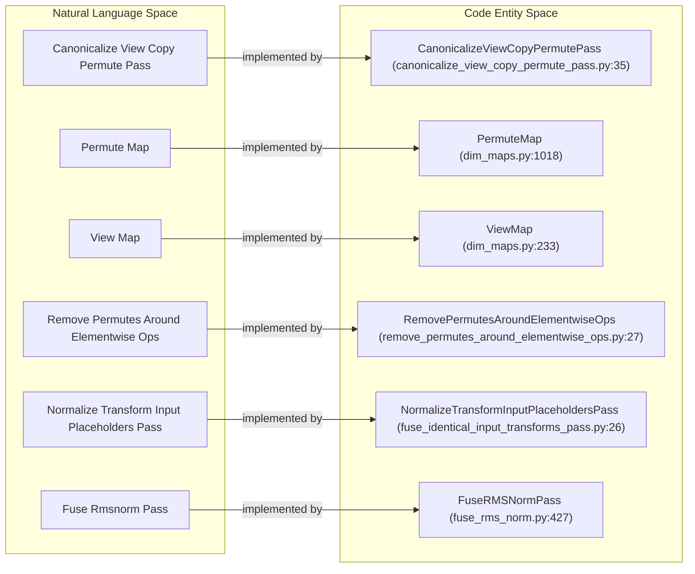
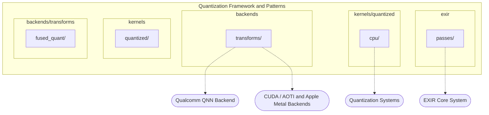
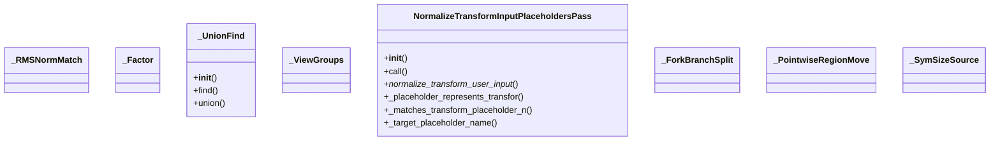
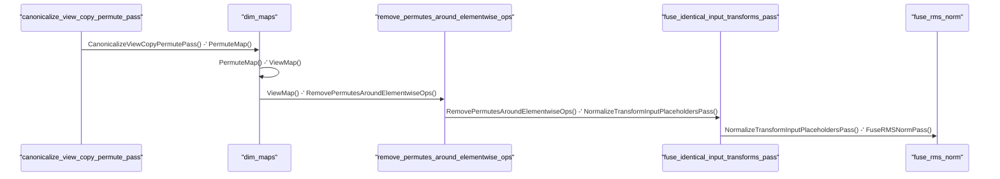

# Quantization Framework and Patterns

↑ [[4-quantization-systems|Quantization Systems]]

> Architectural specification and implementation reference for Quantization Framework and Patterns (35 relevant source files). Primary code entities: `CanonicalizeViewCopyPermutePass`, `__init__`, `_collect_chains`, `_fuse_pair`, `NeonQuantizeTraits<int8_t>`.

<details>
<summary>Relevant source files</summary>

The following files were used as context for generating this wiki page:

- [backends/transforms/canonicalize_view_copy_permute_pass.py](backends/transforms/canonicalize_view_copy_permute_pass.py)
- [kernels/quantized/cpu/op_quantize.cpp](kernels/quantized/cpu/op_quantize.cpp)
- [exir/passes/quantize_io_pass.py](exir/passes/quantize_io_pass.py)
- [kernels/quantized/__init__.py](kernels/quantized/__init__.py)
- [backends/transforms/dim_maps.py](backends/transforms/dim_maps.py)
- [exir/passes/quant_fusion_pass.py](exir/passes/quant_fusion_pass.py)
- [backends/transforms/addmm_mm_to_linear.py](backends/transforms/addmm_mm_to_linear.py)
- [backends/transforms/remove_permutes_around_elementwise_ops.py](backends/transforms/remove_permutes_around_elementwise_ops.py)
- [kernels/quantized/cpu/embeddingxb.cpp](kernels/quantized/cpu/embeddingxb.cpp)
- [kernels/quantized/cpu/op_dequantize.cpp](kernels/quantized/cpu/op_dequantize.cpp)
- [backends/transforms/fuse_rms_norm.py](backends/transforms/fuse_rms_norm.py)
- [backends/transforms/symbolic_shape_utils.py](backends/transforms/symbolic_shape_utils.py)
- [backends/transforms/advance_quantize_op_above_def_chain.py](backends/transforms/advance_quantize_op_above_def_chain.py)
- [backends/transforms/fuse_identical_input_transforms_pass.py](backends/transforms/fuse_identical_input_transforms_pass.py)
- [backends/transforms/convert_conv1d_to_conv2d_pass.py](backends/transforms/convert_conv1d_to_conv2d_pass.py)
- [kernels/quantized/cpu/op_add.cpp](kernels/quantized/cpu/op_add.cpp)
- [kernels/quantized/cpu/op_choose_qparams.cpp](kernels/quantized/cpu/op_choose_qparams.cpp)
- [backends/transforms/propagate_view_copy_permute_pass.py](backends/transforms/propagate_view_copy_permute_pass.py)
- [kernels/quantized/cpu/embeddingxb.h](kernels/quantized/cpu/embeddingxb.h)
- [kernels/quantized/cpu/op_embedding.cpp](kernels/quantized/cpu/op_embedding.cpp)
- [backends/transforms/advance_quantize_op_above_def_in_branch.py](backends/transforms/advance_quantize_op_above_def_in_branch.py)
- [backends/transforms/permute_pass_utils.py](backends/transforms/permute_pass_utils.py)
- [backends/transforms/convert_dtype_pass.py](backends/transforms/convert_dtype_pass.py)
- [kernels/quantized/targets.bzl](kernels/quantized/targets.bzl)
- [backends/transforms/decompose_sdpa.py](backends/transforms/decompose_sdpa.py)
- [backends/transforms/aten_to_dialect_pass.py](backends/transforms/aten_to_dialect_pass.py)
- [kernels/quantized/cpu/op_embedding2b.cpp](kernels/quantized/cpu/op_embedding2b.cpp)
- [backends/transforms/fused_quant/decompose_fused_quant.py](backends/transforms/fused_quant/decompose_fused_quant.py)
- [kernels/quantized/README.md](kernels/quantized/README.md)
- [docs/source/quantization-overview.md](docs/source/quantization-overview.md)
- [kernels/quantized/BUCK](kernels/quantized/BUCK)
- [kernels/quantized/CMakeLists.txt](kernels/quantized/CMakeLists.txt)
- [kernels/quantized/cpu/BUCK](kernels/quantized/cpu/BUCK)
- [backends/transforms/BUCK](backends/transforms/BUCK)
- [backends/transforms/fused_quant/BUCK](backends/transforms/fused_quant/BUCK)

</details>

## Purpose and Scope

Architectural specification and implementation reference for Quantization Framework and Patterns (35 relevant source files). Primary code entities: `CanonicalizeViewCopyPermutePass`, `__init__`, `_collect_chains`, `_fuse_pair`, `NeonQuantizeTraits<int8_t>`.

Primary code entities analyzed on this page include `CanonicalizeViewCopyPermutePass` ([backends/transforms/canonicalize_view_copy_permute_pass.py:35-507]()), `PermuteMap` ([backends/transforms/dim_maps.py:1018-1096]()), `ViewMap` ([backends/transforms/dim_maps.py:233-1015]()), `RemovePermutesAroundElementwiseOps` ([backends/transforms/remove_permutes_around_elementwise_ops.py:27-1119]()), `NormalizeTransformInputPlaceholdersPass` ([backends/transforms/fuse_identical_input_transforms_pass.py:26-113]()).

For the parent architectural layer, see [[4-quantization-systems|Quantization Systems]]. Related sibling subsystems: [[4.2-backend-specific-quantization|Backend-Specific Quantization]].

Sources: [backends/transforms/canonicalize_view_copy_permute_pass.py:35-507](), [backends/transforms/dim_maps.py:1018-1096](), [backends/transforms/dim_maps.py:233-1015](), [backends/transforms/remove_permutes_around_elementwise_ops.py:27-1119]()

---

## 1. High-Level Architecture and Data Flow

### Natural Language Space to Code Entity Space Mapping

The following diagram maps domain concepts in this subsystem to their concrete code entities:



### Subsystem Component & Dependency Flow



Cross-subsystem call and import edges connect **Quantization Framework and Patterns** with [[3-exir-core-system|EXIR Core System]] (coupling `3.0`), [[3.2-graph-transformation-pass-system|Graph Transformation Pass System]] (coupling `3.0`), [[5.3-qualcomm-qnn-backend|Qualcomm QNN Backend]] (coupling `2.0`), [[4-quantization-systems|Quantization Systems]] (coupling `2.0`), [[5-backend-delegation-architecture|Backend Delegation Architecture]] (coupling `1.0`).

| Module Directory | Files | Primary Code Entities | Source Citations |
|---|---|---|---|
| `backends/transforms` | 16 | `CanonicalizeViewCopyPermutePass`, `PermuteMap`, `ViewMap`, `RemovePermutesAroundElementwiseOps` | [backends/transforms/canonicalize_view_copy_permute_pass.py:35-507]() [backends/transforms/dim_maps.py:1018-1096]() |
| `kernels/quantized/cpu` | 9 | `NeonQuantizeTraits<int8_t>`, `NeonQuantizeTraits<uint8_t>`, `store`, `clamp_scalar` | [kernels/quantized/cpu/op_quantize.cpp:154-169]() [kernels/quantized/cpu/op_quantize.cpp:136-151]() |
| `kernels/quantized` | 5 | `define_common_targets` | [kernels/quantized/targets.bzl:4-130]() |
| `backends/transforms/fused_quant` | 2 | `AssertNoFusedQuantOps`, `DecomposeFusedQuant`, `_per_channel_qparam_args`, `_aten_meta_from_fused` | [backends/transforms/fused_quant/decompose_fused_quant.py:446-474]() [backends/transforms/fused_quant/decompose_fused_quant.py:384-435]() |
| `exir/passes` | 2 | `QuantizeInputs`, `QuantizeOutputs`, `QuantFusionPass`, `_gather_io_names` | [exir/passes/quantize_io_pass.py:205-266]() [exir/passes/quantize_io_pass.py:269-324]() |

Sources: [backends/transforms/canonicalize_view_copy_permute_pass.py:35-507](), [backends/transforms/dim_maps.py:1018-1096](), [backends/transforms/dim_maps.py:233-1015](), [backends/transforms/remove_permutes_around_elementwise_ops.py:27-1119](), [backends/transforms/fuse_identical_input_transforms_pass.py:26-113]()

---

## 2. Core Data Structures and Implementation Details

### Class and Entity Relationship Diagram



### `CanonicalizeViewCopyPermutePass` (Class)

- **Source Location**: [backends/transforms/canonicalize_view_copy_permute_pass.py:35-507]()
- **Declaration**: `Class CanonicalizeViewCopyPermutePass`
- **Graph Centrality**: fan-in `0` callers, fan-out `0` callees
- **Responsibility**: Canonicalize view/permute chains. The pass repeatedly fuses adjacent compatible ops and swaps adjacent view/permute pairs when the swap exposes more fusing.

```python
// backends/transforms/canonicalize_view_copy_permute_pass.py:35-50
class CanonicalizeViewCopyPermutePass(ExportPass):
    """Canonicalize view/permute chains.

    The pass repeatedly fuses adjacent compatible ops and swaps adjacent
    view/permute pairs when the swap exposes more fusing.

    """

    _passes_required_after: Set[Type[ExportPass]] = set()
    _recompile_before_retrace = True

    _VIEW_TARGET = exir_ops.edge.aten.view_copy.default
    _PERMUTE_TARGET = exir_ops.edge.aten.permute_copy.default

    def __init__(self, permute_targets: Iterable[Any] | None = None) -> None:
        super().__init__()
```

### `PermuteMap` (Class)

- **Source Location**: [backends/transforms/dim_maps.py:1018-1096]()
- **Declaration**: `Class PermuteMap`
- **Graph Centrality**: fan-in `0` callers, fan-out `0` callees
- **Responsibility**: Maps dims to equivalent dims before and after a permute.

```python
// backends/transforms/dim_maps.py:1018-1033
class PermuteMap:
    """Maps dims to equivalent dims before and after a permute."""

    def __init__(self, permute_node: Node) -> None:
        permute_dims = permute_node.args[1]
        assert isinstance(permute_dims, Sequence) and not isinstance(
            permute_dims, (str, bytes)
        )
        normalized = _normalize_permutation(
            cast(Sequence[int], permute_dims), len(cast(Sequence[int], permute_dims))
        )
        if normalized is None:
            raise ValueError(f"Invalid permute dims: {permute_dims}")
        self.permute_dims = normalized

    def map_dims(self, dims: int | Sequence[int]) -> list[int]:
```

### `ViewMap` (Class)

- **Source Location**: [backends/transforms/dim_maps.py:233-1015]()
- **Declaration**: `Class ViewMap`
- **Graph Centrality**: fan-in `0` callers, fan-out `0` callees
- **Responsibility**: Maps dims before and after a view operator. The map models a view by expanding both shapes into ordered prime-factor streams and finding the permutation between them. Singleton dims are not counted. For example, the view from [4, 3, 10] to [2, 2, 1, 5, 3, 2] is represented as: Source: [4, 3, 10] Source primes: [2, 2, 3

```python
// backends/transforms/dim_maps.py:233-248
class ViewMap:
    """Maps dims before and after a view operator.

    The map models a view by expanding both shapes into ordered prime-factor
    streams and finding the permutation between them. Singleton dims are not counted.
    For example, the view from [4, 3, 10] to [2, 2, 1, 5, 3, 2] is represented as:

        Source:        [4, 3, 10]
        Source primes: [2, 2, 3, 2, 5]
        Permutation:   [0, 1, 4, 2, 3]
        Target primes: [2, 2, 5, 3, 2]
        Target:        [2, 2, 1, 5, 3, 2]

    Dim mappings are derived by unioning factors into groups where
    - factors from the same source axis belong to the same group;
       e.g. [2,2] [3] [2,5]
```

### `RemovePermutesAroundElementwiseOps` (Class)

- **Source Location**: [backends/transforms/remove_permutes_around_elementwise_ops.py:27-1119]()
- **Declaration**: `Class RemovePermutesAroundElementwiseOps`
- **Graph Centrality**: fan-in `0` callers, fan-out `0` callees
- **Responsibility**: Looks for subgraphs of elementwise ops sandwiched between permutes and removes those permutes if possible. Allows special handling for certain non-elementwise ops that can be easily updated based on the permute's parameter such as mean, cat, and slice. The repeat_interleave idiom (unsqueeze -> expand_copy -> merging vi

### `NormalizeTransformInputPlaceholdersPass` (Class)

- **Source Location**: [backends/transforms/fuse_identical_input_transforms_pass.py:26-113]()
- **Declaration**: `Class NormalizeTransformInputPlaceholdersPass`
- **Graph Centrality**: fan-in `1` callers, fan-out `0` callees
- **Responsibility**: Normalize placeholder names for lifted transform inputs.

### `_concrete_shape` (Method)

- **Source Location**: [backends/transforms/remove_permutes_around_elementwise_ops.py:133-141]()
- **Declaration**: `(node: torch.fx.Node)`
- **Graph Centrality**: fan-in `7` callers, fan-out `0` callees
- **Responsibility**: Return a node's shape, or None if it is missing or symbolic.

Sources: [backends/transforms/canonicalize_view_copy_permute_pass.py:35-507](), [backends/transforms/dim_maps.py:1018-1096](), [backends/transforms/dim_maps.py:233-1015](), [backends/transforms/remove_permutes_around_elementwise_ops.py:27-1119](), [backends/transforms/fuse_identical_input_transforms_pass.py:26-113]()

---

## 3. Execution and Call Flow

The sequence diagram below traces the runtime/compile-time call chain across components in this module:



Sources: [backends/transforms/canonicalize_view_copy_permute_pass.py:35-507](), [backends/transforms/dim_maps.py:1018-1096](), [backends/transforms/dim_maps.py:233-1015](), [backends/transforms/remove_permutes_around_elementwise_ops.py:27-1119](), [backends/transforms/fuse_identical_input_transforms_pass.py:26-113]()

---

## 4. Key API and Symbol Reference

| Code Entity | Kind | Location | Fan-In / Out | Role & Signature |
|---|---|---|---|---|
| `CanonicalizeViewCopyPermutePass` | Class | [backends/transforms/canonicalize_view_copy_permute_pass.py:35-507]() | `0` / `0` | Canonicalize view/permute chains. |
| `PermuteMap` | Class | [backends/transforms/dim_maps.py:1018-1096]() | `0` / `0` | Maps dims to equivalent dims before and after a permute. |
| `ViewMap` | Class | [backends/transforms/dim_maps.py:233-1015]() | `0` / `0` | Maps dims before and after a view operator. |
| `RemovePermutesAroundElementwiseOps` | Class | [backends/transforms/remove_permutes_around_elementwise_ops.py:27-1119]() | `0` / `0` | Looks for subgraphs of elementwise ops sandwiched between permutes and removes those |
| `NormalizeTransformInputPlaceholdersPass` | Class | [backends/transforms/fuse_identical_input_transforms_pass.py:26-113]() | `1` / `0` | Normalize placeholder names for lifted transform inputs. |
| `FuseRMSNormPass` | Class | [backends/transforms/fuse_rms_norm.py:427-540]() | `0` / `0` | Fuse weighted and scale-free FP32 RMSNorm decompositions into aten.rms_norm. |
| `AdvanceQuantizeOpAboveDefChainPass` | Class | [backends/transforms/advance_quantize_op_above_def_chain.py:28-270]() | `0` / `0` | Advances a quantize op above data-movement ops to reduce data volume. |
| `FuseIdenticalInputTransformsPass` | Class | [backends/transforms/fuse_identical_input_transforms_pass.py:116-461]() | `0` / `0` | Sink identical input transforms through pointwise ops with multiple |
| `ConvertConv1dToConv2dPass` | Class | [backends/transforms/convert_conv1d_to_conv2d_pass.py:22-322]() | `0` / `0` | Express Conv1d as Conv2d with a unit-height spatial dimension. |
| `PropagateViewCopyPermuteDownPass` | Class | [backends/transforms/propagate_view_copy_permute_pass.py:1034-1601]() | `0` / `0` | Implements PropagateViewCopyPermutePass for downward propagation: |
| `PropagateViewCopyPermutePass` | Class | [backends/transforms/propagate_view_copy_permute_pass.py:86-662]() | `0` / `0` | Abstract implementation of a permute/view_copy propagation pass. |
| `PropagateViewCopyPermuteUpPass` | Class | [backends/transforms/propagate_view_copy_permute_pass.py:665-1031]() | `0` / `0` | Implements PropagateViewCopyPermutePass for upwards propagation: |
| `_RMSNormMatch` | Class | [backends/transforms/fuse_rms_norm.py:68-73]() | `3` / `0` | — |
| `QuantizeInputs` | Class | [exir/passes/quantize_io_pass.py:205-266]() | `1` / `0` | — |
| `QuantizeOutputs` | Class | [exir/passes/quantize_io_pass.py:269-324]() | `1` / `0` | — |
| `AdvanceQuantizeOpAboveDefInBranchPass` | Class | [backends/transforms/advance_quantize_op_above_def_in_branch.py:27-202]() | `0` / `0` | If the graph is branched with the following pattern: |
| `_Factor` | Class | [backends/transforms/dim_maps.py:23-25]() | `1` / `0` | — |
| `_UnionFind` | Class | [backends/transforms/dim_maps.py:216-230]() | `1` / `0` | — |
| `_ViewGroups` | Class | [backends/transforms/dim_maps.py:29-33]() | `1` / `0` | — |
| `FuseOpPairsAcrossBranchesPass` | Class | [backends/transforms/permute_pass_utils.py:210-297]() | `0` / `0` | Base class for passes that fuse op pairs across branches. |
| `HierarchicalInplacePassInterface` | Class | [backends/transforms/permute_pass_utils.py:161-185]() | `0` / `0` | A base class for passes that apply in-place modification to the graph module and its submodules. |
| `QuantFusionPass` | Class | [exir/passes/quant_fusion_pass.py:124-161]() | `1` / `0` | — |

Sources: [backends/transforms/canonicalize_view_copy_permute_pass.py:35-507](), [backends/transforms/dim_maps.py:1018-1096](), [backends/transforms/dim_maps.py:233-1015](), [backends/transforms/remove_permutes_around_elementwise_ops.py:27-1119](), [backends/transforms/fuse_identical_input_transforms_pass.py:26-113](), [backends/transforms/fuse_rms_norm.py:427-540]()

---

## 5. Official Documentation and Design Context

The following linked documentation sections from `llm-wiki` (`raw/`) provide additional architectural context, tutorials, and design invariants for this subsystem:

- **Quantization Systems** ([wiki/4-quantization-systems.md](), score `224.8925`) (sections: `Quantization Systems`, `Purpose and Scope`, `System Mapping: Natural Language Space to Code Entity Space`, `1. Quantization Framework and Patterns`): # Quantization Systems > Architectural specification and implementation reference for Quantization Systems (38 relevant source files). Primary code entities: `NeonQuantizeTraits<int8_t>`, `clamp_scalar`, `narrow_and_saturate`, `store`, `QuantizeInputs`. <details> <summary>Relevant source files</summary> The following files were used as context for generating this wiki page: - [kernels/quantized/cpu/op_quantize.cpp](k
- **XNNPACK CPU Backend** ([wiki/5.6-xnnpack-cpu-backend.md](), score `174.0897`) (sections: `XNNPACK CPU Backend`, `Purpose and Scope`, `1. High-Level Architecture and Data Flow`, `Natural Language Space to Code Entity Space Mapping`): # XNNPACK CPU Backend ↑ [[5-backend-delegation-architecture|Backend Delegation Architecture]] > Architectural specification and implementation reference for XNNPACK CPU Backend (36 relevant source files). Primary code entities: `ChannelsLastTaggedReshapePass`, `_is_nhwc`, `call`, `can_be_converted_to_nhwc`, `InputTypeToIndex`. <details> <summary>Relevant source files</summary> The following files were used as context
- **ExecuTorch DeepWiki** ([wiki/index.md](), score `162.7`) (sections: `ExecuTorch DeepWiki`, `Pages`): # ExecuTorch DeepWiki Generated from `home-jason-Project-deepwiki-executorch` at commit `b3b565b5b62f` (2026-11-15T15:02:11+00:00). ## Pages - [[1-overview|Overview]] — Architectural specification and implementation reference for Overview (10 relevant source files). Primary code entities: `Module`, `MethodHolder`, `PlannedMemory`, `EdgeProgramManager`, `__init__`. - [[1.1-getting-started|Getting Started]] — Architect
- **Vulkan GPU Backend** ([wiki/5.2-vulkan-gpu-backend.md](), score `154.2564`) (sections: `Vulkan GPU Backend`, `Purpose and Scope`, `1. High-Level Architecture and Data Flow`, `Natural Language Space to Code Entity Space Mapping`): # Vulkan GPU Backend ↑ [[5-backend-delegation-architecture|Backend Delegation Architecture]] > Architectural specification and implementation reference for Vulkan GPU Backend (40 relevant source files). Primary code entities: `CommandBuffer`, `begin`, `bind_descriptors`, `bind_pipeline`, `OpFeatures`. <details> <summary>Relevant source files</summary> The following files were used as context for generating this wiki 

Sources: [wiki/4-quantization-systems.md](), [wiki/5.6-xnnpack-cpu-backend.md](), [wiki/index.md](), [wiki/5.2-vulkan-gpu-backend.md]()

## Related pages

- [[4-quantization-systems|Quantization Systems]]
- [[1.1-getting-started|Getting Started]]
- [[1.2-export-api-and-recipe-system|Export API and Recipe System]]
- [[2.2-kernel-libraries-and-selective-build|Kernel Libraries and Selective Build]]
- [[2.3-schema-generation-and-flatbuffers|Schema Generation and FlatBuffers]]
- [[3.4-program-emission-and-serialization|Program Emission and Serialization]]
- [[3.5-verification-and-dialect-system|Verification and Dialect System]]
- [[3-exir-core-system|EXIR Core System]]

## Related documents

- `wiki/4-quantization-systems.md` — Quantization Systems (score 224.8925, via bm25)
- `wiki/5.6-xnnpack-cpu-backend.md` — XNNPACK CPU Backend (score 174.0897, via bm25)
- `wiki/index.md` — ExecuTorch DeepWiki (score 162.7, via bm25)
- `wiki/5.2-vulkan-gpu-backend.md` — Vulkan GPU Backend (score 154.2564, via bm25)
- `wiki/5.3-qualcomm-qnn-backend.md` — Qualcomm QNN Backend (score 130.7124, via bm25)

## Sources

- [`backends/transforms/canonicalize_view_copy_permute_pass.py`](https://github.com/pytorch/executorch/blob/main/backends/transforms/canonicalize_view_copy_permute_pass.py)
- [`kernels/quantized/cpu/op_quantize.cpp`](https://github.com/pytorch/executorch/blob/main/kernels/quantized/cpu/op_quantize.cpp)
- [`exir/passes/quantize_io_pass.py`](https://github.com/pytorch/executorch/blob/main/exir/passes/quantize_io_pass.py)
- [`kernels/quantized/__init__.py`](https://github.com/pytorch/executorch/blob/main/kernels/quantized/__init__.py)
- [`backends/transforms/dim_maps.py`](https://github.com/pytorch/executorch/blob/main/backends/transforms/dim_maps.py)
- [`exir/passes/quant_fusion_pass.py`](https://github.com/pytorch/executorch/blob/main/exir/passes/quant_fusion_pass.py)
- [`backends/transforms/addmm_mm_to_linear.py`](https://github.com/pytorch/executorch/blob/main/backends/transforms/addmm_mm_to_linear.py)
- [`backends/transforms/remove_permutes_around_elementwise_ops.py`](https://github.com/pytorch/executorch/blob/main/backends/transforms/remove_permutes_around_elementwise_ops.py)
- [`kernels/quantized/cpu/embeddingxb.cpp`](https://github.com/pytorch/executorch/blob/main/kernels/quantized/cpu/embeddingxb.cpp)
- [`kernels/quantized/cpu/op_dequantize.cpp`](https://github.com/pytorch/executorch/blob/main/kernels/quantized/cpu/op_dequantize.cpp)
- [`backends/transforms/fuse_rms_norm.py`](https://github.com/pytorch/executorch/blob/main/backends/transforms/fuse_rms_norm.py)
- [`backends/transforms/symbolic_shape_utils.py`](https://github.com/pytorch/executorch/blob/main/backends/transforms/symbolic_shape_utils.py)
- [`backends/transforms/advance_quantize_op_above_def_chain.py`](https://github.com/pytorch/executorch/blob/main/backends/transforms/advance_quantize_op_above_def_chain.py)
- [`backends/transforms/fuse_identical_input_transforms_pass.py`](https://github.com/pytorch/executorch/blob/main/backends/transforms/fuse_identical_input_transforms_pass.py)
- [`backends/transforms/convert_conv1d_to_conv2d_pass.py`](https://github.com/pytorch/executorch/blob/main/backends/transforms/convert_conv1d_to_conv2d_pass.py)
- [`kernels/quantized/cpu/op_add.cpp`](https://github.com/pytorch/executorch/blob/main/kernels/quantized/cpu/op_add.cpp)
- [`kernels/quantized/cpu/op_choose_qparams.cpp`](https://github.com/pytorch/executorch/blob/main/kernels/quantized/cpu/op_choose_qparams.cpp)
- [`backends/transforms/propagate_view_copy_permute_pass.py`](https://github.com/pytorch/executorch/blob/main/backends/transforms/propagate_view_copy_permute_pass.py)
- [`kernels/quantized/cpu/embeddingxb.h`](https://github.com/pytorch/executorch/blob/main/kernels/quantized/cpu/embeddingxb.h)
- [`kernels/quantized/cpu/op_embedding.cpp`](https://github.com/pytorch/executorch/blob/main/kernels/quantized/cpu/op_embedding.cpp)
- [`backends/transforms/advance_quantize_op_above_def_in_branch.py`](https://github.com/pytorch/executorch/blob/main/backends/transforms/advance_quantize_op_above_def_in_branch.py)
- [`backends/transforms/permute_pass_utils.py`](https://github.com/pytorch/executorch/blob/main/backends/transforms/permute_pass_utils.py)
- [`backends/transforms/convert_dtype_pass.py`](https://github.com/pytorch/executorch/blob/main/backends/transforms/convert_dtype_pass.py)
- [`kernels/quantized/targets.bzl`](https://github.com/pytorch/executorch/blob/main/kernels/quantized/targets.bzl)
- [`backends/transforms/decompose_sdpa.py`](https://github.com/pytorch/executorch/blob/main/backends/transforms/decompose_sdpa.py)
- [`backends/transforms/aten_to_dialect_pass.py`](https://github.com/pytorch/executorch/blob/main/backends/transforms/aten_to_dialect_pass.py)
- [`kernels/quantized/cpu/op_embedding2b.cpp`](https://github.com/pytorch/executorch/blob/main/kernels/quantized/cpu/op_embedding2b.cpp)
- [`backends/transforms/fused_quant/decompose_fused_quant.py`](https://github.com/pytorch/executorch/blob/main/backends/transforms/fused_quant/decompose_fused_quant.py)
- [`kernels/quantized/README.md`](https://github.com/pytorch/executorch/blob/main/kernels/quantized/README.md)
- [`docs/source/quantization-overview.md`](https://github.com/pytorch/executorch/blob/main/docs/source/quantization-overview.md)
- [`kernels/quantized/BUCK`](https://github.com/pytorch/executorch/blob/main/kernels/quantized/BUCK)
- [`kernels/quantized/CMakeLists.txt`](https://github.com/pytorch/executorch/blob/main/kernels/quantized/CMakeLists.txt)
- [`kernels/quantized/cpu/BUCK`](https://github.com/pytorch/executorch/blob/main/kernels/quantized/cpu/BUCK)
- [`backends/transforms/BUCK`](https://github.com/pytorch/executorch/blob/main/backends/transforms/BUCK)
- [`backends/transforms/fused_quant/BUCK`](https://github.com/pytorch/executorch/blob/main/backends/transforms/fused_quant/BUCK)


## Dynamic Knowledge Links (Code Graph ↔ LLM-Wiki / RAG)

### Linked Architecture & Design Documents

| Document | Match Channel | Score | Shared Code Symbols |
|---|---|---|---|
| [[4-quantization-systems|Quantization Systems]] | `bm25+entity(2)` | `227.893` | `_concrete_shape`, `store` |
| [[5.6-xnnpack-cpu-backend|XNNPACK CPU Backend]] | `bm25` | `174.09` | *(lexical/graph match)* |
| [[4.2-backend-specific-quantization|Backend-Specific Quantization]] | `wikilink:4.1-quantization-framework-and-patterns` | `169.517` | *(lexical/graph match)* |
| [[3-exir-core-system|EXIR Core System]] | `wikilink:4.1-quantization-framework-and-patterns` | `169.517` | *(lexical/graph match)* |
| [[3.2-graph-transformation-pass-system|Graph Transformation Pass System]] | `wikilink:4.1-quantization-framework-and-patterns` | `169.517` | *(lexical/graph match)* |
| [[index|ExecuTorch DeepWiki]] | `bm25` | `162.7` | *(lexical/graph match)* |

### High-Centrality Bridge Symbols (CBM Graph)

| Symbol | Kind | Source Location | Fan-In / Fan-Out |
|---|---|---|---|
| `CanonicalizeViewCopyPermutePass` | Class | [backends/transforms/canonicalize_view_copy_permute_pass.py:35-507]() | in: `0` / out: `0` |
| `PermuteMap` | Class | [backends/transforms/dim_maps.py:1018-1096]() | in: `0` / out: `0` |
| `ViewMap` | Class | [backends/transforms/dim_maps.py:233-1015]() | in: `0` / out: `0` |
| `RemovePermutesAroundElementwiseOps` | Class | [backends/transforms/remove_permutes_around_elementwise_ops.py:27-1119]() | in: `0` / out: `0` |
| `NormalizeTransformInputPlaceholdersPass` | Class | [backends/transforms/fuse_identical_input_transforms_pass.py:26-113]() | in: `1` / out: `0` |
| `FuseRMSNormPass` | Class | [backends/transforms/fuse_rms_norm.py:427-540]() | in: `0` / out: `0` |

Sources: [backends/transforms/canonicalize_view_copy_permute_pass.py:35-507](), [backends/transforms/dim_maps.py:1018-1096](), [backends/transforms/dim_maps.py:233-1015](), [backends/transforms/remove_permutes_around_elementwise_ops.py:27-1119]()

### Cross-Subsystem Coupling

- [[3-exir-core-system|EXIR Core System]] — call/import coupling weight `3.0`
- [[3.2-graph-transformation-pass-system|Graph Transformation Pass System]] — call/import coupling weight `3.0`
- [[5.3-qualcomm-qnn-backend|Qualcomm QNN Backend]] — call/import coupling weight `2.0`
- [[4-quantization-systems|Quantization Systems]] — call/import coupling weight `2.0`
- [[5-backend-delegation-architecture|Backend Delegation Architecture]] — call/import coupling weight `1.0`
- [[5.4-arm-tosa-and-ethos-u-backend|ARM TOSA and Ethos-U Backend]] — call/import coupling weight `1.0`
