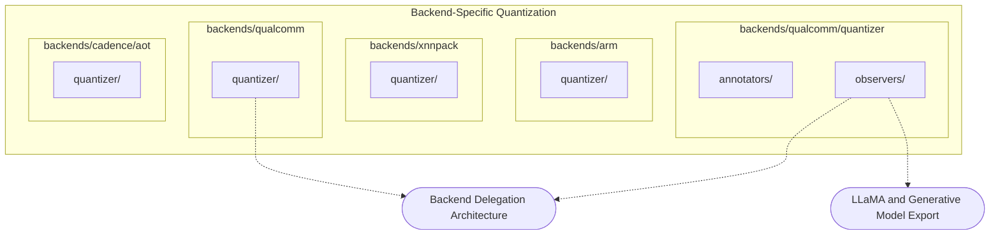
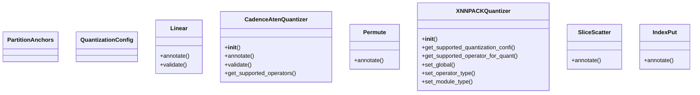
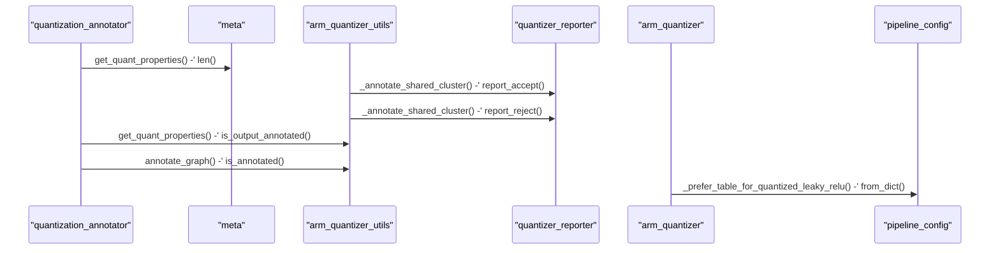

# Backend-Specific Quantization

↑ [[4-quantization-systems|Quantization Systems]]

> Architectural specification and implementation reference for Backend-Specific Quantization (35 relevant source files). Primary code entities: `NodeFinder`, `find_nodes`, `PatternCheck`, `check_pattern`, `EthosUQuantizer`.

<details>
<summary>Relevant source files</summary>

The following files were used as context for generating this wiki page:

- [backends/arm/quantizer/arm_quantizer_utils.py](backends/arm/quantizer/arm_quantizer_utils.py)
- [backends/arm/quantizer/arm_quantizer.py](backends/arm/quantizer/arm_quantizer.py)
- [backends/xnnpack/quantizer/xnnpack_quantizer.py](backends/xnnpack/quantizer/xnnpack_quantizer.py)
- [backends/arm/quantizer/quantization_annotator.py](backends/arm/quantizer/quantization_annotator.py)
- [backends/arm/quantizer/quantization_config.py](backends/arm/quantizer/quantization_config.py)
- [backends/qualcomm/quantizer/qconfig.py](backends/qualcomm/quantizer/qconfig.py)
- [backends/arm/quantizer/quantizer_support.py](backends/arm/quantizer/quantizer_support.py)
- [backends/qualcomm/quantizer/quantizer.py](backends/qualcomm/quantizer/quantizer.py)
- [backends/qualcomm/quantizer/backend_opinfo_adapter.py](backends/qualcomm/quantizer/backend_opinfo_adapter.py)
- [backends/xnnpack/quantizer/xnnpack_quantizer_utils.py](backends/xnnpack/quantizer/xnnpack_quantizer_utils.py)
- [backends/qualcomm/quantizer/quant_recipe.py](backends/qualcomm/quantizer/quant_recipe.py)
- [backends/qualcomm/quantizer/rules.py](backends/qualcomm/quantizer/rules.py)
- [backends/qualcomm/quantizer/annotators/htp_rules.py](backends/qualcomm/quantizer/annotators/htp_rules.py)
- [backends/qualcomm/quantizer/validators.py](backends/qualcomm/quantizer/validators.py)
- [backends/qualcomm/quantizer/annotators/lpai_rules.py](backends/qualcomm/quantizer/annotators/lpai_rules.py)
- [backends/qualcomm/quantizer/observers/per_channel_param_observer.py](backends/qualcomm/quantizer/observers/per_channel_param_observer.py)
- [backends/qualcomm/quantizer/observers/concat_observer.py](backends/qualcomm/quantizer/observers/concat_observer.py)
- [backends/qualcomm/quantizer/observers/per_block_param_observer.py](backends/qualcomm/quantizer/observers/per_block_param_observer.py)
- [backends/cadence/aot/quantizer/quantizer.py](backends/cadence/aot/quantizer/quantizer.py)
- [backends/vulkan/quantizer/vulkan_quantizer.py](backends/vulkan/quantizer/vulkan_quantizer.py)
- [backends/cadence/aot/quantizer/fusion_pass.py](backends/cadence/aot/quantizer/fusion_pass.py)
- [backends/apple/coreml/quantizer/_coreml_quantizer.py](backends/apple/coreml/quantizer/_coreml_quantizer.py)
- [backends/arm/quantizer/__init__.py](backends/arm/quantizer/__init__.py)
- [backends/qualcomm/quantizer/conv_bn.py](backends/qualcomm/quantizer/conv_bn.py)
- [backends/apple/coreml/quantizer/_coreml_quantizer_utils.py](backends/apple/coreml/quantizer/_coreml_quantizer_utils.py)
- [backends/apple/coreml/quantizer/_annotation_config.py](backends/apple/coreml/quantizer/_annotation_config.py)
- [backends/qualcomm/quantizer/custom_annotation.py](backends/qualcomm/quantizer/custom_annotation.py)
- [backends/cadence/aot/quantizer/patterns.py](backends/cadence/aot/quantizer/patterns.py)
- [backends/qualcomm/quantizer/README.md](backends/qualcomm/quantizer/README.md)
- [backends/xnnpack/quantizer/BUCK](backends/xnnpack/quantizer/BUCK)
- [backends/arm/quantizer/BUCK](backends/arm/quantizer/BUCK)
- [backends/qualcomm/quantizer/BUCK](backends/qualcomm/quantizer/BUCK)
- [backends/vulkan/quantizer/BUCK](backends/vulkan/quantizer/BUCK)
- [backends/cadence/aot/quantizer/BUCK](backends/cadence/aot/quantizer/BUCK)
- [backends/cadence/aot/quantizer/passes/BUCK](backends/cadence/aot/quantizer/passes/BUCK)

</details>

## Purpose and Scope

Architectural specification and implementation reference for Backend-Specific Quantization (35 relevant source files). Primary code entities: `NodeFinder`, `find_nodes`, `PatternCheck`, `check_pattern`, `EthosUQuantizer`.

Primary code entities analyzed on this page include `PartitionAnchors` ([backends/cadence/aot/quantizer/patterns.py:40-71]()), `QuantizationConfig` ([backends/qualcomm/quantizer/qconfig.py:39-45]()), `Linear` ([backends/qualcomm/quantizer/annotators/htp_rules.py:965-1044]()), `XNNPACKQuantizer` ([backends/xnnpack/quantizer/xnnpack_quantizer.py:277-464]()), `TOSAQuantizer` ([backends/arm/quantizer/arm_quantizer.py:628-1067]()).

For the parent architectural layer, see [[4-quantization-systems|Quantization Systems]]. Related sibling subsystems: [[4.1-quantization-framework-and-patterns|Quantization Framework and Patterns]].

Sources: [backends/cadence/aot/quantizer/patterns.py:40-71](), [backends/qualcomm/quantizer/qconfig.py:39-45](), [backends/qualcomm/quantizer/annotators/htp_rules.py:965-1044](), [backends/xnnpack/quantizer/xnnpack_quantizer.py:277-464]()

---

## 1. High-Level Architecture and Data Flow

### Natural Language Space to Code Entity Space Mapping

The following diagram maps domain concepts in this subsystem to their concrete code entities:

```mermaid
graph LR
  subgraph NL_Space["Natural Language Space"]
    NL_0["Partition Anchors"]
    NL_1["Quantization Config"]
    NL_2["Linear"]
    NL_3["Xnnpackquantizer"]
    NL_4["Tosaquantizer"]
    NL_5["Op Quant Properties"]
  end
  subgraph Code_Space["Code Entity Space"]
    CE_0["PartitionAnchors (patterns.py:40)"]
    CE_1["QuantizationConfig (qconfig.py:39)"]
    CE_2["Linear (htp_rules.py:965)"]
    CE_3["XNNPACKQuantizer (xnnpack_quantizer.py:277)"]
    CE_4["TOSAQuantizer (arm_quantizer.py:628)"]
    CE_5["_OpQuantProperties (quantization_annotator.py:68)"]
  end
  NL_0 -->|"implemented by"| CE_0
  NL_1 -->|"implemented by"| CE_1
  NL_2 -->|"implemented by"| CE_2
  NL_3 -->|"implemented by"| CE_3
  NL_4 -->|"implemented by"| CE_4
  NL_5 -->|"implemented by"| CE_5
```



### Subsystem Component & Dependency Flow



Cross-subsystem call and import edges connect **Backend-Specific Quantization** with [[5-backend-delegation-architecture|Backend Delegation Architecture]] (coupling `7.0`), [[5.4-arm-tosa-and-ethos-u-backend|ARM TOSA and Ethos-U Backend]] (coupling `7.0`), [[6.1-llama-model-export|LLaMA and Generative Model Export]] (coupling `1.0`).

| Module Directory | Files | Primary Code Entities | Source Citations |
|---|---|---|---|
| `backends/qualcomm/quantizer` | 10 | `QuantizationConfig`, `ByNodeTarget`, `QnnQuantizer`, `ByNameRegex` | [backends/qualcomm/quantizer/qconfig.py:39-45]() [backends/qualcomm/quantizer/quant_recipe.py:148-183]() |
| `backends/arm/quantizer` | 7 | `TOSAQuantizer`, `_OpQuantProperties`, `_QuantProperty`, `EthosUQuantizer` | [backends/arm/quantizer/arm_quantizer.py:628-1067]() [backends/arm/quantizer/quantization_annotator.py:68-81]() |
| `backends/cadence/aot/quantizer` | 4 | `PartitionAnchors`, `CadenceAtenQuantizer`, `CadenceFusedConvReluQuantizer`, `CadenceDefaultQuantizer` | [backends/cadence/aot/quantizer/patterns.py:40-71]() [backends/cadence/aot/quantizer/quantizer.py:237-338]() |
| `backends/apple/coreml/quantizer` | 3 | `CoreMLQuantizer`, `AnnotationConfig`, `_AnnotationPatternRegistry`, `annotate_weighted_mod_pattern` | [backends/apple/coreml/quantizer/_coreml_quantizer.py:522-628]() [backends/apple/coreml/quantizer/_annotation_config.py:46-130]() |
| `backends/qualcomm/quantizer/observers` | 3 | `PerChannelParamObserver`, `PerChannelParamObserverWithLossEvaluation`, `ConcatFakeQuantize`, `ConcatObserver` | [backends/qualcomm/quantizer/observers/per_channel_param_observer.py:120-157]() [backends/qualcomm/quantizer/observers/per_channel_param_observer.py:16-117]() |
| `backends/xnnpack/quantizer` | 3 | `XNNPACKQuantizer`, `QuantPattern`, `_is_annotated`, `_do_annotate_conv_bn` | [backends/xnnpack/quantizer/xnnpack_quantizer.py:277-464]() [backends/xnnpack/quantizer/xnnpack_quantizer.py:242-246]() |
| `backends/qualcomm/quantizer/annotators` | 2 | `Linear`, `Permute`, `SliceScatter`, `IndexPut` | [backends/qualcomm/quantizer/annotators/htp_rules.py:965-1044]() [backends/qualcomm/quantizer/annotators/htp_rules.py:1247-1252]() |
| `backends/vulkan/quantizer` | 2 | `VulkanQuantizer`, `get_symmetric_quantization_config`, `set_filter_function`, `transform_for_annotation` | [backends/vulkan/quantizer/vulkan_quantizer.py:137-198]() [backends/vulkan/quantizer/vulkan_quantizer.py:37-129]() |

Sources: [backends/cadence/aot/quantizer/patterns.py:40-71](), [backends/qualcomm/quantizer/qconfig.py:39-45](), [backends/qualcomm/quantizer/annotators/htp_rules.py:965-1044](), [backends/xnnpack/quantizer/xnnpack_quantizer.py:277-464](), [backends/arm/quantizer/arm_quantizer.py:628-1067]()

---

## 2. Core Data Structures and Implementation Details

### Class and Entity Relationship Diagram



### `PartitionAnchors` (Class)

- **Source Location**: [backends/cadence/aot/quantizer/patterns.py:40-71]()
- **Declaration**: `Class PartitionAnchors`
- **Graph Centrality**: fan-in `20` callers, fan-out `0` callees
- **Responsibility**: All fields except output are lists of (node, args_index) pair, where node is from the given partition and node.args[args_index] is an input to the partition. Assumes a single output. Quantizer uses inputs, weights and biases for quantization annotation. The others field contains tensor inputs that aren't quantized, and

```python
// backends/cadence/aot/quantizer/patterns.py:40-55
class PartitionAnchors:
    """
    All fields except output are lists of (node, args_index) pair, where node is from
    the given partition and node.args[args_index] is an input to the partition. Assumes
    a single output.

    Quantizer uses inputs, weights and biases for quantization annotation. The others
    field contains tensor inputs that aren't quantized, and the literals fields contains
    is used for other types of input values as well as handling default parameters.
    """

    # Inputs can share quantization parameters
    inputs: List[
        Union[
            Tuple[fx.Node, Union[int, Tuple[int, int]]],
            Tuple[
```

### `QuantizationConfig` (Class)

- **Source Location**: [backends/qualcomm/quantizer/qconfig.py:39-45]()
- **Declaration**: `Class QuantizationConfig`
- **Graph Centrality**: fan-in `17` callers, fan-out `0` callees

```python
// backends/qualcomm/quantizer/qconfig.py:39-45
class QuantizationConfig:
    input_activation: Optional[QuantizationSpec]
    output_activation: Optional[QuantizationSpec]
    weight: Optional[QuantizationSpec]
    bias: Optional[QuantizationSpec | Callable]
    block_size: Optional[Tuple] = None
    per_channel_embedding: bool = False
```

### `Linear` (Class)

- **Source Location**: [backends/qualcomm/quantizer/annotators/htp_rules.py:965-1044]()
- **Declaration**: `Class Linear`
- **Graph Centrality**: fan-in `15` callers, fan-out `0` callees

```python
// backends/qualcomm/quantizer/annotators/htp_rules.py:965-980
class Linear(GeneralOpDef):
    @staticmethod
    def annotate(node: Node, quantization_config: QuantizationConfig) -> None:
        if _is_annotated([node]):
            return

        # block quantization
        if quantization_config.block_size is not None:
            quantization_config.weight.observer_or_fake_quant_ctr.p.keywords.update(
                {QCOM_BLOCK_SIZE: quantization_config.block_size}
            )

        input_qspec_map = {}
        act_node = node.args[0]
        assert isinstance(act_node, Node)
        input_spec = quantization_config.input_activation
```

### `XNNPACKQuantizer` (Class)

- **Source Location**: [backends/xnnpack/quantizer/xnnpack_quantizer.py:277-464]()
- **Declaration**: `Class XNNPACKQuantizer`
- **Graph Centrality**: fan-in `7` callers, fan-out `0` callees

### `TOSAQuantizer` (Class)

- **Source Location**: [backends/arm/quantizer/arm_quantizer.py:628-1067]()
- **Declaration**: `Class TOSAQuantizer`
- **Graph Centrality**: fan-in `1` callers, fan-out `0` callees
- **Responsibility**: Manage quantization annotations for TOSA-compatible backends. .. warning:: The composable quantizer is now the default implementation. Setting ``use_composable_quantizer=False`` is deprecated and will be removed in two minor releases.

### `_is_annotated` (Function)

- **Source Location**: [backends/xnnpack/quantizer/xnnpack_quantizer_utils.py:110-121]()
- **Declaration**: `(nodes: list[Node])`
- **Graph Centrality**: fan-in `13` callers, fan-out `0` callees
- **Responsibility**: Given a list of nodes (that represents an operator pattern), check if any of the node is annotated, return True if any of the node is annotated, otherwise return False

Sources: [backends/cadence/aot/quantizer/patterns.py:40-71](), [backends/qualcomm/quantizer/qconfig.py:39-45](), [backends/qualcomm/quantizer/annotators/htp_rules.py:965-1044](), [backends/xnnpack/quantizer/xnnpack_quantizer.py:277-464](), [backends/arm/quantizer/arm_quantizer.py:628-1067]()

---

## 3. Execution and Call Flow

The sequence diagram below traces the runtime/compile-time call chain across components in this module:



Sources: [backends/cadence/aot/quantizer/patterns.py:40-71](), [backends/qualcomm/quantizer/qconfig.py:39-45](), [backends/qualcomm/quantizer/annotators/htp_rules.py:965-1044](), [backends/xnnpack/quantizer/xnnpack_quantizer.py:277-464](), [backends/arm/quantizer/arm_quantizer.py:628-1067]()

---

## 4. Key API and Symbol Reference

| Code Entity | Kind | Location | Fan-In / Out | Role & Signature |
|---|---|---|---|---|
| `PartitionAnchors` | Class | [backends/cadence/aot/quantizer/patterns.py:40-71]() | `20` / `0` | All fields except output are lists of (node, args_index) pair, where node is from |
| `QuantizationConfig` | Class | [backends/qualcomm/quantizer/qconfig.py:39-45]() | `17` / `0` | — |
| `Linear` | Class | [backends/qualcomm/quantizer/annotators/htp_rules.py:965-1044]() | `15` / `0` | — |
| `XNNPACKQuantizer` | Class | [backends/xnnpack/quantizer/xnnpack_quantizer.py:277-464]() | `7` / `0` | — |
| `TOSAQuantizer` | Class | [backends/arm/quantizer/arm_quantizer.py:628-1067]() | `1` / `0` | Manage quantization annotations for TOSA-compatible backends. |
| `_OpQuantProperties` | Class | [backends/arm/quantizer/quantization_annotator.py:68-81]() | `1` / `0` | Collect input/output quantization properties for a node. |
| `_QuantProperty` | Class | [backends/arm/quantizer/quantization_annotator.py:59-65]() | `1` / `0` | Specify how the input/output at 'index' must be quantized. |
| `CadenceAtenQuantizer` | Class | [backends/cadence/aot/quantizer/quantizer.py:237-338]() | `10` / `0` | — |
| `EthosUQuantizer` | Class | [backends/arm/quantizer/arm_quantizer.py:1500-1524]() | `0` / `0` | Quantizer supported by the Arm Ethos-U backend. |
| `VgfQuantizer` | Class | [backends/arm/quantizer/arm_quantizer.py:1527-1579]() | `0` / `0` | Quantizer supported by the Arm Vgf backend. |
| `PatternCheck` | Class | [backends/arm/quantizer/arm_quantizer_utils.py:169-223]() | `0` / `0` | Base class for pattern checks. |
| `PatternQuantizer` | Class | [backends/arm/quantizer/arm_quantizer_utils.py:238-411]() | `0` / `0` | Quantizes a graph according to an OperatorConfig. |
| `SharedQspecQuantizer` | Class | [backends/arm/quantizer/arm_quantizer_utils.py:428-829]() | `0` / `0` | Assures that specific ops share quantization parameters on all |
| `Permute` | Class | [backends/qualcomm/quantizer/annotators/htp_rules.py:1247-1252]() | `8` / `0` | — |
| `ByNodeTarget` | Class | [backends/qualcomm/quantizer/quant_recipe.py:148-183]() | `2` / `0` | Strategy that assigns quantization config to nodes based on their op target. |
| `QnnQuantizer` | Class | [backends/qualcomm/quantizer/quantizer.py:338-840]() | `1` / `0` | QnnQuantizer is a quantization annotator designed for QNN backends. |
| `QuantizationConfig` | Class | [backends/arm/quantizer/quantization_config.py:149-385]() | `0` / `0` | Provide a container for quantization specs. |
| `TOSAQuantizationConfig` | Class | [backends/arm/quantizer/quantization_config.py:388-549]() | `0` / `0` | Configures quantization, while enforcing TOSA specific constraints. |
| `VGFQuantizationConfig` | Class | [backends/arm/quantizer/quantization_config.py:552-605]() | `0` / `0` | Configure quantization for VGF-specific lowering paths. |
| `PowTensorTensorPositiveBaseCheck` | Class | [backends/arm/quantizer/quantizer_support.py:74-99]() | `0` / `0` | Allow Tensor/Tensor pow only when the base is proven strictly positive. |
| `ByNameRegex` | Class | [backends/qualcomm/quantizer/quant_recipe.py:186-227]() | `1` / `0` | Strategy that assigns quantization config to nodes whose module stack matches given regex patterns. |
| `QuantDtype` | Class | [backends/qualcomm/quantizer/quantizer.py:99-111]() | `0` / `0` | bits of activation and bits of weight |

Sources: [backends/cadence/aot/quantizer/patterns.py:40-71](), [backends/qualcomm/quantizer/qconfig.py:39-45](), [backends/qualcomm/quantizer/annotators/htp_rules.py:965-1044](), [backends/xnnpack/quantizer/xnnpack_quantizer.py:277-464](), [backends/arm/quantizer/arm_quantizer.py:628-1067](), [backends/arm/quantizer/quantization_annotator.py:68-81]()

---

## 5. Official Documentation and Design Context

The following linked documentation sections from `llm-wiki` (`raw/`) provide additional architectural context, tutorials, and design invariants for this subsystem:

- **Quantization Systems** ([wiki/4-quantization-systems.md](), score `142.3763`) (sections: `Quantization Systems`, `Purpose and Scope`, `System Mapping: Natural Language Space to Code Entity Space`, `1. Quantization Framework and Patterns`): # Quantization Systems > Architectural specification and implementation reference for Quantization Systems (38 relevant source files). Primary code entities: `NeonQuantizeTraits<int8_t>`, `clamp_scalar`, `narrow_and_saturate`, `store`, `QuantizeInputs`. <details> <summary>Relevant source files</summary> The following files were used as context for generating this wiki page: - [kernels/quantized/cpu/op_quantize.cpp](k
- **Cadence DSP Backend** ([wiki/5.5-cadence-dsp-backend.md](), score `120.6257`) (sections: `Cadence DSP Backend`, `Purpose and Scope`, `1. High-Level Architecture and Data Flow`, `Natural Language Space to Code Entity Space Mapping`): # Cadence DSP Backend ↑ [[5-backend-delegation-architecture|Backend Delegation Architecture]] > Architectural specification and implementation reference for Cadence DSP Backend (36 relevant source files). Primary code entities: `QuantFusionPass`, `__init__`, `call`, `QuantizedInputWrapper`, `MemoryPlanningAlgo`. <details> <summary>Relevant source files</summary> The following files were used as context for generating
- **Quantization Framework and Patterns** ([wiki/4.1-quantization-framework-and-patterns.md](), score `96.206`) (sections: `Quantization Framework and Patterns`, `Purpose and Scope`, `1. High-Level Architecture and Data Flow`, `Natural Language Space to Code Entity Space Mapping`): # Quantization Framework and Patterns ↑ [[4-quantization-systems|Quantization Systems]] > Architectural specification and implementation reference for Quantization Framework and Patterns (35 relevant source files). Primary code entities: `CanonicalizeViewCopyPermutePass`, `__init__`, `_collect_chains`, `_fuse_pair`, `NeonQuantizeTraits<int8_t>`. <details> <summary>Relevant source files</summary> The following files w
- **Backend Delegation Architecture** ([wiki/5-backend-delegation-architecture.md](), score `89.2414`) (sections: `Backend Delegation Architecture`, `Purpose and Scope`, `System Mapping: Natural Language Space to Code Entity Space`, `1. Partitioning and Operator Support`): # Backend Delegation Architecture > Architectural specification and implementation reference for Backend Delegation Architecture (40 relevant source files). Primary code entities: `CommandBuffer`, `begin`, `bind_descriptors`, `bind_pipeline`, `NodeVisitor`. <details> <summary>Relevant source files</summary> The following files were used as context for generating this wiki page: - [backends/vulkan/runtime/vk_api/Comma

Sources: [wiki/4-quantization-systems.md](), [wiki/5.5-cadence-dsp-backend.md](), [wiki/4.1-quantization-framework-and-patterns.md](), [wiki/5-backend-delegation-architecture.md]()

## Related pages

- [[4-quantization-systems|Quantization Systems]]
- [[1.1-getting-started|Getting Started]]
- [[1.2-export-api-and-recipe-system|Export API and Recipe System]]
- [[2.2-kernel-libraries-and-selective-build|Kernel Libraries and Selective Build]]
- [[2.3-schema-generation-and-flatbuffers|Schema Generation and FlatBuffers]]
- [[3.4-program-emission-and-serialization|Program Emission and Serialization]]
- [[3.5-verification-and-dialect-system|Verification and Dialect System]]
- [[4.1-quantization-framework-and-patterns|Quantization Framework and Patterns]]

## Related documents

- `wiki/4-quantization-systems.md` — Quantization Systems (score 142.3763, via bm25)
- `wiki/5.5-cadence-dsp-backend.md` — Cadence DSP Backend (score 120.6257, via bm25)
- `wiki/4.1-quantization-framework-and-patterns.md` — Quantization Framework and Patterns (score 96.206, via bm25)
- `wiki/5-backend-delegation-architecture.md` — Backend Delegation Architecture (score 89.2414, via bm25)
- `wiki/index.md` — ExecuTorch DeepWiki (score 88.9096, via bm25)

## Sources

- [`backends/arm/quantizer/arm_quantizer_utils.py`](https://github.com/pytorch/executorch/blob/main/backends/arm/quantizer/arm_quantizer_utils.py)
- [`backends/arm/quantizer/arm_quantizer.py`](https://github.com/pytorch/executorch/blob/main/backends/arm/quantizer/arm_quantizer.py)
- [`backends/xnnpack/quantizer/xnnpack_quantizer.py`](https://github.com/pytorch/executorch/blob/main/backends/xnnpack/quantizer/xnnpack_quantizer.py)
- [`backends/arm/quantizer/quantization_annotator.py`](https://github.com/pytorch/executorch/blob/main/backends/arm/quantizer/quantization_annotator.py)
- [`backends/arm/quantizer/quantization_config.py`](https://github.com/pytorch/executorch/blob/main/backends/arm/quantizer/quantization_config.py)
- [`backends/qualcomm/quantizer/qconfig.py`](https://github.com/pytorch/executorch/blob/main/backends/qualcomm/quantizer/qconfig.py)
- [`backends/arm/quantizer/quantizer_support.py`](https://github.com/pytorch/executorch/blob/main/backends/arm/quantizer/quantizer_support.py)
- [`backends/qualcomm/quantizer/quantizer.py`](https://github.com/pytorch/executorch/blob/main/backends/qualcomm/quantizer/quantizer.py)
- [`backends/qualcomm/quantizer/backend_opinfo_adapter.py`](https://github.com/pytorch/executorch/blob/main/backends/qualcomm/quantizer/backend_opinfo_adapter.py)
- [`backends/xnnpack/quantizer/xnnpack_quantizer_utils.py`](https://github.com/pytorch/executorch/blob/main/backends/xnnpack/quantizer/xnnpack_quantizer_utils.py)
- [`backends/qualcomm/quantizer/quant_recipe.py`](https://github.com/pytorch/executorch/blob/main/backends/qualcomm/quantizer/quant_recipe.py)
- [`backends/qualcomm/quantizer/rules.py`](https://github.com/pytorch/executorch/blob/main/backends/qualcomm/quantizer/rules.py)
- [`backends/qualcomm/quantizer/annotators/htp_rules.py`](https://github.com/pytorch/executorch/blob/main/backends/qualcomm/quantizer/annotators/htp_rules.py)
- [`backends/qualcomm/quantizer/validators.py`](https://github.com/pytorch/executorch/blob/main/backends/qualcomm/quantizer/validators.py)
- [`backends/qualcomm/quantizer/annotators/lpai_rules.py`](https://github.com/pytorch/executorch/blob/main/backends/qualcomm/quantizer/annotators/lpai_rules.py)
- [`backends/qualcomm/quantizer/observers/per_channel_param_observer.py`](https://github.com/pytorch/executorch/blob/main/backends/qualcomm/quantizer/observers/per_channel_param_observer.py)
- [`backends/qualcomm/quantizer/observers/concat_observer.py`](https://github.com/pytorch/executorch/blob/main/backends/qualcomm/quantizer/observers/concat_observer.py)
- [`backends/qualcomm/quantizer/observers/per_block_param_observer.py`](https://github.com/pytorch/executorch/blob/main/backends/qualcomm/quantizer/observers/per_block_param_observer.py)
- [`backends/cadence/aot/quantizer/quantizer.py`](https://github.com/pytorch/executorch/blob/main/backends/cadence/aot/quantizer/quantizer.py)
- [`backends/vulkan/quantizer/vulkan_quantizer.py`](https://github.com/pytorch/executorch/blob/main/backends/vulkan/quantizer/vulkan_quantizer.py)
- [`backends/cadence/aot/quantizer/fusion_pass.py`](https://github.com/pytorch/executorch/blob/main/backends/cadence/aot/quantizer/fusion_pass.py)
- [`backends/apple/coreml/quantizer/_coreml_quantizer.py`](https://github.com/pytorch/executorch/blob/main/backends/apple/coreml/quantizer/_coreml_quantizer.py)
- [`backends/arm/quantizer/__init__.py`](https://github.com/pytorch/executorch/blob/main/backends/arm/quantizer/__init__.py)
- [`backends/qualcomm/quantizer/conv_bn.py`](https://github.com/pytorch/executorch/blob/main/backends/qualcomm/quantizer/conv_bn.py)
- [`backends/apple/coreml/quantizer/_coreml_quantizer_utils.py`](https://github.com/pytorch/executorch/blob/main/backends/apple/coreml/quantizer/_coreml_quantizer_utils.py)
- [`backends/apple/coreml/quantizer/_annotation_config.py`](https://github.com/pytorch/executorch/blob/main/backends/apple/coreml/quantizer/_annotation_config.py)
- [`backends/qualcomm/quantizer/custom_annotation.py`](https://github.com/pytorch/executorch/blob/main/backends/qualcomm/quantizer/custom_annotation.py)
- [`backends/cadence/aot/quantizer/patterns.py`](https://github.com/pytorch/executorch/blob/main/backends/cadence/aot/quantizer/patterns.py)
- [`backends/qualcomm/quantizer/README.md`](https://github.com/pytorch/executorch/blob/main/backends/qualcomm/quantizer/README.md)
- [`backends/xnnpack/quantizer/BUCK`](https://github.com/pytorch/executorch/blob/main/backends/xnnpack/quantizer/BUCK)
- [`backends/arm/quantizer/BUCK`](https://github.com/pytorch/executorch/blob/main/backends/arm/quantizer/BUCK)
- [`backends/qualcomm/quantizer/BUCK`](https://github.com/pytorch/executorch/blob/main/backends/qualcomm/quantizer/BUCK)
- [`backends/vulkan/quantizer/BUCK`](https://github.com/pytorch/executorch/blob/main/backends/vulkan/quantizer/BUCK)
- [`backends/cadence/aot/quantizer/BUCK`](https://github.com/pytorch/executorch/blob/main/backends/cadence/aot/quantizer/BUCK)
- [`backends/cadence/aot/quantizer/passes/BUCK`](https://github.com/pytorch/executorch/blob/main/backends/cadence/aot/quantizer/passes/BUCK)


## Dynamic Knowledge Links (Code Graph ↔ LLM-Wiki / RAG)

### Linked Architecture & Design Documents

| Document | Match Channel | Score | Shared Code Symbols |
|---|---|---|---|
| [[4-quantization-systems|Quantization Systems]] | `bm25+entity(4)` | `148.376` | `Linear`, `PartitionAnchors`, `QuantizationConfig`, `XNNPACKQuantizer` |
| [[5.5-cadence-dsp-backend|Cadence DSP Backend]] | `bm25+entity(3)` | `125.126` | `CadenceAtenQuantizer`, `PartitionAnchors`, `QuantizationConfig` |
| [[4.1-quantization-framework-and-patterns|Quantization Framework and Patterns]] | `bm25+entity(1)` | `97.706` | `Permute` |
| [[5-backend-delegation-architecture|Backend Delegation Architecture]] | `bm25+entity(1)` | `90.741` | `PartitionAnchors` |
| [[index|ExecuTorch DeepWiki]] | `bm25` | `88.91` | *(lexical/graph match)* |
| [[5.4-arm-tosa-and-ethos-u-backend|ARM TOSA and Ethos-U Backend]] | `wikilink:4.2-backend-specific-quantization+entity(1)` | `81.632` | `PixelShuffle` |

### High-Centrality Bridge Symbols (CBM Graph)

| Symbol | Kind | Source Location | Fan-In / Fan-Out |
|---|---|---|---|
| `PartitionAnchors` | Class | [backends/cadence/aot/quantizer/patterns.py:40-71]() | in: `20` / out: `0` |
| `QuantizationConfig` | Class | [backends/qualcomm/quantizer/qconfig.py:39-45]() | in: `17` / out: `0` |
| `Linear` | Class | [backends/qualcomm/quantizer/annotators/htp_rules.py:965-1044]() | in: `15` / out: `0` |
| `XNNPACKQuantizer` | Class | [backends/xnnpack/quantizer/xnnpack_quantizer.py:277-464]() | in: `7` / out: `0` |
| `TOSAQuantizer` | Class | [backends/arm/quantizer/arm_quantizer.py:628-1067]() | in: `1` / out: `0` |
| `_OpQuantProperties` | Class | [backends/arm/quantizer/quantization_annotator.py:68-81]() | in: `1` / out: `0` |

Sources: [backends/cadence/aot/quantizer/patterns.py:40-71](), [backends/qualcomm/quantizer/qconfig.py:39-45](), [backends/qualcomm/quantizer/annotators/htp_rules.py:965-1044](), [backends/xnnpack/quantizer/xnnpack_quantizer.py:277-464]()

### Cross-Subsystem Coupling

- [[5-backend-delegation-architecture|Backend Delegation Architecture]] — call/import coupling weight `7.0`
- [[5.4-arm-tosa-and-ethos-u-backend|ARM TOSA and Ethos-U Backend]] — call/import coupling weight `7.0`
- [[6.1-llama-model-export|LLaMA and Generative Model Export]] — call/import coupling weight `1.0`
