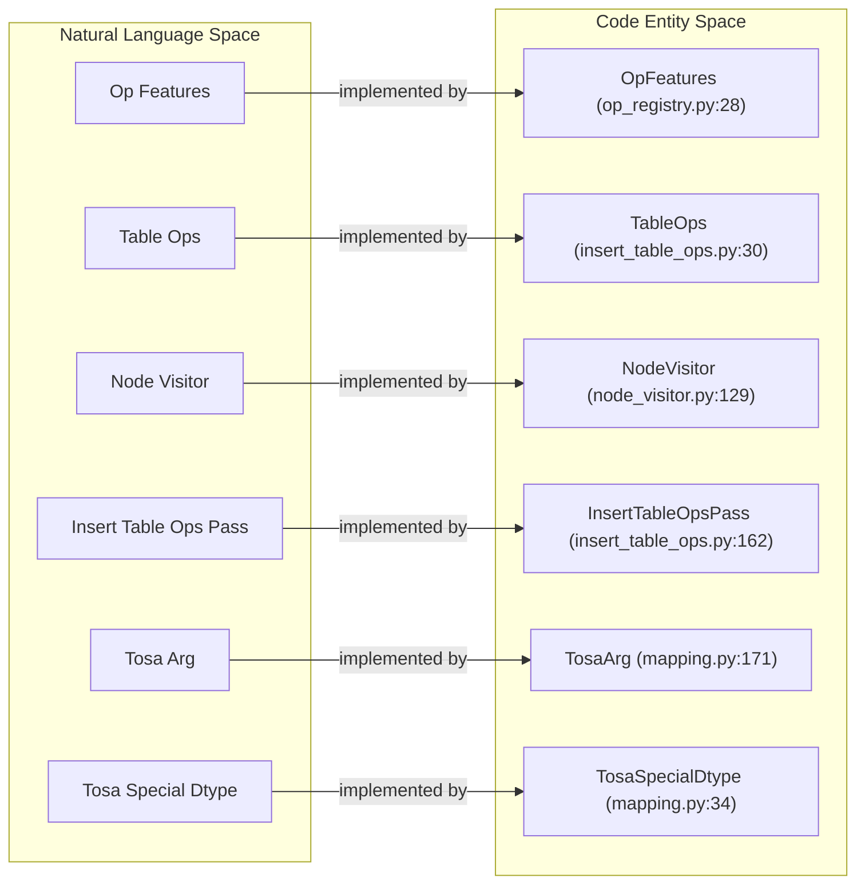
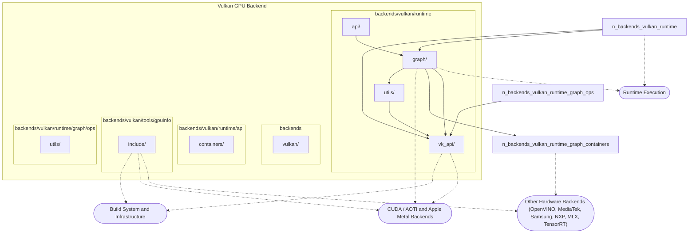
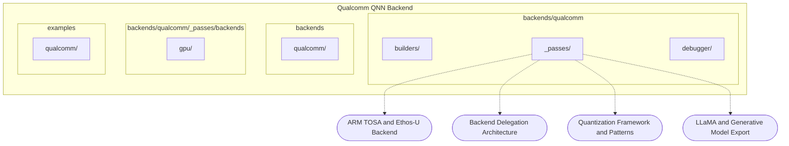
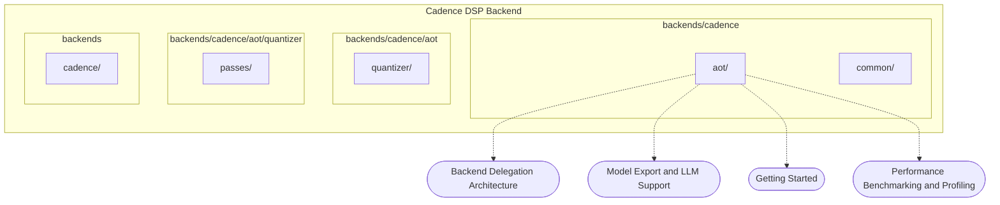
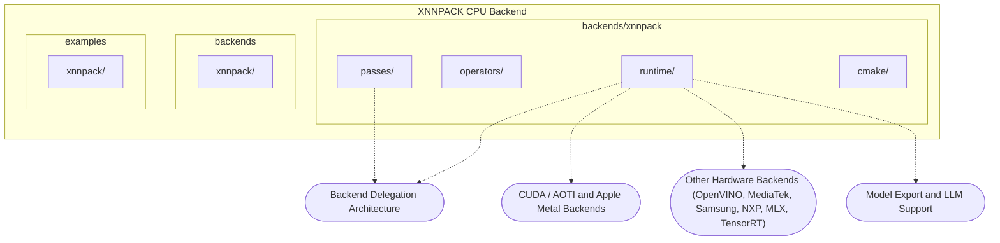
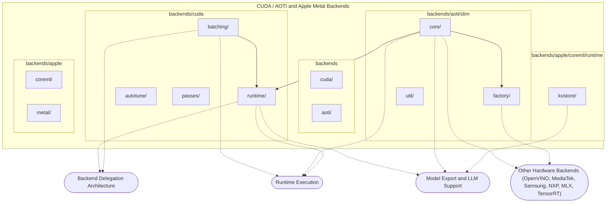
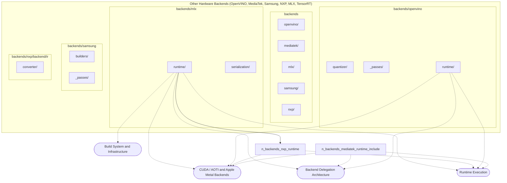

# Backend Delegation Architecture

> Architectural specification and implementation reference for Backend Delegation Architecture (40 relevant source files). Primary code entities: `CommandBuffer`, `begin`, `bind_descriptors`, `bind_pipeline`, `NodeVisitor`.

Relevant source files

The following files were used as context for generating this wiki page:

- [backends/vulkan/runtime/vk_api/Command.cpp](backends/vulkan/runtime/vk_api/Command.cpp)
- [backends/qualcomm/builders/node_visitor.py](backends/qualcomm/builders/node_visitor.py)
- [backends/arm/tosa/mapping.py](backends/arm/tosa/mapping.py)
- [backends/arm/_passes/insert_table_ops.py](backends/arm/_passes/insert_table_ops.py)
- [backends/vulkan/runtime/utils/VecUtils.h](backends/vulkan/runtime/utils/VecUtils.h)
- [backends/vulkan/runtime/graph/ComputeGraph.h](backends/vulkan/runtime/graph/ComputeGraph.h)
- [backends/vulkan/runtime/vk_api/DispatchGrid.cpp](backends/vulkan/runtime/vk_api/DispatchGrid.cpp)
- [backends/vulkan/runtime/api/containers/StagingBuffer.h](backends/vulkan/runtime/api/containers/StagingBuffer.h)
- [backends/vulkan/tools/gpuinfo/include/stats.h](backends/vulkan/tools/gpuinfo/include/stats.h)
- [backends/vulkan/runtime/graph/ops/utils/ShaderNameUtils.cpp](backends/vulkan/runtime/graph/ops/utils/ShaderNameUtils.cpp)
- [exir/backend/backend_api.py](exir/backend/backend_api.py)
- [backends/vulkan/op_registry.py](backends/vulkan/op_registry.py)
- [exir/backend/canonical_partitioners/group_partitioner.py](exir/backend/canonical_partitioners/group_partitioner.py)
- [backends/arm/_passes/arm_pass.py](backends/arm/_passes/arm_pass.py)
- [backends/vulkan/runtime/api/Context.h](backends/vulkan/runtime/api/Context.h)
- [exir/backend/canonical_partitioners/config_partitioner.py](exir/backend/canonical_partitioners/config_partitioner.py)
- [backends/vulkan/runtime/vk_api/Exception.h](backends/vulkan/runtime/vk_api/Exception.h)
- [exir/backend/backend_details.py](exir/backend/backend_details.py)
- [exir/backend/operator_support.py](exir/backend/operator_support.py)
- [backends/vulkan/runtime/graph/containers/PushConstantData.h](backends/vulkan/runtime/graph/containers/PushConstantData.h)
- [exir/backend/partitioner.py](exir/backend/partitioner.py)
- [backends/vulkan/runtime/graph/ComputeGraph.cpp](backends/vulkan/runtime/graph/ComputeGraph.cpp)
- [backends/xnnpack/operators/node_visitor.py](backends/xnnpack/operators/node_visitor.py)
- [exir/backend/canonical_partitioners/all_node_partitioner.py](exir/backend/canonical_partitioners/all_node_partitioner.py)
- [exir/backend/compile_spec_schema.py](exir/backend/compile_spec_schema.py)
- [exir/backend/canonical_partitioners/duplicate_dequant_node_pass.py](exir/backend/canonical_partitioners/duplicate_dequant_node_pass.py)
- [backends/xnnpack/runtime/XNNWeightsCache.h](backends/xnnpack/runtime/XNNWeightsCache.h)
- [runtime/backend/backend_init_context.h](runtime/backend/backend_init_context.h)
- [backends/arm/MODELS.md](backends/arm/MODELS.md)
- [backends/arm/README.md](backends/arm/README.md)
- [backends/arm/SYMINT_ET_LOWERING.md](backends/arm/SYMINT_ET_LOWERING.md)
- [backends/qualcomm/README.md](backends/qualcomm/README.md)
- [backends/qualcomm/setup.md](backends/qualcomm/setup.md)
- [backends/vulkan/README.md](backends/vulkan/README.md)
- [exir/backend/BUCK](exir/backend/BUCK)

## Purpose and Scope

This chapter covers **Backend Delegation Architecture** across the repository, detailing the core abstractions, data structures, transformation pipelines, and runtime/build integrations that implement this layer.

**Scope**: This document provides an architectural hub for the following child subsystems:
- **Partitioning and Operator Support**: See [[5.1-partitioning-and-operator-support|Partitioning and Operator Support]].
- **Vulkan GPU Backend**: See [[5.2-vulkan-gpu-backend|Vulkan GPU Backend]].
- **Qualcomm QNN Backend**: See [[5.3-qualcomm-qnn-backend|Qualcomm QNN Backend]].
- **ARM TOSA and Ethos-U Backend**: See [[5.4-arm-tosa-and-ethos-u-backend|ARM TOSA and Ethos-U Backend]].
- **Cadence DSP Backend**: See [[5.5-cadence-dsp-backend|Cadence DSP Backend]].
- **XNNPACK CPU Backend**: See [[5.6-xnnpack-cpu-backend|XNNPACK CPU Backend]].
- **CUDA / AOTI and Apple Metal Backends**: See [[5.7-cuda-aoti-and-apple-metal-backends|CUDA / AOTI and Apple Metal Backends]].
- **Other Hardware Backends (OpenVINO, MediaTek, Samsung, NXP, MLX, TensorRT)**: See [[5.8-other-backends|Other Hardware Backends (OpenVINO, MediaTek, Samsung, NXP, MLX, TensorRT)]].

Sources: [backends/vulkan/op_registry.py:28-129](), [backends/arm/_passes/insert_table_ops.py:30-159](), [backends/qualcomm/builders/node_visitor.py:129-614](), [backends/arm/_passes/insert_table_ops.py:162-431]()

---

## System Mapping: Natural Language Space to Code Entity Space

Sources: [backends/vulkan/op_registry.py:28-129](), [backends/arm/_passes/insert_table_ops.py:30-159](), [backends/qualcomm/builders/node_visitor.py:129-614](), [backends/arm/_passes/insert_table_ops.py:162-431](), [backends/arm/tosa/mapping.py:171-338]()

---

## 1. Partitioning and Operator Support

Architectural specification and implementation reference for Partitioning and Operator Support (17 relevant source files). Primary code entities: `MethodProgramsPartitionerSpec`, `_`, `_create_partitions`, `_create_partitions_in_graph_module`, `GroupBasedPartitioner`. [exir/backend/backend_api.py:672-680](), [exir/backend/canonical_partitioners/group_partitioner.py:30-71](), [exir/backend/canonical_partitioners/config_partitioner.py:111-137]()

### Primary Code Entities

- **`MethodProgramsPartitionerSpec`** (Class in [exir/backend/backend_api.py:672-680]()): Since single dispatch for to_backend requires the first argument to be a valid class, we create the following dataclass spec to hold the dictionaries mapping the method name to the
- **`_DependencyViewer`** (Class in [exir/backend/canonical_partitioners/group_partitioner.py:30-71]()): Transitive users and inputs of nodes, as bitmasks over node positions. A whole partition can then be checked for cycles with a few integer operations. Nodes must be in topological 
- **`DSJ`** (Class in [exir/backend/canonical_partitioners/config_partitioner.py:111-137]()): Disjoint set union data structure used to find connected components in the graph.
- **`GroupBasedPartitioner`** (Class in [exir/backend/canonical_partitioners/group_partitioner.py:74-495]()): A specialized partitioner that extends the CapabilityBasedPartitioner from PyTorch FX. GroupBasedPartitioner allows for explicit grouping of nodes into partitions based on predefin
- **`_merge_partitions`** (Method in [exir/backend/canonical_partitioners/group_partitioner.py:342-412]()): Merge partitions when possible.
- **`_`** (Function in [exir/backend/backend_api.py:684-809]()): Add overloaded implementations for to_backend: :: def to_backend( method_edge_program_partitioners: MethodProgramsPartitionerSpec ) -> Dict[str, ExportedProgram]: Returns a semanti

### Partitioning and Operator Support Architecture Flow

```mermaid
flowchart TD
  subgraph sub_this["Partitioning and Operator Support"]
    subgraph sg_0["exir/backend"]
      n_exir_backend_backend_api_py["MethodProgramsPartitionerSpec (backend_api.py)"]
      n_exir_backend_backend_details_py["BackendDetails (backend_details.py)"]
      n_exir_backend_operator_support_py["DontPartition (operator_support.py)"]
      n_exir_backend_partitioner_py["Partitioner (partitioner.py)"]
      n_exir_backend_compile_spec_schema_py["CompileSpec (compile_spec_schema.py)"]
      n_exir_backend_targets_bzl["define_common_targets (targets.bzl)"]
      n_exir_backend_utils_py["ReportRejected (utils.py)"]
    end
    subgraph sg_1["exir/backend/canonical_partitioners"]
      n_exir_backend_canonical_partitioners_group_partit["_DependencyViewer (group_partitioner.py)"]
      n_exir_backend_canonical_partitioners_config_parti["DSJ (config_partitioner.py)"]
      n_exir_backend_canonical_partitioners_all_node_par["AllNodePartitioner (all_node_partitioner.py)"]
      n_exir_backend_canonical_partitioners_duplicate_de["DuplicateDequantNodePass (duplicate_dequant_node_pass.py)"]
      n_exir_backend_canonical_partitioners_duplicate_co["duplicate_constant_nodes (duplicate_constant_node_pass.py)"]
      n_exir_backend_canonical_partitioners_pattern_op_p["generate_pattern_op_partitions (pattern_op_partitioner.py)"]
      n_exir_backend_canonical_partitioners_BUCK["BUCK"]
    end
  end
  n_page_5_2_vulkan_gpu_backend(["Vulkan GPU Backend"])
  n_page_5_backend_delegation_architecture(["Backend Delegation Architecture"])
  n_exir_backend_backend_api_py --> n_exir_backend_backend_details_py
  n_exir_backend_backend_api_py -.-> n_page_5_backend_delegation_architecture
  n_exir_backend_utils_py -.-> n_page_5_backend_delegation_architecture
  n_exir_backend_canonical_partitioners_group_partit -.-> n_page_5_2_vulkan_gpu_backend
```

For details, see [[5.1-partitioning-and-operator-support|Partitioning and Operator Support]].

Sources: [exir/backend/backend_api.py:672-680](), [exir/backend/canonical_partitioners/group_partitioner.py:30-71](), [exir/backend/canonical_partitioners/config_partitioner.py:111-137](), [exir/backend/canonical_partitioners/group_partitioner.py:74-495]()

---

## 2. Vulkan GPU Backend

Architectural specification and implementation reference for Vulkan GPU Backend (40 relevant source files). Primary code entities: `CommandBuffer`, `begin`, `bind_descriptors`, `bind_pipeline`, `OpFeatures`. [backends/vulkan/op_registry.py:28-129](), [backends/vulkan/runtime/graph/ComputeGraph.h:166-1340](), [backends/vulkan/runtime/graph/ComputeGraph.h:100-152]()

### Primary Code Entities

- **`OpFeatures`** (Class in [backends/vulkan/op_registry.py:28-129]()): Core implementation entity.
- **`ComputeGraph`** (Class in [backends/vulkan/runtime/graph/ComputeGraph.h:166-1340]()): /* * This is the core data structure used to execute Vulkan models in graph mode. * As opposed to ATen/eager mode where a command buffer is encoded every * inference (since ops are
- **`TmpTensor`** (Class in [backends/vulkan/runtime/graph/ComputeGraph.h:100-152]()): /* * This struct is used to recycle the memory of temporary tensors that are * created during the execution of a node. Upon construction, this struct will * check the `tmp_shared_o
- **`TagMemoryMetaPass`** (Class in [backends/vulkan/_passes/tag_memory_meta_pass.py:134-549]()): Operator implementations in the Vulkan delegate may require that input and output tensors use a specific representation. Representation in this case refers to a combination of stor
- **`end`** (Method in [backends/vulkan/runtime/vk_api/Command.cpp:68-79]()): ()
- **`begin`** (Method in [backends/vulkan/runtime/vk_api/Command.cpp:51-66]()): ()

### Vulkan GPU Backend Architecture Flow

For details, see [[5.2-vulkan-gpu-backend|Vulkan GPU Backend]].

Sources: [backends/vulkan/op_registry.py:28-129](), [backends/vulkan/runtime/graph/ComputeGraph.h:166-1340](), [backends/vulkan/runtime/graph/ComputeGraph.h:100-152](), [backends/vulkan/_passes/tag_memory_meta_pass.py:134-549]()

---

## 3. Qualcomm QNN Backend

Architectural specification and implementation reference for Qualcomm QNN Backend (40 relevant source files). Primary code entities: `NodeVisitor`, `__init__`, `define_custom_tensor_wrapper`, `define_node`, `ConvertMhaToSha`. [backends/qualcomm/_passes/build_quant_io.py:14-53](), [backends/qualcomm/_passes/convert_mha_to_sha.py:95-626](), [backends/qualcomm/builders/node_visitor.py:129-614]()

### Primary Code Entities

- **`BuildQuantIo`** (Class in [backends/qualcomm/_passes/build_quant_io.py:14-53]()): To make lowering process correct, the pass assign the correct quantized dtype to spec of call_delegate.
- **`ConvertMhaToSha`** (Class in [backends/qualcomm/_passes/convert_mha_to_sha.py:95-626]()): b=batch, e=emb=h*d, h=heads, d=head_size, s=seq_len, p=past, c=s+p i[bse] ─┬─ q[bse] ─ [bhsd] ─ RoPE ─ [bhsd] ───────────────────── qk[bhsc] ─ mask ─ softmax ─ qkv[bhsd] ─ [bse] ─ 
- **`NodeVisitor`** (Class in [backends/qualcomm/builders/node_visitor.py:129-614]()): Node visitor pattern for visiting nodes in an edge IR graph
- **`AnnotateAvgPool1D`** (Class in [backends/qualcomm/_passes/annotate_avg_pool1d.py:17-64]()): Add "quant_attrs" to graph nodes' meta from the QDQ information generated after quantization process. avg_pool1d and adaptive_avg_pool1d get decomposed to: unsqueeze -> avg_pool2d/
- **`define_tensor`** (Method in [backends/qualcomm/builders/node_visitor.py:532-606]()): Covert torch.Tensor to TensorWrapper Args: tensor_source_node: EdgeIR Node target_build_node: Current node to build tensor: EdgeIR Tensor tensor_type: QNN tensor type nodes_to_wrap
- **`get_tensor`** (Method in [backends/qualcomm/builders/node_visitor.py:168-187]()): Get tensor value/shape with axis_order

### Qualcomm QNN Backend Architecture Flow

For details, see [[5.3-qualcomm-qnn-backend|Qualcomm QNN Backend]].

Sources: [backends/qualcomm/_passes/build_quant_io.py:14-53](), [backends/qualcomm/_passes/convert_mha_to_sha.py:95-626](), [backends/qualcomm/builders/node_visitor.py:129-614](), [backends/qualcomm/_passes/annotate_avg_pool1d.py:17-64]()

---

## 4. ARM TOSA and Ethos-U Backend

Architectural specification and implementation reference for ARM TOSA and Ethos-U Backend (40 relevant source files). Primary code entities: `TosaArg`, `__init__`, `__process_list`, `__process_node`, `InsertTableOpsPass`. [examples/arm/QAT_example/rife_vgf/passes/pack_rife_warps_and_concat.py:429-646](), [backends/arm/_passes/arm_pass_manager.py:227-231](), [backends/arm/_passes/insert_table_ops.py:30-159]()

### Primary Code Entities

- **`PackRifeWarpsAndConcatPass`** (Class in [examples/arm/QAT_example/rife_vgf/passes/pack_rife_warps_and_concat.py:429-646]()): Pack four private RIFE warps and their C28 concat into one C32 shader. Fuse compatible block0 head resizing and state preparation into the shader. Reorder block0 output channels du
- **`PassInsertions`** (Class in [backends/arm/_passes/arm_pass_manager.py:227-231]()): Holds lists of passes to be inserted before and after a target pass.
- **`TableOps`** (Class in [backends/arm/_passes/insert_table_ops.py:30-159]()): Helper class for finding the corresponding table operator for a given Node.
- **`VgfEnvironmentCheck`** (Class in [backends/arm/vgf/check_env.py:51-71]()): One VGF environment preflight result.
- **`register_buffer`** (Method in [backends/arm/_passes/insert_table_ops.py:179-181]()): Add buffer to self.exported_program.state_dict.
- **`max`** (Method in [backends/arm/tosa/mapping.py:63-70]()): (self)

### ARM TOSA and Ethos-U Backend Architecture Flow

```mermaid
flowchart TD
  subgraph sub_this["ARM TOSA and Ethos-U Backend"]
    subgraph sg_0["backends/arm"]
      n_backends_arm_tosa["tosa/"]
      n_backends_arm__passes["_passes/"]
      n_backends_arm_runtime["runtime/"]
      n_backends_arm_operators["operators/"]
      n_backends_arm_vgf["vgf/"]
      n_backends_arm_cmake["cmake/"]
      n_backends_arm_debug["debug/"]
    end
    subgraph sg_1["examples/arm"]
      n_examples_arm_ethos_u_setup["ethos-u-setup/"]
      n_examples_arm_executor_runner["executor_runner/"]
    end
    subgraph sg_2["examples/arm/QAT_example/rife_vgf"]
      n_examples_arm_QAT_example_rife_vgf_passes["passes/"]
    end
    subgraph sg_3["backends"]
      n_backends_arm["arm/"]
    end
    subgraph sg_4["examples"]
      n_examples_arm["arm/"]
    end
  end
  n_page_2_build_system_and_infrastructure(["Build System and Infrastructure"])
  n_page_6_1_llama_model_export(["LLaMA and Generative Model Export"])
  n_page_6_model_export_and_llm_support(["Model Export and LLM Support"])
  n_page_8_runtime_execution(["Runtime Execution"])
  n_examples_arm_ethos_u_setup -.-> n_page_6_model_export_and_llm_support
  n_examples_arm_executor_runner -.-> n_page_8_runtime_execution
  n_backends_arm__passes -.-> n_page_6_1_llama_model_export
  n_examples_arm_executor_runner -.-> n_page_2_build_system_and_infrastructure
  n_examples_arm_ethos_u_setup -.-> n_page_6_1_llama_model_export
  n_backends_arm_runtime -.-> n_page_6_model_export_and_llm_support
  n_backends_arm__passes --> n_backends_arm_tosa
  n_backends_arm__passes -.-> n_page_6_model_export_and_llm_support
```

For details, see [[5.4-arm-tosa-and-ethos-u-backend|ARM TOSA and Ethos-U Backend]].

Sources: [examples/arm/QAT_example/rife_vgf/passes/pack_rife_warps_and_concat.py:429-646](), [backends/arm/_passes/arm_pass_manager.py:227-231](), [backends/arm/_passes/insert_table_ops.py:30-159](), [backends/arm/vgf/check_env.py:51-71]()

---

## 5. Cadence DSP Backend

Architectural specification and implementation reference for Cadence DSP Backend (36 relevant source files). Primary code entities: `QuantFusionPass`, `__init__`, `call`, `QuantizedInputWrapper`, `MemoryPlanningAlgo`. [backends/cadence/aot/quantizer/patterns.py:40-71](), [backends/cadence/aot/quantizer/quantizer.py:237-338](), [backends/cadence/aot/compiler_funcs.py:717-758]()

### Primary Code Entities

- **`PartitionAnchors`** (Class in [backends/cadence/aot/quantizer/patterns.py:40-71]()): All fields except output are lists of (node, args_index) pair, where node is from the given partition and node.args[args_index] is an input to the partition. Assumes a single outpu
- **`CadenceAtenQuantizer`** (Class in [backends/cadence/aot/quantizer/quantizer.py:237-338]()): Core implementation entity.
- **`QuantFusionPass`** (Class in [backends/cadence/aot/compiler_funcs.py:717-758]()): Iterates patterns, finds anchor ops in the converted graph, and calls pattern.fuse() to replace dq-op-q subgraphs with fused ops. ``exported_program`` is optional but required for 
- **`AbsolutePlacementConstraint`** (Class in [backends/cadence/aot/memory_constraints.py:34-40]()): Information on placement constraint memory id and offset.
- **`add_relative_placement_constraint`** (Method in [backends/cadence/aot/memory_constraints.py:242-301]()): Add a location constraint between source and dependent nodes. The imperative is that both the nodes are tensors. The constraint generated will imply that shadow tensor is at a dist
- **`conv2d`** (Function in [backends/cadence/aot/ref_implementations.py:1973-1986]()): ( input_tensor: torch.Tensor, weight: torch.Tensor, bias: torch.Tensor, stride: tuple[int, int], padding: tuple[int, int], dilation: tuple[int, int], groups: int, )

### Cadence DSP Backend Architecture Flow

For details, see [[5.5-cadence-dsp-backend|Cadence DSP Backend]].

Sources: [backends/cadence/aot/quantizer/patterns.py:40-71](), [backends/cadence/aot/quantizer/quantizer.py:237-338](), [backends/cadence/aot/compiler_funcs.py:717-758](), [backends/cadence/aot/memory_constraints.py:34-40]()

---

## 6. XNNPACK CPU Backend

Architectural specification and implementation reference for XNNPACK CPU Backend (36 relevant source files). Primary code entities: `ChannelsLastTaggedReshapePass`, `_is_nhwc`, `call`, `can_be_converted_to_nhwc`, `InputTypeToIndex`. [backends/xnnpack/_passes/channels_last_tagged_reshape_pass.py:42-753](), [backends/xnnpack/operators/node_visitor.py:59-70](), [backends/xnnpack/operators/node_visitor.py:83-752]()

### Primary Code Entities

- **`ChannelsLastTaggedReshapePass`** (Class in [backends/xnnpack/_passes/channels_last_tagged_reshape_pass.py:42-753]()): # TODO(T151254305) use subgraph_rewriter
- **`InputTypeToIndex`** (Class in [backends/xnnpack/operators/node_visitor.py:59-70]()): Mapping from input type to the arg index of a node
- **`NodeVisitor`** (Class in [backends/xnnpack/operators/node_visitor.py:83-752]()): Node visitor pattern for visiting nodes in an edge IR graph and serializing them using the xnnpack serialization schema defined
- **`Conv1dUnsqueezePass`** (Class in [backends/xnnpack/_passes/conv1d_unsqueeze_pass.py:23-206]()): This pass is used to change conv1d ops into conv2d since xnnpack only supports 2d convolution. This is done by modifying the graph to do the following: 1) unsqueeze the convolution
- **`get`** (Method in [backends/xnnpack/runtime/XNNWeightsCache.h:120-122]()): /** * Returns XNNPACK's underlying weights_cache pointer */
- **`define_nodes_tensor_inputs_outputs`** (Method in [backends/xnnpack/operators/node_visitor.py:667-743]()): ( self, node: torch.fx.Node, xnn_graph: XNNGraph, vals_to_ids: Dict[torch.fx.Node, int], convert_to_nhwc: bool = False, input_type_map: Optional[InputTypeToIndex] = None, )

### XNNPACK CPU Backend Architecture Flow

For details, see [[5.6-xnnpack-cpu-backend|XNNPACK CPU Backend]].

Sources: [backends/xnnpack/_passes/channels_last_tagged_reshape_pass.py:42-753](), [backends/xnnpack/operators/node_visitor.py:59-70](), [backends/xnnpack/operators/node_visitor.py:83-752](), [backends/xnnpack/_passes/conv1d_unsqueeze_pass.py:23-206]()

---

## 7. CUDA / AOTI and Apple Metal Backends

Architectural specification and implementation reference for CUDA / AOTI and Apple Metal Backends (40 relevant source files). Primary code entities: `empty`, `empty_like`, `empty_strided`, `DeviceTraits<c10::DeviceType::CPU>`, `allocate`. [backends/apple/coreml/runtime/kvstore/key_value_store.hpp:96-106](), [backends/cuda/cuda_partitioner.py:20-53](), [backends/cuda/passes/move_cond_predicate_to_cpu.py:11-94]()

### Primary Code Entities

- **`Converter<std::string>`** (Class in [backends/apple/coreml/runtime/kvstore/key_value_store.hpp:96-106]()): Core implementation entity.
- **`CudaPartitioner`** (Class in [backends/cuda/cuda_partitioner.py:20-53]()): CUDA partitioner driven by AOTInductor backend. This partitioner adds a target_device compile spec to enable device info propagation. The PropagateDevicePass will read this spec an
- **`MoveCondPredicateToCpuPass`** (Class in [backends/cuda/passes/move_cond_predicate_to_cpu.py:11-94]()): A pass that moves the predicate of torch.cond to CPU if the predicate is a constantbuffer. This is useful for models that use the predicate as a constant buffer, such as an `initia
- **`ReplaceInt64FloorDivWithFloatPass`** (Class in [backends/cuda/passes/replace_int64_floordiv.py:39-153]()): Pass to rewrite integer floor-division into a float64-domain floor. Matches ``floor_divide.default`` and the floor-mode ``div.Tensor_mode`` / ``div.Scalar_mode`` overloads on integ
- **`empty`** (Function in [backends/aoti/slim/factory/empty.h:64-69]()): /// Creates an empty contiguous tensor with sizes from an initializer list. /// Convenience overload for creating tensors with inline size specification. /// /// @param sizes The s
- **`numel`** (Method in [backends/aoti/slim/core/slim_tensor.h:197-199]()): /** * Get the total number of elements. */

### CUDA / AOTI and Apple Metal Backends Architecture Flow

For details, see [[5.7-cuda-aoti-and-apple-metal-backends|CUDA / AOTI and Apple Metal Backends]].

Sources: [backends/apple/coreml/runtime/kvstore/key_value_store.hpp:96-106](), [backends/cuda/cuda_partitioner.py:20-53](), [backends/cuda/passes/move_cond_predicate_to_cpu.py:11-94](), [backends/cuda/passes/replace_int64_floordiv.py:39-153]()

---

## 8. Other Hardware Backends (OpenVINO, MediaTek, Samsung, NXP, MLX, TensorRT)

Architectural specification and implementation reference for Other Hardware Backends (OpenVINO, MediaTek, Samsung, NXP, MLX, TensorRT) (40 relevant source files). Primary code entities: `ConstantData`, `add`, `get`, `set`, `Interpreter`. [backends/mlx/partitioner.py:95-386](), [backends/mlx/pattern_utils.py:105-193](), [backends/openvino/quantizer/quantizer.py:74-616]()

### Primary Code Entities

- **`MLXPartitioner`** (Class in [backends/mlx/partitioner.py:95-386]()): Partitioner for the MLX delegate. Analyzes an EdgeIR graph and partitions supported operations for delegation to MLX.
- **`OpStep`** (Class in [backends/mlx/pattern_utils.py:105-193]()): One step in a backward walk through the graph. Used with walk_back() to define pattern chains. Supports both exact op matching and predicate-based matching. Attributes: op: Specifi
- **`OpenVINOQuantizer`** (Class in [backends/openvino/quantizer/quantizer.py:74-616]()): Implementation of the Torch AO quantizer which annotates models with quantization annotations optimally for the inference via OpenVINO.
- **`QuantizationMode`** (Class in [backends/openvino/quantizer/quantizer.py:52-71]()): Defines special quantization modes. - INT8_SYM: INT8 symmetric quantization for both activations and weights. - INT8_MIXED: INT8 asymmetric quantization for activations, symmetric 
- **`set_tensor`** (Method in [backends/mlx/runtime/MLXExecutor.h:551-584]()): // Set a tensor output
- **`const_tensor_ref`** (Method in [backends/mlx/runtime/MLXExecutor.h:504-548]()): (Tid id)

### Other Hardware Backends (OpenVINO, MediaTek, Samsung, NXP, MLX, TensorRT) Architecture Flow

For details, see [[5.8-other-backends|Other Hardware Backends (OpenVINO, MediaTek, Samsung, NXP, MLX, TensorRT)]].

Sources: [backends/mlx/partitioner.py:95-386](), [backends/mlx/pattern_utils.py:105-193](), [backends/openvino/quantizer/quantizer.py:74-616](), [backends/openvino/quantizer/quantizer.py:52-71]()

---

## Official Documentation & Architectural References

- **ExecuTorch DeepWiki** ([wiki/index.md]()): # ExecuTorch DeepWiki Generated from `home-jason-Project-deepwiki-executorch` at commit `b3b565b5b62f` (2026-11-15T15:02:11+00:00). ## Pages - [[1-overview|Overview]] — Architectural specification and implementation reference for Overview (10 relevant source files). Primary code entities: `Module`, `MethodHolder`, `PlannedMemory`, `EdgeProgramManager`, `__in
- **ARM TOSA and Ethos-U Backend** ([wiki/5.4-arm-tosa-and-ethos-u-backend.md]()): # ARM TOSA and Ethos-U Backend ↑ [[5-backend-delegation-architecture|Backend Delegation Architecture]] > Architectural specification and implementation reference for ARM TOSA and Ethos-U Backend (40 relevant source files). Primary code entities: `TosaArg`, `__init__`, `__process_list`, `__process_node`, `InsertTableOpsPass`. 
 
Relevant sourc
- **Vulkan GPU Backend** ([wiki/5.2-vulkan-gpu-backend.md]()): # Vulkan GPU Backend ↑ [[5-backend-delegation-architecture|Backend Delegation Architecture]] > Architectural specification and implementation reference for Vulkan GPU Backend (40 relevant source files). Primary code entities: `CommandBuffer`, `begin`, `bind_descriptors`, `bind_pipeline`, `OpFeatures`. 
 
Relevant source files
 The fo
- **Partitioning and Operator Support** ([wiki/5.1-partitioning-and-operator-support.md]()): # Partitioning and Operator Support ↑ [[5-backend-delegation-architecture|Backend Delegation Architecture]] > Architectural specification and implementation reference for Partitioning and Operator Support (17 relevant source files). Primary code entities: `MethodProgramsPartitionerSpec`, `_`, `_create_partitions`, `_create_partitions_in_graph_module`, `Group

Sources: [wiki/index.md](), [wiki/5.4-arm-tosa-and-ethos-u-backend.md](), [wiki/5.2-vulkan-gpu-backend.md](), [wiki/5.1-partitioning-and-operator-support.md]()

## Sub-pages

- [[5.1-partitioning-and-operator-support|Partitioning and Operator Support]]
- [[5.2-vulkan-gpu-backend|Vulkan GPU Backend]]
- [[5.3-qualcomm-qnn-backend|Qualcomm QNN Backend]]
- [[5.4-arm-tosa-and-ethos-u-backend|ARM TOSA and Ethos-U Backend]]
- [[5.5-cadence-dsp-backend|Cadence DSP Backend]]
- [[5.6-xnnpack-cpu-backend|XNNPACK CPU Backend]]
- [[5.7-cuda-aoti-and-apple-metal-backends|CUDA / AOTI and Apple Metal Backends]]
- [[5.8-other-backends|Other Hardware Backends (OpenVINO, MediaTek, Samsung, NXP, MLX, TensorRT)]]

## Related pages

- [[1-overview|Overview]]
- [[5.1-partitioning-and-operator-support|Partitioning and Operator Support]]
- [[5.2-vulkan-gpu-backend|Vulkan GPU Backend]]
- [[5.3-qualcomm-qnn-backend|Qualcomm QNN Backend]]
- [[5.4-arm-tosa-and-ethos-u-backend|ARM TOSA and Ethos-U Backend]]
- [[5.5-cadence-dsp-backend|Cadence DSP Backend]]
- [[5.6-xnnpack-cpu-backend|XNNPACK CPU Backend]]
- [[5.7-cuda-aoti-and-apple-metal-backends|CUDA / AOTI and Apple Metal Backends]]
- [[5.8-other-backends|Other Hardware Backends (OpenVINO, MediaTek, Samsung, NXP, MLX, TensorRT)]]

## Related documents

- `wiki/index.md` — ExecuTorch DeepWiki (score 115.3876, via bm25)
- `wiki/5.4-arm-tosa-and-ethos-u-backend.md` — ARM TOSA and Ethos-U Backend (score 114.8029, via bm25)
- `wiki/5.2-vulkan-gpu-backend.md` — Vulkan GPU Backend (score 113.6956, via bm25)
- `wiki/5.1-partitioning-and-operator-support.md` — Partitioning and Operator Support (score 106.3463, via bm25)
- `wiki/5.8-other-backends.md` — Other Hardware Backends (OpenVINO, MediaTek, Samsung, NXP, MLX, TensorRT) (score 97.1675, via bm25)

## Sources

- [`backends/vulkan/runtime/vk_api/Command.cpp`](https://github.com/pytorch/executorch/blob/main/backends/vulkan/runtime/vk_api/Command.cpp)
- [`backends/qualcomm/builders/node_visitor.py`](https://github.com/pytorch/executorch/blob/main/backends/qualcomm/builders/node_visitor.py)
- [`backends/arm/tosa/mapping.py`](https://github.com/pytorch/executorch/blob/main/backends/arm/tosa/mapping.py)
- [`backends/arm/_passes/insert_table_ops.py`](https://github.com/pytorch/executorch/blob/main/backends/arm/_passes/insert_table_ops.py)
- [`backends/vulkan/runtime/utils/VecUtils.h`](https://github.com/pytorch/executorch/blob/main/backends/vulkan/runtime/utils/VecUtils.h)
- [`backends/vulkan/runtime/graph/ComputeGraph.h`](https://github.com/pytorch/executorch/blob/main/backends/vulkan/runtime/graph/ComputeGraph.h)
- [`backends/vulkan/runtime/vk_api/DispatchGrid.cpp`](https://github.com/pytorch/executorch/blob/main/backends/vulkan/runtime/vk_api/DispatchGrid.cpp)
- [`backends/vulkan/runtime/api/containers/StagingBuffer.h`](https://github.com/pytorch/executorch/blob/main/backends/vulkan/runtime/api/containers/StagingBuffer.h)
- [`backends/vulkan/tools/gpuinfo/include/stats.h`](https://github.com/pytorch/executorch/blob/main/backends/vulkan/tools/gpuinfo/include/stats.h)
- [`backends/vulkan/runtime/graph/ops/utils/ShaderNameUtils.cpp`](https://github.com/pytorch/executorch/blob/main/backends/vulkan/runtime/graph/ops/utils/ShaderNameUtils.cpp)
- [`exir/backend/backend_api.py`](https://github.com/pytorch/executorch/blob/main/exir/backend/backend_api.py)
- [`backends/vulkan/op_registry.py`](https://github.com/pytorch/executorch/blob/main/backends/vulkan/op_registry.py)
- [`exir/backend/canonical_partitioners/group_partitioner.py`](https://github.com/pytorch/executorch/blob/main/exir/backend/canonical_partitioners/group_partitioner.py)
- [`backends/arm/_passes/arm_pass.py`](https://github.com/pytorch/executorch/blob/main/backends/arm/_passes/arm_pass.py)
- [`backends/vulkan/runtime/api/Context.h`](https://github.com/pytorch/executorch/blob/main/backends/vulkan/runtime/api/Context.h)
- [`exir/backend/canonical_partitioners/config_partitioner.py`](https://github.com/pytorch/executorch/blob/main/exir/backend/canonical_partitioners/config_partitioner.py)
- [`backends/vulkan/runtime/vk_api/Exception.h`](https://github.com/pytorch/executorch/blob/main/backends/vulkan/runtime/vk_api/Exception.h)
- [`exir/backend/backend_details.py`](https://github.com/pytorch/executorch/blob/main/exir/backend/backend_details.py)
- [`exir/backend/operator_support.py`](https://github.com/pytorch/executorch/blob/main/exir/backend/operator_support.py)
- [`backends/vulkan/runtime/graph/containers/PushConstantData.h`](https://github.com/pytorch/executorch/blob/main/backends/vulkan/runtime/graph/containers/PushConstantData.h)
- [`exir/backend/partitioner.py`](https://github.com/pytorch/executorch/blob/main/exir/backend/partitioner.py)
- [`backends/vulkan/runtime/graph/ComputeGraph.cpp`](https://github.com/pytorch/executorch/blob/main/backends/vulkan/runtime/graph/ComputeGraph.cpp)
- [`backends/xnnpack/operators/node_visitor.py`](https://github.com/pytorch/executorch/blob/main/backends/xnnpack/operators/node_visitor.py)
- [`exir/backend/canonical_partitioners/all_node_partitioner.py`](https://github.com/pytorch/executorch/blob/main/exir/backend/canonical_partitioners/all_node_partitioner.py)
- [`exir/backend/compile_spec_schema.py`](https://github.com/pytorch/executorch/blob/main/exir/backend/compile_spec_schema.py)
- [`exir/backend/canonical_partitioners/duplicate_dequant_node_pass.py`](https://github.com/pytorch/executorch/blob/main/exir/backend/canonical_partitioners/duplicate_dequant_node_pass.py)
- [`backends/xnnpack/runtime/XNNWeightsCache.h`](https://github.com/pytorch/executorch/blob/main/backends/xnnpack/runtime/XNNWeightsCache.h)
- [`runtime/backend/backend_init_context.h`](https://github.com/pytorch/executorch/blob/main/runtime/backend/backend_init_context.h)
- [`backends/arm/MODELS.md`](https://github.com/pytorch/executorch/blob/main/backends/arm/MODELS.md)
- [`backends/arm/README.md`](https://github.com/pytorch/executorch/blob/main/backends/arm/README.md)
- [`backends/arm/SYMINT_ET_LOWERING.md`](https://github.com/pytorch/executorch/blob/main/backends/arm/SYMINT_ET_LOWERING.md)
- [`backends/qualcomm/README.md`](https://github.com/pytorch/executorch/blob/main/backends/qualcomm/README.md)
- [`backends/qualcomm/setup.md`](https://github.com/pytorch/executorch/blob/main/backends/qualcomm/setup.md)
- [`backends/vulkan/README.md`](https://github.com/pytorch/executorch/blob/main/backends/vulkan/README.md)
- [`exir/backend/BUCK`](https://github.com/pytorch/executorch/blob/main/exir/backend/BUCK)
- [`exir/backend/canonical_partitioners/BUCK`](https://github.com/pytorch/executorch/blob/main/exir/backend/canonical_partitioners/BUCK)
- [`runtime/backend/BUCK`](https://github.com/pytorch/executorch/blob/main/runtime/backend/BUCK)
- [`backends/arm/BUCK`](https://github.com/pytorch/executorch/blob/main/backends/arm/BUCK)
- [`backends/arm/CMakeLists.txt`](https://github.com/pytorch/executorch/blob/main/backends/arm/CMakeLists.txt)
- [`backends/qualcomm/BUCK`](https://github.com/pytorch/executorch/blob/main/backends/qualcomm/BUCK)

## Dynamic Knowledge Links (Code Graph ↔ LLM-Wiki / RAG)

### Linked Architecture & Design Documents

| Document | Match Channel | Score | Shared Code Symbols |
|---|---|---|---|
| [[5.2-vulkan-gpu-backend|Vulkan GPU Backend]] | `bm25+entity(2)` | `116.696` | `OpFeatures`, `PushConstantDataInfo` |
| [[index|ExecuTorch DeepWiki]] | `bm25` | `115.388` | *(lexical/graph match)* |
| [[5.4-arm-tosa-and-ethos-u-backend|ARM TOSA and Ethos-U Backend]] | `bm25` | `114.803` | *(lexical/graph match)* |
| [[5.1-partitioning-and-operator-support|Partitioning and Operator Support]] | `bm25` | `106.346` | *(lexical/graph match)* |
| [[5.8-other-backends|Other Hardware Backends (OpenVINO, MediaTek, Samsung, NXP, MLX, TensorRT)]] | `bm25` | `97.168` | *(lexical/graph match)* |
| [[5.3-qualcomm-qnn-backend|Qualcomm QNN Backend]] | `wikilink:5-backend-delegation-architecture` | `69.286` | *(lexical/graph match)* |

### High-Centrality Bridge Symbols (CBM Graph)

| Symbol | Kind | Source Location | Fan-In / Fan-Out |
|---|---|---|---|
| `OpFeatures` | Class | [backends/vulkan/op_registry.py:28-129]() | in: `92` / out: `0` |
| `TableOps` | Class | [backends/arm/_passes/insert_table_ops.py:30-159]() | in: `1` / out: `0` |
| `NodeVisitor` | Class | [backends/qualcomm/builders/node_visitor.py:129-614]() | in: `0` / out: `0` |
| `InsertTableOpsPass` | Class | [backends/arm/_passes/insert_table_ops.py:162-431]() | in: `0` / out: `0` |
| `TosaArg` | Class | [backends/arm/tosa/mapping.py:171-338]() | in: `0` / out: `0` |
| `TosaSpecialDtype` | Class | [backends/arm/tosa/mapping.py:34-79]() | in: `0` / out: `0` |

Sources: [backends/vulkan/op_registry.py:28-129](), [backends/arm/_passes/insert_table_ops.py:30-159](), [backends/qualcomm/builders/node_visitor.py:129-614](), [backends/arm/_passes/insert_table_ops.py:162-431]()

### Cross-Subsystem Coupling

- [[5.7-cuda-aoti-and-apple-metal-backends|CUDA / AOTI and Apple Metal Backends]] — call/import coupling weight `93.0`
- [[5.2-vulkan-gpu-backend|Vulkan GPU Backend]] — call/import coupling weight `41.0`
- [[5.8-other-backends|Other Hardware Backends (OpenVINO, MediaTek, Samsung, NXP, MLX, TensorRT)]] — call/import coupling weight `36.0`
- [[8-runtime-execution|Runtime Execution]] — call/import coupling weight `30.0`
- [[8.1-core-runtime-architecture|Core Runtime Architecture]] — call/import coupling weight `30.0`
- [[10-glossary|Glossary]] — call/import coupling weight `29.0`
