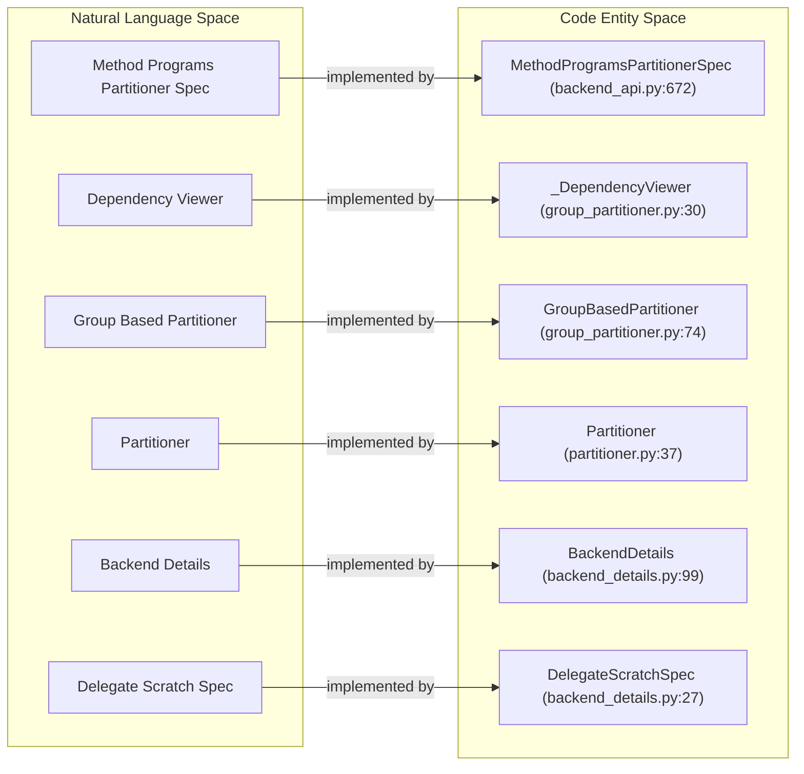
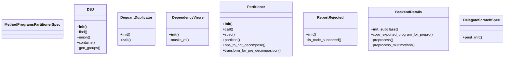
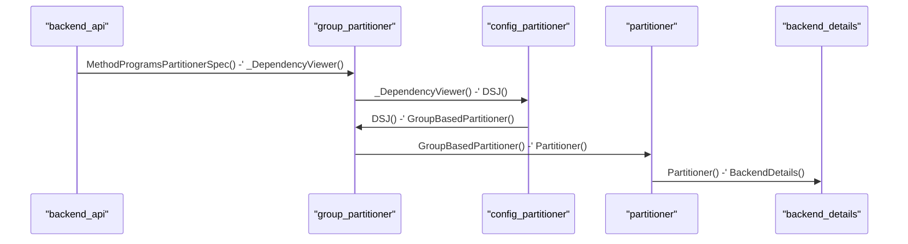

# Partitioning and Operator Support

↑ [[5-backend-delegation-architecture|Backend Delegation Architecture]]

> Architectural specification and implementation reference for Partitioning and Operator Support (17 relevant source files). Primary code entities: `MethodProgramsPartitionerSpec`, `_`, `_create_partitions`, `_create_partitions_in_graph_module`, `GroupBasedPartitioner`.

<details>
<summary>Relevant source files</summary>

The following files were used as context for generating this wiki page:

- [exir/backend/backend_api.py](exir/backend/backend_api.py)
- [exir/backend/canonical_partitioners/group_partitioner.py](exir/backend/canonical_partitioners/group_partitioner.py)
- [exir/backend/canonical_partitioners/config_partitioner.py](exir/backend/canonical_partitioners/config_partitioner.py)
- [exir/backend/backend_details.py](exir/backend/backend_details.py)
- [exir/backend/operator_support.py](exir/backend/operator_support.py)
- [exir/backend/partitioner.py](exir/backend/partitioner.py)
- [exir/backend/canonical_partitioners/all_node_partitioner.py](exir/backend/canonical_partitioners/all_node_partitioner.py)
- [exir/backend/compile_spec_schema.py](exir/backend/compile_spec_schema.py)
- [exir/backend/canonical_partitioners/duplicate_dequant_node_pass.py](exir/backend/canonical_partitioners/duplicate_dequant_node_pass.py)
- [exir/backend/canonical_partitioners/duplicate_constant_node_pass.py](exir/backend/canonical_partitioners/duplicate_constant_node_pass.py)
- [exir/backend/targets.bzl](exir/backend/targets.bzl)
- [exir/backend/utils.py](exir/backend/utils.py)
- [exir/backend/canonical_partitioners/pattern_op_partitioner.py](exir/backend/canonical_partitioners/pattern_op_partitioner.py)
- [docs/source/compiler-delegate-and-partitioner.md](docs/source/compiler-delegate-and-partitioner.md)
- [docs/source/backends-overview.md](docs/source/backends-overview.md)
- [exir/backend/BUCK](exir/backend/BUCK)
- [exir/backend/canonical_partitioners/BUCK](exir/backend/canonical_partitioners/BUCK)

</details>

## Purpose and Scope

Architectural specification and implementation reference for Partitioning and Operator Support (17 relevant source files). Primary code entities: `MethodProgramsPartitionerSpec`, `_`, `_create_partitions`, `_create_partitions_in_graph_module`, `GroupBasedPartitioner`.

Primary code entities analyzed on this page include `MethodProgramsPartitionerSpec` ([exir/backend/backend_api.py:672-680]()), `_DependencyViewer` ([exir/backend/canonical_partitioners/group_partitioner.py:30-71]()), `DSJ` ([exir/backend/canonical_partitioners/config_partitioner.py:111-137]()), `GroupBasedPartitioner` ([exir/backend/canonical_partitioners/group_partitioner.py:74-495]()), `Partitioner` ([exir/backend/partitioner.py:37-152]()).

For the parent architectural layer, see [[5-backend-delegation-architecture|Backend Delegation Architecture]]. Related sibling subsystems: [[5.2-vulkan-gpu-backend|Vulkan GPU Backend]], [[5.3-qualcomm-qnn-backend|Qualcomm QNN Backend]], [[5.4-arm-tosa-and-ethos-u-backend|ARM TOSA and Ethos-U Backend]], [[5.5-cadence-dsp-backend|Cadence DSP Backend]].

Sources: [exir/backend/backend_api.py:672-680](), [exir/backend/canonical_partitioners/group_partitioner.py:30-71](), [exir/backend/canonical_partitioners/config_partitioner.py:111-137](), [exir/backend/canonical_partitioners/group_partitioner.py:74-495]()

---

## 1. High-Level Architecture and Data Flow

### Natural Language Space to Code Entity Space Mapping

The following diagram maps domain concepts in this subsystem to their concrete code entities:



### Subsystem Component & Dependency Flow

```mermaid
flowchart TD
  subgraph sub_this["Partitioning and Operator Support"]
    subgraph sg_0["exir/backend"]
      n_exir_backend_backend_api_py["MethodProgramsPartitionerSpec (backend_api.py)"]
      n_exir_backend_backend_details_py["BackendDetails (backend_details.py)"]
      n_exir_backend_operator_support_py["DontPartition (operator_support.py)"]
      n_exir_backend_partitioner_py["Partitioner (partitioner.py)"]
      n_exir_backend_compile_spec_schema_py["CompileSpec (compile_spec_schema.py)"]
      n_exir_backend_targets_bzl["define_common_targets (targets.bzl)"]
      n_exir_backend_utils_py["ReportRejected (utils.py)"]
    end
    subgraph sg_1["exir/backend/canonical_partitioners"]
      n_exir_backend_canonical_partitioners_group_partit["_DependencyViewer (group_partitioner.py)"]
      n_exir_backend_canonical_partitioners_config_parti["DSJ (config_partitioner.py)"]
      n_exir_backend_canonical_partitioners_all_node_par["AllNodePartitioner (all_node_partitioner.py)"]
      n_exir_backend_canonical_partitioners_duplicate_de["DuplicateDequantNodePass (duplicate_dequant_node_pass.py)"]
      n_exir_backend_canonical_partitioners_duplicate_co["duplicate_constant_nodes (duplicate_constant_node_pass.py)"]
      n_exir_backend_canonical_partitioners_pattern_op_p["generate_pattern_op_partitions (pattern_op_partitioner.py)"]
      n_exir_backend_canonical_partitioners_BUCK["BUCK"]
    end
  end
  n_page_5_2_vulkan_gpu_backend(["Vulkan GPU Backend"])
  n_page_5_backend_delegation_architecture(["Backend Delegation Architecture"])
  n_exir_backend_backend_api_py --> n_exir_backend_backend_details_py
  n_exir_backend_backend_api_py -.-> n_page_5_backend_delegation_architecture
  n_exir_backend_utils_py -.-> n_page_5_backend_delegation_architecture
  n_exir_backend_canonical_partitioners_group_partit -.-> n_page_5_2_vulkan_gpu_backend
```



Cross-subsystem call and import edges connect **Partitioning and Operator Support** with [[5-backend-delegation-architecture|Backend Delegation Architecture]] (coupling `2.0`), [[5.4-arm-tosa-and-ethos-u-backend|ARM TOSA and Ethos-U Backend]] (coupling `2.0`), [[10-glossary|Glossary]] (coupling `2.0`), [[5.2-vulkan-gpu-backend|Vulkan GPU Backend]] (coupling `1.0`), [[1.2-export-api-and-recipe-system|Export API and Recipe System]] (coupling `1.0`).

| Module Directory | Files | Primary Code Entities | Source Citations |
|---|---|---|---|
| `exir/backend` | 8 | `MethodProgramsPartitionerSpec`, `Partitioner`, `BackendDetails`, `DelegateScratchSpec` | [exir/backend/backend_api.py:672-680]() [exir/backend/partitioner.py:37-152]() |
| `exir/backend/canonical_partitioners` | 7 | `_DependencyViewer`, `DSJ`, `GroupBasedPartitioner`, `PartitionerConfig` | [exir/backend/canonical_partitioners/group_partitioner.py:30-71]() [exir/backend/canonical_partitioners/config_partitioner.py:111-137]() |

Sources: [exir/backend/backend_api.py:672-680](), [exir/backend/canonical_partitioners/group_partitioner.py:30-71](), [exir/backend/canonical_partitioners/config_partitioner.py:111-137](), [exir/backend/canonical_partitioners/group_partitioner.py:74-495](), [exir/backend/partitioner.py:37-152]()

---

## 2. Core Data Structures and Implementation Details

### Class and Entity Relationship Diagram



### `MethodProgramsPartitionerSpec` (Class)

- **Source Location**: [exir/backend/backend_api.py:672-680]()
- **Declaration**: `Class MethodProgramsPartitionerSpec`
- **Graph Centrality**: fan-in `1` callers, fan-out `0` callees
- **Responsibility**: Since single dispatch for to_backend requires the first argument to be a valid class, we create the following dataclass spec to hold the dictionaries mapping the method name to the corresponding program, partitioner

```python
// exir/backend/backend_api.py:672-680
class MethodProgramsPartitionerSpec:
    """
    Since single dispatch for to_backend requires the first argument to be a
    valid class, we create the following dataclass spec to hold the dictionaries
    mapping the method name to the corresponding program, partitioner
    """

    method_to_edge_program: Mapping[str, ExportedProgram]
    method_to_partitioner: Mapping[str, Partitioner]
```

### `_DependencyViewer` (Class)

- **Source Location**: [exir/backend/canonical_partitioners/group_partitioner.py:30-71]()
- **Declaration**: `Class _DependencyViewer`
- **Graph Centrality**: fan-in `1` callers, fan-out `0` callees
- **Responsibility**: Transitive users and inputs of nodes, as bitmasks over node positions. A whole partition can then be checked for cycles with a few integer operations. Nodes must be in topological order, as FX graphs keep them.

```python
// exir/backend/canonical_partitioners/group_partitioner.py:30-45
class _DependencyViewer:
    """Transitive users and inputs of nodes, as bitmasks over node positions.

    A whole partition can then be checked for cycles with a few integer
    operations. Nodes must be in topological order, as FX graphs keep them.
    """

    def __init__(self, graph_module: GraphModule, nodes):
        all_nodes = self.nodes = list(graph_module.graph.nodes)
        self.positions = {node: i for i, node in enumerate(all_nodes)}
        self.downstreams = {}
        self.upstreams = {}
        # Only these can be on a path between two of the nodes. A mask costs
        # one bit per position up to its highest node, so skipping the others
        # saves memory where most nodes are far from every partition.
        downstream_nodes = _reachable(nodes, lambda node: node.users)
```

### `DSJ` (Class)

- **Source Location**: [exir/backend/canonical_partitioners/config_partitioner.py:111-137]()
- **Declaration**: `Class DSJ`
- **Graph Centrality**: fan-in `1` callers, fan-out `0` callees
- **Responsibility**: Disjoint set union data structure used to find connected components in the graph.

```python
// exir/backend/canonical_partitioners/config_partitioner.py:111-126
class DSJ:
    """
    Disjoint set union data structure used to find connected components in the graph.
    """

    def __init__(self):
        self.parent = {}

    def find(self, x):
        self.parent.setdefault(x, x)
        if self.parent[x] != x:
            self.parent[x] = self.find(self.parent[x])
        return self.parent[x]

    def union(self, x, y):
        self.parent[self.find(x)] = self.find(y)
```

### `GroupBasedPartitioner` (Class)

- **Source Location**: [exir/backend/canonical_partitioners/group_partitioner.py:74-495]()
- **Declaration**: `Class GroupBasedPartitioner`
- **Graph Centrality**: fan-in `0` callers, fan-out `0` callees
- **Responsibility**: A specialized partitioner that extends the CapabilityBasedPartitioner from PyTorch FX. GroupBasedPartitioner allows for explicit grouping of nodes into partitions based on predefined node groups, while also supporting automatic partitioning for nodes not included in any group. Nodes are only allowed to be in one group.

### `Partitioner` (Class)

- **Source Location**: [exir/backend/partitioner.py:37-152]()
- **Declaration**: `Class Partitioner`
- **Graph Centrality**: fan-in `1` callers, fan-out `0` callees
- **Responsibility**: Defines a callable interface for partitioning an exported program for backend delegation. A partitioner implementation would receive an exported program, determine what portions of the it can be delegated to certain backend (though a partitioner can target multiple backends as well), and return the PartitionResult incl

### `_merge_partitions` (Method)

- **Source Location**: [exir/backend/canonical_partitioners/group_partitioner.py:342-412]()
- **Declaration**: `(self, partitions_by_id, assignment)`
- **Graph Centrality**: fan-in `1` callers, fan-out `6` callees
- **Responsibility**: Merge partitions when possible.

Sources: [exir/backend/backend_api.py:672-680](), [exir/backend/canonical_partitioners/group_partitioner.py:30-71](), [exir/backend/canonical_partitioners/config_partitioner.py:111-137](), [exir/backend/canonical_partitioners/group_partitioner.py:74-495](), [exir/backend/partitioner.py:37-152]()

---

## 3. Execution and Call Flow

The sequence diagram below traces the runtime/compile-time call chain across components in this module:



Sources: [exir/backend/backend_api.py:672-680](), [exir/backend/canonical_partitioners/group_partitioner.py:30-71](), [exir/backend/canonical_partitioners/config_partitioner.py:111-137](), [exir/backend/canonical_partitioners/group_partitioner.py:74-495](), [exir/backend/partitioner.py:37-152]()

---

## 4. Key API and Symbol Reference

| Code Entity | Kind | Location | Fan-In / Out | Role & Signature |
|---|---|---|---|---|
| `MethodProgramsPartitionerSpec` | Class | [exir/backend/backend_api.py:672-680]() | `1` / `0` | Since single dispatch for to_backend requires the first argument to be a |
| `_DependencyViewer` | Class | [exir/backend/canonical_partitioners/group_partitioner.py:30-71]() | `1` / `0` | Transitive users and inputs of nodes, as bitmasks over node positions. |
| `DSJ` | Class | [exir/backend/canonical_partitioners/config_partitioner.py:111-137]() | `1` / `0` | Disjoint set union data structure used to find connected components in the graph. |
| `GroupBasedPartitioner` | Class | [exir/backend/canonical_partitioners/group_partitioner.py:74-495]() | `0` / `0` | A specialized partitioner that extends the CapabilityBasedPartitioner from PyTorch FX. |
| `Partitioner` | Class | [exir/backend/partitioner.py:37-152]() | `1` / `0` | Defines a callable interface for partitioning an exported program for |
| `BackendDetails` | Class | [exir/backend/backend_details.py:99-206]() | `0` / `0` | A base interface to lower the implementation to the according backend. With |
| `DelegateScratchSpec` | Class | [exir/backend/backend_details.py:27-52]() | `0` / `0` | A scratch buffer the delegate needs for the duration of one execute() call. |
| `PartitionerConfig` | Class | [exir/backend/canonical_partitioners/config_partitioner.py:45-108]() | `0` / `0` | Class used to represent a PartitionerConfig. |
| `DontPartition` | Class | [exir/backend/operator_support.py:38-62]() | `0` / `0` | Operator check to skip partitioning ops based on their target. |
| `DontPartitionModule` | Class | [exir/backend/operator_support.py:84-127]() | `0` / `0` | Operator check to skip partitioning modules. |
| `DontPartitionName` | Class | [exir/backend/operator_support.py:65-81]() | `0` / `0` | Operator check to skip partitioning ops based on their name, which can be found |
| `PartitionResult` | Class | [exir/backend/partitioner.py:26-34]() | `0` / `0` | tagged_exported_program: the graph with nodes that intend to be delegated containing a "DelegationSpec" metada |
| `ReportRejected` | Class | [exir/backend/utils.py:683-700]() | `1` / `0` | Class for wrapping a OperatorSupportBase, reporting rejects with the specified message to `reporter`. |
| `DuplicateDequantNodePass` | Class | [exir/backend/canonical_partitioners/duplicate_dequant_node_pass.py:50-111]() | `0` / `0` | Duplicates all of the dequantize. This is such that all |
| `DelegateMappingBuilder` | Class | [exir/backend/utils.py:474-585]() | `0` / `0` | # TODO - style: use templated types |
| `WhyNoPartition` | Class | [exir/backend/utils.py:588-613]() | `0` / `0` | Simple helper class for partitioners to log why a node was not lowered. |
| `WhyNoPartitionReporter` | Class | [exir/backend/utils.py:616-680]() | `0` / `0` | Helper class for partitioners to gather why nodes were not lowered in a single report. |
| `PreprocessResult` | Class | [exir/backend/backend_details.py:56-85]() | `0` / `0` | — |
| `ConfigerationBasedPartitioner` | Class | [exir/backend/canonical_partitioners/config_partitioner.py:140-262]() | `0` / `0` | — |
| `DequantDuplicator` | Class | [exir/backend/canonical_partitioners/duplicate_dequant_node_pass.py:20-47]() | `1` / `0` | — |
| `DontSupportBase` | Class | [exir/backend/operator_support.py:22-35]() | `0` / `0` | — |
| `DelegationSpec` | Class | [exir/backend/partitioner.py:20-22]() | `0` / `0` | — |

Sources: [exir/backend/backend_api.py:672-680](), [exir/backend/canonical_partitioners/group_partitioner.py:30-71](), [exir/backend/canonical_partitioners/config_partitioner.py:111-137](), [exir/backend/canonical_partitioners/group_partitioner.py:74-495](), [exir/backend/partitioner.py:37-152](), [exir/backend/backend_details.py:99-206]()

---

## 5. Official Documentation and Design Context

The following linked documentation sections from `llm-wiki` (`raw/`) provide additional architectural context, tutorials, and design invariants for this subsystem:

- **Backend Delegation Architecture** ([wiki/5-backend-delegation-architecture.md](), score `129.6965`) (sections: `Backend Delegation Architecture`, `Purpose and Scope`, `System Mapping: Natural Language Space to Code Entity Space`, `1. Partitioning and Operator Support`): # Backend Delegation Architecture > Architectural specification and implementation reference for Backend Delegation Architecture (40 relevant source files). Primary code entities: `CommandBuffer`, `begin`, `bind_descriptors`, `bind_pipeline`, `NodeVisitor`. <details> <summary>Relevant source files</summary> The following files were used as context for generating this wiki page: - [backends/vulkan/runtime/vk_api/Comma
- **ExecuTorch DeepWiki** ([wiki/index.md](), score `106.0527`) (sections: `ExecuTorch DeepWiki`, `Pages`): # ExecuTorch DeepWiki Generated from `home-jason-Project-deepwiki-executorch` at commit `b3b565b5b62f` (2026-11-15T15:02:11+00:00). ## Pages - [[1-overview|Overview]] — Architectural specification and implementation reference for Overview (10 relevant source files). Primary code entities: `Module`, `MethodHolder`, `PlannedMemory`, `EdgeProgramManager`, `__init__`. - [[1.1-getting-started|Getting Started]] — Architect
- **Other Hardware Backends (OpenVINO, MediaTek, Samsung, NXP, MLX, TensorRT)** ([wiki/5.8-other-backends.md](), score `83.022`) (sections: `Other Hardware Backends (OpenVINO, MediaTek, Samsung, NXP, MLX, TensorRT)`, `Purpose and Scope`, `1. High-Level Architecture and Data Flow`, `Natural Language Space to Code Entity Space Mapping`): # Other Hardware Backends (OpenVINO, MediaTek, Samsung, NXP, MLX, TensorRT) ↑ [[5-backend-delegation-architecture|Backend Delegation Architecture]] > Architectural specification and implementation reference for Other Hardware Backends (OpenVINO, MediaTek, Samsung, NXP, MLX, TensorRT) (40 relevant source files). Primary code entities: `ConstantData`, `add`, `get`, `set`, `Interpreter`. <details> <summary>Relevant sour
- **Custom Compiler Passes and Partitioners** ([compiler-custom-compiler-passes.md](), score `77.0169`) (sections: `Custom Compiler Passes and Partitioners`, `Passes`, `Level 1`, `To create a pass`): # Custom Compiler Passes and Partitioners ## Passes Passes can be roughly categorized into a couple of axes: Axis A: 1. Creating one-to-X mapping (for example, decomposition) 2. Creating many-to-one mapping (for example, fusion) Axis B: 1. Performing forwards iteration (for example, shape propagation) 2. Performing backwards iteration (for example, dead code elimination) Axis C: 1. Dependent on local node information

Sources: [wiki/5-backend-delegation-architecture.md](), [wiki/index.md](), [wiki/5.8-other-backends.md](), [compiler-custom-compiler-passes.md]()

## Related pages

- [[5-backend-delegation-architecture|Backend Delegation Architecture]]
- [[1.1-getting-started|Getting Started]]
- [[1.2-export-api-and-recipe-system|Export API and Recipe System]]
- [[2.2-kernel-libraries-and-selective-build|Kernel Libraries and Selective Build]]
- [[2.3-schema-generation-and-flatbuffers|Schema Generation and FlatBuffers]]
- [[3.4-program-emission-and-serialization|Program Emission and Serialization]]
- [[3.5-verification-and-dialect-system|Verification and Dialect System]]
- [[4-quantization-systems|Quantization Systems]]

## Related documents

- `wiki/5-backend-delegation-architecture.md` — Backend Delegation Architecture (score 129.6965, via bm25)
- `wiki/index.md` — ExecuTorch DeepWiki (score 106.0527, via bm25)
- `wiki/5.8-other-backends.md` — Other Hardware Backends (OpenVINO, MediaTek, Samsung, NXP, MLX, TensorRT) (score 83.022, via bm25)
- `raw/executorch/compiler-custom-compiler-passes.md` — Custom Compiler Passes and Partitioners (score 77.0169, via bm25)
- `raw/executorch/compiler-delegate-and-partitioner.md` — Understanding Backends and Delegates (score 71.5701, via bm25)

## Sources

- [`exir/backend/backend_api.py`](https://github.com/pytorch/executorch/blob/main/exir/backend/backend_api.py)
- [`exir/backend/canonical_partitioners/group_partitioner.py`](https://github.com/pytorch/executorch/blob/main/exir/backend/canonical_partitioners/group_partitioner.py)
- [`exir/backend/canonical_partitioners/config_partitioner.py`](https://github.com/pytorch/executorch/blob/main/exir/backend/canonical_partitioners/config_partitioner.py)
- [`exir/backend/backend_details.py`](https://github.com/pytorch/executorch/blob/main/exir/backend/backend_details.py)
- [`exir/backend/operator_support.py`](https://github.com/pytorch/executorch/blob/main/exir/backend/operator_support.py)
- [`exir/backend/partitioner.py`](https://github.com/pytorch/executorch/blob/main/exir/backend/partitioner.py)
- [`exir/backend/canonical_partitioners/all_node_partitioner.py`](https://github.com/pytorch/executorch/blob/main/exir/backend/canonical_partitioners/all_node_partitioner.py)
- [`exir/backend/compile_spec_schema.py`](https://github.com/pytorch/executorch/blob/main/exir/backend/compile_spec_schema.py)
- [`exir/backend/canonical_partitioners/duplicate_dequant_node_pass.py`](https://github.com/pytorch/executorch/blob/main/exir/backend/canonical_partitioners/duplicate_dequant_node_pass.py)
- [`exir/backend/canonical_partitioners/duplicate_constant_node_pass.py`](https://github.com/pytorch/executorch/blob/main/exir/backend/canonical_partitioners/duplicate_constant_node_pass.py)
- [`exir/backend/targets.bzl`](https://github.com/pytorch/executorch/blob/main/exir/backend/targets.bzl)
- [`exir/backend/utils.py`](https://github.com/pytorch/executorch/blob/main/exir/backend/utils.py)
- [`exir/backend/canonical_partitioners/pattern_op_partitioner.py`](https://github.com/pytorch/executorch/blob/main/exir/backend/canonical_partitioners/pattern_op_partitioner.py)
- [`docs/source/compiler-delegate-and-partitioner.md`](https://github.com/pytorch/executorch/blob/main/docs/source/compiler-delegate-and-partitioner.md)
- [`docs/source/backends-overview.md`](https://github.com/pytorch/executorch/blob/main/docs/source/backends-overview.md)
- [`exir/backend/BUCK`](https://github.com/pytorch/executorch/blob/main/exir/backend/BUCK)
- [`exir/backend/canonical_partitioners/BUCK`](https://github.com/pytorch/executorch/blob/main/exir/backend/canonical_partitioners/BUCK)


## Dynamic Knowledge Links (Code Graph ↔ LLM-Wiki / RAG)

### Linked Architecture & Design Documents

| Document | Match Channel | Score | Shared Code Symbols |
|---|---|---|---|
| [[5-backend-delegation-architecture|Backend Delegation Architecture]] | `bm25+entity(1)` | `131.196` | `CompileSpec` |
| [[index|ExecuTorch DeepWiki]] | `bm25` | `106.053` | *(lexical/graph match)* |
| [[5.2-vulkan-gpu-backend|Vulkan GPU Backend]] | `wikilink:5.1-partitioning-and-operator-support` | `89.879` | *(lexical/graph match)* |
| [[5.3-qualcomm-qnn-backend|Qualcomm QNN Backend]] | `wikilink:5.1-partitioning-and-operator-support` | `89.879` | *(lexical/graph match)* |
| [[5.4-arm-tosa-and-ethos-u-backend|ARM TOSA and Ethos-U Backend]] | `wikilink:5.1-partitioning-and-operator-support` | `89.879` | *(lexical/graph match)* |
| [[5.8-other-backends|Other Hardware Backends (OpenVINO, MediaTek, Samsung, NXP, MLX, TensorRT)]] | `bm25+entity(1)` | `84.522` | `CompileSpec` |

### High-Centrality Bridge Symbols (CBM Graph)

| Symbol | Kind | Source Location | Fan-In / Fan-Out |
|---|---|---|---|
| `MethodProgramsPartitionerSpec` | Class | [exir/backend/backend_api.py:672-680]() | in: `1` / out: `0` |
| `_DependencyViewer` | Class | [exir/backend/canonical_partitioners/group_partitioner.py:30-71]() | in: `1` / out: `0` |
| `DSJ` | Class | [exir/backend/canonical_partitioners/config_partitioner.py:111-137]() | in: `1` / out: `0` |
| `GroupBasedPartitioner` | Class | [exir/backend/canonical_partitioners/group_partitioner.py:74-495]() | in: `0` / out: `0` |
| `Partitioner` | Class | [exir/backend/partitioner.py:37-152]() | in: `1` / out: `0` |
| `BackendDetails` | Class | [exir/backend/backend_details.py:99-206]() | in: `0` / out: `0` |

Sources: [exir/backend/backend_api.py:672-680](), [exir/backend/canonical_partitioners/group_partitioner.py:30-71](), [exir/backend/canonical_partitioners/config_partitioner.py:111-137](), [exir/backend/canonical_partitioners/group_partitioner.py:74-495]()

### Cross-Subsystem Coupling

- [[5-backend-delegation-architecture|Backend Delegation Architecture]] — call/import coupling weight `2.0`
- [[5.4-arm-tosa-and-ethos-u-backend|ARM TOSA and Ethos-U Backend]] — call/import coupling weight `2.0`
- [[10-glossary|Glossary]] — call/import coupling weight `2.0`
- [[5.2-vulkan-gpu-backend|Vulkan GPU Backend]] — call/import coupling weight `1.0`
- [[1.2-export-api-and-recipe-system|Export API and Recipe System]] — call/import coupling weight `1.0`
- [[3-exir-core-system|EXIR Core System]] — call/import coupling weight `1.0`
