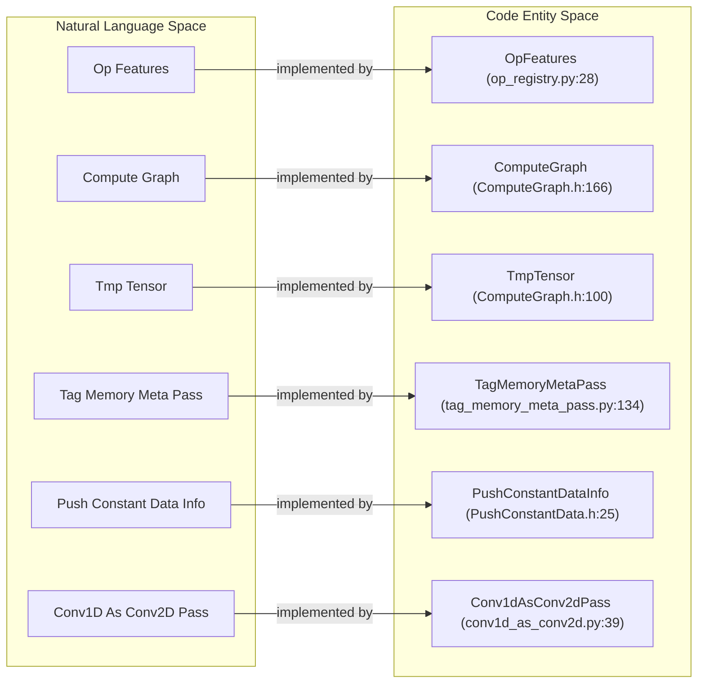
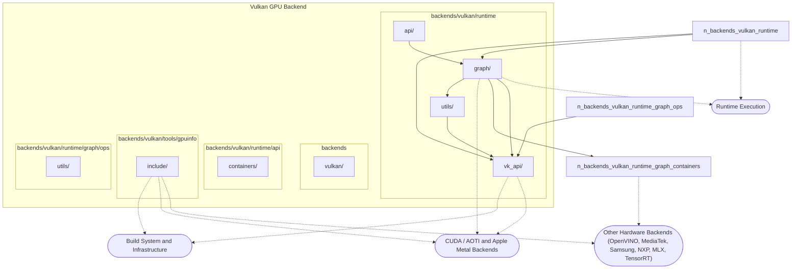
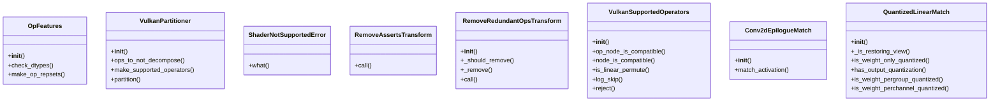
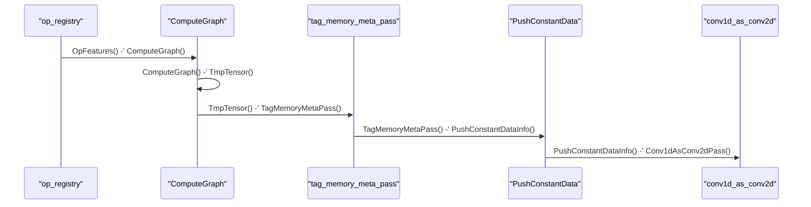

# Vulkan GPU Backend

↑ [[5-backend-delegation-architecture|Backend Delegation Architecture]]

> Architectural specification and implementation reference for Vulkan GPU Backend (40 relevant source files). Primary code entities: `CommandBuffer`, `begin`, `bind_descriptors`, `bind_pipeline`, `OpFeatures`.

<details>
<summary>Relevant source files</summary>

The following files were used as context for generating this wiki page:

- [backends/vulkan/runtime/vk_api/Command.cpp](backends/vulkan/runtime/vk_api/Command.cpp)
- [backends/vulkan/op_registry.py](backends/vulkan/op_registry.py)
- [backends/vulkan/runtime/utils/VecUtils.h](backends/vulkan/runtime/utils/VecUtils.h)
- [backends/vulkan/runtime/graph/ComputeGraph.h](backends/vulkan/runtime/graph/ComputeGraph.h)
- [backends/vulkan/runtime/vk_api/DispatchGrid.cpp](backends/vulkan/runtime/vk_api/DispatchGrid.cpp)
- [backends/vulkan/runtime/api/containers/StagingBuffer.h](backends/vulkan/runtime/api/containers/StagingBuffer.h)
- [backends/vulkan/tools/gpuinfo/include/stats.h](backends/vulkan/tools/gpuinfo/include/stats.h)
- [backends/vulkan/runtime/graph/ops/utils/ShaderNameUtils.cpp](backends/vulkan/runtime/graph/ops/utils/ShaderNameUtils.cpp)
- [backends/vulkan/runtime/api/Context.h](backends/vulkan/runtime/api/Context.h)
- [backends/vulkan/runtime/vk_api/Exception.h](backends/vulkan/runtime/vk_api/Exception.h)
- [backends/vulkan/_passes/tag_memory_meta_pass.py](backends/vulkan/_passes/tag_memory_meta_pass.py)
- [backends/vulkan/runtime/graph/containers/PushConstantData.h](backends/vulkan/runtime/graph/containers/PushConstantData.h)
- [backends/vulkan/partitioner/vulkan_partitioner.py](backends/vulkan/partitioner/vulkan_partitioner.py)
- [backends/vulkan/runtime/graph/ComputeGraph.cpp](backends/vulkan/runtime/graph/ComputeGraph.cpp)
- [backends/vulkan/_passes/conv1d_as_conv2d.py](backends/vulkan/_passes/conv1d_as_conv2d.py)
- [backends/vulkan/_passes/fuse_quantized_ops.py](backends/vulkan/_passes/fuse_quantized_ops.py)
- [backends/vulkan/patterns/quantized_linear.py](backends/vulkan/patterns/quantized_linear.py)
- [backends/vulkan/_passes/fold_qdq.py](backends/vulkan/_passes/fold_qdq.py)
- [backends/vulkan/_passes/remove_redundant_ops.py](backends/vulkan/_passes/remove_redundant_ops.py)
- [backends/vulkan/_passes/fuse_patterns.py](backends/vulkan/_passes/fuse_patterns.py)
- [backends/vulkan/_passes/insert_dtype_promotion.py](backends/vulkan/_passes/insert_dtype_promotion.py)
- [backends/vulkan/_passes/remove_asserts.py](backends/vulkan/_passes/remove_asserts.py)
- [backends/vulkan/patterns/conv2d_with_epilogue.py](backends/vulkan/patterns/conv2d_with_epilogue.py)
- [backends/vulkan/_passes/replace_instance_norm.py](backends/vulkan/_passes/replace_instance_norm.py)
- [backends/vulkan/_passes/squeeze_unsqueeze_inputs.py](backends/vulkan/_passes/squeeze_unsqueeze_inputs.py)
- [backends/vulkan/runtime/VulkanBackend.cpp](backends/vulkan/runtime/VulkanBackend.cpp)
- [backends/vulkan/runtime/graph/ops/DynamicDispatchNode.cpp](backends/vulkan/runtime/graph/ops/DynamicDispatchNode.cpp)
- [backends/vulkan/__init__.py](backends/vulkan/__init__.py)
- [backends/vulkan/README.md](backends/vulkan/README.md)
- [docs/source/backends/vulkan/vulkan-op-support-table.csv](docs/source/backends/vulkan/vulkan-op-support-table.csv)
- [docs/source/backends/vulkan/vulkan-op-support.rst](docs/source/backends/vulkan/vulkan-op-support.rst)
- [docs/source/backends/vulkan/vulkan-overview.md](docs/source/backends/vulkan/vulkan-overview.md)
- [docs/source/backends/vulkan/vulkan-partitioner.md](docs/source/backends/vulkan/vulkan-partitioner.md)
- [docs/source/backends/vulkan/vulkan-quantization.md](docs/source/backends/vulkan/vulkan-quantization.md)
- [backends/vulkan/BUCK](backends/vulkan/BUCK)

</details>

## Purpose and Scope

Architectural specification and implementation reference for Vulkan GPU Backend (40 relevant source files). Primary code entities: `CommandBuffer`, `begin`, `bind_descriptors`, `bind_pipeline`, `OpFeatures`.

Primary code entities analyzed on this page include `OpFeatures` ([backends/vulkan/op_registry.py:28-129]()), `ComputeGraph` ([backends/vulkan/runtime/graph/ComputeGraph.h:166-1340]()), `TmpTensor` ([backends/vulkan/runtime/graph/ComputeGraph.h:100-152]()), `TagMemoryMetaPass` ([backends/vulkan/_passes/tag_memory_meta_pass.py:134-549]()), `PushConstantDataInfo` ([backends/vulkan/runtime/graph/containers/PushConstantData.h:25-80]()).

For the parent architectural layer, see [[5-backend-delegation-architecture|Backend Delegation Architecture]]. Related sibling subsystems: [[5.1-partitioning-and-operator-support|Partitioning and Operator Support]], [[5.3-qualcomm-qnn-backend|Qualcomm QNN Backend]], [[5.4-arm-tosa-and-ethos-u-backend|ARM TOSA and Ethos-U Backend]], [[5.5-cadence-dsp-backend|Cadence DSP Backend]].

Sources: [backends/vulkan/op_registry.py:28-129](), [backends/vulkan/runtime/graph/ComputeGraph.h:166-1340](), [backends/vulkan/runtime/graph/ComputeGraph.h:100-152](), [backends/vulkan/_passes/tag_memory_meta_pass.py:134-549]()

---

## 1. High-Level Architecture and Data Flow

### Natural Language Space to Code Entity Space Mapping

The following diagram maps domain concepts in this subsystem to their concrete code entities:



### Subsystem Component & Dependency Flow



Cross-subsystem call and import edges connect **Vulkan GPU Backend** with [[5.7-cuda-aoti-and-apple-metal-backends|CUDA / AOTI and Apple Metal Backends]] (coupling `69.0`), [[8-runtime-execution|Runtime Execution]] (coupling `44.0`), [[8.1-core-runtime-architecture|Core Runtime Architecture]] (coupling `41.0`), [[10-glossary|Glossary]] (coupling `27.0`), [[5.8-other-backends|Other Hardware Backends (OpenVINO, MediaTek, Samsung, NXP, MLX, TensorRT)]] (coupling `25.0`).

| Module Directory | Files | Primary Code Entities | Source Citations |
|---|---|---|---|
| `backends/vulkan/_passes` | 11 | `TagMemoryMetaPass`, `Conv1dAsConv2dPass`, `RemoveRedundantOpsTransform`, `FoldQDQPass` | [backends/vulkan/_passes/tag_memory_meta_pass.py:134-549]() [backends/vulkan/_passes/conv1d_as_conv2d.py:39-175]() |
| `backends/vulkan` | 5 | `OpFeatures`, `is_reduce_node_supported_by_per_row_impl`, `_index_tensor_shapes`, `unwrap_identity_repeat` | [backends/vulkan/op_registry.py:28-129]() [backends/vulkan/op_registry.py:728-737]() |
| `backends/vulkan/patterns` | 3 | `Conv2dEpilogueMatch`, `QuantizedLinearMatch`, `has_fused_op`, `activation_of` | [backends/vulkan/patterns/conv2d_with_epilogue.py:92-183]() [backends/vulkan/patterns/quantized_linear.py:37-331]() |
| `backends/vulkan/runtime/vk_api` | 3 | `ShaderNotSupportedError`, `Error`, `SourceLocation`, `end` | [backends/vulkan/runtime/vk_api/Exception.h:91-104]() [backends/vulkan/runtime/vk_api/Exception.h:61-79]() |
| `backends/vulkan/partitioner` | 2 | `VulkanPartitioner`, `VulkanSupportedOperators`, `make_supported_operators`, `is_linear_permute` | [backends/vulkan/partitioner/vulkan_partitioner.py:470-619]() [backends/vulkan/partitioner/vulkan_partitioner.py:70-376]() |
| `backends/vulkan/runtime/graph` | 2 | `ComputeGraph`, `TmpTensor`, `PrepackCacheHash`, `is_valid_scalar_type` | [backends/vulkan/runtime/graph/ComputeGraph.h:166-1340]() [backends/vulkan/runtime/graph/ComputeGraph.h:100-152]() |
| `backends/vulkan/quantizer` | 1 | *(build / config)* | [backends/vulkan/quantizer/BUCK]() |
| `backends/vulkan/runtime` | 1 | `VulkanDelegateHandle`, `GraphBuilder`, `TensorProperties`, `VulkanBackend` | [backends/vulkan/runtime/VulkanBackend.cpp:808-825]() [backends/vulkan/runtime/VulkanBackend.cpp:212-718]() |

Sources: [backends/vulkan/op_registry.py:28-129](), [backends/vulkan/runtime/graph/ComputeGraph.h:166-1340](), [backends/vulkan/runtime/graph/ComputeGraph.h:100-152](), [backends/vulkan/_passes/tag_memory_meta_pass.py:134-549](), [backends/vulkan/runtime/graph/containers/PushConstantData.h:25-80]()

---

## 2. Core Data Structures and Implementation Details

### Class and Entity Relationship Diagram



### `OpFeatures` (Class)

- **Source Location**: [backends/vulkan/op_registry.py:28-129]()
- **Declaration**: `Class OpFeatures`
- **Graph Centrality**: fan-in `92` callers, fan-out `0` callees

```python
// backends/vulkan/op_registry.py:28-43
class OpFeatures:
    __slots__ = [
        # Dtype-related slots:
        "inputs_dtypes",  # DtypeSetList for input tensor dtype constraints
        "outputs_dtypes",  # DtypeSetList for output tensor dtype constraints
        # Storage-related slots:
        # Sets of possible (storage types, memory layouts) to use for the input tensor(s)
        "inputs_storage",
        # Sets of possible (storage types, memory layouts) to use for the output tensor(s)
        "outputs_storage",
        # bool indicating if the operator has a resize function, which allows it to
        # support models with dynamic shape
        "supports_resize",
        # bool indicating if the operator supports tensors with more than 4 dimensions
        "supports_highdim",
        # bool indicating if the operator handles its own prepacking. If this is True,
```

### `ComputeGraph` (Class)

- **Source Location**: [backends/vulkan/runtime/graph/ComputeGraph.h:166-1340]()
- **Declaration**: `Class ComputeGraph`
- **Graph Centrality**: fan-in `0` callers, fan-out `0` callees
- **Responsibility**: /* * This is the core data structure used to execute Vulkan models in graph mode. * As opposed to ATen/eager mode where a command buffer is encoded every * inference (since ops are executed with the model), in graph mode the ops that * compose the model are intended to be parsed only once, upon which a command * buffer

```cpp
// backends/vulkan/runtime/graph/ComputeGraph.h:166-181
class ComputeGraph final {
 public:
  explicit ComputeGraph(GraphConfig config);

  ComputeGraph(ComputeGraph&&) = default;
  ComputeGraph& operator=(ComputeGraph&&) = default;

  ~ComputeGraph();

 private:
  GraphConfig config_;
  vkapi::DescriptorPoolConfig prepack_descriptor_counts_;
  vkapi::DescriptorPoolConfig execute_descriptor_counts_;

  std::unique_ptr<api::Context> context_;
```

### `TmpTensor` (Class)

- **Source Location**: [backends/vulkan/runtime/graph/ComputeGraph.h:100-152]()
- **Declaration**: `Class TmpTensor`
- **Graph Centrality**: fan-in `0` callers, fan-out `0` callees
- **Responsibility**: /* * This struct is used to recycle the memory of temporary tensors that are * created during the execution of a node. Upon construction, this struct will * check the `tmp_shared_object_idxs_` of the provided `ComputeGraph` instance * if any shared objects are available; if not, then a new one is created. A * tensor va

```cpp
// backends/vulkan/runtime/graph/ComputeGraph.h:100-115
struct TmpTensor {
  ComputeGraph* graph_p;
  int64_t sobj_idx;
  ValueRef vref;

  //
  // Match all available overloads of `add_tensor`
  //

  TmpTensor(
      ComputeGraph* const graph_ptr,
      const std::vector<int64_t>& sizes,
      const vkapi::ScalarType dtype,
      const utils::StorageType storage_type,
      const utils::GPUMemoryLayout memory_layout);
```

### `TagMemoryMetaPass` (Class)

- **Source Location**: [backends/vulkan/_passes/tag_memory_meta_pass.py:134-549]()
- **Declaration**: `Class TagMemoryMetaPass`
- **Graph Centrality**: fan-in `0` callers, fan-out `0` callees
- **Responsibility**: Operator implementations in the Vulkan delegate may require that input and output tensors use a specific representation. Representation in this case refers to a combination of storage type (buffer or texture) and memory layout (width, height, or channels packed). The tag memory metadata pass is responsible for marking 

### `PushConstantDataInfo` (Class)

- **Source Location**: [backends/vulkan/runtime/graph/containers/PushConstantData.h:25-80]()
- **Declaration**: `Class PushConstantDataInfo`
- **Graph Centrality**: fan-in `0` callers, fan-out `0` callees
- **Responsibility**: /* * Represents a push constant data entry * Which is either shared pointer to a tensor's uniform data with an attribute * Or data with a maximum size of 16 bytes */

### `end` (Method)

- **Source Location**: [backends/vulkan/runtime/vk_api/Command.cpp:68-79]()
- **Declaration**: `()`
- **Graph Centrality**: fan-in `362` callers, fan-out `0` callees

Sources: [backends/vulkan/op_registry.py:28-129](), [backends/vulkan/runtime/graph/ComputeGraph.h:166-1340](), [backends/vulkan/runtime/graph/ComputeGraph.h:100-152](), [backends/vulkan/_passes/tag_memory_meta_pass.py:134-549](), [backends/vulkan/runtime/graph/containers/PushConstantData.h:25-80]()

---

## 3. Execution and Call Flow

The sequence diagram below traces the runtime/compile-time call chain across components in this module:



Sources: [backends/vulkan/op_registry.py:28-129](), [backends/vulkan/runtime/graph/ComputeGraph.h:166-1340](), [backends/vulkan/runtime/graph/ComputeGraph.h:100-152](), [backends/vulkan/_passes/tag_memory_meta_pass.py:134-549](), [backends/vulkan/runtime/graph/containers/PushConstantData.h:25-80]()

---

## 4. Key API and Symbol Reference

| Code Entity | Kind | Location | Fan-In / Out | Role & Signature |
|---|---|---|---|---|
| `OpFeatures` | Class | [backends/vulkan/op_registry.py:28-129]() | `92` / `0` | — |
| `ComputeGraph` | Class | [backends/vulkan/runtime/graph/ComputeGraph.h:166-1340]() | `0` / `0` | /* |
| `TmpTensor` | Class | [backends/vulkan/runtime/graph/ComputeGraph.h:100-152]() | `0` / `0` | /* |
| `TagMemoryMetaPass` | Class | [backends/vulkan/_passes/tag_memory_meta_pass.py:134-549]() | `0` / `0` | Operator implementations in the Vulkan delegate may require that input and output |
| `PushConstantDataInfo` | Class | [backends/vulkan/runtime/graph/containers/PushConstantData.h:25-80]() | `0` / `0` | /* |
| `Conv1dAsConv2dPass` | Class | [backends/vulkan/_passes/conv1d_as_conv2d.py:39-175]() | `0` / `0` | Rewrite eligible 1-D convolutions into a 2-D convolution over a singleton |
| `RemoveRedundantOpsTransform` | Class | [backends/vulkan/_passes/remove_redundant_ops.py:21-90]() | `1` / `0` | Trim certain operators to reduce unnecessary overhead. |
| `FoldQDQPass` | Class | [backends/vulkan/_passes/fold_qdq.py:14-40]() | `0` / `0` | Erase Q/DQ chain introduced by PT2E quantization workflow. It is assumed that all |
| `RemoveAssertsTransform` | Class | [backends/vulkan/_passes/remove_asserts.py:22-41]() | `1` / `0` | Remove operators which perform assertions. These are not possible to execute in |
| `FoldForceFp16CastsPass` | Class | [backends/vulkan/_passes/remove_redundant_ops.py:93-148]() | `0` / `0` | Under `force_fp16` every fp32 tensor runs as fp16, so a cast between the two |
| `Conv2dEpilogueMatch` | Class | [backends/vulkan/patterns/conv2d_with_epilogue.py:92-183]() | `1` / `0` | Matches activation(residual_op(conv(...), residual [* scale])) and |
| `InsertDtypePromotionPass` | Class | [backends/vulkan/_passes/insert_dtype_promotion.py:44-102]() | `0` / `0` | Insert _to_copy nodes before binary ops when the two tensor inputs have |
| `VulkanPartitioner` | Class | [backends/vulkan/partitioner/vulkan_partitioner.py:470-619]() | `3` / `0` | — |
| `StagingBuffer` | Class | [backends/vulkan/runtime/api/containers/StagingBuffer.h:34-169]() | `1` / `0` | — |
| `ShaderNotSupportedError` | Class | [backends/vulkan/runtime/vk_api/Exception.h:91-104]() | `2` / `0` | — |
| `ReplaceInstanceNormPass` | Class | [backends/vulkan/_passes/replace_instance_norm.py:24-106]() | `0` / `0` | Replace ``aten._native_batch_norm_legit.no_stats`` with |
| `PrepackCacheHash` | Class | [backends/vulkan/runtime/graph/ComputeGraph.h:218-225]() | `0` / `0` | — |
| `is_valid_scalar_type` | Class | [backends/vulkan/runtime/graph/ComputeGraph.h:41-41]() | `0` / `0` | — |
| `is_valid_scalar_type<bool>` | Class | [backends/vulkan/runtime/graph/ComputeGraph.h:50-50]() | `0` / `0` | — |
| `is_valid_scalar_type<double>` | Class | [backends/vulkan/runtime/graph/ComputeGraph.h:47-47]() | `0` / `0` | — |
| `is_valid_scalar_type<int64_t>` | Class | [backends/vulkan/runtime/graph/ComputeGraph.h:44-44]() | `0` / `0` | — |
| `vec` | Class | [backends/vulkan/runtime/utils/VecUtils.h:237-291]() | `0` / `0` | — |

Sources: [backends/vulkan/op_registry.py:28-129](), [backends/vulkan/runtime/graph/ComputeGraph.h:166-1340](), [backends/vulkan/runtime/graph/ComputeGraph.h:100-152](), [backends/vulkan/_passes/tag_memory_meta_pass.py:134-549](), [backends/vulkan/runtime/graph/containers/PushConstantData.h:25-80](), [backends/vulkan/_passes/conv1d_as_conv2d.py:39-175]()

---

## 5. Official Documentation and Design Context

The following linked documentation sections from `llm-wiki` (`raw/`) provide additional architectural context, tutorials, and design invariants for this subsystem:

- **XNNPACK CPU Backend** ([wiki/5.6-xnnpack-cpu-backend.md](), score `124.5919`) (sections: `XNNPACK CPU Backend`, `Purpose and Scope`, `1. High-Level Architecture and Data Flow`, `Natural Language Space to Code Entity Space Mapping`): # XNNPACK CPU Backend ↑ [[5-backend-delegation-architecture|Backend Delegation Architecture]] > Architectural specification and implementation reference for XNNPACK CPU Backend (36 relevant source files). Primary code entities: `ChannelsLastTaggedReshapePass`, `_is_nhwc`, `call`, `can_be_converted_to_nhwc`, `InputTypeToIndex`. <details> <summary>Relevant source files</summary> The following files were used as context
- **Backend Delegation Architecture** ([wiki/5-backend-delegation-architecture.md](), score `114.6291`) (sections: `Backend Delegation Architecture`, `Purpose and Scope`, `System Mapping: Natural Language Space to Code Entity Space`, `1. Partitioning and Operator Support`): # Backend Delegation Architecture > Architectural specification and implementation reference for Backend Delegation Architecture (40 relevant source files). Primary code entities: `CommandBuffer`, `begin`, `bind_descriptors`, `bind_pipeline`, `NodeVisitor`. <details> <summary>Relevant source files</summary> The following files were used as context for generating this wiki page: - [backends/vulkan/runtime/vk_api/Comma
- **Other Hardware Backends (OpenVINO, MediaTek, Samsung, NXP, MLX, TensorRT)** ([wiki/5.8-other-backends.md](), score `96.7987`) (sections: `Other Hardware Backends (OpenVINO, MediaTek, Samsung, NXP, MLX, TensorRT)`, `Purpose and Scope`, `1. High-Level Architecture and Data Flow`, `Natural Language Space to Code Entity Space Mapping`): # Other Hardware Backends (OpenVINO, MediaTek, Samsung, NXP, MLX, TensorRT) ↑ [[5-backend-delegation-architecture|Backend Delegation Architecture]] > Architectural specification and implementation reference for Other Hardware Backends (OpenVINO, MediaTek, Samsung, NXP, MLX, TensorRT) (40 relevant source files). Primary code entities: `ConstantData`, `add`, `get`, `set`, `Interpreter`. <details> <summary>Relevant sour
- **ExecuTorch DeepWiki** ([wiki/index.md](), score `92.2725`) (sections: `ExecuTorch DeepWiki`, `Pages`): # ExecuTorch DeepWiki Generated from `home-jason-Project-deepwiki-executorch` at commit `b3b565b5b62f` (2026-11-15T15:02:11+00:00). ## Pages - [[1-overview|Overview]] — Architectural specification and implementation reference for Overview (10 relevant source files). Primary code entities: `Module`, `MethodHolder`, `PlannedMemory`, `EdgeProgramManager`, `__init__`. - [[1.1-getting-started|Getting Started]] — Architect

Sources: [wiki/5.6-xnnpack-cpu-backend.md](), [wiki/5-backend-delegation-architecture.md](), [wiki/5.8-other-backends.md](), [wiki/index.md]()

## Related pages

- [[5-backend-delegation-architecture|Backend Delegation Architecture]]
- [[1.1-getting-started|Getting Started]]
- [[1.2-export-api-and-recipe-system|Export API and Recipe System]]
- [[2.2-kernel-libraries-and-selective-build|Kernel Libraries and Selective Build]]
- [[2.3-schema-generation-and-flatbuffers|Schema Generation and FlatBuffers]]
- [[3.4-program-emission-and-serialization|Program Emission and Serialization]]
- [[3.5-verification-and-dialect-system|Verification and Dialect System]]
- [[4-quantization-systems|Quantization Systems]]

## Related documents

- `wiki/5.6-xnnpack-cpu-backend.md` — XNNPACK CPU Backend (score 124.5919, via bm25)
- `wiki/5-backend-delegation-architecture.md` — Backend Delegation Architecture (score 114.6291, via bm25)
- `wiki/5.8-other-backends.md` — Other Hardware Backends (OpenVINO, MediaTek, Samsung, NXP, MLX, TensorRT) (score 96.7987, via bm25)
- `wiki/index.md` — ExecuTorch DeepWiki (score 92.2725, via bm25)
- `wiki/5.4-arm-tosa-and-ethos-u-backend.md` — ARM TOSA and Ethos-U Backend (score 86.911, via bm25)

## Sources

- [`backends/vulkan/runtime/vk_api/Command.cpp`](https://github.com/pytorch/executorch/blob/main/backends/vulkan/runtime/vk_api/Command.cpp)
- [`backends/vulkan/op_registry.py`](https://github.com/pytorch/executorch/blob/main/backends/vulkan/op_registry.py)
- [`backends/vulkan/runtime/utils/VecUtils.h`](https://github.com/pytorch/executorch/blob/main/backends/vulkan/runtime/utils/VecUtils.h)
- [`backends/vulkan/runtime/graph/ComputeGraph.h`](https://github.com/pytorch/executorch/blob/main/backends/vulkan/runtime/graph/ComputeGraph.h)
- [`backends/vulkan/runtime/vk_api/DispatchGrid.cpp`](https://github.com/pytorch/executorch/blob/main/backends/vulkan/runtime/vk_api/DispatchGrid.cpp)
- [`backends/vulkan/runtime/api/containers/StagingBuffer.h`](https://github.com/pytorch/executorch/blob/main/backends/vulkan/runtime/api/containers/StagingBuffer.h)
- [`backends/vulkan/tools/gpuinfo/include/stats.h`](https://github.com/pytorch/executorch/blob/main/backends/vulkan/tools/gpuinfo/include/stats.h)
- [`backends/vulkan/runtime/graph/ops/utils/ShaderNameUtils.cpp`](https://github.com/pytorch/executorch/blob/main/backends/vulkan/runtime/graph/ops/utils/ShaderNameUtils.cpp)
- [`backends/vulkan/runtime/api/Context.h`](https://github.com/pytorch/executorch/blob/main/backends/vulkan/runtime/api/Context.h)
- [`backends/vulkan/runtime/vk_api/Exception.h`](https://github.com/pytorch/executorch/blob/main/backends/vulkan/runtime/vk_api/Exception.h)
- [`backends/vulkan/_passes/tag_memory_meta_pass.py`](https://github.com/pytorch/executorch/blob/main/backends/vulkan/_passes/tag_memory_meta_pass.py)
- [`backends/vulkan/runtime/graph/containers/PushConstantData.h`](https://github.com/pytorch/executorch/blob/main/backends/vulkan/runtime/graph/containers/PushConstantData.h)
- [`backends/vulkan/partitioner/vulkan_partitioner.py`](https://github.com/pytorch/executorch/blob/main/backends/vulkan/partitioner/vulkan_partitioner.py)
- [`backends/vulkan/runtime/graph/ComputeGraph.cpp`](https://github.com/pytorch/executorch/blob/main/backends/vulkan/runtime/graph/ComputeGraph.cpp)
- [`backends/vulkan/_passes/conv1d_as_conv2d.py`](https://github.com/pytorch/executorch/blob/main/backends/vulkan/_passes/conv1d_as_conv2d.py)
- [`backends/vulkan/_passes/fuse_quantized_ops.py`](https://github.com/pytorch/executorch/blob/main/backends/vulkan/_passes/fuse_quantized_ops.py)
- [`backends/vulkan/patterns/quantized_linear.py`](https://github.com/pytorch/executorch/blob/main/backends/vulkan/patterns/quantized_linear.py)
- [`backends/vulkan/_passes/fold_qdq.py`](https://github.com/pytorch/executorch/blob/main/backends/vulkan/_passes/fold_qdq.py)
- [`backends/vulkan/_passes/remove_redundant_ops.py`](https://github.com/pytorch/executorch/blob/main/backends/vulkan/_passes/remove_redundant_ops.py)
- [`backends/vulkan/_passes/fuse_patterns.py`](https://github.com/pytorch/executorch/blob/main/backends/vulkan/_passes/fuse_patterns.py)
- [`backends/vulkan/_passes/insert_dtype_promotion.py`](https://github.com/pytorch/executorch/blob/main/backends/vulkan/_passes/insert_dtype_promotion.py)
- [`backends/vulkan/_passes/remove_asserts.py`](https://github.com/pytorch/executorch/blob/main/backends/vulkan/_passes/remove_asserts.py)
- [`backends/vulkan/patterns/conv2d_with_epilogue.py`](https://github.com/pytorch/executorch/blob/main/backends/vulkan/patterns/conv2d_with_epilogue.py)
- [`backends/vulkan/_passes/replace_instance_norm.py`](https://github.com/pytorch/executorch/blob/main/backends/vulkan/_passes/replace_instance_norm.py)
- [`backends/vulkan/_passes/squeeze_unsqueeze_inputs.py`](https://github.com/pytorch/executorch/blob/main/backends/vulkan/_passes/squeeze_unsqueeze_inputs.py)
- [`backends/vulkan/runtime/VulkanBackend.cpp`](https://github.com/pytorch/executorch/blob/main/backends/vulkan/runtime/VulkanBackend.cpp)
- [`backends/vulkan/runtime/graph/ops/DynamicDispatchNode.cpp`](https://github.com/pytorch/executorch/blob/main/backends/vulkan/runtime/graph/ops/DynamicDispatchNode.cpp)
- [`backends/vulkan/__init__.py`](https://github.com/pytorch/executorch/blob/main/backends/vulkan/__init__.py)
- [`backends/vulkan/README.md`](https://github.com/pytorch/executorch/blob/main/backends/vulkan/README.md)
- [`docs/source/backends/vulkan/vulkan-op-support-table.csv`](https://github.com/pytorch/executorch/blob/main/docs/source/backends/vulkan/vulkan-op-support-table.csv)
- [`docs/source/backends/vulkan/vulkan-op-support.rst`](https://github.com/pytorch/executorch/blob/main/docs/source/backends/vulkan/vulkan-op-support.rst)
- [`docs/source/backends/vulkan/vulkan-overview.md`](https://github.com/pytorch/executorch/blob/main/docs/source/backends/vulkan/vulkan-overview.md)
- [`docs/source/backends/vulkan/vulkan-partitioner.md`](https://github.com/pytorch/executorch/blob/main/docs/source/backends/vulkan/vulkan-partitioner.md)
- [`docs/source/backends/vulkan/vulkan-quantization.md`](https://github.com/pytorch/executorch/blob/main/docs/source/backends/vulkan/vulkan-quantization.md)
- [`backends/vulkan/BUCK`](https://github.com/pytorch/executorch/blob/main/backends/vulkan/BUCK)
- [`backends/vulkan/CMakeLists.txt`](https://github.com/pytorch/executorch/blob/main/backends/vulkan/CMakeLists.txt)
- [`backends/vulkan/_passes/BUCK`](https://github.com/pytorch/executorch/blob/main/backends/vulkan/_passes/BUCK)
- [`backends/vulkan/partitioner/BUCK`](https://github.com/pytorch/executorch/blob/main/backends/vulkan/partitioner/BUCK)
- [`backends/vulkan/patterns/BUCK`](https://github.com/pytorch/executorch/blob/main/backends/vulkan/patterns/BUCK)
- [`backends/vulkan/quantizer/BUCK`](https://github.com/pytorch/executorch/blob/main/backends/vulkan/quantizer/BUCK)


## Dynamic Knowledge Links (Code Graph ↔ LLM-Wiki / RAG)

### Linked Architecture & Design Documents

| Document | Match Channel | Score | Shared Code Symbols |
|---|---|---|---|
| [[5.6-xnnpack-cpu-backend|XNNPACK CPU Backend]] | `bm25` | `124.592` | *(lexical/graph match)* |
| [[5-backend-delegation-architecture|Backend Delegation Architecture]] | `bm25+entity(2)` | `117.629` | `OpFeatures`, `PushConstantDataInfo` |
| [[5.1-partitioning-and-operator-support|Partitioning and Operator Support]] | `wikilink:5.2-vulkan-gpu-backend` | `106.223` | *(lexical/graph match)* |
| [[5.3-qualcomm-qnn-backend|Qualcomm QNN Backend]] | `wikilink:5.2-vulkan-gpu-backend` | `106.223` | *(lexical/graph match)* |
| [[5.5-cadence-dsp-backend|Cadence DSP Backend]] | `wikilink:5.2-vulkan-gpu-backend` | `106.223` | *(lexical/graph match)* |
| [[5.8-other-backends|Other Hardware Backends (OpenVINO, MediaTek, Samsung, NXP, MLX, TensorRT)]] | `bm25` | `96.799` | *(lexical/graph match)* |

### High-Centrality Bridge Symbols (CBM Graph)

| Symbol | Kind | Source Location | Fan-In / Fan-Out |
|---|---|---|---|
| `OpFeatures` | Class | [backends/vulkan/op_registry.py:28-129]() | in: `92` / out: `0` |
| `ComputeGraph` | Class | [backends/vulkan/runtime/graph/ComputeGraph.h:166-1340]() | in: `0` / out: `0` |
| `TmpTensor` | Class | [backends/vulkan/runtime/graph/ComputeGraph.h:100-152]() | in: `0` / out: `0` |
| `TagMemoryMetaPass` | Class | [backends/vulkan/_passes/tag_memory_meta_pass.py:134-549]() | in: `0` / out: `0` |
| `PushConstantDataInfo` | Class | [backends/vulkan/runtime/graph/containers/PushConstantData.h:25-80]() | in: `0` / out: `0` |
| `Conv1dAsConv2dPass` | Class | [backends/vulkan/_passes/conv1d_as_conv2d.py:39-175]() | in: `0` / out: `0` |

Sources: [backends/vulkan/op_registry.py:28-129](), [backends/vulkan/runtime/graph/ComputeGraph.h:166-1340](), [backends/vulkan/runtime/graph/ComputeGraph.h:100-152](), [backends/vulkan/_passes/tag_memory_meta_pass.py:134-549]()

### Cross-Subsystem Coupling

- [[5.7-cuda-aoti-and-apple-metal-backends|CUDA / AOTI and Apple Metal Backends]] — call/import coupling weight `69.0`
- [[8-runtime-execution|Runtime Execution]] — call/import coupling weight `44.0`
- [[8.1-core-runtime-architecture|Core Runtime Architecture]] — call/import coupling weight `41.0`
- [[10-glossary|Glossary]] — call/import coupling weight `27.0`
- [[5.8-other-backends|Other Hardware Backends (OpenVINO, MediaTek, Samsung, NXP, MLX, TensorRT)]] — call/import coupling weight `25.0`
- [[2-build-system-and-infrastructure|Build System and Infrastructure]] — call/import coupling weight `17.0`
