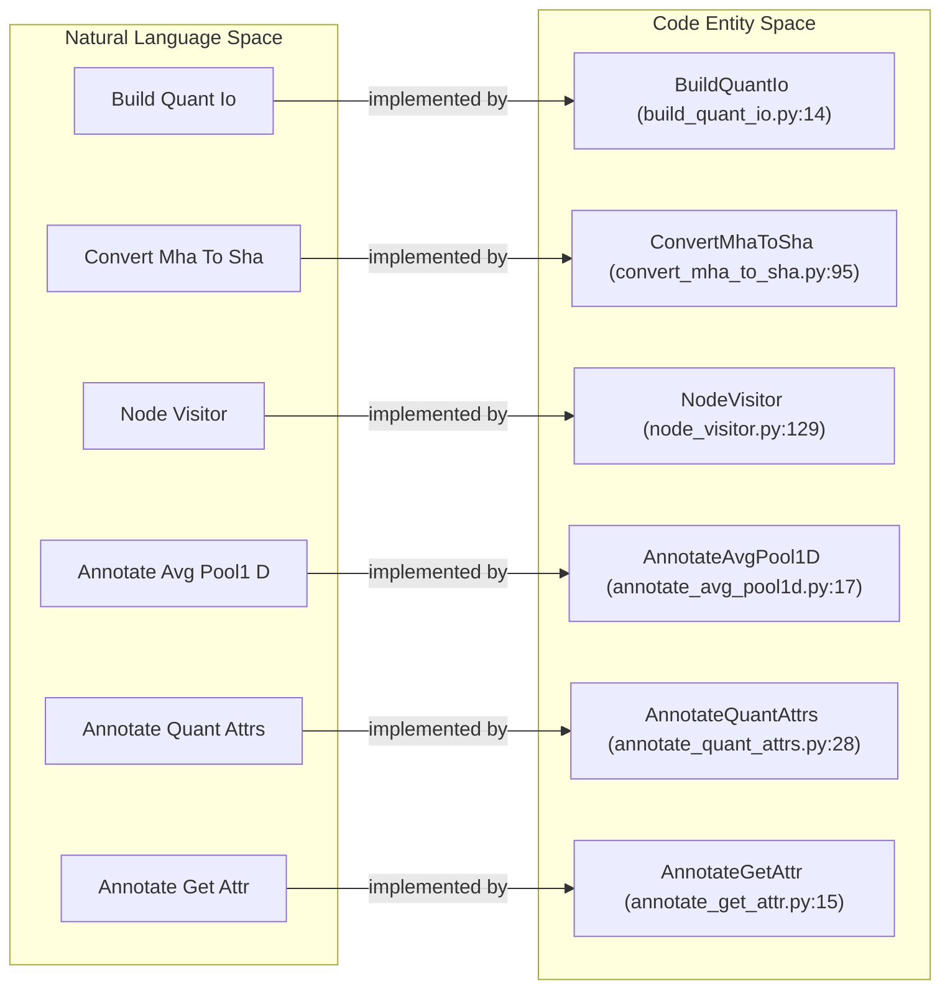
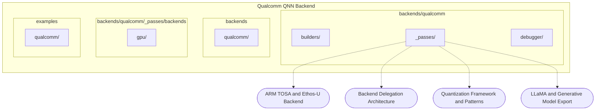
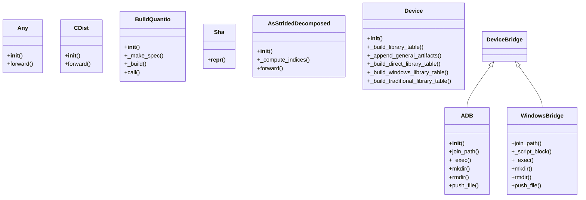
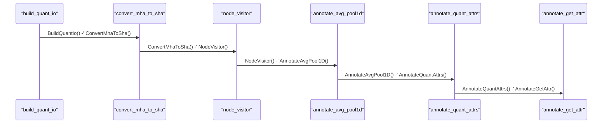

# Qualcomm QNN Backend

↑ [[5-backend-delegation-architecture|Backend Delegation Architecture]]

> Architectural specification and implementation reference for Qualcomm QNN Backend (40 relevant source files). Primary code entities: `NodeVisitor`, `__init__`, `define_custom_tensor_wrapper`, `define_node`, `ConvertMhaToSha`.

<details>
<summary>Relevant source files</summary>

The following files were used as context for generating this wiki page:

- [backends/qualcomm/builders/node_visitor.py](backends/qualcomm/builders/node_visitor.py)
- [backends/qualcomm/_passes/convert_mha_to_sha.py](backends/qualcomm/_passes/convert_mha_to_sha.py)
- [backends/qualcomm/_passes/annotate_quant_attrs.py](backends/qualcomm/_passes/annotate_quant_attrs.py)
- [backends/qualcomm/_passes/annotate_avg_pool1d.py](backends/qualcomm/_passes/annotate_avg_pool1d.py)
- [backends/qualcomm/_passes/annotate_get_attr.py](backends/qualcomm/_passes/annotate_get_attr.py)
- [backends/qualcomm/_passes/annotate_stack.py](backends/qualcomm/_passes/annotate_stack.py)
- [backends/qualcomm/_passes/annotate_unbind.py](backends/qualcomm/_passes/annotate_unbind.py)
- [backends/qualcomm/_passes/convert_linear_to_conv2d.py](backends/qualcomm/_passes/convert_linear_to_conv2d.py)
- [backends/qualcomm/_passes/build_quant_io.py](backends/qualcomm/_passes/build_quant_io.py)
- [backends/qualcomm/_passes/canonicalize_conv.py](backends/qualcomm/_passes/canonicalize_conv.py)
- [backends/qualcomm/_passes/convert_complex_stft.py](backends/qualcomm/_passes/convert_complex_stft.py)
- [backends/qualcomm/_passes/decompose_as_strided.py](backends/qualcomm/_passes/decompose_as_strided.py)
- [backends/qualcomm/__init__.py](backends/qualcomm/__init__.py)
- [backends/qualcomm/_passes/convert_bmm_to_matmul.py](backends/qualcomm/_passes/convert_bmm_to_matmul.py)
- [backends/qualcomm/_passes/decompose_any.py](backends/qualcomm/_passes/decompose_any.py)
- [backends/qualcomm/_passes/decompose_atan2.py](backends/qualcomm/_passes/decompose_atan2.py)
- [backends/qualcomm/_passes/convert_square_to_pow.py](backends/qualcomm/_passes/convert_square_to_pow.py)
- [backends/qualcomm/_passes/decompose_col_im.py](backends/qualcomm/_passes/decompose_col_im.py)
- [backends/qualcomm/_passes/decompose_diagonal.py](backends/qualcomm/_passes/decompose_diagonal.py)
- [backends/qualcomm/_passes/decompose_acos.py](backends/qualcomm/_passes/decompose_acos.py)
- [backends/qualcomm/_passes/decompose_addmm.py](backends/qualcomm/_passes/decompose_addmm.py)
- [backends/qualcomm/export_utils.py](backends/qualcomm/export_utils.py)
- [backends/qualcomm/_passes/decompose_cdist.py](backends/qualcomm/_passes/decompose_cdist.py)
- [backends/qualcomm/_passes/utils.py](backends/qualcomm/_passes/utils.py)
- [backends/qualcomm/_passes/__init__.py](backends/qualcomm/_passes/__init__.py)
- [backends/qualcomm/_passes/decompose_hyperbolic_variants.py](backends/qualcomm/_passes/decompose_hyperbolic_variants.py)
- [backends/qualcomm/_passes/backends/gpu/qnn_gpu_pass_manager.py](backends/qualcomm/_passes/backends/gpu/qnn_gpu_pass_manager.py)
- [backends/qualcomm/_passes/qnn_pass_manager.py](backends/qualcomm/_passes/qnn_pass_manager.py)
- [backends/qualcomm/README.md](backends/qualcomm/README.md)
- [backends/qualcomm/setup.md](backends/qualcomm/setup.md)
- [docs/source/backends-qualcomm.md](docs/source/backends-qualcomm.md)
- [examples/qualcomm/README.md](examples/qualcomm/README.md)
- [backends/qualcomm/builders/README.md](backends/qualcomm/builders/README.md)
- [backends/qualcomm/debugger/README.md](backends/qualcomm/debugger/README.md)
- [backends/qualcomm/BUCK](backends/qualcomm/BUCK)

</details>

## Purpose and Scope

Architectural specification and implementation reference for Qualcomm QNN Backend (40 relevant source files). Primary code entities: `NodeVisitor`, `__init__`, `define_custom_tensor_wrapper`, `define_node`, `ConvertMhaToSha`.

Primary code entities analyzed on this page include `BuildQuantIo` ([backends/qualcomm/_passes/build_quant_io.py:14-53]()), `ConvertMhaToSha` ([backends/qualcomm/_passes/convert_mha_to_sha.py:95-626]()), `NodeVisitor` ([backends/qualcomm/builders/node_visitor.py:129-614]()), `AnnotateAvgPool1D` ([backends/qualcomm/_passes/annotate_avg_pool1d.py:17-64]()), `AnnotateQuantAttrs` ([backends/qualcomm/_passes/annotate_quant_attrs.py:28-139]()).

For the parent architectural layer, see [[5-backend-delegation-architecture|Backend Delegation Architecture]]. Related sibling subsystems: [[5.1-partitioning-and-operator-support|Partitioning and Operator Support]], [[5.2-vulkan-gpu-backend|Vulkan GPU Backend]], [[5.4-arm-tosa-and-ethos-u-backend|ARM TOSA and Ethos-U Backend]], [[5.5-cadence-dsp-backend|Cadence DSP Backend]].

Sources: [backends/qualcomm/_passes/build_quant_io.py:14-53](), [backends/qualcomm/_passes/convert_mha_to_sha.py:95-626](), [backends/qualcomm/builders/node_visitor.py:129-614](), [backends/qualcomm/_passes/annotate_avg_pool1d.py:17-64]()

---

## 1. High-Level Architecture and Data Flow

### Natural Language Space to Code Entity Space Mapping

The following diagram maps domain concepts in this subsystem to their concrete code entities:



### Subsystem Component & Dependency Flow



Cross-subsystem call and import edges connect **Qualcomm QNN Backend** with [[5.4-arm-tosa-and-ethos-u-backend|ARM TOSA and Ethos-U Backend]] (coupling `4.0`), [[5-backend-delegation-architecture|Backend Delegation Architecture]] (coupling `2.0`), [[4.1-quantization-framework-and-patterns|Quantization Framework and Patterns]] (coupling `2.0`), [[3.3-memory-planning-and-allocation|Memory Planning and Allocation]] (coupling `1.0`), [[6.1-llama-model-export|LLaMA and Generative Model Export]] (coupling `1.0`).

| Module Directory | Files | Primary Code Entities | Source Citations |
|---|---|---|---|
| `backends/qualcomm/_passes` | 25 | `BuildQuantIo`, `ConvertMhaToSha`, `AnnotateAvgPool1D`, `AnnotateQuantAttrs` | [backends/qualcomm/_passes/build_quant_io.py:14-53]() [backends/qualcomm/_passes/convert_mha_to_sha.py:95-626]() |
| `backends/qualcomm` | 6 | `ADB`, `Device`, `WindowsBridge`, `DeviceBridge` | [backends/qualcomm/export_utils.py:335-382]() [backends/qualcomm/export_utils.py:468-910]() |
| `backends/qualcomm/builders` | 3 | `NodeVisitor`, `define_tensor`, `get_tensor`, `get_node` | [backends/qualcomm/builders/node_visitor.py:129-614]() [backends/qualcomm/builders/node_visitor.py:532-606]() |
| `examples/qualcomm` | 3 | *(build / config)* | [examples/qualcomm/README.md]() |
| `backends/qualcomm/_passes/backends/gpu` | 1 | `QnnGpuPassManager`, `get_annotation_passes`, `get_default_pass_activations`, `get_export_passes` | [backends/qualcomm/_passes/backends/gpu/qnn_gpu_pass_manager.py:11-46]() [backends/qualcomm/_passes/backends/gpu/qnn_gpu_pass_manager.py:35-38]() |
| `backends/qualcomm/debugger` | 1 | *(build / config)* | [backends/qualcomm/debugger/README.md]() |

Sources: [backends/qualcomm/_passes/build_quant_io.py:14-53](), [backends/qualcomm/_passes/convert_mha_to_sha.py:95-626](), [backends/qualcomm/builders/node_visitor.py:129-614](), [backends/qualcomm/_passes/annotate_avg_pool1d.py:17-64](), [backends/qualcomm/_passes/annotate_quant_attrs.py:28-139]()

---

## 2. Core Data Structures and Implementation Details

### Class and Entity Relationship Diagram



### `BuildQuantIo` (Class)

- **Source Location**: [backends/qualcomm/_passes/build_quant_io.py:14-53]()
- **Declaration**: `Class BuildQuantIo`
- **Graph Centrality**: fan-in `2` callers, fan-out `0` callees
- **Responsibility**: To make lowering process correct, the pass assign the correct quantized dtype to spec of call_delegate.

```python
// backends/qualcomm/_passes/build_quant_io.py:14-29
class BuildQuantIo(ExportPass):
    """
    To make lowering process correct, the pass assign the correct quantized dtype to spec of call_delegate.
    """

    def __init__(self):
        super(BuildQuantIo, self).__init__()

    def _make_spec(self, x):
        if isinstance(x, torch.Tensor):
            return TensorSpec.from_tensor(x)
        elif isinstance(x, (int, bool, float)):
            return x
        else:
            return None
```

### `ConvertMhaToSha` (Class)

- **Source Location**: [backends/qualcomm/_passes/convert_mha_to_sha.py:95-626]()
- **Declaration**: `Class ConvertMhaToSha`
- **Graph Centrality**: fan-in `0` callers, fan-out `0` callees
- **Responsibility**: b=batch, e=emb=h*d, h=heads, d=head_size, s=seq_len, p=past, c=s+p i[bse] ─┬─ q[bse] ─ [bhsd] ─ RoPE ─ [bhsd] ───────────────────── qk[bhsc] ─ mask ─ softmax ─ qkv[bhsd] ─ [bse] ─ o[bse] ├─ k[bse] ─ [bhsd] ─ RoPE ─ [bhds] ─ k_cat[bhdc] ─(k_exp)─┘ │ │ past_k[bhdp] ──┘ │

```python
// backends/qualcomm/_passes/convert_mha_to_sha.py:95-110
class ConvertMhaToSha(ExportPass):
    """
    b=batch, e=emb=h*d, h=heads, d=head_size, s=seq_len, p=past, c=s+p

    i[bse] ─┬─ q[bse] ─ [bhsd] ─ RoPE ─ [bhsd] ───────────────────── qk[bhsc] ─ mask ─ softmax ─ qkv[bhsd] ─ [bse] ─ o[bse]
            ├─ k[bse] ─ [bhsd] ─ RoPE ─ [bhds] ─ k_cat[bhdc] ─(k_exp)─┘                           │
            │                     past_k[bhdp] ──┘                                                │
            └─ v[bse] ─ [bhsd] ───────────────── v_cat[bhcd] ─(v_exp)-────────────────────────────┘
                                  past_v[bhpd] ──┘
    """

    def __init__(
        self,
        edge_program: torch.export.ExportedProgram,
        verbose=False,
    ):
```

### `NodeVisitor` (Class)

- **Source Location**: [backends/qualcomm/builders/node_visitor.py:129-614]()
- **Declaration**: `Class NodeVisitor`
- **Graph Centrality**: fan-in `0` callers, fan-out `0` callees
- **Responsibility**: Node visitor pattern for visiting nodes in an edge IR graph

```python
// backends/qualcomm/builders/node_visitor.py:129-144
class NodeVisitor:
    """
    Node visitor pattern for visiting nodes in an edge IR graph
    """

    def __init__(
        self,
        external_ids,
        edge_program: torch.export.ExportedProgram,
        enable_tensor_dump,
        is_qnn_partitioner=True,
        backend_type=None,
    ) -> None:
        # is_qnn_partitioner: True for the real qnn_partitioner / qnn_preprocess
        # flows, where external_ids is built from the program being processed so
        # graph-input ids resolve correctly.
```

### `AnnotateAvgPool1D` (Class)

- **Source Location**: [backends/qualcomm/_passes/annotate_avg_pool1d.py:17-64]()
- **Declaration**: `Class AnnotateAvgPool1D`
- **Graph Centrality**: fan-in `0` callers, fan-out `0` callees
- **Responsibility**: Add "quant_attrs" to graph nodes' meta from the QDQ information generated after quantization process. avg_pool1d and adaptive_avg_pool1d get decomposed to: unsqueeze -> avg_pool2d/adaptive_avg_pool2d -> squeeze

### `AnnotateQuantAttrs` (Class)

- **Source Location**: [backends/qualcomm/_passes/annotate_quant_attrs.py:28-139]()
- **Declaration**: `Class AnnotateQuantAttrs`
- **Graph Centrality**: fan-in `0` callers, fan-out `0` callees
- **Responsibility**: Add "quant_attrs" to graph nodes' meta from the QDQ information generated after quantization process.

### `define_tensor` (Method)

- **Source Location**: [backends/qualcomm/builders/node_visitor.py:532-606]()
- **Declaration**: `( self, tensor_source_node: torch.fx.Node, target_build_node: torch.fx.Node, tensor: torch.Tensor, tensor_type: PyQnnManager.Qnn_TensorType_`
- **Graph Centrality**: fan-in `122` callers, fan-out `6` callees
- **Responsibility**: Covert torch.Tensor to TensorWrapper Args: tensor_source_node: EdgeIR Node target_build_node: Current node to build tensor: EdgeIR Tensor tensor_type: QNN tensor type nodes_to_wrappers: Set contains edge_graph values(node targets)

Sources: [backends/qualcomm/_passes/build_quant_io.py:14-53](), [backends/qualcomm/_passes/convert_mha_to_sha.py:95-626](), [backends/qualcomm/builders/node_visitor.py:129-614](), [backends/qualcomm/_passes/annotate_avg_pool1d.py:17-64](), [backends/qualcomm/_passes/annotate_quant_attrs.py:28-139]()

---

## 3. Execution and Call Flow

The sequence diagram below traces the runtime/compile-time call chain across components in this module:



Sources: [backends/qualcomm/_passes/build_quant_io.py:14-53](), [backends/qualcomm/_passes/convert_mha_to_sha.py:95-626](), [backends/qualcomm/builders/node_visitor.py:129-614](), [backends/qualcomm/_passes/annotate_avg_pool1d.py:17-64](), [backends/qualcomm/_passes/annotate_quant_attrs.py:28-139]()

---

## 4. Key API and Symbol Reference

| Code Entity | Kind | Location | Fan-In / Out | Role & Signature |
|---|---|---|---|---|
| `BuildQuantIo` | Class | [backends/qualcomm/_passes/build_quant_io.py:14-53]() | `2` / `0` | To make lowering process correct, the pass assign the correct quantized dtype to spec of call_delegate. |
| `ConvertMhaToSha` | Class | [backends/qualcomm/_passes/convert_mha_to_sha.py:95-626]() | `0` / `0` | b=batch, e=emb=h*d, h=heads, d=head_size, s=seq_len, p=past, c=s+p |
| `NodeVisitor` | Class | [backends/qualcomm/builders/node_visitor.py:129-614]() | `0` / `0` | Node visitor pattern for visiting nodes in an edge IR graph |
| `AnnotateAvgPool1D` | Class | [backends/qualcomm/_passes/annotate_avg_pool1d.py:17-64]() | `0` / `0` | Add "quant_attrs" to graph nodes' meta from the QDQ information |
| `AnnotateQuantAttrs` | Class | [backends/qualcomm/_passes/annotate_quant_attrs.py:28-139]() | `0` / `0` | Add "quant_attrs" to graph nodes' meta from the QDQ information |
| `AnnotateGetAttr` | Class | [backends/qualcomm/_passes/annotate_get_attr.py:15-54]() | `0` / `0` | Annotates quantization attributes for `get_attr` nodes. |
| `AnnotateStack` | Class | [backends/qualcomm/_passes/annotate_stack.py:15-42]() | `0` / `0` | Add "quant_attrs" to graph nodes' meta from the QDQ information |
| `AnnotateUnbind` | Class | [backends/qualcomm/_passes/annotate_unbind.py:15-40]() | `0` / `0` | Add "quant_attrs" to graph nodes' meta from the QDQ information |
| `ConvertLinearToConv2d` | Class | [backends/qualcomm/_passes/convert_linear_to_conv2d.py:32-340]() | `0` / `0` | Replace linear with an equivalent 1x1 convolution using call_function nodes. |
| `AsStridedDecomposed` | Class | [backends/qualcomm/_passes/decompose_as_strided.py:17-51]() | `1` / `0` | Decompose as_strided into flatten + index_select + reshape. |
| `CanonicalizeConv` | Class | [backends/qualcomm/_passes/canonicalize_conv.py:41-201]() | `0` / `0` | 1. QNN does not support dilation on TransposeConvND |
| `ConvParamIdx` | Class | [backends/qualcomm/_passes/canonicalize_conv.py:23-38]() | `0` / `0` | Spec for `aten.convolution` (https://docs.pytorch.org/docs/stable/torch.compiler_ir.html) |
| `ConvertComplexStft` | Class | [backends/qualcomm/_passes/convert_complex_stft.py:13-116]() | `0` / `0` | Rewrite a complex-valued stft into its real-valued form so the QNN Stft |
| `DecomposeAsStrided` | Class | [backends/qualcomm/_passes/decompose_as_strided.py:54-226]() | `0` / `0` | Decompose aten.as_strided into supported QNN primitives. |
| `ConvertBmmToMatmul` | Class | [backends/qualcomm/_passes/convert_bmm_to_matmul.py:17-83]() | `0` / `0` | Replace bmm to matmul, because bmm is eqaul to matmul in QNN. |
| `Sha` | Class | [backends/qualcomm/_passes/convert_mha_to_sha.py:87-92]() | `2` / `0` | — |
| `DecomposeAny` | Class | [backends/qualcomm/_passes/decompose_any.py:32-69]() | `0` / `0` | Decompose for math equivalent op. |
| `DecomposeAtan2` | Class | [backends/qualcomm/_passes/decompose_atan2.py:15-210]() | `0` / `0` | Decompose atan2(y, x) with full piecewise definition: |
| `ConvertSquareToPow` | Class | [backends/qualcomm/_passes/convert_square_to_pow.py:13-38]() | `0` / `0` | Convert square to pow with a scalar value of 2. |
| `DecomposeColIm` | Class | [backends/qualcomm/_passes/decompose_col_im.py:16-273]() | `0` / `0` | Decompose im2col(unfold) to pad + index_select + space_to_depth + view_copy |
| `ADB` | Class | [backends/qualcomm/export_utils.py:335-382]() | `1` / `0` | Talk to a remote Android/OE-Linux device over adb. |
| `Device` | Class | [backends/qualcomm/export_utils.py:468-910]() | `1` / `0` | A wrapper class for communicating with a device: either a remote Android/OE-Linux |

Sources: [backends/qualcomm/_passes/build_quant_io.py:14-53](), [backends/qualcomm/_passes/convert_mha_to_sha.py:95-626](), [backends/qualcomm/builders/node_visitor.py:129-614](), [backends/qualcomm/_passes/annotate_avg_pool1d.py:17-64](), [backends/qualcomm/_passes/annotate_quant_attrs.py:28-139](), [backends/qualcomm/_passes/annotate_get_attr.py:15-54]()

---

## 5. Official Documentation and Design Context

The following linked documentation sections from `llm-wiki` (`raw/`) provide additional architectural context, tutorials, and design invariants for this subsystem:

- **Backend Delegation Architecture** ([wiki/5-backend-delegation-architecture.md](), score `134.7151`) (sections: `Backend Delegation Architecture`, `Purpose and Scope`, `System Mapping: Natural Language Space to Code Entity Space`, `1. Partitioning and Operator Support`): # Backend Delegation Architecture > Architectural specification and implementation reference for Backend Delegation Architecture (40 relevant source files). Primary code entities: `CommandBuffer`, `begin`, `bind_descriptors`, `bind_pipeline`, `NodeVisitor`. <details> <summary>Relevant source files</summary> The following files were used as context for generating this wiki page: - [backends/vulkan/runtime/vk_api/Comma
- **Backend-Specific Quantization** ([wiki/4.2-backend-specific-quantization.md](), score `107.2972`) (sections: `Backend-Specific Quantization`, `Purpose and Scope`, `1. High-Level Architecture and Data Flow`, `Natural Language Space to Code Entity Space Mapping`): # Backend-Specific Quantization ↑ [[4-quantization-systems|Quantization Systems]] > Architectural specification and implementation reference for Backend-Specific Quantization (35 relevant source files). Primary code entities: `NodeFinder`, `find_nodes`, `PatternCheck`, `check_pattern`, `EthosUQuantizer`. <details> <summary>Relevant source files</summary> The following files were used as context for generating this wi
- **ExecuTorch DeepWiki** ([wiki/index.md](), score `103.1841`) (sections: `ExecuTorch DeepWiki`, `Pages`): # ExecuTorch DeepWiki Generated from `home-jason-Project-deepwiki-executorch` at commit `b3b565b5b62f` (2026-11-15T15:02:11+00:00). ## Pages - [[1-overview|Overview]] — Architectural specification and implementation reference for Overview (10 relevant source files). Primary code entities: `Module`, `MethodHolder`, `PlannedMemory`, `EdgeProgramManager`, `__init__`. - [[1.1-getting-started|Getting Started]] — Architect
- **XNNPACK CPU Backend** ([wiki/5.6-xnnpack-cpu-backend.md](), score `95.4196`) (sections: `XNNPACK CPU Backend`, `Purpose and Scope`, `1. High-Level Architecture and Data Flow`, `Natural Language Space to Code Entity Space Mapping`): # XNNPACK CPU Backend ↑ [[5-backend-delegation-architecture|Backend Delegation Architecture]] > Architectural specification and implementation reference for XNNPACK CPU Backend (36 relevant source files). Primary code entities: `ChannelsLastTaggedReshapePass`, `_is_nhwc`, `call`, `can_be_converted_to_nhwc`, `InputTypeToIndex`. <details> <summary>Relevant source files</summary> The following files were used as context

Sources: [wiki/5-backend-delegation-architecture.md](), [wiki/4.2-backend-specific-quantization.md](), [wiki/index.md](), [wiki/5.6-xnnpack-cpu-backend.md]()

## Related pages

- [[5-backend-delegation-architecture|Backend Delegation Architecture]]
- [[1.1-getting-started|Getting Started]]
- [[1.2-export-api-and-recipe-system|Export API and Recipe System]]
- [[2.2-kernel-libraries-and-selective-build|Kernel Libraries and Selective Build]]
- [[2.3-schema-generation-and-flatbuffers|Schema Generation and FlatBuffers]]
- [[3.4-program-emission-and-serialization|Program Emission and Serialization]]
- [[3.5-verification-and-dialect-system|Verification and Dialect System]]
- [[4-quantization-systems|Quantization Systems]]

## Related documents

- `wiki/5-backend-delegation-architecture.md` — Backend Delegation Architecture (score 134.7151, via bm25)
- `wiki/4.2-backend-specific-quantization.md` — Backend-Specific Quantization (score 107.2972, via bm25)
- `wiki/index.md` — ExecuTorch DeepWiki (score 103.1841, via bm25)
- `wiki/5.6-xnnpack-cpu-backend.md` — XNNPACK CPU Backend (score 95.4196, via bm25)
- `wiki/4.1-quantization-framework-and-patterns.md` — Quantization Framework and Patterns (score 81.8408, via bm25)

## Sources

- [`backends/qualcomm/builders/node_visitor.py`](https://github.com/pytorch/executorch/blob/main/backends/qualcomm/builders/node_visitor.py)
- [`backends/qualcomm/_passes/convert_mha_to_sha.py`](https://github.com/pytorch/executorch/blob/main/backends/qualcomm/_passes/convert_mha_to_sha.py)
- [`backends/qualcomm/_passes/annotate_quant_attrs.py`](https://github.com/pytorch/executorch/blob/main/backends/qualcomm/_passes/annotate_quant_attrs.py)
- [`backends/qualcomm/_passes/annotate_avg_pool1d.py`](https://github.com/pytorch/executorch/blob/main/backends/qualcomm/_passes/annotate_avg_pool1d.py)
- [`backends/qualcomm/_passes/annotate_get_attr.py`](https://github.com/pytorch/executorch/blob/main/backends/qualcomm/_passes/annotate_get_attr.py)
- [`backends/qualcomm/_passes/annotate_stack.py`](https://github.com/pytorch/executorch/blob/main/backends/qualcomm/_passes/annotate_stack.py)
- [`backends/qualcomm/_passes/annotate_unbind.py`](https://github.com/pytorch/executorch/blob/main/backends/qualcomm/_passes/annotate_unbind.py)
- [`backends/qualcomm/_passes/convert_linear_to_conv2d.py`](https://github.com/pytorch/executorch/blob/main/backends/qualcomm/_passes/convert_linear_to_conv2d.py)
- [`backends/qualcomm/_passes/build_quant_io.py`](https://github.com/pytorch/executorch/blob/main/backends/qualcomm/_passes/build_quant_io.py)
- [`backends/qualcomm/_passes/canonicalize_conv.py`](https://github.com/pytorch/executorch/blob/main/backends/qualcomm/_passes/canonicalize_conv.py)
- [`backends/qualcomm/_passes/convert_complex_stft.py`](https://github.com/pytorch/executorch/blob/main/backends/qualcomm/_passes/convert_complex_stft.py)
- [`backends/qualcomm/_passes/decompose_as_strided.py`](https://github.com/pytorch/executorch/blob/main/backends/qualcomm/_passes/decompose_as_strided.py)
- [`backends/qualcomm/__init__.py`](https://github.com/pytorch/executorch/blob/main/backends/qualcomm/__init__.py)
- [`backends/qualcomm/_passes/convert_bmm_to_matmul.py`](https://github.com/pytorch/executorch/blob/main/backends/qualcomm/_passes/convert_bmm_to_matmul.py)
- [`backends/qualcomm/_passes/decompose_any.py`](https://github.com/pytorch/executorch/blob/main/backends/qualcomm/_passes/decompose_any.py)
- [`backends/qualcomm/_passes/decompose_atan2.py`](https://github.com/pytorch/executorch/blob/main/backends/qualcomm/_passes/decompose_atan2.py)
- [`backends/qualcomm/_passes/convert_square_to_pow.py`](https://github.com/pytorch/executorch/blob/main/backends/qualcomm/_passes/convert_square_to_pow.py)
- [`backends/qualcomm/_passes/decompose_col_im.py`](https://github.com/pytorch/executorch/blob/main/backends/qualcomm/_passes/decompose_col_im.py)
- [`backends/qualcomm/_passes/decompose_diagonal.py`](https://github.com/pytorch/executorch/blob/main/backends/qualcomm/_passes/decompose_diagonal.py)
- [`backends/qualcomm/_passes/decompose_acos.py`](https://github.com/pytorch/executorch/blob/main/backends/qualcomm/_passes/decompose_acos.py)
- [`backends/qualcomm/_passes/decompose_addmm.py`](https://github.com/pytorch/executorch/blob/main/backends/qualcomm/_passes/decompose_addmm.py)
- [`backends/qualcomm/export_utils.py`](https://github.com/pytorch/executorch/blob/main/backends/qualcomm/export_utils.py)
- [`backends/qualcomm/_passes/decompose_cdist.py`](https://github.com/pytorch/executorch/blob/main/backends/qualcomm/_passes/decompose_cdist.py)
- [`backends/qualcomm/_passes/utils.py`](https://github.com/pytorch/executorch/blob/main/backends/qualcomm/_passes/utils.py)
- [`backends/qualcomm/_passes/__init__.py`](https://github.com/pytorch/executorch/blob/main/backends/qualcomm/_passes/__init__.py)
- [`backends/qualcomm/_passes/decompose_hyperbolic_variants.py`](https://github.com/pytorch/executorch/blob/main/backends/qualcomm/_passes/decompose_hyperbolic_variants.py)
- [`backends/qualcomm/_passes/backends/gpu/qnn_gpu_pass_manager.py`](https://github.com/pytorch/executorch/blob/main/backends/qualcomm/_passes/backends/gpu/qnn_gpu_pass_manager.py)
- [`backends/qualcomm/_passes/qnn_pass_manager.py`](https://github.com/pytorch/executorch/blob/main/backends/qualcomm/_passes/qnn_pass_manager.py)
- [`backends/qualcomm/README.md`](https://github.com/pytorch/executorch/blob/main/backends/qualcomm/README.md)
- [`backends/qualcomm/setup.md`](https://github.com/pytorch/executorch/blob/main/backends/qualcomm/setup.md)
- [`docs/source/backends-qualcomm.md`](https://github.com/pytorch/executorch/blob/main/docs/source/backends-qualcomm.md)
- [`examples/qualcomm/README.md`](https://github.com/pytorch/executorch/blob/main/examples/qualcomm/README.md)
- [`backends/qualcomm/builders/README.md`](https://github.com/pytorch/executorch/blob/main/backends/qualcomm/builders/README.md)
- [`backends/qualcomm/debugger/README.md`](https://github.com/pytorch/executorch/blob/main/backends/qualcomm/debugger/README.md)
- [`backends/qualcomm/BUCK`](https://github.com/pytorch/executorch/blob/main/backends/qualcomm/BUCK)
- [`backends/qualcomm/CMakeLists.txt`](https://github.com/pytorch/executorch/blob/main/backends/qualcomm/CMakeLists.txt)
- [`backends/qualcomm/_passes/BUCK`](https://github.com/pytorch/executorch/blob/main/backends/qualcomm/_passes/BUCK)
- [`examples/qualcomm/BUCK`](https://github.com/pytorch/executorch/blob/main/examples/qualcomm/BUCK)
- [`examples/qualcomm/CMakeLists.txt`](https://github.com/pytorch/executorch/blob/main/examples/qualcomm/CMakeLists.txt)
- [`backends/qualcomm/builders/BUCK`](https://github.com/pytorch/executorch/blob/main/backends/qualcomm/builders/BUCK)


## Dynamic Knowledge Links (Code Graph ↔ LLM-Wiki / RAG)

### Linked Architecture & Design Documents

| Document | Match Channel | Score | Shared Code Symbols |
|---|---|---|---|
| [[5-backend-delegation-architecture|Backend Delegation Architecture]] | `bm25+entity(2)` | `137.715` | `define_tensor`, `get_tensor` |
| [[5.1-partitioning-and-operator-support|Partitioning and Operator Support]] | `wikilink:5.3-qualcomm-qnn-backend` | `123.333` | *(lexical/graph match)* |
| [[5.2-vulkan-gpu-backend|Vulkan GPU Backend]] | `wikilink:5.3-qualcomm-qnn-backend` | `123.333` | *(lexical/graph match)* |
| [[5.4-arm-tosa-and-ethos-u-backend|ARM TOSA and Ethos-U Backend]] | `wikilink:5.3-qualcomm-qnn-backend` | `123.333` | *(lexical/graph match)* |
| [[4.2-backend-specific-quantization|Backend-Specific Quantization]] | `bm25` | `107.297` | *(lexical/graph match)* |
| [[index|ExecuTorch DeepWiki]] | `bm25` | `103.184` | *(lexical/graph match)* |

### High-Centrality Bridge Symbols (CBM Graph)

| Symbol | Kind | Source Location | Fan-In / Fan-Out |
|---|---|---|---|
| `BuildQuantIo` | Class | [backends/qualcomm/_passes/build_quant_io.py:14-53]() | in: `2` / out: `0` |
| `ConvertMhaToSha` | Class | [backends/qualcomm/_passes/convert_mha_to_sha.py:95-626]() | in: `0` / out: `0` |
| `NodeVisitor` | Class | [backends/qualcomm/builders/node_visitor.py:129-614]() | in: `0` / out: `0` |
| `AnnotateAvgPool1D` | Class | [backends/qualcomm/_passes/annotate_avg_pool1d.py:17-64]() | in: `0` / out: `0` |
| `AnnotateQuantAttrs` | Class | [backends/qualcomm/_passes/annotate_quant_attrs.py:28-139]() | in: `0` / out: `0` |
| `AnnotateGetAttr` | Class | [backends/qualcomm/_passes/annotate_get_attr.py:15-54]() | in: `0` / out: `0` |

Sources: [backends/qualcomm/_passes/build_quant_io.py:14-53](), [backends/qualcomm/_passes/convert_mha_to_sha.py:95-626](), [backends/qualcomm/builders/node_visitor.py:129-614](), [backends/qualcomm/_passes/annotate_avg_pool1d.py:17-64]()

### Cross-Subsystem Coupling

- [[5.4-arm-tosa-and-ethos-u-backend|ARM TOSA and Ethos-U Backend]] — call/import coupling weight `4.0`
- [[5-backend-delegation-architecture|Backend Delegation Architecture]] — call/import coupling weight `2.0`
- [[4.1-quantization-framework-and-patterns|Quantization Framework and Patterns]] — call/import coupling weight `2.0`
- [[3.3-memory-planning-and-allocation|Memory Planning and Allocation]] — call/import coupling weight `1.0`
- [[6.1-llama-model-export|LLaMA and Generative Model Export]] — call/import coupling weight `1.0`
