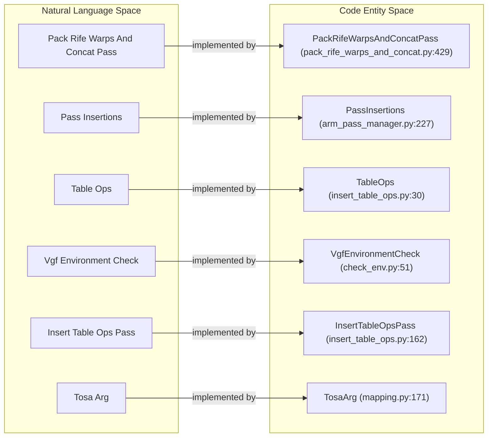
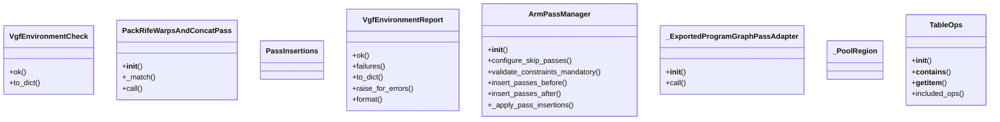
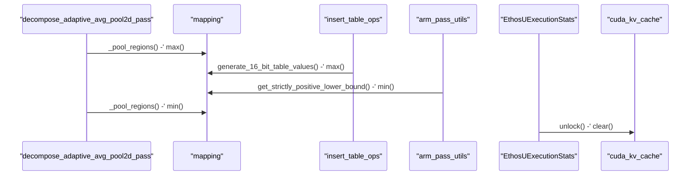

# ARM TOSA and Ethos-U Backend

↑ [[5-backend-delegation-architecture|Backend Delegation Architecture]]

> Architectural specification and implementation reference for ARM TOSA and Ethos-U Backend (40 relevant source files). Primary code entities: `TosaArg`, `__init__`, `__process_list`, `__process_node`, `InsertTableOpsPass`.

<details>
<summary>Relevant source files</summary>

The following files were used as context for generating this wiki page:

- [backends/arm/tosa/mapping.py](backends/arm/tosa/mapping.py)
- [backends/arm/_passes/insert_table_ops.py](backends/arm/_passes/insert_table_ops.py)
- [backends/arm/_passes/arm_pass.py](backends/arm/_passes/arm_pass.py)
- [backends/arm/_passes/arm_pass_manager.py](backends/arm/_passes/arm_pass_manager.py)
- [examples/arm/ethos-u-setup/arm-none-eabi-clang-random-device.h](examples/arm/ethos-u-setup/arm-none-eabi-clang-random-device.h)
- [backends/arm/_passes/arm_pass_utils.py](backends/arm/_passes/arm_pass_utils.py)
- [backends/arm/_passes/cast_int64_pass.py](backends/arm/_passes/cast_int64_pass.py)
- [backends/arm/_passes/decompose_adaptive_avg_pool2d_pass.py](backends/arm/_passes/decompose_adaptive_avg_pool2d_pass.py)
- [backends/arm/_passes/accumulate_index_put_pass.py](backends/arm/_passes/accumulate_index_put_pass.py)
- [backends/arm/_passes/_debug_passes.py](backends/arm/_passes/_debug_passes.py)
- [backends/arm/_passes/convert_int64_output_ops_to_int32.py](backends/arm/_passes/convert_int64_output_ops_to_int32.py)
- [examples/arm/QAT_example/rife_vgf/passes/pack_rife_warps_and_concat.py](examples/arm/QAT_example/rife_vgf/passes/pack_rife_warps_and_concat.py)
- [examples/arm/executor_runner/arm_executor_runner.cpp](examples/arm/executor_runner/arm_executor_runner.cpp)
- [backends/arm/__init__.py](backends/arm/__init__.py)
- [backends/arm/_passes/aten_to_tosa_data_layout.py](backends/arm/_passes/aten_to_tosa_data_layout.py)
- [backends/arm/_passes/broadcast_args_pass.py](backends/arm/_passes/broadcast_args_pass.py)
- [backends/arm/runtime/EthosUExecutionStats.h](backends/arm/runtime/EthosUExecutionStats.h)
- [backends/arm/_passes/aten_to_tosa_activation_functions.py](backends/arm/_passes/aten_to_tosa_activation_functions.py)
- [backends/arm/_passes/canonicalize_gather_pass.py](backends/arm/_passes/canonicalize_gather_pass.py)
- [backends/arm/operators/node_visitor.py](backends/arm/operators/node_visitor.py)
- [backends/arm/_passes/cast_int_comparison_inputs_pass.py](backends/arm/_passes/cast_int_comparison_inputs_pass.py)
- [backends/arm/_passes/canonicalize_view_copy_permute_pass.py](backends/arm/_passes/canonicalize_view_copy_permute_pass.py)
- [backends/arm/_passes/decompose_choose_qparams_symmetric_pass.py](backends/arm/_passes/decompose_choose_qparams_symmetric_pass.py)
- [backends/arm/_passes/cast_to_int32_pass.py](backends/arm/_passes/cast_to_int32_pass.py)
- [backends/arm/_passes/constant_folding_pass.py](backends/arm/_passes/constant_folding_pass.py)
- [backends/arm/_passes/control_flow_const_inline.py](backends/arm/_passes/control_flow_const_inline.py)
- [backends/arm/_passes/decompose_adaptive_max_pool2d_pass.py](backends/arm/_passes/decompose_adaptive_max_pool2d_pass.py)
- [backends/arm/vgf/check_env.py](backends/arm/vgf/check_env.py)
- [backends/arm/MODELS.md](backends/arm/MODELS.md)
- [backends/arm/README.md](backends/arm/README.md)
- [backends/arm/SYMINT_ET_LOWERING.md](backends/arm/SYMINT_ET_LOWERING.md)
- [examples/arm/README.md](examples/arm/README.md)
- [examples/arm/custom_operators.md](examples/arm/custom_operators.md)
- [examples/arm/ethos-u-porting-guide.md](examples/arm/ethos-u-porting-guide.md)
- [backends/arm/BUCK](backends/arm/BUCK)

</details>

## Purpose and Scope

Architectural specification and implementation reference for ARM TOSA and Ethos-U Backend (40 relevant source files). Primary code entities: `TosaArg`, `__init__`, `__process_list`, `__process_node`, `InsertTableOpsPass`.

Primary code entities analyzed on this page include `PackRifeWarpsAndConcatPass` ([examples/arm/QAT_example/rife_vgf/passes/pack_rife_warps_and_concat.py:429-646]()), `PassInsertions` ([backends/arm/_passes/arm_pass_manager.py:227-231]()), `TableOps` ([backends/arm/_passes/insert_table_ops.py:30-159]()), `VgfEnvironmentCheck` ([backends/arm/vgf/check_env.py:51-71]()), `InsertTableOpsPass` ([backends/arm/_passes/insert_table_ops.py:162-431]()).

For the parent architectural layer, see [[5-backend-delegation-architecture|Backend Delegation Architecture]]. Related sibling subsystems: [[5.1-partitioning-and-operator-support|Partitioning and Operator Support]], [[5.2-vulkan-gpu-backend|Vulkan GPU Backend]], [[5.3-qualcomm-qnn-backend|Qualcomm QNN Backend]], [[5.5-cadence-dsp-backend|Cadence DSP Backend]].

Sources: [examples/arm/QAT_example/rife_vgf/passes/pack_rife_warps_and_concat.py:429-646](), [backends/arm/_passes/arm_pass_manager.py:227-231](), [backends/arm/_passes/insert_table_ops.py:30-159](), [backends/arm/vgf/check_env.py:51-71]()

---

## 1. High-Level Architecture and Data Flow

### Natural Language Space to Code Entity Space Mapping

The following diagram maps domain concepts in this subsystem to their concrete code entities:



### Subsystem Component & Dependency Flow

```mermaid
flowchart TD
  subgraph sub_this["ARM TOSA and Ethos-U Backend"]
    subgraph sg_0["backends/arm"]
      n_backends_arm_tosa["tosa/"]
      n_backends_arm__passes["_passes/"]
      n_backends_arm_runtime["runtime/"]
      n_backends_arm_operators["operators/"]
      n_backends_arm_vgf["vgf/"]
      n_backends_arm_cmake["cmake/"]
      n_backends_arm_debug["debug/"]
    end
    subgraph sg_1["examples/arm"]
      n_examples_arm_ethos_u_setup["ethos-u-setup/"]
      n_examples_arm_executor_runner["executor_runner/"]
    end
    subgraph sg_2["examples/arm/QAT_example/rife_vgf"]
      n_examples_arm_QAT_example_rife_vgf_passes["passes/"]
    end
    subgraph sg_3["backends"]
      n_backends_arm["arm/"]
    end
    subgraph sg_4["examples"]
      n_examples_arm["arm/"]
    end
  end
  n_page_2_build_system_and_infrastructure(["Build System and Infrastructure"])
  n_page_6_1_llama_model_export(["LLaMA and Generative Model Export"])
  n_page_6_model_export_and_llm_support(["Model Export and LLM Support"])
  n_page_8_runtime_execution(["Runtime Execution"])
  n_examples_arm_ethos_u_setup -.-> n_page_6_model_export_and_llm_support
  n_examples_arm_executor_runner -.-> n_page_8_runtime_execution
  n_backends_arm__passes -.-> n_page_6_1_llama_model_export
  n_examples_arm_executor_runner -.-> n_page_2_build_system_and_infrastructure
  n_examples_arm_ethos_u_setup -.-> n_page_6_1_llama_model_export
  n_backends_arm_runtime -.-> n_page_6_model_export_and_llm_support
  n_backends_arm__passes --> n_backends_arm_tosa
  n_backends_arm__passes -.-> n_page_6_model_export_and_llm_support
```



Cross-subsystem call and import edges connect **ARM TOSA and Ethos-U Backend** with [[6-model-export-and-llm-support|Model Export and LLM Support]] (coupling `45.0`), [[7.2-model-and-backend-testing-framework|Model and Backend Testing Framework]] (coupling `45.0`), [[6.1-llama-model-export|LLaMA and Generative Model Export]] (coupling `36.0`), [[8-runtime-execution|Runtime Execution]] (coupling `32.0`), [[8.1-core-runtime-architecture|Core Runtime Architecture]] (coupling `28.0`).

| Module Directory | Files | Primary Code Entities | Source Citations |
|---|---|---|---|
| `backends/arm/_passes` | 21 | `PassInsertions`, `TableOps`, `InsertTableOpsPass`, `ArmOpTargetedPass` | [backends/arm/_passes/arm_pass_manager.py:227-231]() [backends/arm/_passes/insert_table_ops.py:30-159]() |
| `backends/arm` | 6 | `__dir__`, `__getattr__` | [backends/arm/__init__.py:58-59]() [backends/arm/__init__.py:48-55]() |
| `examples/arm` | 3 | *(build / config)* | [examples/arm/README.md]() |
| `backends/arm/cmake` | 1 | *(build / config)* | [backends/arm/cmake/ArmRunnerUtils.cmake]() |
| `backends/arm/debug` | 1 | *(build / config)* | [backends/arm/debug/BUCK]() |
| `backends/arm/operator_support` | 1 | *(build / config)* | [backends/arm/operator_support/BUCK]() |
| `backends/arm/operators` | 1 | `NodeVisitor`, `_serialize_operator`, `get_node_visitors`, `define_node` | [backends/arm/operators/node_visitor.py:38-198]() [backends/arm/operators/node_visitor.py:62-105]() |
| `backends/arm/runtime` | 1 | `EthosUStatsBuffer`, `EthosUExecutionRecord`, `EthosUExecutionStats`, `EthosUPmuCounter` | [backends/arm/runtime/EthosUExecutionStats.h:111-156]() [backends/arm/runtime/EthosUExecutionStats.h:103-107]() |

Sources: [examples/arm/QAT_example/rife_vgf/passes/pack_rife_warps_and_concat.py:429-646](), [backends/arm/_passes/arm_pass_manager.py:227-231](), [backends/arm/_passes/insert_table_ops.py:30-159](), [backends/arm/vgf/check_env.py:51-71](), [backends/arm/_passes/insert_table_ops.py:162-431]()

---

## 2. Core Data Structures and Implementation Details

### Class and Entity Relationship Diagram



### `PackRifeWarpsAndConcatPass` (Class)

- **Source Location**: [examples/arm/QAT_example/rife_vgf/passes/pack_rife_warps_and_concat.py:429-646]()
- **Declaration**: `Class PackRifeWarpsAndConcatPass`
- **Graph Centrality**: fan-in `7` callers, fan-out `0` callees
- **Responsibility**: Pack four private RIFE warps and their C28 concat into one C32 shader. Fuse compatible block0 head resizing and state preparation into the shader. Reorder block0 output channels during export so each PixelShuffle read accesses 13 contiguous channels. Keep sampling quantization boundaries. Four zero weight columns make 

```python
// examples/arm/QAT_example/rife_vgf/passes/pack_rife_warps_and_concat.py:429-444
class PackRifeWarpsAndConcatPass(ArmPass):
    """Pack four private RIFE warps and their C28 concat into one C32 shader.

    Fuse compatible block0 head resizing and state preparation into the shader.
    Reorder block0 output channels during export so each PixelShuffle read
    accesses 13 contiguous channels. Keep sampling quantization boundaries.
    Four zero weight columns make the following convolution ignore padding.
    Unsupported graphs are left unchanged.

    """

    _passes_required_after: set[type[ExportPass]] = set()

    def __init__(self, exported_program: ExportedProgram | None = None):
        super().__init__()
        self.exported_program = exported_program
```

### `PassInsertions` (Class)

- **Source Location**: [backends/arm/_passes/arm_pass_manager.py:227-231]()
- **Declaration**: `Class PassInsertions`
- **Graph Centrality**: fan-in `4` callers, fan-out `0` callees
- **Responsibility**: Holds lists of passes to be inserted before and after a target pass.

```python
// backends/arm/_passes/arm_pass_manager.py:227-231
class PassInsertions:
    """Holds lists of passes to be inserted before and after a target pass."""

    before_passes: list = field(default_factory=list)
    after_passes: list = field(default_factory=list)
```

### `TableOps` (Class)

- **Source Location**: [backends/arm/_passes/insert_table_ops.py:30-159]()
- **Declaration**: `Class TableOps`
- **Graph Centrality**: fan-in `1` callers, fan-out `0` callees
- **Responsibility**: Helper class for finding the corresponding table operator for a given Node.

```python
// backends/arm/_passes/insert_table_ops.py:30-45
class TableOps:
    """Helper class for finding the corresponding table operator for a given
    Node.
    """

    # Targets that follow a straigtforward one-to-one mapping to their table op
    unary_table_ops: Dict[EdgeOpOverload, Callable[[torch.Tensor], torch.Tensor]] = {
        exir_ops.edge.aten.ceil.default: torch.ceil,
        exir_ops.edge.aten.erf.default: torch.erf,
        exir_ops.edge.aten.exp.default: torch.exp,
        exir_ops.edge.aten.expm1.default: torch.expm1,
        exir_ops.edge.aten.erfinv.default: torch.erfinv,
        exir_ops.edge.aten.floor.default: torch.floor,
        exir_ops.edge.aten.log.default: torch.log,
        exir_ops.edge.aten.log1p.default: torch.log1p,
        exir_ops.edge.aten.log10.default: torch.log10,
```

### `VgfEnvironmentCheck` (Class)

- **Source Location**: [backends/arm/vgf/check_env.py:51-71]()
- **Declaration**: `Class VgfEnvironmentCheck`
- **Graph Centrality**: fan-in `7` callers, fan-out `0` callees
- **Responsibility**: One VGF environment preflight result.

### `InsertTableOpsPass` (Class)

- **Source Location**: [backends/arm/_passes/insert_table_ops.py:162-431]()
- **Declaration**: `Class InsertTableOpsPass`
- **Graph Centrality**: fan-in `0` callers, fan-out `0` callees
- **Responsibility**: For ops in self.table_ops they need to be serialized as a TOSA TABLE. This pass replaces these edge ops with a tosa._table(input: Tensor, target_str: str) where target_str == str(node.target). When lowering the _table node target_str will be used to find the corresponding torch operator which will be used to produce th

### `register_buffer` (Method)

- **Source Location**: [backends/arm/_passes/insert_table_ops.py:179-181]()
- **Declaration**: `(self, buffer_name: str, buffer: torch.Tensor)`
- **Graph Centrality**: fan-in `252` callers, fan-out `0` callees
- **Responsibility**: Add buffer to self.exported_program.state_dict.

Sources: [examples/arm/QAT_example/rife_vgf/passes/pack_rife_warps_and_concat.py:429-646](), [backends/arm/_passes/arm_pass_manager.py:227-231](), [backends/arm/_passes/insert_table_ops.py:30-159](), [backends/arm/vgf/check_env.py:51-71](), [backends/arm/_passes/insert_table_ops.py:162-431]()

---

## 3. Execution and Call Flow

The sequence diagram below traces the runtime/compile-time call chain across components in this module:



Sources: [examples/arm/QAT_example/rife_vgf/passes/pack_rife_warps_and_concat.py:429-646](), [backends/arm/_passes/arm_pass_manager.py:227-231](), [backends/arm/_passes/insert_table_ops.py:30-159](), [backends/arm/vgf/check_env.py:51-71](), [backends/arm/_passes/insert_table_ops.py:162-431]()

---

## 4. Key API and Symbol Reference

| Code Entity | Kind | Location | Fan-In / Out | Role & Signature |
|---|---|---|---|---|
| `PackRifeWarpsAndConcatPass` | Class | [examples/arm/QAT_example/rife_vgf/passes/pack_rife_warps_and_concat.py:429-646]() | `7` / `0` | Pack four private RIFE warps and their C28 concat into one C32 shader. |
| `PassInsertions` | Class | [backends/arm/_passes/arm_pass_manager.py:227-231]() | `4` / `0` | Holds lists of passes to be inserted before and after a target pass. |
| `TableOps` | Class | [backends/arm/_passes/insert_table_ops.py:30-159]() | `1` / `0` | Helper class for finding the corresponding table operator for a given |
| `VgfEnvironmentCheck` | Class | [backends/arm/vgf/check_env.py:51-71]() | `7` / `0` | One VGF environment preflight result. |
| `InsertTableOpsPass` | Class | [backends/arm/_passes/insert_table_ops.py:162-431]() | `0` / `0` | For ops in self.table_ops they need to be serialized as a TOSA TABLE. |
| `TosaArg` | Class | [backends/arm/tosa/mapping.py:171-338]() | `0` / `0` | Capture and normalize TOSA operator arguments. |
| `TosaSpecialDtype` | Class | [backends/arm/tosa/mapping.py:34-79]() | `0` / `0` | Special TOSA dtypes not natively expressed in PyTorch. |
| `ArmOpTargetedPass` | Class | [backends/arm/_passes/arm_pass.py:250-319]() | `0` / `0` | Base class for passes that only transform selected operators. |
| `ArmPass` | Class | [backends/arm/_passes/arm_pass.py:27-247]() | `0` / `0` | Base class for Arm passes. |
| `CastInt64BuffersToInt32Pass` | Class | [backends/arm/_passes/cast_int64_pass.py:24-239]() | `0` / `0` | Cast int64 buffers and lifted tensor constants to int32 when in range. |
| `DecomposeAdaptiveAvgPool2dPass` | Class | [backends/arm/_passes/decompose_adaptive_avg_pool2d_pass.py:53-558]() | `0` / `0` | Decompose static-shape topology-changing AdaptiveAvgPool2d cases. |
| `PrintGraphModuleCodePass` | Class | [backends/arm/_passes/_debug_passes.py:34-59]() | `0` / `0` | This pass prints the graph module's code to stdout for debugging |
| `VisualizePass` | Class | [backends/arm/_passes/_debug_passes.py:18-31]() | `0` / `0` | This pass visualizes the graph at the point of insertion in the pass |
| `AccumulateIndexPutPass` | Class | [backends/arm/_passes/accumulate_index_put_pass.py:35-65]() | `0` / `0` | This pass adjusts the values arg when the accumulate arg is set to true |
| `VgfEnvironmentReport` | Class | [backends/arm/vgf/check_env.py:75-114]() | `4` / `0` | Structured VGF preflight report. |
| `ConvertInt64OutputOpsToInt32Pass` | Class | [backends/arm/_passes/convert_int64_output_ops_to_int32.py:34-512]() | `0` / `0` | Rewrite or remove operations that produce int64 outputs. |
| `RunnerContext` | Class | [examples/arm/executor_runner/arm_executor_runner.cpp:618-653]() | `0` / `0` | /// Holds all state needed for setup and run phases |
| `BroadcastArgsPass` | Class | [backends/arm/_passes/broadcast_args_pass.py:22-90]() | `0` / `0` | Pass to manually broadcast arguments by inserting repeats. |
| `EthosUStatsBuffer` | Class | [backends/arm/runtime/EthosUExecutionStats.h:111-156]() | `0` / `0` | // Appends from concurrent invocations are synchronized. Read the records only |
| `ArmPassManager` | Class | [backends/arm/_passes/arm_pass_manager.py:306-906]() | `1` / `0` | — |
| `_ExportedProgramGraphPassAdapter` | Class | [backends/arm/_passes/arm_pass_manager.py:245-280]() | `1` / `0` | — |
| `CanonicalizeGatherPass` | Class | [backends/arm/_passes/canonicalize_gather_pass.py:14-203]() | `0` / `0` | Canonicalize gather so it can be lowered to TOSA.GATHER via the backend |

Sources: [examples/arm/QAT_example/rife_vgf/passes/pack_rife_warps_and_concat.py:429-646](), [backends/arm/_passes/arm_pass_manager.py:227-231](), [backends/arm/_passes/insert_table_ops.py:30-159](), [backends/arm/vgf/check_env.py:51-71](), [backends/arm/_passes/insert_table_ops.py:162-431](), [backends/arm/tosa/mapping.py:171-338]()

---

## 5. Official Documentation and Design Context

The following linked documentation sections from `llm-wiki` (`raw/`) provide additional architectural context, tutorials, and design invariants for this subsystem:

- **Backend Delegation Architecture** ([wiki/5-backend-delegation-architecture.md](), score `174.271`) (sections: `Backend Delegation Architecture`, `Purpose and Scope`, `System Mapping: Natural Language Space to Code Entity Space`, `1. Partitioning and Operator Support`): # Backend Delegation Architecture > Architectural specification and implementation reference for Backend Delegation Architecture (40 relevant source files). Primary code entities: `CommandBuffer`, `begin`, `bind_descriptors`, `bind_pipeline`, `NodeVisitor`. <details> <summary>Relevant source files</summary> The following files were used as context for generating this wiki page: - [backends/vulkan/runtime/vk_api/Comma
- **Embedded (Zephyr, ESP32, Pico2) and WebAssembly/WebGPU Targets** ([wiki/9.4-embedded-and-web-targets.md](), score `143.2841`) (sections: `Embedded (Zephyr, ESP32, Pico2) and WebAssembly/WebGPU Targets`, `Purpose and Scope`, `1. High-Level Architecture and Data Flow`, `Natural Language Space to Code Entity Space Mapping`): # Embedded (Zephyr, ESP32, Pico2) and WebAssembly/WebGPU Targets ↑ [[9-mobile-and-platform-extensions|Mobile and Platform Extensions]] > Architectural specification and implementation reference for Embedded (Zephyr, ESP32, Pico2) and WebAssembly/WebGPU Targets (40 relevant source files). Primary code entities: `BindingSpec`, `ComputePipelineBundle`, `operator=`, `acquire_scratch`, `add_compute_dispatch`. <details> <s
- **Mobile and Platform Extensions** ([wiki/9-mobile-and-platform-extensions.md](), score `127.3781`) (sections: `Mobile and Platform Extensions`, `Purpose and Scope`, `System Mapping: Natural Language Space to Code Entity Space`, `1. Android Extension (Java/Kotlin & JNI)`): # Mobile and Platform Extensions > Architectural specification and implementation reference for Mobile and Platform Extensions (40 relevant source files). Primary code entities: `BindingSpec`, `ComputePipelineBundle`, `operator=`, `Storage`, `~Storage`. <details> <summary>Relevant source files</summary> The following files were used as context for generating this wiki page: - [backends/webgpu/runtime/WebGPUUtils.h](b
- **ExecuTorch DeepWiki** ([wiki/index.md](), score `119.076`) (sections: `ExecuTorch DeepWiki`, `Pages`): # ExecuTorch DeepWiki Generated from `home-jason-Project-deepwiki-executorch` at commit `b3b565b5b62f` (2026-11-15T15:02:11+00:00). ## Pages - [[1-overview|Overview]] — Architectural specification and implementation reference for Overview (10 relevant source files). Primary code entities: `Module`, `MethodHolder`, `PlannedMemory`, `EdgeProgramManager`, `__init__`. - [[1.1-getting-started|Getting Started]] — Architect

Sources: [wiki/5-backend-delegation-architecture.md](), [wiki/9.4-embedded-and-web-targets.md](), [wiki/9-mobile-and-platform-extensions.md](), [wiki/index.md]()

## Related pages

- [[5-backend-delegation-architecture|Backend Delegation Architecture]]
- [[1.1-getting-started|Getting Started]]
- [[1.2-export-api-and-recipe-system|Export API and Recipe System]]
- [[2.2-kernel-libraries-and-selective-build|Kernel Libraries and Selective Build]]
- [[2.3-schema-generation-and-flatbuffers|Schema Generation and FlatBuffers]]
- [[3.4-program-emission-and-serialization|Program Emission and Serialization]]
- [[3.5-verification-and-dialect-system|Verification and Dialect System]]
- [[4-quantization-systems|Quantization Systems]]

## Related documents

- `wiki/5-backend-delegation-architecture.md` — Backend Delegation Architecture (score 174.271, via bm25)
- `wiki/9.4-embedded-and-web-targets.md` — Embedded (Zephyr, ESP32, Pico2) and WebAssembly/WebGPU Targets (score 143.2841, via bm25)
- `wiki/9-mobile-and-platform-extensions.md` — Mobile and Platform Extensions (score 127.3781, via bm25)
- `wiki/index.md` — ExecuTorch DeepWiki (score 119.076, via bm25)
- `wiki/5.3-qualcomm-qnn-backend.md` — Qualcomm QNN Backend (score 111.1947, via bm25)

## Sources

- [`backends/arm/tosa/mapping.py`](https://github.com/pytorch/executorch/blob/main/backends/arm/tosa/mapping.py)
- [`backends/arm/_passes/insert_table_ops.py`](https://github.com/pytorch/executorch/blob/main/backends/arm/_passes/insert_table_ops.py)
- [`backends/arm/_passes/arm_pass.py`](https://github.com/pytorch/executorch/blob/main/backends/arm/_passes/arm_pass.py)
- [`backends/arm/_passes/arm_pass_manager.py`](https://github.com/pytorch/executorch/blob/main/backends/arm/_passes/arm_pass_manager.py)
- [`examples/arm/ethos-u-setup/arm-none-eabi-clang-random-device.h`](https://github.com/pytorch/executorch/blob/main/examples/arm/ethos-u-setup/arm-none-eabi-clang-random-device.h)
- [`backends/arm/_passes/arm_pass_utils.py`](https://github.com/pytorch/executorch/blob/main/backends/arm/_passes/arm_pass_utils.py)
- [`backends/arm/_passes/cast_int64_pass.py`](https://github.com/pytorch/executorch/blob/main/backends/arm/_passes/cast_int64_pass.py)
- [`backends/arm/_passes/decompose_adaptive_avg_pool2d_pass.py`](https://github.com/pytorch/executorch/blob/main/backends/arm/_passes/decompose_adaptive_avg_pool2d_pass.py)
- [`backends/arm/_passes/accumulate_index_put_pass.py`](https://github.com/pytorch/executorch/blob/main/backends/arm/_passes/accumulate_index_put_pass.py)
- [`backends/arm/_passes/_debug_passes.py`](https://github.com/pytorch/executorch/blob/main/backends/arm/_passes/_debug_passes.py)
- [`backends/arm/_passes/convert_int64_output_ops_to_int32.py`](https://github.com/pytorch/executorch/blob/main/backends/arm/_passes/convert_int64_output_ops_to_int32.py)
- [`examples/arm/QAT_example/rife_vgf/passes/pack_rife_warps_and_concat.py`](https://github.com/pytorch/executorch/blob/main/examples/arm/QAT_example/rife_vgf/passes/pack_rife_warps_and_concat.py)
- [`examples/arm/executor_runner/arm_executor_runner.cpp`](https://github.com/pytorch/executorch/blob/main/examples/arm/executor_runner/arm_executor_runner.cpp)
- [`backends/arm/__init__.py`](https://github.com/pytorch/executorch/blob/main/backends/arm/__init__.py)
- [`backends/arm/_passes/aten_to_tosa_data_layout.py`](https://github.com/pytorch/executorch/blob/main/backends/arm/_passes/aten_to_tosa_data_layout.py)
- [`backends/arm/_passes/broadcast_args_pass.py`](https://github.com/pytorch/executorch/blob/main/backends/arm/_passes/broadcast_args_pass.py)
- [`backends/arm/runtime/EthosUExecutionStats.h`](https://github.com/pytorch/executorch/blob/main/backends/arm/runtime/EthosUExecutionStats.h)
- [`backends/arm/_passes/aten_to_tosa_activation_functions.py`](https://github.com/pytorch/executorch/blob/main/backends/arm/_passes/aten_to_tosa_activation_functions.py)
- [`backends/arm/_passes/canonicalize_gather_pass.py`](https://github.com/pytorch/executorch/blob/main/backends/arm/_passes/canonicalize_gather_pass.py)
- [`backends/arm/operators/node_visitor.py`](https://github.com/pytorch/executorch/blob/main/backends/arm/operators/node_visitor.py)
- [`backends/arm/_passes/cast_int_comparison_inputs_pass.py`](https://github.com/pytorch/executorch/blob/main/backends/arm/_passes/cast_int_comparison_inputs_pass.py)
- [`backends/arm/_passes/canonicalize_view_copy_permute_pass.py`](https://github.com/pytorch/executorch/blob/main/backends/arm/_passes/canonicalize_view_copy_permute_pass.py)
- [`backends/arm/_passes/decompose_choose_qparams_symmetric_pass.py`](https://github.com/pytorch/executorch/blob/main/backends/arm/_passes/decompose_choose_qparams_symmetric_pass.py)
- [`backends/arm/_passes/cast_to_int32_pass.py`](https://github.com/pytorch/executorch/blob/main/backends/arm/_passes/cast_to_int32_pass.py)
- [`backends/arm/_passes/constant_folding_pass.py`](https://github.com/pytorch/executorch/blob/main/backends/arm/_passes/constant_folding_pass.py)
- [`backends/arm/_passes/control_flow_const_inline.py`](https://github.com/pytorch/executorch/blob/main/backends/arm/_passes/control_flow_const_inline.py)
- [`backends/arm/_passes/decompose_adaptive_max_pool2d_pass.py`](https://github.com/pytorch/executorch/blob/main/backends/arm/_passes/decompose_adaptive_max_pool2d_pass.py)
- [`backends/arm/vgf/check_env.py`](https://github.com/pytorch/executorch/blob/main/backends/arm/vgf/check_env.py)
- [`backends/arm/MODELS.md`](https://github.com/pytorch/executorch/blob/main/backends/arm/MODELS.md)
- [`backends/arm/README.md`](https://github.com/pytorch/executorch/blob/main/backends/arm/README.md)
- [`backends/arm/SYMINT_ET_LOWERING.md`](https://github.com/pytorch/executorch/blob/main/backends/arm/SYMINT_ET_LOWERING.md)
- [`examples/arm/README.md`](https://github.com/pytorch/executorch/blob/main/examples/arm/README.md)
- [`examples/arm/custom_operators.md`](https://github.com/pytorch/executorch/blob/main/examples/arm/custom_operators.md)
- [`examples/arm/ethos-u-porting-guide.md`](https://github.com/pytorch/executorch/blob/main/examples/arm/ethos-u-porting-guide.md)
- [`backends/arm/BUCK`](https://github.com/pytorch/executorch/blob/main/backends/arm/BUCK)
- [`backends/arm/CMakeLists.txt`](https://github.com/pytorch/executorch/blob/main/backends/arm/CMakeLists.txt)
- [`backends/arm/_passes/BUCK`](https://github.com/pytorch/executorch/blob/main/backends/arm/_passes/BUCK)
- [`backends/arm/cmake/ArmRunnerUtils.cmake`](https://github.com/pytorch/executorch/blob/main/backends/arm/cmake/ArmRunnerUtils.cmake)
- [`backends/arm/debug/BUCK`](https://github.com/pytorch/executorch/blob/main/backends/arm/debug/BUCK)
- [`backends/arm/operator_support/BUCK`](https://github.com/pytorch/executorch/blob/main/backends/arm/operator_support/BUCK)


## Dynamic Knowledge Links (Code Graph ↔ LLM-Wiki / RAG)

### Linked Architecture & Design Documents

| Document | Match Channel | Score | Shared Code Symbols |
|---|---|---|---|
| [[5-backend-delegation-architecture|Backend Delegation Architecture]] | `bm25+entity(1)` | `175.771` | `register_buffer` |
| [[9.4-embedded-and-web-targets|Embedded (Zephyr, ESP32, Pico2) and WebAssembly/WebGPU Targets]] | `bm25+entity(1)` | `144.784` | `PackRifeWarpsAndConcatPass` |
| [[9-mobile-and-platform-extensions|Mobile and Platform Extensions]] | `bm25+entity(1)` | `128.878` | `PackRifeWarpsAndConcatPass` |
| [[index|ExecuTorch DeepWiki]] | `bm25` | `119.076` | *(lexical/graph match)* |
| [[5.1-partitioning-and-operator-support|Partitioning and Operator Support]] | `wikilink:5.4-arm-tosa-and-ethos-u-backend` | `116.53` | *(lexical/graph match)* |
| [[5.2-vulkan-gpu-backend|Vulkan GPU Backend]] | `wikilink:5.4-arm-tosa-and-ethos-u-backend` | `116.53` | *(lexical/graph match)* |

### High-Centrality Bridge Symbols (CBM Graph)

| Symbol | Kind | Source Location | Fan-In / Fan-Out |
|---|---|---|---|
| `PackRifeWarpsAndConcatPass` | Class | [examples/arm/QAT_example/rife_vgf/passes/pack_rife_warps_and_concat.py:429-646]() | in: `7` / out: `0` |
| `PassInsertions` | Class | [backends/arm/_passes/arm_pass_manager.py:227-231]() | in: `4` / out: `0` |
| `TableOps` | Class | [backends/arm/_passes/insert_table_ops.py:30-159]() | in: `1` / out: `0` |
| `VgfEnvironmentCheck` | Class | [backends/arm/vgf/check_env.py:51-71]() | in: `7` / out: `0` |
| `InsertTableOpsPass` | Class | [backends/arm/_passes/insert_table_ops.py:162-431]() | in: `0` / out: `0` |
| `TosaArg` | Class | [backends/arm/tosa/mapping.py:171-338]() | in: `0` / out: `0` |

Sources: [examples/arm/QAT_example/rife_vgf/passes/pack_rife_warps_and_concat.py:429-646](), [backends/arm/_passes/arm_pass_manager.py:227-231](), [backends/arm/_passes/insert_table_ops.py:30-159](), [backends/arm/vgf/check_env.py:51-71]()

### Cross-Subsystem Coupling

- [[6-model-export-and-llm-support|Model Export and LLM Support]] — call/import coupling weight `45.0`
- [[7.2-model-and-backend-testing-framework|Model and Backend Testing Framework]] — call/import coupling weight `45.0`
- [[6.1-llama-model-export|LLaMA and Generative Model Export]] — call/import coupling weight `36.0`
- [[8-runtime-execution|Runtime Execution]] — call/import coupling weight `32.0`
- [[8.1-core-runtime-architecture|Core Runtime Architecture]] — call/import coupling weight `28.0`
- [[2-build-system-and-infrastructure|Build System and Infrastructure]] — call/import coupling weight `15.0`
