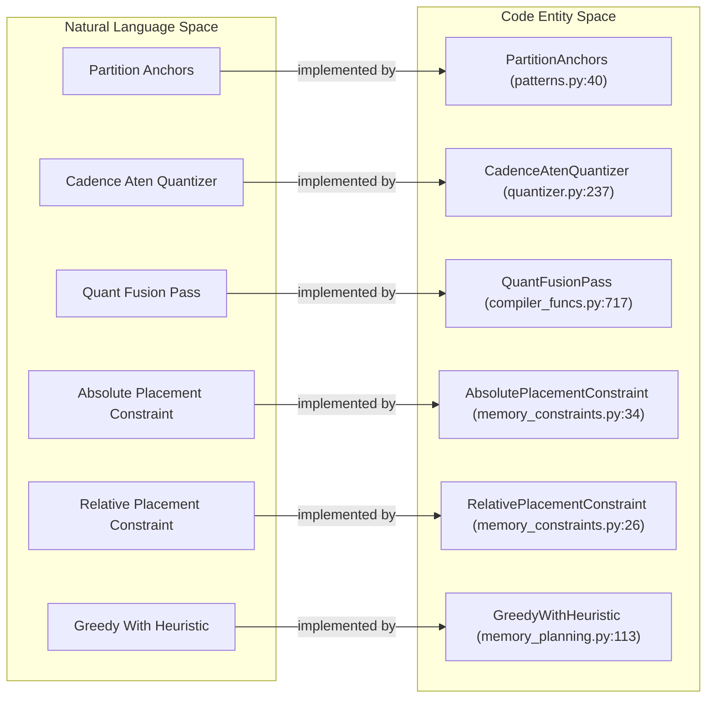
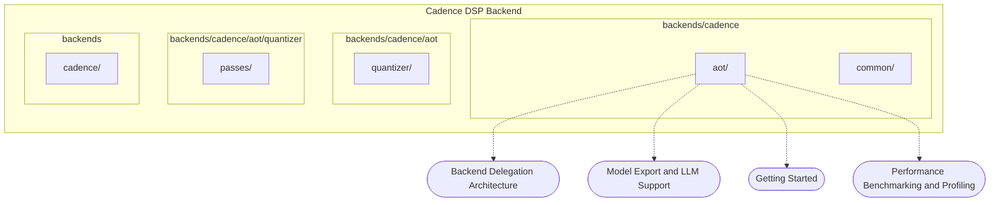
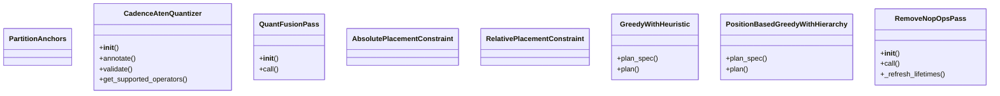
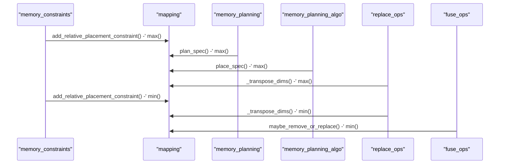

# Cadence DSP Backend

↑ [[5-backend-delegation-architecture|Backend Delegation Architecture]]

> Architectural specification and implementation reference for Cadence DSP Backend (36 relevant source files). Primary code entities: `QuantFusionPass`, `__init__`, `call`, `QuantizedInputWrapper`, `MemoryPlanningAlgo`.

<details>
<summary>Relevant source files</summary>

The following files were used as context for generating this wiki page:

- [backends/cadence/aot/compiler_funcs.py](backends/cadence/aot/compiler_funcs.py)
- [backends/cadence/aot/memory_planning_algo.py](backends/cadence/aot/memory_planning_algo.py)
- [backends/cadence/aot/memory_planning.py](backends/cadence/aot/memory_planning.py)
- [backends/cadence/aot/memory_constraints.py](backends/cadence/aot/memory_constraints.py)
- [backends/cadence/aot/compiler.py](backends/cadence/aot/compiler.py)
- [backends/cadence/aot/fuse_ops.py](backends/cadence/aot/fuse_ops.py)
- [backends/cadence/aot/ref_implementations.py](backends/cadence/aot/ref_implementations.py)
- [backends/cadence/aot/decompose_ops.py](backends/cadence/aot/decompose_ops.py)
- [backends/cadence/aot/quantizer/quantizer.py](backends/cadence/aot/quantizer/quantizer.py)
- [backends/cadence/aot/quantizer/fusion_pass.py](backends/cadence/aot/quantizer/fusion_pass.py)
- [backends/cadence/aot/passes.py](backends/cadence/aot/passes.py)
- [backends/cadence/aot/pass_utils.py](backends/cadence/aot/pass_utils.py)
- [backends/cadence/aot/compiler_utils.py](backends/cadence/aot/compiler_utils.py)
- [backends/cadence/aot/remove_ops.py](backends/cadence/aot/remove_ops.py)
- [backends/cadence/aot/replace_ops.py](backends/cadence/aot/replace_ops.py)
- [backends/cadence/aot/quantizer/patterns.py](backends/cadence/aot/quantizer/patterns.py)
- [backends/cadence/aot/reorder_ops.py](backends/cadence/aot/reorder_ops.py)
- [backends/cadence/aot/__init__.py](backends/cadence/aot/__init__.py)
- [backends/cadence/aot/utils.py](backends/cadence/aot/utils.py)
- [backends/cadence/aot/quantizer/pattern_utils.py](backends/cadence/aot/quantizer/pattern_utils.py)
- [backends/cadence/aot/ops_registrations.py](backends/cadence/aot/ops_registrations.py)
- [backends/cadence/aot/export_example.py](backends/cadence/aot/export_example.py)
- [backends/cadence/aot/quantizer/passes/fuse_ops.py](backends/cadence/aot/quantizer/passes/fuse_ops.py)
- [backends/cadence/aot/simplify_ops.py](backends/cadence/aot/simplify_ops.py)
- [backends/cadence/aot/graph_builder.py](backends/cadence/aot/graph_builder.py)
- [backends/cadence/aot/weight_packing.py](backends/cadence/aot/weight_packing.py)
- [backends/cadence/aot/to_out_var_pass.py](backends/cadence/aot/to_out_var_pass.py)
- [backends/cadence/aot/type_dispatch.py](backends/cadence/aot/type_dispatch.py)
- [backends/cadence/README.md](backends/cadence/README.md)
- [docs/source/backends-cadence.md](docs/source/backends-cadence.md)
- [backends/cadence/CMakeLists.txt](backends/cadence/CMakeLists.txt)
- [backends/cadence/aot/BUCK](backends/cadence/aot/BUCK)
- [backends/cadence/aot/quantizer/BUCK](backends/cadence/aot/quantizer/BUCK)
- [backends/cadence/cadence.cmake](backends/cadence/cadence.cmake)
- [backends/cadence/aot/quantizer/passes/BUCK](backends/cadence/aot/quantizer/passes/BUCK)

</details>

## Purpose and Scope

Architectural specification and implementation reference for Cadence DSP Backend (36 relevant source files). Primary code entities: `QuantFusionPass`, `__init__`, `call`, `QuantizedInputWrapper`, `MemoryPlanningAlgo`.

Primary code entities analyzed on this page include `PartitionAnchors` ([backends/cadence/aot/quantizer/patterns.py:40-71]()), `CadenceAtenQuantizer` ([backends/cadence/aot/quantizer/quantizer.py:237-338]()), `QuantFusionPass` ([backends/cadence/aot/compiler_funcs.py:717-758]()), `AbsolutePlacementConstraint` ([backends/cadence/aot/memory_constraints.py:34-40]()), `RelativePlacementConstraint` ([backends/cadence/aot/memory_constraints.py:26-30]()).

For the parent architectural layer, see [[5-backend-delegation-architecture|Backend Delegation Architecture]]. Related sibling subsystems: [[5.1-partitioning-and-operator-support|Partitioning and Operator Support]], [[5.2-vulkan-gpu-backend|Vulkan GPU Backend]], [[5.3-qualcomm-qnn-backend|Qualcomm QNN Backend]], [[5.4-arm-tosa-and-ethos-u-backend|ARM TOSA and Ethos-U Backend]].

Sources: [backends/cadence/aot/quantizer/patterns.py:40-71](), [backends/cadence/aot/quantizer/quantizer.py:237-338](), [backends/cadence/aot/compiler_funcs.py:717-758](), [backends/cadence/aot/memory_constraints.py:34-40]()

---

## 1. High-Level Architecture and Data Flow

### Natural Language Space to Code Entity Space Mapping

The following diagram maps domain concepts in this subsystem to their concrete code entities:



### Subsystem Component & Dependency Flow



Cross-subsystem call and import edges connect **Cadence DSP Backend** with [[5-backend-delegation-architecture|Backend Delegation Architecture]] (coupling `11.0`), [[5.4-arm-tosa-and-ethos-u-backend|ARM TOSA and Ethos-U Backend]] (coupling `11.0`), [[7.2-model-and-backend-testing-framework|Model and Backend Testing Framework]] (coupling `3.0`), [[6-model-export-and-llm-support|Model Export and LLM Support]] (coupling `2.0`), [[6.1-llama-model-export|LLaMA and Generative Model Export]] (coupling `2.0`).

| Module Directory | Files | Primary Code Entities | Source Citations |
|---|---|---|---|
| `backends/cadence/aot` | 24 | `QuantFusionPass`, `AbsolutePlacementConstraint`, `RelativePlacementConstraint`, `GreedyWithHeuristic` | [backends/cadence/aot/compiler_funcs.py:717-758]() [backends/cadence/aot/memory_constraints.py:34-40]() |
| `backends/cadence/aot/quantizer` | 5 | `PartitionAnchors`, `CadenceAtenQuantizer`, `CadenceFusedConvReluQuantizer`, `CadenceDefaultQuantizer` | [backends/cadence/aot/quantizer/patterns.py:40-71]() [backends/cadence/aot/quantizer/quantizer.py:237-338]() |
| `backends/cadence` | 3 | *(build / config)* | [backends/cadence/README.md]() |
| `backends/cadence/aot/quantizer/passes` | 2 | `FuseQATConvBN`, `_fold_qat_chains`, `_match_qat_chain`, `_compute_folded_bias` | [backends/cadence/aot/quantizer/passes/fuse_ops.py:125-391]() [backends/cadence/aot/quantizer/passes/fuse_ops.py:190-241]() |
| `backends/cadence/common` | 1 | *(build / config)* | [backends/cadence/common/BUCK]() |

Sources: [backends/cadence/aot/quantizer/patterns.py:40-71](), [backends/cadence/aot/quantizer/quantizer.py:237-338](), [backends/cadence/aot/compiler_funcs.py:717-758](), [backends/cadence/aot/memory_constraints.py:34-40](), [backends/cadence/aot/memory_constraints.py:26-30]()

---

## 2. Core Data Structures and Implementation Details

### Class and Entity Relationship Diagram



### `PartitionAnchors` (Class)

- **Source Location**: [backends/cadence/aot/quantizer/patterns.py:40-71]()
- **Declaration**: `Class PartitionAnchors`
- **Graph Centrality**: fan-in `20` callers, fan-out `0` callees
- **Responsibility**: All fields except output are lists of (node, args_index) pair, where node is from the given partition and node.args[args_index] is an input to the partition. Assumes a single output. Quantizer uses inputs, weights and biases for quantization annotation. The others field contains tensor inputs that aren't quantized, and

```python
// backends/cadence/aot/quantizer/patterns.py:40-55
class PartitionAnchors:
    """
    All fields except output are lists of (node, args_index) pair, where node is from
    the given partition and node.args[args_index] is an input to the partition. Assumes
    a single output.

    Quantizer uses inputs, weights and biases for quantization annotation. The others
    field contains tensor inputs that aren't quantized, and the literals fields contains
    is used for other types of input values as well as handling default parameters.
    """

    # Inputs can share quantization parameters
    inputs: List[
        Union[
            Tuple[fx.Node, Union[int, Tuple[int, int]]],
            Tuple[
```

### `CadenceAtenQuantizer` (Class)

- **Source Location**: [backends/cadence/aot/quantizer/quantizer.py:237-338]()
- **Declaration**: `Class CadenceAtenQuantizer`
- **Graph Centrality**: fan-in `10` callers, fan-out `0` callees

```python
// backends/cadence/aot/quantizer/quantizer.py:237-252
class CadenceAtenQuantizer(Quantizer):
    def __init__(
        self, pattern: QuantizationPattern, quantization_config: QuantizationConfig
    ) -> None:
        super().__init__()
        self.pattern = pattern
        self.quantization_config = quantization_config

    def annotate(self, model: torch.fx.GraphModule) -> torch.fx.GraphModule:
        fused_partitions = find_sequential_partitions_aten(
            model,
            self.pattern.partition_types(),
        )

        input_act_qspec = self.quantization_config.input_activation
        weight_qspec = self.quantization_config.weight
```

### `QuantFusionPass` (Class)

- **Source Location**: [backends/cadence/aot/compiler_funcs.py:717-758]()
- **Declaration**: `Class QuantFusionPass`
- **Graph Centrality**: fan-in `2` callers, fan-out `0` callees
- **Responsibility**: Iterates patterns, finds anchor ops in the converted graph, and calls pattern.fuse() to replace dq-op-q subgraphs with fused ops. ``exported_program`` is optional but required for per-channel weights: fusion has to read the weight scale vector and materialize the derived qparam tensors, and by this point both live in t

```python
// backends/cadence/aot/compiler_funcs.py:717-732
class QuantFusionPass(PassBase):
    """
    Iterates patterns, finds anchor ops in the converted graph, and calls
    pattern.fuse() to replace dq-op-q subgraphs with fused ops.

    ``exported_program`` is optional but required for per-channel weights:
    fusion has to read the weight scale vector and materialize the derived
    qparam tensors, and by this point both live in the program's constants
    rather than in the graph.
    """

    def __init__(
        self,
        patterns: Sequence[object],
        exported_program: Optional[ExportedProgram] = None,
    ) -> None:
```

### `AbsolutePlacementConstraint` (Class)

- **Source Location**: [backends/cadence/aot/memory_constraints.py:34-40]()
- **Declaration**: `Class AbsolutePlacementConstraint`
- **Graph Centrality**: fan-in `1` callers, fan-out `0` callees
- **Responsibility**: Information on placement constraint memory id and offset.

### `RelativePlacementConstraint` (Class)

- **Source Location**: [backends/cadence/aot/memory_constraints.py:26-30]()
- **Declaration**: `Class RelativePlacementConstraint`
- **Graph Centrality**: fan-in `1` callers, fan-out `0` callees
- **Responsibility**: Information of source node and offset used for views.

### `add_relative_placement_constraint` (Method)

- **Source Location**: [backends/cadence/aot/memory_constraints.py:242-301]()
- **Declaration**: `( self, source: torch.fx.Node, dependent: torch.fx.Node, offset: int = 0, update_lifetime: bool = True, )`
- **Graph Centrality**: fan-in `4` callers, fan-out `9` callees
- **Responsibility**: Add a location constraint between source and dependent nodes. The imperative is that both the nodes are tensors. The constraint generated will imply that shadow tensor is at a distance `offset` from representative tensor.

Sources: [backends/cadence/aot/quantizer/patterns.py:40-71](), [backends/cadence/aot/quantizer/quantizer.py:237-338](), [backends/cadence/aot/compiler_funcs.py:717-758](), [backends/cadence/aot/memory_constraints.py:34-40](), [backends/cadence/aot/memory_constraints.py:26-30]()

---

## 3. Execution and Call Flow

The sequence diagram below traces the runtime/compile-time call chain across components in this module:



Sources: [backends/cadence/aot/quantizer/patterns.py:40-71](), [backends/cadence/aot/quantizer/quantizer.py:237-338](), [backends/cadence/aot/compiler_funcs.py:717-758](), [backends/cadence/aot/memory_constraints.py:34-40](), [backends/cadence/aot/memory_constraints.py:26-30]()

---

## 4. Key API and Symbol Reference

| Code Entity | Kind | Location | Fan-In / Out | Role & Signature |
|---|---|---|---|---|
| `PartitionAnchors` | Class | [backends/cadence/aot/quantizer/patterns.py:40-71]() | `20` / `0` | All fields except output are lists of (node, args_index) pair, where node is from |
| `CadenceAtenQuantizer` | Class | [backends/cadence/aot/quantizer/quantizer.py:237-338]() | `10` / `0` | — |
| `QuantFusionPass` | Class | [backends/cadence/aot/compiler_funcs.py:717-758]() | `2` / `0` | Iterates patterns, finds anchor ops in the converted graph, and calls |
| `AbsolutePlacementConstraint` | Class | [backends/cadence/aot/memory_constraints.py:34-40]() | `1` / `0` | Information on placement constraint memory id and offset. |
| `RelativePlacementConstraint` | Class | [backends/cadence/aot/memory_constraints.py:26-30]() | `1` / `0` | Information of source node and offset used for views. |
| `GreedyWithHeuristic` | Class | [backends/cadence/aot/memory_planning.py:113-193]() | `1` / `0` | Greedy tensor placement with the heuristics from arxiv.org/pdf/2001.03288.pdf. |
| `PositionBasedGreedyWithHierarchy` | Class | [backends/cadence/aot/memory_planning.py:62-110]() | `1` / `0` | Greedily place tensor in the fastest memory available. |
| `RemoveNopOpsPass` | Class | [backends/cadence/aot/memory_planning.py:372-451]() | `1` / `0` | Erase the cat/slice/select nop nodes once memory planning is done. |
| `QuantizedInputWrapper` | Class | [backends/cadence/aot/compiler_funcs.py:329-475]() | `0` / `0` | Wrapper that allows a quantized model to accept quantized inputs. |
| `QuantizedOutputWrapper` | Class | [backends/cadence/aot/compiler_funcs.py:478-533]() | `0` / `0` | Wrapper that quantizes a model's output(s) so they produce quantized tensors. |
| `MemoryPlanningAlgo` | Class | [backends/cadence/aot/memory_planning_algo.py:83-342]() | `0` / `0` | Callable memory planning algorithm interface. |
| `GenerateCatNopConstraints` | Class | [backends/cadence/aot/memory_constraints.py:395-573]() | `0` / `0` | For cat op where the concatenation is along the outermost dimension, generate |
| `GenerateMemConstraints` | Class | [backends/cadence/aot/memory_constraints.py:695-727]() | `0` / `0` | # The class to generate all the constraints that will be passed on to the memory |
| `GenerateMemoryViewConstraints` | Class | [backends/cadence/aot/memory_constraints.py:576-589]() | `0` / `0` | For memory.view ops, where input and output use the same underlying memory, |
| `GenerateSliceAndSelectNopConstraints` | Class | [backends/cadence/aot/memory_constraints.py:592-684]() | `0` / `0` | For slice ops, where the slice is along the outermost dimension, generate |
| `MemConstraints` | Class | [backends/cadence/aot/memory_constraints.py:43-327]() | `0` / `0` | This class contains all the tensor placement constraints that we create |
| `FuseBatchNormWithConv` | Class | [backends/cadence/aot/fuse_ops.py:213-358]() | `0` / `0` | This pass fuses a conv op with batchnorm if the following two conditions |
| `FuseFullThenReshapePass` | Class | [backends/cadence/aot/fuse_ops.py:824-874]() | `0` / `0` | A pass that fuses a chain of full and reshape-like operations into a single full operation. |
| `FuseMMWithAdd` | Class | [backends/cadence/aot/fuse_ops.py:63-210]() | `0` / `0` | Fuses mm -> add patterns into addmm. |
| `FuseMulScalarIntoDequantPass` | Class | [backends/cadence/aot/fuse_ops.py:618-664]() | `0` / `0` | Looks for the pattern where aten.mul.Scalar is multiplying the |
| `FuseMulTensorIntoDequantPass` | Class | [backends/cadence/aot/fuse_ops.py:750-810]() | `0` / `0` | Looks for the pattern where aten.mul is multiplying the outputs of dequantize |
| `FuseMulTensorIntoQuantPass` | Class | [backends/cadence/aot/fuse_ops.py:667-747]() | `0` / `0` | Looks for the pattern where aten.mul.Tensor is followed by quant node. |

Sources: [backends/cadence/aot/quantizer/patterns.py:40-71](), [backends/cadence/aot/quantizer/quantizer.py:237-338](), [backends/cadence/aot/compiler_funcs.py:717-758](), [backends/cadence/aot/memory_constraints.py:34-40](), [backends/cadence/aot/memory_constraints.py:26-30](), [backends/cadence/aot/memory_planning.py:113-193]()

---

## 5. Official Documentation and Design Context

The following linked documentation sections from `llm-wiki` (`raw/`) provide additional architectural context, tutorials, and design invariants for this subsystem:

- **Backend Delegation Architecture** ([wiki/5-backend-delegation-architecture.md](), score `110.7921`) (sections: `Backend Delegation Architecture`, `Purpose and Scope`, `System Mapping: Natural Language Space to Code Entity Space`, `1. Partitioning and Operator Support`): # Backend Delegation Architecture > Architectural specification and implementation reference for Backend Delegation Architecture (40 relevant source files). Primary code entities: `CommandBuffer`, `begin`, `bind_descriptors`, `bind_pipeline`, `NodeVisitor`. <details> <summary>Relevant source files</summary> The following files were used as context for generating this wiki page: - [backends/vulkan/runtime/vk_api/Comma
- **Quantization Systems** ([wiki/4-quantization-systems.md](), score `100.2749`) (sections: `Quantization Systems`, `Purpose and Scope`, `System Mapping: Natural Language Space to Code Entity Space`, `1. Quantization Framework and Patterns`): # Quantization Systems > Architectural specification and implementation reference for Quantization Systems (38 relevant source files). Primary code entities: `NeonQuantizeTraits<int8_t>`, `clamp_scalar`, `narrow_and_saturate`, `store`, `QuantizeInputs`. <details> <summary>Relevant source files</summary> The following files were used as context for generating this wiki page: - [kernels/quantized/cpu/op_quantize.cpp](k
- **Backend-Specific Quantization** ([wiki/4.2-backend-specific-quantization.md](), score `100.0698`) (sections: `Backend-Specific Quantization`, `Purpose and Scope`, `1. High-Level Architecture and Data Flow`, `Natural Language Space to Code Entity Space Mapping`): # Backend-Specific Quantization ↑ [[4-quantization-systems|Quantization Systems]] > Architectural specification and implementation reference for Backend-Specific Quantization (35 relevant source files). Primary code entities: `NodeFinder`, `find_nodes`, `PatternCheck`, `check_pattern`, `EthosUQuantizer`. <details> <summary>Relevant source files</summary> The following files were used as context for generating this wi
- **ExecuTorch DeepWiki** ([wiki/index.md](), score `93.5267`) (sections: `ExecuTorch DeepWiki`, `Pages`): # ExecuTorch DeepWiki Generated from `home-jason-Project-deepwiki-executorch` at commit `b3b565b5b62f` (2026-11-15T15:02:11+00:00). ## Pages - [[1-overview|Overview]] — Architectural specification and implementation reference for Overview (10 relevant source files). Primary code entities: `Module`, `MethodHolder`, `PlannedMemory`, `EdgeProgramManager`, `__init__`. - [[1.1-getting-started|Getting Started]] — Architect

Sources: [wiki/5-backend-delegation-architecture.md](), [wiki/4-quantization-systems.md](), [wiki/4.2-backend-specific-quantization.md](), [wiki/index.md]()

## Related pages

- [[5-backend-delegation-architecture|Backend Delegation Architecture]]
- [[1.1-getting-started|Getting Started]]
- [[1.2-export-api-and-recipe-system|Export API and Recipe System]]
- [[2.2-kernel-libraries-and-selective-build|Kernel Libraries and Selective Build]]
- [[2.3-schema-generation-and-flatbuffers|Schema Generation and FlatBuffers]]
- [[3.4-program-emission-and-serialization|Program Emission and Serialization]]
- [[3.5-verification-and-dialect-system|Verification and Dialect System]]
- [[4-quantization-systems|Quantization Systems]]

## Related documents

- `wiki/5-backend-delegation-architecture.md` — Backend Delegation Architecture (score 110.7921, via bm25)
- `wiki/4-quantization-systems.md` — Quantization Systems (score 100.2749, via bm25)
- `wiki/4.2-backend-specific-quantization.md` — Backend-Specific Quantization (score 100.0698, via bm25)
- `wiki/index.md` — ExecuTorch DeepWiki (score 93.5267, via bm25)
- `wiki/5.3-qualcomm-qnn-backend.md` — Qualcomm QNN Backend (score 74.4078, via bm25)

## Sources

- [`backends/cadence/aot/compiler_funcs.py`](https://github.com/pytorch/executorch/blob/main/backends/cadence/aot/compiler_funcs.py)
- [`backends/cadence/aot/memory_planning_algo.py`](https://github.com/pytorch/executorch/blob/main/backends/cadence/aot/memory_planning_algo.py)
- [`backends/cadence/aot/memory_planning.py`](https://github.com/pytorch/executorch/blob/main/backends/cadence/aot/memory_planning.py)
- [`backends/cadence/aot/memory_constraints.py`](https://github.com/pytorch/executorch/blob/main/backends/cadence/aot/memory_constraints.py)
- [`backends/cadence/aot/compiler.py`](https://github.com/pytorch/executorch/blob/main/backends/cadence/aot/compiler.py)
- [`backends/cadence/aot/fuse_ops.py`](https://github.com/pytorch/executorch/blob/main/backends/cadence/aot/fuse_ops.py)
- [`backends/cadence/aot/ref_implementations.py`](https://github.com/pytorch/executorch/blob/main/backends/cadence/aot/ref_implementations.py)
- [`backends/cadence/aot/decompose_ops.py`](https://github.com/pytorch/executorch/blob/main/backends/cadence/aot/decompose_ops.py)
- [`backends/cadence/aot/quantizer/quantizer.py`](https://github.com/pytorch/executorch/blob/main/backends/cadence/aot/quantizer/quantizer.py)
- [`backends/cadence/aot/quantizer/fusion_pass.py`](https://github.com/pytorch/executorch/blob/main/backends/cadence/aot/quantizer/fusion_pass.py)
- [`backends/cadence/aot/passes.py`](https://github.com/pytorch/executorch/blob/main/backends/cadence/aot/passes.py)
- [`backends/cadence/aot/pass_utils.py`](https://github.com/pytorch/executorch/blob/main/backends/cadence/aot/pass_utils.py)
- [`backends/cadence/aot/compiler_utils.py`](https://github.com/pytorch/executorch/blob/main/backends/cadence/aot/compiler_utils.py)
- [`backends/cadence/aot/remove_ops.py`](https://github.com/pytorch/executorch/blob/main/backends/cadence/aot/remove_ops.py)
- [`backends/cadence/aot/replace_ops.py`](https://github.com/pytorch/executorch/blob/main/backends/cadence/aot/replace_ops.py)
- [`backends/cadence/aot/quantizer/patterns.py`](https://github.com/pytorch/executorch/blob/main/backends/cadence/aot/quantizer/patterns.py)
- [`backends/cadence/aot/reorder_ops.py`](https://github.com/pytorch/executorch/blob/main/backends/cadence/aot/reorder_ops.py)
- [`backends/cadence/aot/__init__.py`](https://github.com/pytorch/executorch/blob/main/backends/cadence/aot/__init__.py)
- [`backends/cadence/aot/utils.py`](https://github.com/pytorch/executorch/blob/main/backends/cadence/aot/utils.py)
- [`backends/cadence/aot/quantizer/pattern_utils.py`](https://github.com/pytorch/executorch/blob/main/backends/cadence/aot/quantizer/pattern_utils.py)
- [`backends/cadence/aot/ops_registrations.py`](https://github.com/pytorch/executorch/blob/main/backends/cadence/aot/ops_registrations.py)
- [`backends/cadence/aot/export_example.py`](https://github.com/pytorch/executorch/blob/main/backends/cadence/aot/export_example.py)
- [`backends/cadence/aot/quantizer/passes/fuse_ops.py`](https://github.com/pytorch/executorch/blob/main/backends/cadence/aot/quantizer/passes/fuse_ops.py)
- [`backends/cadence/aot/simplify_ops.py`](https://github.com/pytorch/executorch/blob/main/backends/cadence/aot/simplify_ops.py)
- [`backends/cadence/aot/graph_builder.py`](https://github.com/pytorch/executorch/blob/main/backends/cadence/aot/graph_builder.py)
- [`backends/cadence/aot/weight_packing.py`](https://github.com/pytorch/executorch/blob/main/backends/cadence/aot/weight_packing.py)
- [`backends/cadence/aot/to_out_var_pass.py`](https://github.com/pytorch/executorch/blob/main/backends/cadence/aot/to_out_var_pass.py)
- [`backends/cadence/aot/type_dispatch.py`](https://github.com/pytorch/executorch/blob/main/backends/cadence/aot/type_dispatch.py)
- [`backends/cadence/README.md`](https://github.com/pytorch/executorch/blob/main/backends/cadence/README.md)
- [`docs/source/backends-cadence.md`](https://github.com/pytorch/executorch/blob/main/docs/source/backends-cadence.md)
- [`backends/cadence/CMakeLists.txt`](https://github.com/pytorch/executorch/blob/main/backends/cadence/CMakeLists.txt)
- [`backends/cadence/aot/BUCK`](https://github.com/pytorch/executorch/blob/main/backends/cadence/aot/BUCK)
- [`backends/cadence/aot/quantizer/BUCK`](https://github.com/pytorch/executorch/blob/main/backends/cadence/aot/quantizer/BUCK)
- [`backends/cadence/cadence.cmake`](https://github.com/pytorch/executorch/blob/main/backends/cadence/cadence.cmake)
- [`backends/cadence/aot/quantizer/passes/BUCK`](https://github.com/pytorch/executorch/blob/main/backends/cadence/aot/quantizer/passes/BUCK)
- [`backends/cadence/common/BUCK`](https://github.com/pytorch/executorch/blob/main/backends/cadence/common/BUCK)


## Dynamic Knowledge Links (Code Graph ↔ LLM-Wiki / RAG)

### Linked Architecture & Design Documents

| Document | Match Channel | Score | Shared Code Symbols |
|---|---|---|---|
| [[5.1-partitioning-and-operator-support|Partitioning and Operator Support]] | `wikilink:5.5-cadence-dsp-backend` | `112.758` | *(lexical/graph match)* |
| [[5.2-vulkan-gpu-backend|Vulkan GPU Backend]] | `wikilink:5.5-cadence-dsp-backend` | `112.758` | *(lexical/graph match)* |
| [[5.4-arm-tosa-and-ethos-u-backend|ARM TOSA and Ethos-U Backend]] | `wikilink:5.5-cadence-dsp-backend` | `112.758` | *(lexical/graph match)* |
| [[5-backend-delegation-architecture|Backend Delegation Architecture]] | `bm25+entity(1)` | `112.292` | `PartitionAnchors` |
| [[4.2-backend-specific-quantization|Backend-Specific Quantization]] | `bm25+entity(2)` | `103.07` | `CadenceAtenQuantizer`, `PartitionAnchors` |
| [[4-quantization-systems|Quantization Systems]] | `bm25+entity(1)` | `101.775` | `PartitionAnchors` |

### High-Centrality Bridge Symbols (CBM Graph)

| Symbol | Kind | Source Location | Fan-In / Fan-Out |
|---|---|---|---|
| `PartitionAnchors` | Class | [backends/cadence/aot/quantizer/patterns.py:40-71]() | in: `20` / out: `0` |
| `CadenceAtenQuantizer` | Class | [backends/cadence/aot/quantizer/quantizer.py:237-338]() | in: `10` / out: `0` |
| `QuantFusionPass` | Class | [backends/cadence/aot/compiler_funcs.py:717-758]() | in: `2` / out: `0` |
| `AbsolutePlacementConstraint` | Class | [backends/cadence/aot/memory_constraints.py:34-40]() | in: `1` / out: `0` |
| `RelativePlacementConstraint` | Class | [backends/cadence/aot/memory_constraints.py:26-30]() | in: `1` / out: `0` |
| `GreedyWithHeuristic` | Class | [backends/cadence/aot/memory_planning.py:113-193]() | in: `1` / out: `0` |

Sources: [backends/cadence/aot/quantizer/patterns.py:40-71](), [backends/cadence/aot/quantizer/quantizer.py:237-338](), [backends/cadence/aot/compiler_funcs.py:717-758](), [backends/cadence/aot/memory_constraints.py:34-40]()

### Cross-Subsystem Coupling

- [[5-backend-delegation-architecture|Backend Delegation Architecture]] — call/import coupling weight `11.0`
- [[5.4-arm-tosa-and-ethos-u-backend|ARM TOSA and Ethos-U Backend]] — call/import coupling weight `11.0`
- [[7.2-model-and-backend-testing-framework|Model and Backend Testing Framework]] — call/import coupling weight `3.0`
- [[6-model-export-and-llm-support|Model Export and LLM Support]] — call/import coupling weight `2.0`
- [[6.1-llama-model-export|LLaMA and Generative Model Export]] — call/import coupling weight `2.0`
- [[1.1-getting-started|Getting Started]] — call/import coupling weight `2.0`
