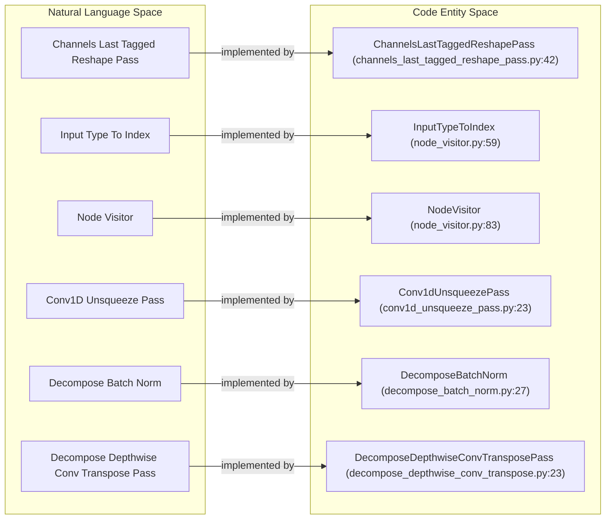
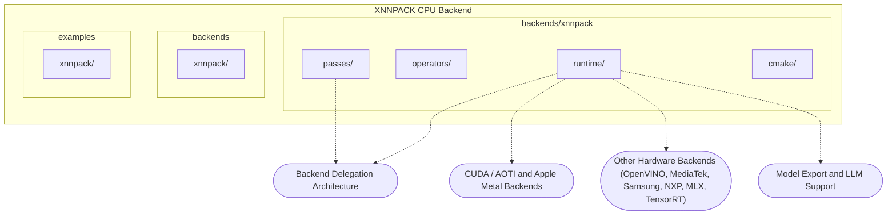
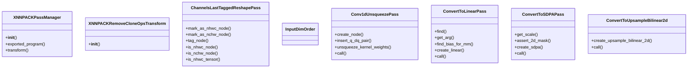
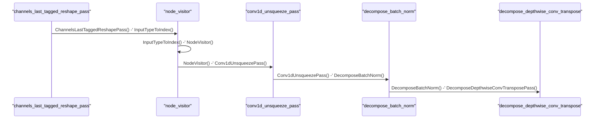

# XNNPACK CPU Backend

↑ [[5-backend-delegation-architecture|Backend Delegation Architecture]]

> Architectural specification and implementation reference for XNNPACK CPU Backend (36 relevant source files). Primary code entities: `ChannelsLastTaggedReshapePass`, `_is_nhwc`, `call`, `can_be_converted_to_nhwc`, `InputTypeToIndex`.

<details>
<summary>Relevant source files</summary>

The following files were used as context for generating this wiki page:

- [backends/xnnpack/_passes/channels_last_tagged_reshape_pass.py](backends/xnnpack/_passes/channels_last_tagged_reshape_pass.py)
- [backends/xnnpack/operators/node_visitor.py](backends/xnnpack/operators/node_visitor.py)
- [backends/xnnpack/_passes/conv1d_unsqueeze_pass.py](backends/xnnpack/_passes/conv1d_unsqueeze_pass.py)
- [backends/xnnpack/_passes/convert_to_linear.py](backends/xnnpack/_passes/convert_to_linear.py)
- [backends/xnnpack/_passes/__init__.py](backends/xnnpack/_passes/__init__.py)
- [backends/xnnpack/_passes/convert_to_sdpa.py](backends/xnnpack/_passes/convert_to_sdpa.py)
- [backends/xnnpack/_passes/decompose_batch_norm.py](backends/xnnpack/_passes/decompose_batch_norm.py)
- [backends/xnnpack/_passes/decompose_depthwise_conv_transpose.py](backends/xnnpack/_passes/decompose_depthwise_conv_transpose.py)
- [backends/xnnpack/runtime/XNNWeightsCache.h](backends/xnnpack/runtime/XNNWeightsCache.h)
- [backends/xnnpack/_passes/convert_to_upsample_bilinear2d.py](backends/xnnpack/_passes/convert_to_upsample_bilinear2d.py)
- [backends/xnnpack/_passes/fuse_activation_pass.py](backends/xnnpack/_passes/fuse_activation_pass.py)
- [backends/xnnpack/_passes/decompose_cat.py](backends/xnnpack/_passes/decompose_cat.py)
- [backends/xnnpack/_passes/fuse_batch_norm.py](backends/xnnpack/_passes/fuse_batch_norm.py)
- [backends/xnnpack/_passes/fuse_pad_into_conv_pass.py](backends/xnnpack/_passes/fuse_pad_into_conv_pass.py)
- [backends/xnnpack/_passes/fold_computed_params.py](backends/xnnpack/_passes/fold_computed_params.py)
- [backends/xnnpack/__init__.py](backends/xnnpack/__init__.py)
- [backends/xnnpack/_passes/remove_redundant_copy_pass.py](backends/xnnpack/_passes/remove_redundant_copy_pass.py)
- [backends/xnnpack/_passes/insert_pad_qdq.py](backends/xnnpack/_passes/insert_pad_qdq.py)
- [backends/xnnpack/_passes/prelu_reshape_pass.py](backends/xnnpack/_passes/prelu_reshape_pass.py)
- [backends/xnnpack/_passes/remove_noop_expand_copy_pass.py](backends/xnnpack/_passes/remove_noop_expand_copy_pass.py)
- [backends/xnnpack/_passes/propagate_custom_meta_pass.py](backends/xnnpack/_passes/propagate_custom_meta_pass.py)
- [backends/xnnpack/_passes/rewrite_fp16_silu.py](backends/xnnpack/_passes/rewrite_fp16_silu.py)
- [backends/xnnpack/_passes/xnnpack_pass.py](backends/xnnpack/_passes/xnnpack_pass.py)
- [backends/xnnpack/operators/op_abs.py](backends/xnnpack/operators/op_abs.py)
- [backends/xnnpack/operators/op_add.py](backends/xnnpack/operators/op_add.py)
- [backends/xnnpack/operators/op_addmm.py](backends/xnnpack/operators/op_addmm.py)
- [backends/xnnpack/operators/op_avg_pooling2d.py](backends/xnnpack/operators/op_avg_pooling2d.py)
- [backends/xnnpack/runtime/XNNCompiler.cpp](backends/xnnpack/runtime/XNNCompiler.cpp)
- [backends/xnnpack/README.md](backends/xnnpack/README.md)
- [examples/xnnpack/README.md](examples/xnnpack/README.md)
- [backends/xnnpack/BUCK](backends/xnnpack/BUCK)
- [backends/xnnpack/CMakeLists.txt](backends/xnnpack/CMakeLists.txt)
- [backends/xnnpack/_passes/BUCK](backends/xnnpack/_passes/BUCK)
- [backends/xnnpack/cmake/Dependencies.cmake](backends/xnnpack/cmake/Dependencies.cmake)
- [backends/xnnpack/operators/BUCK](backends/xnnpack/operators/BUCK)

</details>

## Purpose and Scope

Architectural specification and implementation reference for XNNPACK CPU Backend (36 relevant source files). Primary code entities: `ChannelsLastTaggedReshapePass`, `_is_nhwc`, `call`, `can_be_converted_to_nhwc`, `InputTypeToIndex`.

Primary code entities analyzed on this page include `ChannelsLastTaggedReshapePass` ([backends/xnnpack/_passes/channels_last_tagged_reshape_pass.py:42-753]()), `InputTypeToIndex` ([backends/xnnpack/operators/node_visitor.py:59-70]()), `NodeVisitor` ([backends/xnnpack/operators/node_visitor.py:83-752]()), `Conv1dUnsqueezePass` ([backends/xnnpack/_passes/conv1d_unsqueeze_pass.py:23-206]()), `DecomposeBatchNorm` ([backends/xnnpack/_passes/decompose_batch_norm.py:27-294]()).

For the parent architectural layer, see [[5-backend-delegation-architecture|Backend Delegation Architecture]]. Related sibling subsystems: [[5.1-partitioning-and-operator-support|Partitioning and Operator Support]], [[5.2-vulkan-gpu-backend|Vulkan GPU Backend]], [[5.3-qualcomm-qnn-backend|Qualcomm QNN Backend]], [[5.4-arm-tosa-and-ethos-u-backend|ARM TOSA and Ethos-U Backend]].

Sources: [backends/xnnpack/_passes/channels_last_tagged_reshape_pass.py:42-753](), [backends/xnnpack/operators/node_visitor.py:59-70](), [backends/xnnpack/operators/node_visitor.py:83-752](), [backends/xnnpack/_passes/conv1d_unsqueeze_pass.py:23-206]()

---

## 1. High-Level Architecture and Data Flow

### Natural Language Space to Code Entity Space Mapping

The following diagram maps domain concepts in this subsystem to their concrete code entities:



### Subsystem Component & Dependency Flow



Cross-subsystem call and import edges connect **XNNPACK CPU Backend** with [[5.7-cuda-aoti-and-apple-metal-backends|CUDA / AOTI and Apple Metal Backends]] (coupling `22.0`), [[5.8-other-backends|Other Hardware Backends (OpenVINO, MediaTek, Samsung, NXP, MLX, TensorRT)]] (coupling `9.0`), [[6-model-export-and-llm-support|Model Export and LLM Support]] (coupling `8.0`), [[5-backend-delegation-architecture|Backend Delegation Architecture]] (coupling `5.0`), [[9.1-android-extension|Android Extension (Java/Kotlin & JNI)]] (coupling `5.0`).

| Module Directory | Files | Primary Code Entities | Source Citations |
|---|---|---|---|
| `backends/xnnpack/_passes` | 21 | `ChannelsLastTaggedReshapePass`, `Conv1dUnsqueezePass`, `DecomposeBatchNorm`, `DecomposeDepthwiseConvTransposePass` | [backends/xnnpack/_passes/channels_last_tagged_reshape_pass.py:42-753]() [backends/xnnpack/_passes/conv1d_unsqueeze_pass.py:23-206]() |
| `backends/xnnpack/operators` | 6 | `InputTypeToIndex`, `NodeVisitor`, `AbsVisitor`, `AddVisitor` | [backends/xnnpack/operators/node_visitor.py:59-70]() [backends/xnnpack/operators/node_visitor.py:83-752]() |
| `backends/xnnpack` | 4 | *(build / config)* | [backends/xnnpack/__init__.py]() |
| `backends/xnnpack/runtime` | 2 | `CompileAllocator`, `PackedDataMeta`, `XNNWeightsCache`, `MmapRegion` | [backends/xnnpack/runtime/XNNCompiler.cpp:38-52]() [backends/xnnpack/runtime/XNNWeightsCache.h:37-57]() |
| `examples/xnnpack` | 2 | *(build / config)* | [examples/xnnpack/README.md]() |
| `backends/xnnpack/cmake` | 1 | *(build / config)* | [backends/xnnpack/cmake/Dependencies.cmake]() |

Sources: [backends/xnnpack/_passes/channels_last_tagged_reshape_pass.py:42-753](), [backends/xnnpack/operators/node_visitor.py:59-70](), [backends/xnnpack/operators/node_visitor.py:83-752](), [backends/xnnpack/_passes/conv1d_unsqueeze_pass.py:23-206](), [backends/xnnpack/_passes/decompose_batch_norm.py:27-294]()

---

## 2. Core Data Structures and Implementation Details

### Class and Entity Relationship Diagram



### `ChannelsLastTaggedReshapePass` (Class)

- **Source Location**: [backends/xnnpack/_passes/channels_last_tagged_reshape_pass.py:42-753]()
- **Declaration**: `Class ChannelsLastTaggedReshapePass`
- **Graph Centrality**: fan-in `0` callers, fan-out `0` callees
- **Responsibility**: # TODO(T151254305) use subgraph_rewriter

```python
// backends/xnnpack/_passes/channels_last_tagged_reshape_pass.py:42-57
class ChannelsLastTaggedReshapePass(XNNPACKPass):
    """
    This pass is Internal to XNNPACK only! It is meant to give a new representation
    of the edge graph to be consumed by XNNPACK Preprocess. All added operators
    will be consumed by delegate and turned to delegate blobs.

    Edge IR graph pass to add operator stubs that signal a change in
    memory format from contiguous to channels last. This is to help with
    XNNPACK Delegate to add transpose nodes to change input memory format
    at runtime and run operators in Channels Last Format.

    During this pass, nhwc nodes are not converted back to nchw immediately.
    Instead, they are tagged as nhwc, and this tag is propagated to their
    children which are also kept in nwhc format until a node which requires
    converting back to nchw is encountered.
```

### `InputTypeToIndex` (Class)

- **Source Location**: [backends/xnnpack/operators/node_visitor.py:59-70]()
- **Declaration**: `Class InputTypeToIndex`
- **Graph Centrality**: fan-in `0` callers, fan-out `0` callees
- **Responsibility**: Mapping from input type to the arg index of a node

```python
// backends/xnnpack/operators/node_visitor.py:59-70
class InputTypeToIndex:
    """
    Mapping from input type to the arg index of a node
    """

    node_input: int
    node_weight: int

    def __init__(self, node_input: int, node_weight: int, node_bias=None):
        self.node_input = node_input
        self.node_weight = node_weight
        self.node_bias = node_bias
```

### `NodeVisitor` (Class)

- **Source Location**: [backends/xnnpack/operators/node_visitor.py:83-752]()
- **Declaration**: `Class NodeVisitor`
- **Graph Centrality**: fan-in `0` callers, fan-out `0` callees
- **Responsibility**: Node visitor pattern for visiting nodes in an edge IR graph and serializing them using the xnnpack serialization schema defined

```python
// backends/xnnpack/operators/node_visitor.py:83-98
class NodeVisitor:
    """
    Node visitor pattern for visiting nodes in an edge IR graph and
    serializing them using the xnnpack serialization schema defined
    """

    def __init__(
        self,
        exported_program: ExportedProgram,
        external_ids: Dict,
        named_data_store: NamedDataStore,
    ) -> None:
        self._external_ids = external_ids or {}
        self._exported_program = exported_program or None
        self._named_data_store = named_data_store
```

### `Conv1dUnsqueezePass` (Class)

- **Source Location**: [backends/xnnpack/_passes/conv1d_unsqueeze_pass.py:23-206]()
- **Declaration**: `Class Conv1dUnsqueezePass`
- **Graph Centrality**: fan-in `0` callers, fan-out `0` callees
- **Responsibility**: This pass is used to change conv1d ops into conv2d since xnnpack only supports 2d convolution. This is done by modifying the graph to do the following: 1) unsqueeze the convolution's input from 3d to 4d 2) perform a conv2d (with a modified version of the original conv1d args) 3) squeeze the output back down to 3d.

### `DecomposeBatchNorm` (Class)

- **Source Location**: [backends/xnnpack/_passes/decompose_batch_norm.py:27-294]()
- **Declaration**: `Class DecomposeBatchNorm`
- **Graph Centrality**: fan-in `0` callers, fan-out `0` callees
- **Responsibility**: Decompose batchnorm operators into 1x1 depthwise convolution.

### `get` (Method)

- **Source Location**: [backends/xnnpack/runtime/XNNWeightsCache.h:120-122]()
- **Declaration**: `()`
- **Graph Centrality**: fan-in `68` callers, fan-out `0` callees
- **Responsibility**: /** * Returns XNNPACK's underlying weights_cache pointer */

Sources: [backends/xnnpack/_passes/channels_last_tagged_reshape_pass.py:42-753](), [backends/xnnpack/operators/node_visitor.py:59-70](), [backends/xnnpack/operators/node_visitor.py:83-752](), [backends/xnnpack/_passes/conv1d_unsqueeze_pass.py:23-206](), [backends/xnnpack/_passes/decompose_batch_norm.py:27-294]()

---

## 3. Execution and Call Flow

The sequence diagram below traces the runtime/compile-time call chain across components in this module:



Sources: [backends/xnnpack/_passes/channels_last_tagged_reshape_pass.py:42-753](), [backends/xnnpack/operators/node_visitor.py:59-70](), [backends/xnnpack/operators/node_visitor.py:83-752](), [backends/xnnpack/_passes/conv1d_unsqueeze_pass.py:23-206](), [backends/xnnpack/_passes/decompose_batch_norm.py:27-294]()

---

## 4. Key API and Symbol Reference

| Code Entity | Kind | Location | Fan-In / Out | Role & Signature |
|---|---|---|---|---|
| `ChannelsLastTaggedReshapePass` | Class | [backends/xnnpack/_passes/channels_last_tagged_reshape_pass.py:42-753]() | `0` / `0` | # TODO(T151254305) use subgraph_rewriter |
| `InputTypeToIndex` | Class | [backends/xnnpack/operators/node_visitor.py:59-70]() | `0` / `0` | Mapping from input type to the arg index of a node |
| `NodeVisitor` | Class | [backends/xnnpack/operators/node_visitor.py:83-752]() | `0` / `0` | Node visitor pattern for visiting nodes in an edge IR graph and |
| `Conv1dUnsqueezePass` | Class | [backends/xnnpack/_passes/conv1d_unsqueeze_pass.py:23-206]() | `0` / `0` | This pass is used to change conv1d ops into conv2d since xnnpack only |
| `DecomposeBatchNorm` | Class | [backends/xnnpack/_passes/decompose_batch_norm.py:27-294]() | `0` / `0` | Decompose batchnorm operators into 1x1 depthwise convolution. |
| `DecomposeDepthwiseConvTransposePass` | Class | [backends/xnnpack/_passes/decompose_depthwise_conv_transpose.py:23-230]() | `0` / `0` | Lower a depthwise transposed conv (groups == in_channels == out_channels) |
| `DecomposeConcatenate` | Class | [backends/xnnpack/_passes/decompose_cat.py:23-109]() | `0` / `0` | XNNPACK's Concatenate operation only supports concatenation for <= 5 tensors |
| `FuseActivationPass` | Class | [backends/xnnpack/_passes/fuse_activation_pass.py:18-108]() | `0` / `0` | Some activations like ReLU and hardtanh can be fused with certain operators preceding it. |
| `FuseBatchNormPass` | Class | [backends/xnnpack/_passes/fuse_batch_norm.py:28-294]() | `0` / `0` | BatchNorm can be implemented using 1x1 Depthwise Convolution. However, doing so will increase |
| `FusePadIntoConvPass` | Class | [backends/xnnpack/_passes/fuse_pad_into_conv_pass.py:16-101]() | `0` / `0` | Folds a zero-valued constant_pad_nd on the two spatial dims into the |
| `FoldComputedParamsPass` | Class | [backends/xnnpack/_passes/fold_computed_params.py:19-82]() | `0` / `0` | Folds the nodes that the partitioner tagged with COMPUTED_PARAM_TAG, which |
| `InsertPadQDQPass` | Class | [backends/xnnpack/_passes/insert_pad_qdq.py:20-88]() | `0` / `0` | Inserts implicit quantize/dequantize pairs after constant_pad_nd nodes |
| `PReLUReshapePass` | Class | [backends/xnnpack/_passes/prelu_reshape_pass.py:18-75]() | `0` / `0` | This pass is used to modify the args of a PReLU node to make it compatible |
| `RemoveNoopExpandCopyPass` | Class | [backends/xnnpack/_passes/remove_noop_expand_copy_pass.py:13-59]() | `0` / `0` | Remove ``expand_copy`` nodes that do not change tensor shape or dtype. |
| `InputDimOrder` | Class | [backends/xnnpack/_passes/channels_last_tagged_reshape_pass.py:36-38]() | `0` / `0` | — |
| `PropagateCustomMetaPass` | Class | [backends/xnnpack/_passes/propagate_custom_meta_pass.py:13-44]() | `0` / `0` | Pass to propagate node.meta['custom'] from parent nodes to their q/dq child nodes. |
| `RewriteFp16SiluPass` | Class | [backends/xnnpack/_passes/rewrite_fp16_silu.py:12-44]() | `0` / `0` | Rewrite preserved FP16 SiLU into FP16 sigmoid and multiply. |
| `ConvertToLinearPass` | Class | [backends/xnnpack/_passes/convert_to_linear.py:30-201]() | `0` / `0` | — |
| `XNNPACKPass` | Class | [backends/xnnpack/_passes/xnnpack_pass.py:11-22]() | `0` / `0` | An abstract interface for XNNPACK backend passes. |
| `XNNPACKPassManager` | Class | [backends/xnnpack/_passes/__init__.py:67-128]() | `0` / `0` | — |
| `XNNPACKRemoveCloneOpsTransform` | Class | [backends/xnnpack/_passes/__init__.py:62-64]() | `0` / `0` | — |
| `ConvertToSDPAPass` | Class | [backends/xnnpack/_passes/convert_to_sdpa.py:24-114]() | `0` / `0` | — |

Sources: [backends/xnnpack/_passes/channels_last_tagged_reshape_pass.py:42-753](), [backends/xnnpack/operators/node_visitor.py:59-70](), [backends/xnnpack/operators/node_visitor.py:83-752](), [backends/xnnpack/_passes/conv1d_unsqueeze_pass.py:23-206](), [backends/xnnpack/_passes/decompose_batch_norm.py:27-294](), [backends/xnnpack/_passes/decompose_depthwise_conv_transpose.py:23-230]()

---

## 5. Official Documentation and Design Context

The following linked documentation sections from `llm-wiki` (`raw/`) provide additional architectural context, tutorials, and design invariants for this subsystem:

- **Vulkan GPU Backend** ([wiki/5.2-vulkan-gpu-backend.md](), score `139.4924`) (sections: `Vulkan GPU Backend`, `Purpose and Scope`, `1. High-Level Architecture and Data Flow`, `Natural Language Space to Code Entity Space Mapping`): # Vulkan GPU Backend ↑ [[5-backend-delegation-architecture|Backend Delegation Architecture]] > Architectural specification and implementation reference for Vulkan GPU Backend (40 relevant source files). Primary code entities: `CommandBuffer`, `begin`, `bind_descriptors`, `bind_pipeline`, `OpFeatures`. <details> <summary>Relevant source files</summary> The following files were used as context for generating this wiki 
- **Cadence DSP Backend** ([wiki/5.5-cadence-dsp-backend.md](), score `136.3397`) (sections: `Cadence DSP Backend`, `Purpose and Scope`, `1. High-Level Architecture and Data Flow`, `Natural Language Space to Code Entity Space Mapping`): # Cadence DSP Backend ↑ [[5-backend-delegation-architecture|Backend Delegation Architecture]] > Architectural specification and implementation reference for Cadence DSP Backend (36 relevant source files). Primary code entities: `QuantFusionPass`, `__init__`, `call`, `QuantizedInputWrapper`, `MemoryPlanningAlgo`. <details> <summary>Relevant source files</summary> The following files were used as context for generating
- **Quantization Framework and Patterns** ([wiki/4.1-quantization-framework-and-patterns.md](), score `128.9655`) (sections: `Quantization Framework and Patterns`, `Purpose and Scope`, `1. High-Level Architecture and Data Flow`, `Natural Language Space to Code Entity Space Mapping`): # Quantization Framework and Patterns ↑ [[4-quantization-systems|Quantization Systems]] > Architectural specification and implementation reference for Quantization Framework and Patterns (35 relevant source files). Primary code entities: `CanonicalizeViewCopyPermutePass`, `__init__`, `_collect_chains`, `_fuse_pair`, `NeonQuantizeTraits<int8_t>`. <details> <summary>Relevant source files</summary> The following files w
- **Qualcomm QNN Backend** ([wiki/5.3-qualcomm-qnn-backend.md](), score `128.4136`) (sections: `Qualcomm QNN Backend`, `Purpose and Scope`, `1. High-Level Architecture and Data Flow`, `Natural Language Space to Code Entity Space Mapping`): # Qualcomm QNN Backend ↑ [[5-backend-delegation-architecture|Backend Delegation Architecture]] > Architectural specification and implementation reference for Qualcomm QNN Backend (40 relevant source files). Primary code entities: `NodeVisitor`, `__init__`, `define_custom_tensor_wrapper`, `define_node`, `ConvertMhaToSha`. <details> <summary>Relevant source files</summary> The following files were used as context for g

Sources: [wiki/5.2-vulkan-gpu-backend.md](), [wiki/5.5-cadence-dsp-backend.md](), [wiki/4.1-quantization-framework-and-patterns.md](), [wiki/5.3-qualcomm-qnn-backend.md]()

## Related pages

- [[5-backend-delegation-architecture|Backend Delegation Architecture]]
- [[1.1-getting-started|Getting Started]]
- [[1.2-export-api-and-recipe-system|Export API and Recipe System]]
- [[2.2-kernel-libraries-and-selective-build|Kernel Libraries and Selective Build]]
- [[2.3-schema-generation-and-flatbuffers|Schema Generation and FlatBuffers]]
- [[3.4-program-emission-and-serialization|Program Emission and Serialization]]
- [[3.5-verification-and-dialect-system|Verification and Dialect System]]
- [[4-quantization-systems|Quantization Systems]]

## Related documents

- `wiki/5.2-vulkan-gpu-backend.md` — Vulkan GPU Backend (score 139.4924, via bm25)
- `wiki/5.5-cadence-dsp-backend.md` — Cadence DSP Backend (score 136.3397, via bm25)
- `wiki/4.1-quantization-framework-and-patterns.md` — Quantization Framework and Patterns (score 128.9655, via bm25)
- `wiki/5.3-qualcomm-qnn-backend.md` — Qualcomm QNN Backend (score 128.4136, via bm25)
- `wiki/5-backend-delegation-architecture.md` — Backend Delegation Architecture (score 122.8021, via bm25)

## Sources

- [`backends/xnnpack/_passes/channels_last_tagged_reshape_pass.py`](https://github.com/pytorch/executorch/blob/main/backends/xnnpack/_passes/channels_last_tagged_reshape_pass.py)
- [`backends/xnnpack/operators/node_visitor.py`](https://github.com/pytorch/executorch/blob/main/backends/xnnpack/operators/node_visitor.py)
- [`backends/xnnpack/_passes/conv1d_unsqueeze_pass.py`](https://github.com/pytorch/executorch/blob/main/backends/xnnpack/_passes/conv1d_unsqueeze_pass.py)
- [`backends/xnnpack/_passes/convert_to_linear.py`](https://github.com/pytorch/executorch/blob/main/backends/xnnpack/_passes/convert_to_linear.py)
- [`backends/xnnpack/_passes/__init__.py`](https://github.com/pytorch/executorch/blob/main/backends/xnnpack/_passes/__init__.py)
- [`backends/xnnpack/_passes/convert_to_sdpa.py`](https://github.com/pytorch/executorch/blob/main/backends/xnnpack/_passes/convert_to_sdpa.py)
- [`backends/xnnpack/_passes/decompose_batch_norm.py`](https://github.com/pytorch/executorch/blob/main/backends/xnnpack/_passes/decompose_batch_norm.py)
- [`backends/xnnpack/_passes/decompose_depthwise_conv_transpose.py`](https://github.com/pytorch/executorch/blob/main/backends/xnnpack/_passes/decompose_depthwise_conv_transpose.py)
- [`backends/xnnpack/runtime/XNNWeightsCache.h`](https://github.com/pytorch/executorch/blob/main/backends/xnnpack/runtime/XNNWeightsCache.h)
- [`backends/xnnpack/_passes/convert_to_upsample_bilinear2d.py`](https://github.com/pytorch/executorch/blob/main/backends/xnnpack/_passes/convert_to_upsample_bilinear2d.py)
- [`backends/xnnpack/_passes/fuse_activation_pass.py`](https://github.com/pytorch/executorch/blob/main/backends/xnnpack/_passes/fuse_activation_pass.py)
- [`backends/xnnpack/_passes/decompose_cat.py`](https://github.com/pytorch/executorch/blob/main/backends/xnnpack/_passes/decompose_cat.py)
- [`backends/xnnpack/_passes/fuse_batch_norm.py`](https://github.com/pytorch/executorch/blob/main/backends/xnnpack/_passes/fuse_batch_norm.py)
- [`backends/xnnpack/_passes/fuse_pad_into_conv_pass.py`](https://github.com/pytorch/executorch/blob/main/backends/xnnpack/_passes/fuse_pad_into_conv_pass.py)
- [`backends/xnnpack/_passes/fold_computed_params.py`](https://github.com/pytorch/executorch/blob/main/backends/xnnpack/_passes/fold_computed_params.py)
- [`backends/xnnpack/__init__.py`](https://github.com/pytorch/executorch/blob/main/backends/xnnpack/__init__.py)
- [`backends/xnnpack/_passes/remove_redundant_copy_pass.py`](https://github.com/pytorch/executorch/blob/main/backends/xnnpack/_passes/remove_redundant_copy_pass.py)
- [`backends/xnnpack/_passes/insert_pad_qdq.py`](https://github.com/pytorch/executorch/blob/main/backends/xnnpack/_passes/insert_pad_qdq.py)
- [`backends/xnnpack/_passes/prelu_reshape_pass.py`](https://github.com/pytorch/executorch/blob/main/backends/xnnpack/_passes/prelu_reshape_pass.py)
- [`backends/xnnpack/_passes/remove_noop_expand_copy_pass.py`](https://github.com/pytorch/executorch/blob/main/backends/xnnpack/_passes/remove_noop_expand_copy_pass.py)
- [`backends/xnnpack/_passes/propagate_custom_meta_pass.py`](https://github.com/pytorch/executorch/blob/main/backends/xnnpack/_passes/propagate_custom_meta_pass.py)
- [`backends/xnnpack/_passes/rewrite_fp16_silu.py`](https://github.com/pytorch/executorch/blob/main/backends/xnnpack/_passes/rewrite_fp16_silu.py)
- [`backends/xnnpack/_passes/xnnpack_pass.py`](https://github.com/pytorch/executorch/blob/main/backends/xnnpack/_passes/xnnpack_pass.py)
- [`backends/xnnpack/operators/op_abs.py`](https://github.com/pytorch/executorch/blob/main/backends/xnnpack/operators/op_abs.py)
- [`backends/xnnpack/operators/op_add.py`](https://github.com/pytorch/executorch/blob/main/backends/xnnpack/operators/op_add.py)
- [`backends/xnnpack/operators/op_addmm.py`](https://github.com/pytorch/executorch/blob/main/backends/xnnpack/operators/op_addmm.py)
- [`backends/xnnpack/operators/op_avg_pooling2d.py`](https://github.com/pytorch/executorch/blob/main/backends/xnnpack/operators/op_avg_pooling2d.py)
- [`backends/xnnpack/runtime/XNNCompiler.cpp`](https://github.com/pytorch/executorch/blob/main/backends/xnnpack/runtime/XNNCompiler.cpp)
- [`backends/xnnpack/README.md`](https://github.com/pytorch/executorch/blob/main/backends/xnnpack/README.md)
- [`examples/xnnpack/README.md`](https://github.com/pytorch/executorch/blob/main/examples/xnnpack/README.md)
- [`backends/xnnpack/BUCK`](https://github.com/pytorch/executorch/blob/main/backends/xnnpack/BUCK)
- [`backends/xnnpack/CMakeLists.txt`](https://github.com/pytorch/executorch/blob/main/backends/xnnpack/CMakeLists.txt)
- [`backends/xnnpack/_passes/BUCK`](https://github.com/pytorch/executorch/blob/main/backends/xnnpack/_passes/BUCK)
- [`backends/xnnpack/cmake/Dependencies.cmake`](https://github.com/pytorch/executorch/blob/main/backends/xnnpack/cmake/Dependencies.cmake)
- [`backends/xnnpack/operators/BUCK`](https://github.com/pytorch/executorch/blob/main/backends/xnnpack/operators/BUCK)
- [`examples/xnnpack/BUCK`](https://github.com/pytorch/executorch/blob/main/examples/xnnpack/BUCK)


## Dynamic Knowledge Links (Code Graph ↔ LLM-Wiki / RAG)

### Linked Architecture & Design Documents

| Document | Match Channel | Score | Shared Code Symbols |
|---|---|---|---|
| [[5.2-vulkan-gpu-backend|Vulkan GPU Backend]] | `bm25` | `139.492` | *(lexical/graph match)* |
| [[5.5-cadence-dsp-backend|Cadence DSP Backend]] | `bm25` | `136.34` | *(lexical/graph match)* |
| [[5.1-partitioning-and-operator-support|Partitioning and Operator Support]] | `wikilink:5.6-xnnpack-cpu-backend` | `135.412` | *(lexical/graph match)* |
| [[5.4-arm-tosa-and-ethos-u-backend|ARM TOSA and Ethos-U Backend]] | `wikilink:5.6-xnnpack-cpu-backend` | `135.412` | *(lexical/graph match)* |
| [[5.7-cuda-aoti-and-apple-metal-backends|CUDA / AOTI and Apple Metal Backends]] | `wikilink:5.6-xnnpack-cpu-backend` | `135.412` | *(lexical/graph match)* |
| [[5.3-qualcomm-qnn-backend|Qualcomm QNN Backend]] | `bm25+entity(1)` | `129.914` | `define_tensor` |

### High-Centrality Bridge Symbols (CBM Graph)

| Symbol | Kind | Source Location | Fan-In / Fan-Out |
|---|---|---|---|
| `ChannelsLastTaggedReshapePass` | Class | [backends/xnnpack/_passes/channels_last_tagged_reshape_pass.py:42-753]() | in: `0` / out: `0` |
| `InputTypeToIndex` | Class | [backends/xnnpack/operators/node_visitor.py:59-70]() | in: `0` / out: `0` |
| `NodeVisitor` | Class | [backends/xnnpack/operators/node_visitor.py:83-752]() | in: `0` / out: `0` |
| `Conv1dUnsqueezePass` | Class | [backends/xnnpack/_passes/conv1d_unsqueeze_pass.py:23-206]() | in: `0` / out: `0` |
| `DecomposeBatchNorm` | Class | [backends/xnnpack/_passes/decompose_batch_norm.py:27-294]() | in: `0` / out: `0` |
| `DecomposeDepthwiseConvTransposePass` | Class | [backends/xnnpack/_passes/decompose_depthwise_conv_transpose.py:23-230]() | in: `0` / out: `0` |

Sources: [backends/xnnpack/_passes/channels_last_tagged_reshape_pass.py:42-753](), [backends/xnnpack/operators/node_visitor.py:59-70](), [backends/xnnpack/operators/node_visitor.py:83-752](), [backends/xnnpack/_passes/conv1d_unsqueeze_pass.py:23-206]()

### Cross-Subsystem Coupling

- [[5.7-cuda-aoti-and-apple-metal-backends|CUDA / AOTI and Apple Metal Backends]] — call/import coupling weight `22.0`
- [[5.8-other-backends|Other Hardware Backends (OpenVINO, MediaTek, Samsung, NXP, MLX, TensorRT)]] — call/import coupling weight `9.0`
- [[6-model-export-and-llm-support|Model Export and LLM Support]] — call/import coupling weight `8.0`
- [[5-backend-delegation-architecture|Backend Delegation Architecture]] — call/import coupling weight `5.0`
- [[9.1-android-extension|Android Extension (Java/Kotlin & JNI)]] — call/import coupling weight `5.0`
- [[5.4-arm-tosa-and-ethos-u-backend|ARM TOSA and Ethos-U Backend]] — call/import coupling weight `3.0`
