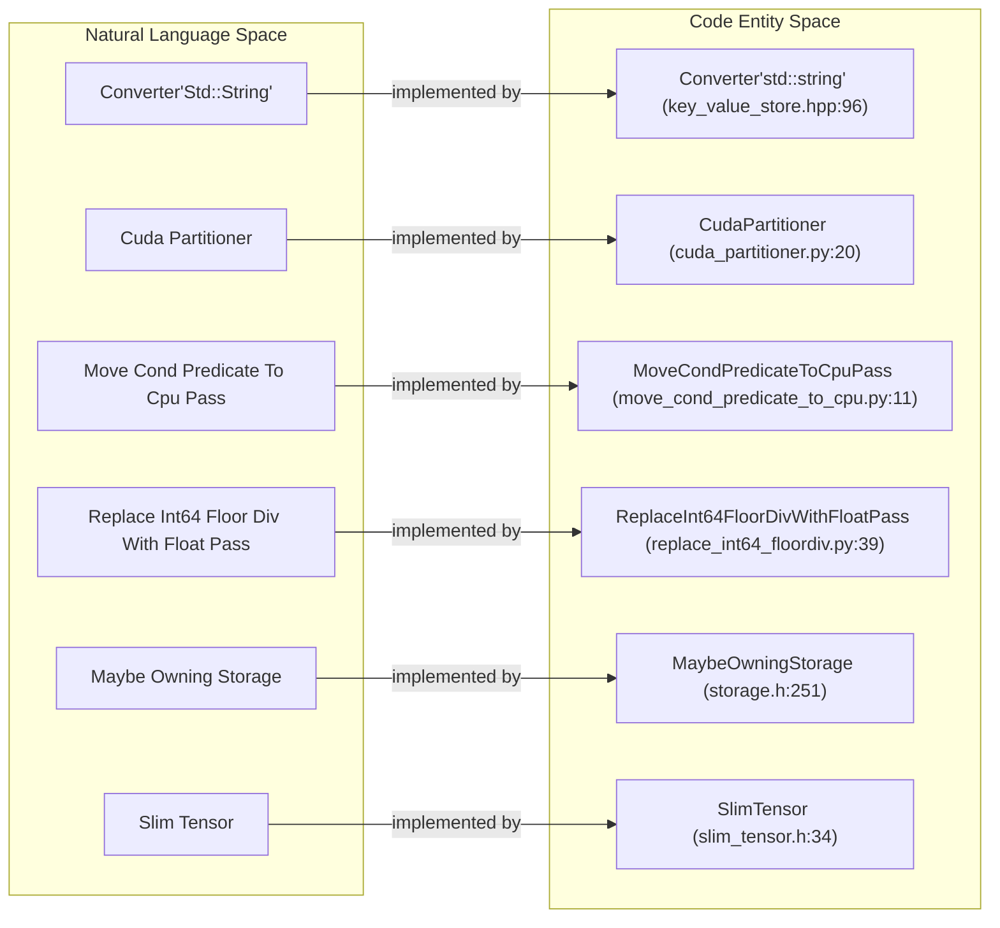
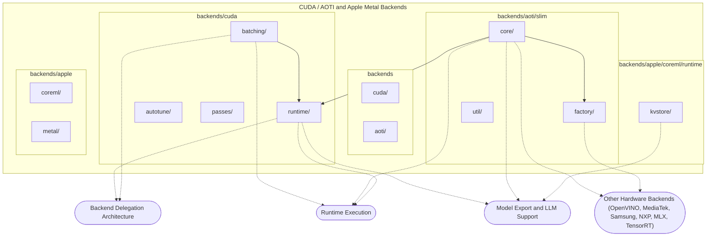
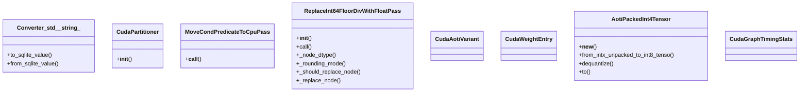
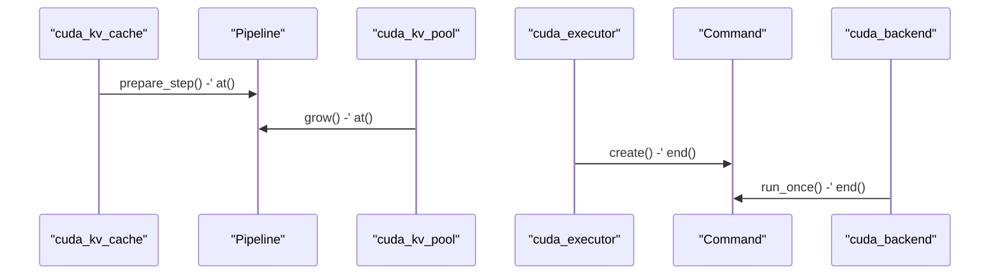

# CUDA / AOTI and Apple Metal Backends

↑ [[5-backend-delegation-architecture|Backend Delegation Architecture]]

> Architectural specification and implementation reference for CUDA / AOTI and Apple Metal Backends (40 relevant source files). Primary code entities: `empty`, `empty_like`, `empty_strided`, `DeviceTraits<c10::DeviceType::CPU>`, `allocate`.

<details>
<summary>Relevant source files</summary>

The following files were used as context for generating this wiki page:

- [backends/aoti/slim/factory/empty.h](backends/aoti/slim/factory/empty.h)
- [backends/aoti/slim/core/storage.h](backends/aoti/slim/core/storage.h)
- [backends/aoti/slim/core/slim_tensor.h](backends/aoti/slim/core/slim_tensor.h)
- [backends/cuda/cuda_backend.py](backends/cuda/cuda_backend.py)
- [backends/cuda/runtime/cuda_kv_cache.cpp](backends/cuda/runtime/cuda_kv_cache.cpp)
- [backends/aoti/slim/util/shared_ptr.h](backends/aoti/slim/util/shared_ptr.h)
- [backends/cuda/batching/cuda_executor.cpp](backends/cuda/batching/cuda_executor.cpp)
- [backends/cuda/autotune/cuda_graph_timing.py](backends/cuda/autotune/cuda_graph_timing.py)
- [backends/cuda/runtime/cuda_weight_cache.cpp](backends/cuda/runtime/cuda_weight_cache.cpp)
- [backends/cuda/aoti_packed_int4_tensor.py](backends/cuda/aoti_packed_int4_tensor.py)
- [backends/cuda/cuda_weight_collector.py](backends/cuda/cuda_weight_collector.py)
- [backends/cuda/merge_ptes.py](backends/cuda/merge_ptes.py)
- [backends/cuda/autotune/launch_params.py](backends/cuda/autotune/launch_params.py)
- [backends/cuda/cuda_partitioner.py](backends/cuda/cuda_partitioner.py)
- [backends/cuda/autotune/inputs.py](backends/cuda/autotune/inputs.py)
- [backends/cuda/dp4a_planar_int5_tensor.py](backends/cuda/dp4a_planar_int5_tensor.py)
- [backends/cuda/passes/lower_offgraph_kv.py](backends/cuda/passes/lower_offgraph_kv.py)
- [backends/cuda/dp4a_planar_int6_tensor.py](backends/cuda/dp4a_planar_int6_tensor.py)
- [backends/cuda/coalesced_int4_tensor.py](backends/cuda/coalesced_int4_tensor.py)
- [backends/cuda/batching/cuda_executor.h](backends/cuda/batching/cuda_executor.h)
- [backends/cuda/runtime/cuda_backend.cpp](backends/cuda/runtime/cuda_backend.cpp)
- [backends/cuda/batching/step_plan.h](backends/cuda/batching/step_plan.h)
- [backends/cuda/__init__.py](backends/cuda/__init__.py)
- [backends/cuda/passes/replace_int64_floordiv.py](backends/cuda/passes/replace_int64_floordiv.py)
- [backends/cuda/runtime/cuda_mutable_state.cpp](backends/cuda/runtime/cuda_mutable_state.cpp)
- [backends/apple/coreml/runtime/kvstore/key_value_store.hpp](backends/apple/coreml/runtime/kvstore/key_value_store.hpp)
- [backends/cuda/passes/move_cond_predicate_to_cpu.py](backends/cuda/passes/move_cond_predicate_to_cpu.py)
- [backends/cuda/runtime/cuda_kv_pool.cpp](backends/cuda/runtime/cuda_kv_pool.cpp)
- [backends/cuda/rocm.md](backends/cuda/rocm.md)
- [backends/cuda/runtime/aoti_cuda_shims.lib.md](backends/cuda/runtime/aoti_cuda_shims.lib.md)
- [backends/aoti/README.md](backends/aoti/README.md)
- [backends/apple/coreml/README.md](backends/apple/coreml/README.md)
- [backends/apple/coreml/setup.md](backends/apple/coreml/setup.md)
- [backends/apple/metal/README.md](backends/apple/metal/README.md)
- [backends/cuda/BUCK](backends/cuda/BUCK)

</details>

## Purpose and Scope

Architectural specification and implementation reference for CUDA / AOTI and Apple Metal Backends (40 relevant source files). Primary code entities: `empty`, `empty_like`, `empty_strided`, `DeviceTraits<c10::DeviceType::CPU>`, `allocate`.

Primary code entities analyzed on this page include `Converter<std::string>` ([backends/apple/coreml/runtime/kvstore/key_value_store.hpp:96-106]()), `CudaPartitioner` ([backends/cuda/cuda_partitioner.py:20-53]()), `MoveCondPredicateToCpuPass` ([backends/cuda/passes/move_cond_predicate_to_cpu.py:11-94]()), `ReplaceInt64FloorDivWithFloatPass` ([backends/cuda/passes/replace_int64_floordiv.py:39-153]()), `MaybeOwningStorage` ([backends/aoti/slim/core/storage.h:251-418]()).

For the parent architectural layer, see [[5-backend-delegation-architecture|Backend Delegation Architecture]]. Related sibling subsystems: [[5.1-partitioning-and-operator-support|Partitioning and Operator Support]], [[5.2-vulkan-gpu-backend|Vulkan GPU Backend]], [[5.3-qualcomm-qnn-backend|Qualcomm QNN Backend]], [[5.4-arm-tosa-and-ethos-u-backend|ARM TOSA and Ethos-U Backend]].

Sources: [backends/apple/coreml/runtime/kvstore/key_value_store.hpp:96-106](), [backends/cuda/cuda_partitioner.py:20-53](), [backends/cuda/passes/move_cond_predicate_to_cpu.py:11-94](), [backends/cuda/passes/replace_int64_floordiv.py:39-153]()

---

## 1. High-Level Architecture and Data Flow

### Natural Language Space to Code Entity Space Mapping

The following diagram maps domain concepts in this subsystem to their concrete code entities:



### Subsystem Component & Dependency Flow



Cross-subsystem call and import edges connect **CUDA / AOTI and Apple Metal Backends** with [[5-backend-delegation-architecture|Backend Delegation Architecture]] (coupling `93.0`), [[8-runtime-execution|Runtime Execution]] (coupling `73.0`), [[5.8-other-backends|Other Hardware Backends (OpenVINO, MediaTek, Samsung, NXP, MLX, TensorRT)]] (coupling `71.0`), [[5.2-vulkan-gpu-backend|Vulkan GPU Backend]] (coupling `69.0`), [[8.1-core-runtime-architecture|Core Runtime Architecture]] (coupling `60.0`).

| Module Directory | Files | Primary Code Entities | Source Citations |
|---|---|---|---|
| `backends/cuda` | 12 | `CudaPartitioner`, `CudaBackend`, `_CompilePatch`, `CudaAotiVariant` | [backends/cuda/cuda_partitioner.py:20-53]() [backends/cuda/cuda_backend.py:920-1592]() |
| `backends/cuda/runtime` | 7 | `CudaCellCache`, `CudaSequenceKVCache`, `CudaBatchedSequenceCache`, `Sequence` | [backends/cuda/runtime/cuda_kv_cache.cpp:288-800]() [backends/cuda/runtime/cuda_kv_cache.cpp:99-253]() |
| `backends/cuda/batching` | 5 | `CudaExecutorOptions`, `ForwardMethodCalls`, `InputEmbedder`, `RawTargetStep` | [backends/cuda/batching/cuda_executor.h:69-78]() [backends/cuda/batching/cuda_executor.h:94-97]() |
| `backends/cuda/autotune` | 3 | `ParkedTensorsNotRestored`, `InvalidLaunchParam`, `CudaGraphTimingStats`, `_State` | [backends/cuda/autotune/cuda_graph_timing.py:186-190]() [backends/cuda/autotune/launch_params.py:82-83]() |
| `backends/cuda/passes` | 3 | `MoveCondPredicateToCpuPass`, `ReplaceInt64FloorDivWithFloatPass`, `CheckOffGraphKVStepWidthPass`, `LowerOffGraphKVPass` | [backends/cuda/passes/move_cond_predicate_to_cpu.py:11-94]() [backends/cuda/passes/replace_int64_floordiv.py:39-153]() |
| `backends/aoti` | 2 | *(build / config)* | [backends/aoti/README.md]() |
| `backends/aoti/slim/core` | 2 | `MaybeOwningStorage`, `SlimTensor`, `DeviceTraits<c10::DeviceType::CPU>`, `DeviceTraits<c10::DeviceType::CUDA>` | [backends/aoti/slim/core/storage.h:251-418]() [backends/aoti/slim/core/slim_tensor.h:34-607]() |
| `backends/apple/coreml` | 2 | *(build / config)* | [backends/apple/coreml/README.md]() |

Sources: [backends/apple/coreml/runtime/kvstore/key_value_store.hpp:96-106](), [backends/cuda/cuda_partitioner.py:20-53](), [backends/cuda/passes/move_cond_predicate_to_cpu.py:11-94](), [backends/cuda/passes/replace_int64_floordiv.py:39-153](), [backends/aoti/slim/core/storage.h:251-418]()

---

## 2. Core Data Structures and Implementation Details

### Class and Entity Relationship Diagram



### `Converter<std::string>` (Class)

- **Source Location**: [backends/apple/coreml/runtime/kvstore/key_value_store.hpp:96-106]()
- **Declaration**: `Class Converter<std::string>`
- **Graph Centrality**: fan-in `70` callers, fan-out `0` callees

```cpp
// backends/apple/coreml/runtime/kvstore/key_value_store.hpp:96-106
struct Converter<std::string> {
    static constexpr sqlite::StorageType storage_type = StorageType::Text;
    
    static inline sqlite::Value to_sqlite_value(const std::string& value) {
        return value;
    }
    
    static inline std::string from_sqlite_value(const UnOwnedValue& value) {
        return std::string(std::get<sqlite::UnOwnedString>(value).data);
    }
};
```

### `CudaPartitioner` (Class)

- **Source Location**: [backends/cuda/cuda_partitioner.py:20-53]()
- **Declaration**: `Class CudaPartitioner`
- **Graph Centrality**: fan-in `25` callers, fan-out `0` callees
- **Responsibility**: CUDA partitioner driven by AOTInductor backend. This partitioner adds a target_device compile spec to enable device info propagation. The PropagateDevicePass will read this spec and mark delegate output tensors with CUDA device type, which flows through to serialization.

```python
// backends/cuda/cuda_partitioner.py:20-35
class CudaPartitioner(AotiPartitioner):
    """
    CUDA partitioner driven by AOTInductor backend.

    This partitioner adds a target_device compile spec to enable device info
    propagation. The PropagateDevicePass will read this spec and mark delegate
    output tensors with CUDA device type, which flows through to serialization.
    """

    def __init__(
        self,
        compile_spec: List[CompileSpec],
    ) -> None:
        """
        Initialize the CUDA partitioner.
```

### `MoveCondPredicateToCpuPass` (Class)

- **Source Location**: [backends/cuda/passes/move_cond_predicate_to_cpu.py:11-94]()
- **Declaration**: `Class MoveCondPredicateToCpuPass`
- **Graph Centrality**: fan-in `10` callers, fan-out `0` callees
- **Responsibility**: A pass that moves the predicate of torch.cond to CPU if the predicate is a constantbuffer. This is useful for models that use the predicate as a constant buffer, such as an `initialized` flag for cross attention kv cache. This saves ~50us per torch.cond call on RTX 5080. Example: ``` class CrossAttentionWithCache(torch

```python
// backends/cuda/passes/move_cond_predicate_to_cpu.py:11-26
class MoveCondPredicateToCpuPass:
    """
    A pass that moves the predicate of torch.cond to CPU if the predicate is a constantbuffer.
    This is useful for models that use the predicate as a constant buffer, such as an `initialized` flag for cross attention kv cache.

    This saves ~50us per torch.cond call on RTX 5080.

    Example:
    ```
    class CrossAttentionWithCache(torch.nn.Module):
        def __init__(self, hidden_size):
            super().__init__()
            self.k_proj = torch.nn.Linear(hidden_size, hidden_size)
            self.v_proj = torch.nn.Linear(hidden_size, hidden_size)
            self.q_proj = torch.nn.Linear(hidden_size, hidden_size)
            self.out_proj = torch.nn.Linear(hidden_size, hidden_size)
```

### `ReplaceInt64FloorDivWithFloatPass` (Class)

- **Source Location**: [backends/cuda/passes/replace_int64_floordiv.py:39-153]()
- **Declaration**: `Class ReplaceInt64FloorDivWithFloatPass`
- **Graph Centrality**: fan-in `8` callers, fan-out `0` callees
- **Responsibility**: Pass to rewrite integer floor-division into a float64-domain floor. Matches ``floor_divide.default`` and the floor-mode ``div.Tensor_mode`` / ``div.Scalar_mode`` overloads on integer operands, and replaces each with ``floor(a.to(float64) / b.to(float64)).to(orig_int_dtype)`` built from edge dialect ops. Float floor-div

### `MaybeOwningStorage` (Class)

- **Source Location**: [backends/aoti/slim/core/storage.h:251-418]()
- **Declaration**: `Class MaybeOwningStorage`
- **Graph Centrality**: fan-in `0` callers, fan-out `0` callees
- **Responsibility**: /** * MaybeOwningStorage - A storage class that manages tensor data memory. * * This class provides owning memory storage for tensor data on CPU. * Owning storage allocates and manages its own memory, freeing it upon * destruction. * * Current limitations: * - CPU device only * - Owning mode only * The future diffs wil

### `empty` (Function)

- **Source Location**: [backends/aoti/slim/factory/empty.h:64-69]()
- **Declaration**: `( std::initializer_list<int64_t> sizes, c10::ScalarType dtype, const c10::Device& device = CPU_DEVICE)`
- **Graph Centrality**: fan-in `385` callers, fan-out `4` callees
- **Responsibility**: /// Creates an empty contiguous tensor with sizes from an initializer list. /// Convenience overload for creating tensors with inline size specification. /// /// @param sizes The sizes of each dimension as an initializer list. /// @param dtype The scalar type of tensor elements. /// @param device The target device. ///

Sources: [backends/apple/coreml/runtime/kvstore/key_value_store.hpp:96-106](), [backends/cuda/cuda_partitioner.py:20-53](), [backends/cuda/passes/move_cond_predicate_to_cpu.py:11-94](), [backends/cuda/passes/replace_int64_floordiv.py:39-153](), [backends/aoti/slim/core/storage.h:251-418]()

---

## 3. Execution and Call Flow

The sequence diagram below traces the runtime/compile-time call chain across components in this module:



Sources: [backends/apple/coreml/runtime/kvstore/key_value_store.hpp:96-106](), [backends/cuda/cuda_partitioner.py:20-53](), [backends/cuda/passes/move_cond_predicate_to_cpu.py:11-94](), [backends/cuda/passes/replace_int64_floordiv.py:39-153](), [backends/aoti/slim/core/storage.h:251-418]()

---

## 4. Key API and Symbol Reference

| Code Entity | Kind | Location | Fan-In / Out | Role & Signature |
|---|---|---|---|---|
| `Converter<std::string>` | Class | [backends/apple/coreml/runtime/kvstore/key_value_store.hpp:96-106]() | `70` / `0` | — |
| `CudaPartitioner` | Class | [backends/cuda/cuda_partitioner.py:20-53]() | `25` / `0` | CUDA partitioner driven by AOTInductor backend. |
| `MoveCondPredicateToCpuPass` | Class | [backends/cuda/passes/move_cond_predicate_to_cpu.py:11-94]() | `10` / `0` | A pass that moves the predicate of torch.cond to CPU if the predicate is a constantbuffer. |
| `ReplaceInt64FloorDivWithFloatPass` | Class | [backends/cuda/passes/replace_int64_floordiv.py:39-153]() | `8` / `0` | Pass to rewrite integer floor-division into a float64-domain floor. |
| `MaybeOwningStorage` | Class | [backends/aoti/slim/core/storage.h:251-418]() | `0` / `0` | /** |
| `SlimTensor` | Class | [backends/aoti/slim/core/slim_tensor.h:34-607]() | `0` / `0` | /** |
| `ParkedTensorsNotRestored` | Class | [backends/cuda/autotune/cuda_graph_timing.py:186-190]() | `1` / `0` | Model tensors parked on the CPU could not be moved back to the GPU. |
| `CudaBackend` | Class | [backends/cuda/cuda_backend.py:920-1592]() | `0` / `0` | CudaBackend is a backend that compiles a model to run on CUDA devices. It uses the AOTInductor compiler to gen |
| `_CompilePatch` | Class | [backends/cuda/cuda_backend.py:145-181]() | `0` / `0` | A patch of Inductor that changes behavior only for the threads inside |
| `CudaAotiVariant` | Class | [backends/cuda/cuda_weight_collector.py:54-60]() | `2` / `0` | One AOTI shared library and its CUDA runtime-selection metadata. |
| `AotiPackedInt4Tensor` | Class | [backends/cuda/aoti_packed_int4_tensor.py:18-108]() | `1` / `0` | Symmetric groupwise INT4 weight consumed by AOTI Triton kernels. |
| `CudaCellCache` | Class | [backends/cuda/runtime/cuda_kv_cache.cpp:288-800]() | `0` / `0` | // Many sequences over one pool of per-token cells on one CUDA device. |
| `CudaSequenceKVCache` | Class | [backends/cuda/runtime/cuda_kv_cache.cpp:99-253]() | `0` / `0` | // One sequence's KV storage on one CUDA device. |
| `CudaAotiMetadata` | Class | [backends/cuda/cuda_weight_collector.py:64-68]() | `1` / `0` | CUDA AOTI native and fallback variants sharing one weight manifest. |
| `CudaPteInput` | Class | [backends/cuda/merge_ptes.py:52-56]() | `1` / `0` | One CUDA PTE input and its optional external tensor data. |
| `CudaWeightCollector` | Class | [backends/cuda/cuda_weight_collector.py:379-641]() | `0` / `0` | Collect one global ``(device, FQN) -> value`` store for all methods. |
| `InvalidLaunchParam` | Class | [backends/cuda/autotune/launch_params.py:82-83]() | `0` / `0` | Raised by a launch function for a candidate that is illegal for its inputs. |
| `CheckOffGraphKVStepWidthPass` | Class | [backends/cuda/passes/lower_offgraph_kv.py:496-563]() | `1` / `0` | Check the declared step width against the delegated program. |
| `CudaCoalescedInt4Tensor` | Class | [backends/cuda/coalesced_int4_tensor.py:112-238]() | `1` / `0` | INT4 weight, uint8 scale + per-256 fp16 step, uint8 zero + per-256 fp16 step. |
| `CudaDp4aPlanarInt5Tensor` | Class | [backends/cuda/dp4a_planar_int5_tensor.py:177-318]() | `0` / `0` | Dp4a-planar 5-bit weight (ql/qh split bit-planes + per-group scale/zero), asymmetric. |
| `CudaDp4aPlanarInt6Tensor` | Class | [backends/cuda/dp4a_planar_int6_tensor.py:185-302]() | `0` / `0` | Dp4a-planar 6-bit weight (ql/qh split bit-planes + per-group scale), symmetric. |
| `CudaExecutorOptions` | Class | [backends/cuda/batching/cuda_executor.h:69-78]() | `0` / `0` | // Process-wide CUDA backend options create() sets before the methods load. |

Sources: [backends/apple/coreml/runtime/kvstore/key_value_store.hpp:96-106](), [backends/cuda/cuda_partitioner.py:20-53](), [backends/cuda/passes/move_cond_predicate_to_cpu.py:11-94](), [backends/cuda/passes/replace_int64_floordiv.py:39-153](), [backends/aoti/slim/core/storage.h:251-418](), [backends/aoti/slim/core/slim_tensor.h:34-607]()

---

## 5. Official Documentation and Design Context

The following linked documentation sections from `llm-wiki` (`raw/`) provide additional architectural context, tutorials, and design invariants for this subsystem:

- **Backend Delegation Architecture** ([wiki/5-backend-delegation-architecture.md](), score `143.4955`) (sections: `Backend Delegation Architecture`, `Purpose and Scope`, `System Mapping: Natural Language Space to Code Entity Space`, `1. Partitioning and Operator Support`): # Backend Delegation Architecture > Architectural specification and implementation reference for Backend Delegation Architecture (40 relevant source files). Primary code entities: `CommandBuffer`, `begin`, `bind_descriptors`, `bind_pipeline`, `NodeVisitor`. <details> <summary>Relevant source files</summary> The following files were used as context for generating this wiki page: - [backends/vulkan/runtime/vk_api/Comma
- **Other Hardware Backends (OpenVINO, MediaTek, Samsung, NXP, MLX, TensorRT)** ([wiki/5.8-other-backends.md](), score `116.8949`) (sections: `Other Hardware Backends (OpenVINO, MediaTek, Samsung, NXP, MLX, TensorRT)`, `Purpose and Scope`, `1. High-Level Architecture and Data Flow`, `Natural Language Space to Code Entity Space Mapping`): # Other Hardware Backends (OpenVINO, MediaTek, Samsung, NXP, MLX, TensorRT) ↑ [[5-backend-delegation-architecture|Backend Delegation Architecture]] > Architectural specification and implementation reference for Other Hardware Backends (OpenVINO, MediaTek, Samsung, NXP, MLX, TensorRT) (40 relevant source files). Primary code entities: `ConstantData`, `add`, `get`, `set`, `Interpreter`. <details> <summary>Relevant sour
- **ExecuTorch DeepWiki** ([wiki/index.md](), score `116.5885`) (sections: `ExecuTorch DeepWiki`, `Pages`): # ExecuTorch DeepWiki Generated from `home-jason-Project-deepwiki-executorch` at commit `b3b565b5b62f` (2026-11-15T15:02:11+00:00). ## Pages - [[1-overview|Overview]] — Architectural specification and implementation reference for Overview (10 relevant source files). Primary code entities: `Module`, `MethodHolder`, `PlannedMemory`, `EdgeProgramManager`, `__init__`. - [[1.1-getting-started|Getting Started]] — Architect
- **Kernel Registration and Dispatch** ([wiki/8.2-kernel-registration-and-dispatch.md](), score `110.0042`) (sections: `Kernel Registration and Dispatch`, `Purpose and Scope`, `1. High-Level Architecture and Data Flow`, `Natural Language Space to Code Entity Space Mapping`): # Kernel Registration and Dispatch ↑ [[8-runtime-execution|Runtime Execution]] > Architectural specification and implementation reference for Kernel Registration and Dispatch (36 relevant source files). Primary code entities: `KernelRuntimeContext`, `allocate_temp`, `fail`, `Kernel`, `KernelKey`. <details> <summary>Relevant source files</summary> The following files were used as context for generating this wiki page:

Sources: [wiki/5-backend-delegation-architecture.md](), [wiki/5.8-other-backends.md](), [wiki/index.md](), [wiki/8.2-kernel-registration-and-dispatch.md]()

## Related pages

- [[5-backend-delegation-architecture|Backend Delegation Architecture]]
- [[1.1-getting-started|Getting Started]]
- [[1.2-export-api-and-recipe-system|Export API and Recipe System]]
- [[2.2-kernel-libraries-and-selective-build|Kernel Libraries and Selective Build]]
- [[2.3-schema-generation-and-flatbuffers|Schema Generation and FlatBuffers]]
- [[3.4-program-emission-and-serialization|Program Emission and Serialization]]
- [[3.5-verification-and-dialect-system|Verification and Dialect System]]
- [[4-quantization-systems|Quantization Systems]]

## Related documents

- `wiki/5-backend-delegation-architecture.md` — Backend Delegation Architecture (score 143.4955, via bm25)
- `wiki/5.8-other-backends.md` — Other Hardware Backends (OpenVINO, MediaTek, Samsung, NXP, MLX, TensorRT) (score 116.8949, via bm25)
- `wiki/index.md` — ExecuTorch DeepWiki (score 116.5885, via bm25)
- `wiki/8.2-kernel-registration-and-dispatch.md` — Kernel Registration and Dispatch (score 110.0042, via bm25)
- `wiki/6.3-custom-operators-and-extensions.md` — Custom Operators and Extensions (score 105.5369, via bm25)

## Sources

- [`backends/aoti/slim/factory/empty.h`](https://github.com/pytorch/executorch/blob/main/backends/aoti/slim/factory/empty.h)
- [`backends/aoti/slim/core/storage.h`](https://github.com/pytorch/executorch/blob/main/backends/aoti/slim/core/storage.h)
- [`backends/aoti/slim/core/slim_tensor.h`](https://github.com/pytorch/executorch/blob/main/backends/aoti/slim/core/slim_tensor.h)
- [`backends/cuda/cuda_backend.py`](https://github.com/pytorch/executorch/blob/main/backends/cuda/cuda_backend.py)
- [`backends/cuda/runtime/cuda_kv_cache.cpp`](https://github.com/pytorch/executorch/blob/main/backends/cuda/runtime/cuda_kv_cache.cpp)
- [`backends/aoti/slim/util/shared_ptr.h`](https://github.com/pytorch/executorch/blob/main/backends/aoti/slim/util/shared_ptr.h)
- [`backends/cuda/batching/cuda_executor.cpp`](https://github.com/pytorch/executorch/blob/main/backends/cuda/batching/cuda_executor.cpp)
- [`backends/cuda/autotune/cuda_graph_timing.py`](https://github.com/pytorch/executorch/blob/main/backends/cuda/autotune/cuda_graph_timing.py)
- [`backends/cuda/runtime/cuda_weight_cache.cpp`](https://github.com/pytorch/executorch/blob/main/backends/cuda/runtime/cuda_weight_cache.cpp)
- [`backends/cuda/aoti_packed_int4_tensor.py`](https://github.com/pytorch/executorch/blob/main/backends/cuda/aoti_packed_int4_tensor.py)
- [`backends/cuda/cuda_weight_collector.py`](https://github.com/pytorch/executorch/blob/main/backends/cuda/cuda_weight_collector.py)
- [`backends/cuda/merge_ptes.py`](https://github.com/pytorch/executorch/blob/main/backends/cuda/merge_ptes.py)
- [`backends/cuda/autotune/launch_params.py`](https://github.com/pytorch/executorch/blob/main/backends/cuda/autotune/launch_params.py)
- [`backends/cuda/cuda_partitioner.py`](https://github.com/pytorch/executorch/blob/main/backends/cuda/cuda_partitioner.py)
- [`backends/cuda/autotune/inputs.py`](https://github.com/pytorch/executorch/blob/main/backends/cuda/autotune/inputs.py)
- [`backends/cuda/dp4a_planar_int5_tensor.py`](https://github.com/pytorch/executorch/blob/main/backends/cuda/dp4a_planar_int5_tensor.py)
- [`backends/cuda/passes/lower_offgraph_kv.py`](https://github.com/pytorch/executorch/blob/main/backends/cuda/passes/lower_offgraph_kv.py)
- [`backends/cuda/dp4a_planar_int6_tensor.py`](https://github.com/pytorch/executorch/blob/main/backends/cuda/dp4a_planar_int6_tensor.py)
- [`backends/cuda/coalesced_int4_tensor.py`](https://github.com/pytorch/executorch/blob/main/backends/cuda/coalesced_int4_tensor.py)
- [`backends/cuda/batching/cuda_executor.h`](https://github.com/pytorch/executorch/blob/main/backends/cuda/batching/cuda_executor.h)
- [`backends/cuda/runtime/cuda_backend.cpp`](https://github.com/pytorch/executorch/blob/main/backends/cuda/runtime/cuda_backend.cpp)
- [`backends/cuda/batching/step_plan.h`](https://github.com/pytorch/executorch/blob/main/backends/cuda/batching/step_plan.h)
- [`backends/cuda/__init__.py`](https://github.com/pytorch/executorch/blob/main/backends/cuda/__init__.py)
- [`backends/cuda/passes/replace_int64_floordiv.py`](https://github.com/pytorch/executorch/blob/main/backends/cuda/passes/replace_int64_floordiv.py)
- [`backends/cuda/runtime/cuda_mutable_state.cpp`](https://github.com/pytorch/executorch/blob/main/backends/cuda/runtime/cuda_mutable_state.cpp)
- [`backends/apple/coreml/runtime/kvstore/key_value_store.hpp`](https://github.com/pytorch/executorch/blob/main/backends/apple/coreml/runtime/kvstore/key_value_store.hpp)
- [`backends/cuda/passes/move_cond_predicate_to_cpu.py`](https://github.com/pytorch/executorch/blob/main/backends/cuda/passes/move_cond_predicate_to_cpu.py)
- [`backends/cuda/runtime/cuda_kv_pool.cpp`](https://github.com/pytorch/executorch/blob/main/backends/cuda/runtime/cuda_kv_pool.cpp)
- [`backends/cuda/rocm.md`](https://github.com/pytorch/executorch/blob/main/backends/cuda/rocm.md)
- [`backends/cuda/runtime/aoti_cuda_shims.lib.md`](https://github.com/pytorch/executorch/blob/main/backends/cuda/runtime/aoti_cuda_shims.lib.md)
- [`backends/aoti/README.md`](https://github.com/pytorch/executorch/blob/main/backends/aoti/README.md)
- [`backends/apple/coreml/README.md`](https://github.com/pytorch/executorch/blob/main/backends/apple/coreml/README.md)
- [`backends/apple/coreml/setup.md`](https://github.com/pytorch/executorch/blob/main/backends/apple/coreml/setup.md)
- [`backends/apple/metal/README.md`](https://github.com/pytorch/executorch/blob/main/backends/apple/metal/README.md)
- [`backends/cuda/BUCK`](https://github.com/pytorch/executorch/blob/main/backends/cuda/BUCK)
- [`backends/cuda/CMakeLists.txt`](https://github.com/pytorch/executorch/blob/main/backends/cuda/CMakeLists.txt)
- [`backends/cuda/batching/BUCK`](https://github.com/pytorch/executorch/blob/main/backends/cuda/batching/BUCK)
- [`backends/cuda/batching/CMakeLists.txt`](https://github.com/pytorch/executorch/blob/main/backends/cuda/batching/CMakeLists.txt)
- [`backends/cuda/runtime/BUCK`](https://github.com/pytorch/executorch/blob/main/backends/cuda/runtime/BUCK)
- [`backends/aoti/BUCK`](https://github.com/pytorch/executorch/blob/main/backends/aoti/BUCK)


## Dynamic Knowledge Links (Code Graph ↔ LLM-Wiki / RAG)

### Linked Architecture & Design Documents

| Document | Match Channel | Score | Shared Code Symbols |
|---|---|---|---|
| [[5-backend-delegation-architecture|Backend Delegation Architecture]] | `bm25+entity(1)` | `144.995` | `CudaPartitioner` |
| [[5.1-partitioning-and-operator-support|Partitioning and Operator Support]] | `wikilink:5.7-cuda-aoti-and-apple-metal-backends` | `122.036` | *(lexical/graph match)* |
| [[5.2-vulkan-gpu-backend|Vulkan GPU Backend]] | `wikilink:5.7-cuda-aoti-and-apple-metal-backends` | `122.036` | *(lexical/graph match)* |
| [[5.3-qualcomm-qnn-backend|Qualcomm QNN Backend]] | `wikilink:5.7-cuda-aoti-and-apple-metal-backends` | `122.036` | *(lexical/graph match)* |
| [[5.8-other-backends|Other Hardware Backends (OpenVINO, MediaTek, Samsung, NXP, MLX, TensorRT)]] | `bm25` | `116.895` | *(lexical/graph match)* |
| [[index|ExecuTorch DeepWiki]] | `bm25` | `116.588` | *(lexical/graph match)* |

### High-Centrality Bridge Symbols (CBM Graph)

| Symbol | Kind | Source Location | Fan-In / Fan-Out |
|---|---|---|---|
| `Converter<std::string>` | Class | [backends/apple/coreml/runtime/kvstore/key_value_store.hpp:96-106]() | in: `70` / out: `0` |
| `CudaPartitioner` | Class | [backends/cuda/cuda_partitioner.py:20-53]() | in: `25` / out: `0` |
| `MoveCondPredicateToCpuPass` | Class | [backends/cuda/passes/move_cond_predicate_to_cpu.py:11-94]() | in: `10` / out: `0` |
| `ReplaceInt64FloorDivWithFloatPass` | Class | [backends/cuda/passes/replace_int64_floordiv.py:39-153]() | in: `8` / out: `0` |
| `MaybeOwningStorage` | Class | [backends/aoti/slim/core/storage.h:251-418]() | in: `0` / out: `0` |
| `SlimTensor` | Class | [backends/aoti/slim/core/slim_tensor.h:34-607]() | in: `0` / out: `0` |

Sources: [backends/apple/coreml/runtime/kvstore/key_value_store.hpp:96-106](), [backends/cuda/cuda_partitioner.py:20-53](), [backends/cuda/passes/move_cond_predicate_to_cpu.py:11-94](), [backends/cuda/passes/replace_int64_floordiv.py:39-153]()

### Cross-Subsystem Coupling

- [[5-backend-delegation-architecture|Backend Delegation Architecture]] — call/import coupling weight `93.0`
- [[8-runtime-execution|Runtime Execution]] — call/import coupling weight `73.0`
- [[5.8-other-backends|Other Hardware Backends (OpenVINO, MediaTek, Samsung, NXP, MLX, TensorRT)]] — call/import coupling weight `71.0`
- [[5.2-vulkan-gpu-backend|Vulkan GPU Backend]] — call/import coupling weight `69.0`
- [[8.1-core-runtime-architecture|Core Runtime Architecture]] — call/import coupling weight `60.0`
- [[6-model-export-and-llm-support|Model Export and LLM Support]] — call/import coupling weight `56.0`
