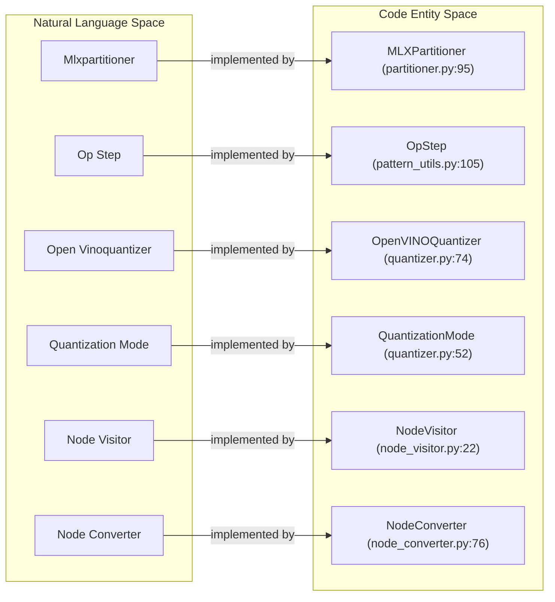
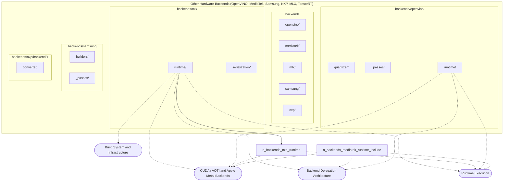
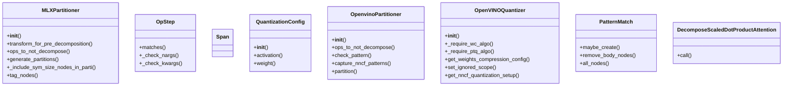
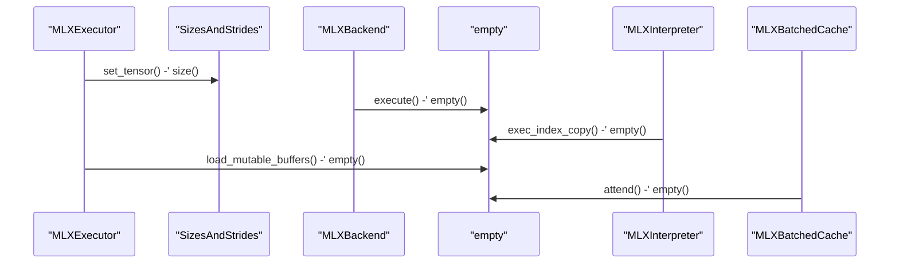

# Other Hardware Backends (OpenVINO, MediaTek, Samsung, NXP, MLX, TensorRT)

↑ [[5-backend-delegation-architecture|Backend Delegation Architecture]]

> Architectural specification and implementation reference for Other Hardware Backends (OpenVINO, MediaTek, Samsung, NXP, MLX, TensorRT) (40 relevant source files). Primary code entities: `ConstantData`, `add`, `get`, `set`, `Interpreter`.

<details>
<summary>Relevant source files</summary>

The following files were used as context for generating this wiki page:

- [backends/mlx/runtime/MLXExecutor.h](backends/mlx/runtime/MLXExecutor.h)
- [backends/mlx/runtime/MLXInterpreter.h](backends/mlx/runtime/MLXInterpreter.h)
- [backends/openvino/partitioner.py](backends/openvino/partitioner.py)
- [backends/openvino/quantizer/quantizer.py](backends/openvino/quantizer/quantizer.py)
- [backends/samsung/builders/node_visitor.py](backends/samsung/builders/node_visitor.py)
- [backends/openvino/preprocess.py](backends/openvino/preprocess.py)
- [backends/openvino/_passes/fold_constant_cumsum_pass.py](backends/openvino/_passes/fold_constant_cumsum_pass.py)
- [backends/nxp/backend/ir/converter/node_converter.py](backends/nxp/backend/ir/converter/node_converter.py)
- [backends/openvino/_passes/decompose_floor_divide_pass.py](backends/openvino/_passes/decompose_floor_divide_pass.py)
- [backends/openvino/runtime/OpenvinoBackend.cpp](backends/openvino/runtime/OpenvinoBackend.cpp)
- [backends/openvino/quantizer/observers.py](backends/openvino/quantizer/observers.py)
- [backends/openvino/_passes/cast_reduction_input_pass.py](backends/openvino/_passes/cast_reduction_input_pass.py)
- [backends/mediatek/preprocess.py](backends/mediatek/preprocess.py)
- [backends/mediatek/quantizer/qconfig.py](backends/mediatek/quantizer/qconfig.py)
- [backends/openvino/runtime/OpenvinoApi.h](backends/openvino/runtime/OpenvinoApi.h)
- [backends/mediatek/partitioner.py](backends/mediatek/partitioner.py)
- [backends/openvino/runtime/OpenvinoBackend.h](backends/openvino/runtime/OpenvinoBackend.h)
- [backends/openvino/__init__.py](backends/openvino/__init__.py)
- [backends/mlx/pattern_utils.py](backends/mlx/pattern_utils.py)
- [backends/nxp/runtime/NeutronBackend.cpp](backends/nxp/runtime/NeutronBackend.cpp)
- [backends/mlx/partitioner.py](backends/mlx/partitioner.py)
- [backends/mediatek/_passes/decompose_scaled_dot_product_attention.py](backends/mediatek/_passes/decompose_scaled_dot_product_attention.py)
- [backends/mediatek/runtime/include/NeuronBufferAllocator.h](backends/mediatek/runtime/include/NeuronBufferAllocator.h)
- [backends/mlx/runtime/MLXBatchedCache.h](backends/mlx/runtime/MLXBatchedCache.h)
- [backends/mlx/runtime/MLXBackend.cpp](backends/mlx/runtime/MLXBackend.cpp)
- [backends/samsung/_passes/annotate_qparams.py](backends/samsung/_passes/annotate_qparams.py)
- [backends/mlx/pte_inspector.py](backends/mlx/pte_inspector.py)
- [backends/openvino/_passes/__init__.py](backends/openvino/_passes/__init__.py)
- [backends/openvino/README.md](backends/openvino/README.md)
- [backends/mediatek/README.md](backends/mediatek/README.md)
- [backends/samsung/README.md](backends/samsung/README.md)
- [backends/mlx/README.md](backends/mlx/README.md)
- [backends/nxp/README.md](backends/nxp/README.md)
- [backends/mlx/serialization/README.md](backends/mlx/serialization/README.md)
- [backends/openvino/CMakeLists.txt](backends/openvino/CMakeLists.txt)

</details>

## Purpose and Scope

Architectural specification and implementation reference for Other Hardware Backends (OpenVINO, MediaTek, Samsung, NXP, MLX, TensorRT) (40 relevant source files). Primary code entities: `ConstantData`, `add`, `get`, `set`, `Interpreter`.

Primary code entities analyzed on this page include `MLXPartitioner` ([backends/mlx/partitioner.py:95-386]()), `OpStep` ([backends/mlx/pattern_utils.py:105-193]()), `OpenVINOQuantizer` ([backends/openvino/quantizer/quantizer.py:74-616]()), `QuantizationMode` ([backends/openvino/quantizer/quantizer.py:52-71]()), `NodeVisitor` ([backends/samsung/builders/node_visitor.py:22-85]()).

For the parent architectural layer, see [[5-backend-delegation-architecture|Backend Delegation Architecture]]. Related sibling subsystems: [[5.1-partitioning-and-operator-support|Partitioning and Operator Support]], [[5.2-vulkan-gpu-backend|Vulkan GPU Backend]], [[5.3-qualcomm-qnn-backend|Qualcomm QNN Backend]], [[5.4-arm-tosa-and-ethos-u-backend|ARM TOSA and Ethos-U Backend]].

Sources: [backends/mlx/partitioner.py:95-386](), [backends/mlx/pattern_utils.py:105-193](), [backends/openvino/quantizer/quantizer.py:74-616](), [backends/openvino/quantizer/quantizer.py:52-71]()

---

## 1. High-Level Architecture and Data Flow

### Natural Language Space to Code Entity Space Mapping

The following diagram maps domain concepts in this subsystem to their concrete code entities:



### Subsystem Component & Dependency Flow



Cross-subsystem call and import edges connect **Other Hardware Backends (OpenVINO, MediaTek, Samsung, NXP, MLX, TensorRT)** with [[5.7-cuda-aoti-and-apple-metal-backends|CUDA / AOTI and Apple Metal Backends]] (coupling `71.0`), [[8-runtime-execution|Runtime Execution]] (coupling `50.0`), [[8.1-core-runtime-architecture|Core Runtime Architecture]] (coupling `46.0`), [[5-backend-delegation-architecture|Backend Delegation Architecture]] (coupling `36.0`), [[5.2-vulkan-gpu-backend|Vulkan GPU Backend]] (coupling `25.0`).

| Module Directory | Files | Primary Code Entities | Source Citations |
|---|---|---|---|
| `backends/mediatek` | 5 | `NeuropilotOperatorsSupport`, `NeuropilotBackend`, `NeuropilotPartitioner`, `preprocess` | [backends/mediatek/partitioner.py:25-58]() [backends/mediatek/preprocess.py:92-253]() |
| `backends/openvino` | 5 | `OpenvinoPartitioner`, `OpenvinoOperatorsSupport`, `PatternNode`, `OpenvinoBackend` | [backends/openvino/partitioner.py:240-388]() [backends/openvino/partitioner.py:153-236]() |
| `backends/mlx` | 4 | `MLXPartitioner`, `OpStep`, `PatternMatch`, `MLXOperatorSupport` | [backends/mlx/partitioner.py:95-386]() [backends/mlx/pattern_utils.py:105-193]() |
| `backends/mlx/runtime` | 4 | `Span`, `ConstantData`, `ExecutionState`, `MutableBufferData` | [backends/mlx/runtime/MLXBatchedCache.h:241-246]() [backends/mlx/runtime/MLXExecutor.h:90-110]() |
| `backends/openvino/_passes` | 4 | `FoldConstantCumsumPass`, `DecomposeFloorDividePass`, `CastReductionInputPass`, `_reads_only_shape` | [backends/openvino/_passes/fold_constant_cumsum_pass.py:108-161]() [backends/openvino/_passes/decompose_floor_divide_pass.py:48-106]() |
| `backends/openvino/runtime` | 3 | `DlCloser`, `ov_dimension_t`, `ov_shape_t`, `ExecutionHandle` | [backends/openvino/runtime/OpenvinoApi.h:136-138]() [backends/openvino/runtime/OpenvinoApi.h:35-38]() |
| `backends/mediatek/_passes` | 2 | `DecomposeScaledDotProductAttention`, `_get_input_node_names`, `call` | [backends/mediatek/_passes/decompose_scaled_dot_product_attention.py:23-79]() [backends/mediatek/_passes/decompose_scaled_dot_product_attention.py:15-20]() |
| `backends/mediatek/quantizer` | 2 | `QuantizationConfig`, `Precision`, `_get_activation_qspec`, `_get_weight_qspec` | [backends/mediatek/quantizer/qconfig.py:30-44]() [backends/mediatek/quantizer/qconfig.py:22-27]() |

Sources: [backends/mlx/partitioner.py:95-386](), [backends/mlx/pattern_utils.py:105-193](), [backends/openvino/quantizer/quantizer.py:74-616](), [backends/openvino/quantizer/quantizer.py:52-71](), [backends/samsung/builders/node_visitor.py:22-85]()

---

## 2. Core Data Structures and Implementation Details

### Class and Entity Relationship Diagram



### `MLXPartitioner` (Class)

- **Source Location**: [backends/mlx/partitioner.py:95-386]()
- **Declaration**: `Class MLXPartitioner`
- **Graph Centrality**: fan-in `23` callers, fan-out `0` callees
- **Responsibility**: Partitioner for the MLX delegate. Analyzes an EdgeIR graph and partitions supported operations for delegation to MLX.

```python
// backends/mlx/partitioner.py:95-110
class MLXPartitioner(Partitioner):
    """
    Partitioner for the MLX delegate.

    Analyzes an EdgeIR graph and partitions supported operations
    for delegation to MLX.
    """

    def __init__(self, compile_specs: List[CompileSpec] | None = None) -> None:
        self.compile_specs = compile_specs or []
        self.delegation_spec = DelegationSpec(MLXBackend.__name__, self.compile_specs)
        self.partition_tags: Dict[str, DelegationSpec] = {}
        # Last (program, result) pair returned by ops_to_not_decompose(). exir
        # asks the same partitioner the same question about the same program
        # object twice in a row (_program.py calls it once directly and once
        # through _can_skip_using_EDGE_DO_NOT_DECOMP), and answering costs a
```

### `OpStep` (Class)

- **Source Location**: [backends/mlx/pattern_utils.py:105-193]()
- **Declaration**: `Class OpStep`
- **Graph Centrality**: fan-in `17` callers, fan-out `0` callees
- **Responsibility**: One step in a backward walk through the graph. Used with walk_back() to define pattern chains. Supports both exact op matching and predicate-based matching. Attributes: op: Specific op to match (e.g., torch.ops.aten.rsqrt.default) predicate: Alternative to op - a function that returns True for matching nodes optional: 

```python
// backends/mlx/pattern_utils.py:105-120
class OpStep:
    """
    One step in a backward walk through the graph.

    Used with walk_back() to define pattern chains. Supports both exact op
    matching and predicate-based matching.

    Attributes:
        op: Specific op to match (e.g., torch.ops.aten.rsqrt.default)
        predicate: Alternative to op - a function that returns True for matching nodes
        optional: If True, skip this step if it doesn't match
        repeat: If True, match this step 0 or more times (like regex *)
        require_single_user: If True (default), only match nodes with exactly one user
        nargs: Number of args required. Can be:
               - int: minimum number of args (default 1, since we advance via args[0])
               - tuple (min, max): range of args required (inclusive)
```

### `OpenVINOQuantizer` (Class)

- **Source Location**: [backends/openvino/quantizer/quantizer.py:74-616]()
- **Declaration**: `Class OpenVINOQuantizer`
- **Graph Centrality**: fan-in `3` callers, fan-out `0` callees
- **Responsibility**: Implementation of the Torch AO quantizer which annotates models with quantization annotations optimally for the inference via OpenVINO.

```python
// backends/openvino/quantizer/quantizer.py:74-89
class OpenVINOQuantizer(Quantizer):
    """
    Implementation of the Torch AO quantizer which annotates models with quantization annotations
    optimally for the inference via OpenVINO.
    """

    WEIGHTS_ONLY_COMPRESSION_MODES = {
        QuantizationMode.INT4WO_SYM: "int4_sym",
        QuantizationMode.INT4WO_ASYM: "int4_asym",
        QuantizationMode.INT8WO_SYM: "int8_sym",
        QuantizationMode.INT8WO_ASYM: "int8_asym",
    }

    def __init__(
        self,
        *,
```

### `QuantizationMode` (Class)

- **Source Location**: [backends/openvino/quantizer/quantizer.py:52-71]()
- **Declaration**: `Class QuantizationMode`
- **Graph Centrality**: fan-in `0` callers, fan-out `0` callees
- **Responsibility**: Defines special quantization modes. - INT8_SYM: INT8 symmetric quantization for both activations and weights. - INT8_MIXED: INT8 asymmetric quantization for activations, symmetric for weights. - INT8_TRANSFORMER: Optimized INT8 quantization for transformer-based models - INT8WO_SYM: INT8 symmetric quantization for weig

### `NodeVisitor` (Class)

- **Source Location**: [backends/samsung/builders/node_visitor.py:22-85]()
- **Declaration**: `Class NodeVisitor`
- **Graph Centrality**: fan-in `0` callers, fan-out `0` callees
- **Responsibility**: Node visitor pattern for visiting nodes in an edge IR graph

### `set_tensor` (Method)

- **Source Location**: [backends/mlx/runtime/MLXExecutor.h:551-584]()
- **Declaration**: `(Tid id, Tensor arr)`
- **Graph Centrality**: fan-in `132` callers, fan-out `7` callees
- **Responsibility**: // Set a tensor output

Sources: [backends/mlx/partitioner.py:95-386](), [backends/mlx/pattern_utils.py:105-193](), [backends/openvino/quantizer/quantizer.py:74-616](), [backends/openvino/quantizer/quantizer.py:52-71](), [backends/samsung/builders/node_visitor.py:22-85]()

---

## 3. Execution and Call Flow

The sequence diagram below traces the runtime/compile-time call chain across components in this module:



Sources: [backends/mlx/partitioner.py:95-386](), [backends/mlx/pattern_utils.py:105-193](), [backends/openvino/quantizer/quantizer.py:74-616](), [backends/openvino/quantizer/quantizer.py:52-71](), [backends/samsung/builders/node_visitor.py:22-85]()

---

## 4. Key API and Symbol Reference

| Code Entity | Kind | Location | Fan-In / Out | Role & Signature |
|---|---|---|---|---|
| `MLXPartitioner` | Class | [backends/mlx/partitioner.py:95-386]() | `23` / `0` | Partitioner for the MLX delegate. |
| `OpStep` | Class | [backends/mlx/pattern_utils.py:105-193]() | `17` / `0` | One step in a backward walk through the graph. |
| `OpenVINOQuantizer` | Class | [backends/openvino/quantizer/quantizer.py:74-616]() | `3` / `0` | Implementation of the Torch AO quantizer which annotates models with quantization annotations |
| `QuantizationMode` | Class | [backends/openvino/quantizer/quantizer.py:52-71]() | `0` / `0` | Defines special quantization modes. |
| `NodeVisitor` | Class | [backends/samsung/builders/node_visitor.py:22-85]() | `0` / `0` | Node visitor pattern for visiting nodes in an edge IR graph |
| `NodeConverter` | Class | [backends/nxp/backend/ir/converter/node_converter.py:76-538]() | `0` / `0` | Classes which implement conversion of torch.Node to TFLite should inherit from this class and overwrite the |
| `FoldConstantCumsumPass` | Class | [backends/openvino/_passes/fold_constant_cumsum_pass.py:108-161]() | `0` / `0` | Replace an integer cumsum that reads only constants with its result. |
| `DecomposeFloorDividePass` | Class | [backends/openvino/_passes/decompose_floor_divide_pass.py:48-106]() | `0` / `0` | Decompose div with rounding_mode='floor' for correct semantics. |
| `PatternMatch` | Class | [backends/mlx/pattern_utils.py:299-360]() | `2` / `0` | Base class for pattern match results. |
| `CastReductionInputPass` | Class | [backends/openvino/_passes/cast_reduction_input_pass.py:18-45]() | `0` / `0` | Cast the input of cumsum and prod to the dtype of their result. |
| `OpenvinoPartitioner` | Class | [backends/openvino/partitioner.py:240-388]() | `3` / `0` | — |
| `INT4WeightObserver` | Class | [backends/openvino/quantizer/observers.py:165-187]() | `0` / `0` | OpenVINO INT4 Weight Compression observer. |
| `INT8WeightObserver` | Class | [backends/openvino/quantizer/observers.py:190-206]() | `0` / `0` | OpenVINO INT8 Weight Compression per channel observer. |
| `WeightObserverBase` | Class | [backends/openvino/quantizer/observers.py:46-162]() | `0` / `0` | Base implementation of an NNCF observer that defines the rules for compressing layer weights into the OpenVINO |
| `QuantizationConfig` | Class | [backends/mediatek/quantizer/qconfig.py:30-44]() | `5` / `0` | — |
| `Span` | Class | [backends/mlx/runtime/MLXBatchedCache.h:241-246]() | `7` / `0` | — |
| `DlCloser` | Class | [backends/openvino/runtime/OpenvinoApi.h:136-138]() | `0` / `0` | // Defined in OpenvinoBackend.cpp, where the platform's loader API is included. |
| `ov_dimension_t` | Class | [backends/openvino/runtime/OpenvinoApi.h:35-38]() | `0` / `0` | // Reproduced from openvino/c/ov_dimension.h and ov_partial_shape.h. |
| `ov_shape_t` | Class | [backends/openvino/runtime/OpenvinoApi.h:29-32]() | `0` / `0` | // Value types reproduced from openvino/c/ov_shape.h and ov_common.h. |
| `DecomposeScaledDotProductAttention` | Class | [backends/mediatek/_passes/decompose_scaled_dot_product_attention.py:23-79]() | `1` / `0` | Decompose the single SDPA operator. |
| `MLXOperatorSupport` | Class | [backends/mlx/partitioner.py:45-92]() | `1` / `0` | Determines which operators are supported by the MLX delegate. |
| `NeutronExecutorchConfig` | Class | [backends/nxp/runtime/NeutronBackend.cpp:78-95]() | `0` / `0` | // Aggregate neutron model handle and data structures into one. |

Sources: [backends/mlx/partitioner.py:95-386](), [backends/mlx/pattern_utils.py:105-193](), [backends/openvino/quantizer/quantizer.py:74-616](), [backends/openvino/quantizer/quantizer.py:52-71](), [backends/samsung/builders/node_visitor.py:22-85](), [backends/nxp/backend/ir/converter/node_converter.py:76-538]()

---

## 5. Official Documentation and Design Context

The following linked documentation sections from `llm-wiki` (`raw/`) provide additional architectural context, tutorials, and design invariants for this subsystem:

- **Backend Delegation Architecture** ([wiki/5-backend-delegation-architecture.md](), score `160.4087`) (sections: `Backend Delegation Architecture`, `Purpose and Scope`, `System Mapping: Natural Language Space to Code Entity Space`, `1. Partitioning and Operator Support`): # Backend Delegation Architecture > Architectural specification and implementation reference for Backend Delegation Architecture (40 relevant source files). Primary code entities: `CommandBuffer`, `begin`, `bind_descriptors`, `bind_pipeline`, `NodeVisitor`. <details> <summary>Relevant source files</summary> The following files were used as context for generating this wiki page: - [backends/vulkan/runtime/vk_api/Comma
- **CUDA / AOTI and Apple Metal Backends** ([wiki/5.7-cuda-aoti-and-apple-metal-backends.md](), score `130.3864`) (sections: `CUDA / AOTI and Apple Metal Backends`, `Purpose and Scope`, `1. High-Level Architecture and Data Flow`, `Natural Language Space to Code Entity Space Mapping`): # CUDA / AOTI and Apple Metal Backends ↑ [[5-backend-delegation-architecture|Backend Delegation Architecture]] > Architectural specification and implementation reference for CUDA / AOTI and Apple Metal Backends (40 relevant source files). Primary code entities: `empty`, `empty_like`, `empty_strided`, `DeviceTraits<c10::DeviceType::CPU>`, `allocate`. <details> <summary>Relevant source files</summary> The following fil
- **Partitioning and Operator Support** ([wiki/5.1-partitioning-and-operator-support.md](), score `126.931`) (sections: `Partitioning and Operator Support`, `Purpose and Scope`, `1. High-Level Architecture and Data Flow`, `Natural Language Space to Code Entity Space Mapping`): # Partitioning and Operator Support ↑ [[5-backend-delegation-architecture|Backend Delegation Architecture]] > Architectural specification and implementation reference for Partitioning and Operator Support (17 relevant source files). Primary code entities: `MethodProgramsPartitionerSpec`, `_`, `_create_partitions`, `_create_partitions_in_graph_module`, `GroupBasedPartitioner`. <details> <summary>Relevant source files<
- **ExecuTorch DeepWiki** ([wiki/index.md](), score `118.8782`) (sections: `ExecuTorch DeepWiki`, `Pages`): # ExecuTorch DeepWiki Generated from `home-jason-Project-deepwiki-executorch` at commit `b3b565b5b62f` (2026-11-15T15:02:11+00:00). ## Pages - [[1-overview|Overview]] — Architectural specification and implementation reference for Overview (10 relevant source files). Primary code entities: `Module`, `MethodHolder`, `PlannedMemory`, `EdgeProgramManager`, `__init__`. - [[1.1-getting-started|Getting Started]] — Architect

Sources: [wiki/5-backend-delegation-architecture.md](), [wiki/5.7-cuda-aoti-and-apple-metal-backends.md](), [wiki/5.1-partitioning-and-operator-support.md](), [wiki/index.md]()

## Related pages

- [[5-backend-delegation-architecture|Backend Delegation Architecture]]
- [[1.1-getting-started|Getting Started]]
- [[1.2-export-api-and-recipe-system|Export API and Recipe System]]
- [[2.2-kernel-libraries-and-selective-build|Kernel Libraries and Selective Build]]
- [[2.3-schema-generation-and-flatbuffers|Schema Generation and FlatBuffers]]
- [[3.4-program-emission-and-serialization|Program Emission and Serialization]]
- [[3.5-verification-and-dialect-system|Verification and Dialect System]]
- [[4-quantization-systems|Quantization Systems]]

## Related documents

- `wiki/5-backend-delegation-architecture.md` — Backend Delegation Architecture (score 160.4087, via bm25)
- `wiki/5.7-cuda-aoti-and-apple-metal-backends.md` — CUDA / AOTI and Apple Metal Backends (score 130.3864, via bm25)
- `wiki/5.1-partitioning-and-operator-support.md` — Partitioning and Operator Support (score 126.931, via bm25)
- `wiki/index.md` — ExecuTorch DeepWiki (score 118.8782, via bm25)
- `wiki/4-quantization-systems.md` — Quantization Systems (score 117.4674, via bm25)

## Sources

- [`backends/mlx/runtime/MLXExecutor.h`](https://github.com/pytorch/executorch/blob/main/backends/mlx/runtime/MLXExecutor.h)
- [`backends/mlx/runtime/MLXInterpreter.h`](https://github.com/pytorch/executorch/blob/main/backends/mlx/runtime/MLXInterpreter.h)
- [`backends/openvino/partitioner.py`](https://github.com/pytorch/executorch/blob/main/backends/openvino/partitioner.py)
- [`backends/openvino/quantizer/quantizer.py`](https://github.com/pytorch/executorch/blob/main/backends/openvino/quantizer/quantizer.py)
- [`backends/samsung/builders/node_visitor.py`](https://github.com/pytorch/executorch/blob/main/backends/samsung/builders/node_visitor.py)
- [`backends/openvino/preprocess.py`](https://github.com/pytorch/executorch/blob/main/backends/openvino/preprocess.py)
- [`backends/openvino/_passes/fold_constant_cumsum_pass.py`](https://github.com/pytorch/executorch/blob/main/backends/openvino/_passes/fold_constant_cumsum_pass.py)
- [`backends/nxp/backend/ir/converter/node_converter.py`](https://github.com/pytorch/executorch/blob/main/backends/nxp/backend/ir/converter/node_converter.py)
- [`backends/openvino/_passes/decompose_floor_divide_pass.py`](https://github.com/pytorch/executorch/blob/main/backends/openvino/_passes/decompose_floor_divide_pass.py)
- [`backends/openvino/runtime/OpenvinoBackend.cpp`](https://github.com/pytorch/executorch/blob/main/backends/openvino/runtime/OpenvinoBackend.cpp)
- [`backends/openvino/quantizer/observers.py`](https://github.com/pytorch/executorch/blob/main/backends/openvino/quantizer/observers.py)
- [`backends/openvino/_passes/cast_reduction_input_pass.py`](https://github.com/pytorch/executorch/blob/main/backends/openvino/_passes/cast_reduction_input_pass.py)
- [`backends/mediatek/preprocess.py`](https://github.com/pytorch/executorch/blob/main/backends/mediatek/preprocess.py)
- [`backends/mediatek/quantizer/qconfig.py`](https://github.com/pytorch/executorch/blob/main/backends/mediatek/quantizer/qconfig.py)
- [`backends/openvino/runtime/OpenvinoApi.h`](https://github.com/pytorch/executorch/blob/main/backends/openvino/runtime/OpenvinoApi.h)
- [`backends/mediatek/partitioner.py`](https://github.com/pytorch/executorch/blob/main/backends/mediatek/partitioner.py)
- [`backends/openvino/runtime/OpenvinoBackend.h`](https://github.com/pytorch/executorch/blob/main/backends/openvino/runtime/OpenvinoBackend.h)
- [`backends/openvino/__init__.py`](https://github.com/pytorch/executorch/blob/main/backends/openvino/__init__.py)
- [`backends/mlx/pattern_utils.py`](https://github.com/pytorch/executorch/blob/main/backends/mlx/pattern_utils.py)
- [`backends/nxp/runtime/NeutronBackend.cpp`](https://github.com/pytorch/executorch/blob/main/backends/nxp/runtime/NeutronBackend.cpp)
- [`backends/mlx/partitioner.py`](https://github.com/pytorch/executorch/blob/main/backends/mlx/partitioner.py)
- [`backends/mediatek/_passes/decompose_scaled_dot_product_attention.py`](https://github.com/pytorch/executorch/blob/main/backends/mediatek/_passes/decompose_scaled_dot_product_attention.py)
- [`backends/mediatek/runtime/include/NeuronBufferAllocator.h`](https://github.com/pytorch/executorch/blob/main/backends/mediatek/runtime/include/NeuronBufferAllocator.h)
- [`backends/mlx/runtime/MLXBatchedCache.h`](https://github.com/pytorch/executorch/blob/main/backends/mlx/runtime/MLXBatchedCache.h)
- [`backends/mlx/runtime/MLXBackend.cpp`](https://github.com/pytorch/executorch/blob/main/backends/mlx/runtime/MLXBackend.cpp)
- [`backends/samsung/_passes/annotate_qparams.py`](https://github.com/pytorch/executorch/blob/main/backends/samsung/_passes/annotate_qparams.py)
- [`backends/mlx/pte_inspector.py`](https://github.com/pytorch/executorch/blob/main/backends/mlx/pte_inspector.py)
- [`backends/openvino/_passes/__init__.py`](https://github.com/pytorch/executorch/blob/main/backends/openvino/_passes/__init__.py)
- [`backends/openvino/README.md`](https://github.com/pytorch/executorch/blob/main/backends/openvino/README.md)
- [`backends/mediatek/README.md`](https://github.com/pytorch/executorch/blob/main/backends/mediatek/README.md)
- [`backends/samsung/README.md`](https://github.com/pytorch/executorch/blob/main/backends/samsung/README.md)
- [`backends/mlx/README.md`](https://github.com/pytorch/executorch/blob/main/backends/mlx/README.md)
- [`backends/nxp/README.md`](https://github.com/pytorch/executorch/blob/main/backends/nxp/README.md)
- [`backends/mlx/serialization/README.md`](https://github.com/pytorch/executorch/blob/main/backends/mlx/serialization/README.md)
- [`backends/openvino/CMakeLists.txt`](https://github.com/pytorch/executorch/blob/main/backends/openvino/CMakeLists.txt)
- [`backends/mediatek/BUCK`](https://github.com/pytorch/executorch/blob/main/backends/mediatek/BUCK)
- [`backends/mediatek/CMakeLists.txt`](https://github.com/pytorch/executorch/blob/main/backends/mediatek/CMakeLists.txt)
- [`backends/mediatek/_passes/BUCK`](https://github.com/pytorch/executorch/blob/main/backends/mediatek/_passes/BUCK)
- [`backends/mediatek/quantizer/BUCK`](https://github.com/pytorch/executorch/blob/main/backends/mediatek/quantizer/BUCK)
- [`backends/mediatek/runtime/BUCK`](https://github.com/pytorch/executorch/blob/main/backends/mediatek/runtime/BUCK)


## Dynamic Knowledge Links (Code Graph ↔ LLM-Wiki / RAG)

### Linked Architecture & Design Documents

| Document | Match Channel | Score | Shared Code Symbols |
|---|---|---|---|
| [[5-backend-delegation-architecture|Backend Delegation Architecture]] | `bm25+entity(2)` | `163.409` | `MLXPartitioner`, `OpStep` |
| [[5.7-cuda-aoti-and-apple-metal-backends|CUDA / AOTI and Apple Metal Backends]] | `bm25` | `130.386` | *(lexical/graph match)* |
| [[5.1-partitioning-and-operator-support|Partitioning and Operator Support]] | `bm25` | `126.931` | *(lexical/graph match)* |
| [[index|ExecuTorch DeepWiki]] | `bm25` | `118.878` | *(lexical/graph match)* |
| [[5.2-vulkan-gpu-backend|Vulkan GPU Backend]] | `wikilink:5.8-other-backends` | `117.478` | *(lexical/graph match)* |
| [[5.3-qualcomm-qnn-backend|Qualcomm QNN Backend]] | `wikilink:5.8-other-backends` | `117.478` | *(lexical/graph match)* |

### High-Centrality Bridge Symbols (CBM Graph)

| Symbol | Kind | Source Location | Fan-In / Fan-Out |
|---|---|---|---|
| `MLXPartitioner` | Class | [backends/mlx/partitioner.py:95-386]() | in: `23` / out: `0` |
| `OpStep` | Class | [backends/mlx/pattern_utils.py:105-193]() | in: `17` / out: `0` |
| `OpenVINOQuantizer` | Class | [backends/openvino/quantizer/quantizer.py:74-616]() | in: `3` / out: `0` |
| `QuantizationMode` | Class | [backends/openvino/quantizer/quantizer.py:52-71]() | in: `0` / out: `0` |
| `NodeVisitor` | Class | [backends/samsung/builders/node_visitor.py:22-85]() | in: `0` / out: `0` |
| `NodeConverter` | Class | [backends/nxp/backend/ir/converter/node_converter.py:76-538]() | in: `0` / out: `0` |

Sources: [backends/mlx/partitioner.py:95-386](), [backends/mlx/pattern_utils.py:105-193](), [backends/openvino/quantizer/quantizer.py:74-616](), [backends/openvino/quantizer/quantizer.py:52-71]()

### Cross-Subsystem Coupling

- [[5.7-cuda-aoti-and-apple-metal-backends|CUDA / AOTI and Apple Metal Backends]] — call/import coupling weight `71.0`
- [[8-runtime-execution|Runtime Execution]] — call/import coupling weight `50.0`
- [[8.1-core-runtime-architecture|Core Runtime Architecture]] — call/import coupling weight `46.0`
- [[5-backend-delegation-architecture|Backend Delegation Architecture]] — call/import coupling weight `36.0`
- [[5.2-vulkan-gpu-backend|Vulkan GPU Backend]] — call/import coupling weight `25.0`
- [[5.6-xnnpack-cpu-backend|XNNPACK CPU Backend]] — call/import coupling weight `9.0`
