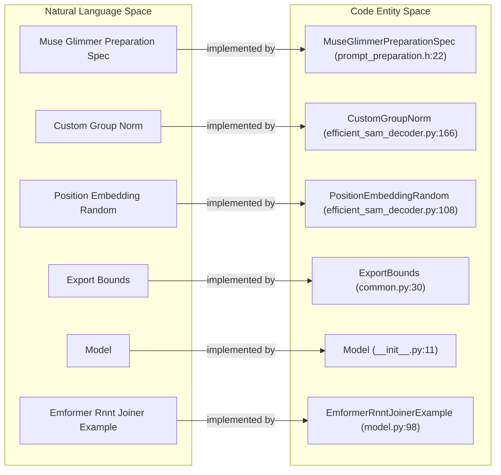
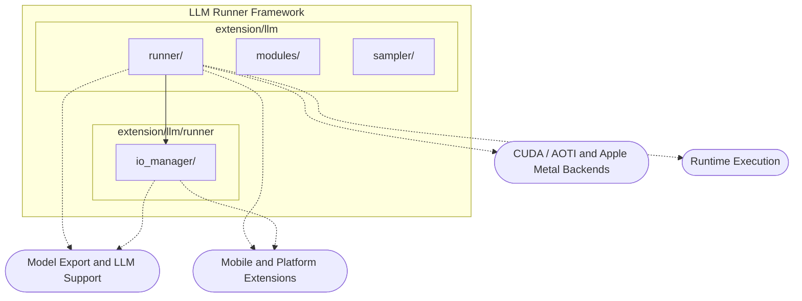
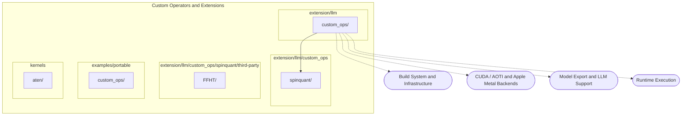
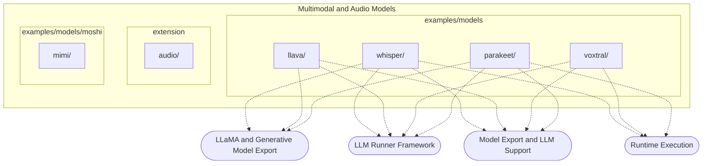

# Model Export and LLM Support

> Architectural specification and implementation reference for Model Export and LLM Support (40 relevant source files). Primary code entities: `MuseGlimmerImageSpan`, `MuseGlimmerPreparationSpec`, `MuseGlimmerPreparedInput`, `Backing`, `RequestHandle`.

Relevant source files

The following files were used as context for generating this wiki page:

- [examples/models/muse-glimmer/runtime/prompt_preparation.h](examples/models/muse-glimmer/runtime/prompt_preparation.h)
- [extension/llm/serving/serving_runtime.cpp](extension/llm/serving/serving_runtime.cpp)
- [extension/llm/cache/cache_registry.cpp](extension/llm/cache/cache_registry.cpp)
- [examples/models/__init__.py](examples/models/__init__.py)
- [extension/llm/serving/detail/prompt_preparer.h](extension/llm/serving/detail/prompt_preparer.h)
- [examples/models/codegen/__init__.py](examples/models/codegen/__init__.py)
- [examples/models/deeplab_v3/model.py](examples/models/deeplab_v3/model.py)
- [examples/models/muse-glimmer/runtime/cuda_dflash_executor.cpp](examples/models/muse-glimmer/runtime/cuda_dflash_executor.cpp)
- [examples/models/deit_tiny/model.py](examples/models/deit_tiny/model.py)
- [examples/models/checkpoint.py](examples/models/checkpoint.py)
- [extension/llm/custom_ops/op_sdpa.cpp](extension/llm/custom_ops/op_sdpa.cpp)
- [examples/models/gemma4_31b/gemma4_31b_engine.cpp](examples/models/gemma4_31b/gemma4_31b_engine.cpp)
- [examples/models/muse-glimmer/runtime/mlx_executor.cpp](examples/models/muse-glimmer/runtime/mlx_executor.cpp)
- [examples/models/efficient_sam/efficient_sam_core/efficient_sam_decoder.py](examples/models/efficient_sam/efficient_sam_core/efficient_sam_decoder.py)
- [examples/models/qwen3_5_moe/qwen35_moe_engine.cpp](examples/models/qwen3_5_moe/qwen35_moe_engine.cpp)
- [examples/models/emformer_rnnt/model.py](examples/models/emformer_rnnt/model.py)
- [examples/models/edsr/model.py](examples/models/edsr/model.py)
- [examples/models/efficient_sam/efficient_sam_core/efficient_sam_encoder.py](examples/models/efficient_sam/efficient_sam_core/efficient_sam_encoder.py)
- [examples/models/codegen/convert_weight.py](examples/models/codegen/convert_weight.py)
- [examples/models/parakeet/parakeet_transcriber.cpp](examples/models/parakeet/parakeet_transcriber.cpp)
- [examples/models/supertonic/runtime/supertonic_runner.cpp](examples/models/supertonic/runtime/supertonic_runner.cpp)
- [examples/models/efficient_sam/efficient_sam_core/efficient_sam.py](examples/models/efficient_sam/efficient_sam_core/efficient_sam.py)
- [examples/models/llava/export_llava.py](examples/models/llava/export_llava.py)
- [examples/models/llava/model.py](examples/models/llava/model.py)
- [examples/models/supertonic/export/common.py](examples/models/supertonic/export/common.py)
- [examples/models/llama/static_attention.py](examples/models/llama/static_attention.py)
- [examples/models/voxtral_tts/voxtral_tts_runner.cpp](examples/models/voxtral_tts/voxtral_tts_runner.cpp)
- [extension/llm/custom_ops/op_sdpa_impl.h](extension/llm/custom_ops/op_sdpa_impl.h)
- [examples/models/deepseek-r1-distill-llama-8B/README.md](examples/models/deepseek-r1-distill-llama-8B/README.md)
- [examples/models/dinov2/README.md](examples/models/dinov2/README.md)
- [examples/models/efficient_sam/README.md](examples/models/efficient_sam/README.md)
- [examples/models/gemma3/README.md](examples/models/gemma3/README.md)
- [extension/llm/README.md](extension/llm/README.md)
- [examples/models/gemma4/README.md](examples/models/gemma4/README.md)
- [examples/models/BUCK](examples/models/BUCK)

## Purpose and Scope

This chapter covers **Model Export and LLM Support** across the repository, detailing the core abstractions, data structures, transformation pipelines, and runtime/build integrations that implement this layer.

**Scope**: This document provides an architectural hub for the following child subsystems:
- **LLaMA and Generative Model Export**: See [[6.1-llama-model-export|LLaMA and Generative Model Export]].
- **LLM Runner Framework**: See [[6.2-llm-runner-framework|LLM Runner Framework]].
- **Custom Operators and Extensions**: See [[6.3-custom-operators-and-extensions|Custom Operators and Extensions]].
- **Multimodal and Audio Models**: See [[6.4-multimodal-and-audio-models|Multimodal and Audio Models]].

Sources: [examples/models/muse-glimmer/runtime/prompt_preparation.h:22-33](), [examples/models/efficient_sam/efficient_sam_core/efficient_sam_decoder.py:166-191](), [examples/models/efficient_sam/efficient_sam_core/efficient_sam_decoder.py:108-162](), [examples/models/supertonic/export/common.py:30-44]()

---

## System Mapping: Natural Language Space to Code Entity Space

Sources: [examples/models/muse-glimmer/runtime/prompt_preparation.h:22-33](), [examples/models/efficient_sam/efficient_sam_core/efficient_sam_decoder.py:166-191](), [examples/models/efficient_sam/efficient_sam_core/efficient_sam_decoder.py:108-162](), [examples/models/supertonic/export/common.py:30-44](), [examples/models/__init__.py:11-55]()

---

## 1. LLaMA and Generative Model Export

Architectural specification and implementation reference for LLaMA and Generative Model Export (40 relevant source files). Primary code entities: `Attention`, `forward`, `AttentionGatedDeltaNet`, `__init__`, `ETPybindEvalWrapper`. [examples/models/llama/eval_llama_lib.py:36-131](), [examples/models/llama/eval_llama_lib.py:134-179](), [examples/models/llama/eval_llama_lib.py:182-206]()

### Primary Code Entities

- **`GraphModuleEvalWrapper`** (Class in [examples/models/llama/eval_llama_lib.py:36-131]()): A wrapper class for ExecuTorch py-binded integration with the lm-evaluation-harness library.
- **`ETPybindEvalWrapper`** (Class in [examples/models/llama/eval_llama_lib.py:134-179]()): A wrapper class for ExecuTorch py-binded integration with the lm-evaluation-harness library.
- **`ETRunnerEvalWrapper`** (Class in [examples/models/llama/eval_llama_lib.py:182-206]()): A wrapper class for ExecuTorch Runtime integration with the lm-evaluation-harness library.
- **`Attention`** (Class in [examples/models/llama/attention.py:36-57]()): Abstract base class for attention mechanisms with unified interface.
- **`end`** (Method in [examples/models/llama/runner/static_attention_io_manager.h:448-450]()): ()
- **`get`** (Method in [examples/models/llama/runner/static_attention_io_manager.h:392-394]()): ()

### LLaMA and Generative Model Export Architecture Flow

```mermaid
flowchart TD
  subgraph sub_this["LLaMA and Generative Model Export"]
    subgraph sg_0["examples/models"]
      n_examples_models_llama["llama/"]
      n_examples_models_gemma4_31b["gemma4_31b/"]
      n_examples_models_qwen3_5_moe["qwen3_5_moe/"]
      n_examples_models_gemma4["gemma4/"]
    end
    subgraph sg_1["examples/models/llama"]
      n_examples_models_llama_experimental["experimental/"]
      n_examples_models_llama_evaluate["evaluate/"]
      n_examples_models_llama_runner["runner/"]
      n_examples_models_llama_source_transformation["source_transformation/"]
      n_examples_models_llama_config["config/"]
      n_examples_models_llama_params["params/"]
    end
    subgraph sg_2["examples/models/gemma4"]
      n_examples_models_gemma4_text_decoder["text_decoder/"]
      n_examples_models_gemma4_runner["runner/"]
    end
  end
  n_page_5_4_arm_tosa_and_ethos_u_backend(["ARM TOSA and Ethos-U Backend"])
  n_page_5_backend_delegation_architecture(["Backend Delegation Architecture"])
  n_page_6_model_export_and_llm_support(["Model Export and LLM Support"])
  n_page_8_runtime_execution(["Runtime Execution"])
  n_examples_models_llama_runner -.-> n_page_6_model_export_and_llm_support
  n_examples_models_llama_runner -.-> n_page_8_runtime_execution
  n_examples_models_llama --> n_examples_models_llama_evaluate
  n_examples_models_gemma4_31b --> n_examples_models_llama_runner
  n_examples_models_gemma4_31b -.-> n_page_8_runtime_execution
  n_examples_models_llama_runner --> n_examples_models_qwen3_5_moe
  n_examples_models_llama_runner -.-> n_page_5_4_arm_tosa_and_ethos_u_backend
  n_examples_models_qwen3_5_moe -.-> n_page_8_runtime_execution
  n_examples_models_gemma4_runner -.-> n_page_8_runtime_execution
  n_examples_models_llama --> n_examples_models_llama_source_transformation
  n_examples_models_llama -.-> n_page_5_backend_delegation_architecture
  n_examples_models_gemma4_runner --> n_examples_models_llama_runner
  n_examples_models_gemma4_runner -.-> n_page_6_model_export_and_llm_support
  n_examples_models_qwen3_5_moe -.-> n_page_6_model_export_and_llm_support
  n_examples_models_qwen3_5_moe -.-> n_page_5_backend_delegation_architecture
  n_examples_models_gemma4_31b -.-> n_page_5_backend_delegation_architecture
  n_examples_models_gemma4_text_decoder -.-> n_page_5_backend_delegation_architecture
  n_examples_models_llama_source_transformation -.-> n_page_5_backend_delegation_architecture
```

For details, see [[6.1-llama-model-export|LLaMA and Generative Model Export]].

Sources: [examples/models/llama/eval_llama_lib.py:36-131](), [examples/models/llama/eval_llama_lib.py:134-179](), [examples/models/llama/eval_llama_lib.py:182-206](), [examples/models/llama/attention.py:36-57]()

---

## 2. LLM Runner Framework

Architectural specification and implementation reference for LLM Runner Framework (36 relevant source files). Primary code entities: `check_vocab_size`, `read_int_method`, `read_int_tensor_method`, `read_required_positive_int`, `MultimodalPrefiller`. [extension/llm/runner/pybindings.cpp:142-252](), [extension/llm/runner/pybindings.cpp:47-139](), [extension/llm/runner/irunner.h:32-113]()

### Primary Code Entities

- **`PyMultimodalRunner`** (Class in [extension/llm/runner/pybindings.cpp:142-252]()): // Python wrapper class for MultimodalRunner
- **`PyTextLLMRunner`** (Class in [extension/llm/runner/pybindings.cpp:47-139]()): // Python wrapper class for TextLLMRunner
- **`GenerationConfig`** (Class in [extension/llm/runner/irunner.h:32-113]()): // Configuration struct for generation parameters, fields should be sorted in // alphabetic order
- **`MultiHeadAttention`** (Class in [extension/llm/modules/attention.py:22-314]()): NOTE: copied from Torchtune's mha.py. Should be mostly 1:1 except that SDPA is factored out so that it can be swapped for more efficient ExecuTorch-defined SDPA ops. Multi-headed a
- **`load`** (Method in [extension/llm/runner/multimodal_prefiller.cpp:255-278]()): /** * Load the Module for encoder prefill purpose. * @return The error code. */
- **`time_in_ms`** (Function in [extension/llm/runner/util.h:225-236]()): ()

### LLM Runner Framework Architecture Flow

For details, see [[6.2-llm-runner-framework|LLM Runner Framework]].

Sources: [extension/llm/runner/pybindings.cpp:142-252](), [extension/llm/runner/pybindings.cpp:47-139](), [extension/llm/runner/irunner.h:32-113](), [extension/llm/modules/attention.py:22-314]()

---

## 3. Custom Operators and Extensions

Architectural specification and implementation reference for Custom Operators and Extensions (39 relevant source files). Primary code entities: `gated_delta_rule_out_boxed`, `ChunkScratch`, `elems`, `view`, `MaybeQuantizedMatrixData`. [extension/llm/custom_ops/model_sharding.py:23-100](), [extension/llm/custom_ops/op_sdpa.cpp:1025-1076](), [extension/llm/custom_ops/op_sdpa_impl.h:38-63]()

### Primary Code Entities

- **`SplitGraph`** (Class in [extension/llm/custom_ops/model_sharding.py:23-100]()): Class to split the model to multiple partitions. Because there is limited memory on the device, it could not load all llama model in one pte.
- **`ChunkScratch`** (Class in [extension/llm/custom_ops/op_sdpa.cpp:1025-1076]()): // One worker's scratch for the chunked kernel, carved from a single arena so // there is one allocate_temp for the whole op and disjoint per-worker slabs. // D below is K for chan
- **`MaybeQuantizedMatrixData`** (Class in [extension/llm/custom_ops/op_sdpa_impl.h:38-63]()): Core implementation entity.
- **`cpu_flash_attention`** (Function in [extension/llm/custom_ops/op_sdpa_impl.h:755-1367]()): /** * @brief Implements Flash Attention algorithm on CPU * * This function computes scaled dot-product attention with optimizations for CPU. * It supports both regular and quantize
- **`gated_delta_rule_chunked`** (Function in [extension/llm/custom_ops/op_sdpa.cpp:1079-1419]()): // T != 1 (prefill) route. See gated_delta_rule_recurrence for kScalarDecay.
- **`sdpa_with_kv_cache_out`** (Function in [extension/llm/custom_ops/op_sdpa.cpp:672-712]()): /* Input params @param[in] q_projected Projected query with query weights. Format [n_layers, batch size, seq_len, num heads, head dim] @param[in] k_projected Projected query with k

### Custom Operators and Extensions Architecture Flow

For details, see [[6.3-custom-operators-and-extensions|Custom Operators and Extensions]].

Sources: [extension/llm/custom_ops/model_sharding.py:23-100](), [extension/llm/custom_ops/op_sdpa.cpp:1025-1076](), [extension/llm/custom_ops/op_sdpa_impl.h:38-63](), [extension/llm/custom_ops/op_sdpa_impl.h:755-1367]()

---

## 4. Multimodal and Audio Models

Architectural specification and implementation reference for Multimodal and Audio Models (36 relevant source files). Primary code entities: `LlavaEdgeManager`, `export`, `create_llava_config_from_args`, `export_all`, `Llava`. [examples/models/parakeet/export_parakeet_tdt.py:68-85](), [examples/models/parakeet/export_parakeet_tdt.py:48-65](), [examples/models/parakeet/export_parakeet_tdt.py:272-284]()

### Primary Code Entities

- **`DecoderStep`** (Class in [examples/models/parakeet/export_parakeet_tdt.py:68-85]()): Single decoder RNN step that outputs projected features for the joint network.
- **`EncoderWithProjection`** (Class in [examples/models/parakeet/export_parakeet_tdt.py:48-65]()): Encoder that outputs projected features ready for the joint network.
- **`JointWithArgmax`** (Class in [examples/models/parakeet/export_parakeet_tdt.py:272-284]()): Joint network that returns token and duration indices directly.
- **`WhisperAudioProcessor`** (Class in [extension/audio/mel_spectrogram.py:23-188]()): r""" Computes Mel spectrograms from mono audio input. Same as HuggingFace WhisperFeatureExtractor, but implemented in PyTorch Args: feature_size (`int`, defaults to 80): The featur
- **`export`** (Method in [examples/models/llava/export_llava.py:57-69]()): (self)
- **`embed_tokens`** (Method in [examples/models/llava/model.py:159-161]()): (self, tokens: torch.Tensor)

### Multimodal and Audio Models Architecture Flow

For details, see [[6.4-multimodal-and-audio-models|Multimodal and Audio Models]].

Sources: [examples/models/parakeet/export_parakeet_tdt.py:68-85](), [examples/models/parakeet/export_parakeet_tdt.py:48-65](), [examples/models/parakeet/export_parakeet_tdt.py:272-284](), [extension/audio/mel_spectrogram.py:23-188]()

---

## Official Documentation & Architectural References

- **Model and Backend Testing Framework** ([wiki/7.2-model-and-backend-testing-framework.md]()): # Model and Backend Testing Framework ↑ [[7-testing-and-cicd-infrastructure|Testing and CI/CD Infrastructure]] > Architectural specification and implementation reference for Model and Backend Testing Framework (40 relevant source files). Primary code entities: `MuseGlimmerImageSpan`, `MuseGlimmerPreparationSpec`, `MuseGlimmerPreparedInput`, `Backing`, `Backe
- **Testing and CI/CD Infrastructure** ([wiki/7-testing-and-cicd-infrastructure.md]()): # Testing and CI/CD Infrastructure > Architectural specification and implementation reference for Testing and CI/CD Infrastructure (36 relevant source files). Primary code entities: `BenchmarkResults`, `save_json`, `to_dict`, `to_v3_format`, `BenchmarkFilters`. 
 
Relevant source files
 The following files were used as context for ge
- **ExecuTorch DeepWiki** ([wiki/index.md]()): # ExecuTorch DeepWiki Generated from `home-jason-Project-deepwiki-executorch` at commit `b3b565b5b62f` (2026-11-15T15:02:11+00:00). ## Pages - [[1-overview|Overview]] — Architectural specification and implementation reference for Overview (10 relevant source files). Primary code entities: `Module`, `MethodHolder`, `PlannedMemory`, `EdgeProgramManager`, `__in
- **Multimodal and Audio Models** ([wiki/6.4-multimodal-and-audio-models.md]()): # Multimodal and Audio Models ↑ [[6-model-export-and-llm-support|Model Export and LLM Support]] > Architectural specification and implementation reference for Multimodal and Audio Models (36 relevant source files). Primary code entities: `LlavaEdgeManager`, `export`, `create_llava_config_from_args`, `export_all`, `Llava`. 
 
Relevant source f

Sources: [wiki/7.2-model-and-backend-testing-framework.md](), [wiki/7-testing-and-cicd-infrastructure.md](), [wiki/index.md](), [wiki/6.4-multimodal-and-audio-models.md]()

## Sub-pages

- [[6.1-llama-model-export|LLaMA and Generative Model Export]]
- [[6.2-llm-runner-framework|LLM Runner Framework]]
- [[6.3-custom-operators-and-extensions|Custom Operators and Extensions]]
- [[6.4-multimodal-and-audio-models|Multimodal and Audio Models]]

## Related pages

- [[1-overview|Overview]]
- [[6.1-llama-model-export|LLaMA and Generative Model Export]]
- [[6.2-llm-runner-framework|LLM Runner Framework]]
- [[6.3-custom-operators-and-extensions|Custom Operators and Extensions]]
- [[6.4-multimodal-and-audio-models|Multimodal and Audio Models]]
- [[1.1-getting-started|Getting Started]]
- [[1.2-export-api-and-recipe-system|Export API and Recipe System]]
- [[2.2-kernel-libraries-and-selective-build|Kernel Libraries and Selective Build]]

## Related documents

- `wiki/7.2-model-and-backend-testing-framework.md` — Model and Backend Testing Framework (score 242.736, via bm25)
- `wiki/7-testing-and-cicd-infrastructure.md` — Testing and CI/CD Infrastructure (score 135.8254, via bm25)
- `wiki/index.md` — ExecuTorch DeepWiki (score 134.499, via bm25)
- `wiki/6.4-multimodal-and-audio-models.md` — Multimodal and Audio Models (score 117.0739, via bm25)
- `wiki/6.2-llm-runner-framework.md` — LLM Runner Framework (score 114.6757, via bm25)

## Sources

- [`examples/models/muse-glimmer/runtime/prompt_preparation.h`](https://github.com/pytorch/executorch/blob/main/examples/models/muse-glimmer/runtime/prompt_preparation.h)
- [`extension/llm/serving/serving_runtime.cpp`](https://github.com/pytorch/executorch/blob/main/extension/llm/serving/serving_runtime.cpp)
- [`extension/llm/cache/cache_registry.cpp`](https://github.com/pytorch/executorch/blob/main/extension/llm/cache/cache_registry.cpp)
- [`examples/models/__init__.py`](https://github.com/pytorch/executorch/blob/main/examples/models/__init__.py)
- [`extension/llm/serving/detail/prompt_preparer.h`](https://github.com/pytorch/executorch/blob/main/extension/llm/serving/detail/prompt_preparer.h)
- [`examples/models/codegen/__init__.py`](https://github.com/pytorch/executorch/blob/main/examples/models/codegen/__init__.py)
- [`examples/models/deeplab_v3/model.py`](https://github.com/pytorch/executorch/blob/main/examples/models/deeplab_v3/model.py)
- [`examples/models/muse-glimmer/runtime/cuda_dflash_executor.cpp`](https://github.com/pytorch/executorch/blob/main/examples/models/muse-glimmer/runtime/cuda_dflash_executor.cpp)
- [`examples/models/deit_tiny/model.py`](https://github.com/pytorch/executorch/blob/main/examples/models/deit_tiny/model.py)
- [`examples/models/checkpoint.py`](https://github.com/pytorch/executorch/blob/main/examples/models/checkpoint.py)
- [`extension/llm/custom_ops/op_sdpa.cpp`](https://github.com/pytorch/executorch/blob/main/extension/llm/custom_ops/op_sdpa.cpp)
- [`examples/models/gemma4_31b/gemma4_31b_engine.cpp`](https://github.com/pytorch/executorch/blob/main/examples/models/gemma4_31b/gemma4_31b_engine.cpp)
- [`examples/models/muse-glimmer/runtime/mlx_executor.cpp`](https://github.com/pytorch/executorch/blob/main/examples/models/muse-glimmer/runtime/mlx_executor.cpp)
- [`examples/models/efficient_sam/efficient_sam_core/efficient_sam_decoder.py`](https://github.com/pytorch/executorch/blob/main/examples/models/efficient_sam/efficient_sam_core/efficient_sam_decoder.py)
- [`examples/models/qwen3_5_moe/qwen35_moe_engine.cpp`](https://github.com/pytorch/executorch/blob/main/examples/models/qwen3_5_moe/qwen35_moe_engine.cpp)
- [`examples/models/emformer_rnnt/model.py`](https://github.com/pytorch/executorch/blob/main/examples/models/emformer_rnnt/model.py)
- [`examples/models/edsr/model.py`](https://github.com/pytorch/executorch/blob/main/examples/models/edsr/model.py)
- [`examples/models/efficient_sam/efficient_sam_core/efficient_sam_encoder.py`](https://github.com/pytorch/executorch/blob/main/examples/models/efficient_sam/efficient_sam_core/efficient_sam_encoder.py)
- [`examples/models/codegen/convert_weight.py`](https://github.com/pytorch/executorch/blob/main/examples/models/codegen/convert_weight.py)
- [`examples/models/parakeet/parakeet_transcriber.cpp`](https://github.com/pytorch/executorch/blob/main/examples/models/parakeet/parakeet_transcriber.cpp)
- [`examples/models/supertonic/runtime/supertonic_runner.cpp`](https://github.com/pytorch/executorch/blob/main/examples/models/supertonic/runtime/supertonic_runner.cpp)
- [`examples/models/efficient_sam/efficient_sam_core/efficient_sam.py`](https://github.com/pytorch/executorch/blob/main/examples/models/efficient_sam/efficient_sam_core/efficient_sam.py)
- [`examples/models/llava/export_llava.py`](https://github.com/pytorch/executorch/blob/main/examples/models/llava/export_llava.py)
- [`examples/models/llava/model.py`](https://github.com/pytorch/executorch/blob/main/examples/models/llava/model.py)
- [`examples/models/supertonic/export/common.py`](https://github.com/pytorch/executorch/blob/main/examples/models/supertonic/export/common.py)
- [`examples/models/llama/static_attention.py`](https://github.com/pytorch/executorch/blob/main/examples/models/llama/static_attention.py)
- [`examples/models/voxtral_tts/voxtral_tts_runner.cpp`](https://github.com/pytorch/executorch/blob/main/examples/models/voxtral_tts/voxtral_tts_runner.cpp)
- [`extension/llm/custom_ops/op_sdpa_impl.h`](https://github.com/pytorch/executorch/blob/main/extension/llm/custom_ops/op_sdpa_impl.h)
- [`examples/models/deepseek-r1-distill-llama-8B/README.md`](https://github.com/pytorch/executorch/blob/main/examples/models/deepseek-r1-distill-llama-8B/README.md)
- [`examples/models/dinov2/README.md`](https://github.com/pytorch/executorch/blob/main/examples/models/dinov2/README.md)
- [`examples/models/efficient_sam/README.md`](https://github.com/pytorch/executorch/blob/main/examples/models/efficient_sam/README.md)
- [`examples/models/gemma3/README.md`](https://github.com/pytorch/executorch/blob/main/examples/models/gemma3/README.md)
- [`extension/llm/README.md`](https://github.com/pytorch/executorch/blob/main/extension/llm/README.md)
- [`examples/models/gemma4/README.md`](https://github.com/pytorch/executorch/blob/main/examples/models/gemma4/README.md)
- [`examples/models/BUCK`](https://github.com/pytorch/executorch/blob/main/examples/models/BUCK)
- [`examples/models/codegen/BUCK`](https://github.com/pytorch/executorch/blob/main/examples/models/codegen/BUCK)
- [`examples/models/deeplab_v3/BUCK`](https://github.com/pytorch/executorch/blob/main/examples/models/deeplab_v3/BUCK)
- [`examples/models/dinov2/CMakeLists.txt`](https://github.com/pytorch/executorch/blob/main/examples/models/dinov2/CMakeLists.txt)
- [`examples/models/edsr/BUCK`](https://github.com/pytorch/executorch/blob/main/examples/models/edsr/BUCK)
- [`examples/models/emformer_rnnt/BUCK`](https://github.com/pytorch/executorch/blob/main/examples/models/emformer_rnnt/BUCK)

## Dynamic Knowledge Links (Code Graph ↔ LLM-Wiki / RAG)

### Linked Architecture & Design Documents

| Document | Match Channel | Score | Shared Code Symbols |
|---|---|---|---|
| [[7.2-model-and-backend-testing-framework|Model and Backend Testing Framework]] | `bm25+entity(3)` | `247.236` | `Attention`, `ExportBounds`, `Model` |
| [[7-testing-and-cicd-infrastructure|Testing and CI/CD Infrastructure]] | `bm25+entity(1)` | `137.325` | `Model` |
| [[index|ExecuTorch DeepWiki]] | `bm25` | `134.499` | *(lexical/graph match)* |
| [[6.1-llama-model-export|LLaMA and Generative Model Export]] | `wikilink:7.2-model-and-backend-testing-framework+entity(2)` | `124.368` | `Attention`, `Model` |
| [[7.1-cicd-workflows-and-validation|CI/CD Workflows and Validation]] | `wikilink:7.2-model-and-backend-testing-framework+entity(1)` | `122.868` | `Model` |
| [[7.3-performance-benchmarking-and-profiling|Performance Benchmarking and Profiling]] | `wikilink:7.2-model-and-backend-testing-framework+entity(1)` | `122.868` | `Model` |

### High-Centrality Bridge Symbols (CBM Graph)

| Symbol | Kind | Source Location | Fan-In / Fan-Out |
|---|---|---|---|
| `MuseGlimmerPreparationSpec` | Class | [examples/models/muse-glimmer/runtime/prompt_preparation.h:22-33]() | in: `0` / out: `0` |
| `CustomGroupNorm` | Class | [examples/models/efficient_sam/efficient_sam_core/efficient_sam_decoder.py:166-191]() | in: `1` / out: `0` |
| `PositionEmbeddingRandom` | Class | [examples/models/efficient_sam/efficient_sam_core/efficient_sam_decoder.py:108-162]() | in: `1` / out: `0` |
| `ExportBounds` | Class | [examples/models/supertonic/export/common.py:30-44]() | in: `9` / out: `0` |
| `Model` | Class | [examples/models/__init__.py:11-55]() | in: `3` / out: `0` |
| `EmformerRnntJoinerExample` | Class | [examples/models/emformer_rnnt/model.py:98-112]() | in: `1` / out: `0` |

Sources: [examples/models/muse-glimmer/runtime/prompt_preparation.h:22-33](), [examples/models/efficient_sam/efficient_sam_core/efficient_sam_decoder.py:166-191](), [examples/models/efficient_sam/efficient_sam_core/efficient_sam_decoder.py:108-162](), [examples/models/supertonic/export/common.py:30-44]()

### Cross-Subsystem Coupling

- [[6.1-llama-model-export|LLaMA and Generative Model Export]] — call/import coupling weight `88.0`
- [[8.1-core-runtime-architecture|Core Runtime Architecture]] — call/import coupling weight `88.0`
- [[8-runtime-execution|Runtime Execution]] — call/import coupling weight `87.0`
- [[9-mobile-and-platform-extensions|Mobile and Platform Extensions]] — call/import coupling weight `75.0`
- [[6.2-llm-runner-framework|LLM Runner Framework]] — call/import coupling weight `75.0`
- [[2-build-system-and-infrastructure|Build System and Infrastructure]] — call/import coupling weight `60.0`
