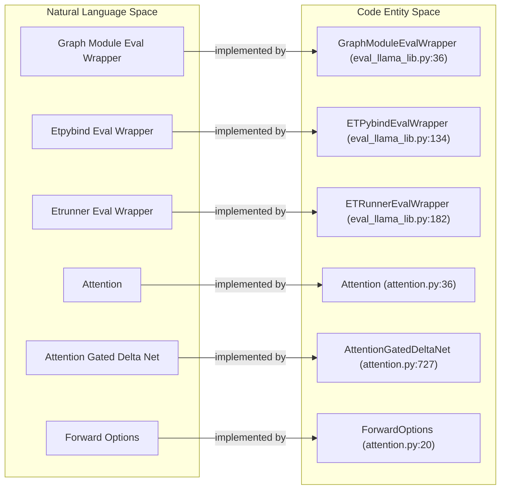
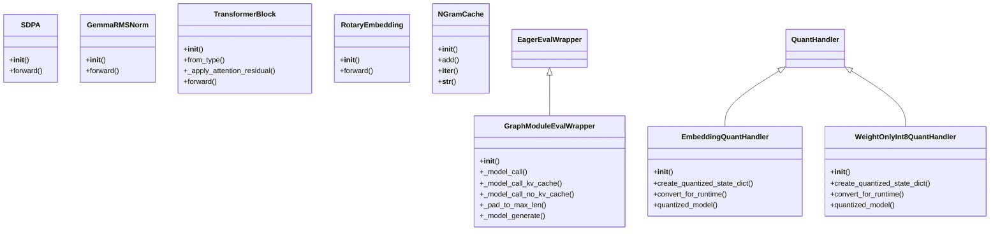
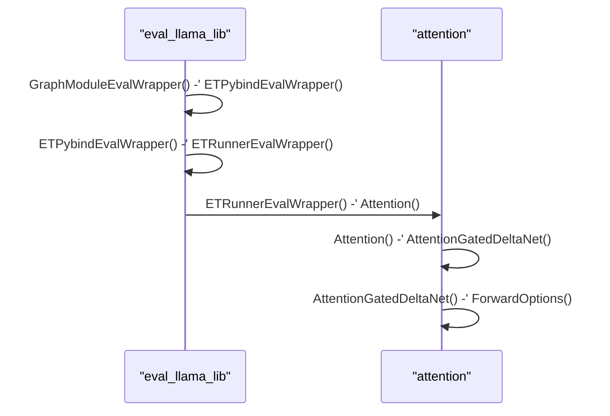

# LLaMA and Generative Model Export

↑ [[6-model-export-and-llm-support|Model Export and LLM Support]]

> Architectural specification and implementation reference for LLaMA and Generative Model Export (40 relevant source files). Primary code entities: `Attention`, `forward`, `AttentionGatedDeltaNet`, `__init__`, `ETPybindEvalWrapper`.

<details>
<summary>Relevant source files</summary>

The following files were used as context for generating this wiki page:

- [examples/models/llama/attention.py](examples/models/llama/attention.py)
- [examples/models/llama/eval_llama_lib.py](examples/models/llama/eval_llama_lib.py)
- [examples/models/llama/export_llama_lib.py](examples/models/llama/export_llama_lib.py)
- [examples/models/gemma4_31b/gemma4_31b_engine.cpp](examples/models/gemma4_31b/gemma4_31b_engine.cpp)
- [examples/models/llama/experimental/subclass.py](examples/models/llama/experimental/subclass.py)
- [examples/models/llama/llama_transformer.py](examples/models/llama/llama_transformer.py)
- [examples/models/qwen3_5_moe/qwen35_moe_engine.cpp](examples/models/qwen3_5_moe/qwen35_moe_engine.cpp)
- [examples/models/llama/evaluate/eager_eval.py](examples/models/llama/evaluate/eager_eval.py)
- [examples/models/llama/static_attention.py](examples/models/llama/static_attention.py)
- [examples/models/llama/__init__.py](examples/models/llama/__init__.py)
- [examples/models/llama/norm.py](examples/models/llama/norm.py)
- [examples/models/llama/rope.py](examples/models/llama/rope.py)
- [examples/models/llama/feed_forward.py](examples/models/llama/feed_forward.py)
- [examples/models/gemma4/export_gemma4.py](examples/models/gemma4/export_gemma4.py)
- [examples/models/llama/model.py](examples/models/llama/model.py)
- [examples/models/llama/lora.py](examples/models/llama/lora.py)
- [examples/models/llama/convert_weights.py](examples/models/llama/convert_weights.py)
- [examples/models/gemma4_31b/model.py](examples/models/gemma4_31b/model.py)
- [examples/models/qwen3_5_moe/model.py](examples/models/qwen3_5_moe/model.py)
- [examples/models/llama/eval_llama.py](examples/models/llama/eval_llama.py)
- [examples/models/llama/model_args.py](examples/models/llama/model_args.py)
- [examples/models/gemma4/text_decoder/gemma4_config.py](examples/models/gemma4/text_decoder/gemma4_config.py)
- [examples/models/llama/experimental/generate.py](examples/models/llama/experimental/generate.py)
- [examples/models/qwen3_5_moe/export.py](examples/models/qwen3_5_moe/export.py)
- [examples/models/gemma4/text_decoder/gemma4_attention.py](examples/models/gemma4/text_decoder/gemma4_attention.py)
- [examples/models/gemma4/runner/gemma4_runner.cpp](examples/models/gemma4/runner/gemma4_runner.cpp)
- [examples/models/llama/runner/static_attention_io_manager.h](examples/models/llama/runner/static_attention_io_manager.h)
- [examples/models/llama/source_transformation/quantize.py](examples/models/llama/source_transformation/quantize.py)
- [examples/models/llama/README.md](examples/models/llama/README.md)
- [examples/models/llama/UTILS.md](examples/models/llama/UTILS.md)
- [examples/models/llama/experimental/README.md](examples/models/llama/experimental/README.md)
- [examples/models/llama/non_cpu_backends.md](examples/models/llama/non_cpu_backends.md)
- [docs/source/llm/build-run-llama3-qualcomm-ai-engine-direct-backend.md](docs/source/llm/build-run-llama3-qualcomm-ai-engine-direct-backend.md)
- [docs/source/llm/export-custom-llm.md](docs/source/llm/export-custom-llm.md)
- [examples/models/llama/BUCK](examples/models/llama/BUCK)

</details>

## Purpose and Scope

Architectural specification and implementation reference for LLaMA and Generative Model Export (40 relevant source files). Primary code entities: `Attention`, `forward`, `AttentionGatedDeltaNet`, `__init__`, `ETPybindEvalWrapper`.

Primary code entities analyzed on this page include `GraphModuleEvalWrapper` ([examples/models/llama/eval_llama_lib.py:36-131]()), `ETPybindEvalWrapper` ([examples/models/llama/eval_llama_lib.py:134-179]()), `ETRunnerEvalWrapper` ([examples/models/llama/eval_llama_lib.py:182-206]()), `Attention` ([examples/models/llama/attention.py:36-57]()), `AttentionGatedDeltaNet` ([examples/models/llama/attention.py:727-970]()).

For the parent architectural layer, see [[6-model-export-and-llm-support|Model Export and LLM Support]]. Related sibling subsystems: [[6.2-llm-runner-framework|LLM Runner Framework]], [[6.3-custom-operators-and-extensions|Custom Operators and Extensions]], [[6.4-multimodal-and-audio-models|Multimodal and Audio Models]].

Sources: [examples/models/llama/eval_llama_lib.py:36-131](), [examples/models/llama/eval_llama_lib.py:134-179](), [examples/models/llama/eval_llama_lib.py:182-206](), [examples/models/llama/attention.py:36-57]()

---

## 1. High-Level Architecture and Data Flow

### Natural Language Space to Code Entity Space Mapping

The following diagram maps domain concepts in this subsystem to their concrete code entities:



### Subsystem Component & Dependency Flow

```mermaid
flowchart TD
  subgraph sub_this["LLaMA and Generative Model Export"]
    subgraph sg_0["examples/models"]
      n_examples_models_llama["llama/"]
      n_examples_models_gemma4_31b["gemma4_31b/"]
      n_examples_models_qwen3_5_moe["qwen3_5_moe/"]
      n_examples_models_gemma4["gemma4/"]
    end
    subgraph sg_1["examples/models/llama"]
      n_examples_models_llama_experimental["experimental/"]
      n_examples_models_llama_evaluate["evaluate/"]
      n_examples_models_llama_runner["runner/"]
      n_examples_models_llama_source_transformation["source_transformation/"]
      n_examples_models_llama_config["config/"]
      n_examples_models_llama_params["params/"]
    end
    subgraph sg_2["examples/models/gemma4"]
      n_examples_models_gemma4_text_decoder["text_decoder/"]
      n_examples_models_gemma4_runner["runner/"]
    end
  end
  n_page_5_4_arm_tosa_and_ethos_u_backend(["ARM TOSA and Ethos-U Backend"])
  n_page_5_backend_delegation_architecture(["Backend Delegation Architecture"])
  n_page_6_model_export_and_llm_support(["Model Export and LLM Support"])
  n_page_8_runtime_execution(["Runtime Execution"])
  n_examples_models_llama_runner -.-> n_page_6_model_export_and_llm_support
  n_examples_models_llama_runner -.-> n_page_8_runtime_execution
  n_examples_models_llama --> n_examples_models_llama_evaluate
  n_examples_models_gemma4_31b --> n_examples_models_llama_runner
  n_examples_models_gemma4_31b -.-> n_page_8_runtime_execution
  n_examples_models_llama_runner --> n_examples_models_qwen3_5_moe
  n_examples_models_llama_runner -.-> n_page_5_4_arm_tosa_and_ethos_u_backend
  n_examples_models_qwen3_5_moe -.-> n_page_8_runtime_execution
  n_examples_models_gemma4_runner -.-> n_page_8_runtime_execution
  n_examples_models_llama --> n_examples_models_llama_source_transformation
  n_examples_models_llama -.-> n_page_5_backend_delegation_architecture
  n_examples_models_gemma4_runner --> n_examples_models_llama_runner
  n_examples_models_gemma4_runner -.-> n_page_6_model_export_and_llm_support
  n_examples_models_qwen3_5_moe -.-> n_page_6_model_export_and_llm_support
  n_examples_models_qwen3_5_moe -.-> n_page_5_backend_delegation_architecture
  n_examples_models_gemma4_31b -.-> n_page_5_backend_delegation_architecture
  n_examples_models_gemma4_text_decoder -.-> n_page_5_backend_delegation_architecture
  n_examples_models_llama_source_transformation -.-> n_page_5_backend_delegation_architecture
```



Cross-subsystem call and import edges connect **LLaMA and Generative Model Export** with [[7.2-model-and-backend-testing-framework|Model and Backend Testing Framework]] (coupling `76.0`), [[6-model-export-and-llm-support|Model Export and LLM Support]] (coupling `68.0`), [[8.1-core-runtime-architecture|Core Runtime Architecture]] (coupling `39.0`), [[8-runtime-execution|Runtime Execution]] (coupling `38.0`), [[5.4-arm-tosa-and-ethos-u-backend|ARM TOSA and Ethos-U Backend]] (coupling `36.0`).

| Module Directory | Files | Primary Code Entities | Source Citations |
|---|---|---|---|
| `examples/models/llama` | 19 | `GraphModuleEvalWrapper`, `ETPybindEvalWrapper`, `ETRunnerEvalWrapper`, `Attention` | [examples/models/llama/eval_llama_lib.py:36-131]() [examples/models/llama/eval_llama_lib.py:134-179]() |
| `examples/models/llama/experimental` | 4 | `GGMLInt4LinearWeight`, `QuantizedLinearWeightBase`, `from_float`, `to_float` | [examples/models/llama/experimental/subclass.py:303-413]() [examples/models/llama/experimental/subclass.py:137-300]() |
| `examples/models/qwen3_5_moe` | 3 | `GemmaRMSNorm`, `FusedMoEExperts`, `RMSNormGated`, `RotaryEmbedding` | [examples/models/qwen3_5_moe/model.py:111-122]() [examples/models/qwen3_5_moe/model.py:461-533]() |
| `examples/models/gemma4/text_decoder` | 2 | `Gemma4Attention`, `Gemma4KVCache`, `Gemma4Config`, `Gemma4QuantizedKVCache` | [examples/models/gemma4/text_decoder/gemma4_attention.py:132-483]() [examples/models/gemma4/text_decoder/gemma4_attention.py:77-129]() |
| `examples/models/gemma4_31b` | 2 | `Gemma4Attention`, `RingKVCache`, `Gemma4_31BSession`, `Gemma4DecoderLayer` | [examples/models/gemma4_31b/model.py:206-355]() [examples/models/gemma4_31b/model.py:65-102]() |
| `examples/models/llama/runner` | 2 | `StaticAttentionIOManager`, `StaticAttentionIOConfig`, `StaticAttentionMask`, `StaticKVCache` | [examples/models/llama/runner/static_attention_io_manager.h:477-1128]() [examples/models/llama/runner/static_attention_io_manager.h:479-499]() |
| `examples/models/gemma4` | 1 | `_HFAudioEncoderWithProjection`, `_HFVisionEncoderWithProjection`, `export_single_pte`, `_export_text_decoder` | [examples/models/gemma4/export_gemma4.py:97-127]() [examples/models/gemma4/export_gemma4.py:283-342]() |
| `examples/models/gemma4/runner` | 1 | `load`, `decode_loop`, `generate_vision`, `generate` | [examples/models/gemma4/runner/gemma4_runner.cpp:40-100]() [examples/models/gemma4/runner/gemma4_runner.cpp:290-399]() |

Sources: [examples/models/llama/eval_llama_lib.py:36-131](), [examples/models/llama/eval_llama_lib.py:134-179](), [examples/models/llama/eval_llama_lib.py:182-206](), [examples/models/llama/attention.py:36-57](), [examples/models/llama/attention.py:727-970]()

---

## 2. Core Data Structures and Implementation Details

### Class and Entity Relationship Diagram



### `GraphModuleEvalWrapper` (Class)

- **Source Location**: [examples/models/llama/eval_llama_lib.py:36-131]()
- **Declaration**: `Class GraphModuleEvalWrapper`
- **Graph Centrality**: fan-in `3` callers, fan-out `0` callees
- **Responsibility**: A wrapper class for ExecuTorch py-binded integration with the lm-evaluation-harness library.

```python
// examples/models/llama/eval_llama_lib.py:36-51
class GraphModuleEvalWrapper(EagerEvalWrapper):
    """
    A wrapper class for ExecuTorch py-binded integration with the
    lm-evaluation-harness library.
    """

    def __init__(
        self,
        model: torch.fx.GraphModule,
        tokenizer: Union[SentencePieceTokenizer, Tiktoken],
        max_seq_length: Optional[int] = None,
        use_kv_cache: bool = False,
        generate_full_logits: bool = False,
        enable_dynamic_shape: bool = True,
        device: Optional[str] = None,
    ):
```

### `ETPybindEvalWrapper` (Class)

- **Source Location**: [examples/models/llama/eval_llama_lib.py:134-179]()
- **Declaration**: `Class ETPybindEvalWrapper`
- **Graph Centrality**: fan-in `1` callers, fan-out `0` callees
- **Responsibility**: A wrapper class for ExecuTorch py-binded integration with the lm-evaluation-harness library.

```python
// examples/models/llama/eval_llama_lib.py:134-149
class ETPybindEvalWrapper(EagerEvalWrapper):
    """
    A wrapper class for ExecuTorch py-binded integration with the
    lm-evaluation-harness library.
    """

    def __init__(
        self,
        model: str,
        tokenizer: Union[SentencePieceTokenizer, Tiktoken],
        max_seq_length: Optional[int] = None,
    ):
        super().__init__(None, tokenizer, max_seq_length)  # pyre-ignore
        self._model = model  # Expects model to be path to a .pte file

        from executorch.extension.pybindings.portable_lib import _load_for_executorch
```

### `ETRunnerEvalWrapper` (Class)

- **Source Location**: [examples/models/llama/eval_llama_lib.py:182-206]()
- **Declaration**: `Class ETRunnerEvalWrapper`
- **Graph Centrality**: fan-in `1` callers, fan-out `0` callees
- **Responsibility**: A wrapper class for ExecuTorch Runtime integration with the lm-evaluation-harness library.

```python
// examples/models/llama/eval_llama_lib.py:182-197
class ETRunnerEvalWrapper(EagerEvalWrapper):
    """
    A wrapper class for ExecuTorch Runtime integration with the
    lm-evaluation-harness library.
    """

    def __init__(
        self,
        model: str,
        tokenizer: Union[SentencePieceTokenizer, Tiktoken],
        tokenizer_bin: str,
        max_seq_length: Optional[int] = None,
    ):
        super().__init__(None, tokenizer, max_seq_length)  # pyre-ignore
        self._model = model
        self._tokenizer_bin = tokenizer_bin
```

### `Attention` (Class)

- **Source Location**: [examples/models/llama/attention.py:36-57]()
- **Declaration**: `Class Attention`
- **Graph Centrality**: fan-in `0` callers, fan-out `0` callees
- **Responsibility**: Abstract base class for attention mechanisms with unified interface.

### `AttentionGatedDeltaNet` (Class)

- **Source Location**: [examples/models/llama/attention.py:727-970]()
- **Declaration**: `Class AttentionGatedDeltaNet`
- **Graph Centrality**: fan-in `0` callers, fan-out `0` callees
- **Responsibility**: Qwen3.5 linear-attention (Gated DeltaNet) block with internal state.

### `end` (Method)

- **Source Location**: [examples/models/llama/runner/static_attention_io_manager.h:448-450]()
- **Declaration**: `()`
- **Graph Centrality**: fan-in `98` callers, fan-out `0` callees

Sources: [examples/models/llama/eval_llama_lib.py:36-131](), [examples/models/llama/eval_llama_lib.py:134-179](), [examples/models/llama/eval_llama_lib.py:182-206](), [examples/models/llama/attention.py:36-57](), [examples/models/llama/attention.py:727-970]()

---

## 3. Execution and Call Flow

The sequence diagram below traces the runtime/compile-time call chain across components in this module:



Sources: [examples/models/llama/eval_llama_lib.py:36-131](), [examples/models/llama/eval_llama_lib.py:134-179](), [examples/models/llama/eval_llama_lib.py:182-206](), [examples/models/llama/attention.py:36-57](), [examples/models/llama/attention.py:727-970]()

---

## 4. Key API and Symbol Reference

| Code Entity | Kind | Location | Fan-In / Out | Role & Signature |
|---|---|---|---|---|
| `GraphModuleEvalWrapper` | Class | [examples/models/llama/eval_llama_lib.py:36-131]() | `3` / `0` | A wrapper class for ExecuTorch py-binded integration with the |
| `ETPybindEvalWrapper` | Class | [examples/models/llama/eval_llama_lib.py:134-179]() | `1` / `0` | A wrapper class for ExecuTorch py-binded integration with the |
| `ETRunnerEvalWrapper` | Class | [examples/models/llama/eval_llama_lib.py:182-206]() | `1` / `0` | A wrapper class for ExecuTorch Runtime integration with the |
| `Attention` | Class | [examples/models/llama/attention.py:36-57]() | `0` / `0` | Abstract base class for attention mechanisms with unified interface. |
| `AttentionGatedDeltaNet` | Class | [examples/models/llama/attention.py:727-970]() | `0` / `0` | Qwen3.5 linear-attention (Gated DeltaNet) block with internal state. |
| `ForwardOptions` | Class | [examples/models/llama/attention.py:20-33]() | `0` / `0` | Optional parameters for `Attention.forward` (compative with Python 3.10 and plus). |
| `SDPA` | Class | [examples/models/llama/attention.py:147-178]() | `5` / `0` | — |
| `EagerEvalWrapper` | Class | [examples/models/llama/evaluate/eager_eval.py:21-93]() | `1` / `0` | A wrapper class based on GPTFast, providing integration with the lm-evaluation-harness library. |
| `RotaryEmbedding` | Class | [examples/models/llama/rope.py:119-131]() | `2` / `0` | # Wrap apply_rotary_emb in a module to enable it to be module swapped out. |
| `GGMLInt4LinearWeight` | Class | [examples/models/llama/experimental/subclass.py:303-413]() | `0` / `0` | A Tensor subclass that when applied to a weight used in a linear op/module, |
| `QuantizedLinearWeightBase` | Class | [examples/models/llama/experimental/subclass.py:137-300]() | `0` / `0` | *** LEGACY TORCHAO TENSOR SUBCLASS *** |
| `GemmaRMSNorm` | Class | [examples/models/qwen3_5_moe/model.py:111-122]() | `3` / `0` | RMSNorm with unit offset: x * (1 + weight). |
| `_HFAudioEncoderWithProjection` | Class | [examples/models/gemma4/export_gemma4.py:97-127]() | `1` / `0` | Thin wrapper combining HF's Gemma4AudioModel + Gemma4MultimodalEmbedder. |
| `_HFVisionEncoderWithProjection` | Class | [examples/models/gemma4/export_gemma4.py:283-342]() | `1` / `0` | Thin wrapper combining HF's Gemma4VisionModel + Gemma4MultimodalEmbedder. |
| `StaticAttention` | Class | [examples/models/llama/static_attention.py:832-1623]() | `0` / `0` | An attention implementation meant for NPUs that require static shapes and are not |
| `Gemma4Attention` | Class | [examples/models/gemma4_31b/model.py:206-355]() | `1` / `0` | Gemma 4 attention with QK-norm, per-layer head_dim, RoPE, KV cache, and SDPA. |
| `RingKVCache` | Class | [examples/models/gemma4_31b/model.py:65-102]() | `1` / `0` | Ring-buffer KV cache for sliding window attention. |
| `LoRALinear` | Class | [examples/models/llama/lora.py:14-71]() | `0` / `0` | LoRA linear layer as introduced in `LoRA: Low-Rank Adaptation of Large Language Models <https://arxiv.org/abs/ |
| `FusedMoEExperts` | Class | [examples/models/qwen3_5_moe/model.py:461-533]() | `1` / `0` | Expert weights stored as stacked tensors for the fused MoE Triton kernel. |
| `RMSNormGated` | Class | [examples/models/qwen3_5_moe/model.py:125-137]() | `1` / `0` | RMSNorm(x) * silu(z) — used in GatedDeltaNet output. |
| `RotaryEmbedding` | Class | [examples/models/qwen3_5_moe/model.py:144-180]() | `1` / `0` | Partial RoPE — only rotates first `rotary_dim` dimensions of each head. |
| `SwiGLU` | Class | [examples/models/qwen3_5_moe/model.py:577-590]() | `1` / `0` | SwiGLU MLP with fused gate+up projection. |

Sources: [examples/models/llama/eval_llama_lib.py:36-131](), [examples/models/llama/eval_llama_lib.py:134-179](), [examples/models/llama/eval_llama_lib.py:182-206](), [examples/models/llama/attention.py:36-57](), [examples/models/llama/attention.py:727-970](), [examples/models/llama/attention.py:20-33]()

---

## 5. Official Documentation and Design Context

The following linked documentation sections from `llm-wiki` (`raw/`) provide additional architectural context, tutorials, and design invariants for this subsystem:

- **Model Export and LLM Support** ([wiki/6-model-export-and-llm-support.md](), score `151.0893`) (sections: `Model Export and LLM Support`, `Purpose and Scope`, `System Mapping: Natural Language Space to Code Entity Space`, `1. LLaMA and Generative Model Export`): # Model Export and LLM Support > Architectural specification and implementation reference for Model Export and LLM Support (40 relevant source files). Primary code entities: `MuseGlimmerImageSpan`, `MuseGlimmerPreparationSpec`, `MuseGlimmerPreparedInput`, `Backing`, `RequestHandle`. <details> <summary>Relevant source files</summary> The following files were used as context for generating this wiki page: - [examples/m
- **ExecuTorch DeepWiki** ([wiki/index.md](), score `119.7286`) (sections: `ExecuTorch DeepWiki`, `Pages`): # ExecuTorch DeepWiki Generated from `home-jason-Project-deepwiki-executorch` at commit `b3b565b5b62f` (2026-11-15T15:02:11+00:00). ## Pages - [[1-overview|Overview]] — Architectural specification and implementation reference for Overview (10 relevant source files). Primary code entities: `Module`, `MethodHolder`, `PlannedMemory`, `EdgeProgramManager`, `__init__`. - [[1.1-getting-started|Getting Started]] — Architect
- **Model and Backend Testing Framework** ([wiki/7.2-model-and-backend-testing-framework.md](), score `100.5079`) (sections: `Model and Backend Testing Framework`, `Purpose and Scope`, `1. High-Level Architecture and Data Flow`, `Natural Language Space to Code Entity Space Mapping`): # Model and Backend Testing Framework ↑ [[7-testing-and-cicd-infrastructure|Testing and CI/CD Infrastructure]] > Architectural specification and implementation reference for Model and Backend Testing Framework (40 relevant source files). Primary code entities: `MuseGlimmerImageSpan`, `MuseGlimmerPreparationSpec`, `MuseGlimmerPreparedInput`, `Backing`, `Backend`. <details> <summary>Relevant source files</summary> The 
- **LLM Runner Framework** ([wiki/6.2-llm-runner-framework.md](), score `94.7616`) (sections: `LLM Runner Framework`, `Purpose and Scope`, `1. High-Level Architecture and Data Flow`, `Natural Language Space to Code Entity Space Mapping`): # LLM Runner Framework ↑ [[6-model-export-and-llm-support|Model Export and LLM Support]] > Architectural specification and implementation reference for LLM Runner Framework (36 relevant source files). Primary code entities: `check_vocab_size`, `read_int_method`, `read_int_tensor_method`, `read_required_positive_int`, `MultimodalPrefiller`. <details> <summary>Relevant source files</summary> The following files were us

Sources: [wiki/6-model-export-and-llm-support.md](), [wiki/index.md](), [wiki/7.2-model-and-backend-testing-framework.md](), [wiki/6.2-llm-runner-framework.md]()

## Related pages

- [[6-model-export-and-llm-support|Model Export and LLM Support]]
- [[1.1-getting-started|Getting Started]]
- [[1.2-export-api-and-recipe-system|Export API and Recipe System]]
- [[2.2-kernel-libraries-and-selective-build|Kernel Libraries and Selective Build]]
- [[2.3-schema-generation-and-flatbuffers|Schema Generation and FlatBuffers]]
- [[3.4-program-emission-and-serialization|Program Emission and Serialization]]
- [[3.5-verification-and-dialect-system|Verification and Dialect System]]
- [[4-quantization-systems|Quantization Systems]]

## Related documents

- `wiki/6-model-export-and-llm-support.md` — Model Export and LLM Support (score 151.0893, via bm25)
- `wiki/index.md` — ExecuTorch DeepWiki (score 119.7286, via bm25)
- `wiki/7.2-model-and-backend-testing-framework.md` — Model and Backend Testing Framework (score 100.5079, via bm25)
- `wiki/6.2-llm-runner-framework.md` — LLM Runner Framework (score 94.7616, via bm25)
- `wiki/6.3-custom-operators-and-extensions.md` — Custom Operators and Extensions (score 94.072, via bm25)

## Sources

- [`examples/models/llama/attention.py`](https://github.com/pytorch/executorch/blob/main/examples/models/llama/attention.py)
- [`examples/models/llama/eval_llama_lib.py`](https://github.com/pytorch/executorch/blob/main/examples/models/llama/eval_llama_lib.py)
- [`examples/models/llama/export_llama_lib.py`](https://github.com/pytorch/executorch/blob/main/examples/models/llama/export_llama_lib.py)
- [`examples/models/gemma4_31b/gemma4_31b_engine.cpp`](https://github.com/pytorch/executorch/blob/main/examples/models/gemma4_31b/gemma4_31b_engine.cpp)
- [`examples/models/llama/experimental/subclass.py`](https://github.com/pytorch/executorch/blob/main/examples/models/llama/experimental/subclass.py)
- [`examples/models/llama/llama_transformer.py`](https://github.com/pytorch/executorch/blob/main/examples/models/llama/llama_transformer.py)
- [`examples/models/qwen3_5_moe/qwen35_moe_engine.cpp`](https://github.com/pytorch/executorch/blob/main/examples/models/qwen3_5_moe/qwen35_moe_engine.cpp)
- [`examples/models/llama/evaluate/eager_eval.py`](https://github.com/pytorch/executorch/blob/main/examples/models/llama/evaluate/eager_eval.py)
- [`examples/models/llama/static_attention.py`](https://github.com/pytorch/executorch/blob/main/examples/models/llama/static_attention.py)
- [`examples/models/llama/__init__.py`](https://github.com/pytorch/executorch/blob/main/examples/models/llama/__init__.py)
- [`examples/models/llama/norm.py`](https://github.com/pytorch/executorch/blob/main/examples/models/llama/norm.py)
- [`examples/models/llama/rope.py`](https://github.com/pytorch/executorch/blob/main/examples/models/llama/rope.py)
- [`examples/models/llama/feed_forward.py`](https://github.com/pytorch/executorch/blob/main/examples/models/llama/feed_forward.py)
- [`examples/models/gemma4/export_gemma4.py`](https://github.com/pytorch/executorch/blob/main/examples/models/gemma4/export_gemma4.py)
- [`examples/models/llama/model.py`](https://github.com/pytorch/executorch/blob/main/examples/models/llama/model.py)
- [`examples/models/llama/lora.py`](https://github.com/pytorch/executorch/blob/main/examples/models/llama/lora.py)
- [`examples/models/llama/convert_weights.py`](https://github.com/pytorch/executorch/blob/main/examples/models/llama/convert_weights.py)
- [`examples/models/gemma4_31b/model.py`](https://github.com/pytorch/executorch/blob/main/examples/models/gemma4_31b/model.py)
- [`examples/models/qwen3_5_moe/model.py`](https://github.com/pytorch/executorch/blob/main/examples/models/qwen3_5_moe/model.py)
- [`examples/models/llama/eval_llama.py`](https://github.com/pytorch/executorch/blob/main/examples/models/llama/eval_llama.py)
- [`examples/models/llama/model_args.py`](https://github.com/pytorch/executorch/blob/main/examples/models/llama/model_args.py)
- [`examples/models/gemma4/text_decoder/gemma4_config.py`](https://github.com/pytorch/executorch/blob/main/examples/models/gemma4/text_decoder/gemma4_config.py)
- [`examples/models/llama/experimental/generate.py`](https://github.com/pytorch/executorch/blob/main/examples/models/llama/experimental/generate.py)
- [`examples/models/qwen3_5_moe/export.py`](https://github.com/pytorch/executorch/blob/main/examples/models/qwen3_5_moe/export.py)
- [`examples/models/gemma4/text_decoder/gemma4_attention.py`](https://github.com/pytorch/executorch/blob/main/examples/models/gemma4/text_decoder/gemma4_attention.py)
- [`examples/models/gemma4/runner/gemma4_runner.cpp`](https://github.com/pytorch/executorch/blob/main/examples/models/gemma4/runner/gemma4_runner.cpp)
- [`examples/models/llama/runner/static_attention_io_manager.h`](https://github.com/pytorch/executorch/blob/main/examples/models/llama/runner/static_attention_io_manager.h)
- [`examples/models/llama/source_transformation/quantize.py`](https://github.com/pytorch/executorch/blob/main/examples/models/llama/source_transformation/quantize.py)
- [`examples/models/llama/README.md`](https://github.com/pytorch/executorch/blob/main/examples/models/llama/README.md)
- [`examples/models/llama/UTILS.md`](https://github.com/pytorch/executorch/blob/main/examples/models/llama/UTILS.md)
- [`examples/models/llama/experimental/README.md`](https://github.com/pytorch/executorch/blob/main/examples/models/llama/experimental/README.md)
- [`examples/models/llama/non_cpu_backends.md`](https://github.com/pytorch/executorch/blob/main/examples/models/llama/non_cpu_backends.md)
- [`docs/source/llm/build-run-llama3-qualcomm-ai-engine-direct-backend.md`](https://github.com/pytorch/executorch/blob/main/docs/source/llm/build-run-llama3-qualcomm-ai-engine-direct-backend.md)
- [`docs/source/llm/export-custom-llm.md`](https://github.com/pytorch/executorch/blob/main/docs/source/llm/export-custom-llm.md)
- [`examples/models/llama/BUCK`](https://github.com/pytorch/executorch/blob/main/examples/models/llama/BUCK)
- [`examples/models/llama/CMakeLists.txt`](https://github.com/pytorch/executorch/blob/main/examples/models/llama/CMakeLists.txt)
- [`examples/models/llama/config/BUCK`](https://github.com/pytorch/executorch/blob/main/examples/models/llama/config/BUCK)
- [`examples/models/llama/experimental/BUCK`](https://github.com/pytorch/executorch/blob/main/examples/models/llama/experimental/BUCK)
- [`examples/models/llama/params/BUCK`](https://github.com/pytorch/executorch/blob/main/examples/models/llama/params/BUCK)
- [`examples/models/llama/runner/BUCK`](https://github.com/pytorch/executorch/blob/main/examples/models/llama/runner/BUCK)


## Dynamic Knowledge Links (Code Graph ↔ LLM-Wiki / RAG)

### Linked Architecture & Design Documents

| Document | Match Channel | Score | Shared Code Symbols |
|---|---|---|---|
| [[6-model-export-and-llm-support|Model Export and LLM Support]] | `bm25+entity(3)` | `155.589` | `Attention`, `GraphModuleEvalWrapper`, `SDPA` |
| [[index|ExecuTorch DeepWiki]] | `bm25` | `119.729` | *(lexical/graph match)* |
| [[6.4-multimodal-and-audio-models|Multimodal and Audio Models]] | `wikilink:6.1-llama-model-export` | `114.244` | *(lexical/graph match)* |
| [[8.1-core-runtime-architecture|Core Runtime Architecture]] | `wikilink:6.1-llama-model-export` | `114.244` | *(lexical/graph match)* |
| [[8-runtime-execution|Runtime Execution]] | `wikilink:6.1-llama-model-export` | `114.244` | *(lexical/graph match)* |
| [[7.2-model-and-backend-testing-framework|Model and Backend Testing Framework]] | `bm25+entity(1)` | `102.008` | `Attention` |

### High-Centrality Bridge Symbols (CBM Graph)

| Symbol | Kind | Source Location | Fan-In / Fan-Out |
|---|---|---|---|
| `GraphModuleEvalWrapper` | Class | [examples/models/llama/eval_llama_lib.py:36-131]() | in: `3` / out: `0` |
| `ETPybindEvalWrapper` | Class | [examples/models/llama/eval_llama_lib.py:134-179]() | in: `1` / out: `0` |
| `ETRunnerEvalWrapper` | Class | [examples/models/llama/eval_llama_lib.py:182-206]() | in: `1` / out: `0` |
| `Attention` | Class | [examples/models/llama/attention.py:36-57]() | in: `0` / out: `0` |
| `AttentionGatedDeltaNet` | Class | [examples/models/llama/attention.py:727-970]() | in: `0` / out: `0` |
| `ForwardOptions` | Class | [examples/models/llama/attention.py:20-33]() | in: `0` / out: `0` |

Sources: [examples/models/llama/eval_llama_lib.py:36-131](), [examples/models/llama/eval_llama_lib.py:134-179](), [examples/models/llama/eval_llama_lib.py:182-206](), [examples/models/llama/attention.py:36-57]()

### Cross-Subsystem Coupling

- [[7.2-model-and-backend-testing-framework|Model and Backend Testing Framework]] — call/import coupling weight `76.0`
- [[6-model-export-and-llm-support|Model Export and LLM Support]] — call/import coupling weight `68.0`
- [[8.1-core-runtime-architecture|Core Runtime Architecture]] — call/import coupling weight `39.0`
- [[8-runtime-execution|Runtime Execution]] — call/import coupling weight `38.0`
- [[5.4-arm-tosa-and-ethos-u-backend|ARM TOSA and Ethos-U Backend]] — call/import coupling weight `36.0`
- [[10-glossary|Glossary]] — call/import coupling weight `23.0`
