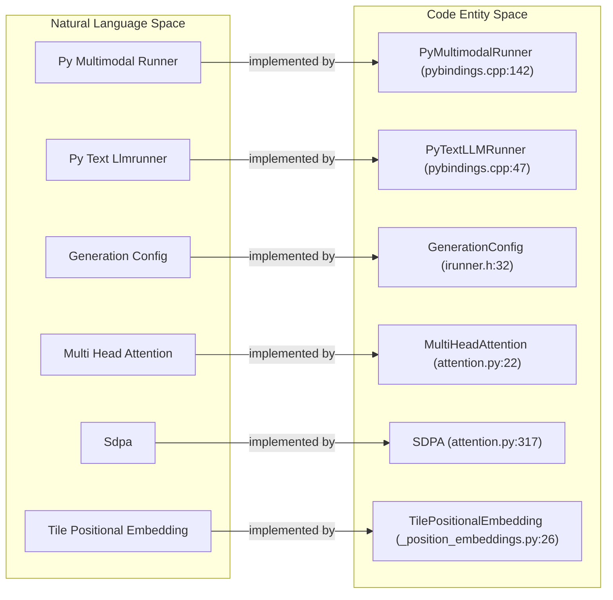
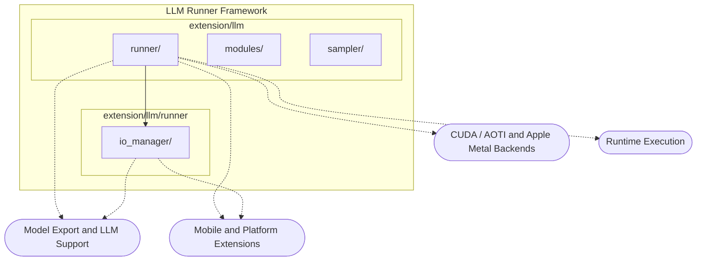
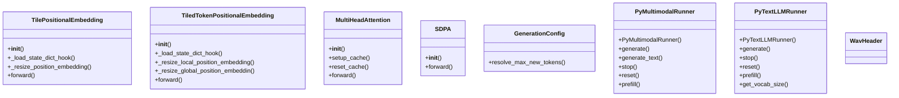
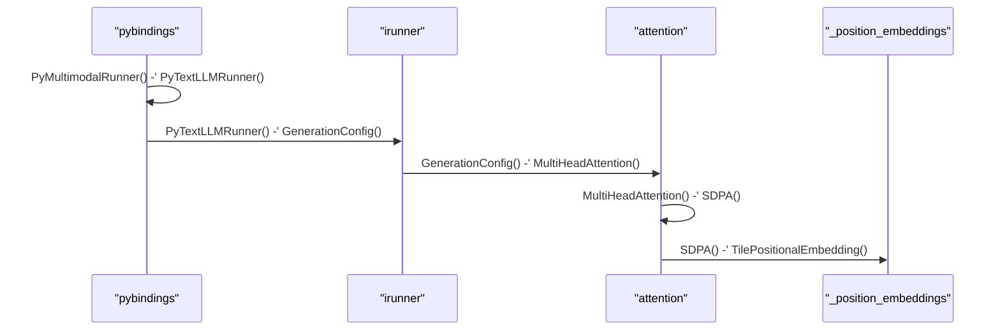

# LLM Runner Framework

↑ [[6-model-export-and-llm-support|Model Export and LLM Support]]

> Architectural specification and implementation reference for LLM Runner Framework (36 relevant source files). Primary code entities: `check_vocab_size`, `read_int_method`, `read_int_tensor_method`, `read_required_positive_int`, `MultimodalPrefiller`.

<details>
<summary>Relevant source files</summary>

The following files were used as context for generating this wiki page:

- [extension/llm/runner/model_metadata.h](extension/llm/runner/model_metadata.h)
- [extension/llm/runner/multimodal_prefiller.cpp](extension/llm/runner/multimodal_prefiller.cpp)
- [extension/llm/runner/pybindings.cpp](extension/llm/runner/pybindings.cpp)
- [extension/llm/runner/llm_runner_helper.cpp](extension/llm/runner/llm_runner_helper.cpp)
- [extension/llm/runner/irunner.h](extension/llm/runner/irunner.h)
- [extension/llm/runner/util.h](extension/llm/runner/util.h)
- [extension/llm/runner/multimodal_input.h](extension/llm/runner/multimodal_input.h)
- [extension/llm/runner/wav_loader.h](extension/llm/runner/wav_loader.h)
- [extension/llm/runner/__init__.py](extension/llm/runner/__init__.py)
- [extension/llm/runner/audio.h](extension/llm/runner/audio.h)
- [extension/llm/runner/image.h](extension/llm/runner/image.h)
- [extension/llm/runner/multimodal_runner.cpp](extension/llm/runner/multimodal_runner.cpp)
- [extension/llm/runner/constants.h](extension/llm/runner/constants.h)
- [extension/llm/runner/image_prefiller.h](extension/llm/runner/image_prefiller.h)
- [extension/llm/runner/stats.h](extension/llm/runner/stats.h)
- [extension/llm/runner/text_llm_runner.cpp](extension/llm/runner/text_llm_runner.cpp)
- [extension/llm/runner/llm_session.h](extension/llm/runner/llm_session.h)
- [extension/llm/modules/attention.py](extension/llm/modules/attention.py)
- [extension/llm/modules/_position_embeddings.py](extension/llm/modules/_position_embeddings.py)
- [extension/llm/runner/llm_runner_helper.h](extension/llm/runner/llm_runner_helper.h)
- [extension/llm/runner/multimodal_decoder_runner.h](extension/llm/runner/multimodal_decoder_runner.h)
- [extension/llm/runner/io_manager/io_manager.h](extension/llm/runner/io_manager/io_manager.h)
- [extension/llm/runner/io_manager/targets.bzl](extension/llm/runner/io_manager/targets.bzl)
- [extension/llm/runner/multimodal_prefiller.h](extension/llm/runner/multimodal_prefiller.h)
- [extension/llm/runner/text_token_generator.h](extension/llm/runner/text_token_generator.h)
- [extension/llm/runner/multimodal_runner.h](extension/llm/runner/multimodal_runner.h)
- [extension/llm/runner/text_decoder_runner.cpp](extension/llm/runner/text_decoder_runner.cpp)
- [extension/llm/runner/targets.bzl](extension/llm/runner/targets.bzl)
- [extension/llm/runner/README.md](extension/llm/runner/README.md)
- [extension/llm/modules/README.md](extension/llm/modules/README.md)
- [extension/llm/runner/BUCK](extension/llm/runner/BUCK)
- [extension/llm/runner/CMakeLists.txt](extension/llm/runner/CMakeLists.txt)
- [extension/llm/runner/io_manager/BUCK](extension/llm/runner/io_manager/BUCK)
- [extension/llm/sampler/BUCK](extension/llm/sampler/BUCK)
- [extension/llm/sampler/CMakeLists.txt](extension/llm/sampler/CMakeLists.txt)

</details>

## Purpose and Scope

Architectural specification and implementation reference for LLM Runner Framework (36 relevant source files). Primary code entities: `check_vocab_size`, `read_int_method`, `read_int_tensor_method`, `read_required_positive_int`, `MultimodalPrefiller`.

Primary code entities analyzed on this page include `PyMultimodalRunner` ([extension/llm/runner/pybindings.cpp:142-252]()), `PyTextLLMRunner` ([extension/llm/runner/pybindings.cpp:47-139]()), `GenerationConfig` ([extension/llm/runner/irunner.h:32-113]()), `MultiHeadAttention` ([extension/llm/modules/attention.py:22-314]()), `SDPA` ([extension/llm/modules/attention.py:317-376]()).

For the parent architectural layer, see [[6-model-export-and-llm-support|Model Export and LLM Support]]. Related sibling subsystems: [[6.1-llama-model-export|LLaMA and Generative Model Export]], [[6.3-custom-operators-and-extensions|Custom Operators and Extensions]], [[6.4-multimodal-and-audio-models|Multimodal and Audio Models]].

Sources: [extension/llm/runner/pybindings.cpp:142-252](), [extension/llm/runner/pybindings.cpp:47-139](), [extension/llm/runner/irunner.h:32-113](), [extension/llm/modules/attention.py:22-314]()

---

## 1. High-Level Architecture and Data Flow

### Natural Language Space to Code Entity Space Mapping

The following diagram maps domain concepts in this subsystem to their concrete code entities:



### Subsystem Component & Dependency Flow



Cross-subsystem call and import edges connect **LLM Runner Framework** with [[6-model-export-and-llm-support|Model Export and LLM Support]] (coupling `75.0`), [[9-mobile-and-platform-extensions|Mobile and Platform Extensions]] (coupling `24.0`), [[7.2-model-and-backend-testing-framework|Model and Backend Testing Framework]] (coupling `22.0`), [[9.1-android-extension|Android Extension (Java/Kotlin & JNI)]] (coupling `19.0`), [[8-runtime-execution|Runtime Execution]] (coupling `18.0`).

| Module Directory | Files | Primary Code Entities | Source Citations |
|---|---|---|---|
| `extension/llm/runner` | 27 | `PyMultimodalRunner`, `PyTextLLMRunner`, `GenerationConfig`, `WavHeader` | [extension/llm/runner/pybindings.cpp:142-252]() [extension/llm/runner/pybindings.cpp:47-139]() |
| `extension/llm/modules` | 4 | `MultiHeadAttention`, `SDPA`, `TilePositionalEmbedding`, `TiledTokenPositionalEmbedding` | [extension/llm/modules/attention.py:22-314]() [extension/llm/modules/attention.py:317-376]() |
| `extension/llm/runner/io_manager` | 3 | `IOManager`, `define_common_targets` | [extension/llm/runner/io_manager/io_manager.h:26-244]() [extension/llm/runner/io_manager/targets.bzl:3-19]() |
| `extension/llm/sampler` | 2 | *(build / config)* | [extension/llm/sampler/BUCK]() |

Sources: [extension/llm/runner/pybindings.cpp:142-252](), [extension/llm/runner/pybindings.cpp:47-139](), [extension/llm/runner/irunner.h:32-113](), [extension/llm/modules/attention.py:22-314](), [extension/llm/modules/attention.py:317-376]()

---

## 2. Core Data Structures and Implementation Details

### Class and Entity Relationship Diagram



### `PyMultimodalRunner` (Class)

- **Source Location**: [extension/llm/runner/pybindings.cpp:142-252]()
- **Declaration**: `Class PyMultimodalRunner`
- **Graph Centrality**: fan-in `0` callers, fan-out `0` callees
- **Responsibility**: // Python wrapper class for MultimodalRunner

```cpp
// extension/llm/runner/pybindings.cpp:142-157
class PyMultimodalRunner {
 public:
  // Constructor that takes a tokenizer path
  PyMultimodalRunner(
      const std::string& model_path,
      const std::string& tokenizer_path,
      std::optional<const std::string> data_path = std::nullopt) {
    // Load tokenizer using the helper function
    auto tokenizer =
        load_tokenizer(tokenizer_path, nullptr, std::nullopt, 0, 0);
    if (!tokenizer) {
      throw std::runtime_error(
          "Failed to load tokenizer from: " + tokenizer_path);
    }

    // Create multimodal runner using the helper function
```

### `PyTextLLMRunner` (Class)

- **Source Location**: [extension/llm/runner/pybindings.cpp:47-139]()
- **Declaration**: `Class PyTextLLMRunner`
- **Graph Centrality**: fan-in `0` callers, fan-out `0` callees
- **Responsibility**: // Python wrapper class for TextLLMRunner

```cpp
// extension/llm/runner/pybindings.cpp:47-62
class PyTextLLMRunner {
 public:
  // Constructor that takes a tokenizer path
  PyTextLLMRunner(
      const std::string& model_path,
      const std::string& tokenizer_path,
      std::optional<const std::string> data_path = std::nullopt) {
    // Load tokenizer using the helper function
    auto tokenizer =
        load_tokenizer(tokenizer_path, nullptr, std::nullopt, 0, 0);
    if (!tokenizer) {
      throw std::runtime_error(
          "Failed to load tokenizer from: " + tokenizer_path);
    }

    // Create text llm runner using the helper function
```

### `GenerationConfig` (Class)

- **Source Location**: [extension/llm/runner/irunner.h:32-113]()
- **Declaration**: `Class GenerationConfig`
- **Graph Centrality**: fan-in `0` callers, fan-out `0` callees
- **Responsibility**: // Configuration struct for generation parameters, fields should be sorted in // alphabetic order

```cpp
// extension/llm/runner/irunner.h:32-47
struct GenerationConfig {
  // Whether to echo the input prompt in the output
  bool echo = true;

  // Reserved grammar definition for constrained decoding.
  // Currently ignored by in-tree runners.
  std::string grammar;

  // Reserved grammar format (e.g. "json_schema", "regex", "lark", or "gbnf").
  // Currently ignored by in-tree runners.
  std::string grammar_type;

  // Whether to ignore EOS token and continue generating until max_new_tokens
  bool ignore_eos = false;

  // Maximum number of new tokens to generate
```

### `MultiHeadAttention` (Class)

- **Source Location**: [extension/llm/modules/attention.py:22-314]()
- **Declaration**: `Class MultiHeadAttention`
- **Graph Centrality**: fan-in `1` callers, fan-out `0` callees
- **Responsibility**: NOTE: copied from Torchtune's mha.py. Should be mostly 1:1 except that SDPA is factored out so that it can be swapped for more efficient ExecuTorch-defined SDPA ops. Multi-headed attention layer with support for grouped query attention (GQA) introduced in https://arxiv.org/abs/2305.13245v1. GQA is a version of multihea

### `SDPA` (Class)

- **Source Location**: [extension/llm/modules/attention.py:317-376]()
- **Declaration**: `Class SDPA`
- **Graph Centrality**: fan-in `1` callers, fan-out `0` callees
- **Responsibility**: TorchTune's SDPA which can be optimized and can be swapped out for a more efficient implementations.

### `load` (Method)

- **Source Location**: [extension/llm/runner/multimodal_prefiller.cpp:255-278]()
- **Declaration**: `()`
- **Graph Centrality**: fan-in `43` callers, fan-out `5` callees
- **Responsibility**: /** * Load the Module for encoder prefill purpose. * @return The error code. */

Sources: [extension/llm/runner/pybindings.cpp:142-252](), [extension/llm/runner/pybindings.cpp:47-139](), [extension/llm/runner/irunner.h:32-113](), [extension/llm/modules/attention.py:22-314](), [extension/llm/modules/attention.py:317-376]()

---

## 3. Execution and Call Flow

The sequence diagram below traces the runtime/compile-time call chain across components in this module:



Sources: [extension/llm/runner/pybindings.cpp:142-252](), [extension/llm/runner/pybindings.cpp:47-139](), [extension/llm/runner/irunner.h:32-113](), [extension/llm/modules/attention.py:22-314](), [extension/llm/modules/attention.py:317-376]()

---

## 4. Key API and Symbol Reference

| Code Entity | Kind | Location | Fan-In / Out | Role & Signature |
|---|---|---|---|---|
| `PyMultimodalRunner` | Class | [extension/llm/runner/pybindings.cpp:142-252]() | `0` / `0` | // Python wrapper class for MultimodalRunner |
| `PyTextLLMRunner` | Class | [extension/llm/runner/pybindings.cpp:47-139]() | `0` / `0` | // Python wrapper class for TextLLMRunner |
| `GenerationConfig` | Class | [extension/llm/runner/irunner.h:32-113]() | `0` / `0` | // Configuration struct for generation parameters, fields should be sorted in |
| `MultiHeadAttention` | Class | [extension/llm/modules/attention.py:22-314]() | `1` / `0` | NOTE: copied from Torchtune's mha.py. Should be mostly 1:1 except |
| `SDPA` | Class | [extension/llm/modules/attention.py:317-376]() | `1` / `0` | TorchTune's SDPA which can be optimized and can be swapped |
| `TilePositionalEmbedding` | Class | [extension/llm/modules/_position_embeddings.py:26-211]() | `1` / `0` | Positional embedding for tiles, different for every tile, same for every token within a tile. |
| `TiledTokenPositionalEmbedding` | Class | [extension/llm/modules/_position_embeddings.py:214-653]() | `1` / `0` | Token positional embedding for tiled images, different for every tile, different for every token. |
| `WavHeader` | Class | [extension/llm/runner/wav_loader.h:31-48]() | `0` / `0` | — |
| `load` | Method | [extension/llm/runner/multimodal_prefiller.cpp:255-278]() | `43` / `5` | /** |
| `time_in_ms` | Function | [extension/llm/runner/util.h:225-236]() | `31` / `0` | () |
| `load_wav_audio_data` | Function | [extension/llm/runner/wav_loader.h:220-310]() | `9` / `8` | /// Load and decode audio samples from a WAV file, returning normalized floats. |
| `MultimodalInput` | Function | [extension/llm/runner/multimodal_input.h:29-368]() | `11` / `0` | /** |
| `read_int_method` | Function | [extension/llm/runner/model_metadata.h:48-65]() | `7` / `4` | // Read a named int constant method: nullopt if absent, the value if present, |
| `read_required_positive_int` | Function | [extension/llm/runner/model_metadata.h:94-107]() | `8` / `2` | // A required int constant that must be present and positive. |
| `read_int_tensor_method` | Function | [extension/llm/runner/model_metadata.h:68-91]() | `5` / `6` | // Read a required int32 tensor constant. |
| `print_report` | Function | [extension/llm/runner/stats.h:172-260]() | `15` / `1` | (const Stats& stats) |
| `get_eos_ids` | Function | [extension/llm/runner/llm_runner_helper.cpp:157-183]() | `9` / `4` | ( tokenizers::Tokenizer* tokenizer, Module* module) |
| `is_method_loaded` | Method | [extension/llm/runner/multimodal_prefiller.cpp:284-301]() | `3` / `5` | /** |
| `prefill` | Method | [extension/llm/runner/multimodal_prefiller.cpp:37-249]() | `0` / `11` | /** |
| `get_rss_bytes` | Function | [extension/llm/runner/util.h:245-258]() | `6` / `0` | // Returns the current RSS in bytes. Returns 0 if not supported. |
| `load_wav_header` | Function | [extension/llm/runner/wav_loader.h:210-216]() | `2` / `8` | /// Parse a WAV header from a file path. |
| `convert_to_bfloat16` | Function | [extension/llm/runner/util.h:309-328]() | `3` / `3` | /** |

Sources: [extension/llm/runner/pybindings.cpp:142-252](), [extension/llm/runner/pybindings.cpp:47-139](), [extension/llm/runner/irunner.h:32-113](), [extension/llm/modules/attention.py:22-314](), [extension/llm/modules/attention.py:317-376](), [extension/llm/modules/_position_embeddings.py:26-211]()

---

## 5. Official Documentation and Design Context

The following linked documentation sections from `llm-wiki` (`raw/`) provide additional architectural context, tutorials, and design invariants for this subsystem:

- **Model Export and LLM Support** ([wiki/6-model-export-and-llm-support.md](), score `128.8542`) (sections: `Model Export and LLM Support`, `Purpose and Scope`, `System Mapping: Natural Language Space to Code Entity Space`, `1. LLaMA and Generative Model Export`): # Model Export and LLM Support > Architectural specification and implementation reference for Model Export and LLM Support (40 relevant source files). Primary code entities: `MuseGlimmerImageSpan`, `MuseGlimmerPreparationSpec`, `MuseGlimmerPreparedInput`, `Backing`, `RequestHandle`. <details> <summary>Relevant source files</summary> The following files were used as context for generating this wiki page: - [examples/m
- **LLaMA and Generative Model Export** ([wiki/6.1-llama-model-export.md](), score `111.4024`) (sections: `LLaMA and Generative Model Export`, `Purpose and Scope`, `1. High-Level Architecture and Data Flow`, `Natural Language Space to Code Entity Space Mapping`): # LLaMA and Generative Model Export ↑ [[6-model-export-and-llm-support|Model Export and LLM Support]] > Architectural specification and implementation reference for LLaMA and Generative Model Export (40 relevant source files). Primary code entities: `Attention`, `forward`, `AttentionGatedDeltaNet`, `__init__`, `ETPybindEvalWrapper`. <details> <summary>Relevant source files</summary> The following files were used as c
- **ExecuTorch DeepWiki** ([wiki/index.md](), score `108.3157`) (sections: `ExecuTorch DeepWiki`, `Pages`): # ExecuTorch DeepWiki Generated from `home-jason-Project-deepwiki-executorch` at commit `b3b565b5b62f` (2026-11-15T15:02:11+00:00). ## Pages - [[1-overview|Overview]] — Architectural specification and implementation reference for Overview (10 relevant source files). Primary code entities: `Module`, `MethodHolder`, `PlannedMemory`, `EdgeProgramManager`, `__init__`. - [[1.1-getting-started|Getting Started]] — Architect
- **Export API and Recipe System** ([wiki/1.2-export-api-and-recipe-system.md](), score `97.0135`) (sections: `Export API and Recipe System`, `Purpose and Scope`, `1. High-Level Architecture and Data Flow`, `Natural Language Space to Code Entity Space Mapping`): # Export API and Recipe System ↑ [[1-overview|Overview]] > Architectural specification and implementation reference for Export API and Recipe System (37 relevant source files). Primary code entities: `AOQuantizationConfig`, `ExportRecipe`, `_assert_scalar_fields_agree`, `_collect_lowering_fields`, `ExportSession`. <details> <summary>Relevant source files</summary> The following files were used as context for generati

Sources: [wiki/6-model-export-and-llm-support.md](), [wiki/6.1-llama-model-export.md](), [wiki/index.md](), [wiki/1.2-export-api-and-recipe-system.md]()

## Related pages

- [[6-model-export-and-llm-support|Model Export and LLM Support]]
- [[1.1-getting-started|Getting Started]]
- [[1.2-export-api-and-recipe-system|Export API and Recipe System]]
- [[2.2-kernel-libraries-and-selective-build|Kernel Libraries and Selective Build]]
- [[2.3-schema-generation-and-flatbuffers|Schema Generation and FlatBuffers]]
- [[3.4-program-emission-and-serialization|Program Emission and Serialization]]
- [[3.5-verification-and-dialect-system|Verification and Dialect System]]
- [[4-quantization-systems|Quantization Systems]]

## Related documents

- `wiki/6-model-export-and-llm-support.md` — Model Export and LLM Support (score 128.8542, via bm25)
- `wiki/6.1-llama-model-export.md` — LLaMA and Generative Model Export (score 111.4024, via bm25)
- `wiki/index.md` — ExecuTorch DeepWiki (score 108.3157, via bm25)
- `wiki/1.2-export-api-and-recipe-system.md` — Export API and Recipe System (score 97.0135, via bm25)
- `wiki/7.2-model-and-backend-testing-framework.md` — Model and Backend Testing Framework (score 95.0109, via bm25)

## Sources

- [`extension/llm/runner/model_metadata.h`](https://github.com/pytorch/executorch/blob/main/extension/llm/runner/model_metadata.h)
- [`extension/llm/runner/multimodal_prefiller.cpp`](https://github.com/pytorch/executorch/blob/main/extension/llm/runner/multimodal_prefiller.cpp)
- [`extension/llm/runner/pybindings.cpp`](https://github.com/pytorch/executorch/blob/main/extension/llm/runner/pybindings.cpp)
- [`extension/llm/runner/llm_runner_helper.cpp`](https://github.com/pytorch/executorch/blob/main/extension/llm/runner/llm_runner_helper.cpp)
- [`extension/llm/runner/irunner.h`](https://github.com/pytorch/executorch/blob/main/extension/llm/runner/irunner.h)
- [`extension/llm/runner/util.h`](https://github.com/pytorch/executorch/blob/main/extension/llm/runner/util.h)
- [`extension/llm/runner/multimodal_input.h`](https://github.com/pytorch/executorch/blob/main/extension/llm/runner/multimodal_input.h)
- [`extension/llm/runner/wav_loader.h`](https://github.com/pytorch/executorch/blob/main/extension/llm/runner/wav_loader.h)
- [`extension/llm/runner/__init__.py`](https://github.com/pytorch/executorch/blob/main/extension/llm/runner/__init__.py)
- [`extension/llm/runner/audio.h`](https://github.com/pytorch/executorch/blob/main/extension/llm/runner/audio.h)
- [`extension/llm/runner/image.h`](https://github.com/pytorch/executorch/blob/main/extension/llm/runner/image.h)
- [`extension/llm/runner/multimodal_runner.cpp`](https://github.com/pytorch/executorch/blob/main/extension/llm/runner/multimodal_runner.cpp)
- [`extension/llm/runner/constants.h`](https://github.com/pytorch/executorch/blob/main/extension/llm/runner/constants.h)
- [`extension/llm/runner/image_prefiller.h`](https://github.com/pytorch/executorch/blob/main/extension/llm/runner/image_prefiller.h)
- [`extension/llm/runner/stats.h`](https://github.com/pytorch/executorch/blob/main/extension/llm/runner/stats.h)
- [`extension/llm/runner/text_llm_runner.cpp`](https://github.com/pytorch/executorch/blob/main/extension/llm/runner/text_llm_runner.cpp)
- [`extension/llm/runner/llm_session.h`](https://github.com/pytorch/executorch/blob/main/extension/llm/runner/llm_session.h)
- [`extension/llm/modules/attention.py`](https://github.com/pytorch/executorch/blob/main/extension/llm/modules/attention.py)
- [`extension/llm/modules/_position_embeddings.py`](https://github.com/pytorch/executorch/blob/main/extension/llm/modules/_position_embeddings.py)
- [`extension/llm/runner/llm_runner_helper.h`](https://github.com/pytorch/executorch/blob/main/extension/llm/runner/llm_runner_helper.h)
- [`extension/llm/runner/multimodal_decoder_runner.h`](https://github.com/pytorch/executorch/blob/main/extension/llm/runner/multimodal_decoder_runner.h)
- [`extension/llm/runner/io_manager/io_manager.h`](https://github.com/pytorch/executorch/blob/main/extension/llm/runner/io_manager/io_manager.h)
- [`extension/llm/runner/io_manager/targets.bzl`](https://github.com/pytorch/executorch/blob/main/extension/llm/runner/io_manager/targets.bzl)
- [`extension/llm/runner/multimodal_prefiller.h`](https://github.com/pytorch/executorch/blob/main/extension/llm/runner/multimodal_prefiller.h)
- [`extension/llm/runner/text_token_generator.h`](https://github.com/pytorch/executorch/blob/main/extension/llm/runner/text_token_generator.h)
- [`extension/llm/runner/multimodal_runner.h`](https://github.com/pytorch/executorch/blob/main/extension/llm/runner/multimodal_runner.h)
- [`extension/llm/runner/text_decoder_runner.cpp`](https://github.com/pytorch/executorch/blob/main/extension/llm/runner/text_decoder_runner.cpp)
- [`extension/llm/runner/targets.bzl`](https://github.com/pytorch/executorch/blob/main/extension/llm/runner/targets.bzl)
- [`extension/llm/runner/README.md`](https://github.com/pytorch/executorch/blob/main/extension/llm/runner/README.md)
- [`extension/llm/modules/README.md`](https://github.com/pytorch/executorch/blob/main/extension/llm/modules/README.md)
- [`extension/llm/runner/BUCK`](https://github.com/pytorch/executorch/blob/main/extension/llm/runner/BUCK)
- [`extension/llm/runner/CMakeLists.txt`](https://github.com/pytorch/executorch/blob/main/extension/llm/runner/CMakeLists.txt)
- [`extension/llm/runner/io_manager/BUCK`](https://github.com/pytorch/executorch/blob/main/extension/llm/runner/io_manager/BUCK)
- [`extension/llm/sampler/BUCK`](https://github.com/pytorch/executorch/blob/main/extension/llm/sampler/BUCK)
- [`extension/llm/sampler/CMakeLists.txt`](https://github.com/pytorch/executorch/blob/main/extension/llm/sampler/CMakeLists.txt)
- [`extension/llm/modules/BUCK`](https://github.com/pytorch/executorch/blob/main/extension/llm/modules/BUCK)


## Dynamic Knowledge Links (Code Graph ↔ LLM-Wiki / RAG)

### Linked Architecture & Design Documents

| Document | Match Channel | Score | Shared Code Symbols |
|---|---|---|---|
| [[6-model-export-and-llm-support|Model Export and LLM Support]] | `bm25+entity(6)` | `137.854` | `SDPA`, `check_vocab_size`, `read_int_method`, `read_int_tensor_method`, `read_required_positive_int` |
| [[6.1-llama-model-export|LLaMA and Generative Model Export]] | `bm25+entity(5)` | `118.902` | `SDPA`, `check_vocab_size`, `read_int_method`, `read_int_tensor_method`, `read_required_positive_int` |
| [[6.3-custom-operators-and-extensions|Custom Operators and Extensions]] | `wikilink:6.2-llm-runner-framework` | `115.742` | *(lexical/graph match)* |
| [[6.4-multimodal-and-audio-models|Multimodal and Audio Models]] | `wikilink:6.2-llm-runner-framework` | `115.742` | *(lexical/graph match)* |
| [[9-mobile-and-platform-extensions|Mobile and Platform Extensions]] | `wikilink:6.2-llm-runner-framework` | `115.742` | *(lexical/graph match)* |
| [[index|ExecuTorch DeepWiki]] | `bm25` | `108.316` | *(lexical/graph match)* |

### High-Centrality Bridge Symbols (CBM Graph)

| Symbol | Kind | Source Location | Fan-In / Fan-Out |
|---|---|---|---|
| `PyMultimodalRunner` | Class | [extension/llm/runner/pybindings.cpp:142-252]() | in: `0` / out: `0` |
| `PyTextLLMRunner` | Class | [extension/llm/runner/pybindings.cpp:47-139]() | in: `0` / out: `0` |
| `GenerationConfig` | Class | [extension/llm/runner/irunner.h:32-113]() | in: `0` / out: `0` |
| `MultiHeadAttention` | Class | [extension/llm/modules/attention.py:22-314]() | in: `1` / out: `0` |
| `SDPA` | Class | [extension/llm/modules/attention.py:317-376]() | in: `1` / out: `0` |
| `TilePositionalEmbedding` | Class | [extension/llm/modules/_position_embeddings.py:26-211]() | in: `1` / out: `0` |

Sources: [extension/llm/runner/pybindings.cpp:142-252](), [extension/llm/runner/pybindings.cpp:47-139](), [extension/llm/runner/irunner.h:32-113](), [extension/llm/modules/attention.py:22-314]()

### Cross-Subsystem Coupling

- [[6-model-export-and-llm-support|Model Export and LLM Support]] — call/import coupling weight `75.0`
- [[9-mobile-and-platform-extensions|Mobile and Platform Extensions]] — call/import coupling weight `24.0`
- [[7.2-model-and-backend-testing-framework|Model and Backend Testing Framework]] — call/import coupling weight `22.0`
- [[9.1-android-extension|Android Extension (Java/Kotlin & JNI)]] — call/import coupling weight `19.0`
- [[8-runtime-execution|Runtime Execution]] — call/import coupling weight `18.0`
- [[8.1-core-runtime-architecture|Core Runtime Architecture]] — call/import coupling weight `18.0`
