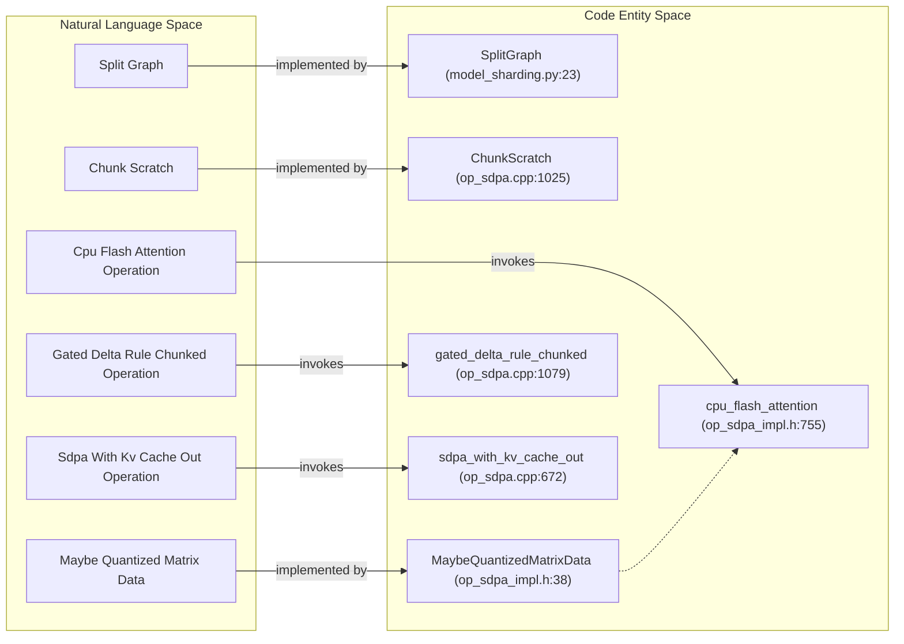
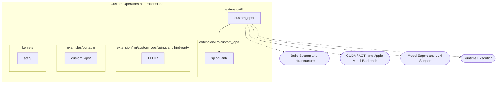
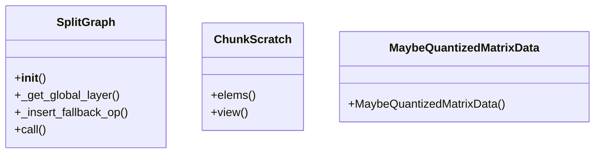
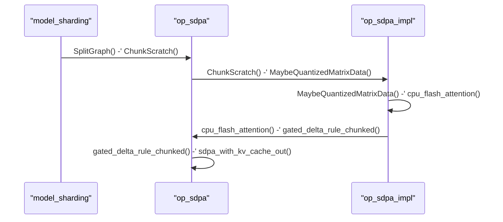

# Custom Operators and Extensions

↑ [[6-model-export-and-llm-support|Model Export and LLM Support]]

> Architectural specification and implementation reference for Custom Operators and Extensions (39 relevant source files). Primary code entities: `gated_delta_rule_out_boxed`, `ChunkScratch`, `elems`, `view`, `MaybeQuantizedMatrixData`.

<details>
<summary>Relevant source files</summary>

The following files were used as context for generating this wiki page:

- [extension/llm/custom_ops/op_sdpa.cpp](extension/llm/custom_ops/op_sdpa.cpp)
- [extension/llm/custom_ops/op_sdpa_impl.h](extension/llm/custom_ops/op_sdpa_impl.h)
- [extension/llm/custom_ops/model_sharding.py](extension/llm/custom_ops/model_sharding.py)
- [extension/llm/custom_ops/custom_ops.py](extension/llm/custom_ops/custom_ops.py)
- [extension/llm/custom_ops/op_moe.cpp](extension/llm/custom_ops/op_moe.cpp)
- [extension/llm/custom_ops/bench_gated_delta_rule.py](extension/llm/custom_ops/bench_gated_delta_rule.py)
- [extension/llm/custom_ops/CMakeLists.txt](extension/llm/custom_ops/CMakeLists.txt)
- [extension/llm/custom_ops/op_sdpa_aot.cpp](extension/llm/custom_ops/op_sdpa_aot.cpp)
- [extension/llm/custom_ops/__init__.py](extension/llm/custom_ops/__init__.py)
- [extension/llm/custom_ops/op_fast_hadamard_transform.cpp](extension/llm/custom_ops/op_fast_hadamard_transform.cpp)
- [extension/llm/custom_ops/op_fallback.cpp](extension/llm/custom_ops/op_fallback.cpp)
- [extension/llm/custom_ops/op_fallback.py](extension/llm/custom_ops/op_fallback.py)
- [extension/llm/custom_ops/op_fallback.h](extension/llm/custom_ops/op_fallback.h)
- [extension/llm/custom_ops/op_fast_hadamard_transform_aten.cpp](extension/llm/custom_ops/op_fast_hadamard_transform_aten.cpp)
- [extension/llm/custom_ops/op_update_cache.cpp](extension/llm/custom_ops/op_update_cache.cpp)
- [extension/llm/custom_ops/op_tile_crop.cpp](extension/llm/custom_ops/op_tile_crop.cpp)
- [extension/llm/custom_ops/op_fast_hadamard_transform.h](extension/llm/custom_ops/op_fast_hadamard_transform.h)
- [extension/llm/custom_ops/op_moe_aot.cpp](extension/llm/custom_ops/op_moe_aot.cpp)
- [extension/llm/custom_ops/op_moe.h](extension/llm/custom_ops/op_moe.h)
- [extension/llm/custom_ops/op_sdpa.h](extension/llm/custom_ops/op_sdpa.h)
- [extension/llm/custom_ops/op_tile_crop_aot.cpp](extension/llm/custom_ops/op_tile_crop_aot.cpp)
- [extension/llm/custom_ops/op_tile_crop.h](extension/llm/custom_ops/op_tile_crop.h)
- [extension/llm/custom_ops/spinquant/fast_hadamard_transform.h](extension/llm/custom_ops/spinquant/fast_hadamard_transform.h)
- [extension/llm/custom_ops/op_tile_crop_aot.py](extension/llm/custom_ops/op_tile_crop_aot.py)
- [extension/llm/custom_ops/preprocess_custom_ops.py](extension/llm/custom_ops/preprocess_custom_ops.py)
- [extension/llm/custom_ops/op_update_cache.h](extension/llm/custom_ops/op_update_cache.h)
- [extension/llm/custom_ops/spinquant/third-party/FFHT/fht_avx.c](extension/llm/custom_ops/spinquant/third-party/FFHT/fht_avx.c)
- [extension/llm/custom_ops/spinquant/third-party/FFHT/fht_sse.c](extension/llm/custom_ops/spinquant/third-party/FFHT/fht_sse.c)
- [extension/llm/custom_ops/spinquant/README.md](extension/llm/custom_ops/spinquant/README.md)
- [docs/source/kernel-library-custom-aten-kernel.md](docs/source/kernel-library-custom-aten-kernel.md)
- [examples/portable/custom_ops/README.md](examples/portable/custom_ops/README.md)
- [extension/llm/custom_ops/spinquant/third-party/FFHT/LICENSE.md](extension/llm/custom_ops/spinquant/third-party/FFHT/LICENSE.md)
- [extension/llm/custom_ops/spinquant/third-party/FFHT/README.md](extension/llm/custom_ops/spinquant/third-party/FFHT/README.md)
- [extension/llm/custom_ops/BUCK](extension/llm/custom_ops/BUCK)
- [extension/llm/custom_ops/spinquant/BUCK](extension/llm/custom_ops/spinquant/BUCK)

</details>

## Purpose and Scope

Architectural specification and implementation reference for Custom Operators and Extensions (39 relevant source files). Primary code entities: `gated_delta_rule_out_boxed`, `ChunkScratch`, `elems`, `view`, `MaybeQuantizedMatrixData`.

Primary code entities analyzed on this page include `SplitGraph` ([extension/llm/custom_ops/model_sharding.py:23-100]()), `ChunkScratch` ([extension/llm/custom_ops/op_sdpa.cpp:1025-1076]()), `MaybeQuantizedMatrixData` ([extension/llm/custom_ops/op_sdpa_impl.h:38-63]()), `cpu_flash_attention` ([extension/llm/custom_ops/op_sdpa_impl.h:755-1367]()), `gated_delta_rule_chunked` ([extension/llm/custom_ops/op_sdpa.cpp:1079-1419]()).

For the parent architectural layer, see [[6-model-export-and-llm-support|Model Export and LLM Support]]. Related sibling subsystems: [[6.1-llama-model-export|LLaMA and Generative Model Export]], [[6.2-llm-runner-framework|LLM Runner Framework]], [[6.4-multimodal-and-audio-models|Multimodal and Audio Models]].

Sources: [extension/llm/custom_ops/model_sharding.py:23-100](), [extension/llm/custom_ops/op_sdpa.cpp:1025-1076](), [extension/llm/custom_ops/op_sdpa_impl.h:38-63](), [extension/llm/custom_ops/op_sdpa_impl.h:755-1367]()

---

## 1. High-Level Architecture and Data Flow

### Natural Language Space to Code Entity Space Mapping

The following diagram maps domain concepts in this subsystem to their concrete code entities:



### Subsystem Component & Dependency Flow



Cross-subsystem call and import edges connect **Custom Operators and Extensions** with [[2-build-system-and-infrastructure|Build System and Infrastructure]] (coupling `38.0`), [[2.4-python-bindings-and-dependencies|Python Bindings and Dependencies]] (coupling `33.0`), [[5.7-cuda-aoti-and-apple-metal-backends|CUDA / AOTI and Apple Metal Backends]] (coupling `29.0`), [[6-model-export-and-llm-support|Model Export and LLM Support]] (coupling `28.0`), [[8-runtime-execution|Runtime Execution]] (coupling `26.0`).

| Module Directory | Files | Primary Code Entities | Source Citations |
|---|---|---|---|
| `extension/llm/custom_ops` | 26 | `SplitGraph`, `ChunkScratch`, `MaybeQuantizedMatrixData`, `cpu_flash_attention` | [extension/llm/custom_ops/model_sharding.py:23-100]() [extension/llm/custom_ops/op_sdpa.cpp:1025-1076]() |
| `extension/llm/custom_ops/spinquant/third-party/FFHT` | 6 | `fht_double`, `fht_float`, `fht_double`, `fht_float` | [extension/llm/custom_ops/spinquant/third-party/FFHT/fht_avx.c:19546-19671]() [extension/llm/custom_ops/spinquant/third-party/FFHT/fht_avx.c:10081-10206]() |
| `extension/llm/custom_ops/spinquant` | 3 | `fast_hadamard_transform`, `fast_hadamard_transform_28N`, `fast_sqrt_of_power_of_2`, `fast_hadamard_transform_simple_impl` | [extension/llm/custom_ops/spinquant/fast_hadamard_transform.h:96-103]() [extension/llm/custom_ops/spinquant/fast_hadamard_transform.h:126-135]() |
| `examples/portable/custom_ops` | 1 | *(build / config)* | [examples/portable/custom_ops/README.md]() |
| `kernels/aten` | 1 | *(build / config)* | [kernels/aten/BUCK]() |
| `kernels/aten/cpu` | 1 | *(build / config)* | [kernels/aten/cpu/BUCK]() |

Sources: [extension/llm/custom_ops/model_sharding.py:23-100](), [extension/llm/custom_ops/op_sdpa.cpp:1025-1076](), [extension/llm/custom_ops/op_sdpa_impl.h:38-63](), [extension/llm/custom_ops/op_sdpa_impl.h:755-1367](), [extension/llm/custom_ops/op_sdpa.cpp:1079-1419]()

---

## 2. Core Data Structures and Implementation Details

### Class and Entity Relationship Diagram



### `SplitGraph` (Class)

- **Source Location**: [extension/llm/custom_ops/model_sharding.py:23-100]()
- **Declaration**: `Class SplitGraph`
- **Graph Centrality**: fan-in `1` callers, fan-out `0` callees
- **Responsibility**: Class to split the model to multiple partitions. Because there is limited memory on the device, it could not load all llama model in one pte.

```python
// extension/llm/custom_ops/model_sharding.py:23-38
class SplitGraph(ExportPass):
    """
    Class to split the model to multiple partitions.
    Because there is limited memory on the device, it could
    not load all llama model in one pte.
    """

    def __init__(
        self,
        shard_layers: List[int],
        pattern=r"layers\.(\d+)",
        layer_prefix_offsets: dict = None,
    ):
        super().__init__()
        self.shard_layers = shard_layers
        self.pattern = pattern
```

### `ChunkScratch` (Class)

- **Source Location**: [extension/llm/custom_ops/op_sdpa.cpp:1025-1076]()
- **Declaration**: `Class ChunkScratch`
- **Graph Centrality**: fan-in `0` callers, fan-out `0` callees
- **Responsibility**: // One worker's scratch for the chunked kernel, carved from a single arena so // there is one allocate_temp for the whole op and disjoint per-worker slabs. // D below is K for channelwise decay and 1 for scalar decay.

```cpp
// extension/llm/custom_ops/op_sdpa.cpp:1025-1040
struct ChunkScratch {
  float* gc; // [CHUNK_SIZE, D]  cumulative log-decay
  float* eg; // [CHUNK_SIZE, D]  exp(gc)
  float* eg_inv; // [CHUNK_SIZE, D]  exp(-gc)
  float* w; // [CHUNK_SIZE, K]  WY pseudo-keys
  float* u; // [CHUNK_SIZE, V]  WY pseudo-values
  float* pv; // [CHUNK_SIZE, V]  u - w @ S
  float* Aqk; // [CHUNK_SIZE, CHUNK_SIZE]
  float* A; // [CHUNK_SIZE, CHUNK_SIZE]  k.k -> UT inverse (beta-folded)
  float* de; // [CHUNK_SIZE]  decay from row r to chunk end

  // Floats needed by one worker. Single source of truth for sizing + carving.
  static int64_t
  elems(int64_t k_head_dim, int64_t v_head_dim, int64_t decay_channels) {
    return 3 *
        chunk_scratch_align(CHUNK_SIZE * decay_channels) + // gc,eg,eg_inv
```

### `MaybeQuantizedMatrixData` (Class)

- **Source Location**: [extension/llm/custom_ops/op_sdpa_impl.h:38-63]()
- **Declaration**: `Class MaybeQuantizedMatrixData`
- **Graph Centrality**: fan-in `0` callers, fan-out `0` callees

```cpp
// extension/llm/custom_ops/op_sdpa_impl.h:38-53
struct MaybeQuantizedMatrixData {
  const void* data{nullptr};
  const int8_t* zero_points{nullptr};
  const float* scales{nullptr};
  int64_t m = 0, n = 0;
  const int64_t zero_points_stride{1};
  const int64_t scales_stride{1};
  ScalarType dtype{ScalarType::Float};
  MaybeQuantizedMatrixData() = default;
  MaybeQuantizedMatrixData(
      const void* data_,
      const int8_t* zero_points_,
      const float* scales_,
      int64_t m_,
      int64_t n_,
      int64_t qparams_stride,
```

### `cpu_flash_attention` (Function)

- **Source Location**: [extension/llm/custom_ops/op_sdpa_impl.h:755-1367]()
- **Declaration**: `( RuntimeContext& ctx, Tensor& output, const Tensor& query, const Tensor& key, const Tensor& value, double dropout_p, bool is_causal, const `
- **Graph Centrality**: fan-in `0` callers, fan-out `26` callees
- **Responsibility**: /** * @brief Implements Flash Attention algorithm on CPU * * This function computes scaled dot-product attention with optimizations for CPU. * It supports both regular and quantized attention computation. * * @tparam scalar_t The data type for computation (e.g., float) * @tparam q_split_size Block size for query matrix

### `gated_delta_rule_chunked` (Function)

- **Source Location**: [extension/llm/custom_ops/op_sdpa.cpp:1079-1419]()
- **Declaration**: `( RuntimeContext& ctx, const Tensor& query, const Tensor& key, const Tensor& value, const Tensor& decay, const Tensor& beta, const Tensor& i`
- **Graph Centrality**: fan-in `1` callers, fan-out `16` callees
- **Responsibility**: // T != 1 (prefill) route. See gated_delta_rule_recurrence for kScalarDecay.

### `sdpa_with_kv_cache_out` (Function)

- **Source Location**: [extension/llm/custom_ops/op_sdpa.cpp:672-712]()
- **Declaration**: `( KernelRuntimeContext& ctx, const Tensor& q_projected, const Tensor& k_projected, const Tensor& v_projected, Tensor& key_cache, Tensor& val`
- **Graph Centrality**: fan-in `3` callers, fan-out `5` callees
- **Responsibility**: /* Input params @param[in] q_projected Projected query with query weights. Format [n_layers, batch size, seq_len, num heads, head dim] @param[in] k_projected Projected query with key weights. Format [n_layers, batch size, seq_len, num heads, head dim] @param[in] v_projected Projected query with value weights. Format [n

Sources: [extension/llm/custom_ops/model_sharding.py:23-100](), [extension/llm/custom_ops/op_sdpa.cpp:1025-1076](), [extension/llm/custom_ops/op_sdpa_impl.h:38-63](), [extension/llm/custom_ops/op_sdpa_impl.h:755-1367](), [extension/llm/custom_ops/op_sdpa.cpp:1079-1419]()

---

## 3. Execution and Call Flow

The sequence diagram below traces the runtime/compile-time call chain across components in this module:



Sources: [extension/llm/custom_ops/model_sharding.py:23-100](), [extension/llm/custom_ops/op_sdpa.cpp:1025-1076](), [extension/llm/custom_ops/op_sdpa_impl.h:38-63](), [extension/llm/custom_ops/op_sdpa_impl.h:755-1367](), [extension/llm/custom_ops/op_sdpa.cpp:1079-1419]()

---

## 4. Key API and Symbol Reference

| Code Entity | Kind | Location | Fan-In / Out | Role & Signature |
|---|---|---|---|---|
| `SplitGraph` | Class | [extension/llm/custom_ops/model_sharding.py:23-100]() | `1` / `0` | Class to split the model to multiple partitions. |
| `ChunkScratch` | Class | [extension/llm/custom_ops/op_sdpa.cpp:1025-1076]() | `0` / `0` | // One worker's scratch for the chunked kernel, carved from a single arena so |
| `MaybeQuantizedMatrixData` | Class | [extension/llm/custom_ops/op_sdpa_impl.h:38-63]() | `0` / `0` | — |
| `cpu_flash_attention` | Function | [extension/llm/custom_ops/op_sdpa_impl.h:755-1367]() | `0` / `26` | /** |
| `gated_delta_rule_chunked` | Function | [extension/llm/custom_ops/op_sdpa.cpp:1079-1419]() | `1` / `16` | // T != 1 (prefill) route. See gated_delta_rule_recurrence for kScalarDecay. |
| `sdpa_with_kv_cache_out` | Function | [extension/llm/custom_ops/op_sdpa.cpp:672-712]() | `3` / `5` | /* |
| `update_cache` | Function | [extension/llm/custom_ops/op_sdpa.cpp:282-339]() | `1` / `9` | // TODO: seq_length is not yet used for copy |
| `gated_delta_rule_recurrence` | Function | [extension/llm/custom_ops/op_sdpa.cpp:813-1009]() | `1` / `8` | // Shared full-sequence recurrence: streams the K x V state twice per token (see |
| `fht_double` | Function | [extension/llm/custom_ops/spinquant/third-party/FFHT/fht_avx.c:19546-19671]() | `1` / `30` | (double *buf, int log_n) |
| `fht_float` | Function | [extension/llm/custom_ops/spinquant/third-party/FFHT/fht_avx.c:10081-10206]() | `1` / `30` | (float *buf, int log_n) |
| `gated_delta_rule_out` | Function | [extension/llm/custom_ops/op_sdpa.cpp:1540-1638]() | `3` / `12` | ( RuntimeContext& ctx, const Tensor& query, const Tensor& key, const Tensor& value, const Tensor& decay, const |
| `fht_double` | Function | [extension/llm/custom_ops/spinquant/third-party/FFHT/fht_sse.c:26090-26215]() | `0` / `30` | (double *buf, int log_n) |
| `fht_float` | Function | [extension/llm/custom_ops/spinquant/third-party/FFHT/fht_sse.c:13828-13953]() | `0` / `30` | (float *buf, int log_n) |
| `update_cache_impl` | Function | [extension/llm/custom_ops/op_update_cache.cpp:91-207]() | `2` / `10` | // Helper function for the actual update operation |
| `quantized_moe_ffn_out` | Function | [extension/llm/custom_ops/op_moe.cpp:394-728]() | `1` / `16` | ( KernelRuntimeContext& ctx, const Tensor& x, const Tensor& gate_weight, const Tensor& expert_bias, const Tens |
| `custom_sdpa_out` | Function | [extension/llm/custom_ops/op_sdpa.cpp:641-655]() | `2` / `1` | /* |
| `gated_delta_rule_chunked_is_safe` | Function | [extension/llm/custom_ops/op_sdpa.cpp:1433-1465]() | `1` / `3` | // The chunked prefill kernel takes std::log(decay); a non-positive decay would |
| `_exp_reduce_sum_fusion_kernel` | Function | [extension/llm/custom_ops/op_sdpa_impl.h:580-620]() | `1` / `3` | // 1) out = exp(a - val) |
| `_mul_reduce_max_fusion_kernel` | Function | [extension/llm/custom_ops/op_sdpa_impl.h:624-654]() | `1` / `3` | // 1) out = a * scale |
| `chunk_scratch_align` | Function | [extension/llm/custom_ops/op_sdpa.cpp:1017-1020]() | `2` / `0` | // Round a float count up to a 64-byte (16-float) boundary so each per-worker |
| `_validate_cross_attn_cache_params` | Function | [extension/llm/custom_ops/custom_ops.py:623-635]() | `2` / `0` | # Expecting cache shape: (B, H, S_max, D), value shape (B, H, S, D) where S <= S_max |
| `fast_hadamard_transform_out` | Function | [extension/llm/custom_ops/op_fast_hadamard_transform.cpp:19-97]() | `2` / `13` | ( RuntimeContext& ctx, const Tensor& mat, Tensor& out) |

Sources: [extension/llm/custom_ops/model_sharding.py:23-100](), [extension/llm/custom_ops/op_sdpa.cpp:1025-1076](), [extension/llm/custom_ops/op_sdpa_impl.h:38-63](), [extension/llm/custom_ops/op_sdpa_impl.h:755-1367](), [extension/llm/custom_ops/op_sdpa.cpp:1079-1419](), [extension/llm/custom_ops/op_sdpa.cpp:672-712]()

---

## 5. Official Documentation and Design Context

The following linked documentation sections from `llm-wiki` (`raw/`) provide additional architectural context, tutorials, and design invariants for this subsystem:

- **Model Export and LLM Support** ([wiki/6-model-export-and-llm-support.md](), score `164.2067`) (sections: `Model Export and LLM Support`, `Purpose and Scope`, `System Mapping: Natural Language Space to Code Entity Space`, `1. LLaMA and Generative Model Export`): # Model Export and LLM Support > Architectural specification and implementation reference for Model Export and LLM Support (40 relevant source files). Primary code entities: `MuseGlimmerImageSpan`, `MuseGlimmerPreparationSpec`, `MuseGlimmerPreparedInput`, `Backing`, `RequestHandle`. <details> <summary>Relevant source files</summary> The following files were used as context for generating this wiki page: - [examples/m
- **LLaMA and Generative Model Export** ([wiki/6.1-llama-model-export.md](), score `144.8265`) (sections: `LLaMA and Generative Model Export`, `Purpose and Scope`, `1. High-Level Architecture and Data Flow`, `Natural Language Space to Code Entity Space Mapping`): # LLaMA and Generative Model Export ↑ [[6-model-export-and-llm-support|Model Export and LLM Support]] > Architectural specification and implementation reference for LLaMA and Generative Model Export (40 relevant source files). Primary code entities: `Attention`, `forward`, `AttentionGatedDeltaNet`, `__init__`, `ETPybindEvalWrapper`. <details> <summary>Relevant source files</summary> The following files were used as c
- **ExecuTorch DeepWiki** ([wiki/index.md](), score `140.4854`) (sections: `ExecuTorch DeepWiki`, `Pages`): # ExecuTorch DeepWiki Generated from `home-jason-Project-deepwiki-executorch` at commit `b3b565b5b62f` (2026-11-15T15:02:11+00:00). ## Pages - [[1-overview|Overview]] — Architectural specification and implementation reference for Overview (10 relevant source files). Primary code entities: `Module`, `MethodHolder`, `PlannedMemory`, `EdgeProgramManager`, `__init__`. - [[1.1-getting-started|Getting Started]] — Architect
- **CUDA / AOTI and Apple Metal Backends** ([wiki/5.7-cuda-aoti-and-apple-metal-backends.md](), score `114.7601`) (sections: `CUDA / AOTI and Apple Metal Backends`, `Purpose and Scope`, `1. High-Level Architecture and Data Flow`, `Natural Language Space to Code Entity Space Mapping`): # CUDA / AOTI and Apple Metal Backends ↑ [[5-backend-delegation-architecture|Backend Delegation Architecture]] > Architectural specification and implementation reference for CUDA / AOTI and Apple Metal Backends (40 relevant source files). Primary code entities: `empty`, `empty_like`, `empty_strided`, `DeviceTraits<c10::DeviceType::CPU>`, `allocate`. <details> <summary>Relevant source files</summary> The following fil

Sources: [wiki/6-model-export-and-llm-support.md](), [wiki/6.1-llama-model-export.md](), [wiki/index.md](), [wiki/5.7-cuda-aoti-and-apple-metal-backends.md]()

## Related pages

- [[6-model-export-and-llm-support|Model Export and LLM Support]]
- [[1.1-getting-started|Getting Started]]
- [[1.2-export-api-and-recipe-system|Export API and Recipe System]]
- [[2.2-kernel-libraries-and-selective-build|Kernel Libraries and Selective Build]]
- [[2.3-schema-generation-and-flatbuffers|Schema Generation and FlatBuffers]]
- [[3.4-program-emission-and-serialization|Program Emission and Serialization]]
- [[3.5-verification-and-dialect-system|Verification and Dialect System]]
- [[4-quantization-systems|Quantization Systems]]

## Related documents

- `wiki/6-model-export-and-llm-support.md` — Model Export and LLM Support (score 164.2067, via bm25)
- `wiki/6.1-llama-model-export.md` — LLaMA and Generative Model Export (score 144.8265, via bm25)
- `wiki/index.md` — ExecuTorch DeepWiki (score 140.4854, via bm25)
- `wiki/5.7-cuda-aoti-and-apple-metal-backends.md` — CUDA / AOTI and Apple Metal Backends (score 114.7601, via bm25)
- `wiki/1.1-getting-started.md` — Getting Started (score 93.6679, via bm25)

## Sources

- [`extension/llm/custom_ops/op_sdpa.cpp`](https://github.com/pytorch/executorch/blob/main/extension/llm/custom_ops/op_sdpa.cpp)
- [`extension/llm/custom_ops/op_sdpa_impl.h`](https://github.com/pytorch/executorch/blob/main/extension/llm/custom_ops/op_sdpa_impl.h)
- [`extension/llm/custom_ops/model_sharding.py`](https://github.com/pytorch/executorch/blob/main/extension/llm/custom_ops/model_sharding.py)
- [`extension/llm/custom_ops/custom_ops.py`](https://github.com/pytorch/executorch/blob/main/extension/llm/custom_ops/custom_ops.py)
- [`extension/llm/custom_ops/op_moe.cpp`](https://github.com/pytorch/executorch/blob/main/extension/llm/custom_ops/op_moe.cpp)
- [`extension/llm/custom_ops/bench_gated_delta_rule.py`](https://github.com/pytorch/executorch/blob/main/extension/llm/custom_ops/bench_gated_delta_rule.py)
- [`extension/llm/custom_ops/CMakeLists.txt`](https://github.com/pytorch/executorch/blob/main/extension/llm/custom_ops/CMakeLists.txt)
- [`extension/llm/custom_ops/op_sdpa_aot.cpp`](https://github.com/pytorch/executorch/blob/main/extension/llm/custom_ops/op_sdpa_aot.cpp)
- [`extension/llm/custom_ops/__init__.py`](https://github.com/pytorch/executorch/blob/main/extension/llm/custom_ops/__init__.py)
- [`extension/llm/custom_ops/op_fast_hadamard_transform.cpp`](https://github.com/pytorch/executorch/blob/main/extension/llm/custom_ops/op_fast_hadamard_transform.cpp)
- [`extension/llm/custom_ops/op_fallback.cpp`](https://github.com/pytorch/executorch/blob/main/extension/llm/custom_ops/op_fallback.cpp)
- [`extension/llm/custom_ops/op_fallback.py`](https://github.com/pytorch/executorch/blob/main/extension/llm/custom_ops/op_fallback.py)
- [`extension/llm/custom_ops/op_fallback.h`](https://github.com/pytorch/executorch/blob/main/extension/llm/custom_ops/op_fallback.h)
- [`extension/llm/custom_ops/op_fast_hadamard_transform_aten.cpp`](https://github.com/pytorch/executorch/blob/main/extension/llm/custom_ops/op_fast_hadamard_transform_aten.cpp)
- [`extension/llm/custom_ops/op_update_cache.cpp`](https://github.com/pytorch/executorch/blob/main/extension/llm/custom_ops/op_update_cache.cpp)
- [`extension/llm/custom_ops/op_tile_crop.cpp`](https://github.com/pytorch/executorch/blob/main/extension/llm/custom_ops/op_tile_crop.cpp)
- [`extension/llm/custom_ops/op_fast_hadamard_transform.h`](https://github.com/pytorch/executorch/blob/main/extension/llm/custom_ops/op_fast_hadamard_transform.h)
- [`extension/llm/custom_ops/op_moe_aot.cpp`](https://github.com/pytorch/executorch/blob/main/extension/llm/custom_ops/op_moe_aot.cpp)
- [`extension/llm/custom_ops/op_moe.h`](https://github.com/pytorch/executorch/blob/main/extension/llm/custom_ops/op_moe.h)
- [`extension/llm/custom_ops/op_sdpa.h`](https://github.com/pytorch/executorch/blob/main/extension/llm/custom_ops/op_sdpa.h)
- [`extension/llm/custom_ops/op_tile_crop_aot.cpp`](https://github.com/pytorch/executorch/blob/main/extension/llm/custom_ops/op_tile_crop_aot.cpp)
- [`extension/llm/custom_ops/op_tile_crop.h`](https://github.com/pytorch/executorch/blob/main/extension/llm/custom_ops/op_tile_crop.h)
- [`extension/llm/custom_ops/spinquant/fast_hadamard_transform.h`](https://github.com/pytorch/executorch/blob/main/extension/llm/custom_ops/spinquant/fast_hadamard_transform.h)
- [`extension/llm/custom_ops/op_tile_crop_aot.py`](https://github.com/pytorch/executorch/blob/main/extension/llm/custom_ops/op_tile_crop_aot.py)
- [`extension/llm/custom_ops/preprocess_custom_ops.py`](https://github.com/pytorch/executorch/blob/main/extension/llm/custom_ops/preprocess_custom_ops.py)
- [`extension/llm/custom_ops/op_update_cache.h`](https://github.com/pytorch/executorch/blob/main/extension/llm/custom_ops/op_update_cache.h)
- [`extension/llm/custom_ops/spinquant/third-party/FFHT/fht_avx.c`](https://github.com/pytorch/executorch/blob/main/extension/llm/custom_ops/spinquant/third-party/FFHT/fht_avx.c)
- [`extension/llm/custom_ops/spinquant/third-party/FFHT/fht_sse.c`](https://github.com/pytorch/executorch/blob/main/extension/llm/custom_ops/spinquant/third-party/FFHT/fht_sse.c)
- [`extension/llm/custom_ops/spinquant/README.md`](https://github.com/pytorch/executorch/blob/main/extension/llm/custom_ops/spinquant/README.md)
- [`docs/source/kernel-library-custom-aten-kernel.md`](https://github.com/pytorch/executorch/blob/main/docs/source/kernel-library-custom-aten-kernel.md)
- [`examples/portable/custom_ops/README.md`](https://github.com/pytorch/executorch/blob/main/examples/portable/custom_ops/README.md)
- [`extension/llm/custom_ops/spinquant/third-party/FFHT/LICENSE.md`](https://github.com/pytorch/executorch/blob/main/extension/llm/custom_ops/spinquant/third-party/FFHT/LICENSE.md)
- [`extension/llm/custom_ops/spinquant/third-party/FFHT/README.md`](https://github.com/pytorch/executorch/blob/main/extension/llm/custom_ops/spinquant/third-party/FFHT/README.md)
- [`extension/llm/custom_ops/BUCK`](https://github.com/pytorch/executorch/blob/main/extension/llm/custom_ops/BUCK)
- [`extension/llm/custom_ops/spinquant/BUCK`](https://github.com/pytorch/executorch/blob/main/extension/llm/custom_ops/spinquant/BUCK)
- [`kernels/aten/BUCK`](https://github.com/pytorch/executorch/blob/main/kernels/aten/BUCK)
- [`extension/llm/custom_ops/spinquant/third-party/FFHT/BUCK`](https://github.com/pytorch/executorch/blob/main/extension/llm/custom_ops/spinquant/third-party/FFHT/BUCK)
- [`kernels/aten/cpu/BUCK`](https://github.com/pytorch/executorch/blob/main/kernels/aten/cpu/BUCK)
- [`extension/llm/custom_ops/spinquant/third-party/FFHT/CMakeLists.txt`](https://github.com/pytorch/executorch/blob/main/extension/llm/custom_ops/spinquant/third-party/FFHT/CMakeLists.txt)


## Dynamic Knowledge Links (Code Graph ↔ LLM-Wiki / RAG)

### Linked Architecture & Design Documents

| Document | Match Channel | Score | Shared Code Symbols |
|---|---|---|---|
| [[6-model-export-and-llm-support|Model Export and LLM Support]] | `bm25` | `164.207` | *(lexical/graph match)* |
| [[6.2-llm-runner-framework|LLM Runner Framework]] | `wikilink:6.3-custom-operators-and-extensions` | `163.402` | *(lexical/graph match)* |
| [[6.4-multimodal-and-audio-models|Multimodal and Audio Models]] | `wikilink:6.3-custom-operators-and-extensions` | `163.402` | *(lexical/graph match)* |
| [[2-build-system-and-infrastructure|Build System and Infrastructure]] | `wikilink:6.3-custom-operators-and-extensions` | `163.402` | *(lexical/graph match)* |
| [[6.1-llama-model-export|LLaMA and Generative Model Export]] | `bm25` | `144.827` | *(lexical/graph match)* |
| [[index|ExecuTorch DeepWiki]] | `bm25` | `140.485` | *(lexical/graph match)* |

### High-Centrality Bridge Symbols (CBM Graph)

| Symbol | Kind | Source Location | Fan-In / Fan-Out |
|---|---|---|---|
| `SplitGraph` | Class | [extension/llm/custom_ops/model_sharding.py:23-100]() | in: `1` / out: `0` |
| `ChunkScratch` | Class | [extension/llm/custom_ops/op_sdpa.cpp:1025-1076]() | in: `0` / out: `0` |
| `MaybeQuantizedMatrixData` | Class | [extension/llm/custom_ops/op_sdpa_impl.h:38-63]() | in: `0` / out: `0` |
| `cpu_flash_attention` | Function | [extension/llm/custom_ops/op_sdpa_impl.h:755-1367]() | in: `0` / out: `26` |
| `gated_delta_rule_chunked` | Function | [extension/llm/custom_ops/op_sdpa.cpp:1079-1419]() | in: `1` / out: `16` |
| `sdpa_with_kv_cache_out` | Function | [extension/llm/custom_ops/op_sdpa.cpp:672-712]() | in: `3` / out: `5` |

Sources: [extension/llm/custom_ops/model_sharding.py:23-100](), [extension/llm/custom_ops/op_sdpa.cpp:1025-1076](), [extension/llm/custom_ops/op_sdpa_impl.h:38-63](), [extension/llm/custom_ops/op_sdpa_impl.h:755-1367]()

### Cross-Subsystem Coupling

- [[2-build-system-and-infrastructure|Build System and Infrastructure]] — call/import coupling weight `38.0`
- [[2.4-python-bindings-and-dependencies|Python Bindings and Dependencies]] — call/import coupling weight `33.0`
- [[5.7-cuda-aoti-and-apple-metal-backends|CUDA / AOTI and Apple Metal Backends]] — call/import coupling weight `29.0`
- [[6-model-export-and-llm-support|Model Export and LLM Support]] — call/import coupling weight `28.0`
- [[8-runtime-execution|Runtime Execution]] — call/import coupling weight `26.0`
- [[8.1-core-runtime-architecture|Core Runtime Architecture]] — call/import coupling weight `26.0`
