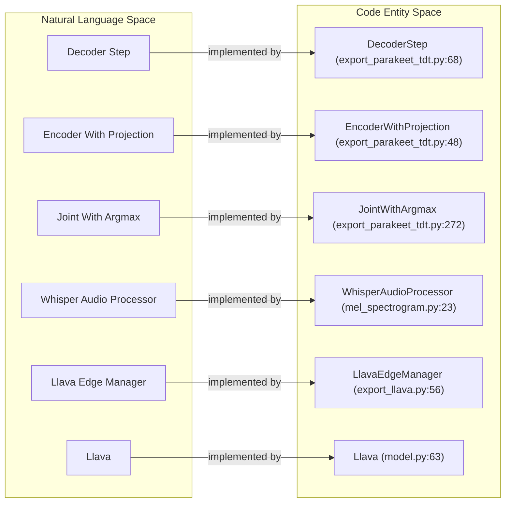
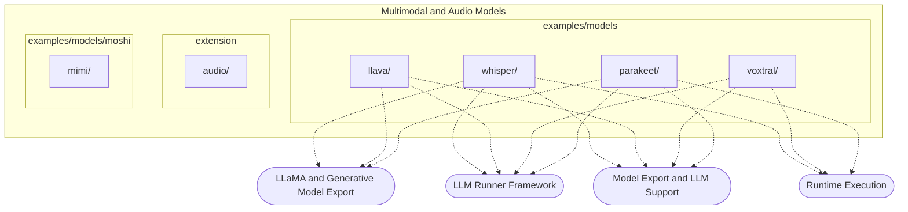
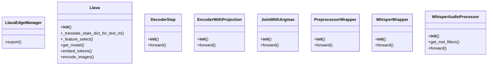
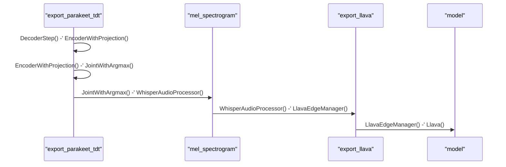

# Multimodal and Audio Models

↑ [[6-model-export-and-llm-support|Model Export and LLM Support]]

> Architectural specification and implementation reference for Multimodal and Audio Models (36 relevant source files). Primary code entities: `LlavaEdgeManager`, `export`, `create_llava_config_from_args`, `export_all`, `Llava`.

<details>
<summary>Relevant source files</summary>

The following files were used as context for generating this wiki page:

- [examples/models/llava/export_llava.py](examples/models/llava/export_llava.py)
- [examples/models/llava/model.py](examples/models/llava/model.py)
- [examples/models/parakeet/parakeet_transcriber.cpp](examples/models/parakeet/parakeet_transcriber.cpp)
- [examples/models/parakeet/export_parakeet_tdt.py](examples/models/parakeet/export_parakeet_tdt.py)
- [examples/models/whisper/model.py](examples/models/whisper/model.py)
- [examples/models/llava/main.cpp](examples/models/llava/main.cpp)
- [examples/models/llava/__init__.py](examples/models/llava/__init__.py)
- [extension/audio/mel_spectrogram.py](extension/audio/mel_spectrogram.py)
- [examples/models/voxtral/multimodal.cpp](examples/models/voxtral/multimodal.cpp)
- [examples/models/llava/targets.bzl](examples/models/llava/targets.bzl)
- [examples/models/parakeet/parakeet_helper_protocol.h](examples/models/parakeet/parakeet_helper_protocol.h)
- [examples/models/parakeet/parakeet_transcriber.h](examples/models/parakeet/parakeet_transcriber.h)
- [examples/models/whisper/main.cpp](examples/models/whisper/main.cpp)
- [examples/models/whisper/__init__.py](examples/models/whisper/__init__.py)
- [examples/models/parakeet/parakeet_helper_protocol.cpp](examples/models/parakeet/parakeet_helper_protocol.cpp)
- [examples/models/parakeet/benchmark.ps1](examples/models/parakeet/benchmark.ps1)
- [examples/models/parakeet/parakeet_helper.cpp](examples/models/parakeet/parakeet_helper.cpp)
- [examples/models/parakeet/main.cpp](examples/models/parakeet/main.cpp)
- [examples/models/parakeet/timestamp_utils.cpp](examples/models/parakeet/timestamp_utils.cpp)
- [examples/models/parakeet/tokenizer_utils.cpp](examples/models/parakeet/tokenizer_utils.cpp)
- [examples/models/parakeet/types.h](examples/models/parakeet/types.h)
- [extension/audio/targets.bzl](extension/audio/targets.bzl)
- [examples/models/parakeet/quantize.py](examples/models/parakeet/quantize.py)
- [examples/models/parakeet/timestamp_utils.h](examples/models/parakeet/timestamp_utils.h)
- [examples/models/parakeet/tokenizer_utils.h](examples/models/parakeet/tokenizer_utils.h)
- [examples/models/llava/README.md](examples/models/llava/README.md)
- [examples/models/whisper/README.md](examples/models/whisper/README.md)
- [examples/models/voxtral/README.md](examples/models/voxtral/README.md)
- [examples/models/parakeet/README.md](examples/models/parakeet/README.md)
- [extension/audio/README.md](extension/audio/README.md)
- [examples/models/llava/BUCK](examples/models/llava/BUCK)
- [examples/models/llava/CMakeLists.txt](examples/models/llava/CMakeLists.txt)
- [examples/models/whisper/CMakeLists.txt](examples/models/whisper/CMakeLists.txt)
- [examples/models/voxtral/CMakeLists.txt](examples/models/voxtral/CMakeLists.txt)
- [examples/models/parakeet/CMakeLists.txt](examples/models/parakeet/CMakeLists.txt)

</details>

## Purpose and Scope

Architectural specification and implementation reference for Multimodal and Audio Models (36 relevant source files). Primary code entities: `LlavaEdgeManager`, `export`, `create_llava_config_from_args`, `export_all`, `Llava`.

Primary code entities analyzed on this page include `DecoderStep` ([examples/models/parakeet/export_parakeet_tdt.py:68-85]()), `EncoderWithProjection` ([examples/models/parakeet/export_parakeet_tdt.py:48-65]()), `JointWithArgmax` ([examples/models/parakeet/export_parakeet_tdt.py:272-284]()), `WhisperAudioProcessor` ([extension/audio/mel_spectrogram.py:23-188]()), `LlavaEdgeManager` ([examples/models/llava/export_llava.py:56-69]()).

For the parent architectural layer, see [[6-model-export-and-llm-support|Model Export and LLM Support]]. Related sibling subsystems: [[6.1-llama-model-export|LLaMA and Generative Model Export]], [[6.2-llm-runner-framework|LLM Runner Framework]], [[6.3-custom-operators-and-extensions|Custom Operators and Extensions]].

Sources: [examples/models/parakeet/export_parakeet_tdt.py:68-85](), [examples/models/parakeet/export_parakeet_tdt.py:48-65](), [examples/models/parakeet/export_parakeet_tdt.py:272-284](), [extension/audio/mel_spectrogram.py:23-188]()

---

## 1. High-Level Architecture and Data Flow

### Natural Language Space to Code Entity Space Mapping

The following diagram maps domain concepts in this subsystem to their concrete code entities:



### Subsystem Component & Dependency Flow



Cross-subsystem call and import edges connect **Multimodal and Audio Models** with [[6-model-export-and-llm-support|Model Export and LLM Support]] (coupling `17.0`), [[6.1-llama-model-export|LLaMA and Generative Model Export]] (coupling `16.0`), [[7.2-model-and-backend-testing-framework|Model and Backend Testing Framework]] (coupling `16.0`), [[6.2-llm-runner-framework|LLM Runner Framework]] (coupling `15.0`), [[8-runtime-execution|Runtime Execution]] (coupling `11.0`).

| Module Directory | Files | Primary Code Entities | Source Citations |
|---|---|---|---|
| `examples/models/parakeet` | 16 | `DecoderStep`, `EncoderWithProjection`, `JointWithArgmax`, `PreprocessorWrapper` | [examples/models/parakeet/export_parakeet_tdt.py:68-85]() [examples/models/parakeet/export_parakeet_tdt.py:48-65]() |
| `examples/models/llava` | 8 | `LlavaEdgeManager`, `Llava`, `LlavaModel`, `export` | [examples/models/llava/export_llava.py:56-69]() [examples/models/llava/model.py:63-301]() |
| `examples/models/whisper` | 5 | `WhisperWrapper`, `WhisperModel`, `get_eager_model`, `__init__` | [examples/models/whisper/model.py:14-24]() [examples/models/whisper/model.py:27-43]() |
| `examples/models/voxtral` | 3 | `processRawAudioFile`, `processAudioFile`, `loadPreprocessedAudio`, `ends_with` | [examples/models/voxtral/multimodal.cpp:128-237]() [examples/models/voxtral/multimodal.cpp:256-278]() |
| `extension/audio` | 3 | `WhisperAudioProcessor`, `export_processor`, `forward`, `_export_processor_model` | [extension/audio/mel_spectrogram.py:23-188]() [extension/audio/mel_spectrogram.py:238-250]() |
| `examples/models/moshi/mimi` | 1 | *(build / config)* | [examples/models/moshi/mimi/BUCK]() |

Sources: [examples/models/parakeet/export_parakeet_tdt.py:68-85](), [examples/models/parakeet/export_parakeet_tdt.py:48-65](), [examples/models/parakeet/export_parakeet_tdt.py:272-284](), [extension/audio/mel_spectrogram.py:23-188](), [examples/models/llava/export_llava.py:56-69]()

---

## 2. Core Data Structures and Implementation Details

### Class and Entity Relationship Diagram



### `DecoderStep` (Class)

- **Source Location**: [examples/models/parakeet/export_parakeet_tdt.py:68-85]()
- **Declaration**: `Class DecoderStep`
- **Graph Centrality**: fan-in `1` callers, fan-out `0` callees
- **Responsibility**: Single decoder RNN step that outputs projected features for the joint network.

```python
// examples/models/parakeet/export_parakeet_tdt.py:68-83
class DecoderStep(torch.nn.Module):
    """Single decoder RNN step that outputs projected features for the joint network."""

    def __init__(self, decoder, joint):
        super().__init__()
        self.decoder = decoder
        self.project_prednet = joint.project_prednet
        self.pred_hidden = decoder.pred_hidden
        self.pred_rnn_layers = getattr(decoder, "pred_rnn_layers", 2)

    def forward(
        self, token: torch.Tensor, h: torch.Tensor, c: torch.Tensor
    ) -> tuple[torch.Tensor, torch.Tensor, torch.Tensor]:
        # Run decoder RNN step
        g, new_state = self.decoder.predict(y=token, state=[h, c], add_sos=False)
        # Project decoder output: [B, 1, pred_hidden] -> [B, 1, joint_hidden]
```

### `EncoderWithProjection` (Class)

- **Source Location**: [examples/models/parakeet/export_parakeet_tdt.py:48-65]()
- **Declaration**: `Class EncoderWithProjection`
- **Graph Centrality**: fan-in `1` callers, fan-out `0` callees
- **Responsibility**: Encoder that outputs projected features ready for the joint network.

```python
// examples/models/parakeet/export_parakeet_tdt.py:48-63
class EncoderWithProjection(torch.nn.Module):
    """Encoder that outputs projected features ready for the joint network."""

    def __init__(self, encoder, joint):
        super().__init__()
        self.encoder = encoder
        self.project_encoder = joint.project_encoder

    def forward(
        self, audio_signal: torch.Tensor, length: torch.Tensor
    ) -> tuple[torch.Tensor, torch.Tensor]:
        # Run encoder: [B, feat_in, T_mel] -> [B, enc_dim, T_enc]
        encoded, enc_len = self.encoder(audio_signal=audio_signal, length=length)
        # Transpose: [B, enc_dim, T_enc] -> [B, T_enc, enc_dim]
        encoded_t = encoded.transpose(1, 2)
        # Project: [B, T_enc, enc_dim] -> [B, T_enc, joint_hidden]
```

### `JointWithArgmax` (Class)

- **Source Location**: [examples/models/parakeet/export_parakeet_tdt.py:272-284]()
- **Declaration**: `Class JointWithArgmax`
- **Graph Centrality**: fan-in `1` callers, fan-out `0` callees
- **Responsibility**: Joint network that returns token and duration indices directly.

```python
// examples/models/parakeet/export_parakeet_tdt.py:272-284
class JointWithArgmax(torch.nn.Module):
    """Joint network that returns token and duration indices directly."""

    def __init__(self, joint, num_token_classes):
        super().__init__()
        self.joint = joint
        self.num_token_classes = num_token_classes

    def forward(self, f, g):
        logits = self.joint.joint_after_projection(f, g).squeeze()
        token_id = logits[: self.num_token_classes].argmax()
        duration_idx = logits[self.num_token_classes :].argmax()
        return token_id, duration_idx
```

### `WhisperAudioProcessor` (Class)

- **Source Location**: [extension/audio/mel_spectrogram.py:23-188]()
- **Declaration**: `Class WhisperAudioProcessor`
- **Graph Centrality**: fan-in `1` callers, fan-out `0` callees
- **Responsibility**: r""" Computes Mel spectrograms from mono audio input. Same as HuggingFace WhisperFeatureExtractor, but implemented in PyTorch Args: feature_size (`int`, defaults to 80): The feature dimension of the extracted features. sampling_rate (`int`, defaults to 16000): The sampling rate at which the audio files should be digita

### `LlavaEdgeManager` (Class)

- **Source Location**: [examples/models/llava/export_llava.py:56-69]()
- **Declaration**: `Class LlavaEdgeManager`
- **Graph Centrality**: fan-in `1` callers, fan-out `0` callees

### `export` (Method)

- **Source Location**: [examples/models/llava/export_llava.py:57-69]()
- **Declaration**: `(self)`
- **Graph Centrality**: fan-in `33` callers, fan-out `1` callees

Sources: [examples/models/parakeet/export_parakeet_tdt.py:68-85](), [examples/models/parakeet/export_parakeet_tdt.py:48-65](), [examples/models/parakeet/export_parakeet_tdt.py:272-284](), [extension/audio/mel_spectrogram.py:23-188](), [examples/models/llava/export_llava.py:56-69]()

---

## 3. Execution and Call Flow

The sequence diagram below traces the runtime/compile-time call chain across components in this module:



Sources: [examples/models/parakeet/export_parakeet_tdt.py:68-85](), [examples/models/parakeet/export_parakeet_tdt.py:48-65](), [examples/models/parakeet/export_parakeet_tdt.py:272-284](), [extension/audio/mel_spectrogram.py:23-188](), [examples/models/llava/export_llava.py:56-69]()

---

## 4. Key API and Symbol Reference

| Code Entity | Kind | Location | Fan-In / Out | Role & Signature |
|---|---|---|---|---|
| `DecoderStep` | Class | [examples/models/parakeet/export_parakeet_tdt.py:68-85]() | `1` / `0` | Single decoder RNN step that outputs projected features for the joint network. |
| `EncoderWithProjection` | Class | [examples/models/parakeet/export_parakeet_tdt.py:48-65]() | `1` / `0` | Encoder that outputs projected features ready for the joint network. |
| `JointWithArgmax` | Class | [examples/models/parakeet/export_parakeet_tdt.py:272-284]() | `1` / `0` | Joint network that returns token and duration indices directly. |
| `WhisperAudioProcessor` | Class | [extension/audio/mel_spectrogram.py:23-188]() | `1` / `0` | r""" |
| `LlavaEdgeManager` | Class | [examples/models/llava/export_llava.py:56-69]() | `1` / `0` | — |
| `Llava` | Class | [examples/models/llava/model.py:63-301]() | `1` / `0` | — |
| `PreprocessorWrapper` | Class | [examples/models/parakeet/export_parakeet_tdt.py:287-297]() | `1` / `0` | — |
| `LlavaModel` | Class | [examples/models/llava/model.py:304-415]() | `0` / `0` | — |
| `WhisperWrapper` | Class | [examples/models/whisper/model.py:14-24]() | `1` / `0` | — |
| `DecodeLoopProfile` | Class | [examples/models/parakeet/parakeet_transcriber.cpp:73-90]() | `0` / `0` | — |
| `MethodTiming` | Class | [examples/models/parakeet/parakeet_transcriber.cpp:53-71]() | `0` / `0` | — |
| `WhisperModel` | Class | [examples/models/whisper/model.py:27-43]() | `0` / `0` | — |
| `AudioDescriptor` | Class | [examples/models/parakeet/parakeet_helper_protocol.h:21-26]() | `0` / `0` | — |
| `Request` | Class | [examples/models/parakeet/parakeet_helper_protocol.h:34-42]() | `0` / `0` | — |
| `TranscribeRequest` | Class | [examples/models/parakeet/parakeet_helper_protocol.h:28-32]() | `0` / `0` | — |
| `ParakeetTranscriber` | Class | [examples/models/parakeet/parakeet_transcriber.h:57-92]() | `0` / `0` | — |
| `TimestampOutputMode` | Class | [examples/models/parakeet/parakeet_transcriber.h:28-36]() | `0` / `0` | — |
| `TranscribeConfig` | Class | [examples/models/parakeet/parakeet_transcriber.h:40-43]() | `0` / `0` | — |
| `TranscribeResult` | Class | [examples/models/parakeet/parakeet_transcriber.h:45-53]() | `0` / `0` | — |
| `TextWithOffsets` | Class | [examples/models/parakeet/types.h:24-28]() | `0` / `0` | — |
| `TokenWithTextInfo` | Class | [examples/models/parakeet/types.h:14-22]() | `0` / `0` | — |
| `export` | Method | [examples/models/llava/export_llava.py:57-69]() | `33` / `1` | (self) |

Sources: [examples/models/parakeet/export_parakeet_tdt.py:68-85](), [examples/models/parakeet/export_parakeet_tdt.py:48-65](), [examples/models/parakeet/export_parakeet_tdt.py:272-284](), [extension/audio/mel_spectrogram.py:23-188](), [examples/models/llava/export_llava.py:56-69](), [examples/models/llava/model.py:63-301]()

---

## 5. Official Documentation and Design Context

The following linked documentation sections from `llm-wiki` (`raw/`) provide additional architectural context, tutorials, and design invariants for this subsystem:

- **Model Export and LLM Support** ([wiki/6-model-export-and-llm-support.md](), score `147.9821`) (sections: `Model Export and LLM Support`, `Purpose and Scope`, `System Mapping: Natural Language Space to Code Entity Space`, `1. LLaMA and Generative Model Export`): # Model Export and LLM Support > Architectural specification and implementation reference for Model Export and LLM Support (40 relevant source files). Primary code entities: `MuseGlimmerImageSpan`, `MuseGlimmerPreparationSpec`, `MuseGlimmerPreparedInput`, `Backing`, `RequestHandle`. <details> <summary>Relevant source files</summary> The following files were used as context for generating this wiki page: - [examples/m
- **ExecuTorch DeepWiki** ([wiki/index.md](), score `110.9037`) (sections: `ExecuTorch DeepWiki`, `Pages`): # ExecuTorch DeepWiki Generated from `home-jason-Project-deepwiki-executorch` at commit `b3b565b5b62f` (2026-11-15T15:02:11+00:00). ## Pages - [[1-overview|Overview]] — Architectural specification and implementation reference for Overview (10 relevant source files). Primary code entities: `Module`, `MethodHolder`, `PlannedMemory`, `EdgeProgramManager`, `__init__`. - [[1.1-getting-started|Getting Started]] — Architect
- **Export API and Recipe System** ([wiki/1.2-export-api-and-recipe-system.md](), score `92.1267`) (sections: `Export API and Recipe System`, `Purpose and Scope`, `1. High-Level Architecture and Data Flow`, `Natural Language Space to Code Entity Space Mapping`): # Export API and Recipe System ↑ [[1-overview|Overview]] > Architectural specification and implementation reference for Export API and Recipe System (37 relevant source files). Primary code entities: `AOQuantizationConfig`, `ExportRecipe`, `_assert_scalar_fields_agree`, `_collect_lowering_fields`, `ExportSession`. <details> <summary>Relevant source files</summary> The following files were used as context for generati
- **Model and Backend Testing Framework** ([wiki/7.2-model-and-backend-testing-framework.md](), score `77.3618`) (sections: `Model and Backend Testing Framework`, `Purpose and Scope`, `1. High-Level Architecture and Data Flow`, `Natural Language Space to Code Entity Space Mapping`): # Model and Backend Testing Framework ↑ [[7-testing-and-cicd-infrastructure|Testing and CI/CD Infrastructure]] > Architectural specification and implementation reference for Model and Backend Testing Framework (40 relevant source files). Primary code entities: `MuseGlimmerImageSpan`, `MuseGlimmerPreparationSpec`, `MuseGlimmerPreparedInput`, `Backing`, `Backend`. <details> <summary>Relevant source files</summary> The 

Sources: [wiki/6-model-export-and-llm-support.md](), [wiki/index.md](), [wiki/1.2-export-api-and-recipe-system.md](), [wiki/7.2-model-and-backend-testing-framework.md]()

## Related pages

- [[6-model-export-and-llm-support|Model Export and LLM Support]]
- [[1.1-getting-started|Getting Started]]
- [[1.2-export-api-and-recipe-system|Export API and Recipe System]]
- [[2.2-kernel-libraries-and-selective-build|Kernel Libraries and Selective Build]]
- [[2.3-schema-generation-and-flatbuffers|Schema Generation and FlatBuffers]]
- [[3.4-program-emission-and-serialization|Program Emission and Serialization]]
- [[3.5-verification-and-dialect-system|Verification and Dialect System]]
- [[4-quantization-systems|Quantization Systems]]

## Related documents

- `wiki/6-model-export-and-llm-support.md` — Model Export and LLM Support (score 147.9821, via bm25)
- `wiki/index.md` — ExecuTorch DeepWiki (score 110.9037, via bm25)
- `wiki/1.2-export-api-and-recipe-system.md` — Export API and Recipe System (score 92.1267, via bm25)
- `wiki/7.2-model-and-backend-testing-framework.md` — Model and Backend Testing Framework (score 77.3618, via bm25)
- `wiki/6.1-llama-model-export.md` — LLaMA and Generative Model Export (score 74.9887, via bm25)

## Sources

- [`examples/models/llava/export_llava.py`](https://github.com/pytorch/executorch/blob/main/examples/models/llava/export_llava.py)
- [`examples/models/llava/model.py`](https://github.com/pytorch/executorch/blob/main/examples/models/llava/model.py)
- [`examples/models/parakeet/parakeet_transcriber.cpp`](https://github.com/pytorch/executorch/blob/main/examples/models/parakeet/parakeet_transcriber.cpp)
- [`examples/models/parakeet/export_parakeet_tdt.py`](https://github.com/pytorch/executorch/blob/main/examples/models/parakeet/export_parakeet_tdt.py)
- [`examples/models/whisper/model.py`](https://github.com/pytorch/executorch/blob/main/examples/models/whisper/model.py)
- [`examples/models/llava/main.cpp`](https://github.com/pytorch/executorch/blob/main/examples/models/llava/main.cpp)
- [`examples/models/llava/__init__.py`](https://github.com/pytorch/executorch/blob/main/examples/models/llava/__init__.py)
- [`extension/audio/mel_spectrogram.py`](https://github.com/pytorch/executorch/blob/main/extension/audio/mel_spectrogram.py)
- [`examples/models/voxtral/multimodal.cpp`](https://github.com/pytorch/executorch/blob/main/examples/models/voxtral/multimodal.cpp)
- [`examples/models/llava/targets.bzl`](https://github.com/pytorch/executorch/blob/main/examples/models/llava/targets.bzl)
- [`examples/models/parakeet/parakeet_helper_protocol.h`](https://github.com/pytorch/executorch/blob/main/examples/models/parakeet/parakeet_helper_protocol.h)
- [`examples/models/parakeet/parakeet_transcriber.h`](https://github.com/pytorch/executorch/blob/main/examples/models/parakeet/parakeet_transcriber.h)
- [`examples/models/whisper/main.cpp`](https://github.com/pytorch/executorch/blob/main/examples/models/whisper/main.cpp)
- [`examples/models/whisper/__init__.py`](https://github.com/pytorch/executorch/blob/main/examples/models/whisper/__init__.py)
- [`examples/models/parakeet/parakeet_helper_protocol.cpp`](https://github.com/pytorch/executorch/blob/main/examples/models/parakeet/parakeet_helper_protocol.cpp)
- [`examples/models/parakeet/benchmark.ps1`](https://github.com/pytorch/executorch/blob/main/examples/models/parakeet/benchmark.ps1)
- [`examples/models/parakeet/parakeet_helper.cpp`](https://github.com/pytorch/executorch/blob/main/examples/models/parakeet/parakeet_helper.cpp)
- [`examples/models/parakeet/main.cpp`](https://github.com/pytorch/executorch/blob/main/examples/models/parakeet/main.cpp)
- [`examples/models/parakeet/timestamp_utils.cpp`](https://github.com/pytorch/executorch/blob/main/examples/models/parakeet/timestamp_utils.cpp)
- [`examples/models/parakeet/tokenizer_utils.cpp`](https://github.com/pytorch/executorch/blob/main/examples/models/parakeet/tokenizer_utils.cpp)
- [`examples/models/parakeet/types.h`](https://github.com/pytorch/executorch/blob/main/examples/models/parakeet/types.h)
- [`extension/audio/targets.bzl`](https://github.com/pytorch/executorch/blob/main/extension/audio/targets.bzl)
- [`examples/models/parakeet/quantize.py`](https://github.com/pytorch/executorch/blob/main/examples/models/parakeet/quantize.py)
- [`examples/models/parakeet/timestamp_utils.h`](https://github.com/pytorch/executorch/blob/main/examples/models/parakeet/timestamp_utils.h)
- [`examples/models/parakeet/tokenizer_utils.h`](https://github.com/pytorch/executorch/blob/main/examples/models/parakeet/tokenizer_utils.h)
- [`examples/models/llava/README.md`](https://github.com/pytorch/executorch/blob/main/examples/models/llava/README.md)
- [`examples/models/whisper/README.md`](https://github.com/pytorch/executorch/blob/main/examples/models/whisper/README.md)
- [`examples/models/voxtral/README.md`](https://github.com/pytorch/executorch/blob/main/examples/models/voxtral/README.md)
- [`examples/models/parakeet/README.md`](https://github.com/pytorch/executorch/blob/main/examples/models/parakeet/README.md)
- [`extension/audio/README.md`](https://github.com/pytorch/executorch/blob/main/extension/audio/README.md)
- [`examples/models/llava/BUCK`](https://github.com/pytorch/executorch/blob/main/examples/models/llava/BUCK)
- [`examples/models/llava/CMakeLists.txt`](https://github.com/pytorch/executorch/blob/main/examples/models/llava/CMakeLists.txt)
- [`examples/models/whisper/CMakeLists.txt`](https://github.com/pytorch/executorch/blob/main/examples/models/whisper/CMakeLists.txt)
- [`examples/models/voxtral/CMakeLists.txt`](https://github.com/pytorch/executorch/blob/main/examples/models/voxtral/CMakeLists.txt)
- [`examples/models/parakeet/CMakeLists.txt`](https://github.com/pytorch/executorch/blob/main/examples/models/parakeet/CMakeLists.txt)
- [`examples/models/moshi/mimi/BUCK`](https://github.com/pytorch/executorch/blob/main/examples/models/moshi/mimi/BUCK)


## Dynamic Knowledge Links (Code Graph ↔ LLM-Wiki / RAG)

### Linked Architecture & Design Documents

| Document | Match Channel | Score | Shared Code Symbols |
|---|---|---|---|
| [[6-model-export-and-llm-support|Model Export and LLM Support]] | `bm25+entity(1)` | `149.482` | `embed_tokens` |
| [[index|ExecuTorch DeepWiki]] | `bm25` | `110.904` | *(lexical/graph match)* |
| [[6.2-llm-runner-framework|LLM Runner Framework]] | `wikilink:6.4-multimodal-and-audio-models` | `95.266` | *(lexical/graph match)* |
| [[6.3-custom-operators-and-extensions|Custom Operators and Extensions]] | `wikilink:6.4-multimodal-and-audio-models` | `95.266` | *(lexical/graph match)* |
| [[8-runtime-execution|Runtime Execution]] | `wikilink:6.4-multimodal-and-audio-models` | `95.266` | *(lexical/graph match)* |
| [[1.2-export-api-and-recipe-system|Export API and Recipe System]] | `bm25` | `92.127` | *(lexical/graph match)* |

### High-Centrality Bridge Symbols (CBM Graph)

| Symbol | Kind | Source Location | Fan-In / Fan-Out |
|---|---|---|---|
| `DecoderStep` | Class | [examples/models/parakeet/export_parakeet_tdt.py:68-85]() | in: `1` / out: `0` |
| `EncoderWithProjection` | Class | [examples/models/parakeet/export_parakeet_tdt.py:48-65]() | in: `1` / out: `0` |
| `JointWithArgmax` | Class | [examples/models/parakeet/export_parakeet_tdt.py:272-284]() | in: `1` / out: `0` |
| `WhisperAudioProcessor` | Class | [extension/audio/mel_spectrogram.py:23-188]() | in: `1` / out: `0` |
| `LlavaEdgeManager` | Class | [examples/models/llava/export_llava.py:56-69]() | in: `1` / out: `0` |
| `Llava` | Class | [examples/models/llava/model.py:63-301]() | in: `1` / out: `0` |

Sources: [examples/models/parakeet/export_parakeet_tdt.py:68-85](), [examples/models/parakeet/export_parakeet_tdt.py:48-65](), [examples/models/parakeet/export_parakeet_tdt.py:272-284](), [extension/audio/mel_spectrogram.py:23-188]()

### Cross-Subsystem Coupling

- [[6-model-export-and-llm-support|Model Export and LLM Support]] — call/import coupling weight `17.0`
- [[6.1-llama-model-export|LLaMA and Generative Model Export]] — call/import coupling weight `16.0`
- [[7.2-model-and-backend-testing-framework|Model and Backend Testing Framework]] — call/import coupling weight `16.0`
- [[6.2-llm-runner-framework|LLM Runner Framework]] — call/import coupling weight `15.0`
- [[8-runtime-execution|Runtime Execution]] — call/import coupling weight `11.0`
- [[8.1-core-runtime-architecture|Core Runtime Architecture]] — call/import coupling weight `11.0`
