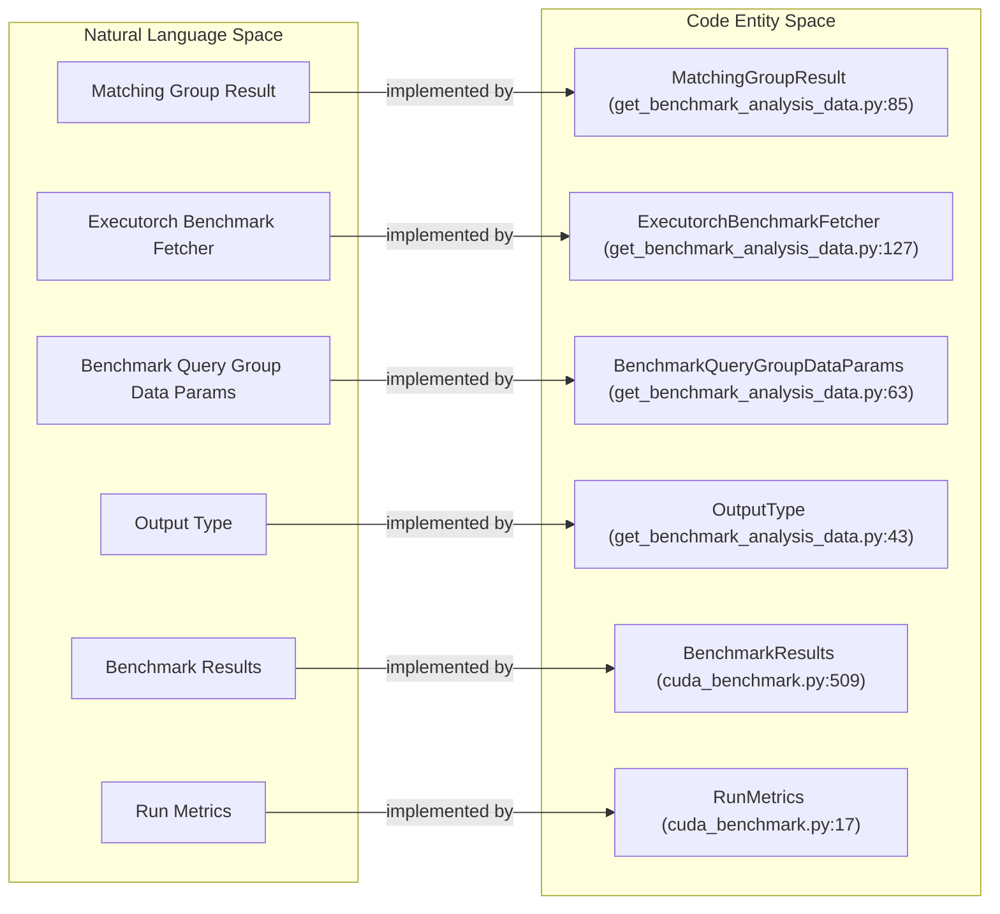
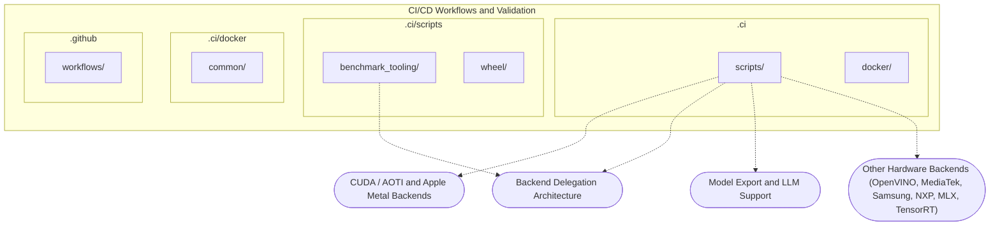
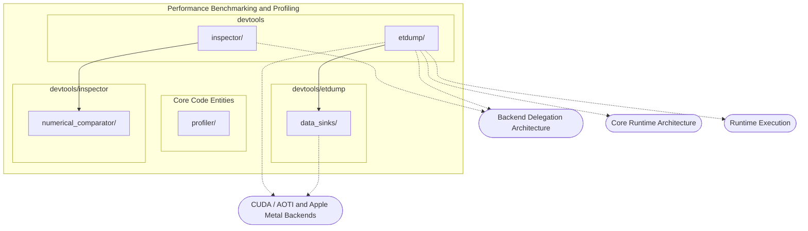

# Testing and CI/CD Infrastructure

> Architectural specification and implementation reference for Testing and CI/CD Infrastructure (36 relevant source files). Primary code entities: `BenchmarkResults`, `save_json`, `to_dict`, `to_v3_format`, `BenchmarkFilters`.

Relevant source files

The following files were used as context for generating this wiki page:

- [.ci/scripts/cuda_benchmark.py](.ci/scripts/cuda_benchmark.py)
- [.ci/scripts/benchmark_tooling/get_benchmark_analysis_data.py](.ci/scripts/benchmark_tooling/get_benchmark_analysis_data.py)
- [.ci/docker/common/zephyr_sdk_release_proxy.py](.ci/docker/common/zephyr_sdk_release_proxy.py)
- [.ci/scripts/muse_glimmer_batching_workload.h](.ci/scripts/muse_glimmer_batching_workload.h)
- [devtools/etdump/etdump_flatcc.cpp](devtools/etdump/etdump_flatcc.cpp)
- [.ci/scripts/gather_benchmark_configs.py](.ci/scripts/gather_benchmark_configs.py)
- [devtools/etdump/schema_flatcc.py](devtools/etdump/schema_flatcc.py)
- [profiler/parse_profiler_results.py](profiler/parse_profiler_results.py)
- [.ci/scripts/utils.sh](.ci/scripts/utils.sh)
- [devtools/etdump/etdump_flatcc.h](devtools/etdump/etdump_flatcc.h)
- [devtools/etdump/etdump_filter.h](devtools/etdump/etdump_filter.h)
- [.ci/scripts/zephyr-utils.sh](.ci/scripts/zephyr-utils.sh)
- [devtools/etdump/data_sinks/buffer_data_sink.h](devtools/etdump/data_sinks/buffer_data_sink.h)
- [.ci/scripts/wheel/export_native.py](.ci/scripts/wheel/export_native.py)
- [devtools/etdump/data_sinks/file_data_sink.h](devtools/etdump/data_sinks/file_data_sink.h)
- [devtools/etdump/data_sinks/data_sink_base.h](devtools/etdump/data_sinks/data_sink_base.h)
- [.ci/scripts/benchmark_tooling/analyze_benchmark_stability.py](.ci/scripts/benchmark_tooling/analyze_benchmark_stability.py)
- [devtools/etdump/serialize.py](devtools/etdump/serialize.py)
- [devtools/etdump/data_sinks/file_data_sink.cpp](devtools/etdump/data_sinks/file_data_sink.cpp)
- [.ci/scripts/setup-vulkan-linux-deps.sh](.ci/scripts/setup-vulkan-linux-deps.sh)
- [.ci/scripts/gather_test_models.py](.ci/scripts/gather_test_models.py)
- [.github/workflows/pending_user_response.py](.github/workflows/pending_user_response.py)
- [devtools/etdump/etdump_filter.cpp](devtools/etdump/etdump_filter.cpp)
- [.ci/scripts/setup-samsung-linux-deps.sh](.ci/scripts/setup-samsung-linux-deps.sh)
- [.ci/scripts/muse_glimmer_batching_smoke.cpp](.ci/scripts/muse_glimmer_batching_smoke.cpp)
- [devtools/etdump/emitter.cpp](devtools/etdump/emitter.cpp)
- [.ci/docker/common/utils.sh](.ci/docker/common/utils.sh)
- [.ci/scripts/setup-macos.sh](.ci/scripts/setup-macos.sh)
- [.ci/docker/README.md](.ci/docker/README.md)
- [.ci/scripts/benchmark_tooling/README.md](.ci/scripts/benchmark_tooling/README.md)
- [profiler/BUCK](profiler/BUCK)
- [.ci/scripts/BUCK](.ci/scripts/BUCK)
- [devtools/etdump/BUCK](devtools/etdump/BUCK)
- [devtools/etdump/CMakeLists.txt](devtools/etdump/CMakeLists.txt)
- [devtools/etdump/etdump_schema_flatcc.fbs](devtools/etdump/etdump_schema_flatcc.fbs)

## Purpose and Scope

This chapter covers **Testing and CI/CD Infrastructure** across the repository, detailing the core abstractions, data structures, transformation pipelines, and runtime/build integrations that implement this layer.

**Scope**: This document provides an architectural hub for the following child subsystems:
- **CI/CD Workflows and Validation**: See [[7.1-cicd-workflows-and-validation|CI/CD Workflows and Validation]].
- **Model and Backend Testing Framework**: See [[7.2-model-and-backend-testing-framework|Model and Backend Testing Framework]].
- **Performance Benchmarking and Profiling**: See [[7.3-performance-benchmarking-and-profiling|Performance Benchmarking and Profiling]].

Sources: [.ci/scripts/benchmark_tooling/get_benchmark_analysis_data.py:85-95](), [.ci/scripts/benchmark_tooling/get_benchmark_analysis_data.py:127-690](), [.ci/scripts/benchmark_tooling/get_benchmark_analysis_data.py:63-81](), [.ci/scripts/benchmark_tooling/get_benchmark_analysis_data.py:43-59]()

---

## System Mapping: Natural Language Space to Code Entity Space

Sources: [.ci/scripts/benchmark_tooling/get_benchmark_analysis_data.py:85-95](), [.ci/scripts/benchmark_tooling/get_benchmark_analysis_data.py:127-690](), [.ci/scripts/benchmark_tooling/get_benchmark_analysis_data.py:63-81](), [.ci/scripts/benchmark_tooling/get_benchmark_analysis_data.py:43-59](), [.ci/scripts/cuda_benchmark.py:509-663]()

---

## 1. CI/CD Workflows and Validation

Architectural specification and implementation reference for CI/CD Workflows and Validation (31 relevant source files). Primary code entities: `BenchmarkResults`, `save_json`, `to_dict`, `to_v3_format`, `BenchmarkFilters`. [.ci/scripts/benchmark_tooling/get_benchmark_analysis_data.py:85-95](), [.ci/scripts/benchmark_tooling/get_benchmark_analysis_data.py:127-690](), [.ci/scripts/benchmark_tooling/get_benchmark_analysis_data.py:63-81]()

### Primary Code Entities

- **`MatchingGroupResult`** (Class in [.ci/scripts/benchmark_tooling/get_benchmark_analysis_data.py:85-95]()): Container for benchmark results grouped by category. Attributes: category: Category name (e.g., 'private', 'public') data: List of benchmark data for this category
- **`ExecutorchBenchmarkFetcher`** (Class in [.ci/scripts/benchmark_tooling/get_benchmark_analysis_data.py:127-690]()): Fetch and process benchmark data from HUD API for ExecutorchBenchmark. This class provides methods to: 1. Fetch all benchmark data for a specified time range 2. Get all private dev
- **`BenchmarkQueryGroupDataParams`** (Class in [.ci/scripts/benchmark_tooling/get_benchmark_analysis_data.py:63-81]()): Parameters for querying benchmark data from HUD API. Attributes: repo: Repository name (e.g., "pytorch/executorch") benchmark_name: Name of the benchmark (e.g., "ExecuTorch") start
- **`OutputType`** (Class in [.ci/scripts/benchmark_tooling/get_benchmark_analysis_data.py:43-59]()): Enumeration of supported output formats for benchmark data. Values: EXCEL: Export data to Excel spreadsheets PRINT: Print data to console (default) CSV: Export data to CSV files JS
- **`get_result`** (Method in [.ci/scripts/benchmark_tooling/get_benchmark_analysis_data.py:231-238]()): Get a deep copy of the benchmark results. Returns: Dictionary containing benchmark results grouped by category
- **`generate_compatible_configs`** (Function in [.ci/scripts/gather_benchmark_configs.py:146-208]()): Generate a list of compatible benchmark configurations for a given model name and target OS. Args: model_name (str): The name of the model to generate configurations for. target_os

### CI/CD Workflows and Validation Architecture Flow

For details, see [[7.1-cicd-workflows-and-validation|CI/CD Workflows and Validation]].

Sources: [.ci/scripts/benchmark_tooling/get_benchmark_analysis_data.py:85-95](), [.ci/scripts/benchmark_tooling/get_benchmark_analysis_data.py:127-690](), [.ci/scripts/benchmark_tooling/get_benchmark_analysis_data.py:63-81](), [.ci/scripts/benchmark_tooling/get_benchmark_analysis_data.py:43-59]()

---

## 2. Model and Backend Testing Framework

Architectural specification and implementation reference for Model and Backend Testing Framework (40 relevant source files). Primary code entities: `MuseGlimmerImageSpan`, `MuseGlimmerPreparationSpec`, `MuseGlimmerPreparedInput`, `Backing`, `Backend`. [examples/models/toy_model/model.py:42-54](), [examples/models/muse-glimmer/runtime/prompt_preparation.h:22-33](), [examples/models/efficient_sam/efficient_sam_core/efficient_sam_decoder.py:166-191]()

### Primary Code Entities

- **`AddModule`** (Class in [examples/models/toy_model/model.py:42-54]()): Core implementation entity.
- **`MuseGlimmerPreparationSpec`** (Class in [examples/models/muse-glimmer/runtime/prompt_preparation.h:22-33]()): // One instance per executor. Sharing this immutable value with the CPU preparer // binds its payloads to that exact executor, not just compatible tensor shapes.
- **`CustomGroupNorm`** (Class in [examples/models/efficient_sam/efficient_sam_core/efficient_sam_decoder.py:166-191]()): # TODO: Remove CustomGroupNorm implementation once issue #6817 is resolved
- **`PositionEmbeddingRandom`** (Class in [examples/models/efficient_sam/efficient_sam_core/efficient_sam_decoder.py:108-162]()): Positional encoding using random spatial frequencies.
- **`size`** (Method in [examples/models/muse-glimmer/runtime/prompt_preparation.h:52-54]()): ()
- **`export`** (Method in [examples/models/llava/export_llava.py:57-69]()): (self)

### Model and Backend Testing Framework Architecture Flow

```mermaid
flowchart TD
  subgraph sub_this["Model and Backend Testing Framework"]
    subgraph sg_0["examples/models/muse-glimmer"]
      n_examples_models_muse_glimmer_runtime["runtime/"]
    end
    subgraph sg_1["examples"]
      n_examples_models["models/"]
    end
    subgraph sg_2["examples/models"]
      n_examples_models_codegen["codegen/"]
      n_examples_models_deeplab_v3["deeplab_v3/"]
      n_examples_models_deit_tiny["deit_tiny/"]
      n_examples_models_gemma4_31b["gemma4_31b/"]
      n_examples_models_qwen3_5_moe["qwen3_5_moe/"]
      n_examples_models_emformer_rnnt["emformer_rnnt/"]
      n_examples_models_edsr["edsr/"]
    end
    subgraph sg_3["examples/models/efficient_sam"]
      n_examples_models_efficient_sam_efficient_sam_core["efficient_sam_core/"]
    end
    subgraph sg_4["examples/models/supertonic"]
      n_examples_models_supertonic_runtime["runtime/"]
      n_examples_models_supertonic_export["export/"]
    end
  end
  n_page_5_4_arm_tosa_and_ethos_u_backend(["ARM TOSA and Ethos-U Backend"])
  n_page_5_7_cuda_aoti_and_apple_metal_backends(["CUDA / AOTI and Apple Metal Backends"])
  n_page_6_1_llama_model_export(["LLaMA and Generative Model Export"])
  n_page_8_runtime_execution(["Runtime Execution"])
  n_examples_models_muse_glimmer_runtime -.-> n_page_6_1_llama_model_export
  n_examples_models_muse_glimmer_runtime -.-> n_page_8_runtime_execution
  n_examples_models_muse_glimmer_runtime -.-> n_page_5_4_arm_tosa_and_ethos_u_backend
  n_examples_models_voxtral_tts -.-> n_page_6_1_llama_model_export
  n_examples_models_voxtral_tts -.-> n_page_8_runtime_execution
  n_examples_models_muse_glimmer_runtime -.-> n_page_5_7_cuda_aoti_and_apple_metal_backends
  n_examples_models_gemma4_31b -.-> n_page_6_1_llama_model_export
  n_examples_models_qwen3_5_moe -.-> n_page_6_1_llama_model_export
  n_examples_models_gemma4_31b -.-> n_page_8_runtime_execution
  n_examples_models_supertonic_runtime -.-> n_page_6_1_llama_model_export
  n_examples_models_muse_glimmer_runtime --> n_examples_models_voxtral_tts
  n_examples_models_supertonic_runtime -.-> n_page_5_4_arm_tosa_and_ethos_u_backend
  n_examples_models_qwen3_5_moe -.-> n_page_8_runtime_execution
  n_examples_models_supertonic_runtime -.-> n_page_8_runtime_execution
  n_examples_models_voxtral_tts -.-> n_page_5_4_arm_tosa_and_ethos_u_backend
  n_examples_models_dinov2 -.-> n_page_8_runtime_execution
  n_examples_models_muse_glimmer_runtime --> n_examples_models_parakeet
  n_examples_models_muse_glimmer_runtime --> n_examples_models_supertonic_runtime
  n_examples_models_llava -.-> n_page_6_1_llama_model_export
```

For details, see [[7.2-model-and-backend-testing-framework|Model and Backend Testing Framework]].

Sources: [examples/models/toy_model/model.py:42-54](), [examples/models/muse-glimmer/runtime/prompt_preparation.h:22-33](), [examples/models/efficient_sam/efficient_sam_core/efficient_sam_decoder.py:166-191](), [examples/models/efficient_sam/efficient_sam_core/efficient_sam_decoder.py:108-162]()

---

## 3. Performance Benchmarking and Profiling

Architectural specification and implementation reference for Performance Benchmarking and Profiling (36 relevant source files). Primary code entities: `Allocator`, `MemAllocation`, `MemEvent`, `ProfileData`, `ETDumpGen`. [devtools/inspector/_inspector_utils.py:112-131](), [devtools/inspector/_inspector.py:312-701](), [devtools/inspector/_inspector.py:705-1000]()

### Primary Code Entities

- **`NodeFilter`** (Class in [devtools/inspector/_inspector_utils.py:112-131]()): A class used to filter nodes based on extensible criteria. Attributes: metadata_key (str): The key to look for in the node's metadata. op_type (str): The operation code to match. e
- **`Event`** (Class in [devtools/inspector/_inspector.py:312-701]()): An Event corresponds to an operator instance with perf data retrieved from the runtime and other metadata from `ETRecord`. Args: name: Name of the profiling `Event`, empty if no pr
- **`EventBlock`** (Class in [devtools/inspector/_inspector.py:705-1000]()): r""" An `EventBlock` contains a collection of events associated with a particular profiling/debugging block retrieved from the runtime. Each `EventBlock` represents a pattern of ex
- **`EventSignature`** (Class in [devtools/inspector/_inspector.py:195-251]()): Note that (profile_event_signature, debug_event_signature) are sufficient signature identifiers. instruction_id is extracted from the signatures (equivalent in both) and surfaced f
- **`check_ready_to_add_events`** (Method in [devtools/etdump/etdump_flatcc.cpp:273-284]()): // ETDumpGen has the following possible states, ETDumpGen_Init, // ETDumpGen_Block_Created, ETDumpGen_Adding_Allocators, // ETDumpGen_Adding_Events. Right after boot-up the state o
- **`ETDumpGen`** (Method in [devtools/etdump/etdump_flatcc.cpp:185-217]()): // Constructor implementation

### Performance Benchmarking and Profiling Architecture Flow

For details, see [[7.3-performance-benchmarking-and-profiling|Performance Benchmarking and Profiling]].

Sources: [devtools/inspector/_inspector_utils.py:112-131](), [devtools/inspector/_inspector.py:312-701](), [devtools/inspector/_inspector.py:705-1000](), [devtools/inspector/_inspector.py:195-251]()

---

## Official Documentation & Architectural References

- **CI/CD Workflows and Validation** ([wiki/7.1-cicd-workflows-and-validation.md]()): # CI/CD Workflows and Validation ↑ [[7-testing-and-cicd-infrastructure|Testing and CI/CD Infrastructure]] > Architectural specification and implementation reference for CI/CD Workflows and Validation (31 relevant source files). Primary code entities: `BenchmarkResults`, `save_json`, `to_dict`, `to_v3_format`, `BenchmarkFilters`. 
 
Relevant s
- **ExecuTorch DeepWiki** ([wiki/index.md]()): # ExecuTorch DeepWiki Generated from `home-jason-Project-deepwiki-executorch` at commit `b3b565b5b62f` (2026-11-15T15:02:11+00:00). ## Pages - [[1-overview|Overview]] — Architectural specification and implementation reference for Overview (10 relevant source files). Primary code entities: `Module`, `MethodHolder`, `PlannedMemory`, `EdgeProgramManager`, `__in
- **Overview** ([wiki/1-overview.md]()): # Overview > Architectural specification and implementation reference for Overview (10 relevant source files). Primary code entities: `Module`, `MethodHolder`, `PlannedMemory`, `EdgeProgramManager`, `__init__`. 
 
Relevant source files
 The following files were used as context for generating this wiki page: - [extension/module/module
- **Performance Benchmarking and Profiling** ([wiki/7.3-performance-benchmarking-and-profiling.md]()): # Performance Benchmarking and Profiling ↑ [[7-testing-and-cicd-infrastructure|Testing and CI/CD Infrastructure]] > Architectural specification and implementation reference for Performance Benchmarking and Profiling (36 relevant source files). Primary code entities: `Allocator`, `MemAllocation`, `MemEvent`, `ProfileData`, `ETDumpGen`. 
 
Rele

Sources: [wiki/7.1-cicd-workflows-and-validation.md](), [wiki/index.md](), [wiki/1-overview.md](), [wiki/7.3-performance-benchmarking-and-profiling.md]()

## Sub-pages

- [[7.1-cicd-workflows-and-validation|CI/CD Workflows and Validation]]
- [[7.2-model-and-backend-testing-framework|Model and Backend Testing Framework]]
- [[7.3-performance-benchmarking-and-profiling|Performance Benchmarking and Profiling]]

## Related pages

- [[1-overview|Overview]]
- [[7.1-cicd-workflows-and-validation|CI/CD Workflows and Validation]]
- [[7.2-model-and-backend-testing-framework|Model and Backend Testing Framework]]
- [[7.3-performance-benchmarking-and-profiling|Performance Benchmarking and Profiling]]
- [[1.1-getting-started|Getting Started]]
- [[1.2-export-api-and-recipe-system|Export API and Recipe System]]
- [[2.2-kernel-libraries-and-selective-build|Kernel Libraries and Selective Build]]
- [[2.3-schema-generation-and-flatbuffers|Schema Generation and FlatBuffers]]

## Related documents

- `wiki/7.1-cicd-workflows-and-validation.md` — CI/CD Workflows and Validation (score 207.1913, via bm25)
- `wiki/index.md` — ExecuTorch DeepWiki (score 143.4605, via bm25)
- `wiki/1-overview.md` — Overview (score 103.4293, via bm25)
- `wiki/7.3-performance-benchmarking-and-profiling.md` — Performance Benchmarking and Profiling (score 102.5335, via bm25)
- `wiki/8.3-developer-tools-devtools.md` — Developer Tools (DevTools: ETDump, ETRecord, Inspector) (score 97.2458, via bm25)

## Sources

- [`.ci/scripts/cuda_benchmark.py`](https://github.com/pytorch/executorch/blob/main/.ci/scripts/cuda_benchmark.py)
- [`.ci/scripts/benchmark_tooling/get_benchmark_analysis_data.py`](https://github.com/pytorch/executorch/blob/main/.ci/scripts/benchmark_tooling/get_benchmark_analysis_data.py)
- [`.ci/docker/common/zephyr_sdk_release_proxy.py`](https://github.com/pytorch/executorch/blob/main/.ci/docker/common/zephyr_sdk_release_proxy.py)
- [`.ci/scripts/muse_glimmer_batching_workload.h`](https://github.com/pytorch/executorch/blob/main/.ci/scripts/muse_glimmer_batching_workload.h)
- [`devtools/etdump/etdump_flatcc.cpp`](https://github.com/pytorch/executorch/blob/main/devtools/etdump/etdump_flatcc.cpp)
- [`.ci/scripts/gather_benchmark_configs.py`](https://github.com/pytorch/executorch/blob/main/.ci/scripts/gather_benchmark_configs.py)
- [`devtools/etdump/schema_flatcc.py`](https://github.com/pytorch/executorch/blob/main/devtools/etdump/schema_flatcc.py)
- [`profiler/parse_profiler_results.py`](https://github.com/pytorch/executorch/blob/main/profiler/parse_profiler_results.py)
- [`.ci/scripts/utils.sh`](https://github.com/pytorch/executorch/blob/main/.ci/scripts/utils.sh)
- [`devtools/etdump/etdump_flatcc.h`](https://github.com/pytorch/executorch/blob/main/devtools/etdump/etdump_flatcc.h)
- [`devtools/etdump/etdump_filter.h`](https://github.com/pytorch/executorch/blob/main/devtools/etdump/etdump_filter.h)
- [`.ci/scripts/zephyr-utils.sh`](https://github.com/pytorch/executorch/blob/main/.ci/scripts/zephyr-utils.sh)
- [`devtools/etdump/data_sinks/buffer_data_sink.h`](https://github.com/pytorch/executorch/blob/main/devtools/etdump/data_sinks/buffer_data_sink.h)
- [`.ci/scripts/wheel/export_native.py`](https://github.com/pytorch/executorch/blob/main/.ci/scripts/wheel/export_native.py)
- [`devtools/etdump/data_sinks/file_data_sink.h`](https://github.com/pytorch/executorch/blob/main/devtools/etdump/data_sinks/file_data_sink.h)
- [`devtools/etdump/data_sinks/data_sink_base.h`](https://github.com/pytorch/executorch/blob/main/devtools/etdump/data_sinks/data_sink_base.h)
- [`.ci/scripts/benchmark_tooling/analyze_benchmark_stability.py`](https://github.com/pytorch/executorch/blob/main/.ci/scripts/benchmark_tooling/analyze_benchmark_stability.py)
- [`devtools/etdump/serialize.py`](https://github.com/pytorch/executorch/blob/main/devtools/etdump/serialize.py)
- [`devtools/etdump/data_sinks/file_data_sink.cpp`](https://github.com/pytorch/executorch/blob/main/devtools/etdump/data_sinks/file_data_sink.cpp)
- [`.ci/scripts/setup-vulkan-linux-deps.sh`](https://github.com/pytorch/executorch/blob/main/.ci/scripts/setup-vulkan-linux-deps.sh)
- [`.ci/scripts/gather_test_models.py`](https://github.com/pytorch/executorch/blob/main/.ci/scripts/gather_test_models.py)
- [`.github/workflows/pending_user_response.py`](https://github.com/pytorch/executorch/blob/main/.github/workflows/pending_user_response.py)
- [`devtools/etdump/etdump_filter.cpp`](https://github.com/pytorch/executorch/blob/main/devtools/etdump/etdump_filter.cpp)
- [`.ci/scripts/setup-samsung-linux-deps.sh`](https://github.com/pytorch/executorch/blob/main/.ci/scripts/setup-samsung-linux-deps.sh)
- [`.ci/scripts/muse_glimmer_batching_smoke.cpp`](https://github.com/pytorch/executorch/blob/main/.ci/scripts/muse_glimmer_batching_smoke.cpp)
- [`devtools/etdump/emitter.cpp`](https://github.com/pytorch/executorch/blob/main/devtools/etdump/emitter.cpp)
- [`.ci/docker/common/utils.sh`](https://github.com/pytorch/executorch/blob/main/.ci/docker/common/utils.sh)
- [`.ci/scripts/setup-macos.sh`](https://github.com/pytorch/executorch/blob/main/.ci/scripts/setup-macos.sh)
- [`.ci/docker/README.md`](https://github.com/pytorch/executorch/blob/main/.ci/docker/README.md)
- [`.ci/scripts/benchmark_tooling/README.md`](https://github.com/pytorch/executorch/blob/main/.ci/scripts/benchmark_tooling/README.md)
- [`profiler/BUCK`](https://github.com/pytorch/executorch/blob/main/profiler/BUCK)
- [`.ci/scripts/BUCK`](https://github.com/pytorch/executorch/blob/main/.ci/scripts/BUCK)
- [`devtools/etdump/BUCK`](https://github.com/pytorch/executorch/blob/main/devtools/etdump/BUCK)
- [`devtools/etdump/CMakeLists.txt`](https://github.com/pytorch/executorch/blob/main/devtools/etdump/CMakeLists.txt)
- [`devtools/etdump/etdump_schema_flatcc.fbs`](https://github.com/pytorch/executorch/blob/main/devtools/etdump/etdump_schema_flatcc.fbs)
- [`devtools/etdump/scalar_type.fbs`](https://github.com/pytorch/executorch/blob/main/devtools/etdump/scalar_type.fbs)

## Dynamic Knowledge Links (Code Graph ↔ LLM-Wiki / RAG)

### Linked Architecture & Design Documents

| Document | Match Channel | Score | Shared Code Symbols |
|---|---|---|---|
| [[7.1-cicd-workflows-and-validation|CI/CD Workflows and Validation]] | `bm25+entity(3)` | `211.691` | `BenchmarkFilters`, `ExecutorchBenchmarkFetcher`, `MatchingGroupResult` |
| [[index|ExecuTorch DeepWiki]] | `bm25` | `143.46` | *(lexical/graph match)* |
| [[5.7-cuda-aoti-and-apple-metal-backends|CUDA / AOTI and Apple Metal Backends]] | `wikilink:7.1-cicd-workflows-and-validation+entity(3)` | `108.096` | `Float`, `Tensor`, `Value` |
| [[5-backend-delegation-architecture|Backend Delegation Architecture]] | `wikilink:7.1-cicd-workflows-and-validation+entity(1)` | `105.096` | `Tensor` |
| [[1-overview|Overview]] | `bm25+entity(1)` | `104.929` | `Tensor` |
| [[7.3-performance-benchmarking-and-profiling|Performance Benchmarking and Profiling]] | `bm25+entity(1)` | `104.034` | `Float` |

### High-Centrality Bridge Symbols (CBM Graph)

| Symbol | Kind | Source Location | Fan-In / Fan-Out |
|---|---|---|---|
| `MatchingGroupResult` | Class | [.ci/scripts/benchmark_tooling/get_benchmark_analysis_data.py:85-95]() | in: `7` / out: `0` |
| `ExecutorchBenchmarkFetcher` | Class | [.ci/scripts/benchmark_tooling/get_benchmark_analysis_data.py:127-690]() | in: `2` / out: `0` |
| `BenchmarkQueryGroupDataParams` | Class | [.ci/scripts/benchmark_tooling/get_benchmark_analysis_data.py:63-81]() | in: `1` / out: `0` |
| `OutputType` | Class | [.ci/scripts/benchmark_tooling/get_benchmark_analysis_data.py:43-59]() | in: `1` / out: `0` |
| `BenchmarkResults` | Class | [.ci/scripts/cuda_benchmark.py:509-663]() | in: `1` / out: `0` |
| `RunMetrics` | Class | [.ci/scripts/cuda_benchmark.py:17-40]() | in: `1` / out: `0` |

Sources: [.ci/scripts/benchmark_tooling/get_benchmark_analysis_data.py:85-95](), [.ci/scripts/benchmark_tooling/get_benchmark_analysis_data.py:127-690](), [.ci/scripts/benchmark_tooling/get_benchmark_analysis_data.py:63-81](), [.ci/scripts/benchmark_tooling/get_benchmark_analysis_data.py:43-59]()

### Cross-Subsystem Coupling

- [[8.1-core-runtime-architecture|Core Runtime Architecture]] — call/import coupling weight `28.0`
- [[8-runtime-execution|Runtime Execution]] — call/import coupling weight `22.0`
- [[5.7-cuda-aoti-and-apple-metal-backends|CUDA / AOTI and Apple Metal Backends]] — call/import coupling weight `19.0`
- [[5-backend-delegation-architecture|Backend Delegation Architecture]] — call/import coupling weight `10.0`
- [[5.4-arm-tosa-and-ethos-u-backend|ARM TOSA and Ethos-U Backend]] — call/import coupling weight `6.0`
- [[7.3-performance-benchmarking-and-profiling|Performance Benchmarking and Profiling]] — call/import coupling weight `5.0`
