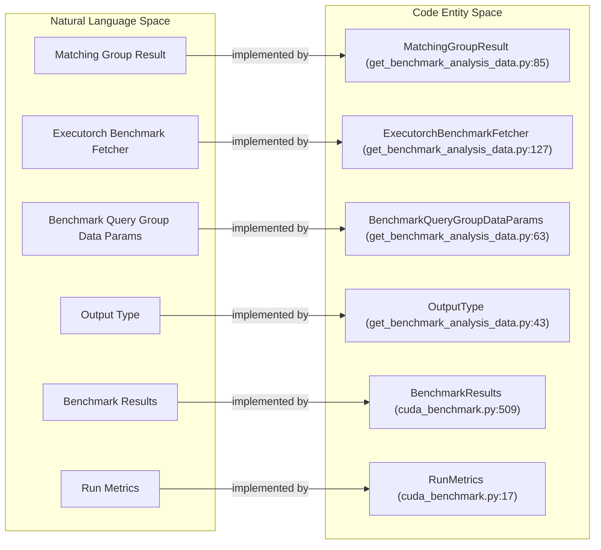
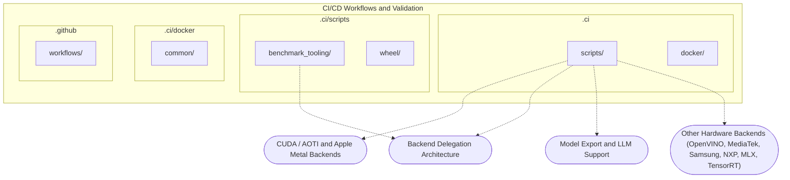
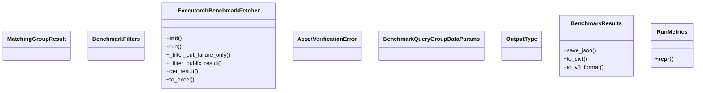
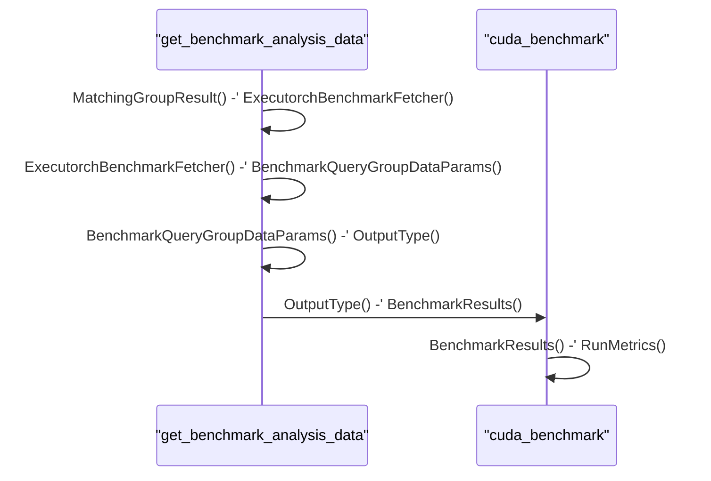

# CI/CD Workflows and Validation

↑ [[7-testing-and-cicd-infrastructure|Testing and CI/CD Infrastructure]]

> Architectural specification and implementation reference for CI/CD Workflows and Validation (31 relevant source files). Primary code entities: `BenchmarkResults`, `save_json`, `to_dict`, `to_v3_format`, `BenchmarkFilters`.

<details>
<summary>Relevant source files</summary>

The following files were used as context for generating this wiki page:

- [.ci/scripts/cuda_benchmark.py](.ci/scripts/cuda_benchmark.py)
- [.ci/scripts/benchmark_tooling/get_benchmark_analysis_data.py](.ci/scripts/benchmark_tooling/get_benchmark_analysis_data.py)
- [.ci/docker/common/zephyr_sdk_release_proxy.py](.ci/docker/common/zephyr_sdk_release_proxy.py)
- [.ci/scripts/muse_glimmer_batching_workload.h](.ci/scripts/muse_glimmer_batching_workload.h)
- [.ci/scripts/gather_benchmark_configs.py](.ci/scripts/gather_benchmark_configs.py)
- [.ci/scripts/utils.sh](.ci/scripts/utils.sh)
- [.ci/scripts/zephyr-utils.sh](.ci/scripts/zephyr-utils.sh)
- [.ci/scripts/wheel/export_native.py](.ci/scripts/wheel/export_native.py)
- [.ci/scripts/benchmark_tooling/analyze_benchmark_stability.py](.ci/scripts/benchmark_tooling/analyze_benchmark_stability.py)
- [.ci/scripts/setup-vulkan-linux-deps.sh](.ci/scripts/setup-vulkan-linux-deps.sh)
- [.ci/scripts/gather_test_models.py](.ci/scripts/gather_test_models.py)
- [.github/workflows/pending_user_response.py](.github/workflows/pending_user_response.py)
- [.ci/scripts/setup-samsung-linux-deps.sh](.ci/scripts/setup-samsung-linux-deps.sh)
- [.ci/scripts/muse_glimmer_batching_smoke.cpp](.ci/scripts/muse_glimmer_batching_smoke.cpp)
- [.ci/docker/common/utils.sh](.ci/docker/common/utils.sh)
- [.ci/scripts/setup-macos.sh](.ci/scripts/setup-macos.sh)
- [.ci/scripts/build-qnn-sdk.sh](.ci/scripts/build-qnn-sdk.sh)
- [.ci/scripts/setup-mediatek-deps.sh](.ci/scripts/setup-mediatek-deps.sh)
- [.ci/scripts/setup-xtensa-tools.sh](.ci/scripts/setup-xtensa-tools.sh)
- [.ci/scripts/build_llama_android.sh](.ci/scripts/build_llama_android.sh)
- [.ci/scripts/export_model_artifact.sh](.ci/scripts/export_model_artifact.sh)
- [.ci/scripts/setup-emscripten.sh](.ci/scripts/setup-emscripten.sh)
- [.ci/scripts/build-mediatek-sdk.sh](.ci/scripts/build-mediatek-sdk.sh)
- [.ci/scripts/cuda_benchmark_from_e2e.sh](.ci/scripts/cuda_benchmark_from_e2e.sh)
- [.ci/scripts/download_hf_hub.sh](.ci/scripts/download_hf_hub.sh)
- [.ci/scripts/esp_idf_mirror.py](.ci/scripts/esp_idf_mirror.py)
- [.ci/scripts/setup-conda.sh](.ci/scripts/setup-conda.sh)
- [.ci/scripts/test-cuda-build.sh](.ci/scripts/test-cuda-build.sh)
- [.ci/docker/README.md](.ci/docker/README.md)
- [.ci/scripts/benchmark_tooling/README.md](.ci/scripts/benchmark_tooling/README.md)
- [.ci/scripts/BUCK](.ci/scripts/BUCK)

</details>

## Purpose and Scope

Architectural specification and implementation reference for CI/CD Workflows and Validation (31 relevant source files). Primary code entities: `BenchmarkResults`, `save_json`, `to_dict`, `to_v3_format`, `BenchmarkFilters`.

Primary code entities analyzed on this page include `MatchingGroupResult` ([.ci/scripts/benchmark_tooling/get_benchmark_analysis_data.py:85-95]()), `ExecutorchBenchmarkFetcher` ([.ci/scripts/benchmark_tooling/get_benchmark_analysis_data.py:127-690]()), `BenchmarkQueryGroupDataParams` ([.ci/scripts/benchmark_tooling/get_benchmark_analysis_data.py:63-81]()), `OutputType` ([.ci/scripts/benchmark_tooling/get_benchmark_analysis_data.py:43-59]()), `BenchmarkResults` ([.ci/scripts/cuda_benchmark.py:509-663]()).

For the parent architectural layer, see [[7-testing-and-cicd-infrastructure|Testing and CI/CD Infrastructure]]. Related sibling subsystems: [[7.2-model-and-backend-testing-framework|Model and Backend Testing Framework]], [[7.3-performance-benchmarking-and-profiling|Performance Benchmarking and Profiling]].

Sources: [.ci/scripts/benchmark_tooling/get_benchmark_analysis_data.py:85-95](), [.ci/scripts/benchmark_tooling/get_benchmark_analysis_data.py:127-690](), [.ci/scripts/benchmark_tooling/get_benchmark_analysis_data.py:63-81](), [.ci/scripts/benchmark_tooling/get_benchmark_analysis_data.py:43-59]()

---

## 1. High-Level Architecture and Data Flow

### Natural Language Space to Code Entity Space Mapping

The following diagram maps domain concepts in this subsystem to their concrete code entities:



### Subsystem Component & Dependency Flow



Cross-subsystem call and import edges connect **CI/CD Workflows and Validation** with [[5-backend-delegation-architecture|Backend Delegation Architecture]] (coupling `9.0`), [[5.7-cuda-aoti-and-apple-metal-backends|CUDA / AOTI and Apple Metal Backends]] (coupling `8.0`), [[5.4-arm-tosa-and-ethos-u-backend|ARM TOSA and Ethos-U Backend]] (coupling `5.0`), [[6-model-export-and-llm-support|Model Export and LLM Support]] (coupling `4.0`), [[5.2-vulkan-gpu-backend|Vulkan GPU Backend]] (coupling `3.0`).

| Module Directory | Files | Primary Code Entities | Source Citations |
|---|---|---|---|
| `.ci/scripts` | 23 | `BenchmarkResults`, `RunMetrics`, `MetricStats`, `EvidenceExecutor` | [.ci/scripts/cuda_benchmark.py:509-663]() [.ci/scripts/cuda_benchmark.py:17-40]() |
| `.ci/scripts/benchmark_tooling` | 3 | `MatchingGroupResult`, `ExecutorchBenchmarkFetcher`, `BenchmarkQueryGroupDataParams`, `OutputType` | [.ci/scripts/benchmark_tooling/get_benchmark_analysis_data.py:85-95]() [.ci/scripts/benchmark_tooling/get_benchmark_analysis_data.py:127-690]() |
| `.ci/docker/common` | 2 | `AssetVerificationError`, `SdkProxyHandler`, `as_ci_user`, `ensure_asset` | [.ci/docker/common/zephyr_sdk_release_proxy.py:51-52]() [.ci/docker/common/zephyr_sdk_release_proxy.py:182-246]() |
| `.ci/docker` | 1 | *(build / config)* | [.ci/docker/README.md]() |
| `.ci/scripts/wheel` | 1 | `Add`, `forward`, `main` | [.ci/scripts/wheel/export_native.py:17-19]() [.ci/scripts/wheel/export_native.py:18-19]() |
| `.github/workflows` | 1 | `main` | [.github/workflows/pending_user_response.py:22-78]() |

Sources: [.ci/scripts/benchmark_tooling/get_benchmark_analysis_data.py:85-95](), [.ci/scripts/benchmark_tooling/get_benchmark_analysis_data.py:127-690](), [.ci/scripts/benchmark_tooling/get_benchmark_analysis_data.py:63-81](), [.ci/scripts/benchmark_tooling/get_benchmark_analysis_data.py:43-59](), [.ci/scripts/cuda_benchmark.py:509-663]()

---

## 2. Core Data Structures and Implementation Details

### Class and Entity Relationship Diagram



### `MatchingGroupResult` (Class)

- **Source Location**: [.ci/scripts/benchmark_tooling/get_benchmark_analysis_data.py:85-95]()
- **Declaration**: `Class MatchingGroupResult`
- **Graph Centrality**: fan-in `7` callers, fan-out `0` callees
- **Responsibility**: Container for benchmark results grouped by category. Attributes: category: Category name (e.g., 'private', 'public') data: List of benchmark data for this category

```python
// .ci/scripts/benchmark_tooling/get_benchmark_analysis_data.py:85-95
class MatchingGroupResult:
    """
    Container for benchmark results grouped by category.

    Attributes:
        category: Category name (e.g., 'private', 'public')
        data: List of benchmark data for this category
    """

    category: str
    data: list
```

### `ExecutorchBenchmarkFetcher` (Class)

- **Source Location**: [.ci/scripts/benchmark_tooling/get_benchmark_analysis_data.py:127-690]()
- **Declaration**: `Class ExecutorchBenchmarkFetcher`
- **Graph Centrality**: fan-in `2` callers, fan-out `0` callees
- **Responsibility**: Fetch and process benchmark data from HUD API for ExecutorchBenchmark. This class provides methods to: 1. Fetch all benchmark data for a specified time range 2. Get all private device info within the time range 3. Filter the private device data if filter is provided 4. Then use the filtered private device data to find 

```python
// .ci/scripts/benchmark_tooling/get_benchmark_analysis_data.py:127-142
class ExecutorchBenchmarkFetcher:
    """
    Fetch and process benchmark data from HUD API for ExecutorchBenchmark.

    This class provides methods to:
    1. Fetch all benchmark data for a specified time range
    2. Get all private device info within the time range
    3. Filter the private device data if filter is provided
    4. Then use the filtered private device data to find matched the public device data using [model, backend, device, arch]
    3. Export results in various formats (JSON, DataFrame, Excel, CSV)

    Usage:
        fetcher = ExecutorchBenchmarkFetcher()
        fetcher.run(start_time, end_time)
        fetcher.output_data(OutputType.EXCEL, output_dir="./results")
    """
```

### `BenchmarkQueryGroupDataParams` (Class)

- **Source Location**: [.ci/scripts/benchmark_tooling/get_benchmark_analysis_data.py:63-81]()
- **Declaration**: `Class BenchmarkQueryGroupDataParams`
- **Graph Centrality**: fan-in `1` callers, fan-out `0` callees
- **Responsibility**: Parameters for querying benchmark data from HUD API. Attributes: repo: Repository name (e.g., "pytorch/executorch") benchmark_name: Name of the benchmark (e.g., "ExecuTorch") start_time: ISO8601 formatted start time end_time: ISO8601 formatted end time group_table_by_fields: Fields to group tables by group_row_by_field

```python
// .ci/scripts/benchmark_tooling/get_benchmark_analysis_data.py:63-78
class BenchmarkQueryGroupDataParams:
    """
    Parameters for querying benchmark data from HUD API.

    Attributes:
        repo: Repository name (e.g., "pytorch/executorch")
        benchmark_name: Name of the benchmark (e.g., "ExecuTorch")
        start_time: ISO8601 formatted start time
        end_time: ISO8601 formatted end time
        group_table_by_fields: Fields to group tables by
        group_row_by_fields: Fields to group rows by
    """

    repo: str
    benchmark_name: str
    start_time: str
```

### `OutputType` (Class)

- **Source Location**: [.ci/scripts/benchmark_tooling/get_benchmark_analysis_data.py:43-59]()
- **Declaration**: `Class OutputType`
- **Graph Centrality**: fan-in `1` callers, fan-out `0` callees
- **Responsibility**: Enumeration of supported output formats for benchmark data. Values: EXCEL: Export data to Excel spreadsheets PRINT: Print data to console (default) CSV: Export data to CSV files JSON: Export data to JSON files DF: Return data as pandas DataFrames

### `BenchmarkResults` (Class)

- **Source Location**: [.ci/scripts/cuda_benchmark.py:509-663]()
- **Declaration**: `Class BenchmarkResults`
- **Graph Centrality**: fan-in `1` callers, fan-out `0` callees
- **Responsibility**: Summary of benchmark results.

### `get_result` (Method)

- **Source Location**: [.ci/scripts/benchmark_tooling/get_benchmark_analysis_data.py:231-238]()
- **Declaration**: `(self)`
- **Graph Centrality**: fan-in `6` callers, fan-out `1` callees
- **Responsibility**: Get a deep copy of the benchmark results. Returns: Dictionary containing benchmark results grouped by category

Sources: [.ci/scripts/benchmark_tooling/get_benchmark_analysis_data.py:85-95](), [.ci/scripts/benchmark_tooling/get_benchmark_analysis_data.py:127-690](), [.ci/scripts/benchmark_tooling/get_benchmark_analysis_data.py:63-81](), [.ci/scripts/benchmark_tooling/get_benchmark_analysis_data.py:43-59](), [.ci/scripts/cuda_benchmark.py:509-663]()

---

## 3. Execution and Call Flow

The sequence diagram below traces the runtime/compile-time call chain across components in this module:



Sources: [.ci/scripts/benchmark_tooling/get_benchmark_analysis_data.py:85-95](), [.ci/scripts/benchmark_tooling/get_benchmark_analysis_data.py:127-690](), [.ci/scripts/benchmark_tooling/get_benchmark_analysis_data.py:63-81](), [.ci/scripts/benchmark_tooling/get_benchmark_analysis_data.py:43-59](), [.ci/scripts/cuda_benchmark.py:509-663]()

---

## 4. Key API and Symbol Reference

| Code Entity | Kind | Location | Fan-In / Out | Role & Signature |
|---|---|---|---|---|
| `MatchingGroupResult` | Class | [.ci/scripts/benchmark_tooling/get_benchmark_analysis_data.py:85-95]() | `7` / `0` | Container for benchmark results grouped by category. |
| `ExecutorchBenchmarkFetcher` | Class | [.ci/scripts/benchmark_tooling/get_benchmark_analysis_data.py:127-690]() | `2` / `0` | Fetch and process benchmark data from HUD API for ExecutorchBenchmark. |
| `BenchmarkQueryGroupDataParams` | Class | [.ci/scripts/benchmark_tooling/get_benchmark_analysis_data.py:63-81]() | `1` / `0` | Parameters for querying benchmark data from HUD API. |
| `OutputType` | Class | [.ci/scripts/benchmark_tooling/get_benchmark_analysis_data.py:43-59]() | `1` / `0` | Enumeration of supported output formats for benchmark data. |
| `BenchmarkResults` | Class | [.ci/scripts/cuda_benchmark.py:509-663]() | `1` / `0` | Summary of benchmark results. |
| `RunMetrics` | Class | [.ci/scripts/cuda_benchmark.py:17-40]() | `1` / `0` | Metrics from a single run. |
| `MetricStats` | Class | [.ci/scripts/cuda_benchmark.py:429-505]() | `0` / `0` | Statistics for a single metric with operations. |
| `EvidenceExecutor` | Class | [.ci/scripts/muse_glimmer_batching_workload.h:103-151]() | `0` / `0` | // Counts distinct owners only after the forwarded executor call succeeds. |
| `RequestCallbacks` | Class | [.ci/scripts/muse_glimmer_batching_workload.h:272-276]() | `0` / `0` | // Submission runs on the caller; text/terminal hooks run on delivery. Captured |
| `BenchmarkFilters` | Class | [.ci/scripts/benchmark_tooling/get_benchmark_analysis_data.py:99-102]() | `2` / `0` | — |
| `AssetVerificationError` | Class | [.ci/docker/common/zephyr_sdk_release_proxy.py:51-52]() | `1` / `0` | — |
| `DisabledConfig` | Class | [.ci/scripts/gather_benchmark_configs.py:102-104]() | `1` / `0` | — |
| `SdkProxyHandler` | Class | [.ci/docker/common/zephyr_sdk_release_proxy.py:182-246]() | `0` / `0` | — |
| `BatchEvidence` | Class | [.ci/scripts/muse_glimmer_batching_workload.h:79-100]() | `0` / `0` | — |
| `Inflight` | Class | [.ci/scripts/muse_glimmer_batching_workload.h:172-192]() | `0` / `0` | — |
| `RequestOptions` | Class | [.ci/scripts/muse_glimmer_batching_workload.h:35-42]() | `0` / `0` | — |
| `RequestResult` | Class | [.ci/scripts/muse_glimmer_batching_workload.h:243-246]() | `0` / `0` | — |
| `Add` | Class | [.ci/scripts/wheel/export_native.py:17-19]() | `1` / `0` | — |
| `get_result` | Method | [.ci/scripts/benchmark_tooling/get_benchmark_analysis_data.py:231-238]() | `6` / `1` | Get a deep copy of the benchmark results. |
| `generate_compatible_configs` | Function | [.ci/scripts/gather_benchmark_configs.py:146-208]() | `6` / `1` | Generate a list of compatible benchmark configurations for a given model name and target OS. |
| `retry` | Function | [.ci/scripts/utils.sh:15-17]() | `9` / `1` | — |
| `output_data` | Method | [.ci/scripts/benchmark_tooling/get_benchmark_analysis_data.py:282-325]() | `0` / `6` | Generate output in the specified format. |

Sources: [.ci/scripts/benchmark_tooling/get_benchmark_analysis_data.py:85-95](), [.ci/scripts/benchmark_tooling/get_benchmark_analysis_data.py:127-690](), [.ci/scripts/benchmark_tooling/get_benchmark_analysis_data.py:63-81](), [.ci/scripts/benchmark_tooling/get_benchmark_analysis_data.py:43-59](), [.ci/scripts/cuda_benchmark.py:509-663](), [.ci/scripts/cuda_benchmark.py:17-40]()

---

## 5. Official Documentation and Design Context

The following linked documentation sections from `llm-wiki` (`raw/`) provide additional architectural context, tutorials, and design invariants for this subsystem:

- **Testing and CI/CD Infrastructure** ([wiki/7-testing-and-cicd-infrastructure.md](), score `176.175`) (sections: `Testing and CI/CD Infrastructure`, `Purpose and Scope`, `System Mapping: Natural Language Space to Code Entity Space`, `1. CI/CD Workflows and Validation`): # Testing and CI/CD Infrastructure > Architectural specification and implementation reference for Testing and CI/CD Infrastructure (36 relevant source files). Primary code entities: `BenchmarkResults`, `save_json`, `to_dict`, `to_v3_format`, `BenchmarkFilters`. <details> <summary>Relevant source files</summary> The following files were used as context for generating this wiki page: - [.ci/scripts/cuda_benchmark.py](.
- **ExecuTorch DeepWiki** ([wiki/index.md](), score `141.9093`) (sections: `ExecuTorch DeepWiki`, `Pages`): # ExecuTorch DeepWiki Generated from `home-jason-Project-deepwiki-executorch` at commit `b3b565b5b62f` (2026-11-15T15:02:11+00:00). ## Pages - [[1-overview|Overview]] — Architectural specification and implementation reference for Overview (10 relevant source files). Primary code entities: `Module`, `MethodHolder`, `PlannedMemory`, `EdgeProgramManager`, `__init__`. - [[1.1-getting-started|Getting Started]] — Architect
- **Overview** ([wiki/1-overview.md](), score `101.9898`) (sections: `Overview`, `1. Architecture Overview & System Component Map`, `Core Concept to Code Entity Mapping`, `Architectural Principles (from Official Documentation)`): # Overview > Architectural specification and implementation reference for Overview (10 relevant source files). Primary code entities: `Module`, `MethodHolder`, `PlannedMemory`, `EdgeProgramManager`, `__init__`. <details> <summary>Relevant source files</summary> The following files were used as context for generating this wiki page: - [extension/module/module.h](extension/module/module.h) - [exir/program/_program.py](
- **Performance Benchmarking and Profiling** ([wiki/7.3-performance-benchmarking-and-profiling.md](), score `82.0867`) (sections: `Performance Benchmarking and Profiling`, `Purpose and Scope`, `1. High-Level Architecture and Data Flow`, `Natural Language Space to Code Entity Space Mapping`): # Performance Benchmarking and Profiling ↑ [[7-testing-and-cicd-infrastructure|Testing and CI/CD Infrastructure]] > Architectural specification and implementation reference for Performance Benchmarking and Profiling (36 relevant source files). Primary code entities: `Allocator`, `MemAllocation`, `MemEvent`, `ProfileData`, `ETDumpGen`. <details> <summary>Relevant source files</summary> The following files were used as

Sources: [wiki/7-testing-and-cicd-infrastructure.md](), [wiki/index.md](), [wiki/1-overview.md](), [wiki/7.3-performance-benchmarking-and-profiling.md]()

## Related pages

- [[7-testing-and-cicd-infrastructure|Testing and CI/CD Infrastructure]]
- [[1.1-getting-started|Getting Started]]
- [[1.2-export-api-and-recipe-system|Export API and Recipe System]]
- [[2.2-kernel-libraries-and-selective-build|Kernel Libraries and Selective Build]]
- [[2.3-schema-generation-and-flatbuffers|Schema Generation and FlatBuffers]]
- [[3.4-program-emission-and-serialization|Program Emission and Serialization]]
- [[3.5-verification-and-dialect-system|Verification and Dialect System]]
- [[4-quantization-systems|Quantization Systems]]

## Related documents

- `wiki/7-testing-and-cicd-infrastructure.md` — Testing and CI/CD Infrastructure (score 176.175, via bm25)
- `wiki/index.md` — ExecuTorch DeepWiki (score 141.9093, via bm25)
- `wiki/1-overview.md` — Overview (score 101.9898, via bm25)
- `wiki/7.3-performance-benchmarking-and-profiling.md` — Performance Benchmarking and Profiling (score 82.0867, via bm25)
- `wiki/6.4-multimodal-and-audio-models.md` — Multimodal and Audio Models (score 81.6914, via bm25)

## Sources

- [`.ci/scripts/cuda_benchmark.py`](https://github.com/pytorch/executorch/blob/main/.ci/scripts/cuda_benchmark.py)
- [`.ci/scripts/benchmark_tooling/get_benchmark_analysis_data.py`](https://github.com/pytorch/executorch/blob/main/.ci/scripts/benchmark_tooling/get_benchmark_analysis_data.py)
- [`.ci/docker/common/zephyr_sdk_release_proxy.py`](https://github.com/pytorch/executorch/blob/main/.ci/docker/common/zephyr_sdk_release_proxy.py)
- [`.ci/scripts/muse_glimmer_batching_workload.h`](https://github.com/pytorch/executorch/blob/main/.ci/scripts/muse_glimmer_batching_workload.h)
- [`.ci/scripts/gather_benchmark_configs.py`](https://github.com/pytorch/executorch/blob/main/.ci/scripts/gather_benchmark_configs.py)
- [`.ci/scripts/utils.sh`](https://github.com/pytorch/executorch/blob/main/.ci/scripts/utils.sh)
- [`.ci/scripts/zephyr-utils.sh`](https://github.com/pytorch/executorch/blob/main/.ci/scripts/zephyr-utils.sh)
- [`.ci/scripts/wheel/export_native.py`](https://github.com/pytorch/executorch/blob/main/.ci/scripts/wheel/export_native.py)
- [`.ci/scripts/benchmark_tooling/analyze_benchmark_stability.py`](https://github.com/pytorch/executorch/blob/main/.ci/scripts/benchmark_tooling/analyze_benchmark_stability.py)
- [`.ci/scripts/setup-vulkan-linux-deps.sh`](https://github.com/pytorch/executorch/blob/main/.ci/scripts/setup-vulkan-linux-deps.sh)
- [`.ci/scripts/gather_test_models.py`](https://github.com/pytorch/executorch/blob/main/.ci/scripts/gather_test_models.py)
- [`.github/workflows/pending_user_response.py`](https://github.com/pytorch/executorch/blob/main/.github/workflows/pending_user_response.py)
- [`.ci/scripts/setup-samsung-linux-deps.sh`](https://github.com/pytorch/executorch/blob/main/.ci/scripts/setup-samsung-linux-deps.sh)
- [`.ci/scripts/muse_glimmer_batching_smoke.cpp`](https://github.com/pytorch/executorch/blob/main/.ci/scripts/muse_glimmer_batching_smoke.cpp)
- [`.ci/docker/common/utils.sh`](https://github.com/pytorch/executorch/blob/main/.ci/docker/common/utils.sh)
- [`.ci/scripts/setup-macos.sh`](https://github.com/pytorch/executorch/blob/main/.ci/scripts/setup-macos.sh)
- [`.ci/scripts/build-qnn-sdk.sh`](https://github.com/pytorch/executorch/blob/main/.ci/scripts/build-qnn-sdk.sh)
- [`.ci/scripts/setup-mediatek-deps.sh`](https://github.com/pytorch/executorch/blob/main/.ci/scripts/setup-mediatek-deps.sh)
- [`.ci/scripts/setup-xtensa-tools.sh`](https://github.com/pytorch/executorch/blob/main/.ci/scripts/setup-xtensa-tools.sh)
- [`.ci/scripts/build_llama_android.sh`](https://github.com/pytorch/executorch/blob/main/.ci/scripts/build_llama_android.sh)
- [`.ci/scripts/export_model_artifact.sh`](https://github.com/pytorch/executorch/blob/main/.ci/scripts/export_model_artifact.sh)
- [`.ci/scripts/setup-emscripten.sh`](https://github.com/pytorch/executorch/blob/main/.ci/scripts/setup-emscripten.sh)
- [`.ci/scripts/build-mediatek-sdk.sh`](https://github.com/pytorch/executorch/blob/main/.ci/scripts/build-mediatek-sdk.sh)
- [`.ci/scripts/cuda_benchmark_from_e2e.sh`](https://github.com/pytorch/executorch/blob/main/.ci/scripts/cuda_benchmark_from_e2e.sh)
- [`.ci/scripts/download_hf_hub.sh`](https://github.com/pytorch/executorch/blob/main/.ci/scripts/download_hf_hub.sh)
- [`.ci/scripts/esp_idf_mirror.py`](https://github.com/pytorch/executorch/blob/main/.ci/scripts/esp_idf_mirror.py)
- [`.ci/scripts/setup-conda.sh`](https://github.com/pytorch/executorch/blob/main/.ci/scripts/setup-conda.sh)
- [`.ci/scripts/test-cuda-build.sh`](https://github.com/pytorch/executorch/blob/main/.ci/scripts/test-cuda-build.sh)
- [`.ci/docker/README.md`](https://github.com/pytorch/executorch/blob/main/.ci/docker/README.md)
- [`.ci/scripts/benchmark_tooling/README.md`](https://github.com/pytorch/executorch/blob/main/.ci/scripts/benchmark_tooling/README.md)
- [`.ci/scripts/BUCK`](https://github.com/pytorch/executorch/blob/main/.ci/scripts/BUCK)


## Dynamic Knowledge Links (Code Graph ↔ LLM-Wiki / RAG)

### Linked Architecture & Design Documents

| Document | Match Channel | Score | Shared Code Symbols |
|---|---|---|---|
| [[7-testing-and-cicd-infrastructure|Testing and CI/CD Infrastructure]] | `bm25+entity(3)` | `180.675` | `MatchingGroupResult`, `generate_compatible_configs`, `get_result` |
| [[index|ExecuTorch DeepWiki]] | `bm25` | `141.909` | *(lexical/graph match)* |
| [[7.2-model-and-backend-testing-framework|Model and Backend Testing Framework]] | `wikilink:7.1-cicd-workflows-and-validation` | `110.484` | *(lexical/graph match)* |
| [[5-backend-delegation-architecture|Backend Delegation Architecture]] | `wikilink:7.1-cicd-workflows-and-validation` | `110.484` | *(lexical/graph match)* |
| [[5.7-cuda-aoti-and-apple-metal-backends|CUDA / AOTI and Apple Metal Backends]] | `wikilink:7.1-cicd-workflows-and-validation` | `110.484` | *(lexical/graph match)* |
| [[1-overview|Overview]] | `bm25` | `101.99` | *(lexical/graph match)* |

### High-Centrality Bridge Symbols (CBM Graph)

| Symbol | Kind | Source Location | Fan-In / Fan-Out |
|---|---|---|---|
| `MatchingGroupResult` | Class | [.ci/scripts/benchmark_tooling/get_benchmark_analysis_data.py:85-95]() | in: `7` / out: `0` |
| `ExecutorchBenchmarkFetcher` | Class | [.ci/scripts/benchmark_tooling/get_benchmark_analysis_data.py:127-690]() | in: `2` / out: `0` |
| `BenchmarkQueryGroupDataParams` | Class | [.ci/scripts/benchmark_tooling/get_benchmark_analysis_data.py:63-81]() | in: `1` / out: `0` |
| `OutputType` | Class | [.ci/scripts/benchmark_tooling/get_benchmark_analysis_data.py:43-59]() | in: `1` / out: `0` |
| `BenchmarkResults` | Class | [.ci/scripts/cuda_benchmark.py:509-663]() | in: `1` / out: `0` |
| `RunMetrics` | Class | [.ci/scripts/cuda_benchmark.py:17-40]() | in: `1` / out: `0` |

Sources: [.ci/scripts/benchmark_tooling/get_benchmark_analysis_data.py:85-95](), [.ci/scripts/benchmark_tooling/get_benchmark_analysis_data.py:127-690](), [.ci/scripts/benchmark_tooling/get_benchmark_analysis_data.py:63-81](), [.ci/scripts/benchmark_tooling/get_benchmark_analysis_data.py:43-59]()

### Cross-Subsystem Coupling

- [[5-backend-delegation-architecture|Backend Delegation Architecture]] — call/import coupling weight `9.0`
- [[5.7-cuda-aoti-and-apple-metal-backends|CUDA / AOTI and Apple Metal Backends]] — call/import coupling weight `8.0`
- [[5.4-arm-tosa-and-ethos-u-backend|ARM TOSA and Ethos-U Backend]] — call/import coupling weight `5.0`
- [[6-model-export-and-llm-support|Model Export and LLM Support]] — call/import coupling weight `4.0`
- [[5.2-vulkan-gpu-backend|Vulkan GPU Backend]] — call/import coupling weight `3.0`
- [[7.2-model-and-backend-testing-framework|Model and Backend Testing Framework]] — call/import coupling weight `2.0`
