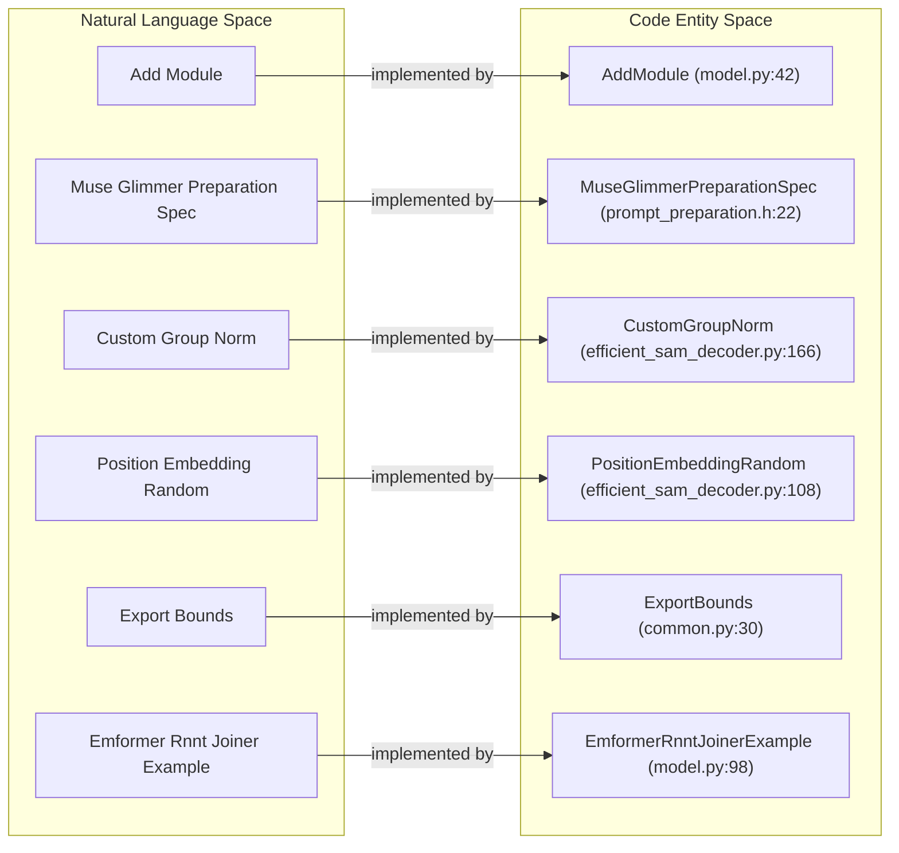
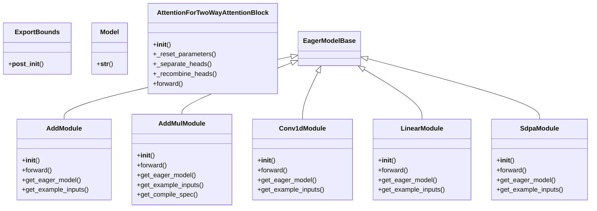
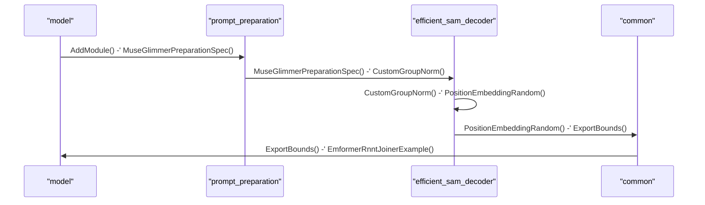

# Model and Backend Testing Framework

↑ [[7-testing-and-cicd-infrastructure|Testing and CI/CD Infrastructure]]

> Architectural specification and implementation reference for Model and Backend Testing Framework (40 relevant source files). Primary code entities: `MuseGlimmerImageSpan`, `MuseGlimmerPreparationSpec`, `MuseGlimmerPreparedInput`, `Backing`, `Backend`.

<details>
<summary>Relevant source files</summary>

The following files were used as context for generating this wiki page:

- [examples/models/muse-glimmer/runtime/prompt_preparation.h](examples/models/muse-glimmer/runtime/prompt_preparation.h)
- [examples/models/__init__.py](examples/models/__init__.py)
- [examples/models/codegen/__init__.py](examples/models/codegen/__init__.py)
- [examples/models/deeplab_v3/model.py](examples/models/deeplab_v3/model.py)
- [examples/models/muse-glimmer/runtime/cuda_dflash_executor.cpp](examples/models/muse-glimmer/runtime/cuda_dflash_executor.cpp)
- [examples/models/deit_tiny/model.py](examples/models/deit_tiny/model.py)
- [examples/models/checkpoint.py](examples/models/checkpoint.py)
- [examples/models/gemma4_31b/gemma4_31b_engine.cpp](examples/models/gemma4_31b/gemma4_31b_engine.cpp)
- [examples/models/muse-glimmer/runtime/mlx_executor.cpp](examples/models/muse-glimmer/runtime/mlx_executor.cpp)
- [examples/models/efficient_sam/efficient_sam_core/efficient_sam_decoder.py](examples/models/efficient_sam/efficient_sam_core/efficient_sam_decoder.py)
- [examples/models/qwen3_5_moe/qwen35_moe_engine.cpp](examples/models/qwen3_5_moe/qwen35_moe_engine.cpp)
- [examples/models/emformer_rnnt/model.py](examples/models/emformer_rnnt/model.py)
- [examples/models/edsr/model.py](examples/models/edsr/model.py)
- [examples/models/efficient_sam/efficient_sam_core/efficient_sam_encoder.py](examples/models/efficient_sam/efficient_sam_core/efficient_sam_encoder.py)
- [examples/models/codegen/convert_weight.py](examples/models/codegen/convert_weight.py)
- [examples/models/parakeet/parakeet_transcriber.cpp](examples/models/parakeet/parakeet_transcriber.cpp)
- [examples/models/supertonic/runtime/supertonic_runner.cpp](examples/models/supertonic/runtime/supertonic_runner.cpp)
- [examples/models/efficient_sam/efficient_sam_core/efficient_sam.py](examples/models/efficient_sam/efficient_sam_core/efficient_sam.py)
- [examples/models/llava/export_llava.py](examples/models/llava/export_llava.py)
- [examples/models/llava/model.py](examples/models/llava/model.py)
- [examples/models/supertonic/export/common.py](examples/models/supertonic/export/common.py)
- [examples/models/llama/static_attention.py](examples/models/llama/static_attention.py)
- [examples/models/voxtral_tts/voxtral_tts_runner.cpp](examples/models/voxtral_tts/voxtral_tts_runner.cpp)
- [examples/models/efficient_sam/efficient_sam_core/two_way_transformer.py](examples/models/efficient_sam/efficient_sam_core/two_way_transformer.py)
- [examples/models/muse-glimmer/runtime/prompt_preparation.cpp](examples/models/muse-glimmer/runtime/prompt_preparation.cpp)
- [examples/models/toy_model/model.py](examples/models/toy_model/model.py)
- [examples/models/deeplab_v3/__init__.py](examples/models/deeplab_v3/__init__.py)
- [examples/models/dinov2/main.cpp](examples/models/dinov2/main.cpp)
- [examples/models/deepseek-r1-distill-llama-8B/README.md](examples/models/deepseek-r1-distill-llama-8B/README.md)
- [examples/models/dinov2/README.md](examples/models/dinov2/README.md)
- [examples/models/efficient_sam/README.md](examples/models/efficient_sam/README.md)
- [examples/models/gemma3/README.md](examples/models/gemma3/README.md)
- [examples/models/gemma4/README.md](examples/models/gemma4/README.md)
- [examples/models/gemma4_31b/README.md](examples/models/gemma4_31b/README.md)
- [examples/models/BUCK](examples/models/BUCK)

</details>

## Purpose and Scope

Architectural specification and implementation reference for Model and Backend Testing Framework (40 relevant source files). Primary code entities: `MuseGlimmerImageSpan`, `MuseGlimmerPreparationSpec`, `MuseGlimmerPreparedInput`, `Backing`, `Backend`.

Primary code entities analyzed on this page include `AddModule` ([examples/models/toy_model/model.py:42-54]()), `MuseGlimmerPreparationSpec` ([examples/models/muse-glimmer/runtime/prompt_preparation.h:22-33]()), `CustomGroupNorm` ([examples/models/efficient_sam/efficient_sam_core/efficient_sam_decoder.py:166-191]()), `PositionEmbeddingRandom` ([examples/models/efficient_sam/efficient_sam_core/efficient_sam_decoder.py:108-162]()), `ExportBounds` ([examples/models/supertonic/export/common.py:30-44]()).

For the parent architectural layer, see [[7-testing-and-cicd-infrastructure|Testing and CI/CD Infrastructure]]. Related sibling subsystems: [[7.1-cicd-workflows-and-validation|CI/CD Workflows and Validation]], [[7.3-performance-benchmarking-and-profiling|Performance Benchmarking and Profiling]].

Sources: [examples/models/toy_model/model.py:42-54](), [examples/models/muse-glimmer/runtime/prompt_preparation.h:22-33](), [examples/models/efficient_sam/efficient_sam_core/efficient_sam_decoder.py:166-191](), [examples/models/efficient_sam/efficient_sam_core/efficient_sam_decoder.py:108-162]()

---

## 1. High-Level Architecture and Data Flow

### Natural Language Space to Code Entity Space Mapping

The following diagram maps domain concepts in this subsystem to their concrete code entities:



### Subsystem Component & Dependency Flow

```mermaid
flowchart TD
  subgraph sub_this["Model and Backend Testing Framework"]
    subgraph sg_0["examples/models/muse-glimmer"]
      n_examples_models_muse_glimmer_runtime["runtime/"]
    end
    subgraph sg_1["examples"]
      n_examples_models["models/"]
    end
    subgraph sg_2["examples/models"]
      n_examples_models_codegen["codegen/"]
      n_examples_models_deeplab_v3["deeplab_v3/"]
      n_examples_models_deit_tiny["deit_tiny/"]
      n_examples_models_gemma4_31b["gemma4_31b/"]
      n_examples_models_qwen3_5_moe["qwen3_5_moe/"]
      n_examples_models_emformer_rnnt["emformer_rnnt/"]
      n_examples_models_edsr["edsr/"]
    end
    subgraph sg_3["examples/models/efficient_sam"]
      n_examples_models_efficient_sam_efficient_sam_core["efficient_sam_core/"]
    end
    subgraph sg_4["examples/models/supertonic"]
      n_examples_models_supertonic_runtime["runtime/"]
      n_examples_models_supertonic_export["export/"]
    end
  end
  n_page_5_4_arm_tosa_and_ethos_u_backend(["ARM TOSA and Ethos-U Backend"])
  n_page_5_7_cuda_aoti_and_apple_metal_backends(["CUDA / AOTI and Apple Metal Backends"])
  n_page_6_1_llama_model_export(["LLaMA and Generative Model Export"])
  n_page_8_runtime_execution(["Runtime Execution"])
  n_examples_models_muse_glimmer_runtime -.-> n_page_6_1_llama_model_export
  n_examples_models_muse_glimmer_runtime -.-> n_page_8_runtime_execution
  n_examples_models_muse_glimmer_runtime -.-> n_page_5_4_arm_tosa_and_ethos_u_backend
  n_examples_models_voxtral_tts -.-> n_page_6_1_llama_model_export
  n_examples_models_voxtral_tts -.-> n_page_8_runtime_execution
  n_examples_models_muse_glimmer_runtime -.-> n_page_5_7_cuda_aoti_and_apple_metal_backends
  n_examples_models_gemma4_31b -.-> n_page_6_1_llama_model_export
  n_examples_models_qwen3_5_moe -.-> n_page_6_1_llama_model_export
  n_examples_models_gemma4_31b -.-> n_page_8_runtime_execution
  n_examples_models_supertonic_runtime -.-> n_page_6_1_llama_model_export
  n_examples_models_muse_glimmer_runtime --> n_examples_models_voxtral_tts
  n_examples_models_supertonic_runtime -.-> n_page_5_4_arm_tosa_and_ethos_u_backend
  n_examples_models_qwen3_5_moe -.-> n_page_8_runtime_execution
  n_examples_models_supertonic_runtime -.-> n_page_8_runtime_execution
  n_examples_models_voxtral_tts -.-> n_page_5_4_arm_tosa_and_ethos_u_backend
  n_examples_models_dinov2 -.-> n_page_8_runtime_execution
  n_examples_models_muse_glimmer_runtime --> n_examples_models_parakeet
  n_examples_models_muse_glimmer_runtime --> n_examples_models_supertonic_runtime
  n_examples_models_llava -.-> n_page_6_1_llama_model_export
```



Cross-subsystem call and import edges connect **Model and Backend Testing Framework** with [[6.1-llama-model-export|LLaMA and Generative Model Export]] (coupling `96.0`), [[8.1-core-runtime-architecture|Core Runtime Architecture]] (coupling `78.0`), [[8-runtime-execution|Runtime Execution]] (coupling `77.0`), [[9-mobile-and-platform-extensions|Mobile and Platform Extensions]] (coupling `61.0`), [[9.4-embedded-and-web-targets|Embedded (Zephyr, ESP32, Pico2) and WebAssembly/WebGPU Targets]] (coupling `52.0`).

| Module Directory | Files | Primary Code Entities | Source Citations |
|---|---|---|---|
| `examples/models/efficient_sam/efficient_sam_core` | 4 | `CustomGroupNorm`, `PositionEmbeddingRandom`, `ImageEncoderViT`, `PatchEmbed` | [examples/models/efficient_sam/efficient_sam_core/efficient_sam_decoder.py:166-191]() [examples/models/efficient_sam/efficient_sam_core/efficient_sam_decoder.py:108-162]() |
| `examples/models/muse-glimmer/runtime` | 4 | `MuseGlimmerPreparationSpec`, `MuseGlimmerImageSpan`, `MuseGlimmerPreparedInput`, `Backing` | [examples/models/muse-glimmer/runtime/prompt_preparation.h:22-33]() [examples/models/muse-glimmer/runtime/prompt_preparation.h:35-38]() |
| `examples/models` | 3 | `Model`, `Backend`, `get_checkpoint_dtype`, `get_default_model_resource_dir` | [examples/models/__init__.py:11-55]() [examples/models/__init__.py:58-65]() |
| `examples/models/codegen` | 3 | `CodeGenModel`, `__init__`, `convert_weights`, `codegen_hf_to_meta` | [examples/models/codegen/__init__.py:8-10]() [examples/models/codegen/__init__.py:9-10]() |
| `examples/models/deeplab_v3` | 3 | `DeepLabV3ResNet101Model`, `DeepLabV3ResNet50Model`, `__init__`, `get_eager_model` | [examples/models/deeplab_v3/model.py:36-50]() [examples/models/deeplab_v3/model.py:19-33]() |
| `examples/models/dinov2` | 3 | `load_image`, `print_top_k`, `get_imagenet_label`, `generate_random_input` | [examples/models/dinov2/main.cpp:70-100]() [examples/models/dinov2/main.cpp:168-189]() |
| `examples/models/edsr` | 2 | `EdsrModel`, `__init__`, `get_eager_model`, `get_example_inputs` | [examples/models/edsr/model.py:16-28]() [examples/models/edsr/model.py:17-18]() |
| `examples/models/emformer_rnnt` | 2 | `EmformerRnntJoinerExample`, `EmformerRnntPredictorExample`, `EmformerRnntTranscriberExample`, `EmformerRnntJoinerModel` | [examples/models/emformer_rnnt/model.py:98-112]() [examples/models/emformer_rnnt/model.py:62-76]() |

Sources: [examples/models/toy_model/model.py:42-54](), [examples/models/muse-glimmer/runtime/prompt_preparation.h:22-33](), [examples/models/efficient_sam/efficient_sam_core/efficient_sam_decoder.py:166-191](), [examples/models/efficient_sam/efficient_sam_core/efficient_sam_decoder.py:108-162](), [examples/models/supertonic/export/common.py:30-44]()

---

## 2. Core Data Structures and Implementation Details

### Class and Entity Relationship Diagram



### `AddModule` (Class)

- **Source Location**: [examples/models/toy_model/model.py:42-54]()
- **Declaration**: `Class AddModule`
- **Graph Centrality**: fan-in `18` callers, fan-out `0` callees

```python
// examples/models/toy_model/model.py:42-54
class AddModule(torch.nn.Module, EagerModelBase):
    def __init__(self):
        super().__init__()

    def forward(self, x, y):
        z = x + y
        return z

    def get_eager_model(self) -> torch.nn.Module:
        return self

    def get_example_inputs(self):
        return (torch.ones(1), torch.ones(1))
```

### `MuseGlimmerPreparationSpec` (Class)

- **Source Location**: [examples/models/muse-glimmer/runtime/prompt_preparation.h:22-33]()
- **Declaration**: `Class MuseGlimmerPreparationSpec`
- **Graph Centrality**: fan-in `0` callers, fan-out `0` callees
- **Responsibility**: // One instance per executor. Sharing this immutable value with the CPU preparer // binds its payloads to that exact executor, not just compatible tensor shapes.

```cpp
// examples/models/muse-glimmer/runtime/prompt_preparation.h:22-33
struct MuseGlimmerPreparationSpec final {
  const aten::ScalarType activation_dtype;
  const int32_t hidden_dim;
  const int32_t max_context_length;
  const int32_t max_forward_tokens;
  const int32_t vocab_size;
  const bool has_vision;
  const int64_t max_soft_tokens;
  const MuseGlimmerImageLimits image_limits;
  const batching::Token bos_id = 200000;
  const batching::Token patch_id = 200092;
};
```

### `CustomGroupNorm` (Class)

- **Source Location**: [examples/models/efficient_sam/efficient_sam_core/efficient_sam_decoder.py:166-191]()
- **Declaration**: `Class CustomGroupNorm`
- **Graph Centrality**: fan-in `1` callers, fan-out `0` callees
- **Responsibility**: # TODO: Remove CustomGroupNorm implementation once issue #6817 is resolved

```python
// examples/models/efficient_sam/efficient_sam_core/efficient_sam_decoder.py:166-181
class CustomGroupNorm(nn.Module):
    def __init__(self, num_groups, num_channels, eps=1e-5, affine=True):
        """Custom Group Normalization."""
        super(CustomGroupNorm, self).__init__()
        self.num_groups = num_groups
        self.num_channels = num_channels
        self.eps = eps
        self.affine = affine

        if self.affine:
            self.weight = nn.Parameter(torch.ones(num_channels))
            self.bias = nn.Parameter(torch.zeros(num_channels))

    def forward(self, x):
        N, C, *rest = x.shape
        G = self.num_groups
```

### `PositionEmbeddingRandom` (Class)

- **Source Location**: [examples/models/efficient_sam/efficient_sam_core/efficient_sam_decoder.py:108-162]()
- **Declaration**: `Class PositionEmbeddingRandom`
- **Graph Centrality**: fan-in `1` callers, fan-out `0` callees
- **Responsibility**: Positional encoding using random spatial frequencies.

### `ExportBounds` (Class)

- **Source Location**: [examples/models/supertonic/export/common.py:30-44]()
- **Declaration**: `Class ExportBounds`
- **Graph Centrality**: fan-in `9` callers, fan-out `0` callees

### `size` (Method)

- **Source Location**: [examples/models/muse-glimmer/runtime/prompt_preparation.h:52-54]()
- **Declaration**: `()`
- **Graph Centrality**: fan-in `358` callers, fan-out `0` callees

Sources: [examples/models/toy_model/model.py:42-54](), [examples/models/muse-glimmer/runtime/prompt_preparation.h:22-33](), [examples/models/efficient_sam/efficient_sam_core/efficient_sam_decoder.py:166-191](), [examples/models/efficient_sam/efficient_sam_core/efficient_sam_decoder.py:108-162](), [examples/models/supertonic/export/common.py:30-44]()

---

## 3. Execution and Call Flow

The sequence diagram below traces the runtime/compile-time call chain across components in this module:



Sources: [examples/models/toy_model/model.py:42-54](), [examples/models/muse-glimmer/runtime/prompt_preparation.h:22-33](), [examples/models/efficient_sam/efficient_sam_core/efficient_sam_decoder.py:166-191](), [examples/models/efficient_sam/efficient_sam_core/efficient_sam_decoder.py:108-162](), [examples/models/supertonic/export/common.py:30-44]()

---

## 4. Key API and Symbol Reference

| Code Entity | Kind | Location | Fan-In / Out | Role & Signature |
|---|---|---|---|---|
| `AddModule` | Class | [examples/models/toy_model/model.py:42-54]() | `18` / `0` | — |
| `MuseGlimmerPreparationSpec` | Class | [examples/models/muse-glimmer/runtime/prompt_preparation.h:22-33]() | `0` / `0` | // One instance per executor. Sharing this immutable value with the CPU preparer |
| `CustomGroupNorm` | Class | [examples/models/efficient_sam/efficient_sam_core/efficient_sam_decoder.py:166-191]() | `1` / `0` | # TODO: Remove CustomGroupNorm implementation once issue #6817 is resolved |
| `PositionEmbeddingRandom` | Class | [examples/models/efficient_sam/efficient_sam_core/efficient_sam_decoder.py:108-162]() | `1` / `0` | Positional encoding using random spatial frequencies. |
| `ExportBounds` | Class | [examples/models/supertonic/export/common.py:30-44]() | `9` / `0` | — |
| `EmformerRnntJoinerExample` | Class | [examples/models/emformer_rnnt/model.py:98-112]() | `1` / `0` | This is a wrapper for validating joiner for the Emformer RNN-T architecture. |
| `EmformerRnntPredictorExample` | Class | [examples/models/emformer_rnnt/model.py:62-76]() | `1` / `0` | This is a wrapper for validating predictor for the Emformer RNN-T architecture. |
| `EmformerRnntTranscriberExample` | Class | [examples/models/emformer_rnnt/model.py:27-41]() | `1` / `0` | This is a wrapper for validating transcriber for the Emformer RNN-T architecture. |
| `Model` | Class | [examples/models/__init__.py:11-55]() | `3` / `0` | — |
| `ImageEncoderViT` | Class | [examples/models/efficient_sam/efficient_sam_core/efficient_sam_encoder.py:183-261]() | `1` / `0` | # Image encoder for efficient SAM. |
| `PatchEmbed` | Class | [examples/models/efficient_sam/efficient_sam_core/efficient_sam_encoder.py:32-54]() | `1` / `0` | 2D Image to Patch Embedding |
| `AttentionForTwoWayAttentionBlock` | Class | [examples/models/efficient_sam/efficient_sam_core/two_way_transformer.py:194-268]() | `2` / `0` | An attention layer that allows for downscaling the size of the embedding |
| `Backend` | Class | [examples/models/__init__.py:58-65]() | `0` / `0` | — |
| `StaticAttention` | Class | [examples/models/llama/static_attention.py:832-1623]() | `0` / `0` | An attention implementation meant for NPUs that require static shapes and are not |
| `MuseGlimmerImageSpan` | Class | [examples/models/muse-glimmer/runtime/prompt_preparation.h:35-38]() | `0` / `0` | — |
| `MuseGlimmerPreparedInput` | Class | [examples/models/muse-glimmer/runtime/prompt_preparation.h:42-86]() | `0` / `0` | — |
| `Backing` | Class | [examples/models/muse-glimmer/runtime/prompt_preparation.h:62-81]() | `0` / `0` | — |
| `Conv1dModule` | Class | [examples/models/toy_model/model.py:93-107]() | `6` / `0` | — |
| `LinearModule` | Class | [examples/models/toy_model/model.py:27-39]() | `6` / `0` | — |
| `CodeGenModel` | Class | [examples/models/codegen/__init__.py:8-10]() | `0` / `0` | — |
| `DeepLabV3ResNet101Model` | Class | [examples/models/deeplab_v3/model.py:36-50]() | `0` / `0` | — |
| `DeepLabV3ResNet50Model` | Class | [examples/models/deeplab_v3/model.py:19-33]() | `0` / `0` | — |

Sources: [examples/models/toy_model/model.py:42-54](), [examples/models/muse-glimmer/runtime/prompt_preparation.h:22-33](), [examples/models/efficient_sam/efficient_sam_core/efficient_sam_decoder.py:166-191](), [examples/models/efficient_sam/efficient_sam_core/efficient_sam_decoder.py:108-162](), [examples/models/supertonic/export/common.py:30-44](), [examples/models/emformer_rnnt/model.py:98-112]()

---

## 5. Official Documentation and Design Context

The following linked documentation sections from `llm-wiki` (`raw/`) provide additional architectural context, tutorials, and design invariants for this subsystem:

- **Model Export and LLM Support** ([wiki/6-model-export-and-llm-support.md](), score `193.2303`) (sections: `Model Export and LLM Support`, `Purpose and Scope`, `System Mapping: Natural Language Space to Code Entity Space`, `1. LLaMA and Generative Model Export`): # Model Export and LLM Support > Architectural specification and implementation reference for Model Export and LLM Support (40 relevant source files). Primary code entities: `MuseGlimmerImageSpan`, `MuseGlimmerPreparationSpec`, `MuseGlimmerPreparedInput`, `Backing`, `RequestHandle`. <details> <summary>Relevant source files</summary> The following files were used as context for generating this wiki page: - [examples/m
- **Testing and CI/CD Infrastructure** ([wiki/7-testing-and-cicd-infrastructure.md](), score `135.8855`) (sections: `Testing and CI/CD Infrastructure`, `Purpose and Scope`, `System Mapping: Natural Language Space to Code Entity Space`, `1. CI/CD Workflows and Validation`): # Testing and CI/CD Infrastructure > Architectural specification and implementation reference for Testing and CI/CD Infrastructure (36 relevant source files). Primary code entities: `BenchmarkResults`, `save_json`, `to_dict`, `to_v3_format`, `BenchmarkFilters`. <details> <summary>Relevant source files</summary> The following files were used as context for generating this wiki page: - [.ci/scripts/cuda_benchmark.py](.
- **ExecuTorch DeepWiki** ([wiki/index.md](), score `122.6634`) (sections: `ExecuTorch DeepWiki`, `Pages`): # ExecuTorch DeepWiki Generated from `home-jason-Project-deepwiki-executorch` at commit `b3b565b5b62f` (2026-11-15T15:02:11+00:00). ## Pages - [[1-overview|Overview]] — Architectural specification and implementation reference for Overview (10 relevant source files). Primary code entities: `Module`, `MethodHolder`, `PlannedMemory`, `EdgeProgramManager`, `__init__`. - [[1.1-getting-started|Getting Started]] — Architect
- **LLM Runner Framework** ([wiki/6.2-llm-runner-framework.md](), score `115.4859`) (sections: `LLM Runner Framework`, `Purpose and Scope`, `1. High-Level Architecture and Data Flow`, `Natural Language Space to Code Entity Space Mapping`): # LLM Runner Framework ↑ [[6-model-export-and-llm-support|Model Export and LLM Support]] > Architectural specification and implementation reference for LLM Runner Framework (36 relevant source files). Primary code entities: `check_vocab_size`, `read_int_method`, `read_int_tensor_method`, `read_required_positive_int`, `MultimodalPrefiller`. <details> <summary>Relevant source files</summary> The following files were us

Sources: [wiki/6-model-export-and-llm-support.md](), [wiki/7-testing-and-cicd-infrastructure.md](), [wiki/index.md](), [wiki/6.2-llm-runner-framework.md]()

## Related pages

- [[7-testing-and-cicd-infrastructure|Testing and CI/CD Infrastructure]]
- [[1.1-getting-started|Getting Started]]
- [[1.2-export-api-and-recipe-system|Export API and Recipe System]]
- [[2.2-kernel-libraries-and-selective-build|Kernel Libraries and Selective Build]]
- [[2.3-schema-generation-and-flatbuffers|Schema Generation and FlatBuffers]]
- [[3.4-program-emission-and-serialization|Program Emission and Serialization]]
- [[3.5-verification-and-dialect-system|Verification and Dialect System]]
- [[4-quantization-systems|Quantization Systems]]

## Related documents

- `wiki/6-model-export-and-llm-support.md` — Model Export and LLM Support (score 193.2303, via bm25)
- `wiki/7-testing-and-cicd-infrastructure.md` — Testing and CI/CD Infrastructure (score 135.8855, via bm25)
- `wiki/index.md` — ExecuTorch DeepWiki (score 122.6634, via bm25)
- `wiki/6.2-llm-runner-framework.md` — LLM Runner Framework (score 115.4859, via bm25)
- `wiki/6.1-llama-model-export.md` — LLaMA and Generative Model Export (score 111.8966, via bm25)

## Sources

- [`examples/models/muse-glimmer/runtime/prompt_preparation.h`](https://github.com/pytorch/executorch/blob/main/examples/models/muse-glimmer/runtime/prompt_preparation.h)
- [`examples/models/__init__.py`](https://github.com/pytorch/executorch/blob/main/examples/models/__init__.py)
- [`examples/models/codegen/__init__.py`](https://github.com/pytorch/executorch/blob/main/examples/models/codegen/__init__.py)
- [`examples/models/deeplab_v3/model.py`](https://github.com/pytorch/executorch/blob/main/examples/models/deeplab_v3/model.py)
- [`examples/models/muse-glimmer/runtime/cuda_dflash_executor.cpp`](https://github.com/pytorch/executorch/blob/main/examples/models/muse-glimmer/runtime/cuda_dflash_executor.cpp)
- [`examples/models/deit_tiny/model.py`](https://github.com/pytorch/executorch/blob/main/examples/models/deit_tiny/model.py)
- [`examples/models/checkpoint.py`](https://github.com/pytorch/executorch/blob/main/examples/models/checkpoint.py)
- [`examples/models/gemma4_31b/gemma4_31b_engine.cpp`](https://github.com/pytorch/executorch/blob/main/examples/models/gemma4_31b/gemma4_31b_engine.cpp)
- [`examples/models/muse-glimmer/runtime/mlx_executor.cpp`](https://github.com/pytorch/executorch/blob/main/examples/models/muse-glimmer/runtime/mlx_executor.cpp)
- [`examples/models/efficient_sam/efficient_sam_core/efficient_sam_decoder.py`](https://github.com/pytorch/executorch/blob/main/examples/models/efficient_sam/efficient_sam_core/efficient_sam_decoder.py)
- [`examples/models/qwen3_5_moe/qwen35_moe_engine.cpp`](https://github.com/pytorch/executorch/blob/main/examples/models/qwen3_5_moe/qwen35_moe_engine.cpp)
- [`examples/models/emformer_rnnt/model.py`](https://github.com/pytorch/executorch/blob/main/examples/models/emformer_rnnt/model.py)
- [`examples/models/edsr/model.py`](https://github.com/pytorch/executorch/blob/main/examples/models/edsr/model.py)
- [`examples/models/efficient_sam/efficient_sam_core/efficient_sam_encoder.py`](https://github.com/pytorch/executorch/blob/main/examples/models/efficient_sam/efficient_sam_core/efficient_sam_encoder.py)
- [`examples/models/codegen/convert_weight.py`](https://github.com/pytorch/executorch/blob/main/examples/models/codegen/convert_weight.py)
- [`examples/models/parakeet/parakeet_transcriber.cpp`](https://github.com/pytorch/executorch/blob/main/examples/models/parakeet/parakeet_transcriber.cpp)
- [`examples/models/supertonic/runtime/supertonic_runner.cpp`](https://github.com/pytorch/executorch/blob/main/examples/models/supertonic/runtime/supertonic_runner.cpp)
- [`examples/models/efficient_sam/efficient_sam_core/efficient_sam.py`](https://github.com/pytorch/executorch/blob/main/examples/models/efficient_sam/efficient_sam_core/efficient_sam.py)
- [`examples/models/llava/export_llava.py`](https://github.com/pytorch/executorch/blob/main/examples/models/llava/export_llava.py)
- [`examples/models/llava/model.py`](https://github.com/pytorch/executorch/blob/main/examples/models/llava/model.py)
- [`examples/models/supertonic/export/common.py`](https://github.com/pytorch/executorch/blob/main/examples/models/supertonic/export/common.py)
- [`examples/models/llama/static_attention.py`](https://github.com/pytorch/executorch/blob/main/examples/models/llama/static_attention.py)
- [`examples/models/voxtral_tts/voxtral_tts_runner.cpp`](https://github.com/pytorch/executorch/blob/main/examples/models/voxtral_tts/voxtral_tts_runner.cpp)
- [`examples/models/efficient_sam/efficient_sam_core/two_way_transformer.py`](https://github.com/pytorch/executorch/blob/main/examples/models/efficient_sam/efficient_sam_core/two_way_transformer.py)
- [`examples/models/muse-glimmer/runtime/prompt_preparation.cpp`](https://github.com/pytorch/executorch/blob/main/examples/models/muse-glimmer/runtime/prompt_preparation.cpp)
- [`examples/models/toy_model/model.py`](https://github.com/pytorch/executorch/blob/main/examples/models/toy_model/model.py)
- [`examples/models/deeplab_v3/__init__.py`](https://github.com/pytorch/executorch/blob/main/examples/models/deeplab_v3/__init__.py)
- [`examples/models/dinov2/main.cpp`](https://github.com/pytorch/executorch/blob/main/examples/models/dinov2/main.cpp)
- [`examples/models/deepseek-r1-distill-llama-8B/README.md`](https://github.com/pytorch/executorch/blob/main/examples/models/deepseek-r1-distill-llama-8B/README.md)
- [`examples/models/dinov2/README.md`](https://github.com/pytorch/executorch/blob/main/examples/models/dinov2/README.md)
- [`examples/models/efficient_sam/README.md`](https://github.com/pytorch/executorch/blob/main/examples/models/efficient_sam/README.md)
- [`examples/models/gemma3/README.md`](https://github.com/pytorch/executorch/blob/main/examples/models/gemma3/README.md)
- [`examples/models/gemma4/README.md`](https://github.com/pytorch/executorch/blob/main/examples/models/gemma4/README.md)
- [`examples/models/gemma4_31b/README.md`](https://github.com/pytorch/executorch/blob/main/examples/models/gemma4_31b/README.md)
- [`examples/models/BUCK`](https://github.com/pytorch/executorch/blob/main/examples/models/BUCK)
- [`examples/models/codegen/BUCK`](https://github.com/pytorch/executorch/blob/main/examples/models/codegen/BUCK)
- [`examples/models/deeplab_v3/BUCK`](https://github.com/pytorch/executorch/blob/main/examples/models/deeplab_v3/BUCK)
- [`examples/models/dinov2/CMakeLists.txt`](https://github.com/pytorch/executorch/blob/main/examples/models/dinov2/CMakeLists.txt)
- [`examples/models/edsr/BUCK`](https://github.com/pytorch/executorch/blob/main/examples/models/edsr/BUCK)
- [`examples/models/emformer_rnnt/BUCK`](https://github.com/pytorch/executorch/blob/main/examples/models/emformer_rnnt/BUCK)


## Dynamic Knowledge Links (Code Graph ↔ LLM-Wiki / RAG)

### Linked Architecture & Design Documents

| Document | Match Channel | Score | Shared Code Symbols |
|---|---|---|---|
| [[6-model-export-and-llm-support|Model Export and LLM Support]] | `bm25+entity(3)` | `197.73` | `Attention`, `ExportBounds`, `Model` |
| [[7-testing-and-cicd-infrastructure|Testing and CI/CD Infrastructure]] | `bm25+entity(2)` | `138.886` | `AddModule`, `Model` |
| [[7.1-cicd-workflows-and-validation|CI/CD Workflows and Validation]] | `wikilink:7.2-model-and-backend-testing-framework+entity(1)` | `125.485` | `Model` |
| [[7.3-performance-benchmarking-and-profiling|Performance Benchmarking and Profiling]] | `wikilink:7.2-model-and-backend-testing-framework+entity(1)` | `125.485` | `Model` |
| [[8.1-core-runtime-architecture|Core Runtime Architecture]] | `wikilink:7.2-model-and-backend-testing-framework+entity(1)` | `125.485` | `Model` |
| [[index|ExecuTorch DeepWiki]] | `bm25` | `122.663` | *(lexical/graph match)* |

### High-Centrality Bridge Symbols (CBM Graph)

| Symbol | Kind | Source Location | Fan-In / Fan-Out |
|---|---|---|---|
| `AddModule` | Class | [examples/models/toy_model/model.py:42-54]() | in: `18` / out: `0` |
| `MuseGlimmerPreparationSpec` | Class | [examples/models/muse-glimmer/runtime/prompt_preparation.h:22-33]() | in: `0` / out: `0` |
| `CustomGroupNorm` | Class | [examples/models/efficient_sam/efficient_sam_core/efficient_sam_decoder.py:166-191]() | in: `1` / out: `0` |
| `PositionEmbeddingRandom` | Class | [examples/models/efficient_sam/efficient_sam_core/efficient_sam_decoder.py:108-162]() | in: `1` / out: `0` |
| `ExportBounds` | Class | [examples/models/supertonic/export/common.py:30-44]() | in: `9` / out: `0` |
| `EmformerRnntJoinerExample` | Class | [examples/models/emformer_rnnt/model.py:98-112]() | in: `1` / out: `0` |

Sources: [examples/models/toy_model/model.py:42-54](), [examples/models/muse-glimmer/runtime/prompt_preparation.h:22-33](), [examples/models/efficient_sam/efficient_sam_core/efficient_sam_decoder.py:166-191](), [examples/models/efficient_sam/efficient_sam_core/efficient_sam_decoder.py:108-162]()

### Cross-Subsystem Coupling

- [[6.1-llama-model-export|LLaMA and Generative Model Export]] — call/import coupling weight `96.0`
- [[8.1-core-runtime-architecture|Core Runtime Architecture]] — call/import coupling weight `78.0`
- [[8-runtime-execution|Runtime Execution]] — call/import coupling weight `77.0`
- [[9-mobile-and-platform-extensions|Mobile and Platform Extensions]] — call/import coupling weight `61.0`
- [[9.4-embedded-and-web-targets|Embedded (Zephyr, ESP32, Pico2) and WebAssembly/WebGPU Targets]] — call/import coupling weight `52.0`
- [[5.4-arm-tosa-and-ethos-u-backend|ARM TOSA and Ethos-U Backend]] — call/import coupling weight `45.0`
