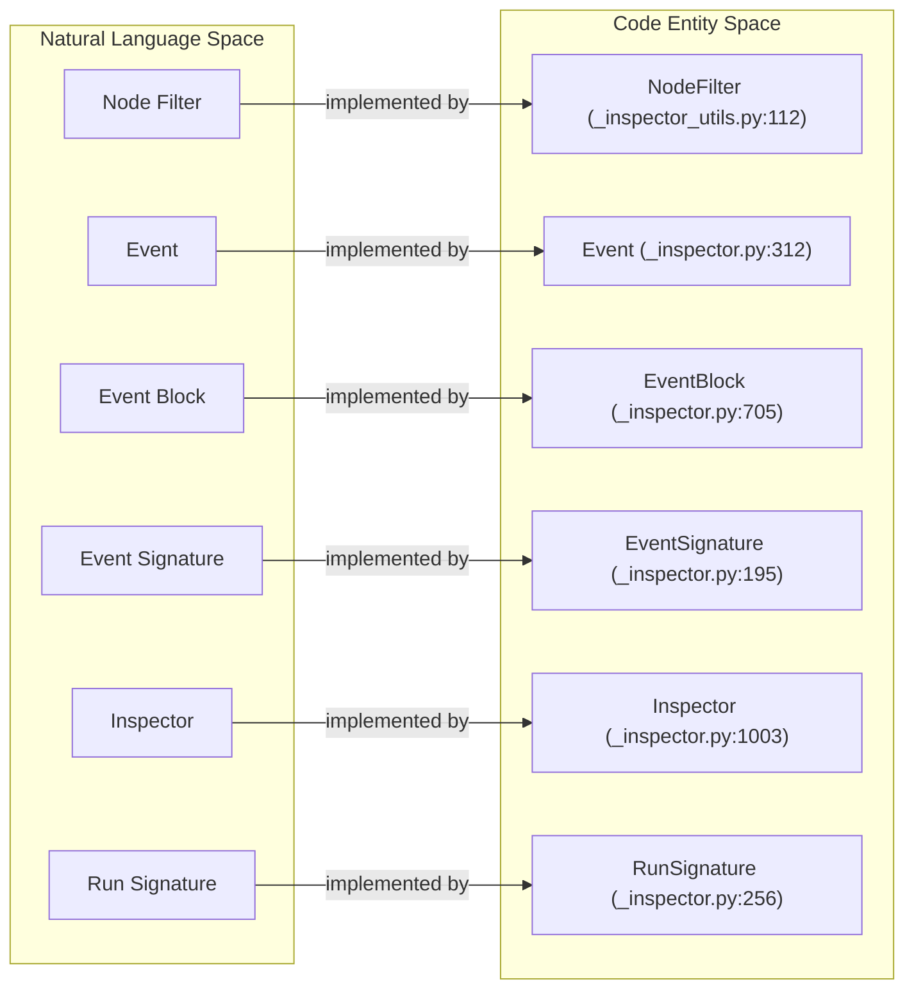
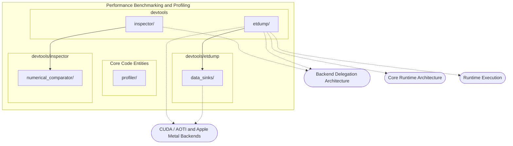
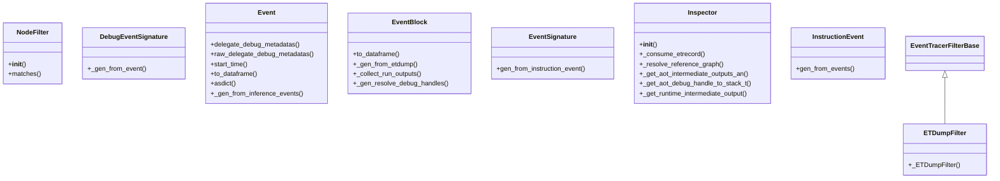
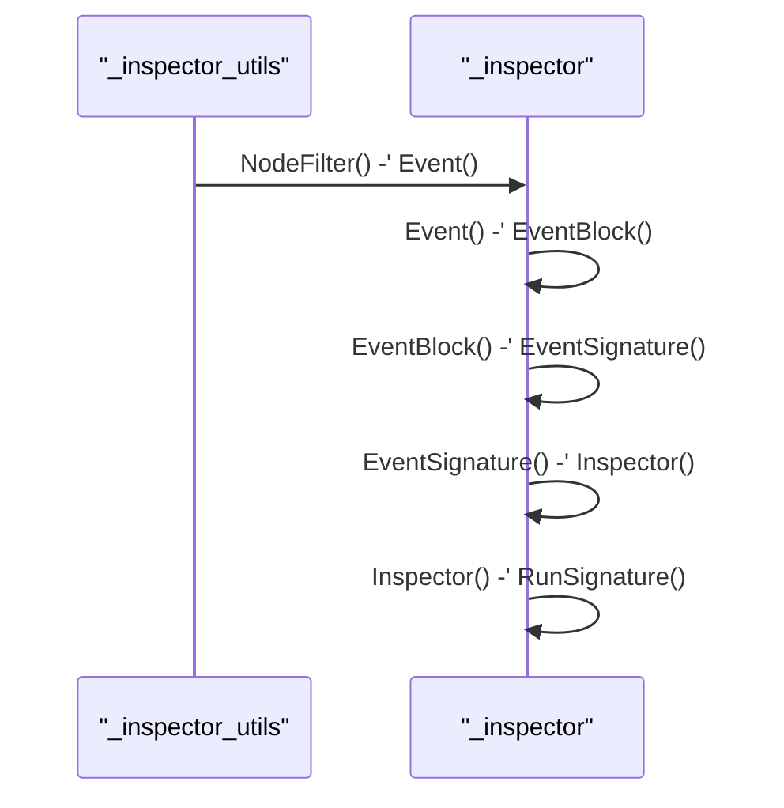

# Performance Benchmarking and Profiling

↑ [[7-testing-and-cicd-infrastructure|Testing and CI/CD Infrastructure]]

> Architectural specification and implementation reference for Performance Benchmarking and Profiling (36 relevant source files). Primary code entities: `Allocator`, `MemAllocation`, `MemEvent`, `ProfileData`, `ETDumpGen`.

<details>
<summary>Relevant source files</summary>

The following files were used as context for generating this wiki page:

- [profiler/parse_profiler_results.py](profiler/parse_profiler_results.py)
- [devtools/etdump/etdump_flatcc.cpp](devtools/etdump/etdump_flatcc.cpp)
- [devtools/etdump/schema_flatcc.py](devtools/etdump/schema_flatcc.py)
- [devtools/etdump/data_sinks/buffer_data_sink.h](devtools/etdump/data_sinks/buffer_data_sink.h)
- [devtools/inspector/_inspector.py](devtools/inspector/_inspector.py)
- [devtools/etdump/data_sinks/data_sink_base.h](devtools/etdump/data_sinks/data_sink_base.h)
- [devtools/inspector/_inspector_utils.py](devtools/inspector/_inspector_utils.py)
- [devtools/etdump/data_sinks/file_data_sink.h](devtools/etdump/data_sinks/file_data_sink.h)
- [devtools/etdump/etdump_filter.h](devtools/etdump/etdump_filter.h)
- [devtools/etdump/etdump_flatcc.h](devtools/etdump/etdump_flatcc.h)
- [profiler/profiler_results_cli.py](profiler/profiler_results_cli.py)
- [devtools/etdump/data_sinks/file_data_sink.cpp](devtools/etdump/data_sinks/file_data_sink.cpp)
- [devtools/etdump/data_sinks/buffer_data_sink.cpp](devtools/etdump/data_sinks/buffer_data_sink.cpp)
- [devtools/etdump/etdump_filter.cpp](devtools/etdump/etdump_filter.cpp)
- [devtools/etdump/emitter.cpp](devtools/etdump/emitter.cpp)
- [devtools/etdump/serialize.py](devtools/etdump/serialize.py)
- [devtools/etdump/emitter.h](devtools/etdump/emitter.h)
- [devtools/etdump/data_sinks/targets.bzl](devtools/etdump/data_sinks/targets.bzl)
- [devtools/inspector/_intermediate_output_capturer.py](devtools/inspector/_intermediate_output_capturer.py)
- [devtools/inspector/numerical_comparator/numerical_comparator_base.py](devtools/inspector/numerical_comparator/numerical_comparator_base.py)
- [devtools/etdump/targets.bzl](devtools/etdump/targets.bzl)
- [devtools/inspector/numerical_comparator/l1_numerical_comparator.py](devtools/inspector/numerical_comparator/l1_numerical_comparator.py)
- [devtools/inspector/numerical_comparator/mse_numerical_comparator.py](devtools/inspector/numerical_comparator/mse_numerical_comparator.py)
- [devtools/etdump/utils.h](devtools/etdump/utils.h)
- [devtools/inspector/numerical_comparator/snr_numerical_comparator.py](devtools/inspector/numerical_comparator/snr_numerical_comparator.py)
- [devtools/inspector/__init__.py](devtools/inspector/__init__.py)
- [devtools/inspector/inspector_cli.py](devtools/inspector/inspector_cli.py)
- [devtools/inspector/vgf_neural_statistics.py](devtools/inspector/vgf_neural_statistics.py)
- [docs/source/devtools-overview.md](docs/source/devtools-overview.md)
- [docs/source/devtools-tutorial.md](docs/source/devtools-tutorial.md)
- [profiler/BUCK](profiler/BUCK)
- [devtools/etdump/BUCK](devtools/etdump/BUCK)
- [devtools/etdump/CMakeLists.txt](devtools/etdump/CMakeLists.txt)
- [devtools/etdump/data_sinks/BUCK](devtools/etdump/data_sinks/BUCK)
- [devtools/etdump/etdump_schema_flatcc.fbs](devtools/etdump/etdump_schema_flatcc.fbs)

</details>

## Purpose and Scope

Architectural specification and implementation reference for Performance Benchmarking and Profiling (36 relevant source files). Primary code entities: `Allocator`, `MemAllocation`, `MemEvent`, `ProfileData`, `ETDumpGen`.

Primary code entities analyzed on this page include `NodeFilter` ([devtools/inspector/_inspector_utils.py:112-131]()), `Event` ([devtools/inspector/_inspector.py:312-701]()), `EventBlock` ([devtools/inspector/_inspector.py:705-1000]()), `EventSignature` ([devtools/inspector/_inspector.py:195-251]()), `Inspector` ([devtools/inspector/_inspector.py:1003-1712]()).

For the parent architectural layer, see [[7-testing-and-cicd-infrastructure|Testing and CI/CD Infrastructure]]. Related sibling subsystems: [[7.1-cicd-workflows-and-validation|CI/CD Workflows and Validation]], [[7.2-model-and-backend-testing-framework|Model and Backend Testing Framework]].

Sources: [devtools/inspector/_inspector_utils.py:112-131](), [devtools/inspector/_inspector.py:312-701](), [devtools/inspector/_inspector.py:705-1000](), [devtools/inspector/_inspector.py:195-251]()

---

## 1. High-Level Architecture and Data Flow

### Natural Language Space to Code Entity Space Mapping

The following diagram maps domain concepts in this subsystem to their concrete code entities:



### Subsystem Component & Dependency Flow



Cross-subsystem call and import edges connect **Performance Benchmarking and Profiling** with [[8.1-core-runtime-architecture|Core Runtime Architecture]] (coupling `28.0`), [[8-runtime-execution|Runtime Execution]] (coupling `22.0`), [[5.7-cuda-aoti-and-apple-metal-backends|CUDA / AOTI and Apple Metal Backends]] (coupling `12.0`), [[5-backend-delegation-architecture|Backend Delegation Architecture]] (coupling `5.0`), [[5.4-arm-tosa-and-ethos-u-backend|ARM TOSA and Ethos-U Backend]] (coupling `5.0`).

| Module Directory | Files | Primary Code Entities | Source Citations |
|---|---|---|---|
| `devtools/etdump` | 14 | `PROFILE_EVENT_ENUM`, `ETDumpFilter`, `AllocationEvent`, `Allocator` | [devtools/etdump/schema_flatcc.py:105-109]() [devtools/etdump/etdump_filter.h:32-101]() |
| `devtools/etdump/data_sinks` | 7 | `BufferDataSink`, `DataSinkBase`, `FileDataSink`, `write` | [devtools/etdump/data_sinks/buffer_data_sink.h:24-124]() [devtools/etdump/data_sinks/data_sink_base.h:24-58]() |
| `devtools/inspector` | 6 | `NodeFilter`, `Event`, `EventBlock`, `EventSignature` | [devtools/inspector/_inspector_utils.py:112-131]() [devtools/inspector/_inspector.py:312-701]() |
| `devtools/inspector/numerical_comparator` | 4 | `MSEComparator`, `NumericalComparatorBase`, `L1Comparator`, `SNRComparator` | [devtools/inspector/numerical_comparator/mse_numerical_comparator.py:19-37]() [devtools/inspector/numerical_comparator/numerical_comparator_base.py:32-281]() |
| `profiler` | 3 | `Allocator`, `MemAllocation`, `MemEvent`, `ProfileData` | [profiler/parse_profiler_results.py:65-67]() [profiler/parse_profiler_results.py:71-73]() |

Sources: [devtools/inspector/_inspector_utils.py:112-131](), [devtools/inspector/_inspector.py:312-701](), [devtools/inspector/_inspector.py:705-1000](), [devtools/inspector/_inspector.py:195-251](), [devtools/inspector/_inspector.py:1003-1712]()

---

## 2. Core Data Structures and Implementation Details

### Class and Entity Relationship Diagram



### `NodeFilter` (Class)

- **Source Location**: [devtools/inspector/_inspector_utils.py:112-131]()
- **Declaration**: `Class NodeFilter`
- **Graph Centrality**: fan-in `2` callers, fan-out `0` callees
- **Responsibility**: A class used to filter nodes based on extensible criteria. Attributes: metadata_key (str): The key to look for in the node's metadata. op_type (str): The operation code to match. exclude_ops (List[str]): A list of operations to exclude from the filter.

```python
// devtools/inspector/_inspector_utils.py:112-127
class NodeFilter:
    """
    A class used to filter nodes based on extensible criteria.
    Attributes:
        metadata_key (str): The key to look for in the node's metadata.
        op_type (str): The operation code to match.
        exclude_ops (List[str]): A list of operations to exclude from the filter.
    """

    def __init__(self, metadata_key: str, op_type: str, exclude_ops: List[str] = None):
        self.metadata_key = metadata_key
        self.op_type = op_type
        self.exclude_ops = exclude_ops

    def matches(self, node: torch.fx.Node) -> bool:
        return (
```

### `Event` (Class)

- **Source Location**: [devtools/inspector/_inspector.py:312-701]()
- **Declaration**: `Class Event`
- **Graph Centrality**: fan-in `1` callers, fan-out `0` callees
- **Responsibility**: An Event corresponds to an operator instance with perf data retrieved from the runtime and other metadata from `ETRecord`. Args: name: Name of the profiling `Event`, empty if no profiling event. perf_data: Performance data associated with the event retrived from the runtime (available attributes: p10, p50, p90, avg, mi

```python
// devtools/inspector/_inspector.py:312-327
class Event:
    """
    An Event corresponds to an operator instance with perf data retrieved from the runtime and other metadata from `ETRecord`.

    Args:
        name: Name of the profiling `Event`, empty if no profiling event.
        perf_data: Performance data associated with the event retrived from the runtime (available attributes: p10, p50, p90, avg, min and max).
        op_type: List of op types corresponding to the event.
        delegate_debug_identifier: Supplemental identifier used in combination with instruction id.
        debug_handles: Debug handles in the model graph to which this event is correlated.
        num_outputs: Indicates the number of outputs generated by the node.
                     Right now only used for call_delegate nodes that output more than one tensor.
        stack_trace: A dictionary mapping the name of each associated op to its stack trace.
        module_hierarchy: A dictionary mapping the name of each associated op to its module hierarchy.
        is_delegated_op: Whether or not the event was delegated.
        delegate_backend_name: Name of the backend this event was delegated to.
```

### `EventBlock` (Class)

- **Source Location**: [devtools/inspector/_inspector.py:705-1000]()
- **Declaration**: `Class EventBlock`
- **Graph Centrality**: fan-in `1` callers, fan-out `0` callees
- **Responsibility**: r""" An `EventBlock` contains a collection of events associated with a particular profiling/debugging block retrieved from the runtime. Each `EventBlock` represents a pattern of execution. For example, model initiation and loading lives in a single `EventBlock`. If there's a control flow, each branch will be represente

```python
// devtools/inspector/_inspector.py:705-720
class EventBlock:
    r"""
    An `EventBlock` contains a collection of events associated with a particular profiling/debugging block retrieved from the runtime.
    Each `EventBlock` represents a pattern of execution. For example, model initiation and loading lives in a single `EventBlock`.
    If there's a control flow, each branch will be represented by a separate `EventBlock`.

    Args:
        name: Name of the profiling/debugging block.
        events: List of `Event`\ s associated with the profiling/debugging block.

        bundled_input_idx: Index of the Bundled Input that this EventBlock corresponds to.
        run_output: Run output extracted from the encapsulated Events
    """

    name: str
    events: List[Event] = dataclasses.field(default_factory=list)
```

### `EventSignature` (Class)

- **Source Location**: [devtools/inspector/_inspector.py:195-251]()
- **Declaration**: `Class EventSignature`
- **Graph Centrality**: fan-in `1` callers, fan-out `0` callees
- **Responsibility**: Note that (profile_event_signature, debug_event_signature) are sufficient signature identifiers. instruction_id is extracted from the signatures (equivalent in both) and surfaced for convenience

### `Inspector` (Class)

- **Source Location**: [devtools/inspector/_inspector.py:1003-1712]()
- **Declaration**: `Class Inspector`
- **Graph Centrality**: fan-in `1` callers, fan-out `0` callees
- **Responsibility**: APIs for examining model architecture and performance stats. Public Attributes: event_blocks: List["EventBlocks"]. Structured data from ETDump (correlated with ETRecord if provided). Private Attributes: _etrecord: Optional[ETRecord]. File under etrecord_path deserialized into an object.

### `check_ready_to_add_events` (Method)

- **Source Location**: [devtools/etdump/etdump_flatcc.cpp:273-284]()
- **Declaration**: `()`
- **Graph Centrality**: fan-in `6` callers, fan-out `1` callees
- **Responsibility**: // ETDumpGen has the following possible states, ETDumpGen_Init, // ETDumpGen_Block_Created, ETDumpGen_Adding_Allocators, // ETDumpGen_Adding_Events. Right after boot-up the state of ETDump will be // ETDumpGen_Init. At this point we have an option of adding allocators that // we want to track. Once we've completed addi

Sources: [devtools/inspector/_inspector_utils.py:112-131](), [devtools/inspector/_inspector.py:312-701](), [devtools/inspector/_inspector.py:705-1000](), [devtools/inspector/_inspector.py:195-251](), [devtools/inspector/_inspector.py:1003-1712]()

---

## 3. Execution and Call Flow

The sequence diagram below traces the runtime/compile-time call chain across components in this module:



Sources: [devtools/inspector/_inspector_utils.py:112-131](), [devtools/inspector/_inspector.py:312-701](), [devtools/inspector/_inspector.py:705-1000](), [devtools/inspector/_inspector.py:195-251](), [devtools/inspector/_inspector.py:1003-1712]()

---

## 4. Key API and Symbol Reference

| Code Entity | Kind | Location | Fan-In / Out | Role & Signature |
|---|---|---|---|---|
| `NodeFilter` | Class | [devtools/inspector/_inspector_utils.py:112-131]() | `2` / `0` | A class used to filter nodes based on extensible criteria. |
| `Event` | Class | [devtools/inspector/_inspector.py:312-701]() | `1` / `0` | An Event corresponds to an operator instance with perf data retrieved from the runtime and other metadata from |
| `EventBlock` | Class | [devtools/inspector/_inspector.py:705-1000]() | `1` / `0` | r""" |
| `EventSignature` | Class | [devtools/inspector/_inspector.py:195-251]() | `1` / `0` | Note that (profile_event_signature, debug_event_signature) are sufficient |
| `Inspector` | Class | [devtools/inspector/_inspector.py:1003-1712]() | `1` / `0` | APIs for examining model architecture and performance stats. |
| `RunSignature` | Class | [devtools/inspector/_inspector.py:256-266]() | `1` / `0` | Args: |
| `BufferDataSink` | Class | [devtools/etdump/data_sinks/buffer_data_sink.h:24-124]() | `0` / `0` | /** |
| `PROFILE_EVENT_ENUM` | Class | [devtools/etdump/schema_flatcc.py:105-109]() | `0` / `0` | # Note the differing value style is a result of ETDump string |
| `NodeData` | Class | [devtools/inspector/_inspector_utils.py:96-109]() | `1` / `0` | Each node in the graph is an instance of NodeData, which contains: |
| `DataSinkBase` | Class | [devtools/etdump/data_sinks/data_sink_base.h:24-58]() | `0` / `0` | /** |
| `ETDumpFilter` | Class | [devtools/etdump/etdump_filter.h:32-101]() | `1` / `0` | /** |
| `FileDataSink` | Class | [devtools/etdump/data_sinks/file_data_sink.h:28-92]() | `0` / `0` | /** |
| `IntermediateOutputCapturer` | Class | [devtools/inspector/_intermediate_output_capturer.py:18-62]() | `0` / `0` | A class that captures intermediate outputs from a PyTorch graph module. |
| `MSEComparator` | Class | [devtools/inspector/numerical_comparator/mse_numerical_comparator.py:19-37]() | `1` / `0` | Mean Squared Error comparator for numerical discrepancy detection. |
| `NumericalComparatorBase` | Class | [devtools/inspector/numerical_comparator/numerical_comparator_base.py:32-281]() | `0` / `0` | Base class for numerical comparison with optional preprocessing. |
| `DebugEventSignature` | Class | [devtools/inspector/_inspector.py:171-190]() | `1` / `0` | — |
| `InstructionEvent` | Class | [devtools/inspector/_inspector.py:97-142]() | `1` / `0` | — |
| `InstructionEventSignature` | Class | [devtools/inspector/_inspector.py:88-92]() | `1` / `0` | — |
| `PerfData` | Class | [devtools/inspector/_inspector.py:282-308]() | `1` / `0` | — |
| `ProfileEventSignature` | Class | [devtools/inspector/_inspector.py:147-166]() | `1` / `0` | — |
| `L1Comparator` | Class | [devtools/inspector/numerical_comparator/l1_numerical_comparator.py:19-35]() | `0` / `0` | L1 (sum of absolute differences) comparator for numerical discrepancy detection. |
| `Allocator` | Class | [profiler/parse_profiler_results.py:65-67]() | `0` / `0` | — |

Sources: [devtools/inspector/_inspector_utils.py:112-131](), [devtools/inspector/_inspector.py:312-701](), [devtools/inspector/_inspector.py:705-1000](), [devtools/inspector/_inspector.py:195-251](), [devtools/inspector/_inspector.py:1003-1712](), [devtools/inspector/_inspector.py:256-266]()

---

## 5. Official Documentation and Design Context

The following linked documentation sections from `llm-wiki` (`raw/`) provide additional architectural context, tutorials, and design invariants for this subsystem:

- **Developer Tools (DevTools: ETDump, ETRecord, Inspector)** ([wiki/8.3-developer-tools-devtools.md](), score `149.1127`) (sections: `Developer Tools (DevTools: ETDump, ETRecord, Inspector)`, `Purpose and Scope`, `1. High-Level Architecture and Data Flow`, `Natural Language Space to Code Entity Space Mapping`): # Developer Tools (DevTools: ETDump, ETRecord, Inspector) ↑ [[8-runtime-execution|Runtime Execution]] > Architectural specification and implementation reference for Developer Tools (DevTools: ETDump, ETRecord, Inspector) (38 relevant source files). Primary code entities: `DelegatePartitionProvenance`, `__hash__`, `ETRecord`, `__init__`, `ETDumpGen`. <details> <summary>Relevant source files</summary> The following fil
- **Testing and CI/CD Infrastructure** ([wiki/7-testing-and-cicd-infrastructure.md](), score `141.7106`) (sections: `Testing and CI/CD Infrastructure`, `Purpose and Scope`, `System Mapping: Natural Language Space to Code Entity Space`, `1. CI/CD Workflows and Validation`): # Testing and CI/CD Infrastructure > Architectural specification and implementation reference for Testing and CI/CD Infrastructure (36 relevant source files). Primary code entities: `BenchmarkResults`, `save_json`, `to_dict`, `to_v3_format`, `BenchmarkFilters`. <details> <summary>Relevant source files</summary> The following files were used as context for generating this wiki page: - [.ci/scripts/cuda_benchmark.py](.
- **Schema Generation and FlatBuffers** ([wiki/2.3-schema-generation-and-flatbuffers.md](), score `111.6646`) (sections: `Schema Generation and FlatBuffers`, `Purpose and Scope`, `1. High-Level Architecture and Data Flow`, `Natural Language Space to Code Entity Space Mapping`): # Schema Generation and FlatBuffers ↑ [[2-build-system-and-infrastructure|Build System and Infrastructure]] > Architectural specification and implementation reference for Schema Generation and FlatBuffers (36 relevant source files). Primary code entities: `Call`, `Sample`, `SampleSet`, `_SetDecoder`, `PTEFile`. <details> <summary>Relevant source files</summary> The following files were used as context for generating 
- **ExecuTorch DeepWiki** ([wiki/index.md](), score `96.9299`) (sections: `ExecuTorch DeepWiki`, `Pages`): # ExecuTorch DeepWiki Generated from `home-jason-Project-deepwiki-executorch` at commit `b3b565b5b62f` (2026-11-15T15:02:11+00:00). ## Pages - [[1-overview|Overview]] — Architectural specification and implementation reference for Overview (10 relevant source files). Primary code entities: `Module`, `MethodHolder`, `PlannedMemory`, `EdgeProgramManager`, `__init__`. - [[1.1-getting-started|Getting Started]] — Architect

Sources: [wiki/8.3-developer-tools-devtools.md](), [wiki/7-testing-and-cicd-infrastructure.md](), [wiki/2.3-schema-generation-and-flatbuffers.md](), [wiki/index.md]()

## Related pages

- [[7-testing-and-cicd-infrastructure|Testing and CI/CD Infrastructure]]
- [[1.1-getting-started|Getting Started]]
- [[1.2-export-api-and-recipe-system|Export API and Recipe System]]
- [[2.2-kernel-libraries-and-selective-build|Kernel Libraries and Selective Build]]
- [[2.3-schema-generation-and-flatbuffers|Schema Generation and FlatBuffers]]
- [[3.4-program-emission-and-serialization|Program Emission and Serialization]]
- [[3.5-verification-and-dialect-system|Verification and Dialect System]]
- [[4-quantization-systems|Quantization Systems]]

## Related documents

- `wiki/8.3-developer-tools-devtools.md` — Developer Tools (DevTools: ETDump, ETRecord, Inspector) (score 149.1127, via bm25)
- `wiki/7-testing-and-cicd-infrastructure.md` — Testing and CI/CD Infrastructure (score 141.7106, via bm25)
- `wiki/2.3-schema-generation-and-flatbuffers.md` — Schema Generation and FlatBuffers (score 111.6646, via bm25)
- `wiki/index.md` — ExecuTorch DeepWiki (score 96.9299, via bm25)
- `wiki/3.4-program-emission-and-serialization.md` — Program Emission and Serialization (score 75.7138, via bm25)

## Sources

- [`profiler/parse_profiler_results.py`](https://github.com/pytorch/executorch/blob/main/profiler/parse_profiler_results.py)
- [`devtools/etdump/etdump_flatcc.cpp`](https://github.com/pytorch/executorch/blob/main/devtools/etdump/etdump_flatcc.cpp)
- [`devtools/etdump/schema_flatcc.py`](https://github.com/pytorch/executorch/blob/main/devtools/etdump/schema_flatcc.py)
- [`devtools/etdump/data_sinks/buffer_data_sink.h`](https://github.com/pytorch/executorch/blob/main/devtools/etdump/data_sinks/buffer_data_sink.h)
- [`devtools/inspector/_inspector.py`](https://github.com/pytorch/executorch/blob/main/devtools/inspector/_inspector.py)
- [`devtools/etdump/data_sinks/data_sink_base.h`](https://github.com/pytorch/executorch/blob/main/devtools/etdump/data_sinks/data_sink_base.h)
- [`devtools/inspector/_inspector_utils.py`](https://github.com/pytorch/executorch/blob/main/devtools/inspector/_inspector_utils.py)
- [`devtools/etdump/data_sinks/file_data_sink.h`](https://github.com/pytorch/executorch/blob/main/devtools/etdump/data_sinks/file_data_sink.h)
- [`devtools/etdump/etdump_filter.h`](https://github.com/pytorch/executorch/blob/main/devtools/etdump/etdump_filter.h)
- [`devtools/etdump/etdump_flatcc.h`](https://github.com/pytorch/executorch/blob/main/devtools/etdump/etdump_flatcc.h)
- [`profiler/profiler_results_cli.py`](https://github.com/pytorch/executorch/blob/main/profiler/profiler_results_cli.py)
- [`devtools/etdump/data_sinks/file_data_sink.cpp`](https://github.com/pytorch/executorch/blob/main/devtools/etdump/data_sinks/file_data_sink.cpp)
- [`devtools/etdump/data_sinks/buffer_data_sink.cpp`](https://github.com/pytorch/executorch/blob/main/devtools/etdump/data_sinks/buffer_data_sink.cpp)
- [`devtools/etdump/etdump_filter.cpp`](https://github.com/pytorch/executorch/blob/main/devtools/etdump/etdump_filter.cpp)
- [`devtools/etdump/emitter.cpp`](https://github.com/pytorch/executorch/blob/main/devtools/etdump/emitter.cpp)
- [`devtools/etdump/serialize.py`](https://github.com/pytorch/executorch/blob/main/devtools/etdump/serialize.py)
- [`devtools/etdump/emitter.h`](https://github.com/pytorch/executorch/blob/main/devtools/etdump/emitter.h)
- [`devtools/etdump/data_sinks/targets.bzl`](https://github.com/pytorch/executorch/blob/main/devtools/etdump/data_sinks/targets.bzl)
- [`devtools/inspector/_intermediate_output_capturer.py`](https://github.com/pytorch/executorch/blob/main/devtools/inspector/_intermediate_output_capturer.py)
- [`devtools/inspector/numerical_comparator/numerical_comparator_base.py`](https://github.com/pytorch/executorch/blob/main/devtools/inspector/numerical_comparator/numerical_comparator_base.py)
- [`devtools/etdump/targets.bzl`](https://github.com/pytorch/executorch/blob/main/devtools/etdump/targets.bzl)
- [`devtools/inspector/numerical_comparator/l1_numerical_comparator.py`](https://github.com/pytorch/executorch/blob/main/devtools/inspector/numerical_comparator/l1_numerical_comparator.py)
- [`devtools/inspector/numerical_comparator/mse_numerical_comparator.py`](https://github.com/pytorch/executorch/blob/main/devtools/inspector/numerical_comparator/mse_numerical_comparator.py)
- [`devtools/etdump/utils.h`](https://github.com/pytorch/executorch/blob/main/devtools/etdump/utils.h)
- [`devtools/inspector/numerical_comparator/snr_numerical_comparator.py`](https://github.com/pytorch/executorch/blob/main/devtools/inspector/numerical_comparator/snr_numerical_comparator.py)
- [`devtools/inspector/__init__.py`](https://github.com/pytorch/executorch/blob/main/devtools/inspector/__init__.py)
- [`devtools/inspector/inspector_cli.py`](https://github.com/pytorch/executorch/blob/main/devtools/inspector/inspector_cli.py)
- [`devtools/inspector/vgf_neural_statistics.py`](https://github.com/pytorch/executorch/blob/main/devtools/inspector/vgf_neural_statistics.py)
- [`docs/source/devtools-overview.md`](https://github.com/pytorch/executorch/blob/main/docs/source/devtools-overview.md)
- [`docs/source/devtools-tutorial.md`](https://github.com/pytorch/executorch/blob/main/docs/source/devtools-tutorial.md)
- [`profiler/BUCK`](https://github.com/pytorch/executorch/blob/main/profiler/BUCK)
- [`devtools/etdump/BUCK`](https://github.com/pytorch/executorch/blob/main/devtools/etdump/BUCK)
- [`devtools/etdump/CMakeLists.txt`](https://github.com/pytorch/executorch/blob/main/devtools/etdump/CMakeLists.txt)
- [`devtools/etdump/data_sinks/BUCK`](https://github.com/pytorch/executorch/blob/main/devtools/etdump/data_sinks/BUCK)
- [`devtools/etdump/etdump_schema_flatcc.fbs`](https://github.com/pytorch/executorch/blob/main/devtools/etdump/etdump_schema_flatcc.fbs)
- [`devtools/etdump/scalar_type.fbs`](https://github.com/pytorch/executorch/blob/main/devtools/etdump/scalar_type.fbs)


## Dynamic Knowledge Links (Code Graph ↔ LLM-Wiki / RAG)

### Linked Architecture & Design Documents

| Document | Match Channel | Score | Shared Code Symbols |
|---|---|---|---|
| [[8.3-developer-tools-devtools|Developer Tools (DevTools: ETDump, ETRecord, Inspector)]] | `bm25+entity(1)` | `150.613` | `Float` |
| [[7-testing-and-cicd-infrastructure|Testing and CI/CD Infrastructure]] | `bm25` | `141.711` | *(lexical/graph match)* |
| [[2.3-schema-generation-and-flatbuffers|Schema Generation and FlatBuffers]] | `bm25` | `111.665` | *(lexical/graph match)* |
| [[index|ExecuTorch DeepWiki]] | `bm25` | `96.93` | *(lexical/graph match)* |
| [[7.1-cicd-workflows-and-validation|CI/CD Workflows and Validation]] | `wikilink:7.3-performance-benchmarking-and-profiling` | `84.765` | *(lexical/graph match)* |
| [[7.2-model-and-backend-testing-framework|Model and Backend Testing Framework]] | `wikilink:7.3-performance-benchmarking-and-profiling` | `84.765` | *(lexical/graph match)* |

### High-Centrality Bridge Symbols (CBM Graph)

| Symbol | Kind | Source Location | Fan-In / Fan-Out |
|---|---|---|---|
| `NodeFilter` | Class | [devtools/inspector/_inspector_utils.py:112-131]() | in: `2` / out: `0` |
| `Event` | Class | [devtools/inspector/_inspector.py:312-701]() | in: `1` / out: `0` |
| `EventBlock` | Class | [devtools/inspector/_inspector.py:705-1000]() | in: `1` / out: `0` |
| `EventSignature` | Class | [devtools/inspector/_inspector.py:195-251]() | in: `1` / out: `0` |
| `Inspector` | Class | [devtools/inspector/_inspector.py:1003-1712]() | in: `1` / out: `0` |
| `RunSignature` | Class | [devtools/inspector/_inspector.py:256-266]() | in: `1` / out: `0` |

Sources: [devtools/inspector/_inspector_utils.py:112-131](), [devtools/inspector/_inspector.py:312-701](), [devtools/inspector/_inspector.py:705-1000](), [devtools/inspector/_inspector.py:195-251]()

### Cross-Subsystem Coupling

- [[8.1-core-runtime-architecture|Core Runtime Architecture]] — call/import coupling weight `28.0`
- [[8-runtime-execution|Runtime Execution]] — call/import coupling weight `22.0`
- [[5.7-cuda-aoti-and-apple-metal-backends|CUDA / AOTI and Apple Metal Backends]] — call/import coupling weight `12.0`
- [[5-backend-delegation-architecture|Backend Delegation Architecture]] — call/import coupling weight `5.0`
- [[5.4-arm-tosa-and-ethos-u-backend|ARM TOSA and Ethos-U Backend]] — call/import coupling weight `5.0`
- [[9-mobile-and-platform-extensions|Mobile and Platform Extensions]] — call/import coupling weight `2.0`
