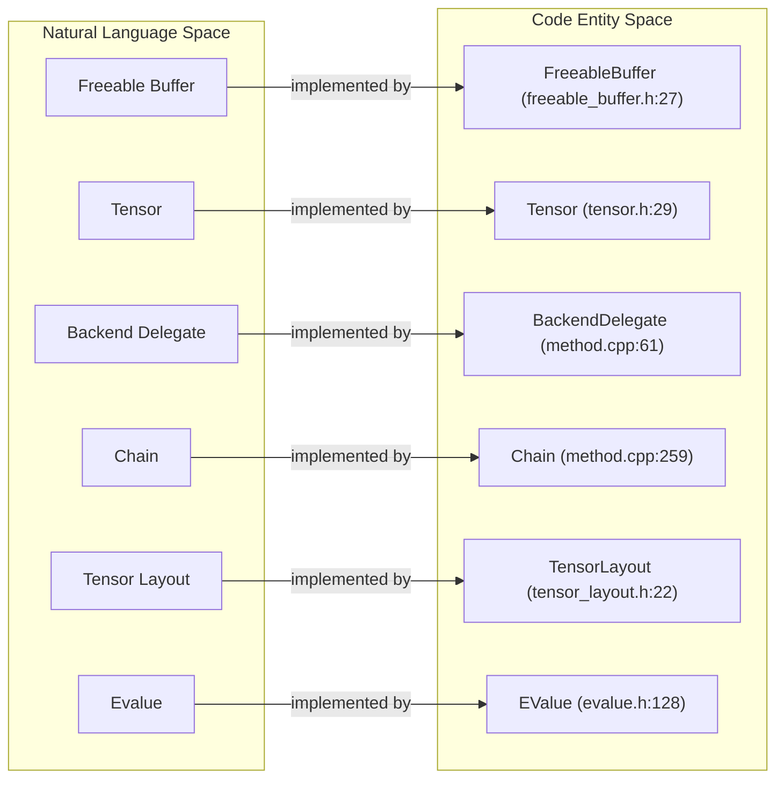
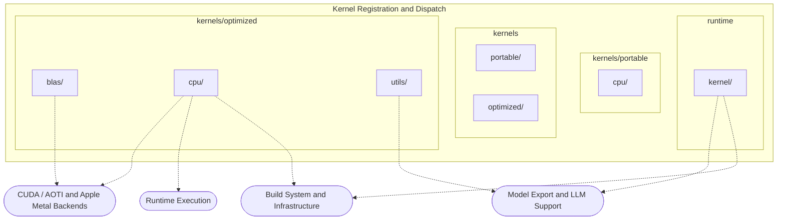
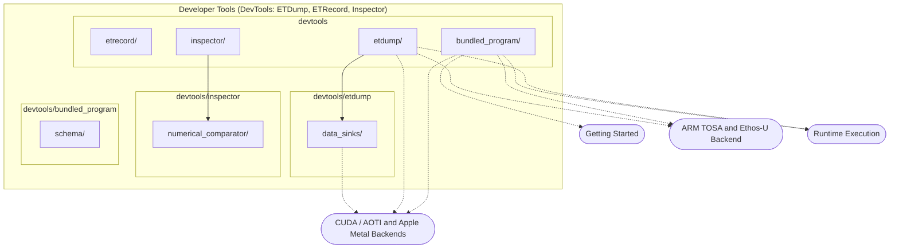

# Runtime Execution

> Architectural specification and implementation reference for Runtime Execution (39 relevant source files). Primary code entities: `ET_CHECK_MSG`, `execute`, `execute_instruction`, `experimental_reset_execution`, `ArrayRef`.

Relevant source files

The following files were used as context for generating this wiki page:

- [runtime/executor/method.cpp](runtime/executor/method.cpp)
- [runtime/core/array_ref.h](runtime/core/array_ref.h)
- [runtime/core/result.h](runtime/core/result.h)
- [runtime/core/portable_type/tensor.h](runtime/core/portable_type/tensor.h)
- [runtime/executor/method_meta.cpp](runtime/executor/method_meta.cpp)
- [runtime/core/tensor_layout.h](runtime/core/tensor_layout.h)
- [runtime/core/evalue.h](runtime/core/evalue.h)
- [runtime/executor/memory_manager.h](runtime/executor/memory_manager.h)
- [runtime/executor/method_meta.h](runtime/executor/method_meta.h)
- [runtime/executor/platform_memory_allocator.h](runtime/executor/platform_memory_allocator.h)
- [runtime/executor/method.h](runtime/executor/method.h)
- [runtime/executor/program.h](runtime/executor/program.h)
- [runtime/executor/pte_data_map.h](runtime/executor/pte_data_map.h)
- [runtime/executor/tensor_parser_exec_aten.cpp](runtime/executor/tensor_parser_exec_aten.cpp)
- [runtime/core/portable_type/tensor_impl.h](runtime/core/portable_type/tensor_impl.h)
- [runtime/executor/program.cpp](runtime/executor/program.cpp)
- [runtime/executor/tensor_parser.h](runtime/executor/tensor_parser.h)
- [runtime/executor/tensor_parser_aten.cpp](runtime/executor/tensor_parser_aten.cpp)
- [runtime/core/freeable_buffer.h](runtime/core/freeable_buffer.h)
- [runtime/platform/runtime.cpp](runtime/platform/runtime.cpp)
- [runtime/executor/merged_data_map.h](runtime/executor/merged_data_map.h)
- [runtime/core/data_loader.h](runtime/core/data_loader.h)
- [runtime/core/memory_allocator.h](runtime/core/memory_allocator.h)
- [kernels/portable/cpu/scalar_utils.h](kernels/portable/cpu/scalar_utils.h)
- [runtime/executor/program_validation.cpp](runtime/executor/program_validation.cpp)
- [runtime/executor/pte_data_map.cpp](runtime/executor/pte_data_map.cpp)
- [runtime/backend/backend_init_context.h](runtime/backend/backend_init_context.h)
- [devtools/bundled_program/bundled_program.cpp](devtools/bundled_program/bundled_program.cpp)
- [kernels/portable/README.md](kernels/portable/README.md)
- [devtools/bundled_program/schema/README.md](devtools/bundled_program/schema/README.md)
- [runtime/core/exec_aten/testing_util/README.md](runtime/core/exec_aten/testing_util/README.md)
- [runtime/core/portable_type/c10/README.md](runtime/core/portable_type/c10/README.md)
- [runtime/core/exec_aten/util/README.md](runtime/core/exec_aten/util/README.md)
- [runtime/executor/BUCK](runtime/executor/BUCK)
- [runtime/core/BUCK](runtime/core/BUCK)

## Purpose and Scope

This chapter covers **Runtime Execution** across the repository, detailing the core abstractions, data structures, transformation pipelines, and runtime/build integrations that implement this layer.

**Scope**: This document provides an architectural hub for the following child subsystems:
- **Core Runtime Architecture**: See [[8.1-core-runtime-architecture|Core Runtime Architecture]].
- **Kernel Registration and Dispatch**: See [[8.2-kernel-registration-and-dispatch|Kernel Registration and Dispatch]].
- **Developer Tools (DevTools: ETDump, ETRecord, Inspector)**: See [[8.3-developer-tools-devtools|Developer Tools (DevTools: ETDump, ETRecord, Inspector)]].

Sources: [runtime/core/freeable_buffer.h:27-270](), [runtime/core/portable_type/tensor.h:29-178](), [runtime/executor/method.cpp:61-254](), [runtime/executor/method.cpp:259-267]()

---

## System Mapping: Natural Language Space to Code Entity Space

Sources: [runtime/core/freeable_buffer.h:27-270](), [runtime/core/portable_type/tensor.h:29-178](), [runtime/executor/method.cpp:61-254](), [runtime/executor/method.cpp:259-267](), [runtime/core/tensor_layout.h:22-90]()

---

## 1. Core Runtime Architecture

Architectural specification and implementation reference for Core Runtime Architecture (38 relevant source files). Primary code entities: `ET_CHECK_MSG`, `execute`, `execute_instruction`, `experimental_reset_execution`, `ArrayRef`. [runtime/core/freeable_buffer.h:27-270](), [runtime/core/portable_type/tensor.h:29-178](), [runtime/executor/method.cpp:61-254]()

### Primary Code Entities

- **`FreeableBuffer`** (Class in [runtime/core/freeable_buffer.h:27-270]()): /** * A read-only buffer than can be freed. */
- **`Tensor`** (Class in [runtime/core/portable_type/tensor.h:29-178]()): /** * A minimal Tensor type whose API is a source compatible subset of at::Tensor. * * NOTE: Instances of this class do not own the TensorImpl given to it, * which means that the c
- **`BackendDelegate`** (Class in [runtime/executor/method.cpp:61-254]()): /** * Runtime state for a backend delegate. */
- **`Chain`** (Class in [runtime/executor/method.cpp:259-267]()): /** * Runtime state for a chain of instructions. */
- **`back`** (Method in [runtime/core/array_ref.h:143-147]()): /// back - Get the last element.
- **`ok`** (Method in [runtime/core/result.h:100-102]()): /** * Returns true if this Result has a value. * * If true, it is guaranteed that `error()` will return `Error::Ok`. * If false, it is guaranteed that `error()` will not return `Er

### Core Runtime Architecture Architecture Flow

```mermaid
flowchart TD
  subgraph sub_this["Core Runtime Architecture"]
    subgraph sg_0["runtime"]
      n_runtime_executor["executor/"]
      n_runtime_core["core/"]
      n_runtime_platform["platform/"]
    end
    subgraph sg_1["runtime/core"]
      n_runtime_core_portable_type["portable_type/"]
      n_runtime_core_exec_aten["exec_aten/"]
    end
    subgraph sg_2["extension"]
      n_extension_data_loader["data_loader/"]
      n_extension_flat_tensor["flat_tensor/"]
    end
    subgraph sg_3["runtime/core/exec_aten"]
      n_runtime_core_exec_aten_util["util/"]
    end
    subgraph sg_4["runtime/core/portable_type"]
      n_runtime_core_portable_type_c10["c10/"]
    end
  end
  n_page_2_build_system_and_infrastructure(["Build System and Infrastructure"])
  n_page_5_7_cuda_aoti_and_apple_metal_backends(["CUDA / AOTI and Apple Metal Backends"])
  n_page_6_model_export_and_llm_support(["Model Export and LLM Support"])
  n_page_9_mobile_and_platform_extensions(["Mobile and Platform Extensions"])
  n_extension_data_loader -.-> n_page_2_build_system_and_infrastructure
  n_runtime_core -.-> n_page_9_mobile_and_platform_extensions
  n_runtime_core -.-> n_page_2_build_system_and_infrastructure
  n_runtime_executor -.-> n_page_2_build_system_and_infrastructure
  n_runtime_executor -.-> n_page_9_mobile_and_platform_extensions
  n_runtime_core -.-> n_page_6_model_export_and_llm_support
  n_runtime_executor -.-> n_page_5_7_cuda_aoti_and_apple_metal_backends
  n_runtime_executor -.-> n_page_6_model_export_and_llm_support
  n_runtime_core -.-> n_page_5_7_cuda_aoti_and_apple_metal_backends
  n_runtime_core_portable_type -.-> n_page_9_mobile_and_platform_extensions
  n_runtime_core_portable_type -.-> n_page_6_model_export_and_llm_support
  n_extension_data_loader -.-> n_page_9_mobile_and_platform_extensions
  n_runtime_core_portable_type -.-> n_page_2_build_system_and_infrastructure
  n_runtime_core_exec_aten_util -.-> n_page_2_build_system_and_infrastructure
```

For details, see [[8.1-core-runtime-architecture|Core Runtime Architecture]].

Sources: [runtime/core/freeable_buffer.h:27-270](), [runtime/core/portable_type/tensor.h:29-178](), [runtime/executor/method.cpp:61-254](), [runtime/executor/method.cpp:259-267]()

---

## 2. Kernel Registration and Dispatch

Architectural specification and implementation reference for Kernel Registration and Dispatch (36 relevant source files). Primary code entities: `KernelRuntimeContext`, `allocate_temp`, `fail`, `Kernel`, `KernelKey`. [runtime/kernel/kernel_runtime_context.h:26-108](), [runtime/kernel/operator_registry.h:179-198](), [runtime/kernel/operator_registry.h:119-171]()

### Primary Code Entities

- **`KernelRuntimeContext`** (Class in [runtime/kernel/kernel_runtime_context.h:26-108]()): /** * Runtime state and functionality for kernel implementations. * * NOTE: Will not be passed to operators if running in ATen mode as those * operators do not expect to receive a 
- **`Kernel`** (Class in [runtime/kernel/operator_registry.h:179-198]()): /** * Struct that bundles a kernel key, a function and an op name together. An * `Operator` may have more than one `Kernel` (maximum kMaxNumOfKernelPerOp) and * they should have th
- **`KernelKey`** (Class in [runtime/kernel/operator_registry.h:119-171]()): /** * Describes which dtype & dim order specialized kernel to be bound to an * operator. * * Kernel key data is a string with the format: * * "v<version>/<tensor_meta>|<tensor_meta
- **`TensorMeta`** (Class in [runtime/kernel/operator_registry.h:52-95]()): /** * Dtype and dim order metadata for a Tensor argument to an operator. * Used by the Executor to hold the tensor metadata info and retrieve kernel. */
- **`fail`** (Method in [runtime/kernel/kernel_runtime_context.h:56-58]()): /** * Tells the runtime that the kernel call has failed. Prefer this over * ET_CHECK_*(), which fatally panics the process/system. * * If this is not called, the runtime will treat
- **`get_scalar_dtype`** (Function in [kernels/portable/cpu/scalar_utils.h:56-67]()): /** * Returns the dtype associated with a Scalar that reflects the category * of value stored by the Scalar. */

### Kernel Registration and Dispatch Architecture Flow

For details, see [[8.2-kernel-registration-and-dispatch|Kernel Registration and Dispatch]].

Sources: [runtime/kernel/kernel_runtime_context.h:26-108](), [runtime/kernel/operator_registry.h:179-198](), [runtime/kernel/operator_registry.h:119-171](), [runtime/kernel/operator_registry.h:52-95]()

---

## 3. Developer Tools (DevTools: ETDump, ETRecord, Inspector)

Architectural specification and implementation reference for Developer Tools (DevTools: ETDump, ETRecord, Inspector) (38 relevant source files). Primary code entities: `DelegatePartitionProvenance`, `__hash__`, `ETRecord`, `__init__`, `ETDumpGen`. [devtools/etrecord/_etrecord.py:102-560](), [devtools/inspector/_inspector_utils.py:112-131](), [devtools/bundled_program/core.py:33-395]()

### Primary Code Entities

- **`ETRecord`** (Class in [devtools/etrecord/_etrecord.py:102-560]()): Core implementation entity.
- **`NodeFilter`** (Class in [devtools/inspector/_inspector_utils.py:112-131]()): A class used to filter nodes based on extensible criteria. Attributes: metadata_key (str): The key to look for in the node's metadata. op_type (str): The operation code to match. e
- **`BundledProgram`** (Class in [devtools/bundled_program/core.py:33-395]()): Bundled program contains all information needed to execute and verify the program on device. Public Attributes: method_test_suites: All test suites for verifying methods. executorc
- **`DelegatePartitionProvenance`** (Class in [devtools/etrecord/_etrecord.py:63-99]()): Backend-agnostic provenance for one emitted delegate partition. ``instruction_id`` is local to ``method_name`` and identifies the emitted ``executorch_call_delegate`` instruction. 
- **`load_bundled_input`** (Function in [devtools/bundled_program/bundled_program.cpp:256-356]()): // Load testset_idx-th bundled data into the Method
- **`check_ready_to_add_events`** (Method in [devtools/etdump/etdump_flatcc.cpp:273-284]()): // ETDumpGen has the following possible states, ETDumpGen_Init, // ETDumpGen_Block_Created, ETDumpGen_Adding_Allocators, // ETDumpGen_Adding_Events. Right after boot-up the state o

### Developer Tools (DevTools: ETDump, ETRecord, Inspector) Architecture Flow

For details, see [[8.3-developer-tools-devtools|Developer Tools (DevTools: ETDump, ETRecord, Inspector)]].

Sources: [devtools/etrecord/_etrecord.py:102-560](), [devtools/inspector/_inspector_utils.py:112-131](), [devtools/bundled_program/core.py:33-395](), [devtools/etrecord/_etrecord.py:63-99]()

---

## Official Documentation & Architectural References

- **Core Runtime Architecture** ([wiki/8.1-core-runtime-architecture.md]()): # Core Runtime Architecture ↑ [[8-runtime-execution|Runtime Execution]] > Architectural specification and implementation reference for Core Runtime Architecture (38 relevant source files). Primary code entities: `ET_CHECK_MSG`, `execute`, `execute_instruction`, `experimental_reset_execution`, `ArrayRef`. 
 
Relevant source files
 The
- **ExecuTorch DeepWiki** ([wiki/index.md]()): # ExecuTorch DeepWiki Generated from `home-jason-Project-deepwiki-executorch` at commit `b3b565b5b62f` (2026-11-15T15:02:11+00:00). ## Pages - [[1-overview|Overview]] — Architectural specification and implementation reference for Overview (10 relevant source files). Primary code entities: `Module`, `MethodHolder`, `PlannedMemory`, `EdgeProgramManager`, `__in
- **Getting Started** ([wiki/1.1-getting-started.md]()): # Getting Started ↑ [[1-overview|Overview]] > Architectural specification and implementation reference for Getting Started (22 relevant source files). Primary code entities: `cu134_requirements`, `get_torch_url`, `get_torchao_version`, `install_optional_example_requirements`, `EventTraceManager`. 
 
Relevant source files
 The followi
- **Developer Tools (DevTools: ETDump, ETRecord, Inspector)** ([wiki/8.3-developer-tools-devtools.md]()): # Developer Tools (DevTools: ETDump, ETRecord, Inspector) ↑ [[8-runtime-execution|Runtime Execution]] > Architectural specification and implementation reference for Developer Tools (DevTools: ETDump, ETRecord, Inspector) (38 relevant source files). Primary code entities: `DelegatePartitionProvenance`, `__hash__`, `ETRecord`, `__init__`, `ETDumpGen`. <details

Sources: [wiki/8.1-core-runtime-architecture.md](), [wiki/index.md](), [wiki/1.1-getting-started.md](), [wiki/8.3-developer-tools-devtools.md]()

## Sub-pages

- [[8.1-core-runtime-architecture|Core Runtime Architecture]]
- [[8.2-kernel-registration-and-dispatch|Kernel Registration and Dispatch]]
- [[8.3-developer-tools-devtools|Developer Tools (DevTools: ETDump, ETRecord, Inspector)]]

## Related pages

- [[1-overview|Overview]]
- [[8.1-core-runtime-architecture|Core Runtime Architecture]]
- [[8.2-kernel-registration-and-dispatch|Kernel Registration and Dispatch]]
- [[8.3-developer-tools-devtools|Developer Tools (DevTools: ETDump, ETRecord, Inspector)]]
- [[1.2-export-api-and-recipe-system|Export API and Recipe System]]
- [[2.3-schema-generation-and-flatbuffers|Schema Generation and FlatBuffers]]
- [[3-exir-core-system|EXIR Core System]]
- [[3.1-program-structure-and-compilation-flow|Program Structure and Compilation Flow]]

## Related documents

- `wiki/8.1-core-runtime-architecture.md` — Core Runtime Architecture (score 113.6633, via bm25)
- `wiki/index.md` — ExecuTorch DeepWiki (score 89.8041, via bm25)
- `wiki/1.1-getting-started.md` — Getting Started (score 57.0812, via bm25)
- `wiki/8.3-developer-tools-devtools.md` — Developer Tools (DevTools: ETDump, ETRecord, Inspector) (score 56.2849, via bm25)
- `wiki/8.2-kernel-registration-and-dispatch.md` — Kernel Registration and Dispatch (score 54.1033, via bm25)

## Sources

- [`runtime/executor/method.cpp`](https://github.com/pytorch/executorch/blob/main/runtime/executor/method.cpp)
- [`runtime/core/array_ref.h`](https://github.com/pytorch/executorch/blob/main/runtime/core/array_ref.h)
- [`runtime/core/result.h`](https://github.com/pytorch/executorch/blob/main/runtime/core/result.h)
- [`runtime/core/portable_type/tensor.h`](https://github.com/pytorch/executorch/blob/main/runtime/core/portable_type/tensor.h)
- [`runtime/executor/method_meta.cpp`](https://github.com/pytorch/executorch/blob/main/runtime/executor/method_meta.cpp)
- [`runtime/core/tensor_layout.h`](https://github.com/pytorch/executorch/blob/main/runtime/core/tensor_layout.h)
- [`runtime/core/evalue.h`](https://github.com/pytorch/executorch/blob/main/runtime/core/evalue.h)
- [`runtime/executor/memory_manager.h`](https://github.com/pytorch/executorch/blob/main/runtime/executor/memory_manager.h)
- [`runtime/executor/method_meta.h`](https://github.com/pytorch/executorch/blob/main/runtime/executor/method_meta.h)
- [`runtime/executor/platform_memory_allocator.h`](https://github.com/pytorch/executorch/blob/main/runtime/executor/platform_memory_allocator.h)
- [`runtime/executor/method.h`](https://github.com/pytorch/executorch/blob/main/runtime/executor/method.h)
- [`runtime/executor/program.h`](https://github.com/pytorch/executorch/blob/main/runtime/executor/program.h)
- [`runtime/executor/pte_data_map.h`](https://github.com/pytorch/executorch/blob/main/runtime/executor/pte_data_map.h)
- [`runtime/executor/tensor_parser_exec_aten.cpp`](https://github.com/pytorch/executorch/blob/main/runtime/executor/tensor_parser_exec_aten.cpp)
- [`runtime/core/portable_type/tensor_impl.h`](https://github.com/pytorch/executorch/blob/main/runtime/core/portable_type/tensor_impl.h)
- [`runtime/executor/program.cpp`](https://github.com/pytorch/executorch/blob/main/runtime/executor/program.cpp)
- [`runtime/executor/tensor_parser.h`](https://github.com/pytorch/executorch/blob/main/runtime/executor/tensor_parser.h)
- [`runtime/executor/tensor_parser_aten.cpp`](https://github.com/pytorch/executorch/blob/main/runtime/executor/tensor_parser_aten.cpp)
- [`runtime/core/freeable_buffer.h`](https://github.com/pytorch/executorch/blob/main/runtime/core/freeable_buffer.h)
- [`runtime/platform/runtime.cpp`](https://github.com/pytorch/executorch/blob/main/runtime/platform/runtime.cpp)
- [`runtime/executor/merged_data_map.h`](https://github.com/pytorch/executorch/blob/main/runtime/executor/merged_data_map.h)
- [`runtime/core/data_loader.h`](https://github.com/pytorch/executorch/blob/main/runtime/core/data_loader.h)
- [`runtime/core/memory_allocator.h`](https://github.com/pytorch/executorch/blob/main/runtime/core/memory_allocator.h)
- [`kernels/portable/cpu/scalar_utils.h`](https://github.com/pytorch/executorch/blob/main/kernels/portable/cpu/scalar_utils.h)
- [`runtime/executor/program_validation.cpp`](https://github.com/pytorch/executorch/blob/main/runtime/executor/program_validation.cpp)
- [`runtime/executor/pte_data_map.cpp`](https://github.com/pytorch/executorch/blob/main/runtime/executor/pte_data_map.cpp)
- [`runtime/backend/backend_init_context.h`](https://github.com/pytorch/executorch/blob/main/runtime/backend/backend_init_context.h)
- [`devtools/bundled_program/bundled_program.cpp`](https://github.com/pytorch/executorch/blob/main/devtools/bundled_program/bundled_program.cpp)
- [`kernels/portable/README.md`](https://github.com/pytorch/executorch/blob/main/kernels/portable/README.md)
- [`devtools/bundled_program/schema/README.md`](https://github.com/pytorch/executorch/blob/main/devtools/bundled_program/schema/README.md)
- [`runtime/core/exec_aten/testing_util/README.md`](https://github.com/pytorch/executorch/blob/main/runtime/core/exec_aten/testing_util/README.md)
- [`runtime/core/portable_type/c10/README.md`](https://github.com/pytorch/executorch/blob/main/runtime/core/portable_type/c10/README.md)
- [`runtime/core/exec_aten/util/README.md`](https://github.com/pytorch/executorch/blob/main/runtime/core/exec_aten/util/README.md)
- [`runtime/executor/BUCK`](https://github.com/pytorch/executorch/blob/main/runtime/executor/BUCK)
- [`runtime/core/BUCK`](https://github.com/pytorch/executorch/blob/main/runtime/core/BUCK)
- [`devtools/BUCK`](https://github.com/pytorch/executorch/blob/main/devtools/BUCK)
- [`devtools/CMakeLists.txt`](https://github.com/pytorch/executorch/blob/main/devtools/CMakeLists.txt)
- [`devtools/backend_debug/BUCK`](https://github.com/pytorch/executorch/blob/main/devtools/backend_debug/BUCK)
- [`devtools/bundled_program/BUCK`](https://github.com/pytorch/executorch/blob/main/devtools/bundled_program/BUCK)

## Dynamic Knowledge Links (Code Graph ↔ LLM-Wiki / RAG)

### Linked Architecture & Design Documents

| Document | Match Channel | Score | Shared Code Symbols |
|---|---|---|---|
| [[8.1-core-runtime-architecture|Core Runtime Architecture]] | `bm25+entity(8)` | `125.663` | `ArrayRef`, `EValue`, `FreeableBuffer`, `MemoryAllocator`, `SegmentInfo` |
| [[index|ExecuTorch DeepWiki]] | `bm25` | `89.804` | *(lexical/graph match)* |
| [[1.1-getting-started|Getting Started]] | `bm25+entity(3)` | `61.581` | `ArrayRef`, `Tensor`, `back` |
| [[9-mobile-and-platform-extensions|Mobile and Platform Extensions]] | `wikilink:8.1-core-runtime-architecture+entity(2)` | `59.832` | `EValue`, `Tensor` |
| [[8.3-developer-tools-devtools|Developer Tools (DevTools: ETDump, ETRecord, Inspector)]] | `bm25+entity(2)` | `59.285` | `ArrayRef`, `back` |
| [[2.4-python-bindings-and-dependencies|Python Bindings and Dependencies]] | `wikilink:8.1-core-runtime-architecture+entity(1)` | `58.332` | `Tensor` |

### High-Centrality Bridge Symbols (CBM Graph)

| Symbol | Kind | Source Location | Fan-In / Fan-Out |
|---|---|---|---|
| `FreeableBuffer` | Class | [runtime/core/freeable_buffer.h:27-270]() | in: `6` / out: `0` |
| `Tensor` | Class | [runtime/core/portable_type/tensor.h:29-178]() | in: `1` / out: `0` |
| `BackendDelegate` | Class | [runtime/executor/method.cpp:61-254]() | in: `0` / out: `0` |
| `Chain` | Class | [runtime/executor/method.cpp:259-267]() | in: `0` / out: `0` |
| `TensorLayout` | Class | [runtime/core/tensor_layout.h:22-90]() | in: `0` / out: `0` |
| `EValue` | Class | [runtime/core/evalue.h:128-705]() | in: `0` / out: `0` |

Sources: [runtime/core/freeable_buffer.h:27-270](), [runtime/core/portable_type/tensor.h:29-178](), [runtime/executor/method.cpp:61-254](), [runtime/executor/method.cpp:259-267]()

### Cross-Subsystem Coupling

- [[9-mobile-and-platform-extensions|Mobile and Platform Extensions]] — call/import coupling weight `148.0`
- [[9.4-embedded-and-web-targets|Embedded (Zephyr, ESP32, Pico2) and WebAssembly/WebGPU Targets]] — call/import coupling weight `117.0`
- [[2-build-system-and-infrastructure|Build System and Infrastructure]] — call/import coupling weight `106.0`
- [[2.4-python-bindings-and-dependencies|Python Bindings and Dependencies]] — call/import coupling weight `104.0`
- [[6-model-export-and-llm-support|Model Export and LLM Support]] — call/import coupling weight `87.0`
- [[7.2-model-and-backend-testing-framework|Model and Backend Testing Framework]] — call/import coupling weight `77.0`
