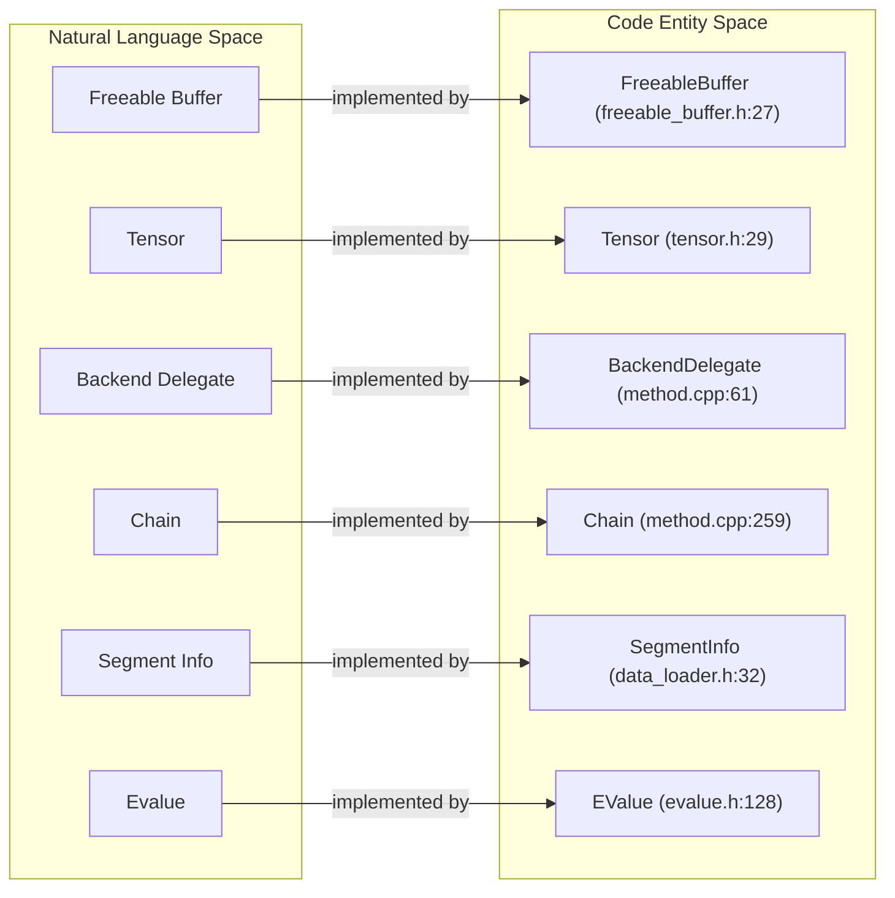
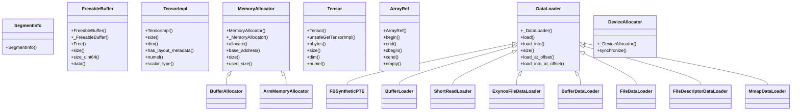
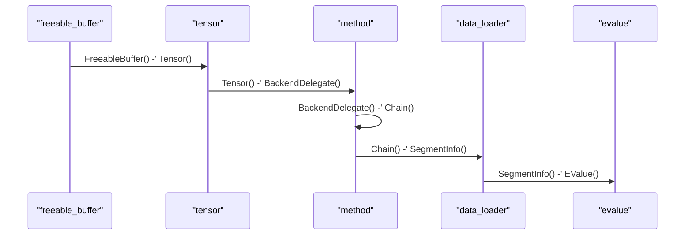

# Core Runtime Architecture

↑ [[8-runtime-execution|Runtime Execution]]

> Architectural specification and implementation reference for Core Runtime Architecture (38 relevant source files). Primary code entities: `ET_CHECK_MSG`, `execute`, `execute_instruction`, `experimental_reset_execution`, `ArrayRef`.

<details>
<summary>Relevant source files</summary>

The following files were used as context for generating this wiki page:

- [runtime/executor/method.cpp](runtime/executor/method.cpp)
- [runtime/core/array_ref.h](runtime/core/array_ref.h)
- [runtime/core/result.h](runtime/core/result.h)
- [runtime/core/portable_type/tensor.h](runtime/core/portable_type/tensor.h)
- [runtime/core/evalue.h](runtime/core/evalue.h)
- [runtime/executor/method_meta.cpp](runtime/executor/method_meta.cpp)
- [extension/data_loader/file_data_loader.cpp](extension/data_loader/file_data_loader.cpp)
- [runtime/core/tensor_layout.h](runtime/core/tensor_layout.h)
- [runtime/executor/memory_manager.h](runtime/executor/memory_manager.h)
- [runtime/executor/method_meta.h](runtime/executor/method_meta.h)
- [runtime/executor/platform_memory_allocator.h](runtime/executor/platform_memory_allocator.h)
- [runtime/executor/method.h](runtime/executor/method.h)
- [runtime/core/data_loader.h](runtime/core/data_loader.h)
- [runtime/core/freeable_buffer.h](runtime/core/freeable_buffer.h)
- [runtime/executor/program.h](runtime/executor/program.h)
- [runtime/executor/pte_data_map.h](runtime/executor/pte_data_map.h)
- [runtime/executor/tensor_parser_exec_aten.cpp](runtime/executor/tensor_parser_exec_aten.cpp)
- [runtime/core/exec_aten/util/scalar_type_util.h](runtime/core/exec_aten/util/scalar_type_util.h)
- [runtime/core/portable_type/tensor_impl.h](runtime/core/portable_type/tensor_impl.h)
- [runtime/executor/program.cpp](runtime/executor/program.cpp)
- [runtime/executor/tensor_parser.h](runtime/executor/tensor_parser.h)
- [runtime/executor/tensor_parser_aten.cpp](runtime/executor/tensor_parser_aten.cpp)
- [runtime/core/event_tracer.h](runtime/core/event_tracer.h)
- [runtime/core/memory_allocator.h](runtime/core/memory_allocator.h)
- [runtime/core/event_tracer_hooks.h](runtime/core/event_tracer_hooks.h)
- [runtime/core/device_allocator.h](runtime/core/device_allocator.h)
- [runtime/core/device_memory_buffer.h](runtime/core/device_memory_buffer.h)
- [runtime/platform/runtime.cpp](runtime/platform/runtime.cpp)
- [docs/source/runtime-overview.md](docs/source/runtime-overview.md)
- [extension/flat_tensor/README.md](extension/flat_tensor/README.md)
- [runtime/core/exec_aten/util/README.md](runtime/core/exec_aten/util/README.md)
- [runtime/core/portable_type/c10/README.md](runtime/core/portable_type/c10/README.md)
- [runtime/executor/BUCK](runtime/executor/BUCK)
- [runtime/core/BUCK](runtime/core/BUCK)
- [runtime/core/exec_aten/BUCK](runtime/core/exec_aten/BUCK)

</details>

## Purpose and Scope

Architectural specification and implementation reference for Core Runtime Architecture (38 relevant source files). Primary code entities: `ET_CHECK_MSG`, `execute`, `execute_instruction`, `experimental_reset_execution`, `ArrayRef`.

Primary code entities analyzed on this page include `FreeableBuffer` ([runtime/core/freeable_buffer.h:27-270]()), `Tensor` ([runtime/core/portable_type/tensor.h:29-178]()), `BackendDelegate` ([runtime/executor/method.cpp:61-254]()), `Chain` ([runtime/executor/method.cpp:259-267]()), `SegmentInfo` ([runtime/core/data_loader.h:32-80]()).

For the parent architectural layer, see [[8-runtime-execution|Runtime Execution]]. Related sibling subsystems: [[8.2-kernel-registration-and-dispatch|Kernel Registration and Dispatch]], [[8.3-developer-tools-devtools|Developer Tools (DevTools: ETDump, ETRecord, Inspector)]].

Sources: [runtime/core/freeable_buffer.h:27-270](), [runtime/core/portable_type/tensor.h:29-178](), [runtime/executor/method.cpp:61-254](), [runtime/executor/method.cpp:259-267]()

---

## 1. High-Level Architecture and Data Flow

### Natural Language Space to Code Entity Space Mapping

The following diagram maps domain concepts in this subsystem to their concrete code entities:



### Subsystem Component & Dependency Flow

```mermaid
flowchart TD
  subgraph sub_this["Core Runtime Architecture"]
    subgraph sg_0["runtime"]
      n_runtime_executor["executor/"]
      n_runtime_core["core/"]
      n_runtime_platform["platform/"]
    end
    subgraph sg_1["runtime/core"]
      n_runtime_core_portable_type["portable_type/"]
      n_runtime_core_exec_aten["exec_aten/"]
    end
    subgraph sg_2["extension"]
      n_extension_data_loader["data_loader/"]
      n_extension_flat_tensor["flat_tensor/"]
    end
    subgraph sg_3["runtime/core/exec_aten"]
      n_runtime_core_exec_aten_util["util/"]
    end
    subgraph sg_4["runtime/core/portable_type"]
      n_runtime_core_portable_type_c10["c10/"]
    end
  end
  n_page_2_build_system_and_infrastructure(["Build System and Infrastructure"])
  n_page_5_7_cuda_aoti_and_apple_metal_backends(["CUDA / AOTI and Apple Metal Backends"])
  n_page_6_model_export_and_llm_support(["Model Export and LLM Support"])
  n_page_9_mobile_and_platform_extensions(["Mobile and Platform Extensions"])
  n_extension_data_loader -.-> n_page_2_build_system_and_infrastructure
  n_runtime_core -.-> n_page_9_mobile_and_platform_extensions
  n_runtime_core -.-> n_page_2_build_system_and_infrastructure
  n_runtime_executor -.-> n_page_2_build_system_and_infrastructure
  n_runtime_executor -.-> n_page_9_mobile_and_platform_extensions
  n_runtime_core -.-> n_page_6_model_export_and_llm_support
  n_runtime_executor -.-> n_page_5_7_cuda_aoti_and_apple_metal_backends
  n_runtime_executor -.-> n_page_6_model_export_and_llm_support
  n_runtime_core -.-> n_page_5_7_cuda_aoti_and_apple_metal_backends
  n_runtime_core_portable_type -.-> n_page_9_mobile_and_platform_extensions
  n_runtime_core_portable_type -.-> n_page_6_model_export_and_llm_support
  n_extension_data_loader -.-> n_page_9_mobile_and_platform_extensions
  n_runtime_core_portable_type -.-> n_page_2_build_system_and_infrastructure
  n_runtime_core_exec_aten_util -.-> n_page_2_build_system_and_infrastructure
```



Cross-subsystem call and import edges connect **Core Runtime Architecture** with [[2.4-python-bindings-and-dependencies|Python Bindings and Dependencies]] (coupling `176.0`), [[2-build-system-and-infrastructure|Build System and Infrastructure]] (coupling `174.0`), [[9-mobile-and-platform-extensions|Mobile and Platform Extensions]] (coupling `161.0`), [[9.4-embedded-and-web-targets|Embedded (Zephyr, ESP32, Pico2) and WebAssembly/WebGPU Targets]] (coupling `107.0`), [[9.3-high-level-module-and-on-device-training|High-Level Module API, Tensor & On-Device Training]] (coupling `90.0`).

| Module Directory | Files | Primary Code Entities | Source Citations |
|---|---|---|---|
| `runtime/executor` | 13 | `BackendDelegate`, `Chain`, `MemoryManager`, `MethodMeta` | [runtime/executor/method.cpp:61-254]() [runtime/executor/method.cpp:259-267]() |
| `runtime/core` | 12 | `FreeableBuffer`, `SegmentInfo`, `EValue`, `TensorLayout` | [runtime/core/freeable_buffer.h:27-270]() [runtime/core/data_loader.h:32-80]() |
| `extension/data_loader` | 3 | `size`, `from`, `is_power_of_2`, `FreeSegment` | [extension/data_loader/file_data_loader.cpp:197-204]() [extension/data_loader/file_data_loader.cpp:93-142]() |
| `extension/flat_tensor` | 2 | *(build / config)* | [extension/flat_tensor/README.md]() |
| `runtime/core/exec_aten/util` | 2 | `can_cast`, `is_barebones_unsigned_type`, `is_bits_type`, `is_complex_type` | [runtime/core/exec_aten/util/scalar_type_util.h:668-672]() [runtime/core/exec_aten/util/scalar_type_util.h:545-548]() |
| `runtime/core/portable_type` | 2 | `Tensor`, `TensorImpl`, `const_data_ptr`, `mutable_data_ptr` | [runtime/core/portable_type/tensor.h:29-178]() [runtime/core/portable_type/tensor_impl.h:60-302]() |
| `runtime/core/exec_aten` | 1 | *(build / config)* | [runtime/core/exec_aten/BUCK]() |
| `runtime/core/portable_type/c10` | 1 | *(build / config)* | [runtime/core/portable_type/c10/README.md]() |

Sources: [runtime/core/freeable_buffer.h:27-270](), [runtime/core/portable_type/tensor.h:29-178](), [runtime/executor/method.cpp:61-254](), [runtime/executor/method.cpp:259-267](), [runtime/core/data_loader.h:32-80]()

---

## 2. Core Data Structures and Implementation Details

### Class and Entity Relationship Diagram



### `FreeableBuffer` (Class)

- **Source Location**: [runtime/core/freeable_buffer.h:27-270]()
- **Declaration**: `Class FreeableBuffer`
- **Graph Centrality**: fan-in `6` callers, fan-out `0` callees
- **Responsibility**: /** * A read-only buffer than can be freed. */

```cpp
// runtime/core/freeable_buffer.h:27-42
class FreeableBuffer final {
 public:
  // Callback signature for the function that does the freeing.
  using FreeFn = void (*)(void* context, void* data, size_t size);
  using FreeUInt64SizeFn =
      void (*)(void* context, uint64_t data_uint64, uint64_t size);
  /// DEPRECATED: Use FreeUInt64SizeFn instead.
  using FreeUInt64Fn ET_DEPRECATED =
      void (*)(void* context, uint64_t data_uint64, size_t size);

 private:
  using LegacyFreeUInt64Fn =
      void (*)(void* context, uint64_t data_uint64, size_t size);

  // Forward declare types.
  struct PointerData {
```

### `Tensor` (Class)

- **Source Location**: [runtime/core/portable_type/tensor.h:29-178]()
- **Declaration**: `Class Tensor`
- **Graph Centrality**: fan-in `1` callers, fan-out `0` callees
- **Responsibility**: /** * A minimal Tensor type whose API is a source compatible subset of at::Tensor. * * NOTE: Instances of this class do not own the TensorImpl given to it, * which means that the caller must guarantee that the TensorImpl lives longer * than any Tensor instances that point to it. * * See the documention on TensorImpl fo

```cpp
// runtime/core/portable_type/tensor.h:29-44
class Tensor {
 public:
  /// The type used for elements of `sizes()`.
  using SizesType = TensorImpl::SizesType;
  /// The type used for elements of `dim_order()`.
  using DimOrderType = TensorImpl::DimOrderType;
  /// The type used for elements of `strides()`.
  using StridesType = TensorImpl::StridesType;

  Tensor() = delete;
  explicit constexpr Tensor(TensorImpl* impl) : impl_(impl) {}

  /**
   * Returns a pointer to the underlying TensorImpl.
   *
   * NOTE: Clients should be wary of operating on the TensorImpl
```

### `BackendDelegate` (Class)

- **Source Location**: [runtime/executor/method.cpp:61-254]()
- **Declaration**: `Class BackendDelegate`
- **Graph Centrality**: fan-in `0` callers, fan-out `0` callees
- **Responsibility**: /** * Runtime state for a backend delegate. */

```cpp
// runtime/executor/method.cpp:61-76
class BackendDelegate final {
 public:
  /**
   * Initializes an already-allocated BackendDelegate from its serialized
   * representation.
   *
   * @param[in] delegate The serialized backend delegate to load.
   * @param[in] program The serialized program to load from.
   * @param[in] backend_init_context The context pointer to pass to the
   *     backend's init() method.
   * @param[out] out The BackendDelegate to initialize.
   *
   * @returns Error::Ok if the initialization succeeded, or an error otherwise.
   */
  static Error Init(
      const executorch_flatbuffer::BackendDelegate& delegate,
```

### `Chain` (Class)

- **Source Location**: [runtime/executor/method.cpp:259-267]()
- **Declaration**: `Class Chain`
- **Graph Centrality**: fan-in `0` callers, fan-out `0` callees
- **Responsibility**: /** * Runtime state for a chain of instructions. */

### `SegmentInfo` (Class)

- **Source Location**: [runtime/core/data_loader.h:32-80]()
- **Declaration**: `Class SegmentInfo`
- **Graph Centrality**: fan-in `7` callers, fan-out `0` callees

### `back` (Method)

- **Source Location**: [runtime/core/array_ref.h:143-147]()
- **Declaration**: `()`
- **Graph Centrality**: fan-in `199` callers, fan-out `0` callees
- **Responsibility**: /// back - Get the last element.

Sources: [runtime/core/freeable_buffer.h:27-270](), [runtime/core/portable_type/tensor.h:29-178](), [runtime/executor/method.cpp:61-254](), [runtime/executor/method.cpp:259-267](), [runtime/core/data_loader.h:32-80]()

---

## 3. Execution and Call Flow

The sequence diagram below traces the runtime/compile-time call chain across components in this module:



Sources: [runtime/core/freeable_buffer.h:27-270](), [runtime/core/portable_type/tensor.h:29-178](), [runtime/executor/method.cpp:61-254](), [runtime/executor/method.cpp:259-267](), [runtime/core/data_loader.h:32-80]()

---

## 4. Key API and Symbol Reference

| Code Entity | Kind | Location | Fan-In / Out | Role & Signature |
|---|---|---|---|---|
| `FreeableBuffer` | Class | [runtime/core/freeable_buffer.h:27-270]() | `6` / `0` | /** |
| `Tensor` | Class | [runtime/core/portable_type/tensor.h:29-178]() | `1` / `0` | /** |
| `BackendDelegate` | Class | [runtime/executor/method.cpp:61-254]() | `0` / `0` | /** |
| `Chain` | Class | [runtime/executor/method.cpp:259-267]() | `0` / `0` | /** |
| `SegmentInfo` | Class | [runtime/core/data_loader.h:32-80]() | `7` / `0` | — |
| `EValue` | Class | [runtime/core/evalue.h:128-705]() | `0` / `0` | // Aggregate typing system similar to IValue only slimmed down with less |
| `TensorLayout` | Class | [runtime/core/tensor_layout.h:22-90]() | `0` / `0` | /** |
| `MemoryManager` | Class | [runtime/executor/memory_manager.h:32-138]() | `0` / `0` | /** |
| `MethodMeta` | Class | [runtime/executor/method_meta.h:155-326]() | `0` / `0` | /** |
| `TensorInfo` | Class | [runtime/executor/method_meta.h:36-146]() | `0` / `0` | /** |
| `TensorImpl` | Class | [runtime/core/portable_type/tensor_impl.h:60-302]() | `2` / `0` | /** |
| `Method` | Class | [runtime/executor/method.h:63-451]() | `0` / `0` | /** |
| `PlatformMemoryAllocator` | Class | [runtime/executor/platform_memory_allocator.h:30-121]() | `0` / `0` | /** |
| `DataLoader` | Class | [runtime/core/data_loader.h:27-195]() | `0` / `0` | /** |
| `Program` | Class | [runtime/executor/program.h:48-354]() | `0` / `0` | /** |
| `PteDataMap` | Class | [runtime/executor/pte_data_map.h:56-147]() | `0` / `0` | /** |
| `TensorParser` | Class | [runtime/executor/tensor_parser_exec_aten.cpp:25-45]() | `0` / `0` | // Provides access to private Program methods. |
| `MemoryAllocator` | Class | [runtime/core/memory_allocator.h:38-238]() | `1` / `0` | /** |
| `ArrayRef` | Class | [runtime/core/array_ref.h:58-190]() | `0` / `0` | — |
| `NamedData` | Class | [runtime/executor/tensor_parser.h:31-34]() | `0` / `0` | /// Data structure to hold key and data buffer for external data used |
| `DeviceTypeMapping` | Class | [runtime/executor/tensor_parser_aten.cpp:36-39]() | `0` / `0` | // Maps a serialized DeviceType to its ATen counterpart. Kept as a table so |
| `EventTracer` | Class | [runtime/core/event_tracer.h:164-569]() | `0` / `0` | /** |

Sources: [runtime/core/freeable_buffer.h:27-270](), [runtime/core/portable_type/tensor.h:29-178](), [runtime/executor/method.cpp:61-254](), [runtime/executor/method.cpp:259-267](), [runtime/core/data_loader.h:32-80](), [runtime/core/evalue.h:128-705]()

---

## 5. Official Documentation and Design Context

The following linked documentation sections from `llm-wiki` (`raw/`) provide additional architectural context, tutorials, and design invariants for this subsystem:

- **Runtime Execution** ([wiki/8-runtime-execution.md](), score `111.7137`) (sections: `Runtime Execution`, `Purpose and Scope`, `System Mapping: Natural Language Space to Code Entity Space`, `1. Core Runtime Architecture`): # Runtime Execution > Architectural specification and implementation reference for Runtime Execution (39 relevant source files). Primary code entities: `ET_CHECK_MSG`, `execute`, `execute_instruction`, `experimental_reset_execution`, `ArrayRef`. <details> <summary>Relevant source files</summary> The following files were used as context for generating this wiki page: - [runtime/executor/method.cpp](runtime/executor/me
- **ExecuTorch DeepWiki** ([wiki/index.md](), score `87.5116`) (sections: `ExecuTorch DeepWiki`, `Pages`): # ExecuTorch DeepWiki Generated from `home-jason-Project-deepwiki-executorch` at commit `b3b565b5b62f` (2026-11-15T15:02:11+00:00). ## Pages - [[1-overview|Overview]] — Architectural specification and implementation reference for Overview (10 relevant source files). Primary code entities: `Module`, `MethodHolder`, `PlannedMemory`, `EdgeProgramManager`, `__init__`. - [[1.1-getting-started|Getting Started]] — Architect
- **Developer Tools (DevTools: ETDump, ETRecord, Inspector)** ([wiki/8.3-developer-tools-devtools.md](), score `57.273`) (sections: `Developer Tools (DevTools: ETDump, ETRecord, Inspector)`, `Purpose and Scope`, `1. High-Level Architecture and Data Flow`, `Natural Language Space to Code Entity Space Mapping`): # Developer Tools (DevTools: ETDump, ETRecord, Inspector) ↑ [[8-runtime-execution|Runtime Execution]] > Architectural specification and implementation reference for Developer Tools (DevTools: ETDump, ETRecord, Inspector) (38 relevant source files). Primary code entities: `DelegatePartitionProvenance`, `__hash__`, `ETRecord`, `__init__`, `ETDumpGen`. <details> <summary>Relevant source files</summary> The following fil
- **Getting Started** ([wiki/1.1-getting-started.md](), score `56.0944`) (sections: `Getting Started`, `Purpose and Scope`, `1. High-Level Architecture and Data Flow`, `Natural Language Space to Code Entity Space Mapping`): # Getting Started ↑ [[1-overview|Overview]] > Architectural specification and implementation reference for Getting Started (22 relevant source files). Primary code entities: `cu134_requirements`, `get_torch_url`, `get_torchao_version`, `install_optional_example_requirements`, `EventTraceManager`. <details> <summary>Relevant source files</summary> The following files were used as context for generating this wiki page:

Sources: [wiki/8-runtime-execution.md](), [wiki/index.md](), [wiki/8.3-developer-tools-devtools.md](), [wiki/1.1-getting-started.md]()

## Related pages

- [[8-runtime-execution|Runtime Execution]]
- [[1.2-export-api-and-recipe-system|Export API and Recipe System]]
- [[2.3-schema-generation-and-flatbuffers|Schema Generation and FlatBuffers]]
- [[3-exir-core-system|EXIR Core System]]
- [[3.1-program-structure-and-compilation-flow|Program Structure and Compilation Flow]]
- [[3.2-graph-transformation-pass-system|Graph Transformation Pass System]]
- [[3.3-memory-planning-and-allocation|Memory Planning and Allocation]]
- [[3.4-program-emission-and-serialization|Program Emission and Serialization]]

## Related documents

- `wiki/8-runtime-execution.md` — Runtime Execution (score 111.7137, via bm25)
- `wiki/index.md` — ExecuTorch DeepWiki (score 87.5116, via bm25)
- `wiki/8.3-developer-tools-devtools.md` — Developer Tools (DevTools: ETDump, ETRecord, Inspector) (score 57.273, via bm25)
- `wiki/1.1-getting-started.md` — Getting Started (score 56.0944, via bm25)
- `wiki/5.2-vulkan-gpu-backend.md` — Vulkan GPU Backend (score 53.2153, via bm25)

## Sources

- [`runtime/executor/method.cpp`](https://github.com/pytorch/executorch/blob/main/runtime/executor/method.cpp)
- [`runtime/core/array_ref.h`](https://github.com/pytorch/executorch/blob/main/runtime/core/array_ref.h)
- [`runtime/core/result.h`](https://github.com/pytorch/executorch/blob/main/runtime/core/result.h)
- [`runtime/core/portable_type/tensor.h`](https://github.com/pytorch/executorch/blob/main/runtime/core/portable_type/tensor.h)
- [`runtime/core/evalue.h`](https://github.com/pytorch/executorch/blob/main/runtime/core/evalue.h)
- [`runtime/executor/method_meta.cpp`](https://github.com/pytorch/executorch/blob/main/runtime/executor/method_meta.cpp)
- [`extension/data_loader/file_data_loader.cpp`](https://github.com/pytorch/executorch/blob/main/extension/data_loader/file_data_loader.cpp)
- [`runtime/core/tensor_layout.h`](https://github.com/pytorch/executorch/blob/main/runtime/core/tensor_layout.h)
- [`runtime/executor/memory_manager.h`](https://github.com/pytorch/executorch/blob/main/runtime/executor/memory_manager.h)
- [`runtime/executor/method_meta.h`](https://github.com/pytorch/executorch/blob/main/runtime/executor/method_meta.h)
- [`runtime/executor/platform_memory_allocator.h`](https://github.com/pytorch/executorch/blob/main/runtime/executor/platform_memory_allocator.h)
- [`runtime/executor/method.h`](https://github.com/pytorch/executorch/blob/main/runtime/executor/method.h)
- [`runtime/core/data_loader.h`](https://github.com/pytorch/executorch/blob/main/runtime/core/data_loader.h)
- [`runtime/core/freeable_buffer.h`](https://github.com/pytorch/executorch/blob/main/runtime/core/freeable_buffer.h)
- [`runtime/executor/program.h`](https://github.com/pytorch/executorch/blob/main/runtime/executor/program.h)
- [`runtime/executor/pte_data_map.h`](https://github.com/pytorch/executorch/blob/main/runtime/executor/pte_data_map.h)
- [`runtime/executor/tensor_parser_exec_aten.cpp`](https://github.com/pytorch/executorch/blob/main/runtime/executor/tensor_parser_exec_aten.cpp)
- [`runtime/core/exec_aten/util/scalar_type_util.h`](https://github.com/pytorch/executorch/blob/main/runtime/core/exec_aten/util/scalar_type_util.h)
- [`runtime/core/portable_type/tensor_impl.h`](https://github.com/pytorch/executorch/blob/main/runtime/core/portable_type/tensor_impl.h)
- [`runtime/executor/program.cpp`](https://github.com/pytorch/executorch/blob/main/runtime/executor/program.cpp)
- [`runtime/executor/tensor_parser.h`](https://github.com/pytorch/executorch/blob/main/runtime/executor/tensor_parser.h)
- [`runtime/executor/tensor_parser_aten.cpp`](https://github.com/pytorch/executorch/blob/main/runtime/executor/tensor_parser_aten.cpp)
- [`runtime/core/event_tracer.h`](https://github.com/pytorch/executorch/blob/main/runtime/core/event_tracer.h)
- [`runtime/core/memory_allocator.h`](https://github.com/pytorch/executorch/blob/main/runtime/core/memory_allocator.h)
- [`runtime/core/event_tracer_hooks.h`](https://github.com/pytorch/executorch/blob/main/runtime/core/event_tracer_hooks.h)
- [`runtime/core/device_allocator.h`](https://github.com/pytorch/executorch/blob/main/runtime/core/device_allocator.h)
- [`runtime/core/device_memory_buffer.h`](https://github.com/pytorch/executorch/blob/main/runtime/core/device_memory_buffer.h)
- [`runtime/platform/runtime.cpp`](https://github.com/pytorch/executorch/blob/main/runtime/platform/runtime.cpp)
- [`docs/source/runtime-overview.md`](https://github.com/pytorch/executorch/blob/main/docs/source/runtime-overview.md)
- [`extension/flat_tensor/README.md`](https://github.com/pytorch/executorch/blob/main/extension/flat_tensor/README.md)
- [`runtime/core/exec_aten/util/README.md`](https://github.com/pytorch/executorch/blob/main/runtime/core/exec_aten/util/README.md)
- [`runtime/core/portable_type/c10/README.md`](https://github.com/pytorch/executorch/blob/main/runtime/core/portable_type/c10/README.md)
- [`runtime/executor/BUCK`](https://github.com/pytorch/executorch/blob/main/runtime/executor/BUCK)
- [`runtime/core/BUCK`](https://github.com/pytorch/executorch/blob/main/runtime/core/BUCK)
- [`runtime/core/exec_aten/BUCK`](https://github.com/pytorch/executorch/blob/main/runtime/core/exec_aten/BUCK)
- [`extension/data_loader/BUCK`](https://github.com/pytorch/executorch/blob/main/extension/data_loader/BUCK)
- [`extension/data_loader/CMakeLists.txt`](https://github.com/pytorch/executorch/blob/main/extension/data_loader/CMakeLists.txt)
- [`extension/flat_tensor/BUCK`](https://github.com/pytorch/executorch/blob/main/extension/flat_tensor/BUCK)


## Dynamic Knowledge Links (Code Graph ↔ LLM-Wiki / RAG)

### Linked Architecture & Design Documents

| Document | Match Channel | Score | Shared Code Symbols |
|---|---|---|---|
| [[8-runtime-execution|Runtime Execution]] | `bm25+entity(6)` | `120.714` | `EValue`, `FreeableBuffer`, `MemoryAllocator`, `SegmentInfo`, `Tensor` |
| [[index|ExecuTorch DeepWiki]] | `bm25` | `87.512` | *(lexical/graph match)* |
| [[8.2-kernel-registration-and-dispatch|Kernel Registration and Dispatch]] | `wikilink:8.1-core-runtime-architecture+entity(2)` | `62.472` | `MemoryAllocator`, `Tensor` |
| [[2.4-python-bindings-and-dependencies|Python Bindings and Dependencies]] | `wikilink:8.1-core-runtime-architecture+entity(1)` | `60.972` | `Tensor` |
| [[2-build-system-and-infrastructure|Build System and Infrastructure]] | `wikilink:8.1-core-runtime-architecture+entity(1)` | `60.972` | `Tensor` |
| [[1.1-getting-started|Getting Started]] | `bm25+entity(2)` | `59.094` | `ArrayRef`, `Tensor` |

### High-Centrality Bridge Symbols (CBM Graph)

| Symbol | Kind | Source Location | Fan-In / Fan-Out |
|---|---|---|---|
| `FreeableBuffer` | Class | [runtime/core/freeable_buffer.h:27-270]() | in: `6` / out: `0` |
| `Tensor` | Class | [runtime/core/portable_type/tensor.h:29-178]() | in: `1` / out: `0` |
| `BackendDelegate` | Class | [runtime/executor/method.cpp:61-254]() | in: `0` / out: `0` |
| `Chain` | Class | [runtime/executor/method.cpp:259-267]() | in: `0` / out: `0` |
| `SegmentInfo` | Class | [runtime/core/data_loader.h:32-80]() | in: `7` / out: `0` |
| `EValue` | Class | [runtime/core/evalue.h:128-705]() | in: `0` / out: `0` |

Sources: [runtime/core/freeable_buffer.h:27-270](), [runtime/core/portable_type/tensor.h:29-178](), [runtime/executor/method.cpp:61-254](), [runtime/executor/method.cpp:259-267]()

### Cross-Subsystem Coupling

- [[2.4-python-bindings-and-dependencies|Python Bindings and Dependencies]] — call/import coupling weight `176.0`
- [[2-build-system-and-infrastructure|Build System and Infrastructure]] — call/import coupling weight `174.0`
- [[9-mobile-and-platform-extensions|Mobile and Platform Extensions]] — call/import coupling weight `161.0`
- [[9.4-embedded-and-web-targets|Embedded (Zephyr, ESP32, Pico2) and WebAssembly/WebGPU Targets]] — call/import coupling weight `107.0`
- [[9.3-high-level-module-and-on-device-training|High-Level Module API, Tensor & On-Device Training]] — call/import coupling weight `90.0`
- [[6-model-export-and-llm-support|Model Export and LLM Support]] — call/import coupling weight `88.0`
