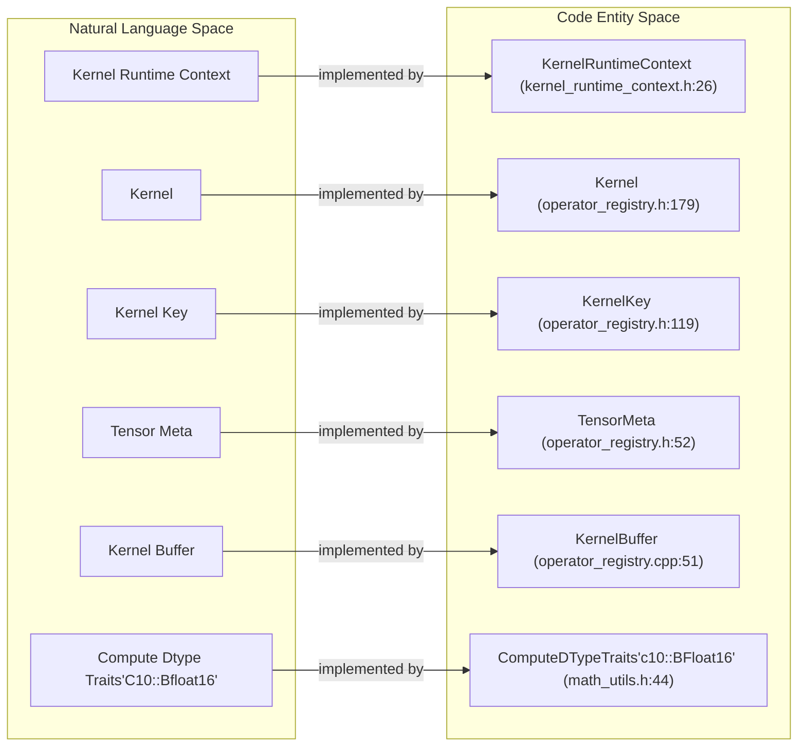
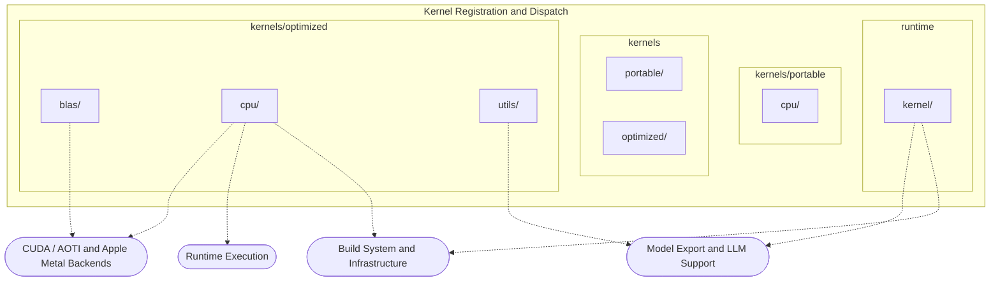
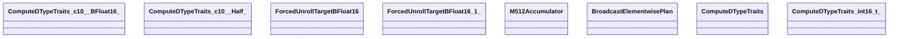
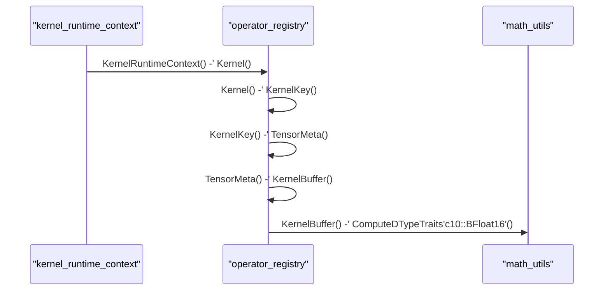

# Kernel Registration and Dispatch

↑ [[8-runtime-execution|Runtime Execution]]

> Architectural specification and implementation reference for Kernel Registration and Dispatch (36 relevant source files). Primary code entities: `KernelRuntimeContext`, `allocate_temp`, `fail`, `Kernel`, `KernelKey`.

<details>
<summary>Relevant source files</summary>

The following files were used as context for generating this wiki page:

- [runtime/kernel/kernel_runtime_context.h](runtime/kernel/kernel_runtime_context.h)
- [runtime/kernel/operator_registry.h](runtime/kernel/operator_registry.h)
- [runtime/kernel/operator_registry.cpp](runtime/kernel/operator_registry.cpp)
- [runtime/kernel/kernel_includes.h](runtime/kernel/kernel_includes.h)
- [runtime/kernel/thread_parallel_interface.h](runtime/kernel/thread_parallel_interface.h)
- [runtime/kernel/targets.bzl](runtime/kernel/targets.bzl)
- [kernels/portable/cpu/scalar_utils.h](kernels/portable/cpu/scalar_utils.h)
- [kernels/portable/__init__.py](kernels/portable/__init__.py)
- [kernels/optimized/blas/BlasKernel.cpp](kernels/optimized/blas/BlasKernel.cpp)
- [kernels/portable/cpu/op__adaptive_avg_pool2d.cpp](kernels/portable/cpu/op__adaptive_avg_pool2d.cpp)
- [kernels/portable/cpu/op__device_copy.cpp](kernels/portable/cpu/op__device_copy.cpp)
- [kernels/portable/cpu/math_constants.h](kernels/portable/cpu/math_constants.h)
- [kernels/portable/cpu/op__clone_dim_order.cpp](kernels/portable/cpu/op__clone_dim_order.cpp)
- [kernels/portable/cpu/op__conj_physical.cpp](kernels/portable/cpu/op__conj_physical.cpp)
- [kernels/portable/cpu/op__empty_dim_order.cpp](kernels/portable/cpu/op__empty_dim_order.cpp)
- [kernels/portable/cpu/op__to_dim_order_copy.cpp](kernels/portable/cpu/op__to_dim_order_copy.cpp)
- [kernels/portable/cpu/op_abs.cpp](kernels/portable/cpu/op_abs.cpp)
- [kernels/portable/cpu/op_acos.cpp](kernels/portable/cpu/op_acos.cpp)
- [kernels/portable/cpu/op_add.cpp](kernels/portable/cpu/op_add.cpp)
- [kernels/portable/cpu/op_acosh.cpp](kernels/portable/cpu/op_acosh.cpp)
- [kernels/optimized/cpu/binary_ops.h](kernels/optimized/cpu/binary_ops.h)
- [kernels/optimized/utils/math_utils.h](kernels/optimized/utils/math_utils.h)
- [kernels/portable/cpu/op_addmm.cpp](kernels/portable/cpu/op_addmm.cpp)
- [kernels/portable/cpu/op_allclose.cpp](kernels/portable/cpu/op_allclose.cpp)
- [kernels/portable/cpu/op_alias_copy.cpp](kernels/portable/cpu/op_alias_copy.cpp)
- [kernels/portable/cpu/op_amax.cpp](kernels/portable/cpu/op_amax.cpp)
- [kernels/portable/cpu/op_any.cpp](kernels/portable/cpu/op_any.cpp)
- [kernels/portable/cpu/op_amin.cpp](kernels/portable/cpu/op_amin.cpp)
- [kernels/portable/README.md](kernels/portable/README.md)
- [docs/source/kernel-library-overview.md](docs/source/kernel-library-overview.md)
- [runtime/kernel/BUCK](runtime/kernel/BUCK)
- [kernels/portable/BUCK](kernels/portable/BUCK)
- [kernels/portable/CMakeLists.txt](kernels/portable/CMakeLists.txt)
- [kernels/portable/cpu/BUCK](kernels/portable/cpu/BUCK)
- [kernels/optimized/BUCK](kernels/optimized/BUCK)

</details>

## Purpose and Scope

Architectural specification and implementation reference for Kernel Registration and Dispatch (36 relevant source files). Primary code entities: `KernelRuntimeContext`, `allocate_temp`, `fail`, `Kernel`, `KernelKey`.

Primary code entities analyzed on this page include `KernelRuntimeContext` ([runtime/kernel/kernel_runtime_context.h:26-108]()), `Kernel` ([runtime/kernel/operator_registry.h:179-198]()), `KernelKey` ([runtime/kernel/operator_registry.h:119-171]()), `TensorMeta` ([runtime/kernel/operator_registry.h:52-95]()), `KernelBuffer` ([runtime/kernel/operator_registry.cpp:51-53]()).

For the parent architectural layer, see [[8-runtime-execution|Runtime Execution]]. Related sibling subsystems: [[8.1-core-runtime-architecture|Core Runtime Architecture]], [[8.3-developer-tools-devtools|Developer Tools (DevTools: ETDump, ETRecord, Inspector)]].

Sources: [runtime/kernel/kernel_runtime_context.h:26-108](), [runtime/kernel/operator_registry.h:179-198](), [runtime/kernel/operator_registry.h:119-171](), [runtime/kernel/operator_registry.h:52-95]()

---

## 1. High-Level Architecture and Data Flow

### Natural Language Space to Code Entity Space Mapping

The following diagram maps domain concepts in this subsystem to their concrete code entities:



### Subsystem Component & Dependency Flow



Cross-subsystem call and import edges connect **Kernel Registration and Dispatch** with [[5.7-cuda-aoti-and-apple-metal-backends|CUDA / AOTI and Apple Metal Backends]] (coupling `6.0`), [[6-model-export-and-llm-support|Model Export and LLM Support]] (coupling `4.0`), [[6.3-custom-operators-and-extensions|Custom Operators and Extensions]] (coupling `4.0`), [[8-runtime-execution|Runtime Execution]] (coupling `4.0`), [[8.1-core-runtime-architecture|Core Runtime Architecture]] (coupling `4.0`).

| Module Directory | Files | Primary Code Entities | Source Citations |
|---|---|---|---|
| `kernels/portable/cpu` | 19 | `promote_type_with_scalar_type`, `get_scalar_dtype`, `extract_scalar`, `promote_type_with_scalar` | [kernels/portable/cpu/scalar_utils.h:84-126]() [kernels/portable/cpu/scalar_utils.h:56-67]() |
| `runtime/kernel` | 7 | `KernelRuntimeContext`, `Kernel`, `KernelKey`, `TensorMeta` | [runtime/kernel/kernel_runtime_context.h:26-108]() [runtime/kernel/operator_registry.h:179-198]() |
| `kernels/portable` | 4 | *(build / config)* | [kernels/portable/__init__.py]() |
| `kernels/optimized` | 2 | *(build / config)* | [kernels/optimized/BUCK]() |
| `kernels/optimized/blas` | 1 | `M512Accumulator`, `ForcedUnrollTargetBFloat16`, `ForcedUnrollTargetBFloat16<1>`, `reduce` | [kernels/optimized/blas/BlasKernel.cpp:688-690]() [kernels/optimized/blas/BlasKernel.cpp:258-265]() |
| `kernels/optimized/cpu` | 1 | `BroadcastElementwisePlan`, `get_broadcast_dim`, `select_optimized_path`, `handle_broadcast_elementwise` | [kernels/optimized/cpu/binary_ops.h:212-218]() [kernels/optimized/cpu/binary_ops.h:49-89]() |
| `kernels/optimized/utils` | 1 | `ComputeDTypeTraits<c10::BFloat16>`, `ComputeDTypeTraits<c10::Half>`, `ComputeDTypeTraits`, `ComputeDTypeTraits<int16_t>` | [kernels/optimized/utils/math_utils.h:44-46]() [kernels/optimized/utils/math_utils.h:48-50]() |

Sources: [runtime/kernel/kernel_runtime_context.h:26-108](), [runtime/kernel/operator_registry.h:179-198](), [runtime/kernel/operator_registry.h:119-171](), [runtime/kernel/operator_registry.h:52-95](), [runtime/kernel/operator_registry.cpp:51-53]()

---

## 2. Core Data Structures and Implementation Details

### Class and Entity Relationship Diagram



### `KernelRuntimeContext` (Class)

- **Source Location**: [runtime/kernel/kernel_runtime_context.h:26-108]()
- **Declaration**: `Class KernelRuntimeContext`
- **Graph Centrality**: fan-in `0` callers, fan-out `0` callees
- **Responsibility**: /** * Runtime state and functionality for kernel implementations. * * NOTE: Will not be passed to operators if running in ATen mode as those * operators do not expect to receive a KernelRuntimeContext argument. */

```cpp
// runtime/kernel/kernel_runtime_context.h:26-41
class KernelRuntimeContext {
 public:
  /**
   * Construct a new kernel runtime context.
   *
   * KernelRuntimeContext does not take ownership
   * of these pointers, so they must outlive the context instance.
   *
   * @param[in] event_tracer The optional EventTracer to use for
   *     profiling/debugging
   * @param[in] temp_allocator The optional MemoryAllocator used to allocate
   *     temporary memory for the kernel. If not provided, an error will be
   *     returned when calling allocate_temp.
   */
  KernelRuntimeContext(
      EventTracer* event_tracer = nullptr,
```

### `Kernel` (Class)

- **Source Location**: [runtime/kernel/operator_registry.h:179-198]()
- **Declaration**: `Class Kernel`
- **Graph Centrality**: fan-in `0` callers, fan-out `0` callees
- **Responsibility**: /** * Struct that bundles a kernel key, a function and an op name together. An * `Operator` may have more than one `Kernel` (maximum kMaxNumOfKernelPerOp) and * they should have the same op name and different kernel key. A "fallback" * kernel may or may not live in an `Operator`. */

```cpp
// runtime/kernel/operator_registry.h:179-194
struct Kernel {
  const char* name_;
  // String representation of kernel key, with the same format as
  // KernelKey.to_string_representation()
  // Data is not owned by the Kernel struct.
  KernelKey kernel_key_;
  OpFunction op_;
  /**
   * We are doing a copy of the string pointer instead of duplicating the string
   * itself, we require the lifetime of the operator name to be at least as long
   * as the operator registry.
   */
  constexpr explicit Kernel(const char* name, OpFunction func)
      : name_(name), op_(func) {}

  constexpr explicit Kernel(const char* name, KernelKey key, OpFunction func)
```

### `KernelKey` (Class)

- **Source Location**: [runtime/kernel/operator_registry.h:119-171]()
- **Declaration**: `Class KernelKey`
- **Graph Centrality**: fan-in `0` callers, fan-out `0` callees
- **Responsibility**: /** * Describes which dtype & dim order specialized kernel to be bound to an * operator. * * Kernel key data is a string with the format: * * "v<version>/<tensor_meta>|<tensor_meta>..." * * The version is v1 for now. If the kernel key format changes, update the * version to avoid breaking pre-existing kernel keys. * * 

```cpp
// runtime/kernel/operator_registry.h:119-134
struct KernelKey {
 public:
  /**
   * Creates a fallback (non-specialized) kernel key: this kernel can be used
   * for all input tensor dtypes and dim orders if the specialized kernel is not
   * registered.
   */
  constexpr KernelKey() = default;

  /**
   * Creates a specialized (non-fallback) kernel key that matches a specific
   * set of input tensor dtypes and dim orders. See the class comment for the
   * expected format of `kernel_key_data`.
   */
  /* implicit */ constexpr KernelKey(const char* kernel_key_data)
      : kernel_key_data_(kernel_key_data) {}
```

### `TensorMeta` (Class)

- **Source Location**: [runtime/kernel/operator_registry.h:52-95]()
- **Declaration**: `Class TensorMeta`
- **Graph Centrality**: fan-in `0` callers, fan-out `0` callees
- **Responsibility**: /** * Dtype and dim order metadata for a Tensor argument to an operator. * Used by the Executor to hold the tensor metadata info and retrieve kernel. */

### `KernelBuffer` (Class)

- **Source Location**: [runtime/kernel/operator_registry.cpp:51-53]()
- **Declaration**: `Class KernelBuffer`
- **Graph Centrality**: fan-in `0` callers, fan-out `0` callees
- **Responsibility**: // Data that backs the kernel table. Since Kernel has a custom default // constructor (implicitly, because it contains KernelKey, which has a custom // ctor), some toolchains don't like having a global array of them: it would // require constructing them at init time. Since we don't care about the values // until we ad

### `fail` (Method)

- **Source Location**: [runtime/kernel/kernel_runtime_context.h:56-58]()
- **Declaration**: `(Error error)`
- **Graph Centrality**: fan-in `25` callers, fan-out `0` callees
- **Responsibility**: /** * Tells the runtime that the kernel call has failed. Prefer this over * ET_CHECK_*(), which fatally panics the process/system. * * If this is not called, the runtime will treat the kernel call as * successful. * * This unusual error-propagation path is required because kernel signatures * do not have a natural way 

Sources: [runtime/kernel/kernel_runtime_context.h:26-108](), [runtime/kernel/operator_registry.h:179-198](), [runtime/kernel/operator_registry.h:119-171](), [runtime/kernel/operator_registry.h:52-95](), [runtime/kernel/operator_registry.cpp:51-53]()

---

## 3. Execution and Call Flow

The sequence diagram below traces the runtime/compile-time call chain across components in this module:



Sources: [runtime/kernel/kernel_runtime_context.h:26-108](), [runtime/kernel/operator_registry.h:179-198](), [runtime/kernel/operator_registry.h:119-171](), [runtime/kernel/operator_registry.h:52-95](), [runtime/kernel/operator_registry.cpp:51-53]()

---

## 4. Key API and Symbol Reference

| Code Entity | Kind | Location | Fan-In / Out | Role & Signature |
|---|---|---|---|---|
| `KernelRuntimeContext` | Class | [runtime/kernel/kernel_runtime_context.h:26-108]() | `0` / `0` | /** |
| `Kernel` | Class | [runtime/kernel/operator_registry.h:179-198]() | `0` / `0` | /** |
| `KernelKey` | Class | [runtime/kernel/operator_registry.h:119-171]() | `0` / `0` | /** |
| `TensorMeta` | Class | [runtime/kernel/operator_registry.h:52-95]() | `0` / `0` | /** |
| `KernelBuffer` | Class | [runtime/kernel/operator_registry.cpp:51-53]() | `0` / `0` | // Data that backs the kernel table. Since Kernel has a custom default |
| `ComputeDTypeTraits<c10::BFloat16>` | Class | [kernels/optimized/utils/math_utils.h:44-46]() | `9` / `0` | — |
| `M512Accumulator` | Class | [kernels/optimized/blas/BlasKernel.cpp:688-690]() | `0` / `0` | // GCC drops vector type attributes on direct std::array<__m512, ...> |
| `ComputeDTypeTraits<c10::Half>` | Class | [kernels/optimized/utils/math_utils.h:48-50]() | `6` / `0` | — |
| `OperatorName` | Class | [runtime/kernel/kernel_includes.h:35-47]() | `0` / `0` | — |
| `promote_type_with_scalar_type` | Class | [kernels/portable/cpu/scalar_utils.h:84-126]() | `0` / `0` | — |
| `ForcedUnrollTargetBFloat16` | Class | [kernels/optimized/blas/BlasKernel.cpp:258-265]() | `0` / `0` | — |
| `ForcedUnrollTargetBFloat16<1>` | Class | [kernels/optimized/blas/BlasKernel.cpp:268-274]() | `0` / `0` | — |
| `BroadcastElementwisePlan` | Class | [kernels/optimized/cpu/binary_ops.h:212-218]() | `0` / `0` | — |
| `ComputeDTypeTraits` | Class | [kernels/optimized/utils/math_utils.h:21-23]() | `0` / `0` | — |
| `ComputeDTypeTraits<int16_t>` | Class | [kernels/optimized/utils/math_utils.h:30-32]() | `0` / `0` | — |
| `ComputeDTypeTraits<int8_t>` | Class | [kernels/optimized/utils/math_utils.h:39-41]() | `0` / `0` | — |
| `ComputeDTypeTraits<uint16_t>` | Class | [kernels/optimized/utils/math_utils.h:26-28]() | `0` / `0` | — |
| `ComputeDTypeTraits<uint8_t>` | Class | [kernels/optimized/utils/math_utils.h:35-37]() | `0` / `0` | — |
| `fail` | Method | [runtime/kernel/kernel_runtime_context.h:56-58]() | `25` / `0` | /** |
| `get_scalar_dtype` | Function | [kernels/portable/cpu/scalar_utils.h:56-67]() | `19` / `0` | /** |
| `extract_scalar` | Function | [kernels/portable/cpu/scalar_utils.h:248-262]() | `17` / `0` | /** |
| `promote_type_with_scalar` | Function | [kernels/portable/cpu/scalar_utils.h:137-171]() | `14` / `0` | /** |

Sources: [runtime/kernel/kernel_runtime_context.h:26-108](), [runtime/kernel/operator_registry.h:179-198](), [runtime/kernel/operator_registry.h:119-171](), [runtime/kernel/operator_registry.h:52-95](), [runtime/kernel/operator_registry.cpp:51-53](), [kernels/optimized/utils/math_utils.h:44-46]()

---

## 5. Official Documentation and Design Context

The following linked documentation sections from `llm-wiki` (`raw/`) provide additional architectural context, tutorials, and design invariants for this subsystem:

- **Kernel Libraries and Selective Build** ([wiki/2.2-kernel-libraries-and-selective-build.md](), score `117.1452`) (sections: `Kernel Libraries and Selective Build`, `Purpose and Scope`, `1. High-Level Architecture and Data Flow`, `Natural Language Space to Code Entity Space Mapping`): # Kernel Libraries and Selective Build ↑ [[2-build-system-and-infrastructure|Build System and Infrastructure]] > Architectural specification and implementation reference for Kernel Libraries and Selective Build (31 relevant source files). Primary code entities: `KernelType`, `ScalarType`, `_dump_yaml`, `_get_et_kernel_metadata_from_ops_yaml`, `IOMetaData`. <details> <summary>Relevant source files</summary> The follow
- **ExecuTorch DeepWiki** ([wiki/index.md](), score `101.2937`) (sections: `ExecuTorch DeepWiki`, `Pages`): # ExecuTorch DeepWiki Generated from `home-jason-Project-deepwiki-executorch` at commit `b3b565b5b62f` (2026-11-15T15:02:11+00:00). ## Pages - [[1-overview|Overview]] — Architectural specification and implementation reference for Overview (10 relevant source files). Primary code entities: `Module`, `MethodHolder`, `PlannedMemory`, `EdgeProgramManager`, `__init__`. - [[1.1-getting-started|Getting Started]] — Architect
- **Runtime Execution** ([wiki/8-runtime-execution.md](), score `100.4866`) (sections: `Runtime Execution`, `Purpose and Scope`, `System Mapping: Natural Language Space to Code Entity Space`, `1. Core Runtime Architecture`): # Runtime Execution > Architectural specification and implementation reference for Runtime Execution (39 relevant source files). Primary code entities: `ET_CHECK_MSG`, `execute`, `execute_instruction`, `experimental_reset_execution`, `ArrayRef`. <details> <summary>Relevant source files</summary> The following files were used as context for generating this wiki page: - [runtime/executor/method.cpp](runtime/executor/me
- **Buck2 and Shim Build Layer** ([wiki/2.5-buck2-and-shim-build-layer.md](), score `75.8958`) (sections: `Buck2 and Shim Build Layer`, `Purpose and Scope`, `1. High-Level Architecture and Data Flow`, `Natural Language Space to Code Entity Space Mapping`): # Buck2 and Shim Build Layer ↑ [[2-build-system-and-infrastructure|Build System and Infrastructure]] > Architectural specification and implementation reference for Buck2 and Shim Build Layer (30 relevant source files). Primary code entities: `ggml_ci_labels`, `define_common_targets`, `_extract_prim_ops_from_lists`, `_get_headers`, `_get_prim_ops_registry_target`. <details> <summary>Relevant source files</summary> The

Sources: [wiki/2.2-kernel-libraries-and-selective-build.md](), [wiki/index.md](), [wiki/8-runtime-execution.md](), [wiki/2.5-buck2-and-shim-build-layer.md]()

## Related pages

- [[8-runtime-execution|Runtime Execution]]
- [[1.2-export-api-and-recipe-system|Export API and Recipe System]]
- [[2.3-schema-generation-and-flatbuffers|Schema Generation and FlatBuffers]]
- [[3-exir-core-system|EXIR Core System]]
- [[3.1-program-structure-and-compilation-flow|Program Structure and Compilation Flow]]
- [[3.2-graph-transformation-pass-system|Graph Transformation Pass System]]
- [[3.3-memory-planning-and-allocation|Memory Planning and Allocation]]
- [[3.4-program-emission-and-serialization|Program Emission and Serialization]]

## Related documents

- `wiki/2.2-kernel-libraries-and-selective-build.md` — Kernel Libraries and Selective Build (score 117.1452, via bm25)
- `wiki/index.md` — ExecuTorch DeepWiki (score 101.2937, via bm25)
- `wiki/8-runtime-execution.md` — Runtime Execution (score 100.4866, via bm25)
- `wiki/2.5-buck2-and-shim-build-layer.md` — Buck2 and Shim Build Layer (score 75.8958, via bm25)
- `wiki/8.1-core-runtime-architecture.md` — Core Runtime Architecture (score 73.9018, via bm25)

## Sources

- [`runtime/kernel/kernel_runtime_context.h`](https://github.com/pytorch/executorch/blob/main/runtime/kernel/kernel_runtime_context.h)
- [`runtime/kernel/operator_registry.h`](https://github.com/pytorch/executorch/blob/main/runtime/kernel/operator_registry.h)
- [`runtime/kernel/operator_registry.cpp`](https://github.com/pytorch/executorch/blob/main/runtime/kernel/operator_registry.cpp)
- [`runtime/kernel/kernel_includes.h`](https://github.com/pytorch/executorch/blob/main/runtime/kernel/kernel_includes.h)
- [`runtime/kernel/thread_parallel_interface.h`](https://github.com/pytorch/executorch/blob/main/runtime/kernel/thread_parallel_interface.h)
- [`runtime/kernel/targets.bzl`](https://github.com/pytorch/executorch/blob/main/runtime/kernel/targets.bzl)
- [`kernels/portable/cpu/scalar_utils.h`](https://github.com/pytorch/executorch/blob/main/kernels/portable/cpu/scalar_utils.h)
- [`kernels/portable/__init__.py`](https://github.com/pytorch/executorch/blob/main/kernels/portable/__init__.py)
- [`kernels/optimized/blas/BlasKernel.cpp`](https://github.com/pytorch/executorch/blob/main/kernels/optimized/blas/BlasKernel.cpp)
- [`kernels/portable/cpu/op__adaptive_avg_pool2d.cpp`](https://github.com/pytorch/executorch/blob/main/kernels/portable/cpu/op__adaptive_avg_pool2d.cpp)
- [`kernels/portable/cpu/op__device_copy.cpp`](https://github.com/pytorch/executorch/blob/main/kernels/portable/cpu/op__device_copy.cpp)
- [`kernels/portable/cpu/math_constants.h`](https://github.com/pytorch/executorch/blob/main/kernels/portable/cpu/math_constants.h)
- [`kernels/portable/cpu/op__clone_dim_order.cpp`](https://github.com/pytorch/executorch/blob/main/kernels/portable/cpu/op__clone_dim_order.cpp)
- [`kernels/portable/cpu/op__conj_physical.cpp`](https://github.com/pytorch/executorch/blob/main/kernels/portable/cpu/op__conj_physical.cpp)
- [`kernels/portable/cpu/op__empty_dim_order.cpp`](https://github.com/pytorch/executorch/blob/main/kernels/portable/cpu/op__empty_dim_order.cpp)
- [`kernels/portable/cpu/op__to_dim_order_copy.cpp`](https://github.com/pytorch/executorch/blob/main/kernels/portable/cpu/op__to_dim_order_copy.cpp)
- [`kernels/portable/cpu/op_abs.cpp`](https://github.com/pytorch/executorch/blob/main/kernels/portable/cpu/op_abs.cpp)
- [`kernels/portable/cpu/op_acos.cpp`](https://github.com/pytorch/executorch/blob/main/kernels/portable/cpu/op_acos.cpp)
- [`kernels/portable/cpu/op_add.cpp`](https://github.com/pytorch/executorch/blob/main/kernels/portable/cpu/op_add.cpp)
- [`kernels/portable/cpu/op_acosh.cpp`](https://github.com/pytorch/executorch/blob/main/kernels/portable/cpu/op_acosh.cpp)
- [`kernels/optimized/cpu/binary_ops.h`](https://github.com/pytorch/executorch/blob/main/kernels/optimized/cpu/binary_ops.h)
- [`kernels/optimized/utils/math_utils.h`](https://github.com/pytorch/executorch/blob/main/kernels/optimized/utils/math_utils.h)
- [`kernels/portable/cpu/op_addmm.cpp`](https://github.com/pytorch/executorch/blob/main/kernels/portable/cpu/op_addmm.cpp)
- [`kernels/portable/cpu/op_allclose.cpp`](https://github.com/pytorch/executorch/blob/main/kernels/portable/cpu/op_allclose.cpp)
- [`kernels/portable/cpu/op_alias_copy.cpp`](https://github.com/pytorch/executorch/blob/main/kernels/portable/cpu/op_alias_copy.cpp)
- [`kernels/portable/cpu/op_amax.cpp`](https://github.com/pytorch/executorch/blob/main/kernels/portable/cpu/op_amax.cpp)
- [`kernels/portable/cpu/op_any.cpp`](https://github.com/pytorch/executorch/blob/main/kernels/portable/cpu/op_any.cpp)
- [`kernels/portable/cpu/op_amin.cpp`](https://github.com/pytorch/executorch/blob/main/kernels/portable/cpu/op_amin.cpp)
- [`kernels/portable/README.md`](https://github.com/pytorch/executorch/blob/main/kernels/portable/README.md)
- [`docs/source/kernel-library-overview.md`](https://github.com/pytorch/executorch/blob/main/docs/source/kernel-library-overview.md)
- [`runtime/kernel/BUCK`](https://github.com/pytorch/executorch/blob/main/runtime/kernel/BUCK)
- [`kernels/portable/BUCK`](https://github.com/pytorch/executorch/blob/main/kernels/portable/BUCK)
- [`kernels/portable/CMakeLists.txt`](https://github.com/pytorch/executorch/blob/main/kernels/portable/CMakeLists.txt)
- [`kernels/portable/cpu/BUCK`](https://github.com/pytorch/executorch/blob/main/kernels/portable/cpu/BUCK)
- [`kernels/optimized/BUCK`](https://github.com/pytorch/executorch/blob/main/kernels/optimized/BUCK)
- [`kernels/optimized/CMakeLists.txt`](https://github.com/pytorch/executorch/blob/main/kernels/optimized/CMakeLists.txt)


## Dynamic Knowledge Links (Code Graph ↔ LLM-Wiki / RAG)

### Linked Architecture & Design Documents

| Document | Match Channel | Score | Shared Code Symbols |
|---|---|---|---|
| [[2.2-kernel-libraries-and-selective-build|Kernel Libraries and Selective Build]] | `bm25` | `117.145` | *(lexical/graph match)* |
| [[6-model-export-and-llm-support|Model Export and LLM Support]] | `wikilink:8.2-kernel-registration-and-dispatch+entity(1)` | `105.101` | `allocate_temp` |
| [[8.3-developer-tools-devtools|Developer Tools (DevTools: ETDump, ETRecord, Inspector)]] | `wikilink:8.2-kernel-registration-and-dispatch` | `103.601` | *(lexical/graph match)* |
| [[5.7-cuda-aoti-and-apple-metal-backends|CUDA / AOTI and Apple Metal Backends]] | `wikilink:8.2-kernel-registration-and-dispatch` | `103.601` | *(lexical/graph match)* |
| [[8-runtime-execution|Runtime Execution]] | `bm25+entity(2)` | `103.487` | `allocate_temp`, `get_scalar_dtype` |
| [[index|ExecuTorch DeepWiki]] | `bm25` | `101.294` | *(lexical/graph match)* |

### High-Centrality Bridge Symbols (CBM Graph)

| Symbol | Kind | Source Location | Fan-In / Fan-Out |
|---|---|---|---|
| `KernelRuntimeContext` | Class | [runtime/kernel/kernel_runtime_context.h:26-108]() | in: `0` / out: `0` |
| `Kernel` | Class | [runtime/kernel/operator_registry.h:179-198]() | in: `0` / out: `0` |
| `KernelKey` | Class | [runtime/kernel/operator_registry.h:119-171]() | in: `0` / out: `0` |
| `TensorMeta` | Class | [runtime/kernel/operator_registry.h:52-95]() | in: `0` / out: `0` |
| `KernelBuffer` | Class | [runtime/kernel/operator_registry.cpp:51-53]() | in: `0` / out: `0` |
| `ComputeDTypeTraits<c10::BFloat16>` | Class | [kernels/optimized/utils/math_utils.h:44-46]() | in: `9` / out: `0` |

Sources: [runtime/kernel/kernel_runtime_context.h:26-108](), [runtime/kernel/operator_registry.h:179-198](), [runtime/kernel/operator_registry.h:119-171](), [runtime/kernel/operator_registry.h:52-95]()

### Cross-Subsystem Coupling

- [[5.7-cuda-aoti-and-apple-metal-backends|CUDA / AOTI and Apple Metal Backends]] — call/import coupling weight `6.0`
- [[6-model-export-and-llm-support|Model Export and LLM Support]] — call/import coupling weight `4.0`
- [[6.3-custom-operators-and-extensions|Custom Operators and Extensions]] — call/import coupling weight `4.0`
- [[8-runtime-execution|Runtime Execution]] — call/import coupling weight `4.0`
- [[8.1-core-runtime-architecture|Core Runtime Architecture]] — call/import coupling weight `4.0`
- [[7.2-model-and-backend-testing-framework|Model and Backend Testing Framework]] — call/import coupling weight `3.0`
