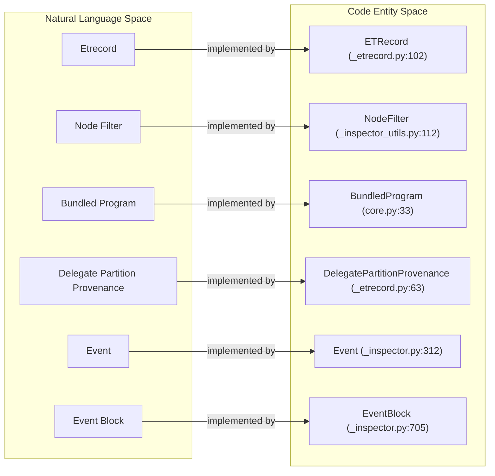
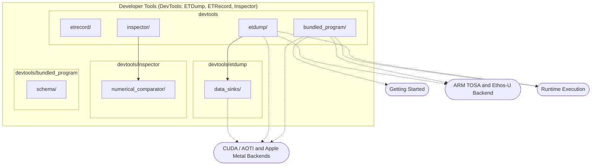
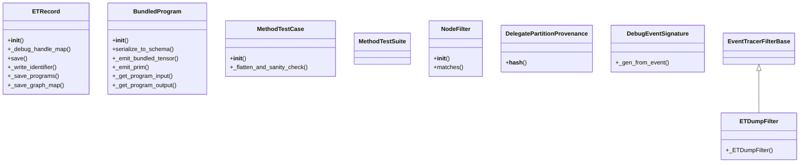
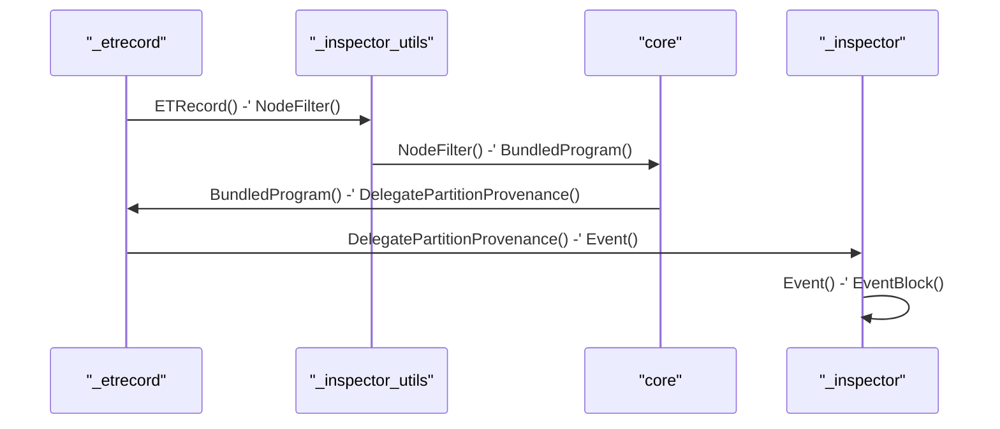

# Developer Tools (DevTools: ETDump, ETRecord, Inspector)

↑ [[8-runtime-execution|Runtime Execution]]

> Architectural specification and implementation reference for Developer Tools (DevTools: ETDump, ETRecord, Inspector) (38 relevant source files). Primary code entities: `DelegatePartitionProvenance`, `__hash__`, `ETRecord`, `__init__`, `ETDumpGen`.

<details>
<summary>Relevant source files</summary>

The following files were used as context for generating this wiki page:

- [devtools/etrecord/_etrecord.py](devtools/etrecord/_etrecord.py)
- [devtools/etdump/etdump_flatcc.cpp](devtools/etdump/etdump_flatcc.cpp)
- [devtools/inspector/_inspector.py](devtools/inspector/_inspector.py)
- [devtools/inspector/_inspector_utils.py](devtools/inspector/_inspector_utils.py)
- [devtools/etdump/schema_flatcc.py](devtools/etdump/schema_flatcc.py)
- [devtools/etdump/data_sinks/buffer_data_sink.h](devtools/etdump/data_sinks/buffer_data_sink.h)
- [devtools/bundled_program/bundled_program.cpp](devtools/bundled_program/bundled_program.cpp)
- [devtools/etdump/etdump_filter.h](devtools/etdump/etdump_filter.h)
- [devtools/etdump/etdump_flatcc.h](devtools/etdump/etdump_flatcc.h)
- [devtools/etdump/data_sinks/data_sink_base.h](devtools/etdump/data_sinks/data_sink_base.h)
- [devtools/etdump/data_sinks/file_data_sink.h](devtools/etdump/data_sinks/file_data_sink.h)
- [devtools/etdump/data_sinks/file_data_sink.cpp](devtools/etdump/data_sinks/file_data_sink.cpp)
- [devtools/bundled_program/core.py](devtools/bundled_program/core.py)
- [devtools/etdump/etdump_filter.cpp](devtools/etdump/etdump_filter.cpp)
- [devtools/etdump/emitter.cpp](devtools/etdump/emitter.cpp)
- [devtools/etdump/data_sinks/buffer_data_sink.cpp](devtools/etdump/data_sinks/buffer_data_sink.cpp)
- [devtools/inspector/_intermediate_output_capturer.py](devtools/inspector/_intermediate_output_capturer.py)
- [devtools/etdump/serialize.py](devtools/etdump/serialize.py)
- [devtools/etdump/emitter.h](devtools/etdump/emitter.h)
- [devtools/inspector/numerical_comparator/numerical_comparator_base.py](devtools/inspector/numerical_comparator/numerical_comparator_base.py)
- [devtools/etdump/data_sinks/targets.bzl](devtools/etdump/data_sinks/targets.bzl)
- [devtools/bundled_program/config.py](devtools/bundled_program/config.py)
- [devtools/etdump/targets.bzl](devtools/etdump/targets.bzl)
- [devtools/etdump/utils.h](devtools/etdump/utils.h)
- [devtools/inspector/numerical_comparator/l1_numerical_comparator.py](devtools/inspector/numerical_comparator/l1_numerical_comparator.py)
- [devtools/inspector/numerical_comparator/mse_numerical_comparator.py](devtools/inspector/numerical_comparator/mse_numerical_comparator.py)
- [devtools/bundled_program/bundled_program.h](devtools/bundled_program/bundled_program.h)
- [devtools/inspector/numerical_comparator/snr_numerical_comparator.py](devtools/inspector/numerical_comparator/snr_numerical_comparator.py)
- [devtools/bundled_program/schema/README.md](devtools/bundled_program/schema/README.md)
- [docs/source/devtools-overview.md](docs/source/devtools-overview.md)
- [docs/source/devtools-tutorial.md](docs/source/devtools-tutorial.md)
- [docs/source/etdump.md](docs/source/etdump.md)
- [devtools/etdump/BUCK](devtools/etdump/BUCK)
- [devtools/etdump/CMakeLists.txt](devtools/etdump/CMakeLists.txt)
- [devtools/etdump/data_sinks/BUCK](devtools/etdump/data_sinks/BUCK)

</details>

## Purpose and Scope

Architectural specification and implementation reference for Developer Tools (DevTools: ETDump, ETRecord, Inspector) (38 relevant source files). Primary code entities: `DelegatePartitionProvenance`, `__hash__`, `ETRecord`, `__init__`, `ETDumpGen`.

Primary code entities analyzed on this page include `ETRecord` ([devtools/etrecord/_etrecord.py:102-560]()), `NodeFilter` ([devtools/inspector/_inspector_utils.py:112-131]()), `BundledProgram` ([devtools/bundled_program/core.py:33-395]()), `DelegatePartitionProvenance` ([devtools/etrecord/_etrecord.py:63-99]()), `Event` ([devtools/inspector/_inspector.py:312-701]()).

For the parent architectural layer, see [[8-runtime-execution|Runtime Execution]]. Related sibling subsystems: [[8.1-core-runtime-architecture|Core Runtime Architecture]], [[8.2-kernel-registration-and-dispatch|Kernel Registration and Dispatch]].

Sources: [devtools/etrecord/_etrecord.py:102-560](), [devtools/inspector/_inspector_utils.py:112-131](), [devtools/bundled_program/core.py:33-395](), [devtools/etrecord/_etrecord.py:63-99]()

---

## 1. High-Level Architecture and Data Flow

### Natural Language Space to Code Entity Space Mapping

The following diagram maps domain concepts in this subsystem to their concrete code entities:



### Subsystem Component & Dependency Flow



Cross-subsystem call and import edges connect **Developer Tools (DevTools: ETDump, ETRecord, Inspector)** with [[8.1-core-runtime-architecture|Core Runtime Architecture]] (coupling `38.0`), [[8-runtime-execution|Runtime Execution]] (coupling `32.0`), [[5.7-cuda-aoti-and-apple-metal-backends|CUDA / AOTI and Apple Metal Backends]] (coupling `24.0`), [[9-mobile-and-platform-extensions|Mobile and Platform Extensions]] (coupling `12.0`), [[9.4-embedded-and-web-targets|Embedded (Zephyr, ESP32, Pico2) and WebAssembly/WebGPU Targets]] (coupling `12.0`).

| Module Directory | Files | Primary Code Entities | Source Citations |
|---|---|---|---|
| `devtools/etdump` | 14 | `ETDumpFilter`, `PROFILE_EVENT_ENUM`, `AllocationEvent`, `Allocator` | [devtools/etdump/etdump_filter.h:32-101]() [devtools/etdump/schema_flatcc.py:105-109]() |
| `devtools/etdump/data_sinks` | 7 | `BufferDataSink`, `DataSinkBase`, `FileDataSink`, `write` | [devtools/etdump/data_sinks/buffer_data_sink.h:24-124]() [devtools/etdump/data_sinks/data_sink_base.h:24-58]() |
| `devtools/bundled_program` | 4 | `BundledProgram`, `MethodTestCase`, `MethodTestSuite`, `ErrorStats` | [devtools/bundled_program/core.py:33-395]() [devtools/bundled_program/config.py:49-107]() |
| `devtools/inspector/numerical_comparator` | 4 | `NumericalComparatorBase`, `MSEComparator`, `L1Comparator`, `SNRComparator` | [devtools/inspector/numerical_comparator/numerical_comparator_base.py:32-281]() [devtools/inspector/numerical_comparator/mse_numerical_comparator.py:19-37]() |
| `devtools/inspector` | 3 | `NodeFilter`, `Event`, `EventBlock`, `EventSignature` | [devtools/inspector/_inspector_utils.py:112-131]() [devtools/inspector/_inspector.py:312-701]() |
| `devtools/etrecord` | 2 | `ETRecord`, `DelegatePartitionProvenance`, `ETRecordReservedFileNames`, `StrEnum` | [devtools/etrecord/_etrecord.py:102-560]() [devtools/etrecord/_etrecord.py:63-99]() |
| `devtools/bundled_program/schema` | 1 | *(build / config)* | [devtools/bundled_program/schema/README.md]() |

Sources: [devtools/etrecord/_etrecord.py:102-560](), [devtools/inspector/_inspector_utils.py:112-131](), [devtools/bundled_program/core.py:33-395](), [devtools/etrecord/_etrecord.py:63-99](), [devtools/inspector/_inspector.py:312-701]()

---

## 2. Core Data Structures and Implementation Details

### Class and Entity Relationship Diagram



### `ETRecord` (Class)

- **Source Location**: [devtools/etrecord/_etrecord.py:102-560]()
- **Declaration**: `Class ETRecord`
- **Graph Centrality**: fan-in `7` callers, fan-out `0` callees

```python
// devtools/etrecord/_etrecord.py:102-117
class ETRecord:
    def __init__(
        self,
        exported_program: Optional[ExportedProgram] = None,
        export_graph_id: Optional[int] = None,
        edge_dialect_program: Optional[
            Union[ExportedProgram, Dict[str, ExportedProgram]]
        ] = None,
        graph_map: Optional[Dict[str, ExportedProgram]] = None,
        _debug_handle_map: Optional[Dict[int, Union[int, List[int]]]] = None,
        _delegate_map: Optional[
            Dict[str, Dict[int, Dict[str, Union[str, _DelegateDebugIdentifierMap]]]]
        ] = None,
        _instruction_id_to_num_outs_map: Optional[
            Dict[str, Dict[int, Union[int, List[int]]]]
        ] = None,
```

### `NodeFilter` (Class)

- **Source Location**: [devtools/inspector/_inspector_utils.py:112-131]()
- **Declaration**: `Class NodeFilter`
- **Graph Centrality**: fan-in `2` callers, fan-out `0` callees
- **Responsibility**: A class used to filter nodes based on extensible criteria. Attributes: metadata_key (str): The key to look for in the node's metadata. op_type (str): The operation code to match. exclude_ops (List[str]): A list of operations to exclude from the filter.

```python
// devtools/inspector/_inspector_utils.py:112-127
class NodeFilter:
    """
    A class used to filter nodes based on extensible criteria.
    Attributes:
        metadata_key (str): The key to look for in the node's metadata.
        op_type (str): The operation code to match.
        exclude_ops (List[str]): A list of operations to exclude from the filter.
    """

    def __init__(self, metadata_key: str, op_type: str, exclude_ops: List[str] = None):
        self.metadata_key = metadata_key
        self.op_type = op_type
        self.exclude_ops = exclude_ops

    def matches(self, node: torch.fx.Node) -> bool:
        return (
```

### `BundledProgram` (Class)

- **Source Location**: [devtools/bundled_program/core.py:33-395]()
- **Declaration**: `Class BundledProgram`
- **Graph Centrality**: fan-in `4` callers, fan-out `0` callees
- **Responsibility**: Bundled program contains all information needed to execute and verify the program on device. Public Attributes: method_test_suites: All test suites for verifying methods. executorch_program: ExecutorchProgram-like variable, containing the Program to be verified by method_test_suites, including ExecutorchProgram, MultiM

```python
// devtools/bundled_program/core.py:33-48
class BundledProgram:
    """
    Bundled program contains all information needed to execute and verify the program on device.

    Public Attributes:
        method_test_suites: All test suites for verifying methods.
        executorch_program: ExecutorchProgram-like variable, containing the Program to be verified by method_test_suites, including
                            ExecutorchProgram, MultiMethodExecutorchProgram or ExecutorchProgramManager.
    """

    def __init__(
        self,
        executorch_program: Optional[
            Union[
                ExecutorchProgram,
                ExecutorchProgramManager,
```

### `DelegatePartitionProvenance` (Class)

- **Source Location**: [devtools/etrecord/_etrecord.py:63-99]()
- **Declaration**: `Class DelegatePartitionProvenance`
- **Graph Centrality**: fan-in `1` callers, fan-out `0` callees
- **Responsibility**: Backend-agnostic provenance for one emitted delegate partition. ``instruction_id`` is local to ``method_name`` and identifies the emitted ``executorch_call_delegate`` instruction. ``source_debug_handles`` contains the debug handles of call_function nodes in the delegate's original lowered graph. Handles are de-duplicat

### `Event` (Class)

- **Source Location**: [devtools/inspector/_inspector.py:312-701]()
- **Declaration**: `Class Event`
- **Graph Centrality**: fan-in `1` callers, fan-out `0` callees
- **Responsibility**: An Event corresponds to an operator instance with perf data retrieved from the runtime and other metadata from `ETRecord`. Args: name: Name of the profiling `Event`, empty if no profiling event. perf_data: Performance data associated with the event retrived from the runtime (available attributes: p10, p50, p90, avg, mi

### `load_bundled_input` (Function)

- **Source Location**: [devtools/bundled_program/bundled_program.cpp:256-356]()
- **Declaration**: `( Method& method, SerializedBundledProgram* bundled_program_ptr, size_t testset_idx)`
- **Graph Centrality**: fan-in `5` callers, fan-out `8` callees
- **Responsibility**: // Load testset_idx-th bundled data into the Method

Sources: [devtools/etrecord/_etrecord.py:102-560](), [devtools/inspector/_inspector_utils.py:112-131](), [devtools/bundled_program/core.py:33-395](), [devtools/etrecord/_etrecord.py:63-99](), [devtools/inspector/_inspector.py:312-701]()

---

## 3. Execution and Call Flow

The sequence diagram below traces the runtime/compile-time call chain across components in this module:



Sources: [devtools/etrecord/_etrecord.py:102-560](), [devtools/inspector/_inspector_utils.py:112-131](), [devtools/bundled_program/core.py:33-395](), [devtools/etrecord/_etrecord.py:63-99](), [devtools/inspector/_inspector.py:312-701]()

---

## 4. Key API and Symbol Reference

| Code Entity | Kind | Location | Fan-In / Out | Role & Signature |
|---|---|---|---|---|
| `ETRecord` | Class | [devtools/etrecord/_etrecord.py:102-560]() | `7` / `0` | — |
| `NodeFilter` | Class | [devtools/inspector/_inspector_utils.py:112-131]() | `2` / `0` | A class used to filter nodes based on extensible criteria. |
| `BundledProgram` | Class | [devtools/bundled_program/core.py:33-395]() | `4` / `0` | Bundled program contains all information needed to execute and verify the program on device. |
| `DelegatePartitionProvenance` | Class | [devtools/etrecord/_etrecord.py:63-99]() | `1` / `0` | Backend-agnostic provenance for one emitted delegate partition. |
| `Event` | Class | [devtools/inspector/_inspector.py:312-701]() | `1` / `0` | An Event corresponds to an operator instance with perf data retrieved from the runtime and other metadata from |
| `EventBlock` | Class | [devtools/inspector/_inspector.py:705-1000]() | `1` / `0` | r""" |
| `EventSignature` | Class | [devtools/inspector/_inspector.py:195-251]() | `1` / `0` | Note that (profile_event_signature, debug_event_signature) are sufficient |
| `Inspector` | Class | [devtools/inspector/_inspector.py:1003-1712]() | `1` / `0` | APIs for examining model architecture and performance stats. |
| `RunSignature` | Class | [devtools/inspector/_inspector.py:256-266]() | `1` / `0` | Args: |
| `NodeData` | Class | [devtools/inspector/_inspector_utils.py:96-109]() | `1` / `0` | Each node in the graph is an instance of NodeData, which contains: |
| `ETDumpFilter` | Class | [devtools/etdump/etdump_filter.h:32-101]() | `1` / `0` | /** |
| `BufferDataSink` | Class | [devtools/etdump/data_sinks/buffer_data_sink.h:24-124]() | `0` / `0` | /** |
| `PROFILE_EVENT_ENUM` | Class | [devtools/etdump/schema_flatcc.py:105-109]() | `0` / `0` | # Note the differing value style is a result of ETDump string |
| `MethodTestCase` | Class | [devtools/bundled_program/config.py:49-107]() | `3` / `0` | Test case with inputs and expected outputs |
| `MethodTestSuite` | Class | [devtools/bundled_program/config.py:111-120]() | `3` / `0` | All test info related to verify method |
| `DataSinkBase` | Class | [devtools/etdump/data_sinks/data_sink_base.h:24-58]() | `0` / `0` | /** |
| `FileDataSink` | Class | [devtools/etdump/data_sinks/file_data_sink.h:28-92]() | `0` / `0` | /** |
| `IntermediateOutputCapturer` | Class | [devtools/inspector/_intermediate_output_capturer.py:18-62]() | `0` / `0` | A class that captures intermediate outputs from a PyTorch graph module. |
| `DebugEventSignature` | Class | [devtools/inspector/_inspector.py:171-190]() | `1` / `0` | — |
| `InstructionEvent` | Class | [devtools/inspector/_inspector.py:97-142]() | `1` / `0` | — |
| `InstructionEventSignature` | Class | [devtools/inspector/_inspector.py:88-92]() | `1` / `0` | — |
| `PerfData` | Class | [devtools/inspector/_inspector.py:282-308]() | `1` / `0` | — |

Sources: [devtools/etrecord/_etrecord.py:102-560](), [devtools/inspector/_inspector_utils.py:112-131](), [devtools/bundled_program/core.py:33-395](), [devtools/etrecord/_etrecord.py:63-99](), [devtools/inspector/_inspector.py:312-701](), [devtools/inspector/_inspector.py:705-1000]()

---

## 5. Official Documentation and Design Context

The following linked documentation sections from `llm-wiki` (`raw/`) provide additional architectural context, tutorials, and design invariants for this subsystem:

- **Performance Benchmarking and Profiling** ([wiki/7.3-performance-benchmarking-and-profiling.md](), score `145.7459`) (sections: `Performance Benchmarking and Profiling`, `Purpose and Scope`, `1. High-Level Architecture and Data Flow`, `Natural Language Space to Code Entity Space Mapping`): # Performance Benchmarking and Profiling ↑ [[7-testing-and-cicd-infrastructure|Testing and CI/CD Infrastructure]] > Architectural specification and implementation reference for Performance Benchmarking and Profiling (36 relevant source files). Primary code entities: `Allocator`, `MemAllocation`, `MemEvent`, `ProfileData`, `ETDumpGen`. <details> <summary>Relevant source files</summary> The following files were used as
- **Runtime Execution** ([wiki/8-runtime-execution.md](), score `131.2299`) (sections: `Runtime Execution`, `Purpose and Scope`, `System Mapping: Natural Language Space to Code Entity Space`, `1. Core Runtime Architecture`): # Runtime Execution > Architectural specification and implementation reference for Runtime Execution (39 relevant source files). Primary code entities: `ET_CHECK_MSG`, `execute`, `execute_instruction`, `experimental_reset_execution`, `ArrayRef`. <details> <summary>Relevant source files</summary> The following files were used as context for generating this wiki page: - [runtime/executor/method.cpp](runtime/executor/me
- **Testing and CI/CD Infrastructure** ([wiki/7-testing-and-cicd-infrastructure.md](), score `113.2899`) (sections: `Testing and CI/CD Infrastructure`, `Purpose and Scope`, `System Mapping: Natural Language Space to Code Entity Space`, `1. CI/CD Workflows and Validation`): # Testing and CI/CD Infrastructure > Architectural specification and implementation reference for Testing and CI/CD Infrastructure (36 relevant source files). Primary code entities: `BenchmarkResults`, `save_json`, `to_dict`, `to_v3_format`, `BenchmarkFilters`. <details> <summary>Relevant source files</summary> The following files were used as context for generating this wiki page: - [.ci/scripts/cuda_benchmark.py](.
- **ExecuTorch DeepWiki** ([wiki/index.md](), score `112.39`) (sections: `ExecuTorch DeepWiki`, `Pages`): # ExecuTorch DeepWiki Generated from `home-jason-Project-deepwiki-executorch` at commit `b3b565b5b62f` (2026-11-15T15:02:11+00:00). ## Pages - [[1-overview|Overview]] — Architectural specification and implementation reference for Overview (10 relevant source files). Primary code entities: `Module`, `MethodHolder`, `PlannedMemory`, `EdgeProgramManager`, `__init__`. - [[1.1-getting-started|Getting Started]] — Architect

Sources: [wiki/7.3-performance-benchmarking-and-profiling.md](), [wiki/8-runtime-execution.md](), [wiki/7-testing-and-cicd-infrastructure.md](), [wiki/index.md]()

## Related pages

- [[8-runtime-execution|Runtime Execution]]
- [[1.1-getting-started|Getting Started]]
- [[1.2-export-api-and-recipe-system|Export API and Recipe System]]
- [[2.2-kernel-libraries-and-selective-build|Kernel Libraries and Selective Build]]
- [[2.3-schema-generation-and-flatbuffers|Schema Generation and FlatBuffers]]
- [[3.4-program-emission-and-serialization|Program Emission and Serialization]]
- [[3.5-verification-and-dialect-system|Verification and Dialect System]]
- [[4-quantization-systems|Quantization Systems]]

## Related documents

- `wiki/7.3-performance-benchmarking-and-profiling.md` — Performance Benchmarking and Profiling (score 145.7459, via bm25)
- `wiki/8-runtime-execution.md` — Runtime Execution (score 131.2299, via bm25)
- `wiki/7-testing-and-cicd-infrastructure.md` — Testing and CI/CD Infrastructure (score 113.2899, via bm25)
- `wiki/index.md` — ExecuTorch DeepWiki (score 112.39, via bm25)
- `wiki/8.1-core-runtime-architecture.md` — Core Runtime Architecture (score 100.2756, via bm25)

## Sources

- [`devtools/etrecord/_etrecord.py`](https://github.com/pytorch/executorch/blob/main/devtools/etrecord/_etrecord.py)
- [`devtools/etdump/etdump_flatcc.cpp`](https://github.com/pytorch/executorch/blob/main/devtools/etdump/etdump_flatcc.cpp)
- [`devtools/inspector/_inspector.py`](https://github.com/pytorch/executorch/blob/main/devtools/inspector/_inspector.py)
- [`devtools/inspector/_inspector_utils.py`](https://github.com/pytorch/executorch/blob/main/devtools/inspector/_inspector_utils.py)
- [`devtools/etdump/schema_flatcc.py`](https://github.com/pytorch/executorch/blob/main/devtools/etdump/schema_flatcc.py)
- [`devtools/etdump/data_sinks/buffer_data_sink.h`](https://github.com/pytorch/executorch/blob/main/devtools/etdump/data_sinks/buffer_data_sink.h)
- [`devtools/bundled_program/bundled_program.cpp`](https://github.com/pytorch/executorch/blob/main/devtools/bundled_program/bundled_program.cpp)
- [`devtools/etdump/etdump_filter.h`](https://github.com/pytorch/executorch/blob/main/devtools/etdump/etdump_filter.h)
- [`devtools/etdump/etdump_flatcc.h`](https://github.com/pytorch/executorch/blob/main/devtools/etdump/etdump_flatcc.h)
- [`devtools/etdump/data_sinks/data_sink_base.h`](https://github.com/pytorch/executorch/blob/main/devtools/etdump/data_sinks/data_sink_base.h)
- [`devtools/etdump/data_sinks/file_data_sink.h`](https://github.com/pytorch/executorch/blob/main/devtools/etdump/data_sinks/file_data_sink.h)
- [`devtools/etdump/data_sinks/file_data_sink.cpp`](https://github.com/pytorch/executorch/blob/main/devtools/etdump/data_sinks/file_data_sink.cpp)
- [`devtools/bundled_program/core.py`](https://github.com/pytorch/executorch/blob/main/devtools/bundled_program/core.py)
- [`devtools/etdump/etdump_filter.cpp`](https://github.com/pytorch/executorch/blob/main/devtools/etdump/etdump_filter.cpp)
- [`devtools/etdump/emitter.cpp`](https://github.com/pytorch/executorch/blob/main/devtools/etdump/emitter.cpp)
- [`devtools/etdump/data_sinks/buffer_data_sink.cpp`](https://github.com/pytorch/executorch/blob/main/devtools/etdump/data_sinks/buffer_data_sink.cpp)
- [`devtools/inspector/_intermediate_output_capturer.py`](https://github.com/pytorch/executorch/blob/main/devtools/inspector/_intermediate_output_capturer.py)
- [`devtools/etdump/serialize.py`](https://github.com/pytorch/executorch/blob/main/devtools/etdump/serialize.py)
- [`devtools/etdump/emitter.h`](https://github.com/pytorch/executorch/blob/main/devtools/etdump/emitter.h)
- [`devtools/inspector/numerical_comparator/numerical_comparator_base.py`](https://github.com/pytorch/executorch/blob/main/devtools/inspector/numerical_comparator/numerical_comparator_base.py)
- [`devtools/etdump/data_sinks/targets.bzl`](https://github.com/pytorch/executorch/blob/main/devtools/etdump/data_sinks/targets.bzl)
- [`devtools/bundled_program/config.py`](https://github.com/pytorch/executorch/blob/main/devtools/bundled_program/config.py)
- [`devtools/etdump/targets.bzl`](https://github.com/pytorch/executorch/blob/main/devtools/etdump/targets.bzl)
- [`devtools/etdump/utils.h`](https://github.com/pytorch/executorch/blob/main/devtools/etdump/utils.h)
- [`devtools/inspector/numerical_comparator/l1_numerical_comparator.py`](https://github.com/pytorch/executorch/blob/main/devtools/inspector/numerical_comparator/l1_numerical_comparator.py)
- [`devtools/inspector/numerical_comparator/mse_numerical_comparator.py`](https://github.com/pytorch/executorch/blob/main/devtools/inspector/numerical_comparator/mse_numerical_comparator.py)
- [`devtools/bundled_program/bundled_program.h`](https://github.com/pytorch/executorch/blob/main/devtools/bundled_program/bundled_program.h)
- [`devtools/inspector/numerical_comparator/snr_numerical_comparator.py`](https://github.com/pytorch/executorch/blob/main/devtools/inspector/numerical_comparator/snr_numerical_comparator.py)
- [`devtools/bundled_program/schema/README.md`](https://github.com/pytorch/executorch/blob/main/devtools/bundled_program/schema/README.md)
- [`docs/source/devtools-overview.md`](https://github.com/pytorch/executorch/blob/main/docs/source/devtools-overview.md)
- [`docs/source/devtools-tutorial.md`](https://github.com/pytorch/executorch/blob/main/docs/source/devtools-tutorial.md)
- [`docs/source/etdump.md`](https://github.com/pytorch/executorch/blob/main/docs/source/etdump.md)
- [`devtools/etdump/BUCK`](https://github.com/pytorch/executorch/blob/main/devtools/etdump/BUCK)
- [`devtools/etdump/CMakeLists.txt`](https://github.com/pytorch/executorch/blob/main/devtools/etdump/CMakeLists.txt)
- [`devtools/etdump/data_sinks/BUCK`](https://github.com/pytorch/executorch/blob/main/devtools/etdump/data_sinks/BUCK)
- [`devtools/etdump/etdump_schema_flatcc.fbs`](https://github.com/pytorch/executorch/blob/main/devtools/etdump/etdump_schema_flatcc.fbs)
- [`devtools/etdump/scalar_type.fbs`](https://github.com/pytorch/executorch/blob/main/devtools/etdump/scalar_type.fbs)
- [`devtools/etrecord/BUCK`](https://github.com/pytorch/executorch/blob/main/devtools/etrecord/BUCK)


## Dynamic Knowledge Links (Code Graph ↔ LLM-Wiki / RAG)

### Linked Architecture & Design Documents

| Document | Match Channel | Score | Shared Code Symbols |
|---|---|---|---|
| [[7.3-performance-benchmarking-and-profiling|Performance Benchmarking and Profiling]] | `bm25+entity(3)` | `150.246` | `BundledProgram`, `ETRecord`, `Float` |
| [[8-runtime-execution|Runtime Execution]] | `bm25+entity(1)` | `132.73` | `ETRecord` |
| [[7-testing-and-cicd-infrastructure|Testing and CI/CD Infrastructure]] | `bm25+entity(1)` | `114.79` | `ETRecord` |
| [[index|ExecuTorch DeepWiki]] | `bm25+entity(1)` | `113.89` | `ETRecord` |
| [[8.1-core-runtime-architecture|Core Runtime Architecture]] | `bm25+entity(1)` | `101.776` | `ETRecord` |
| [[8.2-kernel-registration-and-dispatch|Kernel Registration and Dispatch]] | `wikilink:8.3-developer-tools-devtools+entity(1)` | `89.687` | `ETRecord` |

### High-Centrality Bridge Symbols (CBM Graph)

| Symbol | Kind | Source Location | Fan-In / Fan-Out |
|---|---|---|---|
| `ETRecord` | Class | [devtools/etrecord/_etrecord.py:102-560]() | in: `7` / out: `0` |
| `NodeFilter` | Class | [devtools/inspector/_inspector_utils.py:112-131]() | in: `2` / out: `0` |
| `BundledProgram` | Class | [devtools/bundled_program/core.py:33-395]() | in: `4` / out: `0` |
| `DelegatePartitionProvenance` | Class | [devtools/etrecord/_etrecord.py:63-99]() | in: `1` / out: `0` |
| `Event` | Class | [devtools/inspector/_inspector.py:312-701]() | in: `1` / out: `0` |
| `EventBlock` | Class | [devtools/inspector/_inspector.py:705-1000]() | in: `1` / out: `0` |

Sources: [devtools/etrecord/_etrecord.py:102-560](), [devtools/inspector/_inspector_utils.py:112-131](), [devtools/bundled_program/core.py:33-395](), [devtools/etrecord/_etrecord.py:63-99]()

### Cross-Subsystem Coupling

- [[8.1-core-runtime-architecture|Core Runtime Architecture]] — call/import coupling weight `38.0`
- [[8-runtime-execution|Runtime Execution]] — call/import coupling weight `32.0`
- [[5.7-cuda-aoti-and-apple-metal-backends|CUDA / AOTI and Apple Metal Backends]] — call/import coupling weight `24.0`
- [[9-mobile-and-platform-extensions|Mobile and Platform Extensions]] — call/import coupling weight `12.0`
- [[9.4-embedded-and-web-targets|Embedded (Zephyr, ESP32, Pico2) and WebAssembly/WebGPU Targets]] — call/import coupling weight `12.0`
- [[5.4-arm-tosa-and-ethos-u-backend|ARM TOSA and Ethos-U Backend]] — call/import coupling weight `10.0`
