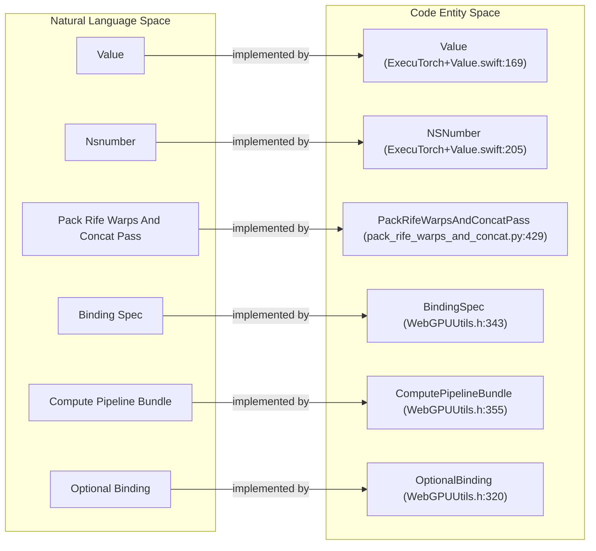
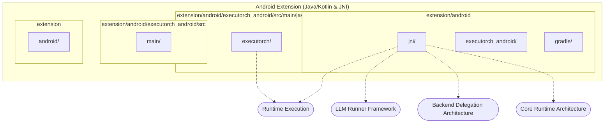
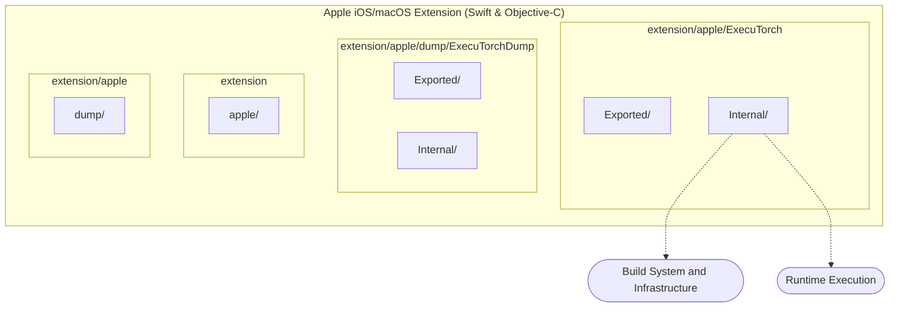
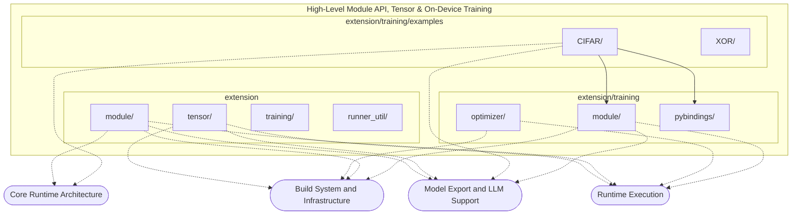
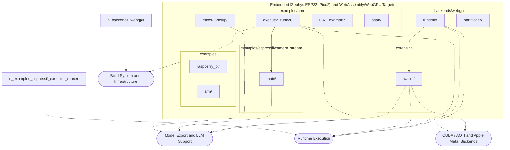

# Mobile and Platform Extensions

> Architectural specification and implementation reference for Mobile and Platform Extensions (40 relevant source files). Primary code entities: `BindingSpec`, `ComputePipelineBundle`, `operator=`, `Storage`, `~Storage`.

Relevant source files

The following files were used as context for generating this wiki page:

- [backends/webgpu/runtime/WebGPUUtils.h](backends/webgpu/runtime/WebGPUUtils.h)
- [extension/tensor/tensor_ptr.cpp](extension/tensor/tensor_ptr.cpp)
- [examples/arm/ethos-u-setup/arm-none-eabi-clang-random-device.h](examples/arm/ethos-u-setup/arm-none-eabi-clang-random-device.h)
- [backends/webgpu/runtime/WebGPUGraph.cpp](backends/webgpu/runtime/WebGPUGraph.cpp)
- [extension/android/jni/jni_layer_image.cpp](extension/android/jni/jni_layer_image.cpp)
- [examples/espressif/camera_stream/main/camera_stream.cpp](examples/espressif/camera_stream/main/camera_stream.cpp)
- [extension/tensor/tensor_ptr_maker.h](extension/tensor/tensor_ptr_maker.h)
- [examples/raspberry_pi/setup.sh](examples/raspberry_pi/setup.sh)
- [extension/module/module.cpp](extension/module/module.cpp)
- [extension/module/module.h](extension/module/module.h)
- [examples/arm/QAT_example/rife_vgf/passes/pack_rife_warps_and_concat.py](examples/arm/QAT_example/rife_vgf/passes/pack_rife_warps_and_concat.py)
- [examples/arm/executor_runner/arm_executor_runner.cpp](examples/arm/executor_runner/arm_executor_runner.cpp)
- [backends/webgpu/runtime/WebGPUDispatchMath.h](backends/webgpu/runtime/WebGPUDispatchMath.h)
- [backends/webgpu/runtime/WebGPUDevice.cpp](backends/webgpu/runtime/WebGPUDevice.cpp)
- [extension/android/executorch_android/android_test_setup.sh](extension/android/executorch_android/android_test_setup.sh)
- [extension/android/executorch_android/src/main/java/org/pytorch/executorch/EValue.kt](extension/android/executorch_android/src/main/java/org/pytorch/executorch/EValue.kt)
- [extension/android/jni/jni_layer.cpp](extension/android/jni/jni_layer.cpp)
- [extension/android/executorch_android/src/main/java/org/pytorch/executorch/extension/llm/LlmModule.kt](extension/android/executorch_android/src/main/java/org/pytorch/executorch/extension/llm/LlmModule.kt)
- [examples/arm/QAT_example/qat_loop.py](examples/arm/QAT_example/qat_loop.py)
- [examples/arm/visualize.py](examples/arm/visualize.py)
- [examples/espressif/executor_runner/esp_executor_runner.cpp](examples/espressif/executor_runner/esp_executor_runner.cpp)
- [examples/arm/smollm2_example_ethos_u/generate_sampled.py](examples/arm/smollm2_example_ethos_u/generate_sampled.py)
- [extension/android/executorch_android/src/main/java/org/pytorch/executorch/Module.kt](extension/android/executorch_android/src/main/java/org/pytorch/executorch/Module.kt)
- [examples/arm/custom_operators.py](examples/arm/custom_operators.py)
- [backends/webgpu/scripts/gen_wgsl_headers.py](backends/webgpu/scripts/gen_wgsl_headers.py)
- [extension/apple/ExecuTorch/Exported/ExecuTorch+Value.swift](extension/apple/ExecuTorch/Exported/ExecuTorch+Value.swift)
- [extension/android/executorch_android/src/main/java/org/pytorch/executorch/Tensor.kt](extension/android/executorch_android/src/main/java/org/pytorch/executorch/Tensor.kt)
- [examples/arm/smollm2_example_vgf/generate_sampled.py](examples/arm/smollm2_example_vgf/generate_sampled.py)
- [extension/android/README.md](extension/android/README.md)
- [backends/webgpu/README.md](backends/webgpu/README.md)
- [backends/webgpu/TODO.md](backends/webgpu/TODO.md)
- [examples/arm/README.md](examples/arm/README.md)
- [examples/arm/custom_operators.md](examples/arm/custom_operators.md)
- [examples/arm/ethos-u-porting-guide.md](examples/arm/ethos-u-porting-guide.md)
- [extension/android/BUCK](extension/android/BUCK)

## Purpose and Scope

This chapter covers **Mobile and Platform Extensions** across the repository, detailing the core abstractions, data structures, transformation pipelines, and runtime/build integrations that implement this layer.

**Scope**: This document provides an architectural hub for the following child subsystems:
- **Android Extension (Java/Kotlin & JNI)**: See [[9.1-android-extension|Android Extension (Java/Kotlin & JNI)]].
- **Apple iOS/macOS Extension (Swift & Objective-C)**: See [[9.2-apple-ios-macos-extension|Apple iOS/macOS Extension (Swift & Objective-C)]].
- **High-Level Module API, Tensor & On-Device Training**: See [[9.3-high-level-module-and-on-device-training|High-Level Module API, Tensor & On-Device Training]].
- **Embedded (Zephyr, ESP32, Pico2) and WebAssembly/WebGPU Targets**: See [[9.4-embedded-and-web-targets|Embedded (Zephyr, ESP32, Pico2) and WebAssembly/WebGPU Targets]].

Sources: [extension/apple/ExecuTorch/Exported/ExecuTorch+Value.swift:169-173](), [extension/apple/ExecuTorch/Exported/ExecuTorch+Value.swift:205-212](), [examples/arm/QAT_example/rife_vgf/passes/pack_rife_warps_and_concat.py:429-646](), [backends/webgpu/runtime/WebGPUUtils.h:343-348]()

---

## System Mapping: Natural Language Space to Code Entity Space

Sources: [extension/apple/ExecuTorch/Exported/ExecuTorch+Value.swift:169-173](), [extension/apple/ExecuTorch/Exported/ExecuTorch+Value.swift:205-212](), [examples/arm/QAT_example/rife_vgf/passes/pack_rife_warps_and_concat.py:429-646](), [backends/webgpu/runtime/WebGPUUtils.h:343-348](), [backends/webgpu/runtime/WebGPUUtils.h:355-391]()

---

## 1. Android Extension (Java/Kotlin & JNI)

Architectural specification and implementation reference for Android Extension (Java/Kotlin & JNI) (33 relevant source files). Primary code entities: `Java_org_pytorch_executorch_extension_image_ImageProcessor_nativeComputeLetterboxPadding`, `Java_org_pytorch_executorch_extension_image_ImageProcessor_nativeComputeOutputShape`, `Java_org_pytorch_executorch_extension_image_ImageProcessor_nativeCreate`, `Java_org_pytorch_executorch_extension_image_ImageProcessor_nativeDestroy`, `JNI_OnLoad`. [extension/android/executorch_android/src/main/java/org/pytorch/executorch/extension/image/ImageProcessor.kt:37-361](), [extension/android/executorch_android/src/main/java/org/pytorch/executorch/extension/image/ImageProcessorConfig.kt:116-167](), [extension/android/jni/jni_layer_image.cpp:128-189]()

### Primary Code Entities

- **`ImageProcessor`** (Class in [extension/android/executorch_android/src/main/java/org/pytorch/executorch/extension/image/ImageProcessor.kt:37-361]()): /** * Converts camera frames and bitmaps into the normalized `[1, 3, H, W]` float tensors vision models * expect, replacing the hand-rolled resize/normalize loops apps otherwise wr
- **`ImageProcessorConfig`** (Class in [extension/android/executorch_android/src/main/java/org/pytorch/executorch/extension/image/ImageProcessorConfig.kt:116-167]()): /** * Configuration for [ImageProcessor]. * * Warning: These APIs are experimental and subject to change without notice * * @property targetWidth Width of the produced tensor, in p
- **`ScopedBitmapLock`** (Class in [extension/android/jni/jni_layer_image.cpp:128-189]()): // Locks an ARGB_8888 bitmap for the lifetime of the scope. Android stores that // format as RGBA bytes in memory, so it maps to ColorFormat::RGBA.
- **`EValue`** (Class in [extension/android/executorch_android/src/main/java/org/pytorch/executorch/EValue.kt:34-209]()): /** * Java representation of an ExecuTorch value, which is implemented as tagged union that can be one * of the supported types: https://pytorch.org/docs/stable/jit.html#types . * 
- **`ok`** (Method in [extension/android/jni/jni_layer_image.cpp:167-169]()): ()
- **`generate`** (Method in [extension/android/executorch_android/src/main/java/org/pytorch/executorch/extension/llm/LlmModule.kt:485-515]()): /** * Start generating tokens from the module. * * @param image Input image as a byte array * @param width Input image width * @param height Input image height * @param channels In

### Android Extension (Java/Kotlin & JNI) Architecture Flow

For details, see [[9.1-android-extension|Android Extension (Java/Kotlin & JNI)]].

Sources: [extension/android/executorch_android/src/main/java/org/pytorch/executorch/extension/image/ImageProcessor.kt:37-361](), [extension/android/executorch_android/src/main/java/org/pytorch/executorch/extension/image/ImageProcessorConfig.kt:116-167](), [extension/android/jni/jni_layer_image.cpp:128-189](), [extension/android/executorch_android/src/main/java/org/pytorch/executorch/EValue.kt:34-209]()

---

## 2. Apple iOS/macOS Extension (Swift & Objective-C)

Architectural specification and implementation reference for Apple iOS/macOS Extension (Swift & Objective-C) (26 relevant source files). Primary code entities: `AnyTensor`, `asValue`, `from`, `Array`, `==`. [extension/apple/ExecuTorch/Exported/ExecuTorch+Tensor.swift:1127-1131](), [extension/apple/ExecuTorch/Exported/ExecuTorch+Value.swift:169-173](), [extension/apple/ExecuTorch/Exported/ExecuTorch+Value.swift:205-212]()

### Primary Code Entities

- **`Tensor`** (Class in [extension/apple/ExecuTorch/Exported/ExecuTorch+Tensor.swift:1127-1131]()): Core implementation entity.
- **`Value`** (Class in [extension/apple/ExecuTorch/Exported/ExecuTorch+Value.swift:169-173]()): Core implementation entity.
- **`NSNumber`** (Class in [extension/apple/ExecuTorch/Exported/ExecuTorch+Value.swift:205-212]()): Core implementation entity.
- **`Module`** (Class in [extension/apple/ExecuTorch/Exported/ExecuTorch+Module.swift:210-327]()): Core implementation entity.
- **`scalars`** (Method in [extension/apple/ExecuTorch/Exported/ExecuTorch+Tensor.swift:845-847]()): /// Returns the tensor's elements as an array of scalars. /// /// - Returns: An array of scalars of type `T`.
- **`withUnsafeBytes`** (Method in [extension/apple/ExecuTorch/Exported/ExecuTorch+Tensor.swift:792-800]()): /// Calls the closure with a typed, immutable buffer pointer over the tensor’s elements. /// /// - Parameter body: A closure that receives an `UnsafeBufferPointer<T>` bound to the 

### Apple iOS/macOS Extension (Swift & Objective-C) Architecture Flow

For details, see [[9.2-apple-ios-macos-extension|Apple iOS/macOS Extension (Swift & Objective-C)]].

Sources: [extension/apple/ExecuTorch/Exported/ExecuTorch+Tensor.swift:1127-1131](), [extension/apple/ExecuTorch/Exported/ExecuTorch+Value.swift:169-173](), [extension/apple/ExecuTorch/Exported/ExecuTorch+Value.swift:205-212](), [extension/apple/ExecuTorch/Exported/ExecuTorch+Module.swift:210-327]()

---

## 3. High-Level Module API, Tensor & On-Device Training

Architectural specification and implementation reference for High-Level Module API, Tensor & On-Device Training (37 relevant source files). Primary code entities: `Storage`, `operator=`, `~Storage`, `Module`, `execute`. [extension/tensor/tensor_ptr.cpp:35-66](), [extension/module/module.h:51-791](), [extension/tensor/tensor_ptr_maker.h:26-163]()

### Primary Code Entities

- **`Storage`** (Class in [extension/tensor/tensor_ptr.cpp:35-66]()): /** * A structure that consolidates the metadata (sizes, dim_order, strides) and * the data buffer associated with a Tensor. Since Tensor does not own * the memory for these metada
- **`Module`** (Class in [extension/module/module.h:51-791]()): /** * A facade class for loading programs and executing methods within them. */
- **`TensorPtrMaker`** (Class in [extension/tensor/tensor_ptr_maker.h:26-163]()): /** * A helper class for creating TensorPtr instances from raw data and tensor * properties. Note that the TensorPtr created by this class does not own the * data, so the data must
- **`TrainingNet`** (Class in [extension/training/examples/XOR/model.py:26-34]()): # On device training requires the loss to be embedded in the model (and be the first output). # We wrap the original model here and add the loss calculation. This will be the model
- **`make_tensor_ptr`** (Function in [extension/tensor/tensor_ptr.cpp:206-244]()): ( std::vector<executorch::aten::SizesType> sizes, std::vector<uint8_t> data, std::vector<executorch::aten::DimOrderType> dim_order, std::vector<executorch::aten::StridesType> strid
- **`from_blob`** (Function in [extension/tensor/tensor_ptr_maker.h:391-406]()): /** * Creates a TensorPtr from a raw data pointer, tensor sizes, and strides, with * an optional dynamism setting. * * This function allows for the creation of a tensor from existi

### High-Level Module API, Tensor & On-Device Training Architecture Flow

For details, see [[9.3-high-level-module-and-on-device-training|High-Level Module API, Tensor & On-Device Training]].

Sources: [extension/tensor/tensor_ptr.cpp:35-66](), [extension/module/module.h:51-791](), [extension/tensor/tensor_ptr_maker.h:26-163](), [extension/training/examples/XOR/model.py:26-34]()

---

## 4. Embedded (Zephyr, ESP32, Pico2) and WebAssembly/WebGPU Targets

Architectural specification and implementation reference for Embedded (Zephyr, ESP32, Pico2) and WebAssembly/WebGPU Targets (40 relevant source files). Primary code entities: `BindingSpec`, `ComputePipelineBundle`, `operator=`, `acquire_scratch`, `add_compute_dispatch`. [examples/arm/QAT_example/rife_vgf/passes/pack_rife_warps_and_concat.py:429-646](), [backends/webgpu/runtime/WebGPUUtils.h:343-348](), [backends/webgpu/runtime/WebGPUUtils.h:355-391]()

### Primary Code Entities

- **`PackRifeWarpsAndConcatPass`** (Class in [examples/arm/QAT_example/rife_vgf/passes/pack_rife_warps_and_concat.py:429-646]()): Pack four private RIFE warps and their C28 concat into one C32 shader. Fuse compatible block0 head resizing and state preparation into the shader. Reorder block0 output channels du
- **`BindingSpec`** (Class in [backends/webgpu/runtime/WebGPUUtils.h:343-348]()): // One compute-shader binding: a bind-group-layout entry + its bind-group // entry share every field except `type` (layout) vs `buffer`/`size` (bind).
- **`ComputePipelineBundle`** (Class in [backends/webgpu/runtime/WebGPUUtils.h:355-391]()): // Owns the shader module, bind-group layout, and pipeline layout, releasing // them on destruction. `pipeline` and `bind_group` are NOT released here — // every op hands them to W
- **`OptionalBinding`** (Class in [backends/webgpu/runtime/WebGPUUtils.h:320-324]()): // Resolves an optional tensor arg (bias/mask/affine) to the binding to use: // the real tensor's buffer+size if present, else a zero-filled dummy. Caller // releases `.owned_dummy
- **`get_tensor`** (Method in [backends/webgpu/runtime/WebGPUGraph.h:189-191]()): (int id)
- **`device`** (Method in [backends/webgpu/runtime/WebGPUGraph.h:362-364]()): ()

### Embedded (Zephyr, ESP32, Pico2) and WebAssembly/WebGPU Targets Architecture Flow

For details, see [[9.4-embedded-and-web-targets|Embedded (Zephyr, ESP32, Pico2) and WebAssembly/WebGPU Targets]].

Sources: [examples/arm/QAT_example/rife_vgf/passes/pack_rife_warps_and_concat.py:429-646](), [backends/webgpu/runtime/WebGPUUtils.h:343-348](), [backends/webgpu/runtime/WebGPUUtils.h:355-391](), [backends/webgpu/runtime/WebGPUUtils.h:320-324]()

---

## Official Documentation & Architectural References

- **Embedded (Zephyr, ESP32, Pico2) and WebAssembly/WebGPU Targets** ([wiki/9.4-embedded-and-web-targets.md]()): # Embedded (Zephyr, ESP32, Pico2) and WebAssembly/WebGPU Targets ↑ [[9-mobile-and-platform-extensions|Mobile and Platform Extensions]] > Architectural specification and implementation reference for Embedded (Zephyr, ESP32, Pico2) and WebAssembly/WebGPU Targets (40 relevant source files). Primary code entities: `BindingSpec`, `ComputePipelineBundle`, `operato
- **ExecuTorch DeepWiki** ([wiki/index.md]()): # ExecuTorch DeepWiki Generated from `home-jason-Project-deepwiki-executorch` at commit `b3b565b5b62f` (2026-11-15T15:02:11+00:00). ## Pages - [[1-overview|Overview]] — Architectural specification and implementation reference for Overview (10 relevant source files). Primary code entities: `Module`, `MethodHolder`, `PlannedMemory`, `EdgeProgramManager`, `__in
- **Android Extension (Java/Kotlin & JNI)** ([wiki/9.1-android-extension.md]()): # Android Extension (Java/Kotlin & JNI) ↑ [[9-mobile-and-platform-extensions|Mobile and Platform Extensions]] > Architectural specification and implementation reference for Android Extension (Java/Kotlin & JNI) (33 relevant source files). Primary code entities: `Java_org_pytorch_executorch_extension_image_ImageProcessor_nativeComputeLetterboxPadding`, `Java_
- **ARM TOSA and Ethos-U Backend** ([wiki/5.4-arm-tosa-and-ethos-u-backend.md]()): # ARM TOSA and Ethos-U Backend ↑ [[5-backend-delegation-architecture|Backend Delegation Architecture]] > Architectural specification and implementation reference for ARM TOSA and Ethos-U Backend (40 relevant source files). Primary code entities: `TosaArg`, `__init__`, `__process_list`, `__process_node`, `InsertTableOpsPass`. 
 
Relevant sourc

Sources: [wiki/9.4-embedded-and-web-targets.md](), [wiki/index.md](), [wiki/9.1-android-extension.md](), [wiki/5.4-arm-tosa-and-ethos-u-backend.md]()

## Sub-pages

- [[9.1-android-extension|Android Extension (Java/Kotlin & JNI)]]
- [[9.2-apple-ios-macos-extension|Apple iOS/macOS Extension (Swift & Objective-C)]]
- [[9.3-high-level-module-and-on-device-training|High-Level Module API, Tensor & On-Device Training]]
- [[9.4-embedded-and-web-targets|Embedded (Zephyr, ESP32, Pico2) and WebAssembly/WebGPU Targets]]

## Related pages

- [[1-overview|Overview]]
- [[9.1-android-extension|Android Extension (Java/Kotlin & JNI)]]
- [[9.2-apple-ios-macos-extension|Apple iOS/macOS Extension (Swift & Objective-C)]]
- [[9.3-high-level-module-and-on-device-training|High-Level Module API, Tensor & On-Device Training]]
- [[9.4-embedded-and-web-targets|Embedded (Zephyr, ESP32, Pico2) and WebAssembly/WebGPU Targets]]
- [[1.1-getting-started|Getting Started]]
- [[1.2-export-api-and-recipe-system|Export API and Recipe System]]
- [[2.2-kernel-libraries-and-selective-build|Kernel Libraries and Selective Build]]

## Related documents

- `wiki/9.4-embedded-and-web-targets.md` — Embedded (Zephyr, ESP32, Pico2) and WebAssembly/WebGPU Targets (score 132.6548, via bm25)
- `wiki/index.md` — ExecuTorch DeepWiki (score 99.2298, via bm25)
- `wiki/9.1-android-extension.md` — Android Extension (Java/Kotlin & JNI) (score 84.6794, via bm25)
- `wiki/5.4-arm-tosa-and-ethos-u-backend.md` — ARM TOSA and Ethos-U Backend (score 82.9944, via bm25)
- `wiki/9.3-high-level-module-and-on-device-training.md` — High-Level Module API, Tensor & On-Device Training (score 81.1239, via bm25)

## Sources

- [`backends/webgpu/runtime/WebGPUUtils.h`](https://github.com/pytorch/executorch/blob/main/backends/webgpu/runtime/WebGPUUtils.h)
- [`extension/tensor/tensor_ptr.cpp`](https://github.com/pytorch/executorch/blob/main/extension/tensor/tensor_ptr.cpp)
- [`examples/arm/ethos-u-setup/arm-none-eabi-clang-random-device.h`](https://github.com/pytorch/executorch/blob/main/examples/arm/ethos-u-setup/arm-none-eabi-clang-random-device.h)
- [`backends/webgpu/runtime/WebGPUGraph.cpp`](https://github.com/pytorch/executorch/blob/main/backends/webgpu/runtime/WebGPUGraph.cpp)
- [`extension/android/jni/jni_layer_image.cpp`](https://github.com/pytorch/executorch/blob/main/extension/android/jni/jni_layer_image.cpp)
- [`examples/espressif/camera_stream/main/camera_stream.cpp`](https://github.com/pytorch/executorch/blob/main/examples/espressif/camera_stream/main/camera_stream.cpp)
- [`extension/tensor/tensor_ptr_maker.h`](https://github.com/pytorch/executorch/blob/main/extension/tensor/tensor_ptr_maker.h)
- [`examples/raspberry_pi/setup.sh`](https://github.com/pytorch/executorch/blob/main/examples/raspberry_pi/setup.sh)
- [`extension/module/module.cpp`](https://github.com/pytorch/executorch/blob/main/extension/module/module.cpp)
- [`extension/module/module.h`](https://github.com/pytorch/executorch/blob/main/extension/module/module.h)
- [`examples/arm/QAT_example/rife_vgf/passes/pack_rife_warps_and_concat.py`](https://github.com/pytorch/executorch/blob/main/examples/arm/QAT_example/rife_vgf/passes/pack_rife_warps_and_concat.py)
- [`examples/arm/executor_runner/arm_executor_runner.cpp`](https://github.com/pytorch/executorch/blob/main/examples/arm/executor_runner/arm_executor_runner.cpp)
- [`backends/webgpu/runtime/WebGPUDispatchMath.h`](https://github.com/pytorch/executorch/blob/main/backends/webgpu/runtime/WebGPUDispatchMath.h)
- [`backends/webgpu/runtime/WebGPUDevice.cpp`](https://github.com/pytorch/executorch/blob/main/backends/webgpu/runtime/WebGPUDevice.cpp)
- [`extension/android/executorch_android/android_test_setup.sh`](https://github.com/pytorch/executorch/blob/main/extension/android/executorch_android/android_test_setup.sh)
- [`extension/android/executorch_android/src/main/java/org/pytorch/executorch/EValue.kt`](https://github.com/pytorch/executorch/blob/main/extension/android/executorch_android/src/main/java/org/pytorch/executorch/EValue.kt)
- [`extension/android/jni/jni_layer.cpp`](https://github.com/pytorch/executorch/blob/main/extension/android/jni/jni_layer.cpp)
- [`extension/android/executorch_android/src/main/java/org/pytorch/executorch/extension/llm/LlmModule.kt`](https://github.com/pytorch/executorch/blob/main/extension/android/executorch_android/src/main/java/org/pytorch/executorch/extension/llm/LlmModule.kt)
- [`examples/arm/QAT_example/qat_loop.py`](https://github.com/pytorch/executorch/blob/main/examples/arm/QAT_example/qat_loop.py)
- [`examples/arm/visualize.py`](https://github.com/pytorch/executorch/blob/main/examples/arm/visualize.py)
- [`examples/espressif/executor_runner/esp_executor_runner.cpp`](https://github.com/pytorch/executorch/blob/main/examples/espressif/executor_runner/esp_executor_runner.cpp)
- [`examples/arm/smollm2_example_ethos_u/generate_sampled.py`](https://github.com/pytorch/executorch/blob/main/examples/arm/smollm2_example_ethos_u/generate_sampled.py)
- [`extension/android/executorch_android/src/main/java/org/pytorch/executorch/Module.kt`](https://github.com/pytorch/executorch/blob/main/extension/android/executorch_android/src/main/java/org/pytorch/executorch/Module.kt)
- [`examples/arm/custom_operators.py`](https://github.com/pytorch/executorch/blob/main/examples/arm/custom_operators.py)
- [`backends/webgpu/scripts/gen_wgsl_headers.py`](https://github.com/pytorch/executorch/blob/main/backends/webgpu/scripts/gen_wgsl_headers.py)
- [`extension/apple/ExecuTorch/Exported/ExecuTorch+Value.swift`](https://github.com/pytorch/executorch/blob/main/extension/apple/ExecuTorch/Exported/ExecuTorch+Value.swift)
- [`extension/android/executorch_android/src/main/java/org/pytorch/executorch/Tensor.kt`](https://github.com/pytorch/executorch/blob/main/extension/android/executorch_android/src/main/java/org/pytorch/executorch/Tensor.kt)
- [`examples/arm/smollm2_example_vgf/generate_sampled.py`](https://github.com/pytorch/executorch/blob/main/examples/arm/smollm2_example_vgf/generate_sampled.py)
- [`extension/android/README.md`](https://github.com/pytorch/executorch/blob/main/extension/android/README.md)
- [`backends/webgpu/README.md`](https://github.com/pytorch/executorch/blob/main/backends/webgpu/README.md)
- [`backends/webgpu/TODO.md`](https://github.com/pytorch/executorch/blob/main/backends/webgpu/TODO.md)
- [`examples/arm/README.md`](https://github.com/pytorch/executorch/blob/main/examples/arm/README.md)
- [`examples/arm/custom_operators.md`](https://github.com/pytorch/executorch/blob/main/examples/arm/custom_operators.md)
- [`examples/arm/ethos-u-porting-guide.md`](https://github.com/pytorch/executorch/blob/main/examples/arm/ethos-u-porting-guide.md)
- [`extension/android/BUCK`](https://github.com/pytorch/executorch/blob/main/extension/android/BUCK)
- [`extension/android/CMakeLists.txt`](https://github.com/pytorch/executorch/blob/main/extension/android/CMakeLists.txt)
- [`extension/apple/BUCK`](https://github.com/pytorch/executorch/blob/main/extension/apple/BUCK)
- [`extension/apple/CMakeLists.txt`](https://github.com/pytorch/executorch/blob/main/extension/apple/CMakeLists.txt)
- [`extension/module/BUCK`](https://github.com/pytorch/executorch/blob/main/extension/module/BUCK)
- [`extension/module/CMakeLists.txt`](https://github.com/pytorch/executorch/blob/main/extension/module/CMakeLists.txt)

## Dynamic Knowledge Links (Code Graph ↔ LLM-Wiki / RAG)

### Linked Architecture & Design Documents

| Document | Match Channel | Score | Shared Code Symbols |
|---|---|---|---|
| [[9.4-embedded-and-web-targets|Embedded (Zephyr, ESP32, Pico2) and WebAssembly/WebGPU Targets]] | `bm25+entity(4)` | `138.655` | `FrameTriple`, `Module`, `PackRifeWarpsAndConcatPass`, `Tensor` |
| [[index|ExecuTorch DeepWiki]] | `bm25` | `99.23` | *(lexical/graph match)* |
| [[9.1-android-extension|Android Extension (Java/Kotlin & JNI)]] | `bm25+entity(4)` | `90.679` | `EValue`, `LlmModule`, `Module`, `Tensor` |
| [[5.4-arm-tosa-and-ethos-u-backend|ARM TOSA and Ethos-U Backend]] | `bm25+entity(3)` | `87.494` | `Module`, `PackRifeWarpsAndConcatPass`, `Tensor` |
| [[9.2-apple-ios-macos-extension|Apple iOS/macOS Extension (Swift & Objective-C)]] | `wikilink:9-mobile-and-platform-extensions+entity(5)` | `85.79` | `Module`, `NSNumber`, `String`, `Tensor`, `Value` |
| [[9.3-high-level-module-and-on-device-training|High-Level Module API, Tensor & On-Device Training]] | `bm25+entity(2)` | `84.124` | `Module`, `Tensor` |

### High-Centrality Bridge Symbols (CBM Graph)

| Symbol | Kind | Source Location | Fan-In / Fan-Out |
|---|---|---|---|
| `Value` | Class | [extension/apple/ExecuTorch/Exported/ExecuTorch+Value.swift:169-173]() | in: `29` / out: `0` |
| `NSNumber` | Class | [extension/apple/ExecuTorch/Exported/ExecuTorch+Value.swift:205-212]() | in: `25` / out: `0` |
| `PackRifeWarpsAndConcatPass` | Class | [examples/arm/QAT_example/rife_vgf/passes/pack_rife_warps_and_concat.py:429-646]() | in: `7` / out: `0` |
| `BindingSpec` | Class | [backends/webgpu/runtime/WebGPUUtils.h:343-348]() | in: `0` / out: `0` |
| `ComputePipelineBundle` | Class | [backends/webgpu/runtime/WebGPUUtils.h:355-391]() | in: `0` / out: `0` |
| `OptionalBinding` | Class | [backends/webgpu/runtime/WebGPUUtils.h:320-324]() | in: `0` / out: `0` |

Sources: [extension/apple/ExecuTorch/Exported/ExecuTorch+Value.swift:169-173](), [extension/apple/ExecuTorch/Exported/ExecuTorch+Value.swift:205-212](), [examples/arm/QAT_example/rife_vgf/passes/pack_rife_warps_and_concat.py:429-646](), [backends/webgpu/runtime/WebGPUUtils.h:343-348]()

### Cross-Subsystem Coupling

- [[8.1-core-runtime-architecture|Core Runtime Architecture]] — call/import coupling weight `161.0`
- [[8-runtime-execution|Runtime Execution]] — call/import coupling weight `148.0`
- [[6-model-export-and-llm-support|Model Export and LLM Support]] — call/import coupling weight `75.0`
- [[7.2-model-and-backend-testing-framework|Model and Backend Testing Framework]] — call/import coupling weight `61.0`
- [[2.4-python-bindings-and-dependencies|Python Bindings and Dependencies]] — call/import coupling weight `55.0`
- [[2-build-system-and-infrastructure|Build System and Infrastructure]] — call/import coupling weight `51.0`
