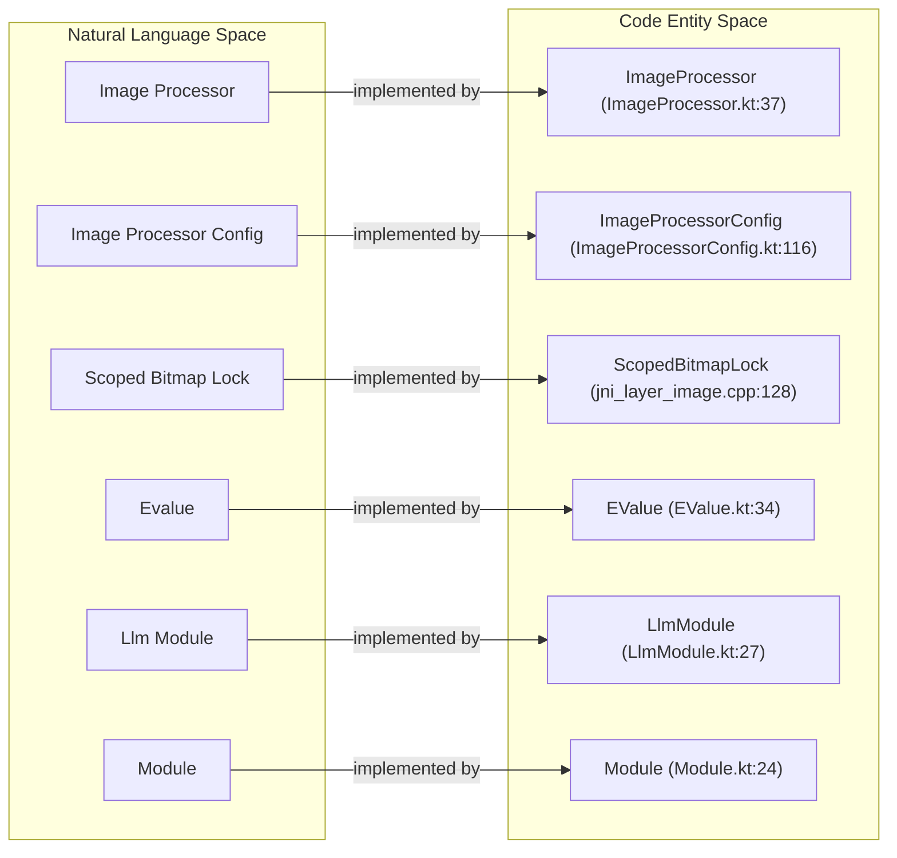
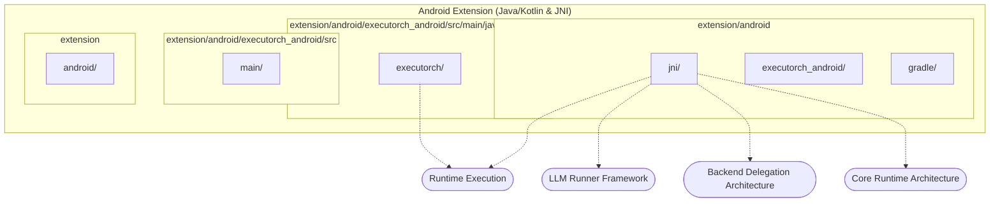
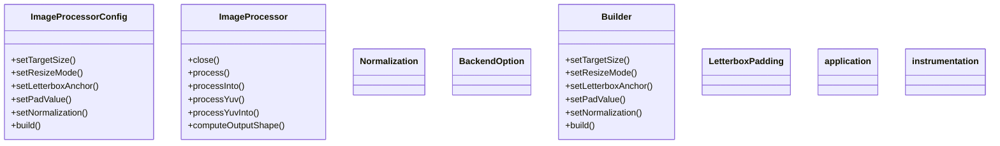
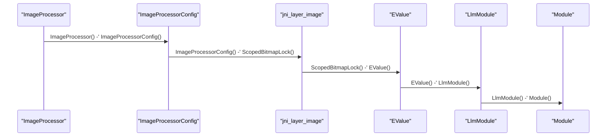

# Android Extension (Java/Kotlin & JNI)

↑ [[9-mobile-and-platform-extensions|Mobile and Platform Extensions]]

> Architectural specification and implementation reference for Android Extension (Java/Kotlin & JNI) (33 relevant source files). Primary code entities: `Java_org_pytorch_executorch_extension_image_ImageProcessor_nativeComputeLetterboxPadding`, `Java_org_pytorch_executorch_extension_image_ImageProcessor_nativeComputeOutputShape`, `Java_org_pytorch_executorch_extension_image_ImageProcessor_nativeCreate`, `Java_org_pytorch_executorch_extension_image_ImageProcessor_nativeDestroy`, `JNI_OnLoad`.

<details>
<summary>Relevant source files</summary>

The following files were used as context for generating this wiki page:

- [extension/android/jni/jni_layer_image.cpp](extension/android/jni/jni_layer_image.cpp)
- [extension/android/jni/jni_layer.cpp](extension/android/jni/jni_layer.cpp)
- [extension/android/executorch_android/src/main/java/org/pytorch/executorch/EValue.kt](extension/android/executorch_android/src/main/java/org/pytorch/executorch/EValue.kt)
- [extension/android/executorch_android/src/main/java/org/pytorch/executorch/extension/llm/LlmModule.kt](extension/android/executorch_android/src/main/java/org/pytorch/executorch/extension/llm/LlmModule.kt)
- [extension/android/executorch_android/src/main/java/org/pytorch/executorch/Module.kt](extension/android/executorch_android/src/main/java/org/pytorch/executorch/Module.kt)
- [extension/android/executorch_android/src/main/java/org/pytorch/executorch/Tensor.kt](extension/android/executorch_android/src/main/java/org/pytorch/executorch/Tensor.kt)
- [extension/android/jni/jni_layer_llama.cpp](extension/android/jni/jni_layer_llama.cpp)
- [extension/android/executorch_android/android_test_setup.sh](extension/android/executorch_android/android_test_setup.sh)
- [extension/android/executorch_android/src/main/AndroidManifest.xml](extension/android/executorch_android/src/main/AndroidManifest.xml)
- [extension/android/jni/jni_layer_training.cpp](extension/android/jni/jni_layer_training.cpp)
- [extension/android/jni/jni_layer_asr.cpp](extension/android/jni/jni_layer_asr.cpp)
- [extension/android/gradle/libs.versions.toml](extension/android/gradle/libs.versions.toml)
- [extension/android/jni/jni_helper.cpp](extension/android/jni/jni_helper.cpp)
- [extension/android/jni/jni_layer_runtime.cpp](extension/android/jni/jni_layer_runtime.cpp)
- [extension/android/jni/jni_helper.h](extension/android/jni/jni_helper.h)
- [extension/android/executorch_android/src/main/java/org/pytorch/executorch/extension/image/ImageProcessor.kt](extension/android/executorch_android/src/main/java/org/pytorch/executorch/extension/image/ImageProcessor.kt)
- [extension/android/gradlew](extension/android/gradlew)
- [extension/android/jni/log.h](extension/android/jni/log.h)
- [extension/android/executorch_android/src/main/java/org/pytorch/executorch/BackendOptionsMap.kt](extension/android/executorch_android/src/main/java/org/pytorch/executorch/BackendOptionsMap.kt)
- [extension/android/executorch_android/src/main/java/org/pytorch/executorch/ExecutorchRuntimeException.kt](extension/android/executorch_android/src/main/java/org/pytorch/executorch/ExecutorchRuntimeException.kt)
- [extension/android/executorch_android/src/main/java/org/pytorch/executorch/extension/image/ImageProcessorConfig.kt](extension/android/executorch_android/src/main/java/org/pytorch/executorch/extension/image/ImageProcessorConfig.kt)
- [extension/android/executorch_android/src/main/java/org/pytorch/executorch/DType.kt](extension/android/executorch_android/src/main/java/org/pytorch/executorch/DType.kt)
- [extension/android/executorch_android/src/main/java/org/pytorch/executorch/ExecuTorchRuntime.kt](extension/android/executorch_android/src/main/java/org/pytorch/executorch/ExecuTorchRuntime.kt)
- [extension/android/executorch_android/src/main/java/org/pytorch/executorch/extension/llm/LlmModuleConfig.kt](extension/android/executorch_android/src/main/java/org/pytorch/executorch/extension/llm/LlmModuleConfig.kt)
- [extension/android/jni/jni_layer_constants.h](extension/android/jni/jni_layer_constants.h)
- [extension/android/executorch_android/src/main/java/org/pytorch/executorch/MethodMetadata.kt](extension/android/executorch_android/src/main/java/org/pytorch/executorch/MethodMetadata.kt)
- [extension/android/jni/log.cpp](extension/android/jni/log.cpp)
- [extension/android/jni/selective_jni.buck.bzl](extension/android/jni/selective_jni.buck.bzl)
- [extension/android/README.md](extension/android/README.md)
- [docs/source/using-executorch-android.md](docs/source/using-executorch-android.md)
- [extension/android/BUCK](extension/android/BUCK)
- [extension/android/CMakeLists.txt](extension/android/CMakeLists.txt)
- [extension/android/jni/BUCK](extension/android/jni/BUCK)

</details>

## Purpose and Scope

Architectural specification and implementation reference for Android Extension (Java/Kotlin & JNI) (33 relevant source files). Primary code entities: `Java_org_pytorch_executorch_extension_image_ImageProcessor_nativeComputeLetterboxPadding`, `Java_org_pytorch_executorch_extension_image_ImageProcessor_nativeComputeOutputShape`, `Java_org_pytorch_executorch_extension_image_ImageProcessor_nativeCreate`, `Java_org_pytorch_executorch_extension_image_ImageProcessor_nativeDestroy`, `JNI_OnLoad`.

Primary code entities analyzed on this page include `ImageProcessor` ([extension/android/executorch_android/src/main/java/org/pytorch/executorch/extension/image/ImageProcessor.kt:37-361]()), `ImageProcessorConfig` ([extension/android/executorch_android/src/main/java/org/pytorch/executorch/extension/image/ImageProcessorConfig.kt:116-167]()), `ScopedBitmapLock` ([extension/android/jni/jni_layer_image.cpp:128-189]()), `EValue` ([extension/android/executorch_android/src/main/java/org/pytorch/executorch/EValue.kt:34-209]()), `LlmModule` ([extension/android/executorch_android/src/main/java/org/pytorch/executorch/extension/llm/LlmModule.kt:27-898]()).

For the parent architectural layer, see [[9-mobile-and-platform-extensions|Mobile and Platform Extensions]]. Related sibling subsystems: [[9.2-apple-ios-macos-extension|Apple iOS/macOS Extension (Swift & Objective-C)]], [[9.3-high-level-module-and-on-device-training|High-Level Module API, Tensor & On-Device Training]], [[9.4-embedded-and-web-targets|Embedded (Zephyr, ESP32, Pico2) and WebAssembly/WebGPU Targets]].

Sources: [extension/android/executorch_android/src/main/java/org/pytorch/executorch/extension/image/ImageProcessor.kt:37-361](), [extension/android/executorch_android/src/main/java/org/pytorch/executorch/extension/image/ImageProcessorConfig.kt:116-167](), [extension/android/jni/jni_layer_image.cpp:128-189](), [extension/android/executorch_android/src/main/java/org/pytorch/executorch/EValue.kt:34-209]()

---

## 1. High-Level Architecture and Data Flow

### Natural Language Space to Code Entity Space Mapping

The following diagram maps domain concepts in this subsystem to their concrete code entities:



### Subsystem Component & Dependency Flow



Cross-subsystem call and import edges connect **Android Extension (Java/Kotlin & JNI)** with [[8.1-core-runtime-architecture|Core Runtime Architecture]] (coupling `65.0`), [[8-runtime-execution|Runtime Execution]] (coupling `52.0`), [[9.3-high-level-module-and-on-device-training|High-Level Module API, Tensor & On-Device Training]] (coupling `19.0`), [[6.2-llm-runner-framework|LLM Runner Framework]] (coupling `19.0`), [[5-backend-delegation-architecture|Backend Delegation Architecture]] (coupling `15.0`).

| Module Directory | Files | Primary Code Entities | Source Citations |
|---|---|---|---|
| `extension/android/jni` | 13 | `ScopedBitmapLock`, `TensorHybrid`, `AsrCallbackCache`, `AsrModuleHandle` | [extension/android/jni/jni_layer_image.cpp:128-189]() [extension/android/jni/jni_layer_training.cpp:33-43]() |
| `extension/android/executorch_android/src/main/java/org/pytorch/executorch` | 8 | `EValue`, `Module`, `Tensor`, `BackendOption` | [extension/android/executorch_android/src/main/java/org/pytorch/executorch/EValue.kt:34-209]() [extension/android/executorch_android/src/main/java/org/pytorch/executorch/Module.kt:24-325]() |
| `extension/android` | 4 | `die`, `warn` | [extension/android/gradlew:96-101]() [extension/android/gradlew:92-94]() |
| `extension/android/executorch_android/src/main/java/org/pytorch/executorch/extension/image` | 2 | `ImageProcessor`, `ImageProcessorConfig`, `Normalization`, `Builder` | [extension/android/executorch_android/src/main/java/org/pytorch/executorch/extension/image/ImageProcessor.kt:37-361]() [extension/android/executorch_android/src/main/java/org/pytorch/executorch/extension/image/ImageProcessorConfig.kt:116-167]() |
| `extension/android/executorch_android/src/main/java/org/pytorch/executorch/extension/llm` | 2 | `LlmModule`, `Builder`, `LlmModuleConfig`, `generate` | [extension/android/executorch_android/src/main/java/org/pytorch/executorch/extension/llm/LlmModule.kt:27-898]() [extension/android/executorch_android/src/main/java/org/pytorch/executorch/extension/llm/LlmModuleConfig.kt:64-133]() |
| `extension/android/executorch_android` | 1 | `prepare_add`, `prepare_golden`, `prepare_tinyllama`, `prepare_xor` | [extension/android/executorch_android/android_test_setup.sh:44-48]() [extension/android/executorch_android/android_test_setup.sh:31-42]() |
| `extension/android/executorch_android/src/main` | 1 | `application`, `instrumentation`, `manifest` | [extension/android/executorch_android/src/main/AndroidManifest.xml:3-4]() [extension/android/executorch_android/src/main/AndroidManifest.xml:5-8]() |
| `extension/android/gradle` | 1 | `libraries`, `plugins`, `versions` | [extension/android/gradle/libs.versions.toml:11-16]() [extension/android/gradle/libs.versions.toml:16-18]() |

Sources: [extension/android/executorch_android/src/main/java/org/pytorch/executorch/extension/image/ImageProcessor.kt:37-361](), [extension/android/executorch_android/src/main/java/org/pytorch/executorch/extension/image/ImageProcessorConfig.kt:116-167](), [extension/android/jni/jni_layer_image.cpp:128-189](), [extension/android/executorch_android/src/main/java/org/pytorch/executorch/EValue.kt:34-209](), [extension/android/executorch_android/src/main/java/org/pytorch/executorch/extension/llm/LlmModule.kt:27-898]()

---

## 2. Core Data Structures and Implementation Details

### Class and Entity Relationship Diagram



### `ImageProcessor` (Class)

- **Source Location**: [extension/android/executorch_android/src/main/java/org/pytorch/executorch/extension/image/ImageProcessor.kt:37-361]()
- **Declaration**: `Class ImageProcessor`
- **Graph Centrality**: fan-in `22` callers, fan-out `0` callees
- **Responsibility**: /** * Converts camera frames and bitmaps into the normalized `[1, 3, H, W]` float tensors vision models * expect, replacing the hand-rolled resize/normalize loops apps otherwise write per model. * * The pipeline rotates the source upright according to the supplied [ImageOrientation], resizes it * per [ImageProcessorCon

```kotlin
// extension/android/executorch_android/src/main/java/org/pytorch/executorch/extension/image/ImageProcessor.kt:37-52
@Experimental
class ImageProcessor(val config: ImageProcessorConfig) : Closeable {

  private val nativeHandle = AtomicLong(0L)

  init {
    val handle =
        nativeCreate(
            config.targetWidth,
            config.targetHeight,
            config.resizeMode.ordinal,
            config.letterboxAnchor.ordinal,
            config.padValue,
            config.normalization.scaleFactor,
            config.normalization.mean,
            config.normalization.standardDeviation,
```

### `ImageProcessorConfig` (Class)

- **Source Location**: [extension/android/executorch_android/src/main/java/org/pytorch/executorch/extension/image/ImageProcessorConfig.kt:116-167]()
- **Declaration**: `Class ImageProcessorConfig`
- **Graph Centrality**: fan-in `23` callers, fan-out `0` callees
- **Responsibility**: /** * Configuration for [ImageProcessor]. * * Warning: These APIs are experimental and subject to change without notice * * @property targetWidth Width of the produced tensor, in pixels. * @property targetHeight Height of the produced tensor, in pixels. * @property resizeMode How the source is fitted to the target dime

```kotlin
// extension/android/executorch_android/src/main/java/org/pytorch/executorch/extension/image/ImageProcessorConfig.kt:116-131
@Experimental
data class ImageProcessorConfig(
    val targetWidth: Int = 224,
    val targetHeight: Int = 224,
    val resizeMode: ResizeMode = ResizeMode.STRETCH,
    val letterboxAnchor: LetterboxAnchor = LetterboxAnchor.CENTER,
    val padValue: Float = 0.0f,
    val normalization: Normalization = Normalization.zeroToOne(),
) {
  init {
    require(targetWidth > 0) { "targetWidth must be positive" }
    require(targetHeight > 0) { "targetHeight must be positive" }
  }

  /** Builder class for ImageProcessorConfig for Java interoperability. */
  class Builder {
```

### `ScopedBitmapLock` (Class)

- **Source Location**: [extension/android/jni/jni_layer_image.cpp:128-189]()
- **Declaration**: `Class ScopedBitmapLock`
- **Graph Centrality**: fan-in `0` callers, fan-out `0` callees
- **Responsibility**: // Locks an ARGB_8888 bitmap for the lifetime of the scope. Android stores that // format as RGBA bytes in memory, so it maps to ColorFormat::RGBA.

```cpp
// extension/android/jni/jni_layer_image.cpp:128-143
class ScopedBitmapLock {
 public:
  ScopedBitmapLock(JNIEnv* env, jobject bitmap) : env_(env), bitmap_(bitmap) {
    if (AndroidBitmap_getInfo(env, bitmap, &info_) !=
        ANDROID_BITMAP_RESULT_SUCCESS) {
      setExecutorchPendingException(
          env,
          static_cast<uint32_t>(Error::InvalidArgument),
          "Failed to read Bitmap info");
      return;
    }
    if (info_.format != ANDROID_BITMAP_FORMAT_RGBA_8888) {
      setExecutorchPendingException(
          env,
          static_cast<uint32_t>(Error::InvalidArgument),
          "Bitmap must be ARGB_8888");
```

### `EValue` (Class)

- **Source Location**: [extension/android/executorch_android/src/main/java/org/pytorch/executorch/EValue.kt:34-209]()
- **Declaration**: `Class EValue`
- **Graph Centrality**: fan-in `0` callers, fan-out `0` callees
- **Responsibility**: /** * Java representation of an ExecuTorch value, which is implemented as tagged union that can be one * of the supported types: https://pytorch.org/docs/stable/jit.html#types . * * Calling `toX` methods for inappropriate types will throw [IllegalStateException]. * * `EValue` objects are constructed with `EValue.from(v

### `LlmModule` (Class)

- **Source Location**: [extension/android/executorch_android/src/main/java/org/pytorch/executorch/extension/llm/LlmModule.kt:27-898]()
- **Declaration**: `Class LlmModule`
- **Graph Centrality**: fan-in `0` callers, fan-out `0` callees
- **Responsibility**: /** * LlmModule is a wrapper around the Executorch LLM. It provides a simple interface to generate text * from the model. * * Warning: These APIs are experimental and subject to change without notice */

### `ok` (Method)

- **Source Location**: [extension/android/jni/jni_layer_image.cpp:167-169]()
- **Declaration**: `()`
- **Graph Centrality**: fan-in `56` callers, fan-out `0` callees

Sources: [extension/android/executorch_android/src/main/java/org/pytorch/executorch/extension/image/ImageProcessor.kt:37-361](), [extension/android/executorch_android/src/main/java/org/pytorch/executorch/extension/image/ImageProcessorConfig.kt:116-167](), [extension/android/jni/jni_layer_image.cpp:128-189](), [extension/android/executorch_android/src/main/java/org/pytorch/executorch/EValue.kt:34-209](), [extension/android/executorch_android/src/main/java/org/pytorch/executorch/extension/llm/LlmModule.kt:27-898]()

---

## 3. Execution and Call Flow

The sequence diagram below traces the runtime/compile-time call chain across components in this module:



Sources: [extension/android/executorch_android/src/main/java/org/pytorch/executorch/extension/image/ImageProcessor.kt:37-361](), [extension/android/executorch_android/src/main/java/org/pytorch/executorch/extension/image/ImageProcessorConfig.kt:116-167](), [extension/android/jni/jni_layer_image.cpp:128-189](), [extension/android/executorch_android/src/main/java/org/pytorch/executorch/EValue.kt:34-209](), [extension/android/executorch_android/src/main/java/org/pytorch/executorch/extension/llm/LlmModule.kt:27-898]()

---

## 4. Key API and Symbol Reference

| Code Entity | Kind | Location | Fan-In / Out | Role & Signature |
|---|---|---|---|---|
| `ImageProcessor` | Class | [extension/android/executorch_android/src/main/java/org/pytorch/executorch/extension/image/ImageProcessor.kt:37-361]() | `22` / `0` | /** |
| `ImageProcessorConfig` | Class | [extension/android/executorch_android/src/main/java/org/pytorch/executorch/extension/image/ImageProcessorConfig.kt:116-167]() | `23` / `0` | /** |
| `ScopedBitmapLock` | Class | [extension/android/jni/jni_layer_image.cpp:128-189]() | `0` / `0` | // Locks an ARGB_8888 bitmap for the lifetime of the scope. Android stores that |
| `EValue` | Class | [extension/android/executorch_android/src/main/java/org/pytorch/executorch/EValue.kt:34-209]() | `0` / `0` | /** |
| `LlmModule` | Class | [extension/android/executorch_android/src/main/java/org/pytorch/executorch/extension/llm/LlmModule.kt:27-898]() | `0` / `0` | /** |
| `Module` | Class | [extension/android/executorch_android/src/main/java/org/pytorch/executorch/Module.kt:24-325]() | `0` / `0` | /** |
| `Tensor` | Class | [extension/android/executorch_android/src/main/java/org/pytorch/executorch/Tensor.kt:43-837]() | `0` / `0` | /** |
| `TensorHybrid` | Class | [extension/android/jni/jni_layer_training.cpp:33-43]() | `0` / `0` | // Forward declarations from jni_layer.cpp |
| `AsrCallbackCache` | Class | [extension/android/jni/jni_layer_asr.cpp:52-55]() | `0` / `0` | // Global cached JNI references for callback (shared across threads) |
| `AsrModuleHandle` | Class | [extension/android/jni/jni_layer_asr.cpp:35-38]() | `0` / `0` | // Handle struct that holds both the ASR runner and optional preprocessor |
| `Normalization` | Class | [extension/android/executorch_android/src/main/java/org/pytorch/executorch/extension/image/ImageProcessorConfig.kt:68-102]() | `2` / `0` | /** |
| `BackendOption` | Class | [extension/android/executorch_android/src/main/java/org/pytorch/executorch/BackendOptionsMap.kt:14-14]() | `1` / `0` | /** A single backend option: an integer [value] for [key]. */ |
| `JExecutorchRuntimeException` | Class | [extension/android/jni/jni_helper.h:53-57]() | `0` / `0` | // Define the JavaClass wrapper |
| `Builder` | Class | [extension/android/executorch_android/src/main/java/org/pytorch/executorch/extension/image/ImageProcessorConfig.kt:131-166]() | `1` / `0` | /** Builder class for ImageProcessorConfig for Java interoperability. */ |
| `LetterboxPadding` | Class | [extension/android/executorch_android/src/main/java/org/pytorch/executorch/extension/image/ImageProcessorConfig.kt:175-175]() | `1` / `0` | /** |
| `BackendOptionsMap` | Class | [extension/android/executorch_android/src/main/java/org/pytorch/executorch/BackendOptionsMap.kt:29-58]() | `0` / `0` | /** |
| `ExecutorchRuntimeException` | Class | [extension/android/executorch_android/src/main/java/org/pytorch/executorch/ExecutorchRuntimeException.kt:17-151]() | `0` / `0` | /** |
| `DType` | Class | [extension/android/executorch_android/src/main/java/org/pytorch/executorch/DType.kt:18-77]() | `0` / `0` | /** |
| `ImageOrientation` | Class | [extension/android/executorch_android/src/main/java/org/pytorch/executorch/extension/image/ImageProcessorConfig.kt:35-41]() | `0` / `0` | /** |
| `LetterboxAnchor` | Class | [extension/android/executorch_android/src/main/java/org/pytorch/executorch/extension/image/ImageProcessorConfig.kt:23-27]() | `0` / `0` | /** Where letterboxed content sits within the padded canvas. */ |
| `ResizeMode` | Class | [extension/android/executorch_android/src/main/java/org/pytorch/executorch/extension/image/ImageProcessorConfig.kt:14-20]() | `0` / `0` | /** How the source image is fitted to the target dimensions. */ |
| `YuvFormat` | Class | [extension/android/executorch_android/src/main/java/org/pytorch/executorch/extension/image/ImageProcessorConfig.kt:44-48]() | `0` / `0` | /** Chroma layout of semi-planar YUV input. */ |

Sources: [extension/android/executorch_android/src/main/java/org/pytorch/executorch/extension/image/ImageProcessor.kt:37-361](), [extension/android/executorch_android/src/main/java/org/pytorch/executorch/extension/image/ImageProcessorConfig.kt:116-167](), [extension/android/jni/jni_layer_image.cpp:128-189](), [extension/android/executorch_android/src/main/java/org/pytorch/executorch/EValue.kt:34-209](), [extension/android/executorch_android/src/main/java/org/pytorch/executorch/extension/llm/LlmModule.kt:27-898](), [extension/android/executorch_android/src/main/java/org/pytorch/executorch/Module.kt:24-325]()

---

## 5. Official Documentation and Design Context

The following linked documentation sections from `llm-wiki` (`raw/`) provide additional architectural context, tutorials, and design invariants for this subsystem:

- **Mobile and Platform Extensions** ([wiki/9-mobile-and-platform-extensions.md](), score `255.4408`) (sections: `Mobile and Platform Extensions`, `Purpose and Scope`, `System Mapping: Natural Language Space to Code Entity Space`, `1. Android Extension (Java/Kotlin & JNI)`): # Mobile and Platform Extensions > Architectural specification and implementation reference for Mobile and Platform Extensions (40 relevant source files). Primary code entities: `BindingSpec`, `ComputePipelineBundle`, `operator=`, `Storage`, `~Storage`. <details> <summary>Relevant source files</summary> The following files were used as context for generating this wiki page: - [backends/webgpu/runtime/WebGPUUtils.h](b
- **ExecuTorch DeepWiki** ([wiki/index.md](), score `251.9151`) (sections: `ExecuTorch DeepWiki`, `Pages`): # ExecuTorch DeepWiki Generated from `home-jason-Project-deepwiki-executorch` at commit `b3b565b5b62f` (2026-11-15T15:02:11+00:00). ## Pages - [[1-overview|Overview]] — Architectural specification and implementation reference for Overview (10 relevant source files). Primary code entities: `Module`, `MethodHolder`, `PlannedMemory`, `EdgeProgramManager`, `__init__`. - [[1.1-getting-started|Getting Started]] — Architect
- **Apple iOS/macOS Extension (Swift & Objective-C)** ([wiki/9.2-apple-ios-macos-extension.md](), score `221.0446`) (sections: `Apple iOS/macOS Extension (Swift & Objective-C)`, `Purpose and Scope`, `1. High-Level Architecture and Data Flow`, `Natural Language Space to Code Entity Space Mapping`): # Apple iOS/macOS Extension (Swift & Objective-C) ↑ [[9-mobile-and-platform-extensions|Mobile and Platform Extensions]] > Architectural specification and implementation reference for Apple iOS/macOS Extension (Swift & Objective-C) (26 relevant source files). Primary code entities: `AnyTensor`, `asValue`, `from`, `Array`, `==`. <details> <summary>Relevant source files</summary> The following files were used as context
- **Working with Computer Vision Models** ([working-with-cv-models.md](), score `176.5667`) (sections: `Working with Computer Vision Models`, `Choose where preprocessing runs`, `Convert images to tensors in app code`, `C++`): (working-with-cv-models)= # Working with Computer Vision Models Computer vision deployments depend on the boundary between the app and the exported program being precise. Before exporting, write down the tensor contract that your app will satisfy: - input shape, including whether the model expects `NCHW` (`[batch, channels, height, width]`) or `NHWC` (`[batch, height, width, channels]`) - input dtype, such as `float3

Sources: [wiki/9-mobile-and-platform-extensions.md](), [wiki/index.md](), [wiki/9.2-apple-ios-macos-extension.md](), [working-with-cv-models.md]()

## Related pages

- [[9-mobile-and-platform-extensions|Mobile and Platform Extensions]]
- [[1.1-getting-started|Getting Started]]
- [[1.2-export-api-and-recipe-system|Export API and Recipe System]]
- [[2.2-kernel-libraries-and-selective-build|Kernel Libraries and Selective Build]]
- [[2.3-schema-generation-and-flatbuffers|Schema Generation and FlatBuffers]]
- [[3.4-program-emission-and-serialization|Program Emission and Serialization]]
- [[3.5-verification-and-dialect-system|Verification and Dialect System]]
- [[4-quantization-systems|Quantization Systems]]

## Related documents

- `wiki/9-mobile-and-platform-extensions.md` — Mobile and Platform Extensions (score 255.4408, via bm25)
- `wiki/index.md` — ExecuTorch DeepWiki (score 251.9151, via bm25)
- `wiki/9.2-apple-ios-macos-extension.md` — Apple iOS/macOS Extension (Swift & Objective-C) (score 221.0446, via bm25)
- `raw/executorch/working-with-cv-models.md` — Working with Computer Vision Models (score 176.5667, via bm25)
- `raw/executorch/run-on-android.md` — Running LLMs on Android (score 143.181, via bm25)

## Sources

- [`extension/android/jni/jni_layer_image.cpp`](https://github.com/pytorch/executorch/blob/main/extension/android/jni/jni_layer_image.cpp)
- [`extension/android/jni/jni_layer.cpp`](https://github.com/pytorch/executorch/blob/main/extension/android/jni/jni_layer.cpp)
- [`extension/android/executorch_android/src/main/java/org/pytorch/executorch/EValue.kt`](https://github.com/pytorch/executorch/blob/main/extension/android/executorch_android/src/main/java/org/pytorch/executorch/EValue.kt)
- [`extension/android/executorch_android/src/main/java/org/pytorch/executorch/extension/llm/LlmModule.kt`](https://github.com/pytorch/executorch/blob/main/extension/android/executorch_android/src/main/java/org/pytorch/executorch/extension/llm/LlmModule.kt)
- [`extension/android/executorch_android/src/main/java/org/pytorch/executorch/Module.kt`](https://github.com/pytorch/executorch/blob/main/extension/android/executorch_android/src/main/java/org/pytorch/executorch/Module.kt)
- [`extension/android/executorch_android/src/main/java/org/pytorch/executorch/Tensor.kt`](https://github.com/pytorch/executorch/blob/main/extension/android/executorch_android/src/main/java/org/pytorch/executorch/Tensor.kt)
- [`extension/android/jni/jni_layer_llama.cpp`](https://github.com/pytorch/executorch/blob/main/extension/android/jni/jni_layer_llama.cpp)
- [`extension/android/executorch_android/android_test_setup.sh`](https://github.com/pytorch/executorch/blob/main/extension/android/executorch_android/android_test_setup.sh)
- [`extension/android/executorch_android/src/main/AndroidManifest.xml`](https://github.com/pytorch/executorch/blob/main/extension/android/executorch_android/src/main/AndroidManifest.xml)
- [`extension/android/jni/jni_layer_training.cpp`](https://github.com/pytorch/executorch/blob/main/extension/android/jni/jni_layer_training.cpp)
- [`extension/android/jni/jni_layer_asr.cpp`](https://github.com/pytorch/executorch/blob/main/extension/android/jni/jni_layer_asr.cpp)
- [`extension/android/gradle/libs.versions.toml`](https://github.com/pytorch/executorch/blob/main/extension/android/gradle/libs.versions.toml)
- [`extension/android/jni/jni_helper.cpp`](https://github.com/pytorch/executorch/blob/main/extension/android/jni/jni_helper.cpp)
- [`extension/android/jni/jni_layer_runtime.cpp`](https://github.com/pytorch/executorch/blob/main/extension/android/jni/jni_layer_runtime.cpp)
- [`extension/android/jni/jni_helper.h`](https://github.com/pytorch/executorch/blob/main/extension/android/jni/jni_helper.h)
- [`extension/android/executorch_android/src/main/java/org/pytorch/executorch/extension/image/ImageProcessor.kt`](https://github.com/pytorch/executorch/blob/main/extension/android/executorch_android/src/main/java/org/pytorch/executorch/extension/image/ImageProcessor.kt)
- [`extension/android/gradlew`](https://github.com/pytorch/executorch/blob/main/extension/android/gradlew)
- [`extension/android/jni/log.h`](https://github.com/pytorch/executorch/blob/main/extension/android/jni/log.h)
- [`extension/android/executorch_android/src/main/java/org/pytorch/executorch/BackendOptionsMap.kt`](https://github.com/pytorch/executorch/blob/main/extension/android/executorch_android/src/main/java/org/pytorch/executorch/BackendOptionsMap.kt)
- [`extension/android/executorch_android/src/main/java/org/pytorch/executorch/ExecutorchRuntimeException.kt`](https://github.com/pytorch/executorch/blob/main/extension/android/executorch_android/src/main/java/org/pytorch/executorch/ExecutorchRuntimeException.kt)
- [`extension/android/executorch_android/src/main/java/org/pytorch/executorch/extension/image/ImageProcessorConfig.kt`](https://github.com/pytorch/executorch/blob/main/extension/android/executorch_android/src/main/java/org/pytorch/executorch/extension/image/ImageProcessorConfig.kt)
- [`extension/android/executorch_android/src/main/java/org/pytorch/executorch/DType.kt`](https://github.com/pytorch/executorch/blob/main/extension/android/executorch_android/src/main/java/org/pytorch/executorch/DType.kt)
- [`extension/android/executorch_android/src/main/java/org/pytorch/executorch/ExecuTorchRuntime.kt`](https://github.com/pytorch/executorch/blob/main/extension/android/executorch_android/src/main/java/org/pytorch/executorch/ExecuTorchRuntime.kt)
- [`extension/android/executorch_android/src/main/java/org/pytorch/executorch/extension/llm/LlmModuleConfig.kt`](https://github.com/pytorch/executorch/blob/main/extension/android/executorch_android/src/main/java/org/pytorch/executorch/extension/llm/LlmModuleConfig.kt)
- [`extension/android/jni/jni_layer_constants.h`](https://github.com/pytorch/executorch/blob/main/extension/android/jni/jni_layer_constants.h)
- [`extension/android/executorch_android/src/main/java/org/pytorch/executorch/MethodMetadata.kt`](https://github.com/pytorch/executorch/blob/main/extension/android/executorch_android/src/main/java/org/pytorch/executorch/MethodMetadata.kt)
- [`extension/android/jni/log.cpp`](https://github.com/pytorch/executorch/blob/main/extension/android/jni/log.cpp)
- [`extension/android/jni/selective_jni.buck.bzl`](https://github.com/pytorch/executorch/blob/main/extension/android/jni/selective_jni.buck.bzl)
- [`extension/android/README.md`](https://github.com/pytorch/executorch/blob/main/extension/android/README.md)
- [`docs/source/using-executorch-android.md`](https://github.com/pytorch/executorch/blob/main/docs/source/using-executorch-android.md)
- [`extension/android/BUCK`](https://github.com/pytorch/executorch/blob/main/extension/android/BUCK)
- [`extension/android/CMakeLists.txt`](https://github.com/pytorch/executorch/blob/main/extension/android/CMakeLists.txt)
- [`extension/android/jni/BUCK`](https://github.com/pytorch/executorch/blob/main/extension/android/jni/BUCK)


## Dynamic Knowledge Links (Code Graph ↔ LLM-Wiki / RAG)

### Linked Architecture & Design Documents

| Document | Match Channel | Score | Shared Code Symbols |
|---|---|---|---|
| [[9-mobile-and-platform-extensions|Mobile and Platform Extensions]] | `bm25+entity(6)` | `264.441` | `EValue`, `ImageProcessor`, `ImageProcessorConfig`, `LlmModule`, `Module` |
| [[index|ExecuTorch DeepWiki]] | `bm25` | `251.915` | *(lexical/graph match)* |
| [[9.2-apple-ios-macos-extension|Apple iOS/macOS Extension (Swift & Objective-C)]] | `bm25+entity(4)` | `227.045` | `ImageProcessor`, `ImageProcessorConfig`, `Module`, `Tensor` |
| `raw/executorch/working-with-cv-models.md` (Working with Computer Vision Models) | `bm25+entity(5)` | `184.067` | `EValue`, `ImageProcessor`, `ImageProcessorConfig`, `Module`, `Tensor` |
| [[8.1-core-runtime-architecture|Core Runtime Architecture]] | `wikilink:9.1-android-extension+entity(3)` | `169.375` | `EValue`, `Module`, `Tensor` |
| [[9.3-high-level-module-and-on-device-training|High-Level Module API, Tensor & On-Device Training]] | `wikilink:9.1-android-extension+entity(2)` | `167.875` | `Module`, `Tensor` |

### High-Centrality Bridge Symbols (CBM Graph)

| Symbol | Kind | Source Location | Fan-In / Fan-Out |
|---|---|---|---|
| `ImageProcessor` | Class | [extension/android/executorch_android/src/main/java/org/pytorch/executorch/extension/image/ImageProcessor.kt:37-361]() | in: `22` / out: `0` |
| `ImageProcessorConfig` | Class | [extension/android/executorch_android/src/main/java/org/pytorch/executorch/extension/image/ImageProcessorConfig.kt:116-167]() | in: `23` / out: `0` |
| `ScopedBitmapLock` | Class | [extension/android/jni/jni_layer_image.cpp:128-189]() | in: `0` / out: `0` |
| `EValue` | Class | [extension/android/executorch_android/src/main/java/org/pytorch/executorch/EValue.kt:34-209]() | in: `0` / out: `0` |
| `LlmModule` | Class | [extension/android/executorch_android/src/main/java/org/pytorch/executorch/extension/llm/LlmModule.kt:27-898]() | in: `0` / out: `0` |
| `Module` | Class | [extension/android/executorch_android/src/main/java/org/pytorch/executorch/Module.kt:24-325]() | in: `0` / out: `0` |

Sources: [extension/android/executorch_android/src/main/java/org/pytorch/executorch/extension/image/ImageProcessor.kt:37-361](), [extension/android/executorch_android/src/main/java/org/pytorch/executorch/extension/image/ImageProcessorConfig.kt:116-167](), [extension/android/jni/jni_layer_image.cpp:128-189](), [extension/android/executorch_android/src/main/java/org/pytorch/executorch/EValue.kt:34-209]()

### Cross-Subsystem Coupling

- [[8.1-core-runtime-architecture|Core Runtime Architecture]] — call/import coupling weight `65.0`
- [[8-runtime-execution|Runtime Execution]] — call/import coupling weight `52.0`
- [[9.3-high-level-module-and-on-device-training|High-Level Module API, Tensor & On-Device Training]] — call/import coupling weight `19.0`
- [[6.2-llm-runner-framework|LLM Runner Framework]] — call/import coupling weight `19.0`
- [[5-backend-delegation-architecture|Backend Delegation Architecture]] — call/import coupling weight `15.0`
- [[2.4-python-bindings-and-dependencies|Python Bindings and Dependencies]] — call/import coupling weight `12.0`
