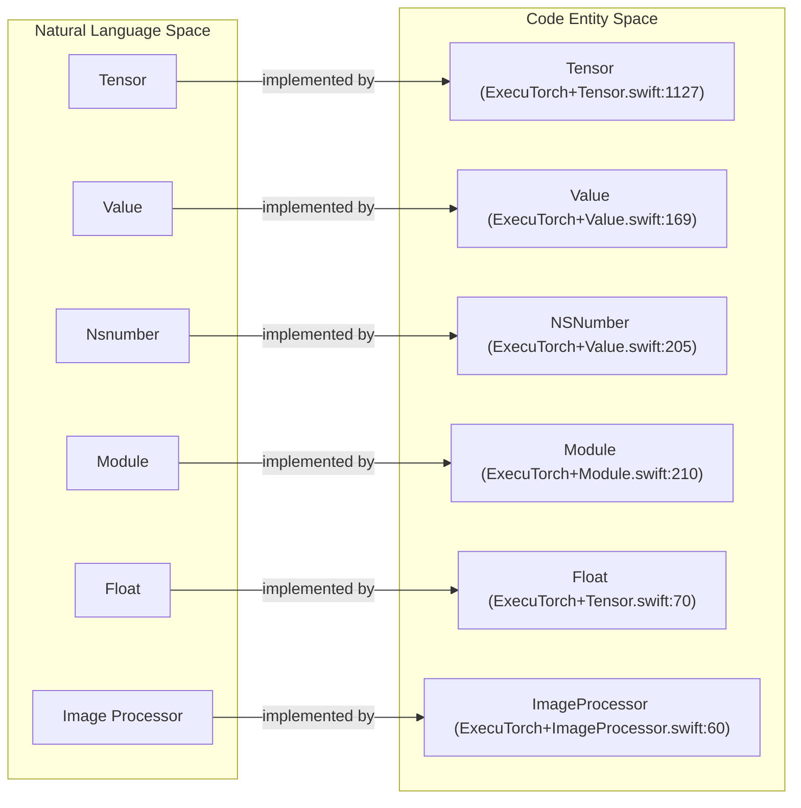
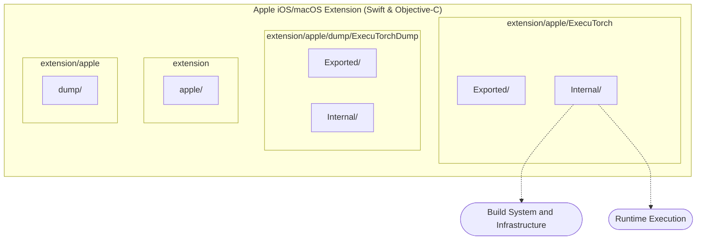
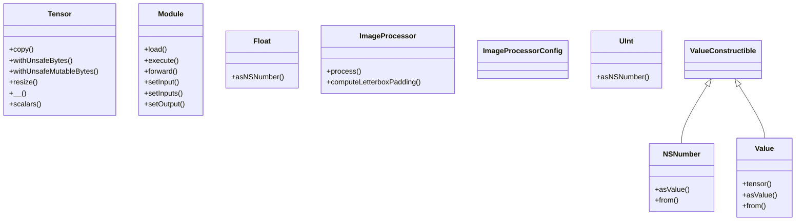
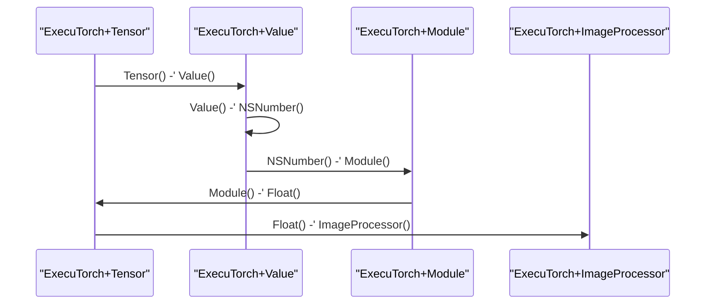

# Apple iOS/macOS Extension (Swift & Objective-C)

↑ [[9-mobile-and-platform-extensions|Mobile and Platform Extensions]]

> Architectural specification and implementation reference for Apple iOS/macOS Extension (Swift & Objective-C) (26 relevant source files). Primary code entities: `AnyTensor`, `asValue`, `from`, `Array`, `==`.

<details>
<summary>Relevant source files</summary>

The following files were used as context for generating this wiki page:

- [extension/apple/ExecuTorch/Exported/ExecuTorch+Value.swift](extension/apple/ExecuTorch/Exported/ExecuTorch+Value.swift)
- [extension/apple/ExecuTorch/Exported/ExecuTorch+Tensor.swift](extension/apple/ExecuTorch/Exported/ExecuTorch+Tensor.swift)
- [extension/apple/ExecuTorch/Exported/ExecuTorch+Module.swift](extension/apple/ExecuTorch/Exported/ExecuTorch+Module.swift)
- [extension/apple/ExecuTorch/Exported/ExecuTorch+ImageProcessor.swift](extension/apple/ExecuTorch/Exported/ExecuTorch+ImageProcessor.swift)
- [extension/apple/ExecuTorch/Exported/ExecuTorchImageProcessor.h](extension/apple/ExecuTorch/Exported/ExecuTorchImageProcessor.h)
- [extension/apple/ExecuTorch/Exported/ExecuTorch.h](extension/apple/ExecuTorch/Exported/ExecuTorch.h)
- [extension/apple/ExecuTorch/Exported/ExecuTorchBackendOption.h](extension/apple/ExecuTorch/Exported/ExecuTorchBackendOption.h)
- [extension/apple/ExecuTorch/Exported/ExecuTorchError.m](extension/apple/ExecuTorch/Exported/ExecuTorchError.m)
- [extension/apple/ExecuTorch/Exported/ExecuTorchBackendOptionsMap.h](extension/apple/ExecuTorch/Exported/ExecuTorchBackendOptionsMap.h)
- [extension/apple/ExecuTorch/Exported/ExecuTorchError.h](extension/apple/ExecuTorch/Exported/ExecuTorchError.h)
- [extension/apple/ExecuTorch/Exported/ExecuTorchEventTracer.h](extension/apple/ExecuTorch/Exported/ExecuTorchEventTracer.h)
- [extension/apple/ExecuTorch/Exported/ExecuTorchLog.h](extension/apple/ExecuTorch/Exported/ExecuTorchLog.h)
- [extension/apple/ExecuTorch/Exported/ExecuTorchModule.h](extension/apple/ExecuTorch/Exported/ExecuTorchModule.h)
- [extension/apple/ExecuTorch/Exported/ExecuTorchTensor.h](extension/apple/ExecuTorch/Exported/ExecuTorchTensor.h)
- [extension/apple/ExecuTorch/Internal/ExecuTorchUtils.h](extension/apple/ExecuTorch/Internal/ExecuTorchUtils.h)
- [extension/apple/ExecuTorch/Exported/ExecuTorchValue.h](extension/apple/ExecuTorch/Exported/ExecuTorchValue.h)
- [extension/apple/ExecuTorch/Internal/ExecuTorchBackendOptionsMap+Internal.h](extension/apple/ExecuTorch/Internal/ExecuTorchBackendOptionsMap+Internal.h)
- [extension/apple/dump/ExecuTorchDump/Exported/ExecuTorchDump.h](extension/apple/dump/ExecuTorchDump/Exported/ExecuTorchDump.h)
- [extension/apple/dump/ExecuTorchDump/Exported/ExecuTorchDumpError.h](extension/apple/dump/ExecuTorchDump/Exported/ExecuTorchDumpError.h)
- [extension/apple/dump/ExecuTorchDump/Exported/ExecuTorchDumpTracer.h](extension/apple/dump/ExecuTorchDump/Exported/ExecuTorchDumpTracer.h)
- [extension/apple/dump/ExecuTorchDump/Internal/ExecuTorchDumpTracer+Internal.h](extension/apple/dump/ExecuTorchDump/Internal/ExecuTorchDumpTracer+Internal.h)
- [docs/source/using-executorch-ios.md](docs/source/using-executorch-ios.md)
- [extension/apple/BUCK](extension/apple/BUCK)
- [extension/apple/CMakeLists.txt](extension/apple/CMakeLists.txt)
- [extension/apple/dump/BUCK](extension/apple/dump/BUCK)
- [extension/apple/dump/CMakeLists.txt](extension/apple/dump/CMakeLists.txt)

</details>

## Purpose and Scope

Architectural specification and implementation reference for Apple iOS/macOS Extension (Swift & Objective-C) (26 relevant source files). Primary code entities: `AnyTensor`, `asValue`, `from`, `Array`, `==`.

Primary code entities analyzed on this page include `Tensor` ([extension/apple/ExecuTorch/Exported/ExecuTorch+Tensor.swift:1127-1131]()), `Value` ([extension/apple/ExecuTorch/Exported/ExecuTorch+Value.swift:169-173]()), `NSNumber` ([extension/apple/ExecuTorch/Exported/ExecuTorch+Value.swift:205-212]()), `Module` ([extension/apple/ExecuTorch/Exported/ExecuTorch+Module.swift:210-327]()), `Float` ([extension/apple/ExecuTorch/Exported/ExecuTorch+Tensor.swift:70-75]()).

For the parent architectural layer, see [[9-mobile-and-platform-extensions|Mobile and Platform Extensions]]. Related sibling subsystems: [[9.1-android-extension|Android Extension (Java/Kotlin & JNI)]], [[9.3-high-level-module-and-on-device-training|High-Level Module API, Tensor & On-Device Training]], [[9.4-embedded-and-web-targets|Embedded (Zephyr, ESP32, Pico2) and WebAssembly/WebGPU Targets]].

Sources: [extension/apple/ExecuTorch/Exported/ExecuTorch+Tensor.swift:1127-1131](), [extension/apple/ExecuTorch/Exported/ExecuTorch+Value.swift:169-173](), [extension/apple/ExecuTorch/Exported/ExecuTorch+Value.swift:205-212](), [extension/apple/ExecuTorch/Exported/ExecuTorch+Module.swift:210-327]()

---

## 1. High-Level Architecture and Data Flow

### Natural Language Space to Code Entity Space Mapping

The following diagram maps domain concepts in this subsystem to their concrete code entities:



### Subsystem Component & Dependency Flow



Cross-subsystem call and import edges connect **Apple iOS/macOS Extension (Swift & Objective-C)** with [[2-build-system-and-infrastructure|Build System and Infrastructure]] (coupling `2.0`), [[2.4-python-bindings-and-dependencies|Python Bindings and Dependencies]] (coupling `2.0`), [[8-runtime-execution|Runtime Execution]] (coupling `1.0`), [[8.1-core-runtime-architecture|Core Runtime Architecture]] (coupling `1.0`).

| Module Directory | Files | Primary Code Entities | Source Citations |
|---|---|---|---|
| `extension/apple/ExecuTorch/Exported` | 15 | `Tensor`, `Value`, `NSNumber`, `Module` | [extension/apple/ExecuTorch/Exported/ExecuTorch+Tensor.swift:1127-1131]() [extension/apple/ExecuTorch/Exported/ExecuTorch+Value.swift:169-173]() |
| `extension/apple/dump/ExecuTorchDump/Exported` | 3 | *(build / config)* | [extension/apple/dump/ExecuTorchDump/Exported/ExecuTorchDump.h]() |
| `extension/apple` | 2 | *(build / config)* | [extension/apple/BUCK]() |
| `extension/apple/ExecuTorch/Internal` | 2 | `toType`, `toVector` | [extension/apple/ExecuTorch/Internal/ExecuTorchUtils.h:35-76]() [extension/apple/ExecuTorch/Internal/ExecuTorchUtils.h:85-120]() |
| `extension/apple/dump` | 2 | *(build / config)* | [extension/apple/dump/BUCK]() |
| `extension/apple/dump/ExecuTorchDump/Internal` | 1 | *(build / config)* | [extension/apple/dump/ExecuTorchDump/Internal/ExecuTorchDumpTracer+Internal.h]() |

Sources: [extension/apple/ExecuTorch/Exported/ExecuTorch+Tensor.swift:1127-1131](), [extension/apple/ExecuTorch/Exported/ExecuTorch+Value.swift:169-173](), [extension/apple/ExecuTorch/Exported/ExecuTorch+Value.swift:205-212](), [extension/apple/ExecuTorch/Exported/ExecuTorch+Module.swift:210-327](), [extension/apple/ExecuTorch/Exported/ExecuTorch+Tensor.swift:70-75]()

---

## 2. Core Data Structures and Implementation Details

### Class and Entity Relationship Diagram



### `Tensor` (Class)

- **Source Location**: [extension/apple/ExecuTorch/Exported/ExecuTorch+Tensor.swift:1127-1131]()
- **Declaration**: `Class Tensor`
- **Graph Centrality**: fan-in `61` callers, fan-out `0` callees

```swift
// extension/apple/ExecuTorch/Exported/ExecuTorch+Tensor.swift:1127-1131
extension Tensor: CustomStringConvertible {
  public var description: String {
    self.anyTensor.description
  }
}
```

### `Value` (Class)

- **Source Location**: [extension/apple/ExecuTorch/Exported/ExecuTorch+Value.swift:169-173]()
- **Declaration**: `Class Value`
- **Graph Centrality**: fan-in `29` callers, fan-out `0` callees

```swift
// extension/apple/ExecuTorch/Exported/ExecuTorch+Value.swift:169-173
extension Value: ValueConstructible, ValueSequenceConstructible {
  public static func from(_ value: Value) throws -> Self {
    value as! Self
  }
}
```

### `NSNumber` (Class)

- **Source Location**: [extension/apple/ExecuTorch/Exported/ExecuTorch+Value.swift:205-212]()
- **Declaration**: `Class NSNumber`
- **Graph Centrality**: fan-in `25` callers, fan-out `0` callees

```swift
// extension/apple/ExecuTorch/Exported/ExecuTorch+Value.swift:205-212
extension NSNumber: ValueConstructible, ValueSequenceConstructible {
  public static func from(_ value: Value) throws -> Self {
    guard let scalar = value.scalar as? Self else {
      throw Error(code: .invalidType, description: "Value is not a scalar")
    }
    return scalar
  }
}
```

### `Module` (Class)

- **Source Location**: [extension/apple/ExecuTorch/Exported/ExecuTorch+Module.swift:210-327]()
- **Declaration**: `Class Module`
- **Graph Centrality**: fan-in `14` callers, fan-out `0` callees

### `Float` (Class)

- **Source Location**: [extension/apple/ExecuTorch/Exported/ExecuTorch+Tensor.swift:70-75]()
- **Declaration**: `Class Float`
- **Graph Centrality**: fan-in `9` callers, fan-out `0` callees

### `scalars` (Method)

- **Source Location**: [extension/apple/ExecuTorch/Exported/ExecuTorch+Tensor.swift:845-847]()
- **Declaration**: `Method scalars`
- **Graph Centrality**: fan-in `57` callers, fan-out `2` callees
- **Responsibility**: /// Returns the tensor's elements as an array of scalars. /// /// - Returns: An array of scalars of type `T`.

Sources: [extension/apple/ExecuTorch/Exported/ExecuTorch+Tensor.swift:1127-1131](), [extension/apple/ExecuTorch/Exported/ExecuTorch+Value.swift:169-173](), [extension/apple/ExecuTorch/Exported/ExecuTorch+Value.swift:205-212](), [extension/apple/ExecuTorch/Exported/ExecuTorch+Module.swift:210-327](), [extension/apple/ExecuTorch/Exported/ExecuTorch+Tensor.swift:70-75]()

---

## 3. Execution and Call Flow

The sequence diagram below traces the runtime/compile-time call chain across components in this module:



Sources: [extension/apple/ExecuTorch/Exported/ExecuTorch+Tensor.swift:1127-1131](), [extension/apple/ExecuTorch/Exported/ExecuTorch+Value.swift:169-173](), [extension/apple/ExecuTorch/Exported/ExecuTorch+Value.swift:205-212](), [extension/apple/ExecuTorch/Exported/ExecuTorch+Module.swift:210-327](), [extension/apple/ExecuTorch/Exported/ExecuTorch+Tensor.swift:70-75]()

---

## 4. Key API and Symbol Reference

| Code Entity | Kind | Location | Fan-In / Out | Role & Signature |
|---|---|---|---|---|
| `Tensor` | Class | [extension/apple/ExecuTorch/Exported/ExecuTorch+Tensor.swift:1127-1131]() | `61` / `0` | — |
| `Value` | Class | [extension/apple/ExecuTorch/Exported/ExecuTorch+Value.swift:169-173]() | `29` / `0` | — |
| `NSNumber` | Class | [extension/apple/ExecuTorch/Exported/ExecuTorch+Value.swift:205-212]() | `25` / `0` | — |
| `Module` | Class | [extension/apple/ExecuTorch/Exported/ExecuTorch+Module.swift:210-327]() | `14` / `0` | — |
| `Float` | Class | [extension/apple/ExecuTorch/Exported/ExecuTorch+Tensor.swift:70-75]() | `9` / `0` | — |
| `ImageProcessor` | Class | [extension/apple/ExecuTorch/Exported/ExecuTorch+ImageProcessor.swift:60-113]() | `7` / `0` | — |
| `ImageProcessorConfig` | Class | [extension/apple/ExecuTorch/Exported/ExecuTorch+ImageProcessor.swift:29-58]() | `7` / `0` | — |
| `UInt` | Class | [extension/apple/ExecuTorch/Exported/ExecuTorch+Tensor.swift:112-117]() | `6` / `0` | — |
| `Scalar` | Interface | [extension/apple/ExecuTorch/Exported/ExecuTorch+Tensor.swift:21-26]() | `0` / `0` | /// A protocol that types conform to in order to be used as tensor element types. |
| `String` | Class | [extension/apple/ExecuTorch/Exported/ExecuTorch+Value.swift:196-203]() | `5` / `0` | — |
| `ValueConvertible` | Interface | [extension/apple/ExecuTorch/Exported/ExecuTorch+Value.swift:37-40]() | `0` / `0` | /// A protocol that provides a uniform way to convert different Swift types |
| `Int` | Class | [extension/apple/ExecuTorch/Exported/ExecuTorch+Tensor.swift:63-68]() | `4` / `0` | — |
| `ExecuTorchImageLetterboxPadding` | Class | [extension/apple/ExecuTorch/Exported/ExecuTorchImageProcessor.h:28-31]() | `0` / `0` | /// Per-side letterbox padding in pixels: `x` is the left/right pad and `y` the |
| `Array` | Class | [extension/apple/ExecuTorch/Exported/ExecuTorch+Value.swift:363-367]() | `3` / `0` | — |
| `Int` | Class | [extension/apple/ExecuTorch/Exported/ExecuTorch+Value.swift:274-284]() | `3` / `0` | — |
| `Int16` | Class | [extension/apple/ExecuTorch/Exported/ExecuTorch+Tensor.swift:42-47]() | `2` / `0` | — |
| `Int32` | Class | [extension/apple/ExecuTorch/Exported/ExecuTorch+Tensor.swift:49-54]() | `2` / `0` | — |
| `Int64` | Class | [extension/apple/ExecuTorch/Exported/ExecuTorch+Tensor.swift:56-61]() | `2` / `0` | — |
| `UInt8` | Class | [extension/apple/ExecuTorch/Exported/ExecuTorch+Tensor.swift:28-33]() | `2` / `0` | — |
| `Int8` | Class | [extension/apple/ExecuTorch/Exported/ExecuTorch+Tensor.swift:35-40]() | `1` / `0` | — |
| `UInt16` | Class | [extension/apple/ExecuTorch/Exported/ExecuTorch+Tensor.swift:91-96]() | `1` / `0` | — |
| `UInt32` | Class | [extension/apple/ExecuTorch/Exported/ExecuTorch+Tensor.swift:98-103]() | `1` / `0` | — |

Sources: [extension/apple/ExecuTorch/Exported/ExecuTorch+Tensor.swift:1127-1131](), [extension/apple/ExecuTorch/Exported/ExecuTorch+Value.swift:169-173](), [extension/apple/ExecuTorch/Exported/ExecuTorch+Value.swift:205-212](), [extension/apple/ExecuTorch/Exported/ExecuTorch+Module.swift:210-327](), [extension/apple/ExecuTorch/Exported/ExecuTorch+Tensor.swift:70-75](), [extension/apple/ExecuTorch/Exported/ExecuTorch+ImageProcessor.swift:60-113]()

---

## 5. Official Documentation and Design Context

The following linked documentation sections from `llm-wiki` (`raw/`) provide additional architectural context, tutorials, and design invariants for this subsystem:

- **Mobile and Platform Extensions** ([wiki/9-mobile-and-platform-extensions.md](), score `108.7195`) (sections: `Mobile and Platform Extensions`, `Purpose and Scope`, `System Mapping: Natural Language Space to Code Entity Space`, `1. Android Extension (Java/Kotlin & JNI)`): # Mobile and Platform Extensions > Architectural specification and implementation reference for Mobile and Platform Extensions (40 relevant source files). Primary code entities: `BindingSpec`, `ComputePipelineBundle`, `operator=`, `Storage`, `~Storage`. <details> <summary>Relevant source files</summary> The following files were used as context for generating this wiki page: - [backends/webgpu/runtime/WebGPUUtils.h](b
- **Using ExecuTorch on iOS** ([using-executorch-ios.md](), score `96.1452`) (sections: `Using ExecuTorch on iOS`, `Integration`, `Swift Package Manager`, `or just build it`): # Using ExecuTorch on iOS ExecuTorch supports both iOS and macOS via Objective-C, Swift, and C++. ExecuTorch also provides backends to leverage Core ML and MLX for hardware-accelerated execution on Apple platforms. ## Integration The ExecuTorch Runtime for iOS and macOS (ARM64) is distributed as a collection of prebuilt [.xcframework](https://developer.apple.com/documentation/xcode/creating-a-multi-platform-binary-fr
- **ExecuTorch DeepWiki** ([wiki/index.md](), score `93.9293`) (sections: `ExecuTorch DeepWiki`, `Pages`): # ExecuTorch DeepWiki Generated from `home-jason-Project-deepwiki-executorch` at commit `b3b565b5b62f` (2026-11-15T15:02:11+00:00). ## Pages - [[1-overview|Overview]] — Architectural specification and implementation reference for Overview (10 relevant source files). Primary code entities: `Module`, `MethodHolder`, `PlannedMemory`, `EdgeProgramManager`, `__init__`. - [[1.1-getting-started|Getting Started]] — Architect
- **Android Extension (Java/Kotlin & JNI)** ([wiki/9.1-android-extension.md](), score `93.2632`) (sections: `Android Extension (Java/Kotlin & JNI)`, `Purpose and Scope`, `1. High-Level Architecture and Data Flow`, `Natural Language Space to Code Entity Space Mapping`): # Android Extension (Java/Kotlin & JNI) ↑ [[9-mobile-and-platform-extensions|Mobile and Platform Extensions]] > Architectural specification and implementation reference for Android Extension (Java/Kotlin & JNI) (33 relevant source files). Primary code entities: `Java_org_pytorch_executorch_extension_image_ImageProcessor_nativeComputeLetterboxPadding`, `Java_org_pytorch_executorch_extension_image_ImageProcessor_native

Sources: [wiki/9-mobile-and-platform-extensions.md](), [using-executorch-ios.md](), [wiki/index.md](), [wiki/9.1-android-extension.md]()

## Related pages

- [[9-mobile-and-platform-extensions|Mobile and Platform Extensions]]
- [[1.1-getting-started|Getting Started]]
- [[1.2-export-api-and-recipe-system|Export API and Recipe System]]
- [[2.2-kernel-libraries-and-selective-build|Kernel Libraries and Selective Build]]
- [[2.3-schema-generation-and-flatbuffers|Schema Generation and FlatBuffers]]
- [[3.4-program-emission-and-serialization|Program Emission and Serialization]]
- [[3.5-verification-and-dialect-system|Verification and Dialect System]]
- [[4-quantization-systems|Quantization Systems]]

## Related documents

- `wiki/9-mobile-and-platform-extensions.md` — Mobile and Platform Extensions (score 108.7195, via bm25)
- `raw/executorch/using-executorch-ios.md` — Using ExecuTorch on iOS (score 96.1452, via bm25)
- `wiki/index.md` — ExecuTorch DeepWiki (score 93.9293, via bm25)
- `wiki/9.1-android-extension.md` — Android Extension (Java/Kotlin & JNI) (score 93.2632, via bm25)
- `raw/executorch/working-with-cv-models.md` — Working with Computer Vision Models (score 77.2439, via bm25)

## Sources

- [`extension/apple/ExecuTorch/Exported/ExecuTorch+Value.swift`](https://github.com/pytorch/executorch/blob/main/extension/apple/ExecuTorch/Exported/ExecuTorch+Value.swift)
- [`extension/apple/ExecuTorch/Exported/ExecuTorch+Tensor.swift`](https://github.com/pytorch/executorch/blob/main/extension/apple/ExecuTorch/Exported/ExecuTorch+Tensor.swift)
- [`extension/apple/ExecuTorch/Exported/ExecuTorch+Module.swift`](https://github.com/pytorch/executorch/blob/main/extension/apple/ExecuTorch/Exported/ExecuTorch+Module.swift)
- [`extension/apple/ExecuTorch/Exported/ExecuTorch+ImageProcessor.swift`](https://github.com/pytorch/executorch/blob/main/extension/apple/ExecuTorch/Exported/ExecuTorch+ImageProcessor.swift)
- [`extension/apple/ExecuTorch/Exported/ExecuTorchImageProcessor.h`](https://github.com/pytorch/executorch/blob/main/extension/apple/ExecuTorch/Exported/ExecuTorchImageProcessor.h)
- [`extension/apple/ExecuTorch/Exported/ExecuTorch.h`](https://github.com/pytorch/executorch/blob/main/extension/apple/ExecuTorch/Exported/ExecuTorch.h)
- [`extension/apple/ExecuTorch/Exported/ExecuTorchBackendOption.h`](https://github.com/pytorch/executorch/blob/main/extension/apple/ExecuTorch/Exported/ExecuTorchBackendOption.h)
- [`extension/apple/ExecuTorch/Exported/ExecuTorchError.m`](https://github.com/pytorch/executorch/blob/main/extension/apple/ExecuTorch/Exported/ExecuTorchError.m)
- [`extension/apple/ExecuTorch/Exported/ExecuTorchBackendOptionsMap.h`](https://github.com/pytorch/executorch/blob/main/extension/apple/ExecuTorch/Exported/ExecuTorchBackendOptionsMap.h)
- [`extension/apple/ExecuTorch/Exported/ExecuTorchError.h`](https://github.com/pytorch/executorch/blob/main/extension/apple/ExecuTorch/Exported/ExecuTorchError.h)
- [`extension/apple/ExecuTorch/Exported/ExecuTorchEventTracer.h`](https://github.com/pytorch/executorch/blob/main/extension/apple/ExecuTorch/Exported/ExecuTorchEventTracer.h)
- [`extension/apple/ExecuTorch/Exported/ExecuTorchLog.h`](https://github.com/pytorch/executorch/blob/main/extension/apple/ExecuTorch/Exported/ExecuTorchLog.h)
- [`extension/apple/ExecuTorch/Exported/ExecuTorchModule.h`](https://github.com/pytorch/executorch/blob/main/extension/apple/ExecuTorch/Exported/ExecuTorchModule.h)
- [`extension/apple/ExecuTorch/Exported/ExecuTorchTensor.h`](https://github.com/pytorch/executorch/blob/main/extension/apple/ExecuTorch/Exported/ExecuTorchTensor.h)
- [`extension/apple/ExecuTorch/Internal/ExecuTorchUtils.h`](https://github.com/pytorch/executorch/blob/main/extension/apple/ExecuTorch/Internal/ExecuTorchUtils.h)
- [`extension/apple/ExecuTorch/Exported/ExecuTorchValue.h`](https://github.com/pytorch/executorch/blob/main/extension/apple/ExecuTorch/Exported/ExecuTorchValue.h)
- [`extension/apple/ExecuTorch/Internal/ExecuTorchBackendOptionsMap+Internal.h`](https://github.com/pytorch/executorch/blob/main/extension/apple/ExecuTorch/Internal/ExecuTorchBackendOptionsMap+Internal.h)
- [`extension/apple/dump/ExecuTorchDump/Exported/ExecuTorchDump.h`](https://github.com/pytorch/executorch/blob/main/extension/apple/dump/ExecuTorchDump/Exported/ExecuTorchDump.h)
- [`extension/apple/dump/ExecuTorchDump/Exported/ExecuTorchDumpError.h`](https://github.com/pytorch/executorch/blob/main/extension/apple/dump/ExecuTorchDump/Exported/ExecuTorchDumpError.h)
- [`extension/apple/dump/ExecuTorchDump/Exported/ExecuTorchDumpTracer.h`](https://github.com/pytorch/executorch/blob/main/extension/apple/dump/ExecuTorchDump/Exported/ExecuTorchDumpTracer.h)
- [`extension/apple/dump/ExecuTorchDump/Internal/ExecuTorchDumpTracer+Internal.h`](https://github.com/pytorch/executorch/blob/main/extension/apple/dump/ExecuTorchDump/Internal/ExecuTorchDumpTracer+Internal.h)
- [`docs/source/using-executorch-ios.md`](https://github.com/pytorch/executorch/blob/main/docs/source/using-executorch-ios.md)
- [`extension/apple/BUCK`](https://github.com/pytorch/executorch/blob/main/extension/apple/BUCK)
- [`extension/apple/CMakeLists.txt`](https://github.com/pytorch/executorch/blob/main/extension/apple/CMakeLists.txt)
- [`extension/apple/dump/BUCK`](https://github.com/pytorch/executorch/blob/main/extension/apple/dump/BUCK)
- [`extension/apple/dump/CMakeLists.txt`](https://github.com/pytorch/executorch/blob/main/extension/apple/dump/CMakeLists.txt)


## Dynamic Knowledge Links (Code Graph ↔ LLM-Wiki / RAG)

### Linked Architecture & Design Documents

| Document | Match Channel | Score | Shared Code Symbols |
|---|---|---|---|
| [[9-mobile-and-platform-extensions|Mobile and Platform Extensions]] | `bm25+entity(7)` | `119.219` | `ImageProcessor`, `ImageProcessorConfig`, `Module`, `NSNumber`, `String` |
| `raw/executorch/using-executorch-ios.md` (Using ExecuTorch on iOS) | `bm25+entity(5)` | `103.645` | `Float`, `Module`, `NSNumber`, `Tensor`, `Value` |
| [[9.1-android-extension|Android Extension (Java/Kotlin & JNI)]] | `bm25+entity(6)` | `102.263` | `Array`, `Float`, `ImageProcessor`, `ImageProcessorConfig`, `Module` |
| [[index|ExecuTorch DeepWiki]] | `bm25` | `93.929` | *(lexical/graph match)* |
| `raw/executorch/working-with-cv-models.md` (Working with Computer Vision Models) | `bm25+entity(5)` | `84.744` | `Float`, `ImageProcessor`, `ImageProcessorConfig`, `Module`, `Tensor` |
| [[9.3-high-level-module-and-on-device-training|High-Level Module API, Tensor & On-Device Training]] | `wikilink:9.2-apple-ios-macos-extension+entity(2)` | `68.26` | `Module`, `Tensor` |

### High-Centrality Bridge Symbols (CBM Graph)

| Symbol | Kind | Source Location | Fan-In / Fan-Out |
|---|---|---|---|
| `Tensor` | Class | [extension/apple/ExecuTorch/Exported/ExecuTorch+Tensor.swift:1127-1131]() | in: `61` / out: `0` |
| `Value` | Class | [extension/apple/ExecuTorch/Exported/ExecuTorch+Value.swift:169-173]() | in: `29` / out: `0` |
| `NSNumber` | Class | [extension/apple/ExecuTorch/Exported/ExecuTorch+Value.swift:205-212]() | in: `25` / out: `0` |
| `Module` | Class | [extension/apple/ExecuTorch/Exported/ExecuTorch+Module.swift:210-327]() | in: `14` / out: `0` |
| `Float` | Class | [extension/apple/ExecuTorch/Exported/ExecuTorch+Tensor.swift:70-75]() | in: `9` / out: `0` |
| `ImageProcessor` | Class | [extension/apple/ExecuTorch/Exported/ExecuTorch+ImageProcessor.swift:60-113]() | in: `7` / out: `0` |

Sources: [extension/apple/ExecuTorch/Exported/ExecuTorch+Tensor.swift:1127-1131](), [extension/apple/ExecuTorch/Exported/ExecuTorch+Value.swift:169-173](), [extension/apple/ExecuTorch/Exported/ExecuTorch+Value.swift:205-212](), [extension/apple/ExecuTorch/Exported/ExecuTorch+Module.swift:210-327]()

### Cross-Subsystem Coupling

- [[2-build-system-and-infrastructure|Build System and Infrastructure]] — call/import coupling weight `2.0`
- [[2.4-python-bindings-and-dependencies|Python Bindings and Dependencies]] — call/import coupling weight `2.0`
- [[8-runtime-execution|Runtime Execution]] — call/import coupling weight `1.0`
- [[8.1-core-runtime-architecture|Core Runtime Architecture]] — call/import coupling weight `1.0`
