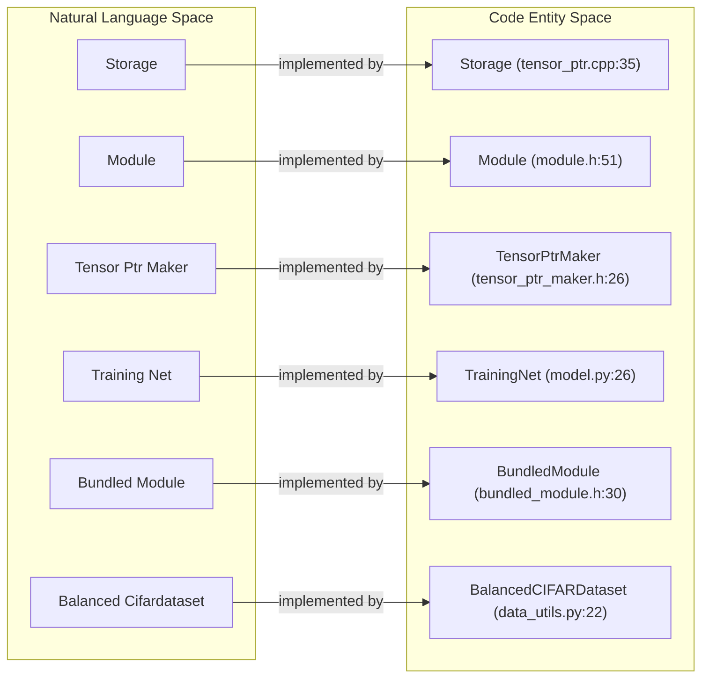
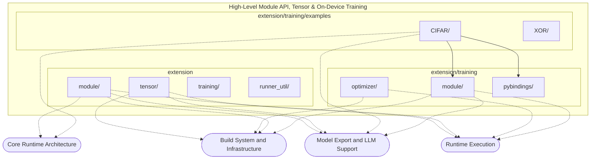
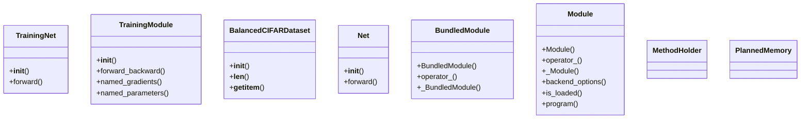
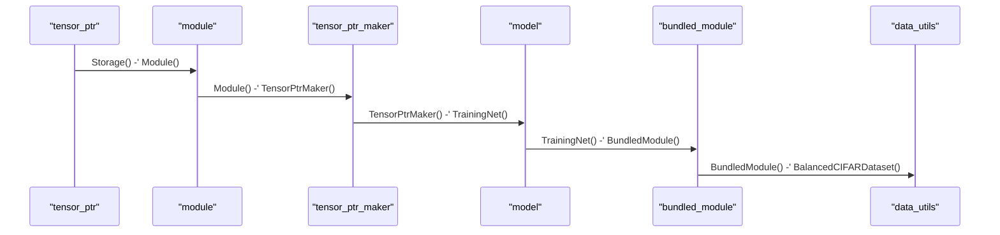

# High-Level Module API, Tensor & On-Device Training

↑ [[9-mobile-and-platform-extensions|Mobile and Platform Extensions]]

> Architectural specification and implementation reference for High-Level Module API, Tensor & On-Device Training (37 relevant source files). Primary code entities: `Storage`, `operator=`, `~Storage`, `Module`, `execute`.

<details>
<summary>Relevant source files</summary>

The following files were used as context for generating this wiki page:

- [extension/tensor/tensor_ptr.cpp](extension/tensor/tensor_ptr.cpp)
- [extension/module/module.cpp](extension/module/module.cpp)
- [extension/module/module.h](extension/module/module.h)
- [extension/tensor/tensor_ptr_maker.h](extension/tensor/tensor_ptr_maker.h)
- [extension/module/ptn_module.cpp](extension/module/ptn_module.cpp)
- [extension/tensor/tensor_accessor.h](extension/tensor/tensor_accessor.h)
- [extension/module/bundled_module.h](extension/module/bundled_module.h)
- [extension/module/ptn_module.h](extension/module/ptn_module.h)
- [extension/module/bundled_module.cpp](extension/module/bundled_module.cpp)
- [extension/tensor/tensor_ptr_maker.cpp](extension/tensor/tensor_ptr_maker.cpp)
- [extension/module/targets.bzl](extension/module/targets.bzl)
- [extension/training/examples/CIFAR/data_utils.py](extension/training/examples/CIFAR/data_utils.py)
- [extension/tensor/targets.bzl](extension/tensor/targets.bzl)
- [extension/tensor/tensor.h](extension/tensor/tensor.h)
- [extension/tensor/tensor_ptr.h](extension/tensor/tensor_ptr.h)
- [extension/training/optimizer/adamw.cpp](extension/training/optimizer/adamw.cpp)
- [extension/training/examples/CIFAR/model.py](extension/training/examples/CIFAR/model.py)
- [extension/training/__init__.py](extension/training/__init__.py)
- [extension/training/examples/XOR/model.py](extension/training/examples/XOR/model.py)
- [extension/training/module/training_module.cpp](extension/training/module/training_module.cpp)
- [extension/training/examples/CIFAR/export.py](extension/training/examples/CIFAR/export.py)
- [extension/training/pybindings/_training_lib.cpp](extension/training/pybindings/_training_lib.cpp)
- [extension/training/optimizer/sgd.cpp](extension/training/optimizer/sgd.cpp)
- [extension/training/examples/CIFAR/train.cpp](extension/training/examples/CIFAR/train.cpp)
- [extension/runner_util/inputs.h](extension/runner_util/inputs.h)
- [extension/training/pybindings/_training_module.py](extension/training/pybindings/_training_module.py)
- [extension/training/examples/CIFAR/main.py](extension/training/examples/CIFAR/main.py)
- [extension/training/examples/CIFAR/train_utils.py](extension/training/examples/CIFAR/train_utils.py)
- [extension/training/README.md](extension/training/README.md)
- [extension/training/examples/CIFAR/README.md](extension/training/examples/CIFAR/README.md)
- [docs/source/using-executorch-cpp.md](docs/source/using-executorch-cpp.md)
- [extension/module/BUCK](extension/module/BUCK)
- [extension/module/CMakeLists.txt](extension/module/CMakeLists.txt)
- [extension/tensor/BUCK](extension/tensor/BUCK)
- [extension/tensor/CMakeLists.txt](extension/tensor/CMakeLists.txt)

</details>

## Purpose and Scope

Architectural specification and implementation reference for High-Level Module API, Tensor & On-Device Training (37 relevant source files). Primary code entities: `Storage`, `operator=`, `~Storage`, `Module`, `execute`.

Primary code entities analyzed on this page include `Storage` ([extension/tensor/tensor_ptr.cpp:35-66]()), `Module` ([extension/module/module.h:51-791]()), `TensorPtrMaker` ([extension/tensor/tensor_ptr_maker.h:26-163]()), `TrainingNet` ([extension/training/examples/XOR/model.py:26-34]()), `BundledModule` ([extension/module/bundled_module.h:30-130]()).

For the parent architectural layer, see [[9-mobile-and-platform-extensions|Mobile and Platform Extensions]]. Related sibling subsystems: [[9.1-android-extension|Android Extension (Java/Kotlin & JNI)]], [[9.2-apple-ios-macos-extension|Apple iOS/macOS Extension (Swift & Objective-C)]], [[9.4-embedded-and-web-targets|Embedded (Zephyr, ESP32, Pico2) and WebAssembly/WebGPU Targets]].

Sources: [extension/tensor/tensor_ptr.cpp:35-66](), [extension/module/module.h:51-791](), [extension/tensor/tensor_ptr_maker.h:26-163](), [extension/training/examples/XOR/model.py:26-34]()

---

## 1. High-Level Architecture and Data Flow

### Natural Language Space to Code Entity Space Mapping

The following diagram maps domain concepts in this subsystem to their concrete code entities:



### Subsystem Component & Dependency Flow



Cross-subsystem call and import edges connect **High-Level Module API, Tensor & On-Device Training** with [[8.1-core-runtime-architecture|Core Runtime Architecture]] (coupling `90.0`), [[8-runtime-execution|Runtime Execution]] (coupling `71.0`), [[2.4-python-bindings-and-dependencies|Python Bindings and Dependencies]] (coupling `49.0`), [[2-build-system-and-infrastructure|Build System and Infrastructure]] (coupling `48.0`), [[6-model-export-and-llm-support|Model Export and LLM Support]] (coupling `30.0`).

| Module Directory | Files | Primary Code Entities | Source Citations |
|---|---|---|---|
| `extension/module` | 9 | `Module`, `BundledModule`, `MethodHolder`, `PlannedMemory` | [extension/module/module.h:51-791]() [extension/module/bundled_module.h:30-130]() |
| `extension/tensor` | 9 | `Storage`, `TensorPtrMaker`, `TensorAccessor`, `TensorAccessor<T, 1>` | [extension/tensor/tensor_ptr.cpp:35-66]() [extension/tensor/tensor_ptr_maker.h:26-163]() |
| `extension/training/examples/CIFAR` | 7 | `BalancedCIFARDataset`, `ModelWithLoss`, `CIFAR10Model`, `get_data_loaders` | [extension/training/examples/CIFAR/data_utils.py:22-79]() [extension/training/examples/CIFAR/model.py:49-73]() |
| `extension/training` | 4 | *(build / config)* | [extension/training/__init__.py]() |
| `extension/training/optimizer` | 2 | `step`, `set_options`, `adamw_update_hack`, `step` | [extension/training/optimizer/adamw.cpp:135-263]() [extension/training/optimizer/adamw.cpp:116-118]() |
| `extension/training/pybindings` | 2 | `TrainingModule`, `PySGD`, `PySGD`, `step` | [extension/training/pybindings/_training_module.py:22-72]() [extension/training/pybindings/_training_lib.cpp:30-121]() |
| `extension/runner_util` | 1 | `BufferCleanup`, `PrepareInputTensorsOptions`, `BufferCleanup`, `~BufferCleanup` | [extension/runner_util/inputs.h:27-58]() [extension/runner_util/inputs.h:61-75]() |
| `extension/training/examples/XOR` | 1 | `TrainingNet`, `Net`, `__init__`, `forward` | [extension/training/examples/XOR/model.py:26-34]() [extension/training/examples/XOR/model.py:14-21]() |

Sources: [extension/tensor/tensor_ptr.cpp:35-66](), [extension/module/module.h:51-791](), [extension/tensor/tensor_ptr_maker.h:26-163](), [extension/training/examples/XOR/model.py:26-34](), [extension/module/bundled_module.h:30-130]()

---

## 2. Core Data Structures and Implementation Details

### Class and Entity Relationship Diagram



### `Storage` (Class)

- **Source Location**: [extension/tensor/tensor_ptr.cpp:35-66]()
- **Declaration**: `Class Storage`
- **Graph Centrality**: fan-in `0` callers, fan-out `0` callees
- **Responsibility**: /** * A structure that consolidates the metadata (sizes, dim_order, strides) and * the data buffer associated with a Tensor. Since Tensor does not own * the memory for these metadata arrays or the data itself, this structure * ensures that they are managed together and have the same lifetime as the * Tensor. When the T

```cpp
// extension/tensor/tensor_ptr.cpp:35-50
struct Storage final {
  executorch::aten::TensorImpl tensor_impl;
  executorch::aten::Tensor tensor;
  std::vector<executorch::aten::SizesType> sizes;
  std::vector<executorch::aten::DimOrderType> dim_order;
  std::vector<executorch::aten::StridesType> strides;
  std::function<void(void*)> deleter;

  Storage(
      executorch::aten::TensorImpl&& tensor_impl,
      std::vector<executorch::aten::SizesType>&& sizes,
      std::vector<executorch::aten::DimOrderType>&& dim_order,
      std::vector<executorch::aten::StridesType>&& strides,
      std::function<void(void*)>&& deleter)
      : tensor_impl(std::move(tensor_impl)),
        tensor(&this->tensor_impl),
```

### `Module` (Class)

- **Source Location**: [extension/module/module.h:51-791]()
- **Declaration**: `Class Module`
- **Graph Centrality**: fan-in `0` callers, fan-out `0` callees
- **Responsibility**: /** * A facade class for loading programs and executing methods within them. */

```cpp
// extension/module/module.h:51-66
class Module {
 public:
  /**
   * Enum to define loading behavior.
   */
  enum class LoadMode {
    /// Load the whole file as a buffer.
    File,
    /// Use mmap to load pages into memory.
    Mmap,
    /// Use memory locking and handle errors.
    MmapUseMlock,
    /// Use memory locking and ignore errors.
    MmapUseMlockIgnoreErrors,
    /// Use mmap with madvise(MADV_WILLNEED | MADV_SEQUENTIAL) hints.
    MmapUseMadvise,
```

### `TensorPtrMaker` (Class)

- **Source Location**: [extension/tensor/tensor_ptr_maker.h:26-163]()
- **Declaration**: `Class TensorPtrMaker`
- **Graph Centrality**: fan-in `0` callers, fan-out `0` callees
- **Responsibility**: /** * A helper class for creating TensorPtr instances from raw data and tensor * properties. Note that the TensorPtr created by this class does not own the * data, so the data must outlive the TensorPtr. * * TensorPtrMaker provides a fluent interface for specifying various tensor * properties, such as type, sizes, data

```cpp
// extension/tensor/tensor_ptr_maker.h:26-41
class TensorPtrMaker final {
 public:
  // This class may have non-copyable members in the future.
  TensorPtrMaker(const TensorPtrMaker&) = delete;
  TensorPtrMaker& operator=(const TensorPtrMaker&) = delete;
  // But it is movable.
  TensorPtrMaker(TensorPtrMaker&&) = default;
  TensorPtrMaker& operator=(TensorPtrMaker&&) = default;

  /**
   * Sets the scalar type of the tensor elements.
   *
   * @param type The scalar type (e.g., float, int, bool).
   * @return Rvalue to this TensorPtrMaker for method chaining.
   */
  TensorPtrMaker&& type(executorch::aten::ScalarType type) {
```

### `TrainingNet` (Class)

- **Source Location**: [extension/training/examples/XOR/model.py:26-34]()
- **Declaration**: `Class TrainingNet`
- **Graph Centrality**: fan-in `4` callers, fan-out `0` callees
- **Responsibility**: # On device training requires the loss to be embedded in the model (and be the first output). # We wrap the original model here and add the loss calculation. This will be the model we export.

### `BundledModule` (Class)

- **Source Location**: [extension/module/bundled_module.h:30-130]()
- **Declaration**: `Class BundledModule`
- **Graph Centrality**: fan-in `0` callers, fan-out `0` callees
- **Responsibility**: /** * A facade class for loading bundled programs and executing methods within * them. */

### `make_tensor_ptr` (Function)

- **Source Location**: [extension/tensor/tensor_ptr.cpp:206-244]()
- **Declaration**: `( std::vector<executorch::aten::SizesType> sizes, std::vector<uint8_t> data, std::vector<executorch::aten::DimOrderType> dim_order, std::vec`
- **Graph Centrality**: fan-in `70` callers, fan-out `33` callees

Sources: [extension/tensor/tensor_ptr.cpp:35-66](), [extension/module/module.h:51-791](), [extension/tensor/tensor_ptr_maker.h:26-163](), [extension/training/examples/XOR/model.py:26-34](), [extension/module/bundled_module.h:30-130]()

---

## 3. Execution and Call Flow

The sequence diagram below traces the runtime/compile-time call chain across components in this module:



Sources: [extension/tensor/tensor_ptr.cpp:35-66](), [extension/module/module.h:51-791](), [extension/tensor/tensor_ptr_maker.h:26-163](), [extension/training/examples/XOR/model.py:26-34](), [extension/module/bundled_module.h:30-130]()

---

## 4. Key API and Symbol Reference

| Code Entity | Kind | Location | Fan-In / Out | Role & Signature |
|---|---|---|---|---|
| `Storage` | Class | [extension/tensor/tensor_ptr.cpp:35-66]() | `0` / `0` | /** |
| `Module` | Class | [extension/module/module.h:51-791]() | `0` / `0` | /** |
| `TensorPtrMaker` | Class | [extension/tensor/tensor_ptr_maker.h:26-163]() | `0` / `0` | /** |
| `TrainingNet` | Class | [extension/training/examples/XOR/model.py:26-34]() | `4` / `0` | # On device training requires the loss to be embedded in the model (and be the first output). |
| `BundledModule` | Class | [extension/module/bundled_module.h:30-130]() | `0` / `0` | /** |
| `BalancedCIFARDataset` | Class | [extension/training/examples/CIFAR/data_utils.py:22-79]() | `1` / `0` | Custom dataset class to load balanced |
| `Net` | Class | [extension/training/examples/XOR/model.py:14-21]() | `1` / `0` | # Basic Net for XOR |
| `ModelWithLoss` | Class | [extension/training/examples/CIFAR/model.py:49-73]() | `0` / `0` | NOTE: A wrapper class that combines a model and the loss function |
| `MethodHolder` | Class | [extension/module/module.h:752-757]() | `0` / `0` | — |
| `PlannedMemory` | Class | [extension/module/module.h:730-739]() | `0` / `0` | — |
| `PtnHookRegistry` | Class | [extension/module/ptn_module.cpp:17-21]() | `0` / `0` | — |
| `BufferCleanup` | Class | [extension/runner_util/inputs.h:27-58]() | `0` / `0` | /** |
| `PrepareInputTensorsOptions` | Class | [extension/runner_util/inputs.h:61-75]() | `0` / `0` | /// Defines options for `prepare_input_tensors()`. |
| `TensorAccessor` | Class | [extension/tensor/tensor_accessor.h:68-116]() | `0` / `0` | — |
| `TensorAccessor<T, 1>` | Class | [extension/tensor/tensor_accessor.h:123-159]() | `0` / `0` | — |
| `TensorAccessorBase` | Class | [extension/tensor/tensor_accessor.h:23-57]() | `0` / `0` | — |
| `PtnFileSource` | Class | [extension/module/ptn_module.h:77-85]() | `0` / `0` | — |
| `PtnHooks` | Class | [extension/module/ptn_module.h:90-94]() | `0` / `0` | — |
| `PtnModule` | Class | [extension/module/ptn_module.h:41-75]() | `0` / `0` | — |
| `CIFAR10Model` | Class | [extension/training/examples/CIFAR/model.py:14-46]() | `0` / `0` | — |
| `TrainingModule` | Class | [extension/training/pybindings/_training_module.py:22-72]() | `2` / `0` | — |
| `PySGD` | Class | [extension/training/pybindings/_training_lib.cpp:30-121]() | `0` / `0` | — |

Sources: [extension/tensor/tensor_ptr.cpp:35-66](), [extension/module/module.h:51-791](), [extension/tensor/tensor_ptr_maker.h:26-163](), [extension/training/examples/XOR/model.py:26-34](), [extension/module/bundled_module.h:30-130](), [extension/training/examples/CIFAR/data_utils.py:22-79]()

---

## 5. Official Documentation and Design Context

The following linked documentation sections from `llm-wiki` (`raw/`) provide additional architectural context, tutorials, and design invariants for this subsystem:

- **Mobile and Platform Extensions** ([wiki/9-mobile-and-platform-extensions.md](), score `82.7115`) (sections: `Mobile and Platform Extensions`, `Purpose and Scope`, `System Mapping: Natural Language Space to Code Entity Space`, `1. Android Extension (Java/Kotlin & JNI)`): # Mobile and Platform Extensions > Architectural specification and implementation reference for Mobile and Platform Extensions (40 relevant source files). Primary code entities: `BindingSpec`, `ComputePipelineBundle`, `operator=`, `Storage`, `~Storage`. <details> <summary>Relevant source files</summary> The following files were used as context for generating this wiki page: - [backends/webgpu/runtime/WebGPUUtils.h](b
- **ExecuTorch DeepWiki** ([wiki/index.md](), score `75.5295`) (sections: `ExecuTorch DeepWiki`, `Pages`): # ExecuTorch DeepWiki Generated from `home-jason-Project-deepwiki-executorch` at commit `b3b565b5b62f` (2026-11-15T15:02:11+00:00). ## Pages - [[1-overview|Overview]] — Architectural specification and implementation reference for Overview (10 relevant source files). Primary code entities: `Module`, `MethodHolder`, `PlannedMemory`, `EdgeProgramManager`, `__init__`. - [[1.1-getting-started|Getting Started]] — Architect
- **Python Bindings and Dependencies** ([wiki/2.4-python-bindings-and-dependencies.md](), score `64.6069`) (sections: `Python Bindings and Dependencies`, `Purpose and Scope`, `1. High-Level Architecture and Data Flow`, `Natural Language Space to Code Entity Space Mapping`): # Python Bindings and Dependencies ↑ [[2-build-system-and-infrastructure|Build System and Infrastructure]] > Architectural specification and implementation reference for Python Bindings and Dependencies (15 relevant source files). Primary code entities: `BorrowedInput`, `torch_storage`, `validate`, `PyExecuTorchResult`, `DLPackHolder`. <details> <summary>Relevant source files</summary> The following files were used a
- **Overview** ([wiki/1-overview.md](), score `59.2666`) (sections: `Overview`, `1. Architecture Overview & System Component Map`, `Core Concept to Code Entity Mapping`, `Architectural Principles (from Official Documentation)`): # Overview > Architectural specification and implementation reference for Overview (10 relevant source files). Primary code entities: `Module`, `MethodHolder`, `PlannedMemory`, `EdgeProgramManager`, `__init__`. <details> <summary>Relevant source files</summary> The following files were used as context for generating this wiki page: - [extension/module/module.h](extension/module/module.h) - [exir/program/_program.py](

Sources: [wiki/9-mobile-and-platform-extensions.md](), [wiki/index.md](), [wiki/2.4-python-bindings-and-dependencies.md](), [wiki/1-overview.md]()

## Related pages

- [[9-mobile-and-platform-extensions|Mobile and Platform Extensions]]
- [[1.1-getting-started|Getting Started]]
- [[1.2-export-api-and-recipe-system|Export API and Recipe System]]
- [[2.2-kernel-libraries-and-selective-build|Kernel Libraries and Selective Build]]
- [[2.3-schema-generation-and-flatbuffers|Schema Generation and FlatBuffers]]
- [[3.4-program-emission-and-serialization|Program Emission and Serialization]]
- [[3.5-verification-and-dialect-system|Verification and Dialect System]]
- [[4-quantization-systems|Quantization Systems]]

## Related documents

- `wiki/9-mobile-and-platform-extensions.md` — Mobile and Platform Extensions (score 82.7115, via bm25)
- `wiki/index.md` — ExecuTorch DeepWiki (score 75.5295, via bm25)
- `wiki/2.4-python-bindings-and-dependencies.md` — Python Bindings and Dependencies (score 64.6069, via bm25)
- `wiki/1-overview.md` — Overview (score 59.2666, via bm25)
- `wiki/2-build-system-and-infrastructure.md` — Build System and Infrastructure (score 58.9153, via bm25)

## Sources

- [`extension/tensor/tensor_ptr.cpp`](https://github.com/pytorch/executorch/blob/main/extension/tensor/tensor_ptr.cpp)
- [`extension/module/module.cpp`](https://github.com/pytorch/executorch/blob/main/extension/module/module.cpp)
- [`extension/module/module.h`](https://github.com/pytorch/executorch/blob/main/extension/module/module.h)
- [`extension/tensor/tensor_ptr_maker.h`](https://github.com/pytorch/executorch/blob/main/extension/tensor/tensor_ptr_maker.h)
- [`extension/module/ptn_module.cpp`](https://github.com/pytorch/executorch/blob/main/extension/module/ptn_module.cpp)
- [`extension/tensor/tensor_accessor.h`](https://github.com/pytorch/executorch/blob/main/extension/tensor/tensor_accessor.h)
- [`extension/module/bundled_module.h`](https://github.com/pytorch/executorch/blob/main/extension/module/bundled_module.h)
- [`extension/module/ptn_module.h`](https://github.com/pytorch/executorch/blob/main/extension/module/ptn_module.h)
- [`extension/module/bundled_module.cpp`](https://github.com/pytorch/executorch/blob/main/extension/module/bundled_module.cpp)
- [`extension/tensor/tensor_ptr_maker.cpp`](https://github.com/pytorch/executorch/blob/main/extension/tensor/tensor_ptr_maker.cpp)
- [`extension/module/targets.bzl`](https://github.com/pytorch/executorch/blob/main/extension/module/targets.bzl)
- [`extension/training/examples/CIFAR/data_utils.py`](https://github.com/pytorch/executorch/blob/main/extension/training/examples/CIFAR/data_utils.py)
- [`extension/tensor/targets.bzl`](https://github.com/pytorch/executorch/blob/main/extension/tensor/targets.bzl)
- [`extension/tensor/tensor.h`](https://github.com/pytorch/executorch/blob/main/extension/tensor/tensor.h)
- [`extension/tensor/tensor_ptr.h`](https://github.com/pytorch/executorch/blob/main/extension/tensor/tensor_ptr.h)
- [`extension/training/optimizer/adamw.cpp`](https://github.com/pytorch/executorch/blob/main/extension/training/optimizer/adamw.cpp)
- [`extension/training/examples/CIFAR/model.py`](https://github.com/pytorch/executorch/blob/main/extension/training/examples/CIFAR/model.py)
- [`extension/training/__init__.py`](https://github.com/pytorch/executorch/blob/main/extension/training/__init__.py)
- [`extension/training/examples/XOR/model.py`](https://github.com/pytorch/executorch/blob/main/extension/training/examples/XOR/model.py)
- [`extension/training/module/training_module.cpp`](https://github.com/pytorch/executorch/blob/main/extension/training/module/training_module.cpp)
- [`extension/training/examples/CIFAR/export.py`](https://github.com/pytorch/executorch/blob/main/extension/training/examples/CIFAR/export.py)
- [`extension/training/pybindings/_training_lib.cpp`](https://github.com/pytorch/executorch/blob/main/extension/training/pybindings/_training_lib.cpp)
- [`extension/training/optimizer/sgd.cpp`](https://github.com/pytorch/executorch/blob/main/extension/training/optimizer/sgd.cpp)
- [`extension/training/examples/CIFAR/train.cpp`](https://github.com/pytorch/executorch/blob/main/extension/training/examples/CIFAR/train.cpp)
- [`extension/runner_util/inputs.h`](https://github.com/pytorch/executorch/blob/main/extension/runner_util/inputs.h)
- [`extension/training/pybindings/_training_module.py`](https://github.com/pytorch/executorch/blob/main/extension/training/pybindings/_training_module.py)
- [`extension/training/examples/CIFAR/main.py`](https://github.com/pytorch/executorch/blob/main/extension/training/examples/CIFAR/main.py)
- [`extension/training/examples/CIFAR/train_utils.py`](https://github.com/pytorch/executorch/blob/main/extension/training/examples/CIFAR/train_utils.py)
- [`extension/training/README.md`](https://github.com/pytorch/executorch/blob/main/extension/training/README.md)
- [`extension/training/examples/CIFAR/README.md`](https://github.com/pytorch/executorch/blob/main/extension/training/examples/CIFAR/README.md)
- [`docs/source/using-executorch-cpp.md`](https://github.com/pytorch/executorch/blob/main/docs/source/using-executorch-cpp.md)
- [`extension/module/BUCK`](https://github.com/pytorch/executorch/blob/main/extension/module/BUCK)
- [`extension/module/CMakeLists.txt`](https://github.com/pytorch/executorch/blob/main/extension/module/CMakeLists.txt)
- [`extension/tensor/BUCK`](https://github.com/pytorch/executorch/blob/main/extension/tensor/BUCK)
- [`extension/tensor/CMakeLists.txt`](https://github.com/pytorch/executorch/blob/main/extension/tensor/CMakeLists.txt)
- [`extension/training/BUCK`](https://github.com/pytorch/executorch/blob/main/extension/training/BUCK)
- [`extension/training/CMakeLists.txt`](https://github.com/pytorch/executorch/blob/main/extension/training/CMakeLists.txt)


## Dynamic Knowledge Links (Code Graph ↔ LLM-Wiki / RAG)

### Linked Architecture & Design Documents

| Document | Match Channel | Score | Shared Code Symbols |
|---|---|---|---|
| [[9-mobile-and-platform-extensions|Mobile and Platform Extensions]] | `bm25+entity(4)` | `88.712` | `Module`, `TrainingNet`, `from_blob`, `make_tensor_ptr` |
| [[index|ExecuTorch DeepWiki]] | `bm25` | `75.529` | *(lexical/graph match)* |
| [[9.1-android-extension|Android Extension (Java/Kotlin & JNI)]] | `wikilink:9.3-high-level-module-and-on-device-training+entity(1)` | `71.45` | `Module` |
| [[9.2-apple-ios-macos-extension|Apple iOS/macOS Extension (Swift & Objective-C)]] | `wikilink:9.3-high-level-module-and-on-device-training+entity(1)` | `71.45` | `Module` |
| [[9.4-embedded-and-web-targets|Embedded (Zephyr, ESP32, Pico2) and WebAssembly/WebGPU Targets]] | `wikilink:9.3-high-level-module-and-on-device-training+entity(1)` | `71.45` | `Module` |
| [[2.4-python-bindings-and-dependencies|Python Bindings and Dependencies]] | `bm25+entity(1)` | `66.107` | `Module` |

### High-Centrality Bridge Symbols (CBM Graph)

| Symbol | Kind | Source Location | Fan-In / Fan-Out |
|---|---|---|---|
| `Storage` | Class | [extension/tensor/tensor_ptr.cpp:35-66]() | in: `0` / out: `0` |
| `Module` | Class | [extension/module/module.h:51-791]() | in: `0` / out: `0` |
| `TensorPtrMaker` | Class | [extension/tensor/tensor_ptr_maker.h:26-163]() | in: `0` / out: `0` |
| `TrainingNet` | Class | [extension/training/examples/XOR/model.py:26-34]() | in: `4` / out: `0` |
| `BundledModule` | Class | [extension/module/bundled_module.h:30-130]() | in: `0` / out: `0` |
| `BalancedCIFARDataset` | Class | [extension/training/examples/CIFAR/data_utils.py:22-79]() | in: `1` / out: `0` |

Sources: [extension/tensor/tensor_ptr.cpp:35-66](), [extension/module/module.h:51-791](), [extension/tensor/tensor_ptr_maker.h:26-163](), [extension/training/examples/XOR/model.py:26-34]()

### Cross-Subsystem Coupling

- [[8.1-core-runtime-architecture|Core Runtime Architecture]] — call/import coupling weight `90.0`
- [[8-runtime-execution|Runtime Execution]] — call/import coupling weight `71.0`
- [[2.4-python-bindings-and-dependencies|Python Bindings and Dependencies]] — call/import coupling weight `49.0`
- [[2-build-system-and-infrastructure|Build System and Infrastructure]] — call/import coupling weight `48.0`
- [[6-model-export-and-llm-support|Model Export and LLM Support]] — call/import coupling weight `30.0`
- [[9.1-android-extension|Android Extension (Java/Kotlin & JNI)]] — call/import coupling weight `19.0`
