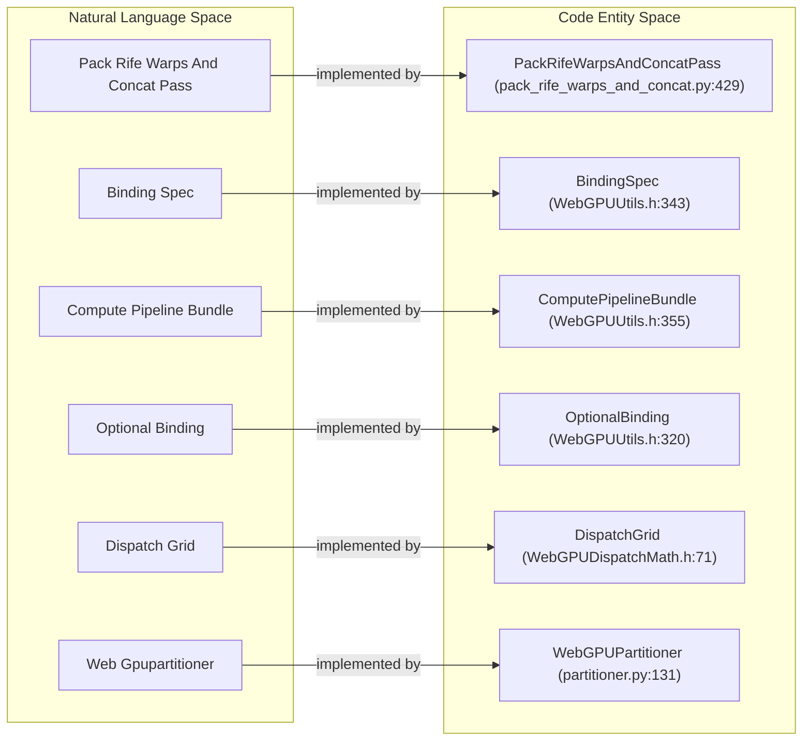
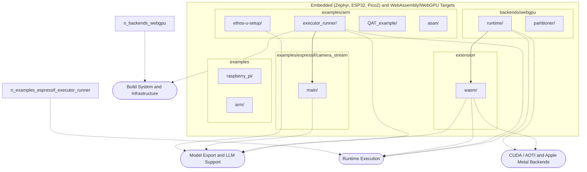
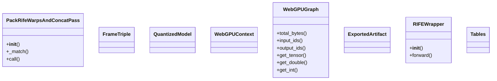
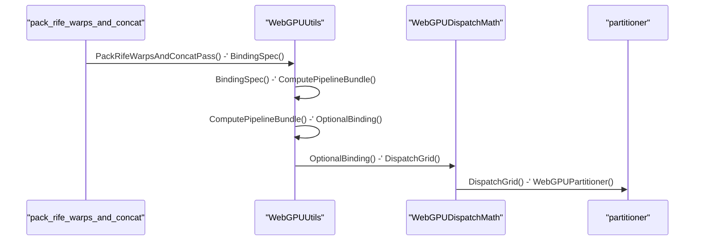

# Embedded (Zephyr, ESP32, Pico2) and WebAssembly/WebGPU Targets

↑ [[9-mobile-and-platform-extensions|Mobile and Platform Extensions]]

> Architectural specification and implementation reference for Embedded (Zephyr, ESP32, Pico2) and WebAssembly/WebGPU Targets (40 relevant source files). Primary code entities: `BindingSpec`, `ComputePipelineBundle`, `operator=`, `acquire_scratch`, `add_compute_dispatch`.

<details>
<summary>Relevant source files</summary>

The following files were used as context for generating this wiki page:

- [backends/webgpu/runtime/WebGPUUtils.h](backends/webgpu/runtime/WebGPUUtils.h)
- [backends/webgpu/runtime/WebGPUGraph.cpp](backends/webgpu/runtime/WebGPUGraph.cpp)
- [examples/arm/ethos-u-setup/arm-none-eabi-clang-random-device.h](examples/arm/ethos-u-setup/arm-none-eabi-clang-random-device.h)
- [backends/webgpu/runtime/WebGPUDevice.cpp](backends/webgpu/runtime/WebGPUDevice.cpp)
- [backends/webgpu/runtime/WebGPUDispatchMath.h](backends/webgpu/runtime/WebGPUDispatchMath.h)
- [extension/wasm/wasm_bindings.cpp](extension/wasm/wasm_bindings.cpp)
- [backends/webgpu/partitioner/partitioner.py](backends/webgpu/partitioner/partitioner.py)
- [examples/espressif/camera_stream/main/camera_stream.cpp](examples/espressif/camera_stream/main/camera_stream.cpp)
- [backends/webgpu/runtime/WebGPUDelegateHeader.cpp](backends/webgpu/runtime/WebGPUDelegateHeader.cpp)
- [examples/raspberry_pi/setup.sh](examples/raspberry_pi/setup.sh)
- [backends/webgpu/runtime/WebGPUQueryPool.cpp](backends/webgpu/runtime/WebGPUQueryPool.cpp)
- [backends/webgpu/runtime/WebGPUGraph.h](backends/webgpu/runtime/WebGPUGraph.h)
- [examples/arm/QAT_example/rife_vgf/passes/pack_rife_warps_and_concat.py](examples/arm/QAT_example/rife_vgf/passes/pack_rife_warps_and_concat.py)
- [backends/webgpu/runtime/WebGPUBackend.h](backends/webgpu/runtime/WebGPUBackend.h)
- [examples/arm/executor_runner/arm_executor_runner.cpp](examples/arm/executor_runner/arm_executor_runner.cpp)
- [backends/webgpu/runtime/WebGPUExecutionOptions.h](backends/webgpu/runtime/WebGPUExecutionOptions.h)
- [backends/webgpu/runtime/WebGPUDelegateHeader.h](backends/webgpu/runtime/WebGPUDelegateHeader.h)
- [backends/webgpu/CMakeLists.txt](backends/webgpu/CMakeLists.txt)
- [backends/webgpu/runtime/WebGPUDevice.h](backends/webgpu/runtime/WebGPUDevice.h)
- [backends/webgpu/__init__.py](backends/webgpu/__init__.py)
- [backends/webgpu/runtime/WebGPUQueryPool.h](backends/webgpu/runtime/WebGPUQueryPool.h)
- [extension/wasm/tokenizers/tokenizers.cpp](extension/wasm/tokenizers/tokenizers.cpp)
- [backends/webgpu/runtime/WebGPUBackend.cpp](backends/webgpu/runtime/WebGPUBackend.cpp)
- [examples/arm/QAT_example/qat_loop.py](examples/arm/QAT_example/qat_loop.py)
- [backends/webgpu/runtime/ops/TensorMeta.h](backends/webgpu/runtime/ops/TensorMeta.h)
- [examples/arm/visualize.py](examples/arm/visualize.py)
- [examples/espressif/executor_runner/esp_executor_runner.cpp](examples/espressif/executor_runner/esp_executor_runner.cpp)
- [backends/webgpu/runtime/WebGPUShaderRegistry.h](backends/webgpu/runtime/WebGPUShaderRegistry.h)
- [extension/wasm/README.md](extension/wasm/README.md)
- [backends/webgpu/README.md](backends/webgpu/README.md)
- [backends/webgpu/TODO.md](backends/webgpu/TODO.md)
- [extension/wasm/tokenizers/README.md](extension/wasm/tokenizers/README.md)
- [docs/source/pico2_tutorial.md](docs/source/pico2_tutorial.md)
- [examples/arm/README.md](examples/arm/README.md)
- [extension/wasm/BUCK](extension/wasm/BUCK)

</details>

## Purpose and Scope

Architectural specification and implementation reference for Embedded (Zephyr, ESP32, Pico2) and WebAssembly/WebGPU Targets (40 relevant source files). Primary code entities: `BindingSpec`, `ComputePipelineBundle`, `operator=`, `acquire_scratch`, `add_compute_dispatch`.

Primary code entities analyzed on this page include `PackRifeWarpsAndConcatPass` ([examples/arm/QAT_example/rife_vgf/passes/pack_rife_warps_and_concat.py:429-646]()), `BindingSpec` ([backends/webgpu/runtime/WebGPUUtils.h:343-348]()), `ComputePipelineBundle` ([backends/webgpu/runtime/WebGPUUtils.h:355-391]()), `OptionalBinding` ([backends/webgpu/runtime/WebGPUUtils.h:320-324]()), `DispatchGrid` ([backends/webgpu/runtime/WebGPUDispatchMath.h:71-76]()).

For the parent architectural layer, see [[9-mobile-and-platform-extensions|Mobile and Platform Extensions]]. Related sibling subsystems: [[9.1-android-extension|Android Extension (Java/Kotlin & JNI)]], [[9.2-apple-ios-macos-extension|Apple iOS/macOS Extension (Swift & Objective-C)]], [[9.3-high-level-module-and-on-device-training|High-Level Module API, Tensor & On-Device Training]].

Sources: [examples/arm/QAT_example/rife_vgf/passes/pack_rife_warps_and_concat.py:429-646](), [backends/webgpu/runtime/WebGPUUtils.h:343-348](), [backends/webgpu/runtime/WebGPUUtils.h:355-391](), [backends/webgpu/runtime/WebGPUUtils.h:320-324]()

---

## 1. High-Level Architecture and Data Flow

### Natural Language Space to Code Entity Space Mapping

The following diagram maps domain concepts in this subsystem to their concrete code entities:



### Subsystem Component & Dependency Flow



Cross-subsystem call and import edges connect **Embedded (Zephyr, ESP32, Pico2) and WebAssembly/WebGPU Targets** with [[8-runtime-execution|Runtime Execution]] (coupling `117.0`), [[8.1-core-runtime-architecture|Core Runtime Architecture]] (coupling `107.0`), [[7.2-model-and-backend-testing-framework|Model and Backend Testing Framework]] (coupling `52.0`), [[6-model-export-and-llm-support|Model Export and LLM Support]] (coupling `51.0`), [[5.7-cuda-aoti-and-apple-metal-backends|CUDA / AOTI and Apple Metal Backends]] (coupling `26.0`).

| Module Directory | Files | Primary Code Entities | Source Citations |
|---|---|---|---|
| `backends/webgpu/runtime` | 14 | `BindingSpec`, `ComputePipelineBundle`, `OptionalBinding`, `DispatchGrid` | [backends/webgpu/runtime/WebGPUUtils.h:343-348]() [backends/webgpu/runtime/WebGPUUtils.h:355-391]() |
| `backends/webgpu` | 4 | `add_webgpu_native_test` | [backends/webgpu/CMakeLists.txt:115-147]() |
| `extension/wasm` | 4 | `to_val`, `to_evalue`, `assert_layout_valid`, `JsMethodMeta` | [extension/wasm/wasm_bindings.cpp:387-406]() [extension/wasm/wasm_bindings.cpp:356-384]() |
| `extension/wasm/tokenizers` | 3 | `JsTokenizer`, `EMSCRIPTEN_BINDINGS` | [extension/wasm/tokenizers/tokenizers.cpp:68-154]() [extension/wasm/tokenizers/tokenizers.cpp:158-181]() |
| `backends/webgpu/partitioner` | 2 | `WebGPUPartitioner`, `_silu_support`, `_keeps_silu`, `_webgpu_features` | [backends/webgpu/partitioner/partitioner.py:131-214]() [backends/webgpu/partitioner/partitioner.py:172-191]() |
| `examples/arm` | 2 | `Tables`, `build_overlay_data`, `parse_tables`, `build_perf_df` | [examples/arm/visualize.py:29-33]() [examples/arm/visualize.py:233-244]() |
| `examples/arm/ethos-u-setup` | 2 | `random_device`, `max`, `min`, `entropy` | [examples/arm/ethos-u-setup/arm-none-eabi-clang-random-device.h:12-32]() [examples/arm/ethos-u-setup/arm-none-eabi-clang-random-device.h:26-28]() |
| `backends/webgpu/runtime/ops` | 1 | `TensorMeta`, `fill_tensor_meta`, `fill_tensor_meta_broadcast` | [backends/webgpu/runtime/ops/TensorMeta.h:22-28]() [backends/webgpu/runtime/ops/TensorMeta.h:40-61]() |

Sources: [examples/arm/QAT_example/rife_vgf/passes/pack_rife_warps_and_concat.py:429-646](), [backends/webgpu/runtime/WebGPUUtils.h:343-348](), [backends/webgpu/runtime/WebGPUUtils.h:355-391](), [backends/webgpu/runtime/WebGPUUtils.h:320-324](), [backends/webgpu/runtime/WebGPUDispatchMath.h:71-76]()

---

## 2. Core Data Structures and Implementation Details

### Class and Entity Relationship Diagram



### `PackRifeWarpsAndConcatPass` (Class)

- **Source Location**: [examples/arm/QAT_example/rife_vgf/passes/pack_rife_warps_and_concat.py:429-646]()
- **Declaration**: `Class PackRifeWarpsAndConcatPass`
- **Graph Centrality**: fan-in `7` callers, fan-out `0` callees
- **Responsibility**: Pack four private RIFE warps and their C28 concat into one C32 shader. Fuse compatible block0 head resizing and state preparation into the shader. Reorder block0 output channels during export so each PixelShuffle read accesses 13 contiguous channels. Keep sampling quantization boundaries. Four zero weight columns make 

```python
// examples/arm/QAT_example/rife_vgf/passes/pack_rife_warps_and_concat.py:429-444
class PackRifeWarpsAndConcatPass(ArmPass):
    """Pack four private RIFE warps and their C28 concat into one C32 shader.

    Fuse compatible block0 head resizing and state preparation into the shader.
    Reorder block0 output channels during export so each PixelShuffle read
    accesses 13 contiguous channels. Keep sampling quantization boundaries.
    Four zero weight columns make the following convolution ignore padding.
    Unsupported graphs are left unchanged.

    """

    _passes_required_after: set[type[ExportPass]] = set()

    def __init__(self, exported_program: ExportedProgram | None = None):
        super().__init__()
        self.exported_program = exported_program
```

### `BindingSpec` (Class)

- **Source Location**: [backends/webgpu/runtime/WebGPUUtils.h:343-348]()
- **Declaration**: `Class BindingSpec`
- **Graph Centrality**: fan-in `0` callers, fan-out `0` callees
- **Responsibility**: // One compute-shader binding: a bind-group-layout entry + its bind-group // entry share every field except `type` (layout) vs `buffer`/`size` (bind).

```cpp
// backends/webgpu/runtime/WebGPUUtils.h:343-348
struct BindingSpec {
  uint32_t binding;
  WGPUBufferBindingType type;
  WGPUBuffer buffer;
  uint64_t size;
};
```

### `ComputePipelineBundle` (Class)

- **Source Location**: [backends/webgpu/runtime/WebGPUUtils.h:355-391]()
- **Declaration**: `Class ComputePipelineBundle`
- **Graph Centrality**: fan-in `0` callers, fan-out `0` callees
- **Responsibility**: // Owns the shader module, bind-group layout, and pipeline layout, releasing // them on destruction. `pipeline` and `bind_group` are NOT released here — // every op hands them to WebGPUGraph::add_dispatch, which keeps them alive // for the life of the graph (mirrors the "kept by dispatch" comment repeated // across eve

```cpp
// backends/webgpu/runtime/WebGPUUtils.h:355-370
struct ComputePipelineBundle {
  WGPUShaderModule shader = nullptr;
  WGPUBindGroupLayout bind_group_layout = nullptr;
  WGPUPipelineLayout pipeline_layout = nullptr;
  WGPUComputePipeline pipeline = nullptr;
  WGPUBindGroup bind_group = nullptr;

  ComputePipelineBundle() = default;
  ComputePipelineBundle(const ComputePipelineBundle&) = delete;
  ComputePipelineBundle& operator=(const ComputePipelineBundle&) = delete;
  ComputePipelineBundle& operator=(ComputePipelineBundle&&) = delete;

  ComputePipelineBundle(ComputePipelineBundle&& other) noexcept
      : shader(other.shader),
        bind_group_layout(other.bind_group_layout),
        pipeline_layout(other.pipeline_layout),
```

### `OptionalBinding` (Class)

- **Source Location**: [backends/webgpu/runtime/WebGPUUtils.h:320-324]()
- **Declaration**: `Class OptionalBinding`
- **Graph Centrality**: fan-in `0` callers, fan-out `0` callees
- **Responsibility**: // Resolves an optional tensor arg (bias/mask/affine) to the binding to use: // the real tensor's buffer+size if present, else a zero-filled dummy. Caller // releases `.owned_dummy` (if non-null) after the dispatch is recorded.

### `DispatchGrid` (Class)

- **Source Location**: [backends/webgpu/runtime/WebGPUDispatchMath.h:71-76]()
- **Declaration**: `Class DispatchGrid`
- **Graph Centrality**: fan-in `0` callers, fan-out `0` callees
- **Responsibility**: // Adaptive 1D->2D dispatch grid. `count_x`/`count_y` are the dispatch dims; // `stride_x` (= count_x * wg_size) lets the shader decode a flat index as // `gid.y * stride_x + gid.x`. Used by ops whose element count can exceed the // 65535 per-dimension ceiling that compute_1d_workgroup_count throws on.

### `get_tensor` (Method)

- **Source Location**: [backends/webgpu/runtime/WebGPUGraph.h:189-191]()
- **Declaration**: `(int id)`
- **Graph Centrality**: fan-in `97` callers, fan-out `0` callees

Sources: [examples/arm/QAT_example/rife_vgf/passes/pack_rife_warps_and_concat.py:429-646](), [backends/webgpu/runtime/WebGPUUtils.h:343-348](), [backends/webgpu/runtime/WebGPUUtils.h:355-391](), [backends/webgpu/runtime/WebGPUUtils.h:320-324](), [backends/webgpu/runtime/WebGPUDispatchMath.h:71-76]()

---

## 3. Execution and Call Flow

The sequence diagram below traces the runtime/compile-time call chain across components in this module:



Sources: [examples/arm/QAT_example/rife_vgf/passes/pack_rife_warps_and_concat.py:429-646](), [backends/webgpu/runtime/WebGPUUtils.h:343-348](), [backends/webgpu/runtime/WebGPUUtils.h:355-391](), [backends/webgpu/runtime/WebGPUUtils.h:320-324](), [backends/webgpu/runtime/WebGPUDispatchMath.h:71-76]()

---

## 4. Key API and Symbol Reference

| Code Entity | Kind | Location | Fan-In / Out | Role & Signature |
|---|---|---|---|---|
| `PackRifeWarpsAndConcatPass` | Class | [examples/arm/QAT_example/rife_vgf/passes/pack_rife_warps_and_concat.py:429-646]() | `7` / `0` | Pack four private RIFE warps and their C28 concat into one C32 shader. |
| `BindingSpec` | Class | [backends/webgpu/runtime/WebGPUUtils.h:343-348]() | `0` / `0` | // One compute-shader binding: a bind-group-layout entry + its bind-group |
| `ComputePipelineBundle` | Class | [backends/webgpu/runtime/WebGPUUtils.h:355-391]() | `0` / `0` | // Owns the shader module, bind-group layout, and pipeline layout, releasing |
| `OptionalBinding` | Class | [backends/webgpu/runtime/WebGPUUtils.h:320-324]() | `0` / `0` | // Resolves an optional tensor arg (bias/mask/affine) to the binding to use: |
| `DispatchGrid` | Class | [backends/webgpu/runtime/WebGPUDispatchMath.h:71-76]() | `0` / `0` | // Adaptive 1D->2D dispatch grid. `count_x`/`count_y` are the dispatch dims; |
| `WebGPUPartitioner` | Class | [backends/webgpu/partitioner/partitioner.py:131-214]() | `0` / `0` | WebGPU frontend for the Vulkan partitioning and serialization path. |
| `ConstantSource` | Class | [backends/webgpu/runtime/WebGPUGraph.h:118-122]() | `0` / `0` | // CPU-side record for a prepack-routed constant; mirrors Vulkan's TensorRef |
| `InputData` | Class | [backends/webgpu/runtime/WebGPUGraph.h:49-54]() | `0` / `0` | // Host-side view of one graph input, passed to copy_inputs. |
| `OutputData` | Class | [backends/webgpu/runtime/WebGPUGraph.h:58-62]() | `0` / `0` | // Host destination for a graph output. host_is_fp32 gates the fp16->fp32 widen |
| `RunnerContext` | Class | [examples/arm/executor_runner/arm_executor_runner.cpp:618-653]() | `0` / `0` | /// Holds all state needed for setup and run phases |
| `MapCallbackData` | Class | [backends/webgpu/runtime/WebGPUGraph.cpp:1758-1760]() | `0` / `0` | — |
| `ScopedBindGroup` | Class | [backends/webgpu/runtime/WebGPUGraph.cpp:70-93]() | `0` / `0` | — |
| `ScopedBindGroupLayout` | Class | [backends/webgpu/runtime/WebGPUGraph.cpp:50-68]() | `0` / `0` | — |
| `ScopedComputePipeline` | Class | [backends/webgpu/runtime/WebGPUGraph.cpp:95-115]() | `0` / `0` | — |
| `ScopedComputePipelineRef` | Class | [backends/webgpu/runtime/WebGPUGraph.cpp:117-139]() | `0` / `0` | — |
| `ShaderDuration` | Class | [backends/webgpu/runtime/WebGPUQueryPool.h:23-31]() | `0` / `0` | // Per-dispatch GPU timing; mirrors Vulkan QueryPool ShaderDuration. |
| `WebGPUQueryPool` | Class | [backends/webgpu/runtime/WebGPUQueryPool.h:34-84]() | `0` / `0` | // GPU timestamp-query pool; re-port of Vulkan vk_api/QueryPool. |
| `AdapterResult` | Class | [backends/webgpu/runtime/WebGPUDevice.cpp:24-26]() | `0` / `0` | — |
| `DeviceResult` | Class | [backends/webgpu/runtime/WebGPUDevice.cpp:28-30]() | `0` / `0` | — |
| `random_device` | Class | [examples/arm/ethos-u-setup/arm-none-eabi-clang-random-device.h:12-32]() | `0` / `0` | — |
| `DispatchRange` | Class | [backends/webgpu/runtime/WebGPUDispatchMath.h:83-86]() | `0` / `0` | — |
| `DispatchRouteRegistry` | Class | [backends/webgpu/runtime/WebGPUDispatchMath.h:126-203]() | `0` / `0` | — |

Sources: [examples/arm/QAT_example/rife_vgf/passes/pack_rife_warps_and_concat.py:429-646](), [backends/webgpu/runtime/WebGPUUtils.h:343-348](), [backends/webgpu/runtime/WebGPUUtils.h:355-391](), [backends/webgpu/runtime/WebGPUUtils.h:320-324](), [backends/webgpu/runtime/WebGPUDispatchMath.h:71-76](), [backends/webgpu/partitioner/partitioner.py:131-214]()

---

## 5. Official Documentation and Design Context

The following linked documentation sections from `llm-wiki` (`raw/`) provide additional architectural context, tutorials, and design invariants for this subsystem:

- **Mobile and Platform Extensions** ([wiki/9-mobile-and-platform-extensions.md](), score `191.4917`) (sections: `Mobile and Platform Extensions`, `Purpose and Scope`, `System Mapping: Natural Language Space to Code Entity Space`, `1. Android Extension (Java/Kotlin & JNI)`): # Mobile and Platform Extensions > Architectural specification and implementation reference for Mobile and Platform Extensions (40 relevant source files). Primary code entities: `BindingSpec`, `ComputePipelineBundle`, `operator=`, `Storage`, `~Storage`. <details> <summary>Relevant source files</summary> The following files were used as context for generating this wiki page: - [backends/webgpu/runtime/WebGPUUtils.h](b
- **ExecuTorch DeepWiki** ([wiki/index.md](), score `161.7704`) (sections: `ExecuTorch DeepWiki`, `Pages`): # ExecuTorch DeepWiki Generated from `home-jason-Project-deepwiki-executorch` at commit `b3b565b5b62f` (2026-11-15T15:02:11+00:00). ## Pages - [[1-overview|Overview]] — Architectural specification and implementation reference for Overview (10 relevant source files). Primary code entities: `Module`, `MethodHolder`, `PlannedMemory`, `EdgeProgramManager`, `__init__`. - [[1.1-getting-started|Getting Started]] — Architect
- **ARM TOSA and Ethos-U Backend** ([wiki/5.4-arm-tosa-and-ethos-u-backend.md](), score `157.5892`) (sections: `ARM TOSA and Ethos-U Backend`, `Purpose and Scope`, `1. High-Level Architecture and Data Flow`, `Natural Language Space to Code Entity Space Mapping`): # ARM TOSA and Ethos-U Backend ↑ [[5-backend-delegation-architecture|Backend Delegation Architecture]] > Architectural specification and implementation reference for ARM TOSA and Ethos-U Backend (40 relevant source files). Primary code entities: `TosaArg`, `__init__`, `__process_list`, `__process_node`, `InsertTableOpsPass`. <details> <summary>Relevant source files</summary> The following files were used as context f
- **Build System and Infrastructure** ([wiki/2-build-system-and-infrastructure.md](), score `105.8814`) (sections: `Build System and Infrastructure`, `Purpose and Scope`, `System Mapping: Natural Language Space to Code Entity Space`, `1. CMake Configuration and Targets`): # Build System and Infrastructure > Architectural specification and implementation reference for Build System and Infrastructure (38 relevant source files). Primary code entities: `CMakeCache`, `__post_init__`, `_is_truthy`, `get`, `_executorch_add_windows_anchor`. <details> <summary>Relevant source files</summary> The following files were used as context for generating this wiki page: - [tools/cmake/cmake_cache.py](

Sources: [wiki/9-mobile-and-platform-extensions.md](), [wiki/index.md](), [wiki/5.4-arm-tosa-and-ethos-u-backend.md](), [wiki/2-build-system-and-infrastructure.md]()

## Related pages

- [[9-mobile-and-platform-extensions|Mobile and Platform Extensions]]
- [[1.1-getting-started|Getting Started]]
- [[1.2-export-api-and-recipe-system|Export API and Recipe System]]
- [[2.2-kernel-libraries-and-selective-build|Kernel Libraries and Selective Build]]
- [[2.3-schema-generation-and-flatbuffers|Schema Generation and FlatBuffers]]
- [[3.4-program-emission-and-serialization|Program Emission and Serialization]]
- [[3.5-verification-and-dialect-system|Verification and Dialect System]]
- [[4-quantization-systems|Quantization Systems]]

## Related documents

- `wiki/9-mobile-and-platform-extensions.md` — Mobile and Platform Extensions (score 191.4917, via bm25)
- `wiki/index.md` — ExecuTorch DeepWiki (score 161.7704, via bm25)
- `wiki/5.4-arm-tosa-and-ethos-u-backend.md` — ARM TOSA and Ethos-U Backend (score 157.5892, via bm25)
- `wiki/2-build-system-and-infrastructure.md` — Build System and Infrastructure (score 105.8814, via bm25)
- `wiki/1-overview.md` — Overview (score 101.888, via bm25)

## Sources

- [`backends/webgpu/runtime/WebGPUUtils.h`](https://github.com/pytorch/executorch/blob/main/backends/webgpu/runtime/WebGPUUtils.h)
- [`backends/webgpu/runtime/WebGPUGraph.cpp`](https://github.com/pytorch/executorch/blob/main/backends/webgpu/runtime/WebGPUGraph.cpp)
- [`examples/arm/ethos-u-setup/arm-none-eabi-clang-random-device.h`](https://github.com/pytorch/executorch/blob/main/examples/arm/ethos-u-setup/arm-none-eabi-clang-random-device.h)
- [`backends/webgpu/runtime/WebGPUDevice.cpp`](https://github.com/pytorch/executorch/blob/main/backends/webgpu/runtime/WebGPUDevice.cpp)
- [`backends/webgpu/runtime/WebGPUDispatchMath.h`](https://github.com/pytorch/executorch/blob/main/backends/webgpu/runtime/WebGPUDispatchMath.h)
- [`extension/wasm/wasm_bindings.cpp`](https://github.com/pytorch/executorch/blob/main/extension/wasm/wasm_bindings.cpp)
- [`backends/webgpu/partitioner/partitioner.py`](https://github.com/pytorch/executorch/blob/main/backends/webgpu/partitioner/partitioner.py)
- [`examples/espressif/camera_stream/main/camera_stream.cpp`](https://github.com/pytorch/executorch/blob/main/examples/espressif/camera_stream/main/camera_stream.cpp)
- [`backends/webgpu/runtime/WebGPUDelegateHeader.cpp`](https://github.com/pytorch/executorch/blob/main/backends/webgpu/runtime/WebGPUDelegateHeader.cpp)
- [`examples/raspberry_pi/setup.sh`](https://github.com/pytorch/executorch/blob/main/examples/raspberry_pi/setup.sh)
- [`backends/webgpu/runtime/WebGPUQueryPool.cpp`](https://github.com/pytorch/executorch/blob/main/backends/webgpu/runtime/WebGPUQueryPool.cpp)
- [`backends/webgpu/runtime/WebGPUGraph.h`](https://github.com/pytorch/executorch/blob/main/backends/webgpu/runtime/WebGPUGraph.h)
- [`examples/arm/QAT_example/rife_vgf/passes/pack_rife_warps_and_concat.py`](https://github.com/pytorch/executorch/blob/main/examples/arm/QAT_example/rife_vgf/passes/pack_rife_warps_and_concat.py)
- [`backends/webgpu/runtime/WebGPUBackend.h`](https://github.com/pytorch/executorch/blob/main/backends/webgpu/runtime/WebGPUBackend.h)
- [`examples/arm/executor_runner/arm_executor_runner.cpp`](https://github.com/pytorch/executorch/blob/main/examples/arm/executor_runner/arm_executor_runner.cpp)
- [`backends/webgpu/runtime/WebGPUExecutionOptions.h`](https://github.com/pytorch/executorch/blob/main/backends/webgpu/runtime/WebGPUExecutionOptions.h)
- [`backends/webgpu/runtime/WebGPUDelegateHeader.h`](https://github.com/pytorch/executorch/blob/main/backends/webgpu/runtime/WebGPUDelegateHeader.h)
- [`backends/webgpu/CMakeLists.txt`](https://github.com/pytorch/executorch/blob/main/backends/webgpu/CMakeLists.txt)
- [`backends/webgpu/runtime/WebGPUDevice.h`](https://github.com/pytorch/executorch/blob/main/backends/webgpu/runtime/WebGPUDevice.h)
- [`backends/webgpu/__init__.py`](https://github.com/pytorch/executorch/blob/main/backends/webgpu/__init__.py)
- [`backends/webgpu/runtime/WebGPUQueryPool.h`](https://github.com/pytorch/executorch/blob/main/backends/webgpu/runtime/WebGPUQueryPool.h)
- [`extension/wasm/tokenizers/tokenizers.cpp`](https://github.com/pytorch/executorch/blob/main/extension/wasm/tokenizers/tokenizers.cpp)
- [`backends/webgpu/runtime/WebGPUBackend.cpp`](https://github.com/pytorch/executorch/blob/main/backends/webgpu/runtime/WebGPUBackend.cpp)
- [`examples/arm/QAT_example/qat_loop.py`](https://github.com/pytorch/executorch/blob/main/examples/arm/QAT_example/qat_loop.py)
- [`backends/webgpu/runtime/ops/TensorMeta.h`](https://github.com/pytorch/executorch/blob/main/backends/webgpu/runtime/ops/TensorMeta.h)
- [`examples/arm/visualize.py`](https://github.com/pytorch/executorch/blob/main/examples/arm/visualize.py)
- [`examples/espressif/executor_runner/esp_executor_runner.cpp`](https://github.com/pytorch/executorch/blob/main/examples/espressif/executor_runner/esp_executor_runner.cpp)
- [`backends/webgpu/runtime/WebGPUShaderRegistry.h`](https://github.com/pytorch/executorch/blob/main/backends/webgpu/runtime/WebGPUShaderRegistry.h)
- [`extension/wasm/README.md`](https://github.com/pytorch/executorch/blob/main/extension/wasm/README.md)
- [`backends/webgpu/README.md`](https://github.com/pytorch/executorch/blob/main/backends/webgpu/README.md)
- [`backends/webgpu/TODO.md`](https://github.com/pytorch/executorch/blob/main/backends/webgpu/TODO.md)
- [`extension/wasm/tokenizers/README.md`](https://github.com/pytorch/executorch/blob/main/extension/wasm/tokenizers/README.md)
- [`docs/source/pico2_tutorial.md`](https://github.com/pytorch/executorch/blob/main/docs/source/pico2_tutorial.md)
- [`examples/arm/README.md`](https://github.com/pytorch/executorch/blob/main/examples/arm/README.md)
- [`extension/wasm/BUCK`](https://github.com/pytorch/executorch/blob/main/extension/wasm/BUCK)
- [`extension/wasm/CMakeLists.txt`](https://github.com/pytorch/executorch/blob/main/extension/wasm/CMakeLists.txt)
- [`extension/wasm/tokenizers/CMakeLists.txt`](https://github.com/pytorch/executorch/blob/main/extension/wasm/tokenizers/CMakeLists.txt)
- [`backends/webgpu/partitioner/BUCK`](https://github.com/pytorch/executorch/blob/main/backends/webgpu/partitioner/BUCK)
- [`examples/arm/asan/CMakeLists.txt`](https://github.com/pytorch/executorch/blob/main/examples/arm/asan/CMakeLists.txt)
- [`examples/arm/ethos-u-setup/aarch64-linux-musl-toolchain.cmake`](https://github.com/pytorch/executorch/blob/main/examples/arm/ethos-u-setup/aarch64-linux-musl-toolchain.cmake)


## Dynamic Knowledge Links (Code Graph ↔ LLM-Wiki / RAG)

### Linked Architecture & Design Documents

| Document | Match Channel | Score | Shared Code Symbols |
|---|---|---|---|
| [[9-mobile-and-platform-extensions|Mobile and Platform Extensions]] | `bm25+entity(1)` | `192.992` | `PackRifeWarpsAndConcatPass` |
| [[index|ExecuTorch DeepWiki]] | `bm25` | `161.77` | *(lexical/graph match)* |
| [[5.4-arm-tosa-and-ethos-u-backend|ARM TOSA and Ethos-U Backend]] | `bm25+entity(1)` | `159.089` | `PackRifeWarpsAndConcatPass` |
| [[9.1-android-extension|Android Extension (Java/Kotlin & JNI)]] | `wikilink:9.4-embedded-and-web-targets` | `116.981` | *(lexical/graph match)* |
| [[9.2-apple-ios-macos-extension|Apple iOS/macOS Extension (Swift & Objective-C)]] | `wikilink:9.4-embedded-and-web-targets` | `116.981` | *(lexical/graph match)* |
| [[9.3-high-level-module-and-on-device-training|High-Level Module API, Tensor & On-Device Training]] | `wikilink:9.4-embedded-and-web-targets` | `116.981` | *(lexical/graph match)* |

### High-Centrality Bridge Symbols (CBM Graph)

| Symbol | Kind | Source Location | Fan-In / Fan-Out |
|---|---|---|---|
| `PackRifeWarpsAndConcatPass` | Class | [examples/arm/QAT_example/rife_vgf/passes/pack_rife_warps_and_concat.py:429-646]() | in: `7` / out: `0` |
| `BindingSpec` | Class | [backends/webgpu/runtime/WebGPUUtils.h:343-348]() | in: `0` / out: `0` |
| `ComputePipelineBundle` | Class | [backends/webgpu/runtime/WebGPUUtils.h:355-391]() | in: `0` / out: `0` |
| `OptionalBinding` | Class | [backends/webgpu/runtime/WebGPUUtils.h:320-324]() | in: `0` / out: `0` |
| `DispatchGrid` | Class | [backends/webgpu/runtime/WebGPUDispatchMath.h:71-76]() | in: `0` / out: `0` |
| `WebGPUPartitioner` | Class | [backends/webgpu/partitioner/partitioner.py:131-214]() | in: `0` / out: `0` |

Sources: [examples/arm/QAT_example/rife_vgf/passes/pack_rife_warps_and_concat.py:429-646](), [backends/webgpu/runtime/WebGPUUtils.h:343-348](), [backends/webgpu/runtime/WebGPUUtils.h:355-391](), [backends/webgpu/runtime/WebGPUUtils.h:320-324]()

### Cross-Subsystem Coupling

- [[8-runtime-execution|Runtime Execution]] — call/import coupling weight `117.0`
- [[8.1-core-runtime-architecture|Core Runtime Architecture]] — call/import coupling weight `107.0`
- [[7.2-model-and-backend-testing-framework|Model and Backend Testing Framework]] — call/import coupling weight `52.0`
- [[6-model-export-and-llm-support|Model Export and LLM Support]] — call/import coupling weight `51.0`
- [[5.7-cuda-aoti-and-apple-metal-backends|CUDA / AOTI and Apple Metal Backends]] — call/import coupling weight `26.0`
- [[10-glossary|Glossary]] — call/import coupling weight `22.0`
