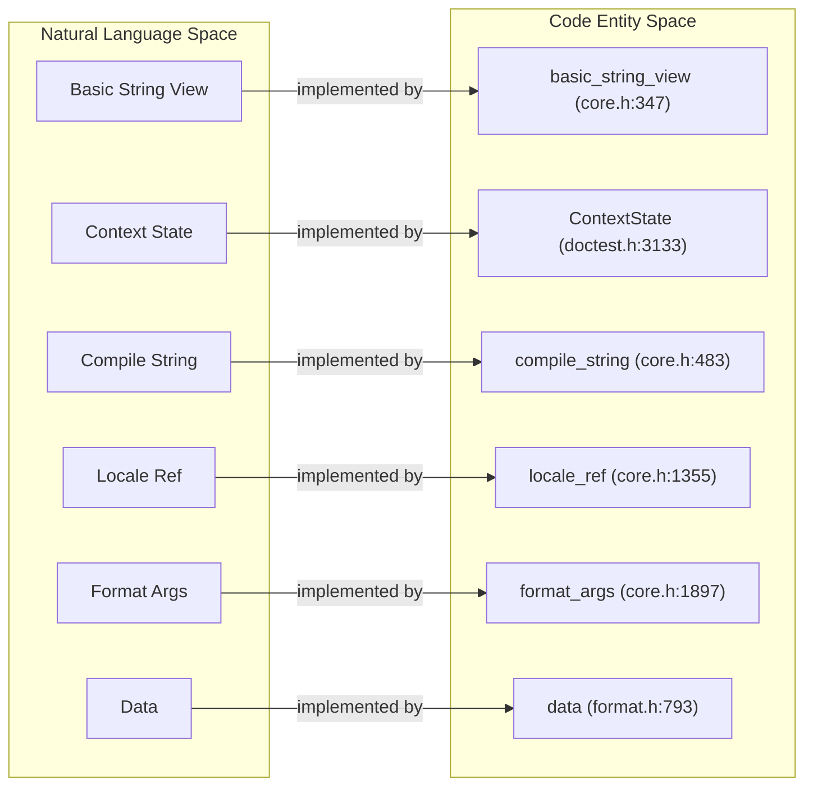
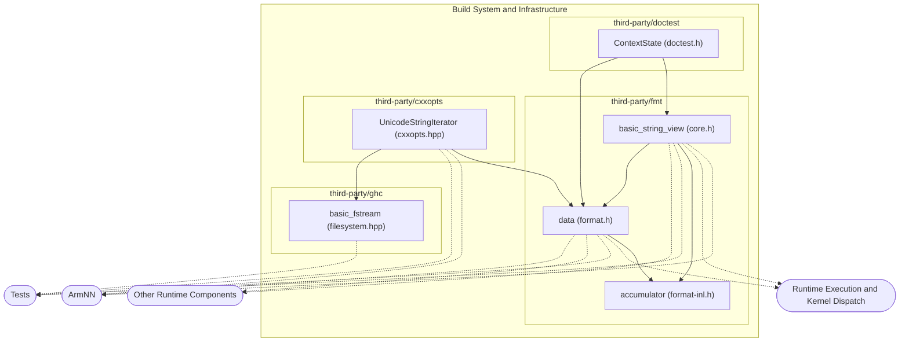
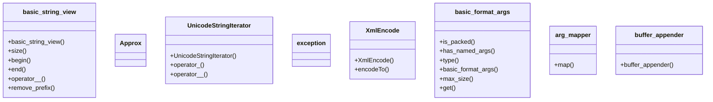
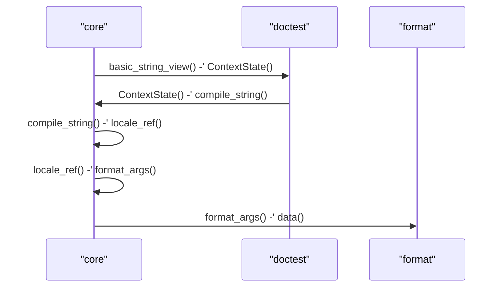

# 3-Source Context Packet (`git` + `CBM` + `llm-wiki`) for `2-build-system-and-infrastructure` — Build System and Infrastructure

- **Target Wiki File**: `wiki/2-build-system-and-infrastructure.md`
- **Archetype**: `Parent Hub Page`
- **Parent Page**: `None (Top-Level Chapter)`
- **Summary**: Architectural overview of Build System and Infrastructure, spanning 28 source files and 2092 code symbols across 1 subsystems.
- **Valid `[[wikilink]]` Neighbours**: `[[1-overview|Overview]]`, `[[3-backend-delegation-and-hardware-providers|Backend Delegation and Hardware Providers]]`, `[[3.1-backends-backendscommon|Backends Backendscommon]]`, `[[3.2-backends-reference|Backends Reference]]`, `[[3.3-backends-opencl|Backends OpenCL]]`, `[[3.4-backends-aclcommon|Backends Aclcommon]]`, `[[3.6-other-backends|Other Backends]]`, `[[5-runtime-execution-and-kernel-dispatch|Runtime Execution and Kernel Dispatch]]`

## 1. Relevant Source Files (`git` + `CBM`, use verbatim in `<details>`)
- `[third-party/fmt/format.h](third-party/fmt/format.h)`
- `[third-party/fmt/core.h](third-party/fmt/core.h)`
- `[third-party/cxxopts/cxxopts.hpp](third-party/cxxopts/cxxopts.hpp)`
- `[third-party/fmt/format-inl.h](third-party/fmt/format-inl.h)`
- `[third-party/ghc/filesystem.hpp](third-party/ghc/filesystem.hpp)`
- `[third-party/doctest/doctest.h](third-party/doctest/doctest.h)`

## 2. Grounded Code Symbols (`CBM`, use verbatim for `[file:start-end]()` pill citations)
- `basic_string_view` (Class) @ `[third-party/fmt/core.h:347-430]()` [fan-in=7, fan-out=0] — 
- `ContextState` (Class) @ `[third-party/doctest/doctest.h:3133-3206]()` [fan-in=1, fan-out=0] — // this holds both parameters from the command line and runtime data for tests
- `compile_string` (Class) @ `[third-party/fmt/core.h:483-483]()` [fan-in=0, fan-out=0] — // A base class for compile-time strings. It is defined in the fmt namespace to // make formatting functions visible via ADL, e.g. format(FMT_STRING("{}"), 42).
- `locale_ref` (Class) @ `[third-party/fmt/core.h:1355-1366]()` [fan-in=0, fan-out=0] — // A type-erased reference to an std::locale to avoid heavy <locale> include.
- `format_args` (Class) @ `[third-party/fmt/core.h:1897-1900]()` [fan-in=0, fan-out=0] — /** An alias to ``basic_format_args<context>``. */
- `data` (Class) @ `[third-party/fmt/format.h:793-793]()` [fan-in=0, fan-out=0] — // This is a struct rather than an alias to avoid shadowing warnings in gcc.
- `utf8_to_utf16` (Class) @ `[third-party/fmt/format.h:996-1006]()` [fan-in=0, fan-out=0] — // A converter from UTF-8 to UTF-16.
- `format_int` (Class) @ `[third-party/fmt/format.h:3042-3099]()` [fan-in=0, fan-out=0] — /** Fast integer formatter. */
- `accumulator` (Class) @ `[third-party/fmt/format-inl.h:506-523]()` [fan-in=0, fan-out=0] — // A simple accumulator to hold the sums of terms in bigint::square if uint128_t // is not available.
- `boundaries` (Class) @ `[third-party/fmt/format-inl.h:357-360]()` [fan-in=0, fan-out=0] — // Lower (upper) boundary is a value half way between a floating-point value // and its predecessor (successor). Boundaries have the same exponent as the // val
- `fixed_handler` (Class) @ `[third-party/fmt/format-inl.h:889-940]()` [fan-in=0, fan-out=0] — // The fixed precision digit handler.
- `fp` (Class) @ `[third-party/fmt/format-inl.h:363-446]()` [fan-in=0, fan-out=0] — // A handmade floating-point number f * pow(2, e).
- `grisu_shortest_handler` (Class) @ `[third-party/fmt/format-inl.h:943-982]()` [fan-in=0, fan-out=0] — // The shortest representation digit handler.
- `JUnitReporter` (Class) @ `[third-party/doctest/doctest.h:5269-5483]()` [fan-in=0, fan-out=0] — // TODO: // - log_message() // - respond to queries // - honor remaining options // - more attributes in tags
- `Approx` (Class) @ `[third-party/doctest/doctest.h:945-1024]()` [fan-in=5, fan-out=0] — 
- `UnicodeStringIterator` (Class) @ `[third-party/cxxopts/cxxopts.hpp:148-198]()` [fan-in=3, fan-out=0] — 
- `exception` (Class) @ `[third-party/cxxopts/cxxopts.hpp:402-419]()` [fan-in=3, fan-out=0] — 
- `basic_format_args` (Class) @ `[third-party/fmt/core.h:1791-1893]()` [fan-in=2, fan-out=0] — 
- `arg_mapper` (Class) @ `[third-party/fmt/core.h:1065-1173]()` [fan-in=2, fan-out=0] — 
- `buffer_appender` (Class) @ `[third-party/fmt/core.h:808-814]()` [fan-in=2, fan-out=0] — 
- `dynamic_arg_list` (Class) @ `[third-party/fmt/core.h:1419-1449]()` [fan-in=2, fan-out=0] — 
- `auto_id` (Class) @ `[third-party/fmt/format.h:2246-2246]()` [fan-in=2, fan-out=0] — 

## 3. Grounded Source Code Excerpts (`git` Working Tree)
### `basic_string_view` in `[third-party/fmt/core.h:347-362]()`
```cpp
template <typename Char> class basic_string_view {
 private:
  const Char* data_;
  size_t size_;

 public:
  using value_type = Char;
  using iterator = const Char*;

  constexpr basic_string_view() FMT_NOEXCEPT : data_(nullptr), size_(0) {}

  /** Constructs a string reference object from a C string and a size. */
  constexpr basic_string_view(const Char* s, size_t count) FMT_NOEXCEPT
      : data_(s),
        size_(count) {}
```

### `ContextState` in `[third-party/doctest/doctest.h:3133-3148]()`
```cpp
    struct ContextState : ContextOptions, TestRunStats, CurrentTestCaseStats
    {
        AtomicOrMultiLaneAtomic<int> numAssertsCurrentTest_atomic;
        AtomicOrMultiLaneAtomic<int> numAssertsFailedCurrentTest_atomic;

        std::vector<std::vector<String>> filters = decltype(filters)(9); // 9 different filters

        std::vector<IReporter*> reporters_currently_used;

        assert_handler ah = nullptr;

        Timer timer;

        std::vector<String> stringifiedContexts; // logging from INFO() due to an exception

        // stuff for subcases
```

### `locale_ref` in `[third-party/fmt/core.h:1355-1366]()`
```cpp
class locale_ref {
 private:
  const void* locale_;  // A type-erased pointer to std::locale.

 public:
  locale_ref() : locale_(nullptr) {}
  template <typename Locale> explicit locale_ref(const Locale& loc);

  explicit operator bool() const FMT_NOEXCEPT { return locale_ != nullptr; }

  template <typename Locale> Locale get() const;
};
```

### `format_args` in `[third-party/fmt/core.h:1897-1900]()`
```cpp
struct format_args : basic_format_args<format_context> {
  template <typename... Args>
  FMT_INLINE format_args(const Args&... args) : basic_format_args(args...) {}
};
```

### `utf8_to_utf16` in `[third-party/fmt/format.h:996-1006]()`
```cpp
class utf8_to_utf16 {
 private:
  wmemory_buffer buffer_;

 public:
  FMT_API explicit utf8_to_utf16(string_view s);
  operator wstring_view() const { return {&buffer_[0], size()}; }
  size_t size() const { return buffer_.size() - 1; }
  const wchar_t* c_str() const { return &buffer_[0]; }
  std::wstring str() const { return {&buffer_[0], size()}; }
};
```


## 4. Linked Official Docs (`llm-wiki` / `RAG`)
- **Build Infrastructure** (`wiki/2.1-build-infrastructure.md`, score=107.59, shared_symbols=['Approx', 'UnicodeStringIterator', 'XmlEncode', 'basic_string_view', 'exception', 'locale_ref']): # Build Infrastructure ↑ [[2-build-system-and-infrastructure|Build System and Infrastructure]] > Build Infrastructure subsystem (`build/infrastructure`), covering 28 files and 2092 symbols. Key symbols include `push_back`, `data`, `move`, `get`. <details> <summary>Relevant source files</summary> The following files were used as context for generating thi
- **Glossary** (`wiki/7-glossary.md`, score=77.091, shared_symbols=['basic_format_args', 'basic_string_view', 'locale_ref']): # Glossary > Definitions and technical context for ArmNN domain terms, acronyms, file formats, and core code entities. <details> <summary>Relevant source files</summary> The following files were used as context for generating this wiki page: - [src/armnn/Tensor.cpp](src/armnn/Tensor.cpp) - [include/armnn/Exceptions.hpp](include/armnn/Exceptions.hpp) - [i
- **Other Runtime Components** (`wiki/5.6-other-runtime-components.md`, score=49.295, shared_symbols=[]): # Other Runtime Components ↑ [[5-runtime-execution-and-kernel-dispatch|Runtime Execution and Kernel Dispatch]] > Other Runtime Components subsystem (consolidating `ArmNN Optimizations`, `Armnntestutils`, `ArmNN Layers`, `Samples Common`, `Armnntestutils`, `Samples Objectdetection`), covering 28 files and 1895 symbols. Key symbols include `Run`, `FoldPadInt
- **ArmNN** (`wiki/5.1-armnn.md`, score=49.295, shared_symbols=[]): # ArmNN ↑ [[5-runtime-execution-and-kernel-dispatch|Runtime Execution and Kernel Dispatch]] > ArmNN subsystem (`src/armnn`), covering 28 files and 1007 symbols. Key symbols include `SetTensorInfo`, `Connect`, `end`, `GetName`. <details> <summary>Relevant source files</summary> The following files were used as context for generating this wiki page: - [sr
- **Runtime Execution and Kernel Dispatch** (`wiki/5-runtime-execution-and-kernel-dispatch.md`, score=49.295, shared_symbols=[]): # Runtime Execution and Kernel Dispatch > Architectural overview of Runtime Execution and Kernel Dispatch, spanning 157 source files and 3718 code symbols across 6 subsystems. <details> <summary>Relevant source files</summary> The following files were used as context for generating this wiki page: - [samples/common/include/Audio/DataStructures.hpp](sampl
- **Overview** (`wiki/1-overview.md`, score=26.929, shared_symbols=[]): # Overview > End-to-end architecture overview of ArmNN: core subsystems, compilation/execution pipeline, entry points, and cross-module dependencies. <details> <summary>Relevant source files</summary> The following files were used as context for generating this wiki page: - [src/armnn/Tensor.cpp](src/armnn/Tensor.cpp) - [include/armnn/Exceptions.hpp](inc

## 5. Pre-Verified DeepWiki v1.9.9.5 Mermaid Diagrams
### Natural Language Space <-> Code Entity Space


### Subsystem Architecture Flowchart


### Class Hierarchy Diagram


### Call Sequence Diagram


## 6. DeepWiki v1.9.9.5 Authoring Checklist for `wiki/2-build-system-and-infrastructure.md`
1. Keep YAML frontmatter at top (`id`, `title`, `parent`, `sources`, `linked_docs`, `bridge_symbols`).
2. Keep `<details><summary>Relevant source files</summary>` block immediately after `# Title`.
3. Start with `## Purpose and Scope`, then numbered `## 1. ...`, `## 2. ...` sections separated by `---`.
4. Include at least 2 ```mermaid``` diagrams (including a `Natural Language Space` <-> `Code Entity Space` mapping).
5. Cite code entities inline using `[path/to/file.ext:start-end]()` and end every `##` section with `Sources: [file:start-end]()`.
6. Run `deepwiki_cli.py build --enrich-only ...` and `deepwiki_cli.py validate ...` after editing.
