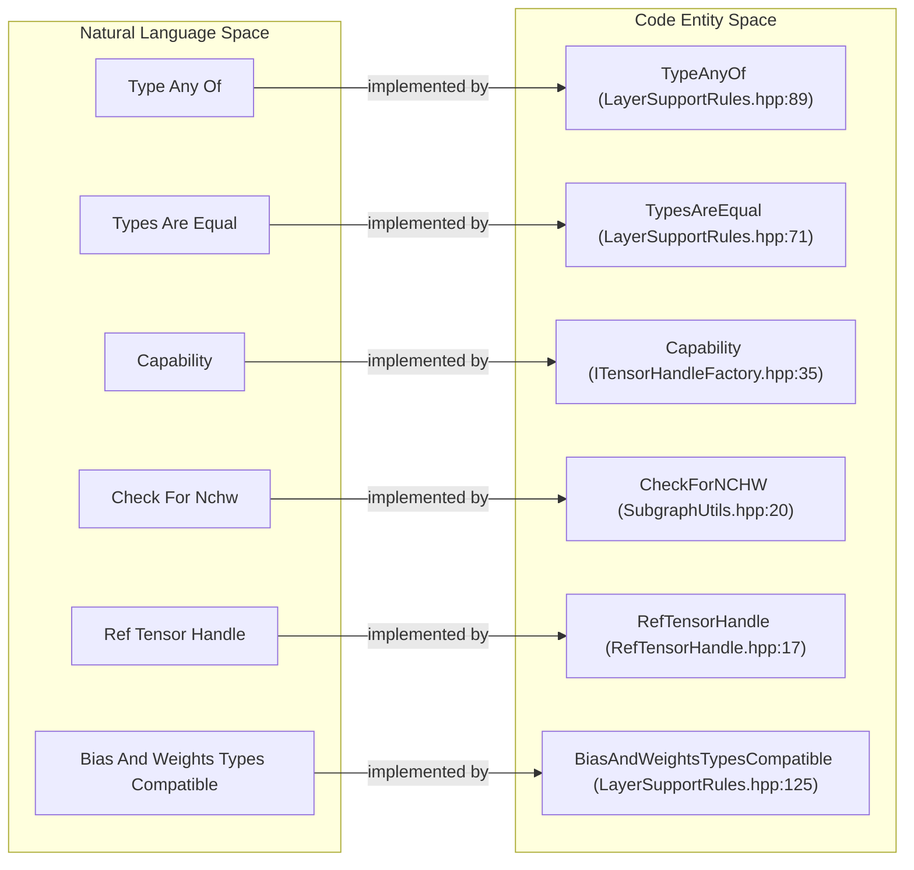
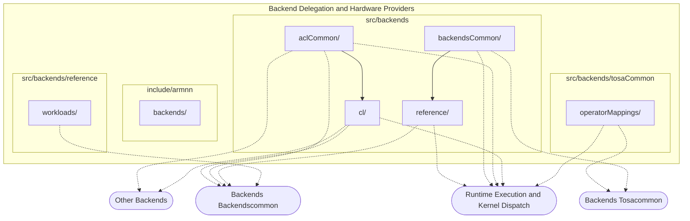
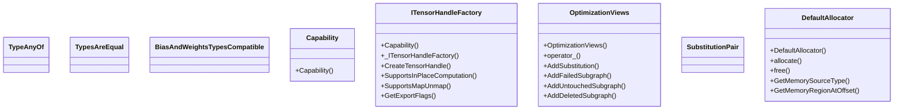
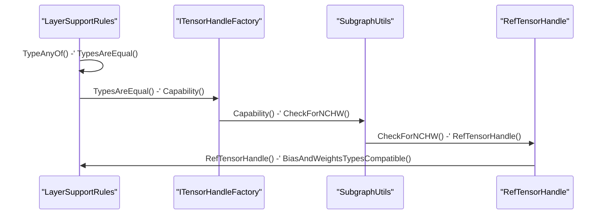

# 3-Source Context Packet (`git` + `CBM` + `llm-wiki`) for `3-backend-delegation-and-hardware-providers` — Backend Delegation and Hardware Providers

- **Target Wiki File**: `wiki/3-backend-delegation-and-hardware-providers.md`
- **Archetype**: `Parent Hub Page`
- **Parent Page**: `None (Top-Level Chapter)`
- **Summary**: Architectural overview of Backend Delegation and Hardware Providers, spanning 150 source files and 2618 code symbols across 6 subsystems.
- **Valid `[[wikilink]]` Neighbours**: `[[1-overview|Overview]]`, `[[3.1-backends-backendscommon|Backends Backendscommon]]`, `[[3.2-backends-reference|Backends Reference]]`, `[[3.6-other-backends|Other Backends]]`, `[[5-runtime-execution-and-kernel-dispatch|Runtime Execution and Kernel Dispatch]]`, `[[5.1-armnn|ArmNN]]`, `[[5.2-armnn|ArmNN]]`, `[[5.6-other-runtime-components|Other Runtime Components]]`

## 1. Relevant Source Files (`git` + `CBM`, use verbatim in `<details>`)
- `[src/backends/aclCommon/ArmComputeTensorUtils.hpp](src/backends/aclCommon/ArmComputeTensorUtils.hpp)`
- `[src/backends/aclCommon/ArmComputeTensorUtils.cpp](src/backends/aclCommon/ArmComputeTensorUtils.cpp)`
- `[src/backends/tosaCommon/operatorMappings/TosaOperatorUtils.hpp](src/backends/tosaCommon/operatorMappings/TosaOperatorUtils.hpp)`
- `[src/backends/backendsCommon/LayerSupportRules.hpp](src/backends/backendsCommon/LayerSupportRules.hpp)`
- `[include/armnn/backends/ITensorHandleFactory.hpp](include/armnn/backends/ITensorHandleFactory.hpp)`
- `[src/backends/reference/workloads/BaseIterator.hpp](src/backends/reference/workloads/BaseIterator.hpp)`
- `[src/backends/aclCommon/ArmComputeUtils.hpp](src/backends/aclCommon/ArmComputeUtils.hpp)`
- `[src/backends/cl/ClImportTensorHandle.hpp](src/backends/cl/ClImportTensorHandle.hpp)`
- `[src/backends/backendsCommon/TensorHandleFactoryRegistry.cpp](src/backends/backendsCommon/TensorHandleFactoryRegistry.cpp)`
- `[src/backends/reference/workloads/Broadcast.hpp](src/backends/reference/workloads/Broadcast.hpp)`
- `[src/backends/backendsCommon/DynamicBackendUtils.cpp](src/backends/backendsCommon/DynamicBackendUtils.cpp)`
- `[src/backends/backendsCommon/SubgraphUtils.hpp](src/backends/backendsCommon/SubgraphUtils.hpp)`
- `[src/backends/reference/RefTensorHandle.hpp](src/backends/reference/RefTensorHandle.hpp)`
- `[include/armnn/backends/OptimizationViews.hpp](include/armnn/backends/OptimizationViews.hpp)`
- `[src/backends/aclCommon/ArmComputeSubgraphUtils.hpp](src/backends/aclCommon/ArmComputeSubgraphUtils.hpp)`
- `[src/backends/reference/RefLayerSupport.cpp](src/backends/reference/RefLayerSupport.cpp)`
- `[src/backends/cl/ClContextSchema_generated.h](src/backends/cl/ClContextSchema_generated.h)`
- `[src/backends/reference/RefWorkloadFactory.cpp](src/backends/reference/RefWorkloadFactory.cpp)`
- `[src/backends/backendsCommon/LayerSupportBase.cpp](src/backends/backendsCommon/LayerSupportBase.cpp)`
- `[src/backends/cl/ClBackend.cpp](src/backends/cl/ClBackend.cpp)`
- `[src/backends/cl/ClTensorHandle.hpp](src/backends/cl/ClTensorHandle.hpp)`
- `[src/backends/cl/ClBackend.hpp](src/backends/cl/ClBackend.hpp)`
- `[src/backends/backendsCommon/DefaultAllocator.hpp](src/backends/backendsCommon/DefaultAllocator.hpp)`

## 2. Grounded Code Symbols (`CBM`, use verbatim for `[file:start-end]()` pill citations)
- `TypeAnyOf` (Class) @ `[src/backends/backendsCommon/LayerSupportRules.hpp:89-99]()` [fan-in=64, fan-out=0] — 
- `TypesAreEqual` (Class) @ `[src/backends/backendsCommon/LayerSupportRules.hpp:71-78]()` [fan-in=49, fan-out=0] — 
- `Capability` (Class) @ `[include/armnn/backends/ITensorHandleFactory.hpp:35-44]()` [fan-in=0, fan-out=0] — /// Capability of the TensorHandleFactory
- `CheckForNCHW` (Class) @ `[src/backends/backendsCommon/SubgraphUtils.hpp:20-129]()` [fan-in=0, fan-out=0] — /// Checks if a Layer has a DataLayout that is either NCHW or NCDHW.
- `RefTensorHandle` (Class) @ `[src/backends/reference/RefTensorHandle.hpp:17-82]()` [fan-in=0, fan-out=0] — // An implementation of ITensorHandle with simple "bump the pointer" memory-management behaviour
- `BiasAndWeightsTypesCompatible` (Class) @ `[src/backends/backendsCommon/LayerSupportRules.hpp:125-135]()` [fan-in=1, fan-out=0] — 
- `ClTensorDecorator` (Class) @ `[src/backends/cl/ClTensorHandle.hpp:379-417]()` [fan-in=0, fan-out=0] — /** ClTensorDecorator wraps an existing CL tensor allowing us to override the TensorInfo for it */
- `DefaultAllocator` (Class) @ `[src/backends/backendsCommon/DefaultAllocator.hpp:17-43]()` [fan-in=0, fan-out=0] — /** Default Memory Allocator class returned from IBackendInternal::GetDefaultAllocator(MemorySource) */
- `BiasAndWeightsTypesMatch` (Class) @ `[src/backends/backendsCommon/LayerSupportRules.hpp:117-123]()` [fan-in=0, fan-out=0] — 
- `QuantizationParametersAreEqual` (Class) @ `[src/backends/backendsCommon/LayerSupportRules.hpp:80-87]()` [fan-in=0, fan-out=0] — 
- `Rule` (Class) @ `[src/backends/backendsCommon/LayerSupportRules.hpp:47-55]()` [fan-in=0, fan-out=0] — 
- `ShapesAreBroadcastCompatible` (Class) @ `[src/backends/backendsCommon/LayerSupportRules.hpp:153-178]()` [fan-in=0, fan-out=0] — 
- `ShapesAreSameRank` (Class) @ `[src/backends/backendsCommon/LayerSupportRules.hpp:137-143]()` [fan-in=0, fan-out=0] — 
- `ShapesAreSameTotalSize` (Class) @ `[src/backends/backendsCommon/LayerSupportRules.hpp:145-151]()` [fan-in=0, fan-out=0] — 
- `TensorNumDimensionsAreCorrect` (Class) @ `[src/backends/backendsCommon/LayerSupportRules.hpp:180-186]()` [fan-in=0, fan-out=0] — 
- `TensorNumDimensionsAreGreaterOrEqualTo` (Class) @ `[src/backends/backendsCommon/LayerSupportRules.hpp:188-194]()` [fan-in=0, fan-out=0] — 
- `TypeIs` (Class) @ `[src/backends/backendsCommon/LayerSupportRules.hpp:101-107]()` [fan-in=0, fan-out=0] — 
- `TypeNotPerAxisQuantized` (Class) @ `[src/backends/backendsCommon/LayerSupportRules.hpp:109-115]()` [fan-in=0, fan-out=0] — 
- `ITensorHandleFactory` (Class) @ `[include/armnn/backends/ITensorHandleFactory.hpp:46-102]()` [fan-in=0, fan-out=0] — 
- `BaseIterator` (Class) @ `[src/backends/reference/workloads/BaseIterator.hpp:18-32]()` [fan-in=0, fan-out=0] — 
- `BooleanDecoder` (Class) @ `[src/backends/reference/workloads/BaseIterator.hpp:427-454]()` [fan-in=0, fan-out=0] — 
- `BooleanDecoderBool` (Class) @ `[src/backends/reference/workloads/BaseIterator.hpp:456-484]()` [fan-in=0, fan-out=0] — 

## 3. Grounded Source Code Excerpts (`git` Working Tree)
### `TypeAnyOf` in `[src/backends/backendsCommon/LayerSupportRules.hpp:89-99]()`
```cpp
struct TypeAnyOf : public Rule
{
    template<typename Container>
    TypeAnyOf(const TensorInfo& info, const Container& c)
    {
        m_Res = std::any_of(c.begin(), c.end(), [&info](DataType dt)
        {
            return dt == info.GetDataType();
        });
    }
};
```

### `TypesAreEqual` in `[src/backends/backendsCommon/LayerSupportRules.hpp:71-78]()`
```cpp
struct TypesAreEqual : public Rule
{
    template<typename ... Ts>
    TypesAreEqual(const Ts&... ts)
    {
        m_Res = AllTypesAreEqualImpl(ts...);
    }
};
```

### `Capability` in `[include/armnn/backends/ITensorHandleFactory.hpp:35-44]()`
```cpp
struct Capability
{
    Capability(CapabilityClass capabilityClass, bool value)
        : m_CapabilityClass(capabilityClass)
        , m_Value(value)
    {}

    CapabilityClass m_CapabilityClass;
    bool            m_Value;
};
```

### `CheckForNCHW` in `[src/backends/backendsCommon/SubgraphUtils.hpp:20-35]()`
```cpp
class CheckForNCHW : public StrategyBase<NoThrowStrategy>
{
public:
    CheckForNCHW()
    {}

    void ExecuteStrategy(const armnn::IConnectableLayer* layer,
                         const armnn::BaseDescriptor& descriptor,
                         const std::vector<armnn::ConstTensor>& constants,
                         const char* name,
                         const armnn::LayerBindingId id = 0) override
    {
        armnn::IgnoreUnused(layer, constants, id, name);
        switch (layer->GetType())
        {
            case armnn::LayerType::BatchMatMul:
```

### `RefTensorHandle` in `[src/backends/reference/RefTensorHandle.hpp:17-32]()`
```cpp
class RefTensorHandle : public ITensorHandle
{
public:
    RefTensorHandle(const TensorInfo& tensorInfo, std::shared_ptr<RefMemoryManager>& memoryManager);

    RefTensorHandle(const TensorInfo& tensorInfo);

    RefTensorHandle(const TensorInfo& tensorInfo, const RefTensorHandle& parent);

    ~RefTensorHandle();

    virtual void Manage() override;

    virtual void Allocate() override;

    virtual ITensorHandle* GetParent() const override
```


## 4. Linked Official Docs (`llm-wiki` / `RAG`)
- **Backends Backendscommon** (`wiki/3.1-backends-backendscommon.md`, score=110.079, shared_symbols=['ShapesAreBroadcastCompatible', 'ShapesAreSameTotalSize', 'TensorNumDimensionsAreCorrect', 'TypeAnyOf', 'TypeIs', 'TypesAreEqual']): # Backends Backendscommon ↑ [[3-backend-delegation-and-hardware-providers|Backend Delegation and Hardware Providers]] > Backends Backendscommon subsystem (`backends/backendsCommon`), covering 28 files and 312 symbols. Key symbols include `to_string`, `ValidateInputsOutputs`, `ValidateNumInputs`, `ValidateNumOutputs`. <details> <summary>Relevant source fil
- **Glossary** (`wiki/7-glossary.md`, score=79.664, shared_symbols=['BiasAndWeightsTypesCompatible', 'TypeAnyOf', 'TypesAreEqual']): # Glossary > Definitions and technical context for ArmNN domain terms, acronyms, file formats, and core code entities. <details> <summary>Relevant source files</summary> The following files were used as context for generating this wiki page: - [src/armnn/Tensor.cpp](src/armnn/Tensor.cpp) - [include/armnn/Exceptions.hpp](include/armnn/Exceptions.hpp) - [i
- **Backends Reference** (`wiki/3.2-backends-reference.md`, score=50.54, shared_symbols=[]): # Backends Reference ↑ [[3-backend-delegation-and-hardware-providers|Backend Delegation and Hardware Providers]] > Backends Reference subsystem (`backends/reference`), covering 28 files and 634 symbols. Key symbols include `GetNumDimensions`, `GetTensorInfo`, `MakeDecoder`, `MakeEncoder`. <details> <summary>Relevant source files</summary> The following f
- **Backends OpenCL** (`wiki/3.3-backends-opencl.md`, score=50.54, shared_symbols=[]): # Backends OpenCL ↑ [[3-backend-delegation-and-hardware-providers|Backend Delegation and Hardware Providers]] > Backends OpenCL subsystem (`backends/cl`), covering 28 files and 648 symbols. Key symbols include `IsClBackendSupported`, `RunClFunction`, `GetDataType`, `IsLayerSupported`. <details> <summary>Relevant source files</summary> The following files
- **Backends Aclcommon** (`wiki/3.4-backends-aclcommon.md`, score=50.54, shared_symbols=[]): # Backends Aclcommon ↑ [[3-backend-delegation-and-hardware-providers|Backend Delegation and Hardware Providers]] > Backends Aclcommon subsystem (`backends/aclCommon`), covering 10 files and 89 symbols. Key symbols include `GetShape`, `BuildArmComputeTensorInfo`, `ConvertDataLayout`, `ConvertActivationDescriptorToAclActivationLayerInfo`. <details> <summary
- **Overview** (`wiki/1-overview.md`, score=43.726, shared_symbols=['TypeAnyOf']): # Overview > End-to-end architecture overview of ArmNN: core subsystems, compilation/execution pipeline, entry points, and cross-module dependencies. <details> <summary>Relevant source files</summary> The following files were used as context for generating this wiki page: - [src/armnn/Tensor.cpp](src/armnn/Tensor.cpp) - [include/armnn/Exceptions.hpp](inc

## 5. Pre-Verified DeepWiki v1.9.9.5 Mermaid Diagrams
### Natural Language Space <-> Code Entity Space


### Subsystem Architecture Flowchart


### Class Hierarchy Diagram


### Call Sequence Diagram


## 6. DeepWiki v1.9.9.5 Authoring Checklist for `wiki/3-backend-delegation-and-hardware-providers.md`
1. Keep YAML frontmatter at top (`id`, `title`, `parent`, `sources`, `linked_docs`, `bridge_symbols`).
2. Keep `<details><summary>Relevant source files</summary>` block immediately after `# Title`.
3. Start with `## Purpose and Scope`, then numbered `## 1. ...`, `## 2. ...` sections separated by `---`.
4. Include at least 2 ```mermaid``` diagrams (including a `Natural Language Space` <-> `Code Entity Space` mapping).
5. Cite code entities inline using `[path/to/file.ext:start-end]()` and end every `##` section with `Sources: [file:start-end]()`.
6. Run `deepwiki_cli.py build --enrich-only ...` and `deepwiki_cli.py validate ...` after editing.
