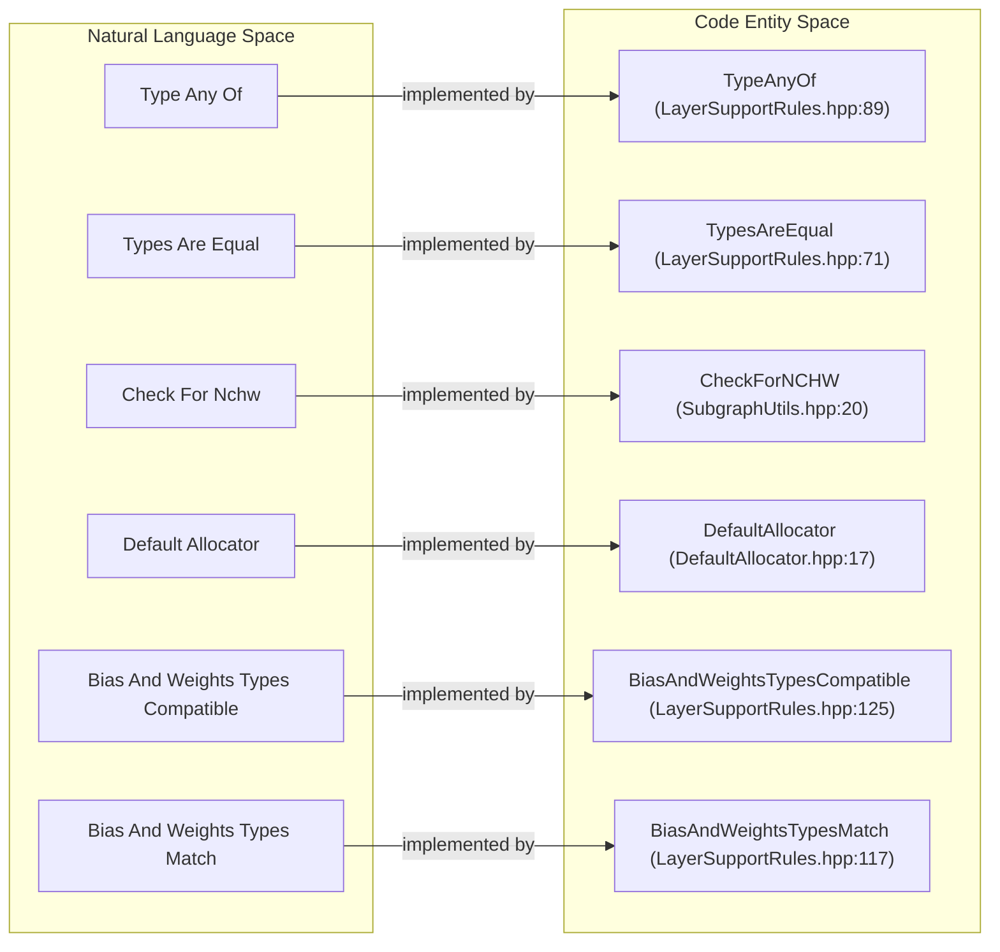
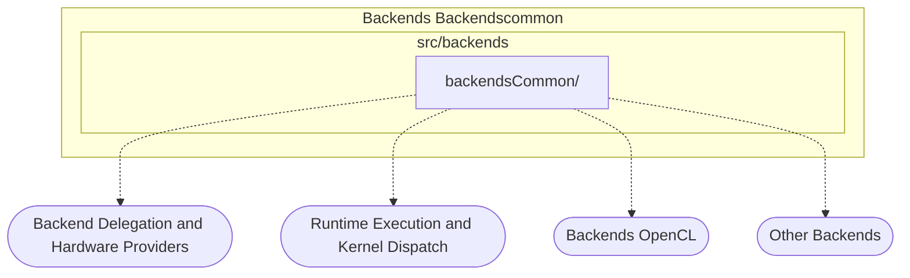
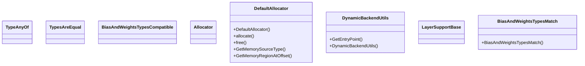
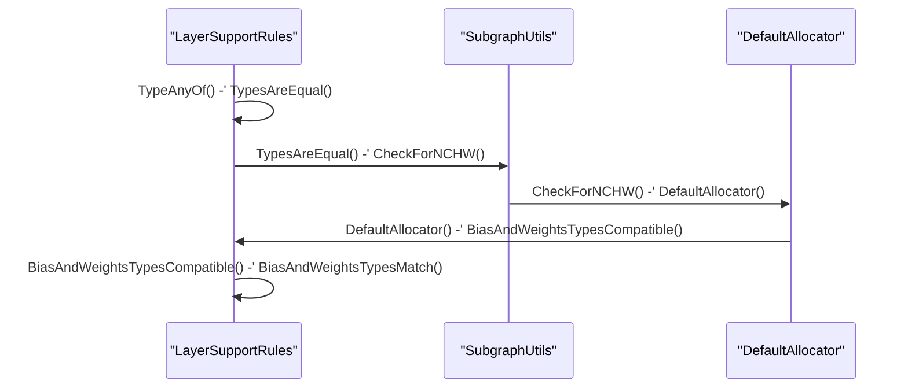

# 3-Source Context Packet (`git` + `CBM` + `llm-wiki`) for `3.1-backends-backendscommon` — Backends Backendscommon

- **Target Wiki File**: `wiki/3.1-backends-backendscommon.md`
- **Archetype**: `Leaf Technical Spec Page`
- **Parent Page**: `3-backend-delegation-and-hardware-providers`
- **Summary**: Backends Backendscommon subsystem (`backends/backendsCommon`), covering 28 files and 312 symbols. Key symbols include `to_string`, `ValidateInputsOutputs`, `ValidateNumInputs`, `ValidateNumOutputs`.
- **Valid `[[wikilink]]` Neighbours**: `[[3-backend-delegation-and-hardware-providers|Backend Delegation and Hardware Providers]]`, `[[3.2-backends-reference|Backends Reference]]`, `[[3.6-other-backends|Other Backends]]`, `[[5-runtime-execution-and-kernel-dispatch|Runtime Execution and Kernel Dispatch]]`, `[[5.1-armnn|ArmNN]]`, `[[5.2-armnn|ArmNN]]`, `[[5.6-other-runtime-components|Other Runtime Components]]`, `[[7-glossary|Glossary]]`

## 1. Relevant Source Files (`git` + `CBM`, use verbatim in `<details>`)
- `[src/backends/backendsCommon/LayerSupportRules.hpp](src/backends/backendsCommon/LayerSupportRules.hpp)`
- `[src/backends/backendsCommon/DynamicBackendUtils.cpp](src/backends/backendsCommon/DynamicBackendUtils.cpp)`
- `[src/backends/backendsCommon/TensorHandleFactoryRegistry.cpp](src/backends/backendsCommon/TensorHandleFactoryRegistry.cpp)`
- `[src/backends/backendsCommon/SubgraphUtils.hpp](src/backends/backendsCommon/SubgraphUtils.hpp)`
- `[src/backends/backendsCommon/DefaultAllocator.hpp](src/backends/backendsCommon/DefaultAllocator.hpp)`
- `[src/backends/backendsCommon/LayerSupportBase.cpp](src/backends/backendsCommon/LayerSupportBase.cpp)`
- `[src/backends/backendsCommon/DynamicBackend.cpp](src/backends/backendsCommon/DynamicBackend.cpp)`
- `[src/backends/backendsCommon/WorkloadData.cpp](src/backends/backendsCommon/WorkloadData.cpp)`
- `[src/backends/backendsCommon/WorkloadFactory.cpp](src/backends/backendsCommon/WorkloadFactory.cpp)`
- `[src/backends/backendsCommon/DynamicBackendUtils.hpp](src/backends/backendsCommon/DynamicBackendUtils.hpp)`
- `[src/backends/backendsCommon/MakeWorkloadHelper.hpp](src/backends/backendsCommon/MakeWorkloadHelper.hpp)`
- `[src/backends/backendsCommon/WorkloadUtils.cpp](src/backends/backendsCommon/WorkloadUtils.cpp)`
- `[src/backends/backendsCommon/LayerSupportBase.hpp](src/backends/backendsCommon/LayerSupportBase.hpp)`
- `[src/backends/backendsCommon/IBackendInternal.cpp](src/backends/backendsCommon/IBackendInternal.cpp)`
- `[src/backends/backendsCommon/MapWorkload.hpp](src/backends/backendsCommon/MapWorkload.hpp)`
- `[src/backends/backendsCommon/TensorHandle.cpp](src/backends/backendsCommon/TensorHandle.cpp)`
- `[src/backends/backendsCommon/MemImportWorkload.hpp](src/backends/backendsCommon/MemImportWorkload.hpp)`
- `[src/backends/backendsCommon/MemoryManager.hpp](src/backends/backendsCommon/MemoryManager.hpp)`
- `[src/backends/backendsCommon/MemSyncWorkload.hpp](src/backends/backendsCommon/MemSyncWorkload.hpp)`
- `[src/backends/backendsCommon/TensorHandleFactoryRegistry.hpp](src/backends/backendsCommon/TensorHandleFactoryRegistry.hpp)`
- `[src/backends/backendsCommon/WorkloadDataCollector.hpp](src/backends/backendsCommon/WorkloadDataCollector.hpp)`
- `[src/backends/backendsCommon/UnmapWorkload.hpp](src/backends/backendsCommon/UnmapWorkload.hpp)`
- `[src/backends/backendsCommon/WorkloadFactoryBase.hpp](src/backends/backendsCommon/WorkloadFactoryBase.hpp)`
- `[src/backends/backendsCommon/MemCopyWorkload.cpp](src/backends/backendsCommon/MemCopyWorkload.cpp)`
- `[src/backends/backendsCommon/MapWorkload.cpp](src/backends/backendsCommon/MapWorkload.cpp)`
- `[src/backends/backendsCommon/MemImportWorkload.cpp](src/backends/backendsCommon/MemImportWorkload.cpp)`
- `[src/backends/backendsCommon/MemSyncWorkload.cpp](src/backends/backendsCommon/MemSyncWorkload.cpp)`
- `[src/backends/backendsCommon/MemoryManager.cpp](src/backends/backendsCommon/MemoryManager.cpp)`

## 2. Grounded Code Symbols (`CBM`, use verbatim for `[file:start-end]()` pill citations)
- `TypeAnyOf` (Class) @ `[src/backends/backendsCommon/LayerSupportRules.hpp:89-99]()` [fan-in=64, fan-out=0] — 
- `TypesAreEqual` (Class) @ `[src/backends/backendsCommon/LayerSupportRules.hpp:71-78]()` [fan-in=49, fan-out=0] — 
- `CheckForNCHW` (Class) @ `[src/backends/backendsCommon/SubgraphUtils.hpp:20-129]()` [fan-in=0, fan-out=0] — /// Checks if a Layer has a DataLayout that is either NCHW or NCDHW.
- `DefaultAllocator` (Class) @ `[src/backends/backendsCommon/DefaultAllocator.hpp:17-43]()` [fan-in=0, fan-out=0] — /** Default Memory Allocator class returned from IBackendInternal::GetDefaultAllocator(MemorySource) */
- `BiasAndWeightsTypesCompatible` (Class) @ `[src/backends/backendsCommon/LayerSupportRules.hpp:125-135]()` [fan-in=1, fan-out=0] — 
- `BiasAndWeightsTypesMatch` (Class) @ `[src/backends/backendsCommon/LayerSupportRules.hpp:117-123]()` [fan-in=0, fan-out=0] — 
- `QuantizationParametersAreEqual` (Class) @ `[src/backends/backendsCommon/LayerSupportRules.hpp:80-87]()` [fan-in=0, fan-out=0] — 
- `Rule` (Class) @ `[src/backends/backendsCommon/LayerSupportRules.hpp:47-55]()` [fan-in=0, fan-out=0] — 
- `ShapesAreBroadcastCompatible` (Class) @ `[src/backends/backendsCommon/LayerSupportRules.hpp:153-178]()` [fan-in=0, fan-out=0] — 
- `ShapesAreSameRank` (Class) @ `[src/backends/backendsCommon/LayerSupportRules.hpp:137-143]()` [fan-in=0, fan-out=0] — 
- `ShapesAreSameTotalSize` (Class) @ `[src/backends/backendsCommon/LayerSupportRules.hpp:145-151]()` [fan-in=0, fan-out=0] — 
- `TensorNumDimensionsAreCorrect` (Class) @ `[src/backends/backendsCommon/LayerSupportRules.hpp:180-186]()` [fan-in=0, fan-out=0] — 
- `TensorNumDimensionsAreGreaterOrEqualTo` (Class) @ `[src/backends/backendsCommon/LayerSupportRules.hpp:188-194]()` [fan-in=0, fan-out=0] — 
- `TypeIs` (Class) @ `[src/backends/backendsCommon/LayerSupportRules.hpp:101-107]()` [fan-in=0, fan-out=0] — 
- `TypeNotPerAxisQuantized` (Class) @ `[src/backends/backendsCommon/LayerSupportRules.hpp:109-115]()` [fan-in=0, fan-out=0] — 
- `IsValidPair` (Class) @ `[src/backends/backendsCommon/SubgraphUtils.hpp:222-222]()` [fan-in=0, fan-out=0] — 
- `IsValidPair<Convolution2dLayer, Convolution2dDescriptor>` (Class) @ `[src/backends/backendsCommon/SubgraphUtils.hpp:229-229]()` [fan-in=0, fan-out=0] — 
- `IsValidPair<DepthwiseConvolution2dLayer, DepthwiseConvolution2dDescriptor>` (Class) @ `[src/backends/backendsCommon/SubgraphUtils.hpp:232-232]()` [fan-in=0, fan-out=0] — 
- `IsValidPair<Pooling2dLayer, Pooling2dDescriptor>` (Class) @ `[src/backends/backendsCommon/SubgraphUtils.hpp:226-226]()` [fan-in=0, fan-out=0] — 
- `OpBlockSequencer` (Class) @ `[src/backends/backendsCommon/SubgraphUtils.hpp:552-641]()` [fan-in=0, fan-out=0] — 
- `Pair` (Class) @ `[src/backends/backendsCommon/SubgraphUtils.hpp:555-559]()` [fan-in=0, fan-out=0] — 
- `DynamicBackendUtils` (Class) @ `[src/backends/backendsCommon/DynamicBackendUtils.hpp:28-59]()` [fan-in=0, fan-out=0] — 

## 3. Grounded Source Code Excerpts (`git` Working Tree)
### `TypeAnyOf` in `[src/backends/backendsCommon/LayerSupportRules.hpp:89-99]()`
```cpp
struct TypeAnyOf : public Rule
{
    template<typename Container>
    TypeAnyOf(const TensorInfo& info, const Container& c)
    {
        m_Res = std::any_of(c.begin(), c.end(), [&info](DataType dt)
        {
            return dt == info.GetDataType();
        });
    }
};
```

### `TypesAreEqual` in `[src/backends/backendsCommon/LayerSupportRules.hpp:71-78]()`
```cpp
struct TypesAreEqual : public Rule
{
    template<typename ... Ts>
    TypesAreEqual(const Ts&... ts)
    {
        m_Res = AllTypesAreEqualImpl(ts...);
    }
};
```

### `CheckForNCHW` in `[src/backends/backendsCommon/SubgraphUtils.hpp:20-35]()`
```cpp
class CheckForNCHW : public StrategyBase<NoThrowStrategy>
{
public:
    CheckForNCHW()
    {}

    void ExecuteStrategy(const armnn::IConnectableLayer* layer,
                         const armnn::BaseDescriptor& descriptor,
                         const std::vector<armnn::ConstTensor>& constants,
                         const char* name,
                         const armnn::LayerBindingId id = 0) override
    {
        armnn::IgnoreUnused(layer, constants, id, name);
        switch (layer->GetType())
        {
            case armnn::LayerType::BatchMatMul:
```

### `DefaultAllocator` in `[src/backends/backendsCommon/DefaultAllocator.hpp:17-32]()`
```cpp
class DefaultAllocator : public armnn::ICustomAllocator
{
public:
    DefaultAllocator() = default;

    void* allocate(size_t size, size_t alignment = 0) override
    {
        IgnoreUnused(alignment);
        return ::operator new(size_t(size));
    }

    void free(void* ptr) override
    {
        ::operator delete(ptr);
    }
```

### `BiasAndWeightsTypesCompatible` in `[src/backends/backendsCommon/LayerSupportRules.hpp:125-135]()`
```cpp
struct BiasAndWeightsTypesCompatible : public Rule
{
    template<typename Container>
    BiasAndWeightsTypesCompatible(const TensorInfo& info, const Container& c)
    {
        m_Res = std::any_of(c.begin(), c.end(), [&info](DataType dt)
            {
                return dt ==  GetBiasTypeFromWeightsType(info.GetDataType()).value();
            });
    }
};
```


## 4. Linked Official Docs (`llm-wiki` / `RAG`)
- **Backend Delegation and Hardware Providers** (`wiki/3-backend-delegation-and-hardware-providers.md`, score=132.007, shared_symbols=['TypeAnyOf', 'TypesAreEqual', 'ValidateInputsOutputs', 'ValidateNumInputs', 'ValidateNumOutputs', 'to_string']): # Backend Delegation and Hardware Providers > Architectural overview of Backend Delegation and Hardware Providers, spanning 150 source files and 2618 code symbols across 6 subsystems. <details> <summary>Relevant source files</summary> The following files were used as context for generating this wiki page: - [src/backends/aclCommon/ArmComputeTensorUtils.h
- **Backends OpenCL** (`wiki/3.3-backends-opencl.md`, score=83.699, shared_symbols=['Allocator', 'ValidateInputsOutputs', 'ValidateNumInputs', 'ValidateNumOutputs', 'to_string']): # Backends OpenCL ↑ [[3-backend-delegation-and-hardware-providers|Backend Delegation and Hardware Providers]] > Backends OpenCL subsystem (`backends/cl`), covering 28 files and 648 symbols. Key symbols include `IsClBackendSupported`, `RunClFunction`, `GetDataType`, `IsLayerSupported`. <details> <summary>Relevant source files</summary> The following files
- **Backends Reference** (`wiki/3.2-backends-reference.md`, score=76.199, shared_symbols=[]): # Backends Reference ↑ [[3-backend-delegation-and-hardware-providers|Backend Delegation and Hardware Providers]] > Backends Reference subsystem (`backends/reference`), covering 28 files and 634 symbols. Key symbols include `GetNumDimensions`, `GetTensorInfo`, `MakeDecoder`, `MakeEncoder`. <details> <summary>Relevant source files</summary> The following f
- **Backends Aclcommon** (`wiki/3.4-backends-aclcommon.md`, score=76.199, shared_symbols=[]): # Backends Aclcommon ↑ [[3-backend-delegation-and-hardware-providers|Backend Delegation and Hardware Providers]] > Backends Aclcommon subsystem (`backends/aclCommon`), covering 10 files and 89 symbols. Key symbols include `GetShape`, `BuildArmComputeTensorInfo`, `ConvertDataLayout`, `ConvertActivationDescriptorToAclActivationLayerInfo`. <details> <summary
- **Glossary** (`wiki/7-glossary.md`, score=73.651, shared_symbols=['BiasAndWeightsTypesCompatible', 'TypeAnyOf', 'TypesAreEqual']): # Glossary > Definitions and technical context for ArmNN domain terms, acronyms, file formats, and core code entities. <details> <summary>Relevant source files</summary> The following files were used as context for generating this wiki page: - [src/armnn/Tensor.cpp](src/armnn/Tensor.cpp) - [include/armnn/Exceptions.hpp](include/armnn/Exceptions.hpp) - [i
- **ArmNN DeepWiki** (`wiki/index.md`, score=56.065, shared_symbols=['ValidateInputsOutputs', 'ValidateNumInputs', 'ValidateNumOutputs', 'to_string']): # ArmNN DeepWiki Generated from `home-jason-Project-deepwiki-armnn` at commit `2b61cecc9df7` (2026-11-14T15:13:53+00:00). ## Pages - [[1-overview|Overview]] — End-to-end architecture overview of ArmNN: core subsystems, compilation/execution pipeline, entry points, and cross-module dependencies. - [[2-build-system-and-infrastructure|Build System and Infras

## 5. Pre-Verified DeepWiki v1.9.9.5 Mermaid Diagrams
### Natural Language Space <-> Code Entity Space


### Subsystem Architecture Flowchart


### Class Hierarchy Diagram


### Call Sequence Diagram


## 6. DeepWiki v1.9.9.5 Authoring Checklist for `wiki/3.1-backends-backendscommon.md`
1. Keep YAML frontmatter at top (`id`, `title`, `parent`, `sources`, `linked_docs`, `bridge_symbols`).
2. Keep `<details><summary>Relevant source files</summary>` block immediately after `# Title`.
3. Start with `## Purpose and Scope`, then numbered `## 1. ...`, `## 2. ...` sections separated by `---`.
4. Include at least 2 ```mermaid``` diagrams (including a `Natural Language Space` <-> `Code Entity Space` mapping).
5. Cite code entities inline using `[path/to/file.ext:start-end]()` and end every `##` section with `Sources: [file:start-end]()`.
6. Run `deepwiki_cli.py build --enrich-only ...` and `deepwiki_cli.py validate ...` after editing.
