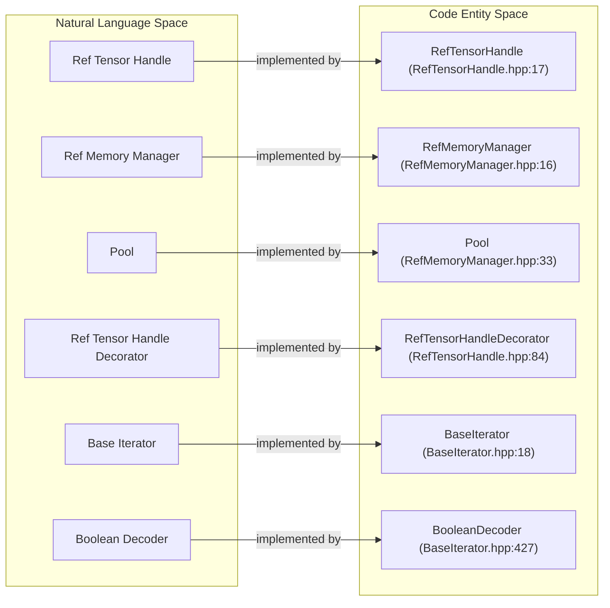
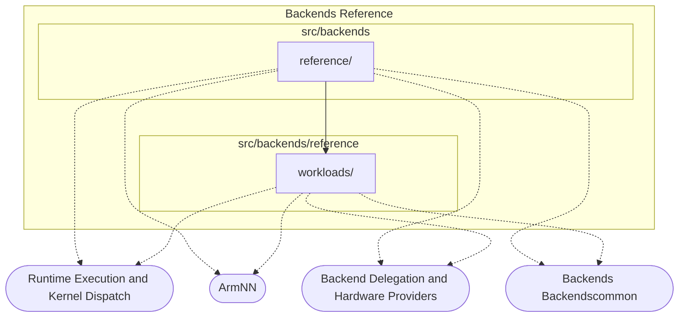
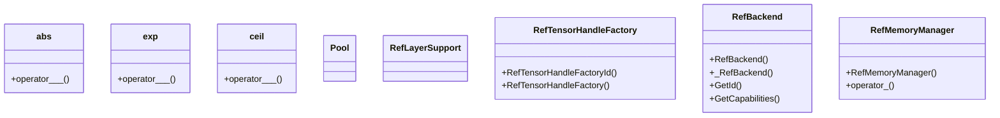
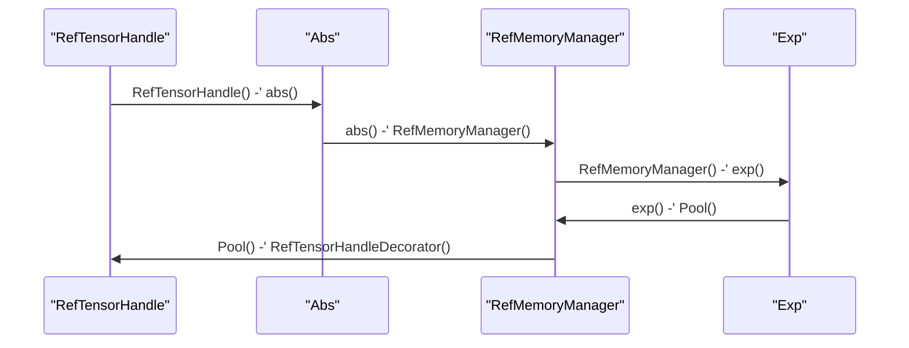

# 3-Source Context Packet (`git` + `CBM` + `llm-wiki`) for `3.2-backends-reference` — Backends Reference

- **Target Wiki File**: `wiki/3.2-backends-reference.md`
- **Archetype**: `Leaf Technical Spec Page`
- **Parent Page**: `3-backend-delegation-and-hardware-providers`
- **Summary**: Backends Reference subsystem (`backends/reference`), covering 28 files and 634 symbols. Key symbols include `GetNumDimensions`, `GetTensorInfo`, `MakeDecoder`, `MakeEncoder`.
- **Valid `[[wikilink]]` Neighbours**: `[[3-backend-delegation-and-hardware-providers|Backend Delegation and Hardware Providers]]`, `[[3.1-backends-backendscommon|Backends Backendscommon]]`, `[[3.6-other-backends|Other Backends]]`, `[[5-runtime-execution-and-kernel-dispatch|Runtime Execution and Kernel Dispatch]]`, `[[5.1-armnn|ArmNN]]`, `[[5.2-armnn|ArmNN]]`, `[[5.6-other-runtime-components|Other Runtime Components]]`, `[[7-glossary|Glossary]]`

## 1. Relevant Source Files (`git` + `CBM`, use verbatim in `<details>`)
- `[src/backends/reference/workloads/BaseIterator.hpp](src/backends/reference/workloads/BaseIterator.hpp)`
- `[src/backends/reference/RefTensorHandle.hpp](src/backends/reference/RefTensorHandle.hpp)`
- `[src/backends/reference/workloads/Broadcast.hpp](src/backends/reference/workloads/Broadcast.hpp)`
- `[src/backends/reference/RefLayerSupport.cpp](src/backends/reference/RefLayerSupport.cpp)`
- `[src/backends/reference/RefWorkloadFactory.cpp](src/backends/reference/RefWorkloadFactory.cpp)`
- `[src/backends/reference/RefBackend.hpp](src/backends/reference/RefBackend.hpp)`
- `[src/backends/reference/RefMemoryManager.hpp](src/backends/reference/RefMemoryManager.hpp)`
- `[src/backends/reference/RefBackend.cpp](src/backends/reference/RefBackend.cpp)`
- `[src/backends/reference/RefLayerSupport.hpp](src/backends/reference/RefLayerSupport.hpp)`
- `[src/backends/reference/RefTensorHandle.cpp](src/backends/reference/RefTensorHandle.cpp)`
- `[src/backends/reference/RefTensorHandleFactory.hpp](src/backends/reference/RefTensorHandleFactory.hpp)`
- `[src/backends/reference/workloads/BatchMatMulImpl.cpp](src/backends/reference/workloads/BatchMatMulImpl.cpp)`
- `[src/backends/reference/workloads/Abs.hpp](src/backends/reference/workloads/Abs.hpp)`
- `[src/backends/reference/workloads/Decoders.hpp](src/backends/reference/workloads/Decoders.hpp)`
- `[src/backends/reference/RefMemoryManager.cpp](src/backends/reference/RefMemoryManager.cpp)`
- `[src/backends/reference/RefBackendId.hpp](src/backends/reference/RefBackendId.hpp)`
- `[src/backends/reference/RefTensorHandleFactory.cpp](src/backends/reference/RefTensorHandleFactory.cpp)`
- `[src/backends/reference/workloads/BatchMatMulImpl.hpp](src/backends/reference/workloads/BatchMatMulImpl.hpp)`
- `[src/backends/reference/workloads/Ceil.hpp](src/backends/reference/workloads/Ceil.hpp)`
- `[src/backends/reference/workloads/Encoders.hpp](src/backends/reference/workloads/Encoders.hpp)`
- `[src/backends/reference/workloads/RefWorkloadUtils.hpp](src/backends/reference/workloads/RefWorkloadUtils.hpp)`
- `[src/backends/reference/RefWorkloadFactory.hpp](src/backends/reference/RefWorkloadFactory.hpp)`
- `[src/backends/reference/workloads/LstmUtils.cpp](src/backends/reference/workloads/LstmUtils.cpp)`
- `[src/backends/reference/workloads/ConvImpl.hpp](src/backends/reference/workloads/ConvImpl.hpp)`
- `[src/backends/reference/workloads/Exp.hpp](src/backends/reference/workloads/Exp.hpp)`
- `[src/backends/reference/workloads/Activation.cpp](src/backends/reference/workloads/Activation.cpp)`
- `[src/backends/reference/workloads/ArgMinMax.cpp](src/backends/reference/workloads/ArgMinMax.cpp)`
- `[src/backends/reference/workloads/BatchToSpaceNd.cpp](src/backends/reference/workloads/BatchToSpaceNd.cpp)`

## 2. Grounded Code Symbols (`CBM`, use verbatim for `[file:start-end]()` pill citations)
- `RefTensorHandle` (Class) @ `[src/backends/reference/RefTensorHandle.hpp:17-82]()` [fan-in=0, fan-out=0] — // An implementation of ITensorHandle with simple "bump the pointer" memory-management behaviour
- `abs` (Class) @ `[src/backends/reference/workloads/Abs.hpp:13-23]()` [fan-in=8, fan-out=0] — 
- `RefMemoryManager` (Class) @ `[src/backends/reference/RefMemoryManager.hpp:16-57]()` [fan-in=0, fan-out=0] — // An implementation of IMemoryManager to be used with RefTensorHandle
- `exp` (Class) @ `[src/backends/reference/workloads/Exp.hpp:13-23]()` [fan-in=8, fan-out=0] — 
- `Pool` (Class) @ `[src/backends/reference/RefMemoryManager.hpp:33-49]()` [fan-in=2, fan-out=0] — 
- `RefTensorHandleDecorator` (Class) @ `[src/backends/reference/RefTensorHandle.hpp:84-156]()` [fan-in=0, fan-out=0] — 
- `BaseIterator` (Class) @ `[src/backends/reference/workloads/BaseIterator.hpp:18-32]()` [fan-in=0, fan-out=0] — 
- `BooleanDecoder` (Class) @ `[src/backends/reference/workloads/BaseIterator.hpp:427-454]()` [fan-in=0, fan-out=0] — 
- `BooleanDecoderBool` (Class) @ `[src/backends/reference/workloads/BaseIterator.hpp:456-484]()` [fan-in=0, fan-out=0] — 
- `BooleanEncoder` (Class) @ `[src/backends/reference/workloads/BaseIterator.hpp:684-702]()` [fan-in=0, fan-out=0] — 
- `Decoder` (Class) @ `[src/backends/reference/workloads/BaseIterator.hpp:35-47]()` [fan-in=0, fan-out=0] — 
- `Encoder` (Class) @ `[src/backends/reference/workloads/BaseIterator.hpp:50-62]()` [fan-in=0, fan-out=0] — 
- `Float16Decoder` (Class) @ `[src/backends/reference/workloads/BaseIterator.hpp:247-280]()` [fan-in=0, fan-out=0] — 
- `Float16Encoder` (Class) @ `[src/backends/reference/workloads/BaseIterator.hpp:582-602]()` [fan-in=0, fan-out=0] — 
- `Float32Decoder` (Class) @ `[src/backends/reference/workloads/BaseIterator.hpp:282-305]()` [fan-in=0, fan-out=0] — 
- `Float32Encoder` (Class) @ `[src/backends/reference/workloads/BaseIterator.hpp:604-622]()` [fan-in=0, fan-out=0] — 
- `Int32Decoder` (Class) @ `[src/backends/reference/workloads/BaseIterator.hpp:340-367]()` [fan-in=0, fan-out=0] — 
- `Int32Encoder` (Class) @ `[src/backends/reference/workloads/BaseIterator.hpp:624-642]()` [fan-in=0, fan-out=0] — 
- `Int32ToInt32tDecoder` (Class) @ `[src/backends/reference/workloads/BaseIterator.hpp:369-396]()` [fan-in=0, fan-out=0] — 
- `Int32ToInt32tEncoder` (Class) @ `[src/backends/reference/workloads/BaseIterator.hpp:644-662]()` [fan-in=0, fan-out=0] — 
- `Int64Decoder` (Class) @ `[src/backends/reference/workloads/BaseIterator.hpp:398-425]()` [fan-in=0, fan-out=0] — 
- `Int64Encoder` (Class) @ `[src/backends/reference/workloads/BaseIterator.hpp:664-682]()` [fan-in=0, fan-out=0] — 

## 3. Grounded Source Code Excerpts (`git` Working Tree)
### `RefTensorHandle` in `[src/backends/reference/RefTensorHandle.hpp:17-32]()`
```cpp
class RefTensorHandle : public ITensorHandle
{
public:
    RefTensorHandle(const TensorInfo& tensorInfo, std::shared_ptr<RefMemoryManager>& memoryManager);

    RefTensorHandle(const TensorInfo& tensorInfo);

    RefTensorHandle(const TensorInfo& tensorInfo, const RefTensorHandle& parent);

    ~RefTensorHandle();

    virtual void Manage() override;

    virtual void Allocate() override;

    virtual ITensorHandle* GetParent() const override
```

### `abs` in `[src/backends/reference/workloads/Abs.hpp:13-23]()`
```cpp
struct abs
    {
        typedef T result_type;
        typedef T argument_type;

        T
        operator () (const T&  inputData) const
        {
            return std::abs(inputData);
        }
    };
```

### `RefMemoryManager` in `[src/backends/reference/RefMemoryManager.hpp:16-31]()`
```cpp
class RefMemoryManager : public IMemoryManager
{
public:
    RefMemoryManager();
    virtual ~RefMemoryManager();

    class Pool;

    Pool* Manage(unsigned int numBytes);

    void Allocate(Pool *pool);

    void* GetPointer(Pool *pool);

    void Acquire() override;
    void Release() override;
```

### `exp` in `[src/backends/reference/workloads/Exp.hpp:13-23]()`
```cpp
struct exp
    {
        typedef T result_type;
        typedef T argument_type;

        T
        operator () (const T&  inputData) const
        {
            return std::exp(inputData);
        }
    };
```

### `Pool` in `[src/backends/reference/RefMemoryManager.hpp:33-48]()`
```cpp
    class Pool
    {
    public:
        Pool(unsigned int numBytes);
        ~Pool();

        void Acquire();
        void Release();

        void* GetPointer();

        void Reserve(unsigned int numBytes);

    private:
        unsigned int m_Size;
        void* m_Pointer;
```


## 4. Linked Official Docs (`llm-wiki` / `RAG`)
- **Backend Delegation and Hardware Providers** (`wiki/3-backend-delegation-and-hardware-providers.md`, score=80.663, shared_symbols=[]): # Backend Delegation and Hardware Providers > Architectural overview of Backend Delegation and Hardware Providers, spanning 150 source files and 2618 code symbols across 6 subsystems. <details> <summary>Relevant source files</summary> The following files were used as context for generating this wiki page: - [src/backends/aclCommon/ArmComputeTensorUtils.h
- **Backends Backendscommon** (`wiki/3.1-backends-backendscommon.md`, score=57.125, shared_symbols=[]): # Backends Backendscommon ↑ [[3-backend-delegation-and-hardware-providers|Backend Delegation and Hardware Providers]] > Backends Backendscommon subsystem (`backends/backendsCommon`), covering 28 files and 312 symbols. Key symbols include `to_string`, `ValidateInputsOutputs`, `ValidateNumInputs`, `ValidateNumOutputs`. <details> <summary>Relevant source fil
- **Backends OpenCL** (`wiki/3.3-backends-opencl.md`, score=57.125, shared_symbols=[]): # Backends OpenCL ↑ [[3-backend-delegation-and-hardware-providers|Backend Delegation and Hardware Providers]] > Backends OpenCL subsystem (`backends/cl`), covering 28 files and 648 symbols. Key symbols include `IsClBackendSupported`, `RunClFunction`, `GetDataType`, `IsLayerSupported`. <details> <summary>Relevant source files</summary> The following files
- **Backends Aclcommon** (`wiki/3.4-backends-aclcommon.md`, score=57.125, shared_symbols=[]): # Backends Aclcommon ↑ [[3-backend-delegation-and-hardware-providers|Backend Delegation and Hardware Providers]] > Backends Aclcommon subsystem (`backends/aclCommon`), covering 10 files and 89 symbols. Key symbols include `GetShape`, `BuildArmComputeTensorInfo`, `ConvertDataLayout`, `ConvertActivationDescriptorToAclActivationLayerInfo`. <details> <summary
- **ArmNN DeepWiki** (`wiki/index.md`, score=53.056, shared_symbols=[]): # ArmNN DeepWiki Generated from `home-jason-Project-deepwiki-armnn` at commit `2b61cecc9df7` (2026-11-14T15:13:53+00:00). ## Pages - [[1-overview|Overview]] — End-to-end architecture overview of ArmNN: core subsystems, compilation/execution pipeline, entry points, and cross-module dependencies. - [[2-build-system-and-infrastructure|Build System and Infras
- **Overview** (`wiki/1-overview.md`, score=41.035, shared_symbols=[]): # Overview > End-to-end architecture overview of ArmNN: core subsystems, compilation/execution pipeline, entry points, and cross-module dependencies. <details> <summary>Relevant source files</summary> The following files were used as context for generating this wiki page: - [src/armnn/Tensor.cpp](src/armnn/Tensor.cpp) - [include/armnn/Exceptions.hpp](inc

## 5. Pre-Verified DeepWiki v1.9.9.5 Mermaid Diagrams
### Natural Language Space <-> Code Entity Space


### Subsystem Architecture Flowchart


### Class Hierarchy Diagram


### Call Sequence Diagram


## 6. DeepWiki v1.9.9.5 Authoring Checklist for `wiki/3.2-backends-reference.md`
1. Keep YAML frontmatter at top (`id`, `title`, `parent`, `sources`, `linked_docs`, `bridge_symbols`).
2. Keep `<details><summary>Relevant source files</summary>` block immediately after `# Title`.
3. Start with `## Purpose and Scope`, then numbered `## 1. ...`, `## 2. ...` sections separated by `---`.
4. Include at least 2 ```mermaid``` diagrams (including a `Natural Language Space` <-> `Code Entity Space` mapping).
5. Cite code entities inline using `[path/to/file.ext:start-end]()` and end every `##` section with `Sources: [file:start-end]()`.
6. Run `deepwiki_cli.py build --enrich-only ...` and `deepwiki_cli.py validate ...` after editing.
