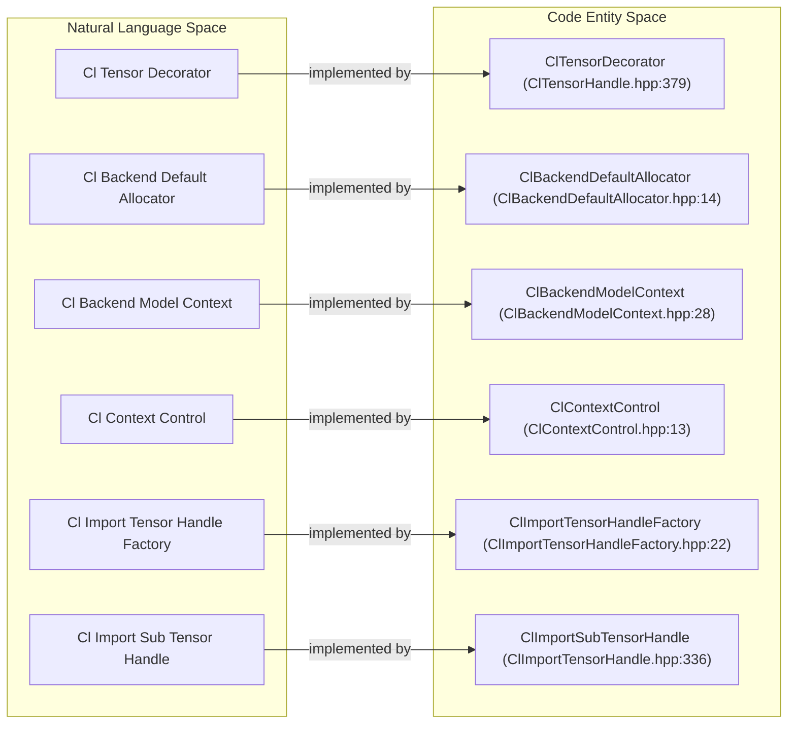
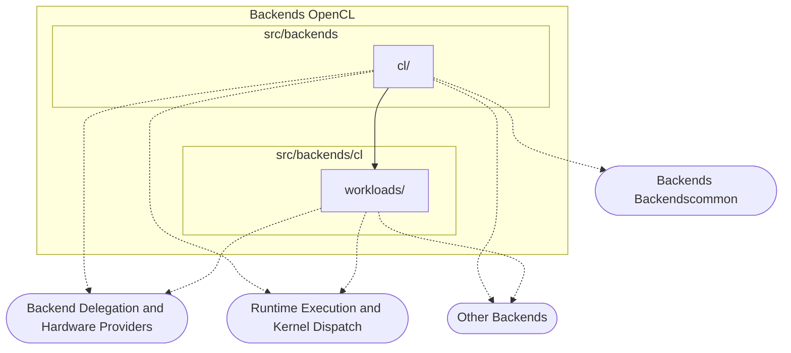
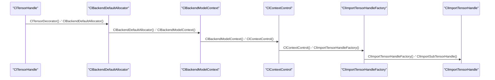

# 3-Source Context Packet (`git` + `CBM` + `llm-wiki`) for `3.3-backends-opencl` — Backends OpenCL

- **Target Wiki File**: `wiki/3.3-backends-opencl.md`
- **Archetype**: `Leaf Technical Spec Page`
- **Parent Page**: `3-backend-delegation-and-hardware-providers`
- **Summary**: Backends OpenCL subsystem (`backends/cl`), covering 28 files and 648 symbols. Key symbols include `IsClBackendSupported`, `RunClFunction`, `GetDataType`, `IsLayerSupported`.
- **Valid `[[wikilink]]` Neighbours**: `[[3-backend-delegation-and-hardware-providers|Backend Delegation and Hardware Providers]]`, `[[3.1-backends-backendscommon|Backends Backendscommon]]`, `[[3.2-backends-reference|Backends Reference]]`, `[[3.6-other-backends|Other Backends]]`, `[[5-runtime-execution-and-kernel-dispatch|Runtime Execution and Kernel Dispatch]]`, `[[5.1-armnn|ArmNN]]`, `[[5.2-armnn|ArmNN]]`, `[[5.6-other-runtime-components|Other Runtime Components]]`

## 1. Relevant Source Files (`git` + `CBM`, use verbatim in `<details>`)
- `[src/backends/cl/ClImportTensorHandle.hpp](src/backends/cl/ClImportTensorHandle.hpp)`
- `[src/backends/cl/ClBackend.cpp](src/backends/cl/ClBackend.cpp)`
- `[src/backends/cl/ClBackend.hpp](src/backends/cl/ClBackend.hpp)`
- `[src/backends/cl/ClContextSchema_generated.h](src/backends/cl/ClContextSchema_generated.h)`
- `[src/backends/cl/ClBackendContext.cpp](src/backends/cl/ClBackendContext.cpp)`
- `[src/backends/cl/ClTensorHandle.hpp](src/backends/cl/ClTensorHandle.hpp)`
- `[src/backends/cl/ClBackendDefaultAllocator.hpp](src/backends/cl/ClBackendDefaultAllocator.hpp)`
- `[src/backends/cl/ClLayerSupport.cpp](src/backends/cl/ClLayerSupport.cpp)`
- `[src/backends/cl/ClBackendContext.hpp](src/backends/cl/ClBackendContext.hpp)`
- `[src/backends/cl/ClBackendModelContext.hpp](src/backends/cl/ClBackendModelContext.hpp)`
- `[src/backends/cl/ICLTensorProxy.hpp](src/backends/cl/ICLTensorProxy.hpp)`
- `[src/backends/cl/ClContextControl.hpp](src/backends/cl/ClContextControl.hpp)`
- `[src/backends/cl/ClContextDeserializer.hpp](src/backends/cl/ClContextDeserializer.hpp)`
- `[src/backends/cl/ClContextSerializer.hpp](src/backends/cl/ClContextSerializer.hpp)`
- `[src/backends/cl/ClTensorHandle.cpp](src/backends/cl/ClTensorHandle.cpp)`
- `[src/backends/cl/ClImportTensorHandleFactory.hpp](src/backends/cl/ClImportTensorHandleFactory.hpp)`
- `[src/backends/cl/ClContextControl.cpp](src/backends/cl/ClContextControl.cpp)`
- `[src/backends/cl/ClBackendModelContext.cpp](src/backends/cl/ClBackendModelContext.cpp)`
- `[src/backends/cl/ClLayerSupport.hpp](src/backends/cl/ClLayerSupport.hpp)`
- `[src/backends/cl/ClTensorHandleFactory.hpp](src/backends/cl/ClTensorHandleFactory.hpp)`
- `[src/backends/cl/ClContextDeserializer.cpp](src/backends/cl/ClContextDeserializer.cpp)`
- `[src/backends/cl/OpenClTimer.hpp](src/backends/cl/OpenClTimer.hpp)`
- `[src/backends/cl/ClBackendId.hpp](src/backends/cl/ClBackendId.hpp)`
- `[src/backends/cl/ClWorkloadFactory.cpp](src/backends/cl/ClWorkloadFactory.cpp)`
- `[src/backends/cl/ClImportTensorHandleFactory.cpp](src/backends/cl/ClImportTensorHandleFactory.cpp)`
- `[src/backends/cl/ClContextSerializer.cpp](src/backends/cl/ClContextSerializer.cpp)`
- `[src/backends/cl/workloads/ClWorkloadUtils.hpp](src/backends/cl/workloads/ClWorkloadUtils.hpp)`
- `[src/backends/cl/ClTensorHandleFactory.cpp](src/backends/cl/ClTensorHandleFactory.cpp)`

## 2. Grounded Code Symbols (`CBM`, use verbatim for `[file:start-end]()` pill citations)
- `ClTensorDecorator` (Class) @ `[src/backends/cl/ClTensorHandle.hpp:379-417]()` [fan-in=0, fan-out=0] — /** ClTensorDecorator wraps an existing CL tensor allowing us to override the TensorInfo for it */
- `ClBackendDefaultAllocator` (Class) @ `[src/backends/cl/ClBackendDefaultAllocator.hpp:14-46]()` [fan-in=0, fan-out=0] — /** Default Memory Allocator class returned from IBackendInternal::GetDefaultAllocator(MemorySource) */
- `ClBackendModelContext` (Class) @ `[src/backends/cl/ClBackendModelContext.hpp:28-47]()` [fan-in=0, fan-out=0] — /// The ClBackendModelContext is used to pass in CL specific backend ModelOptions. The supported backend ModelOptions /// are: /// - "FastMathEnabled" /// Using
- `ClContextControl` (Class) @ `[src/backends/cl/ClContextControl.hpp:13-40]()` [fan-in=0, fan-out=0] — // ARM Compute OpenCL context control.
- `ClImportTensorHandleFactory` (Class) @ `[src/backends/cl/ClImportTensorHandleFactory.hpp:22-73]()` [fan-in=0, fan-out=0] — /** * This factory creates ClImportTensorHandles that refer to imported memory tensors. */
- `ClImportSubTensorHandle` (Class) @ `[src/backends/cl/ClImportTensorHandle.hpp:336-467]()` [fan-in=0, fan-out=0] — 
- `ClImportTensorHandle` (Class) @ `[src/backends/cl/ClImportTensorHandle.hpp:30-334]()` [fan-in=0, fan-out=0] — 
- `OpenClTimer` (Class) @ `[src/backends/cl/OpenClTimer.hpp:20-60]()` [fan-in=0, fan-out=0] — /// OpenClTimer instrument that times all OpenCl kernels executed between calls to Start() and Stop().
- `ClBackend` (Class) @ `[src/backends/cl/ClBackend.hpp:24-285]()` [fan-in=0, fan-out=0] — 
- `ClBackendCustomAllocatorMemoryRegion` (Class) @ `[src/backends/cl/ClBackend.hpp:213-281]()` [fan-in=0, fan-out=0] — 
- `ClBackendCustomAllocatorWrapper` (Class) @ `[src/backends/cl/ClBackend.hpp:97-211]()` [fan-in=0, fan-out=0] — 
- `ClContextBuilder` (Class) @ `[src/backends/cl/ClContextSchema_generated.h:38-55]()` [fan-in=0, fan-out=0] — 
- `ProgramBuilder` (Class) @ `[src/backends/cl/ClContextSchema_generated.h:96-116]()` [fan-in=0, fan-out=0] — 
- `ClBackendContext::ClContextControlWrapper` (Class) @ `[src/backends/cl/ClBackendContext.cpp:20-59]()` [fan-in=0, fan-out=0] — 
- `ClSubTensorHandle` (Class) @ `[src/backends/cl/ClTensorHandle.hpp:246-376]()` [fan-in=0, fan-out=0] — 
- `ClTensorHandle` (Class) @ `[src/backends/cl/ClTensorHandle.hpp:28-244]()` [fan-in=0, fan-out=0] — 
- `ClTensorHandleDecorator` (Class) @ `[src/backends/cl/ClTensorHandle.hpp:419-551]()` [fan-in=0, fan-out=0] — 
- `ClBackendContext` (Class) @ `[src/backends/cl/ClBackendContext.hpp:17-45]()` [fan-in=0, fan-out=0] — 
- `ICLTensorProxy` (Class) @ `[src/backends/cl/ICLTensorProxy.hpp:13-76]()` [fan-in=0, fan-out=0] — 
- `ClContextDeserializer` (Class) @ `[src/backends/cl/ClContextDeserializer.hpp:13-39]()` [fan-in=0, fan-out=0] — 
- `ClContextSerializer` (Class) @ `[src/backends/cl/ClContextSerializer.hpp:15-33]()` [fan-in=0, fan-out=0] — 
- `ClTensorHandleFactory` (Class) @ `[src/backends/cl/ClTensorHandleFactory.hpp:20-57]()` [fan-in=1, fan-out=0] — 

## 3. Grounded Source Code Excerpts (`git` Working Tree)
### `ClTensorDecorator` in `[src/backends/cl/ClTensorHandle.hpp:379-394]()`
```cpp
class ClTensorDecorator : public arm_compute::ICLTensor
{
public:
    ClTensorDecorator();

    ClTensorDecorator(arm_compute::ICLTensor* original, const TensorInfo& info);

    ~ClTensorDecorator() = default;

    ClTensorDecorator(const ClTensorDecorator&) = delete;

    ClTensorDecorator& operator=(const ClTensorDecorator&) = delete;

    ClTensorDecorator(ClTensorDecorator&&) = default;

    ClTensorDecorator& operator=(ClTensorDecorator&&) = default;
```

### `ClBackendDefaultAllocator` in `[src/backends/cl/ClBackendDefaultAllocator.hpp:14-29]()`
```cpp
class ClBackendDefaultAllocator : public armnn::ICustomAllocator
{
public:
    ClBackendDefaultAllocator() = default;

    void* allocate(size_t size, size_t alignment = 0) override
    {
        IgnoreUnused(alignment);
        cl_mem buf{ clCreateBuffer(arm_compute::CLScheduler::get().context().get(),
                                   CL_MEM_ALLOC_HOST_PTR | CL_MEM_READ_WRITE,
                                   size,
                                   nullptr,
                                   nullptr)};
        return static_cast<void *>(buf);
    }
```

### `ClBackendModelContext` in `[src/backends/cl/ClBackendModelContext.hpp:28-43]()`
```cpp
class ClBackendModelContext : public IBackendModelContext
{
public:
    ClBackendModelContext(const ModelOptions& modelOptions);

    std::string GetCachedNetworkFilePath() const;

    bool IsFastMathEnabled() const;

    bool SaveCachedNetwork() const;

    int GetCachedFileDescriptor() const;

private:
    std::string m_CachedNetworkFilePath;
    bool m_IsFastMathEnabled;
```

### `ClContextControl` in `[src/backends/cl/ClContextControl.hpp:13-28]()`
```cpp
class ClContextControl
{
public:

    ClContextControl(arm_compute::CLTuner* = nullptr,
                     arm_compute::CLGEMMHeuristicsHandle* = nullptr,
                     bool profilingEnabled = false);

    virtual ~ClContextControl();

    void LoadOpenClRuntime();

    // Users should call this (after freeing all of the cl::Context objects they use)
    // to release the cached memory used by the compute library.
    void UnloadOpenClRuntime();
```

### `ClImportTensorHandleFactory` in `[src/backends/cl/ClImportTensorHandleFactory.hpp:22-37]()`
```cpp
class ClImportTensorHandleFactory : public ITensorHandleFactory
{
public:
    static const FactoryId m_Id;

    /**
     * Create a tensor handle factory for tensors that will be imported or exported.
     *
     * @param importFlags
     * @param exportFlags
     */
    ClImportTensorHandleFactory(MemorySourceFlags importFlags, MemorySourceFlags exportFlags)
        : m_ImportFlags(importFlags)
        , m_ExportFlags(exportFlags)
    {}
```


## 4. Linked Official Docs (`llm-wiki` / `RAG`)
- **Backend Delegation and Hardware Providers** (`wiki/3-backend-delegation-and-hardware-providers.md`, score=95.821, shared_symbols=['IsClBackendSupported', 'RunClFunction']): # Backend Delegation and Hardware Providers > Architectural overview of Backend Delegation and Hardware Providers, spanning 150 source files and 2618 code symbols across 6 subsystems. <details> <summary>Relevant source files</summary> The following files were used as context for generating this wiki page: - [src/backends/aclCommon/ArmComputeTensorUtils.h
- **Other Backends** (`wiki/3.6-other-backends.md`, score=86.608, shared_symbols=['IsClBackendSupported', 'RunClFunction']): # Other Backends ↑ [[3-backend-delegation-and-hardware-providers|Backend Delegation and Hardware Providers]] > Other Backends subsystem (consolidating `Backends Neon`, `ArmNN Backends`, `Backends Tosareference`, `Backends Dynamic`), covering 28 files and 849 symbols. Key symbols include `IsNeonBackendSupported`, `info`, `IsLayerTypeSupported`, `CreateTenso
- **Overview** (`wiki/1-overview.md`, score=76.955, shared_symbols=['IsClBackendSupported', 'RunClFunction']): # Overview > End-to-end architecture overview of ArmNN: core subsystems, compilation/execution pipeline, entry points, and cross-module dependencies. <details> <summary>Relevant source files</summary> The following files were used as context for generating this wiki page: - [src/armnn/Tensor.cpp](src/armnn/Tensor.cpp) - [include/armnn/Exceptions.hpp](inc
- **Backends Aclcommon** (`wiki/3.4-backends-aclcommon.md`, score=72.04, shared_symbols=['IsClBackendSupported', 'RunClFunction']): # Backends Aclcommon ↑ [[3-backend-delegation-and-hardware-providers|Backend Delegation and Hardware Providers]] > Backends Aclcommon subsystem (`backends/aclCommon`), covering 10 files and 89 symbols. Key symbols include `GetShape`, `BuildArmComputeTensorInfo`, `ConvertDataLayout`, `ConvertActivationDescriptorToAclActivationLayerInfo`. <details> <summary
- **Backends Backendscommon** (`wiki/3.1-backends-backendscommon.md`, score=71.806, shared_symbols=[]): # Backends Backendscommon ↑ [[3-backend-delegation-and-hardware-providers|Backend Delegation and Hardware Providers]] > Backends Backendscommon subsystem (`backends/backendsCommon`), covering 28 files and 312 symbols. Key symbols include `to_string`, `ValidateInputsOutputs`, `ValidateNumInputs`, `ValidateNumOutputs`. <details> <summary>Relevant source fil
- **Backends Reference** (`wiki/3.2-backends-reference.md`, score=61.645, shared_symbols=[]): # Backends Reference ↑ [[3-backend-delegation-and-hardware-providers|Backend Delegation and Hardware Providers]] > Backends Reference subsystem (`backends/reference`), covering 28 files and 634 symbols. Key symbols include `GetNumDimensions`, `GetTensorInfo`, `MakeDecoder`, `MakeEncoder`. <details> <summary>Relevant source files</summary> The following f

## 5. Pre-Verified DeepWiki v1.9.9.5 Mermaid Diagrams
### Natural Language Space <-> Code Entity Space


### Subsystem Architecture Flowchart


### Class Hierarchy Diagram

```mermaid
classDiagram
  class ClTensorHandleFactory {
    +ClTensorHandleFactoryId()
    +ClTensorHandleFactory()
  }
  class ClBackend {
    +ClBackend()
    +_ClBackend()
    +GetId()
    +UseCustomMemoryAllocator()
    +GetNumberOfCacheFiles()
    +ClBackendCustomAllocatorMemoryRe()
  }
  class ClBackendCustomAllocatorMemoryRegion {
    +ClBackendCustomAllocatorMemoryRe()
    +ptr()
    +map()
    +unmap()
  }
  class ClBackendCustomAllocatorWrapper {
    +ClBackendCustomAllocatorWrapper()
    +allocate()
    +free()
    +make_region()
    +MapAllocatedMemory()
  }
  class ClBackendContext {
  }
  class ClBackendContext__ClContextControlWrappe {
    +ClContextControlWrapper()
    +Sync()
    +ClearClCache()
  }
  class ClBackendDefaultAllocator {
    +ClBackendDefaultAllocator()
    +allocate()
    +free()
    +GetMemorySourceType()
    +GetMemoryRegionAtOffset()
  }
  class ClBackendModelContext {
  }
```


### Call Sequence Diagram


## 6. DeepWiki v1.9.9.5 Authoring Checklist for `wiki/3.3-backends-opencl.md`
1. Keep YAML frontmatter at top (`id`, `title`, `parent`, `sources`, `linked_docs`, `bridge_symbols`).
2. Keep `<details><summary>Relevant source files</summary>` block immediately after `# Title`.
3. Start with `## Purpose and Scope`, then numbered `## 1. ...`, `## 2. ...` sections separated by `---`.
4. Include at least 2 ```mermaid``` diagrams (including a `Natural Language Space` <-> `Code Entity Space` mapping).
5. Cite code entities inline using `[path/to/file.ext:start-end]()` and end every `##` section with `Sources: [file:start-end]()`.
6. Run `deepwiki_cli.py build --enrich-only ...` and `deepwiki_cli.py validate ...` after editing.
