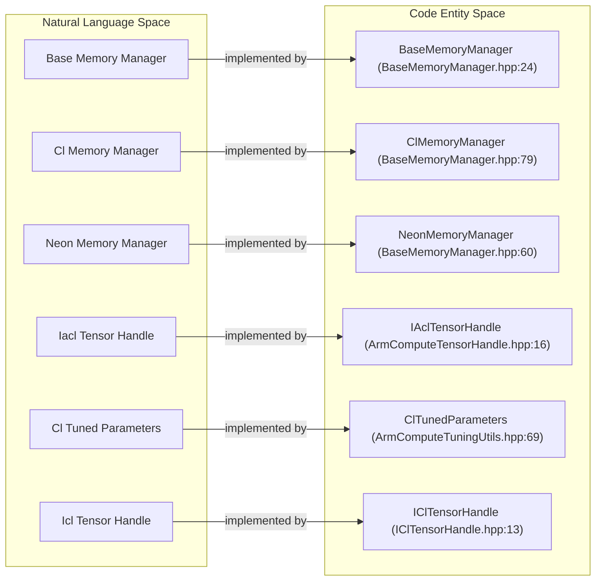
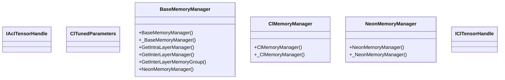
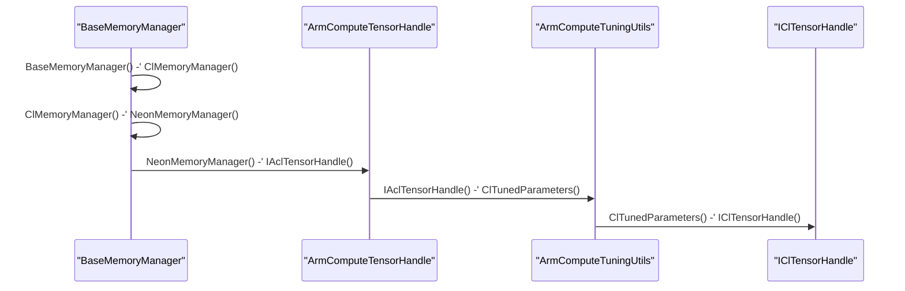

# 3-Source Context Packet (`git` + `CBM` + `llm-wiki`) for `3.4-backends-aclcommon` — Backends Aclcommon

- **Target Wiki File**: `wiki/3.4-backends-aclcommon.md`
- **Archetype**: `Leaf Technical Spec Page`
- **Parent Page**: `3-backend-delegation-and-hardware-providers`
- **Summary**: Backends Aclcommon subsystem (`backends/aclCommon`), covering 10 files and 89 symbols. Key symbols include `GetShape`, `BuildArmComputeTensorInfo`, `ConvertDataLayout`, `ConvertActivationDescriptorToAclActivationLayerInfo`.
- **Valid `[[wikilink]]` Neighbours**: `[[3-backend-delegation-and-hardware-providers|Backend Delegation and Hardware Providers]]`, `[[3.1-backends-backendscommon|Backends Backendscommon]]`, `[[3.2-backends-reference|Backends Reference]]`, `[[3.6-other-backends|Other Backends]]`, `[[5-runtime-execution-and-kernel-dispatch|Runtime Execution and Kernel Dispatch]]`, `[[5.1-armnn|ArmNN]]`, `[[5.2-armnn|ArmNN]]`, `[[5.6-other-runtime-components|Other Runtime Components]]`

## 1. Relevant Source Files (`git` + `CBM`, use verbatim in `<details>`)
- `[src/backends/aclCommon/ArmComputeTensorUtils.hpp](src/backends/aclCommon/ArmComputeTensorUtils.hpp)`
- `[src/backends/aclCommon/ArmComputeTensorUtils.cpp](src/backends/aclCommon/ArmComputeTensorUtils.cpp)`
- `[src/backends/aclCommon/ArmComputeUtils.hpp](src/backends/aclCommon/ArmComputeUtils.hpp)`
- `[src/backends/aclCommon/ArmComputeSubgraphUtils.hpp](src/backends/aclCommon/ArmComputeSubgraphUtils.hpp)`
- `[src/backends/aclCommon/ArmComputeTuningUtils.cpp](src/backends/aclCommon/ArmComputeTuningUtils.cpp)`
- `[src/backends/aclCommon/BaseMemoryManager.hpp](src/backends/aclCommon/BaseMemoryManager.hpp)`
- `[src/backends/aclCommon/ArmComputeTensorHandle.hpp](src/backends/aclCommon/ArmComputeTensorHandle.hpp)`
- `[src/backends/aclCommon/ArmComputeTuningUtils.hpp](src/backends/aclCommon/ArmComputeTuningUtils.hpp)`
- `[src/backends/aclCommon/IClTensorHandle.hpp](src/backends/aclCommon/IClTensorHandle.hpp)`
- `[src/backends/aclCommon/BaseMemoryManager.cpp](src/backends/aclCommon/BaseMemoryManager.cpp)`

## 2. Grounded Code Symbols (`CBM`, use verbatim for `[file:start-end]()` pill citations)
- `BaseMemoryManager` (Class) @ `[src/backends/aclCommon/BaseMemoryManager.hpp:24-57]()` [fan-in=0, fan-out=0] — 
- `ClMemoryManager` (Class) @ `[src/backends/aclCommon/BaseMemoryManager.hpp:79-95]()` [fan-in=0, fan-out=0] — 
- `NeonMemoryManager` (Class) @ `[src/backends/aclCommon/BaseMemoryManager.hpp:60-75]()` [fan-in=0, fan-out=0] — 
- `IAclTensorHandle` (Class) @ `[src/backends/aclCommon/ArmComputeTensorHandle.hpp:16-23]()` [fan-in=0, fan-out=0] — 
- `ClTunedParameters` (Class) @ `[src/backends/aclCommon/ArmComputeTuningUtils.hpp:69-82]()` [fan-in=0, fan-out=0] — 
- `IClTensorHandle` (Class) @ `[src/backends/aclCommon/IClTensorHandle.hpp:13-20]()` [fan-in=0, fan-out=0] — 
- `GetShape` (Function) @ `[src/backends/aclCommon/ArmComputeTensorUtils.hpp:317-320]()` [fan-in=177, fan-out=1] — /// Get the shape from an ACL shape object
- `BuildArmComputeTensorInfo` (Function) @ `[src/backends/aclCommon/ArmComputeTensorUtils.cpp:242-249]()` [fan-in=145, fan-out=10] — (const armnn::TensorInfo& tensorInfo, armnn::DataLayout dataLayout, unsigned int dimensions)
- `ConvertDataLayout` (Function) @ `[src/backends/aclCommon/ArmComputeTensorUtils.cpp:252-267]()` [fan-in=40, fan-out=2] — (armnn::DataLayout dataLayout)
- `ConvertActivationDescriptorToAclActivationLayerInfo` (Function) @ `[src/backends/aclCommon/ArmComputeUtils.hpp:93-102]()` [fan-in=32, fan-out=1] — (const ActivationDescriptor* activationDescPtr)
- `Create` (Method) @ `[src/backends/aclCommon/ArmComputeTuningUtils.cpp:17-21]()` [fan-in=31, fan-out=1] — (IGpuAccTunedParameters::Mode mode, IGpuAccTunedParameters::TuningLevel tuningLevel)
- `BuildArmComputeTensor` (Function) @ `[src/backends/aclCommon/ArmComputeTensorUtils.hpp:166-170]()` [fan-in=23, fan-out=1] — /// Sets up the given ArmCompute tensor's dimensions based on the given ArmNN tensor.
- `ConvertAdditionalInfoToAclActivationLayerInfo` (Function) @ `[src/backends/aclCommon/ArmComputeUtils.hpp:104-115]()` [fan-in=24, fan-out=1] — (const QueueDescriptor& queueDescriptor)
- `ComputeAclAxis` (Function) @ `[src/backends/aclCommon/ArmComputeUtils.hpp:246-258]()` [fan-in=16, fan-out=2] — /// Function to convert ArmNN axis (left to right) to ACL axis (right to left) ranging from [-rank, rank)
- `CopyArmComputeITensorData` (Function) @ `[src/backends/aclCommon/ArmComputeTensorUtils.hpp:257-291]()` [fan-in=19, fan-out=4] — (const T* srcData, arm_compute::ITensor& dstTensor)
- `FreeTensorIfUnused` (Function) @ `[src/backends/aclCommon/ArmComputeTensorUtils.hpp:179-186]()` [fan-in=15, fan-out=1] — /// Utility function to free unused tensors after a workload is configured and prepared
- `BuildArmComputePadStrideInfo` (Function) @ `[src/backends/aclCommon/ArmComputeTensorUtils.hpp:116-126]()` [fan-in=12, fan-out=0] — /// Utility function used to setup an arm_compute::PadStrideInfo object from an ArmNN layer descriptor.
- `InitialiseArmComputeTensorEmpty` (Function) @ `[src/backends/aclCommon/ArmComputeTensorUtils.hpp:172-176]()` [fan-in=17, fan-out=0] — (Tensor& tensor)
- `ChainReduceLayers` (Function) @ `[src/backends/aclCommon/ArmComputeSubgraphUtils.hpp:277-333]()` [fan-in=2, fan-out=15] — // // If reduce layer has multiple axes, add new layer for each axis to simulate the same behaviour // as currently only one axis is supported. //
- `BuildArmComputeReductionCoordinates` (Function) @ `[src/backends/aclCommon/ArmComputeTensorUtils.cpp:91-131]()` [fan-in=12, fan-out=4] — (size_t inputDimensions, unsigned int originalInputRank, const std::vector<unsigned int>& armnnAxes)
- `BuildArmComputeTensorShape` (Function) @ `[src/backends/aclCommon/ArmComputeTensorUtils.cpp:184-200]()` [fan-in=12, fan-out=4] — (const armnn::TensorShape& tensorShape, unsigned int dimensions)
- `GetTensorShape` (Function) @ `[src/backends/aclCommon/ArmComputeTensorUtils.hpp:299-308]()` [fan-in=8, fan-out=2] — /// Construct a TensorShape object from an ArmCompute object based on arm_compute::Dimensions. /// \\tparam ArmComputeType Any type that implements the Dimensio

## 3. Grounded Source Code Excerpts (`git` Working Tree)
### `BaseMemoryManager` in `[src/backends/aclCommon/BaseMemoryManager.hpp:24-39]()`
```cpp
class BaseMemoryManager : public IMemoryManager
{
public:
    enum class MemoryAffinity
    {
        Buffer,
        Offset
    };

    BaseMemoryManager() { }
    virtual ~BaseMemoryManager() { }

    void Acquire() override;
    void Release() override;

#if defined(ARMCOMPUTENEON_ENABLED) || defined(ARMCOMPUTECL_ENABLED)
```

### `ClMemoryManager` in `[src/backends/aclCommon/BaseMemoryManager.hpp:79-94]()`
```cpp
class ClMemoryManager : public BaseMemoryManager
{
public:
    ClMemoryManager() {}
    virtual ~ClMemoryManager() {}

    ClMemoryManager(std::shared_ptr<arm_compute::IAllocator> alloc)
    : BaseMemoryManager(std::move(alloc), MemoryAffinity::Buffer)
    {
        arm_compute::CLTensorAllocator::set_global_allocator(alloc.get());
        m_InterLayerMemoryGroup = CreateMemoryGroup(m_InterLayerMemoryMgr);
    }

protected:
    std::shared_ptr<arm_compute::IMemoryGroup>
    CreateMemoryGroup(const std::shared_ptr<arm_compute::MemoryManagerOnDemand>& memoryManager) override;
```

### `NeonMemoryManager` in `[src/backends/aclCommon/BaseMemoryManager.hpp:60-75]()`
```cpp
class NeonMemoryManager : public BaseMemoryManager
{
public:
    NeonMemoryManager() {}
    virtual ~NeonMemoryManager() {}

    NeonMemoryManager(std::unique_ptr<arm_compute::IAllocator> alloc, MemoryAffinity memoryAffinity)
    : BaseMemoryManager(std::move(alloc), memoryAffinity)
    {
        m_InterLayerMemoryGroup = CreateMemoryGroup(m_InterLayerMemoryMgr);
    }

protected:
    std::shared_ptr<arm_compute::IMemoryGroup>
    CreateMemoryGroup(const std::shared_ptr<arm_compute::MemoryManagerOnDemand>& memoryManager) override;
};
```

### `IAclTensorHandle` in `[src/backends/aclCommon/ArmComputeTensorHandle.hpp:16-23]()`
```cpp
class IAclTensorHandle : public ITensorHandle
{
public:
    virtual arm_compute::ITensor& GetTensor() = 0;
    virtual arm_compute::ITensor const& GetTensor() const = 0;
    virtual arm_compute::DataType GetDataType() const = 0;
    virtual void SetMemoryGroup(const std::shared_ptr<arm_compute::IMemoryGroup>& memoryGroup) = 0;
};
```

### `ClTunedParameters` in `[src/backends/aclCommon/ArmComputeTuningUtils.hpp:69-82]()`
```cpp
class ClTunedParameters : public IGpuAccTunedParameters
{
public:
    ClTunedParameters(IGpuAccTunedParameters::Mode mode, IGpuAccTunedParameters::TuningLevel tuningLevel);

    virtual void Load(const char* filename);
    virtual void Save(const char* filename) const;

    Mode m_Mode;
    TuningLevel m_TuningLevel;

    arm_compute::CLTuner m_Tuner;
    arm_compute::CLGEMMHeuristicsHandle m_HeuristicsHandle;
};
```


## 4. Linked Official Docs (`llm-wiki` / `RAG`)
- **Backend Delegation and Hardware Providers** (`wiki/3-backend-delegation-and-hardware-providers.md`, score=115.32, shared_symbols=['BuildArmComputeTensorInfo', 'ConvertDataLayout']): # Backend Delegation and Hardware Providers > Architectural overview of Backend Delegation and Hardware Providers, spanning 150 source files and 2618 code symbols across 6 subsystems. <details> <summary>Relevant source files</summary> The following files were used as context for generating this wiki page: - [src/backends/aclCommon/ArmComputeTensorUtils.h
- **Other Backends** (`wiki/3.6-other-backends.md`, score=92.044, shared_symbols=['BuildArmComputeTensorInfo', 'ConvertActivationDescriptorToAclActivationLayerInfo', 'ConvertDataLayout']): # Other Backends ↑ [[3-backend-delegation-and-hardware-providers|Backend Delegation and Hardware Providers]] > Other Backends subsystem (consolidating `Backends Neon`, `ArmNN Backends`, `Backends Tosareference`, `Backends Dynamic`), covering 28 files and 849 symbols. Key symbols include `IsNeonBackendSupported`, `info`, `IsLayerTypeSupported`, `CreateTenso
- **ArmNN DeepWiki** (`wiki/index.md`, score=85.218, shared_symbols=['BuildArmComputeTensorInfo']): # ArmNN DeepWiki Generated from `home-jason-Project-deepwiki-armnn` at commit `2b61cecc9df7` (2026-11-14T15:13:53+00:00). ## Pages - [[1-overview|Overview]] — End-to-end architecture overview of ArmNN: core subsystems, compilation/execution pipeline, entry points, and cross-module dependencies. - [[2-build-system-and-infrastructure|Build System and Infras
- **Backends OpenCL** (`wiki/3.3-backends-opencl.md`, score=70.788, shared_symbols=[]): # Backends OpenCL ↑ [[3-backend-delegation-and-hardware-providers|Backend Delegation and Hardware Providers]] > Backends OpenCL subsystem (`backends/cl`), covering 28 files and 648 symbols. Key symbols include `IsClBackendSupported`, `RunClFunction`, `GetDataType`, `IsLayerSupported`. <details> <summary>Relevant source files</summary> The following files
- **Backends Tosacommon** (`wiki/3.5-backends-tosacommon.md`, score=70.788, shared_symbols=[]): # Backends Tosacommon ↑ [[3-backend-delegation-and-hardware-providers|Backend Delegation and Hardware Providers]] > Backends Tosacommon subsystem (`backends/tosaCommon`), covering 28 files and 86 symbols. Key symbols include `GetTosaTensorShape`, `GenerateUniqueOutputName`, `GetUniqueTosaMappingID`, `GenerateUniqueInputName`. <details> <summary>Relevant s
- **Runtime Execution and Kernel Dispatch** (`wiki/5-runtime-execution-and-kernel-dispatch.md`, score=70.788, shared_symbols=[]): # Runtime Execution and Kernel Dispatch > Architectural overview of Runtime Execution and Kernel Dispatch, spanning 157 source files and 3718 code symbols across 6 subsystems. <details> <summary>Relevant source files</summary> The following files were used as context for generating this wiki page: - [samples/common/include/Audio/DataStructures.hpp](sampl

## 5. Pre-Verified DeepWiki v1.9.9.5 Mermaid Diagrams
### Natural Language Space <-> Code Entity Space


### Subsystem Architecture Flowchart

```mermaid
flowchart TD
  subgraph sub_this["Backends Aclcommon"]
    subgraph sg_0["src/backends/aclCommon"]
      n_src_backends_aclCommon_ArmComputeTensorUtils_hpp["GetShape (ArmComputeTensorUtils.hpp)"]
      n_src_backends_aclCommon_ArmComputeTensorUtils_cpp["BuildArmComputeTensorInfo (ArmComputeTensorUtils.cpp)"]
      n_src_backends_aclCommon_ArmComputeUtils_hpp["ConvertActivationDescriptorToAclActivationLayerInfo (ArmComputeUtils.hpp)"]
      n_src_backends_aclCommon_ArmComputeSubgraphUtils_h["ChainReduceLayers (ArmComputeSubgraphUtils.hpp)"]
      n_src_backends_aclCommon_ArmComputeTuningUtils_cpp["Create (ArmComputeTuningUtils.cpp)"]
      n_src_backends_aclCommon_BaseMemoryManager_hpp["BaseMemoryManager (BaseMemoryManager.hpp)"]
      n_src_backends_aclCommon_ArmComputeTensorHandle_hp["IAclTensorHandle (ArmComputeTensorHandle.hpp)"]
    end
  end
  n_page_3_3_backends_opencl(["Backends OpenCL"])
  n_page_3_6_other_backends(["Other Backends"])
  n_page_3_backend_delegation_and_hardware_providers(["Backend Delegation and Hardware Providers"])
  n_page_5_runtime_execution_and_kernel_dispatch(["Runtime Execution and Kernel Dispatch"])
  n_src_backends_aclCommon_ArmComputeSubgraphUtils_h -.-> n_page_3_backend_delegation_and_hardware_providers
  n_src_backends_aclCommon_ArmComputeTensorUtils_hpp -.-> n_page_3_backend_delegation_and_hardware_providers
  n_src_backends_aclCommon_ArmComputeSubgraphUtils_h -.-> n_page_5_runtime_execution_and_kernel_dispatch
  n_src_backends_aclCommon_ArmComputeTensorUtils_hpp -.-> n_page_3_6_other_backends
  n_src_backends_aclCommon_IClTensorHandle_hpp -.-> n_page_3_backend_delegation_and_hardware_providers
  n_src_backends_aclCommon_ArmComputeSubgraphUtils_h -.-> n_page_3_6_other_backends
  n_src_backends_aclCommon_ArmComputeTensorHandle_hp -.-> n_page_3_6_other_backends
  n_src_backends_aclCommon_ArmComputeTensorUtils_hpp -.-> n_page_3_3_backends_opencl
  n_src_backends_aclCommon_ArmComputeTensorUtils_cpp -.-> n_page_5_runtime_execution_and_kernel_dispatch
  n_src_backends_aclCommon_ArmComputeTensorUtils_cpp --> n_src_backends_aclCommon_ArmComputeUtils_hpp
  n_src_backends_aclCommon_ArmComputeTensorUtils_cpp -.-> n_page_3_3_backends_opencl
  n_src_backends_aclCommon_ArmComputeUtils_hpp -.-> n_page_3_6_other_backends
  n_src_backends_aclCommon_ArmComputeUtils_hpp -.-> n_page_5_runtime_execution_and_kernel_dispatch
  n_src_backends_aclCommon_ArmComputeTuningUtils_cpp -.-> n_page_5_runtime_execution_and_kernel_dispatch
  n_src_backends_aclCommon_ArmComputeTensorHandle_hp -.-> n_page_3_backend_delegation_and_hardware_providers
  n_src_backends_aclCommon_ArmComputeTuningUtils_hpp -.-> n_page_3_3_backends_opencl
  n_src_backends_aclCommon_BaseMemoryManager_cpp --> n_src_backends_aclCommon_BaseMemoryManager_hpp
  n_src_backends_aclCommon_BaseMemoryManager_hpp -.-> n_page_3_backend_delegation_and_hardware_providers
  n_src_backends_aclCommon_BaseMemoryManager_hpp -.-> n_page_3_6_other_backends
```


### Class Hierarchy Diagram


### Call Sequence Diagram


## 6. DeepWiki v1.9.9.5 Authoring Checklist for `wiki/3.4-backends-aclcommon.md`
1. Keep YAML frontmatter at top (`id`, `title`, `parent`, `sources`, `linked_docs`, `bridge_symbols`).
2. Keep `<details><summary>Relevant source files</summary>` block immediately after `# Title`.
3. Start with `## Purpose and Scope`, then numbered `## 1. ...`, `## 2. ...` sections separated by `---`.
4. Include at least 2 ```mermaid``` diagrams (including a `Natural Language Space` <-> `Code Entity Space` mapping).
5. Cite code entities inline using `[path/to/file.ext:start-end]()` and end every `##` section with `Sources: [file:start-end]()`.
6. Run `deepwiki_cli.py build --enrich-only ...` and `deepwiki_cli.py validate ...` after editing.
