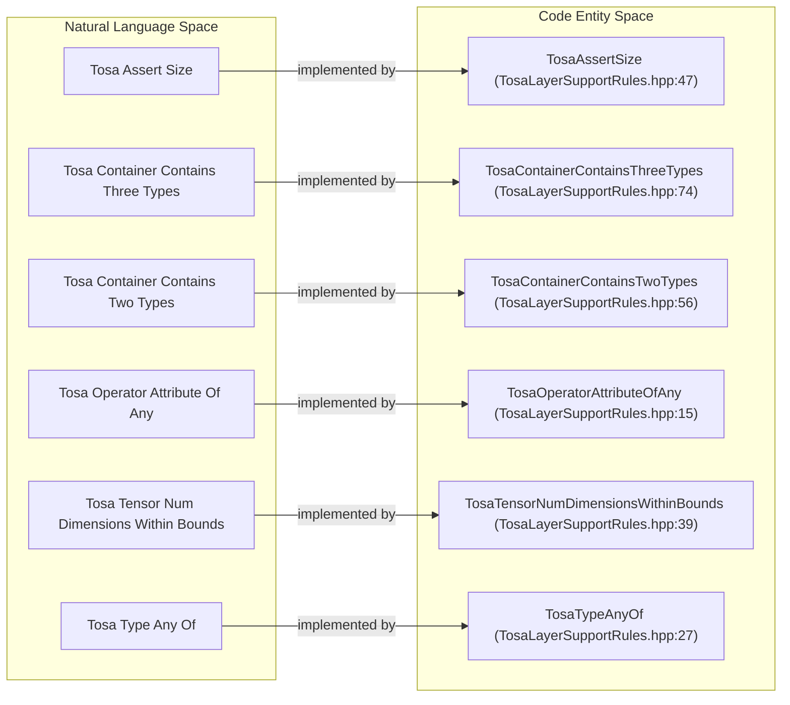
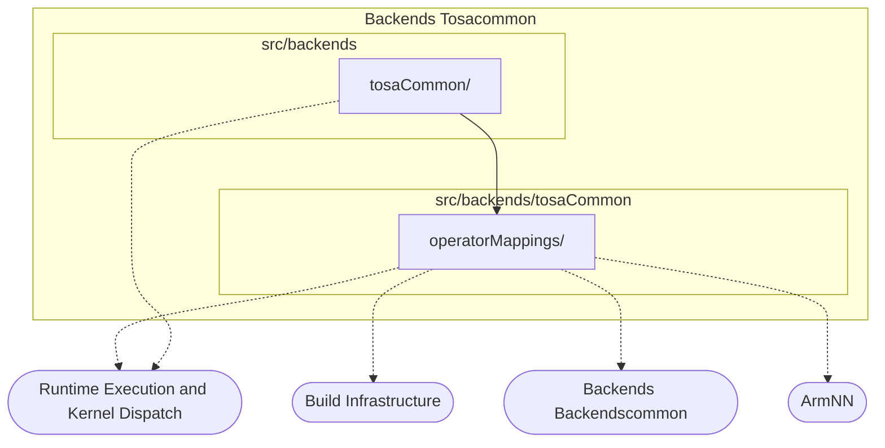
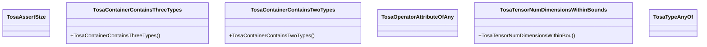
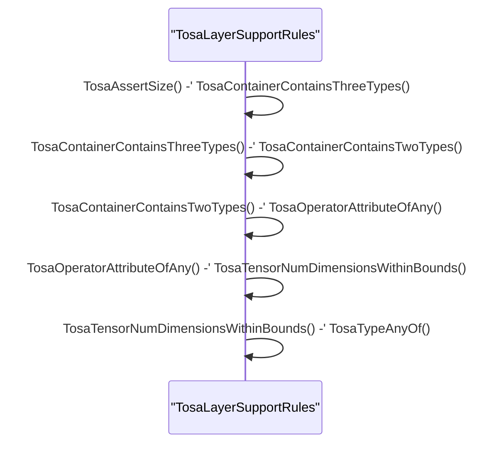

# 3-Source Context Packet (`git` + `CBM` + `llm-wiki`) for `3.5-backends-tosacommon` — Backends Tosacommon

- **Target Wiki File**: `wiki/3.5-backends-tosacommon.md`
- **Archetype**: `Leaf Technical Spec Page`
- **Parent Page**: `3-backend-delegation-and-hardware-providers`
- **Summary**: Backends Tosacommon subsystem (`backends/tosaCommon`), covering 28 files and 86 symbols. Key symbols include `GetTosaTensorShape`, `GenerateUniqueOutputName`, `GetUniqueTosaMappingID`, `GenerateUniqueInputName`.
- **Valid `[[wikilink]]` Neighbours**: `[[3-backend-delegation-and-hardware-providers|Backend Delegation and Hardware Providers]]`, `[[3.1-backends-backendscommon|Backends Backendscommon]]`, `[[3.2-backends-reference|Backends Reference]]`, `[[3.3-backends-opencl|Backends OpenCL]]`, `[[3.4-backends-aclcommon|Backends Aclcommon]]`, `[[3.6-other-backends|Other Backends]]`, `[[5-runtime-execution-and-kernel-dispatch|Runtime Execution and Kernel Dispatch]]`, `[[5.2-armnn|ArmNN]]`

## 1. Relevant Source Files (`git` + `CBM`, use verbatim in `<details>`)
- `[src/backends/tosaCommon/operatorMappings/TosaOperatorUtils.hpp](src/backends/tosaCommon/operatorMappings/TosaOperatorUtils.hpp)`
- `[src/backends/tosaCommon/TosaLayerSupportRules.hpp](src/backends/tosaCommon/TosaLayerSupportRules.hpp)`
- `[src/backends/tosaCommon/TosaMappings.cpp](src/backends/tosaCommon/TosaMappings.cpp)`
- `[src/backends/tosaCommon/operatorMappings/ElementwiseBinaryOperator.cpp](src/backends/tosaCommon/operatorMappings/ElementwiseBinaryOperator.cpp)`
- `[src/backends/tosaCommon/operatorMappings/BatchMatMulOperator.cpp](src/backends/tosaCommon/operatorMappings/BatchMatMulOperator.cpp)`
- `[src/backends/tosaCommon/operatorMappings/AvgPool2DIgnoreValueOperator.cpp](src/backends/tosaCommon/operatorMappings/AvgPool2DIgnoreValueOperator.cpp)`
- `[src/backends/tosaCommon/operatorMappings/BatchToSpaceOperator.cpp](src/backends/tosaCommon/operatorMappings/BatchToSpaceOperator.cpp)`
- `[src/backends/tosaCommon/operatorMappings/ConstantOperator.cpp](src/backends/tosaCommon/operatorMappings/ConstantOperator.cpp)`
- `[src/backends/tosaCommon/operatorMappings/ConcatOperator.cpp](src/backends/tosaCommon/operatorMappings/ConcatOperator.cpp)`
- `[src/backends/tosaCommon/operatorMappings/HardSwishOperator.cpp](src/backends/tosaCommon/operatorMappings/HardSwishOperator.cpp)`
- `[src/backends/tosaCommon/operatorMappings/Conv2dOperator.cpp](src/backends/tosaCommon/operatorMappings/Conv2dOperator.cpp)`
- `[src/backends/tosaCommon/operatorMappings/Conv3dOperator.cpp](src/backends/tosaCommon/operatorMappings/Conv3dOperator.cpp)`
- `[src/backends/tosaCommon/operatorMappings/DepthToSpaceOperator.cpp](src/backends/tosaCommon/operatorMappings/DepthToSpaceOperator.cpp)`
- `[src/backends/tosaCommon/operatorMappings/DepthwiseConv2dOperator.cpp](src/backends/tosaCommon/operatorMappings/DepthwiseConv2dOperator.cpp)`
- `[src/backends/tosaCommon/operatorMappings/DequantizeOperator.cpp](src/backends/tosaCommon/operatorMappings/DequantizeOperator.cpp)`
- `[src/backends/tosaCommon/operatorMappings/ExpOperator.cpp](src/backends/tosaCommon/operatorMappings/ExpOperator.cpp)`
- `[src/backends/tosaCommon/operatorMappings/FullyConnectedOperator.cpp](src/backends/tosaCommon/operatorMappings/FullyConnectedOperator.cpp)`
- `[src/backends/tosaCommon/operatorMappings/GatherOperator.cpp](src/backends/tosaCommon/operatorMappings/GatherOperator.cpp)`
- `[src/backends/tosaCommon/operatorMappings/GeluOperator.cpp](src/backends/tosaCommon/operatorMappings/GeluOperator.cpp)`
- `[src/backends/tosaCommon/operatorMappings/LeakyReluOperator.cpp](src/backends/tosaCommon/operatorMappings/LeakyReluOperator.cpp)`
- `[src/backends/tosaCommon/operatorMappings/LogOperator.cpp](src/backends/tosaCommon/operatorMappings/LogOperator.cpp)`
- `[src/backends/tosaCommon/operatorMappings/TosaRescaleOperatorUtils.hpp](src/backends/tosaCommon/operatorMappings/TosaRescaleOperatorUtils.hpp)`
- `[src/backends/tosaCommon/operatorMappings/PReluOperator.cpp](src/backends/tosaCommon/operatorMappings/PReluOperator.cpp)`
- `[src/backends/tosaCommon/operatorMappings/QuantizeOperator.cpp](src/backends/tosaCommon/operatorMappings/QuantizeOperator.cpp)`
- `[src/backends/tosaCommon/operatorMappings/PadOperator.cpp](src/backends/tosaCommon/operatorMappings/PadOperator.cpp)`
- `[src/backends/tosaCommon/operatorMappings/ReduceOperator.cpp](src/backends/tosaCommon/operatorMappings/ReduceOperator.cpp)`
- `[src/backends/tosaCommon/operatorMappings/Pooling2DOperator.cpp](src/backends/tosaCommon/operatorMappings/Pooling2DOperator.cpp)`
- `[src/backends/tosaCommon/operatorMappings/ReluOperator.cpp](src/backends/tosaCommon/operatorMappings/ReluOperator.cpp)`

## 2. Grounded Code Symbols (`CBM`, use verbatim for `[file:start-end]()` pill citations)
- `TosaAssertSize` (Class) @ `[src/backends/tosaCommon/TosaLayerSupportRules.hpp:47-54]()` [fan-in=0, fan-out=0] — 
- `TosaContainerContainsThreeTypes` (Class) @ `[src/backends/tosaCommon/TosaLayerSupportRules.hpp:74-91]()` [fan-in=0, fan-out=0] — 
- `TosaContainerContainsTwoTypes` (Class) @ `[src/backends/tosaCommon/TosaLayerSupportRules.hpp:56-72]()` [fan-in=0, fan-out=0] — 
- `TosaOperatorAttributeOfAny` (Class) @ `[src/backends/tosaCommon/TosaLayerSupportRules.hpp:15-25]()` [fan-in=0, fan-out=0] — 
- `TosaTensorNumDimensionsWithinBounds` (Class) @ `[src/backends/tosaCommon/TosaLayerSupportRules.hpp:39-45]()` [fan-in=0, fan-out=0] — 
- `TosaTypeAnyOf` (Class) @ `[src/backends/tosaCommon/TosaLayerSupportRules.hpp:27-37]()` [fan-in=0, fan-out=0] — 
- `GetTosaTensorShape` (Function) @ `[src/backends/tosaCommon/operatorMappings/TosaOperatorUtils.hpp:83-91]()` [fan-in=39, fan-out=2] — // Function to return Tosa tensor shape from input ArmNN tensor shape.
- `GenerateUniqueOutputName` (Function) @ `[src/backends/tosaCommon/operatorMappings/TosaOperatorUtils.hpp:137-151]()` [fan-in=37, fan-out=5] — // Function that generates unique output name using the layer type, input slot and layer guid.
- `GenerateUniqueInputName` (Function) @ `[src/backends/tosaCommon/operatorMappings/TosaOperatorUtils.hpp:113-121]()` [fan-in=37, fan-out=4] — // Function that generates unique name for the parent layer from the child layer input slot.
- `ArmNNToDType` (Function) @ `[src/backends/tosaCommon/operatorMappings/TosaOperatorUtils.hpp:26-53]()` [fan-in=38, fan-out=0] — // Function to return Tosa datatype from input ArmNN datatype.
- `GetUniqueTosaMappingID` (Function) @ `[src/backends/tosaCommon/operatorMappings/TosaOperatorUtils.hpp:155-158]()` [fan-in=39, fan-out=1] — ()
- `GetTosaMapping` (Function) @ `[src/backends/tosaCommon/TosaMappings.cpp:21-275]()` [fan-in=2, fan-out=45] — (const Layer* layer, const LayerType type, const std::vector<const TensorInfo*>& inputs, const std::vector<con
- `GetInputSlicedToItsUsedSize` (Function) @ `[src/backends/tosaCommon/operatorMappings/TosaOperatorUtils.hpp:602-655]()` [fan-in=5, fan-out=8] — // This function is paraphrased from: // tensorflow/compiler/mlir/tosa/transforms/legalize_utils.cc from function getInputSlicedToItsUsedSize
- `ConvertBatchMatMulToTosaOperator` (Function) @ `[src/backends/tosaCommon/operatorMappings/BatchMatMulOperator.cpp:14-306]()` [fan-in=1, fan-out=15] — // This function is paraphrased from: // tensorflow/compiler/mlir/tosa/transforms/legalize_tfl.cc from function ConvertTFLBatchMatMulOp
- `ConvertQuantizeToTosaOperator` (Function) @ `[src/backends/tosaCommon/operatorMappings/QuantizeOperator.cpp:17-200]()` [fan-in=1, fan-out=22] — // This function is paraphrased from: // tensorflow/compiler/mlir/tosa/transforms/legalize_common.cc from function convertQuantizeOp
- `ConvertHardSwishToTosaOperator` (Function) @ `[src/backends/tosaCommon/operatorMappings/HardSwishOperator.cpp:160-241]()` [fan-in=1, fan-out=13] — // This function is paraphrased from: // tensorflow/compiler/mlir/tosa/transforms/legalize_tfl.cc ConvertTFLHardSwishOp()
- `CreateRescaleTosaOperator` (Function) @ `[src/backends/tosaCommon/operatorMappings/TosaRescaleOperatorUtils.hpp:197-235]()` [fan-in=9, fan-out=3] — /// @brief Creates a Tosa rescale operator. /// /// This inline function computes the multiplier and shift values based on the given scale /// using either 32-b
- `ConvertConv3dToTosaOperator` (Function) @ `[src/backends/tosaCommon/operatorMappings/Conv3dOperator.cpp:16-228]()` [fan-in=1, fan-out=13] — // This function is paraphrased from: // tensorflow/compiler/mlir/tosa/transforms/legalize_tfl.cc from function ConvertTFLConv3DOp
- `ConvertReduceToTosaOperator` (Function) @ `[src/backends/tosaCommon/operatorMappings/ReduceOperator.cpp:17-387]()` [fan-in=1, fan-out=19] — // This function is paraphrased from: // tensorflow/compiler/mlir/tosa/transforms/legalize_common.cc from functions convertReduceMeanOp, convertReduceSumOp, // 
- `ConvertFullyConnectedToTosaOperator` (Function) @ `[src/backends/tosaCommon/operatorMappings/FullyConnectedOperator.cpp:16-197]()` [fan-in=1, fan-out=14] — // This function is paraphrased from: // tensorflow/compiler/mlir/tosa/transforms/legalize_tfl.cc from function ConvertTFLFullyConnectedOp
- `ConvertGatherToTosaOperator` (Function) @ `[src/backends/tosaCommon/operatorMappings/GatherOperator.cpp:16-343]()` [fan-in=1, fan-out=14] — // This function is paraphrased from: // tensorflow/compiler/mlir/tosa/transforms/legalize_common.cc from function convertGatherOp
- `getTosaConstHardSwish8bitTable` (Function) @ `[src/backends/tosaCommon/operatorMappings/HardSwishOperator.cpp:90-156]()` [fan-in=1, fan-out=10] — // This function is paraphrased from: // tensorflow/compiler/mlir/tosa/transforms/legalize_utils.cc getTosaConstHardSwish8bitTable()

## 3. Grounded Source Code Excerpts (`git` Working Tree)
### `TosaAssertSize` in `[src/backends/tosaCommon/TosaLayerSupportRules.hpp:47-54]()`
```cpp
struct TosaAssertSize : public Rule
{
    template<typename Container>
    explicit TosaAssertSize(const Container& c1, const Container& c2)
    {
        m_Res = (c1.size() == c2.size());
    }
};
```

### `TosaContainerContainsThreeTypes` in `[src/backends/tosaCommon/TosaLayerSupportRules.hpp:74-89]()`
```cpp
struct TosaContainerContainsThreeTypes : public Rule
{
    explicit TosaContainerContainsThreeTypes(std::tuple<DType, DType, DType>& check,
                                             const std::vector<std::tuple<DType, DType, DType>>& c)
    {
        for (auto item: c)
        {
            if (std::get<0>(check) == std::get<0>(item) &&
                std::get<1>(check) == std::get<1>(item) &&
                std::get<2>(check) == std::get<2>(item))
            {
                m_Res = true;
                return;
            }
        }
        m_Res = false;
```

### `TosaContainerContainsTwoTypes` in `[src/backends/tosaCommon/TosaLayerSupportRules.hpp:56-71]()`
```cpp
struct TosaContainerContainsTwoTypes : public Rule
{
    explicit TosaContainerContainsTwoTypes(std::tuple<DType, DType>& check,
                                           const std::vector<std::tuple<DType, DType>>& c)
    {
        for (auto item: c)
        {
            if (std::get<0>(check) == std::get<0>(item) &&
                std::get<1>(check) == std::get<1>(item))
            {
                m_Res = true;
                return;
            }
        }
        m_Res = false;
    }
```

### `TosaOperatorAttributeOfAny` in `[src/backends/tosaCommon/TosaLayerSupportRules.hpp:15-25]()`
```cpp
struct TosaOperatorAttributeOfAny : public Rule
{
    template<typename Container>
    explicit TosaOperatorAttributeOfAny(TosaSerializationOperator* op, const Container& c)
    {
        m_Res = std::any_of(c.begin(), c.end(), [&op](Attribute attribute)
        {
            return attribute == op->GetAttributeType();
        });
    }
};
```

### `TosaTensorNumDimensionsWithinBounds` in `[src/backends/tosaCommon/TosaLayerSupportRules.hpp:39-45]()`
```cpp
struct TosaTensorNumDimensionsWithinBounds : public Rule
{
    explicit TosaTensorNumDimensionsWithinBounds(TosaSerializationTensor* tensor)
    {
        m_Res = (tensor->GetShape().size() <= MaxNumOfTensorDimensions) || (!tensor->GetShape().empty());
    }
};
```


## 4. Linked Official Docs (`llm-wiki` / `RAG`)
- **Backend Delegation and Hardware Providers** (`wiki/3-backend-delegation-and-hardware-providers.md`, score=157.016, shared_symbols=['GetTosaTensorShape', 'GetUniqueTosaMappingID']): # Backend Delegation and Hardware Providers > Architectural overview of Backend Delegation and Hardware Providers, spanning 150 source files and 2618 code symbols across 6 subsystems. <details> <summary>Relevant source files</summary> The following files were used as context for generating this wiki page: - [src/backends/aclCommon/ArmComputeTensorUtils.h
- **ArmNN DeepWiki** (`wiki/index.md`, score=127.663, shared_symbols=[]): # ArmNN DeepWiki Generated from `home-jason-Project-deepwiki-armnn` at commit `2b61cecc9df7` (2026-11-14T15:13:53+00:00). ## Pages - [[1-overview|Overview]] — End-to-end architecture overview of ArmNN: core subsystems, compilation/execution pipeline, entry points, and cross-module dependencies. - [[2-build-system-and-infrastructure|Build System and Infras
- **ArmNN** (`wiki/5.1-armnn.md`, score=123.253, shared_symbols=['GenerateUniqueInputName', 'GenerateUniqueOutputName', 'GetTosaTensorShape', 'GetUniqueTosaMappingID']): # ArmNN ↑ [[5-runtime-execution-and-kernel-dispatch|Runtime Execution and Kernel Dispatch]] > ArmNN subsystem (`src/armnn`), covering 28 files and 1007 symbols. Key symbols include `SetTensorInfo`, `Connect`, `end`, `GetName`. <details> <summary>Relevant source files</summary> The following files were used as context for generating this wiki page: - [sr
- **Backends Reference** (`wiki/3.2-backends-reference.md`, score=111.812, shared_symbols=[]): # Backends Reference ↑ [[3-backend-delegation-and-hardware-providers|Backend Delegation and Hardware Providers]] > Backends Reference subsystem (`backends/reference`), covering 28 files and 634 symbols. Key symbols include `GetNumDimensions`, `GetTensorInfo`, `MakeDecoder`, `MakeEncoder`. <details> <summary>Relevant source files</summary> The following f
- **Backends OpenCL** (`wiki/3.3-backends-opencl.md`, score=111.812, shared_symbols=[]): # Backends OpenCL ↑ [[3-backend-delegation-and-hardware-providers|Backend Delegation and Hardware Providers]] > Backends OpenCL subsystem (`backends/cl`), covering 28 files and 648 symbols. Key symbols include `IsClBackendSupported`, `RunClFunction`, `GetDataType`, `IsLayerSupported`. <details> <summary>Relevant source files</summary> The following files
- **Backends Aclcommon** (`wiki/3.4-backends-aclcommon.md`, score=111.812, shared_symbols=[]): # Backends Aclcommon ↑ [[3-backend-delegation-and-hardware-providers|Backend Delegation and Hardware Providers]] > Backends Aclcommon subsystem (`backends/aclCommon`), covering 10 files and 89 symbols. Key symbols include `GetShape`, `BuildArmComputeTensorInfo`, `ConvertDataLayout`, `ConvertActivationDescriptorToAclActivationLayerInfo`. <details> <summary

## 5. Pre-Verified DeepWiki v1.9.9.5 Mermaid Diagrams
### Natural Language Space <-> Code Entity Space


### Subsystem Architecture Flowchart


### Class Hierarchy Diagram


### Call Sequence Diagram


## 6. DeepWiki v1.9.9.5 Authoring Checklist for `wiki/3.5-backends-tosacommon.md`
1. Keep YAML frontmatter at top (`id`, `title`, `parent`, `sources`, `linked_docs`, `bridge_symbols`).
2. Keep `<details><summary>Relevant source files</summary>` block immediately after `# Title`.
3. Start with `## Purpose and Scope`, then numbered `## 1. ...`, `## 2. ...` sections separated by `---`.
4. Include at least 2 ```mermaid``` diagrams (including a `Natural Language Space` <-> `Code Entity Space` mapping).
5. Cite code entities inline using `[path/to/file.ext:start-end]()` and end every `##` section with `Sources: [file:start-end]()`.
6. Run `deepwiki_cli.py build --enrich-only ...` and `deepwiki_cli.py validate ...` after editing.
