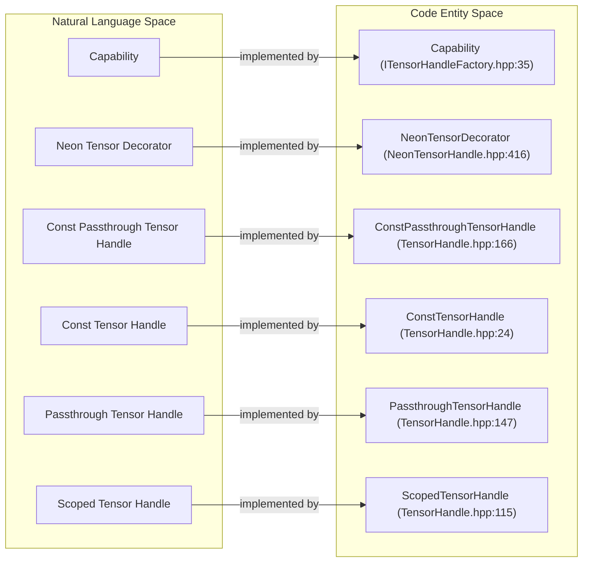
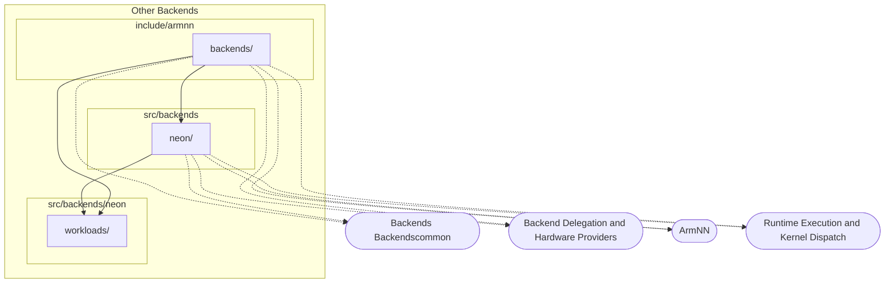
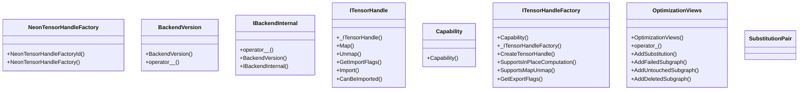
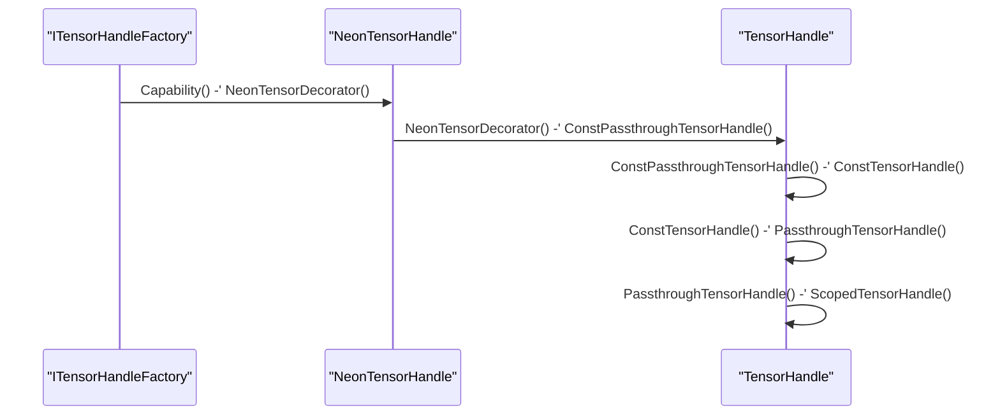

# 3-Source Context Packet (`git` + `CBM` + `llm-wiki`) for `3.6-other-backends` — Other Backends

- **Target Wiki File**: `wiki/3.6-other-backends.md`
- **Archetype**: `Leaf Technical Spec Page`
- **Parent Page**: `3-backend-delegation-and-hardware-providers`
- **Summary**: Other Backends subsystem (consolidating `Backends Neon`, `ArmNN Backends`, `Backends Tosareference`, `Backends Dynamic`), covering 28 files and 849 symbols. Key symbols include `IsNeonBackendSupported`, `info`, `IsLayerTypeSupported`, `CreateTensorHandle`.
- **Valid `[[wikilink]]` Neighbours**: `[[3-backend-delegation-and-hardware-providers|Backend Delegation and Hardware Providers]]`, `[[3.1-backends-backendscommon|Backends Backendscommon]]`, `[[3.2-backends-reference|Backends Reference]]`, `[[3.3-backends-opencl|Backends OpenCL]]`, `[[3.4-backends-aclcommon|Backends Aclcommon]]`, `[[5-runtime-execution-and-kernel-dispatch|Runtime Execution and Kernel Dispatch]]`, `[[5.1-armnn|ArmNN]]`, `[[5.2-armnn|ArmNN]]`

## 1. Relevant Source Files (`git` + `CBM`, use verbatim in `<details>`)
- `[include/armnn/backends/ITensorHandleFactory.hpp](include/armnn/backends/ITensorHandleFactory.hpp)`
- `[src/backends/neon/NeonTensorHandle.cpp](src/backends/neon/NeonTensorHandle.cpp)`
- `[src/backends/neon/NeonTensorHandle.hpp](src/backends/neon/NeonTensorHandle.hpp)`
- `[include/armnn/backends/OptimizationViews.hpp](include/armnn/backends/OptimizationViews.hpp)`
- `[src/backends/neon/NeonBackend.cpp](src/backends/neon/NeonBackend.cpp)`
- `[src/backends/neon/NeonLayerSupport.cpp](src/backends/neon/NeonLayerSupport.cpp)`
- `[include/armnn/backends/TensorHandle.hpp](include/armnn/backends/TensorHandle.hpp)`
- `[src/backends/neon/NeonBackend.hpp](src/backends/neon/NeonBackend.hpp)`
- `[src/backends/neon/NeonInterceptorScheduler.hpp](src/backends/neon/NeonInterceptorScheduler.hpp)`
- `[src/backends/neon/NeonBackendModelContext.hpp](src/backends/neon/NeonBackendModelContext.hpp)`
- `[src/backends/neon/NeonTensorHandleFactory.hpp](src/backends/neon/NeonTensorHandleFactory.hpp)`
- `[src/backends/neon/NeonLayerSupport.hpp](src/backends/neon/NeonLayerSupport.hpp)`
- `[src/backends/neon/NeonTimer.hpp](src/backends/neon/NeonTimer.hpp)`
- `[include/armnn/backends/IBackendInternal.hpp](include/armnn/backends/IBackendInternal.hpp)`
- `[include/armnn/backends/ITensorHandle.hpp](include/armnn/backends/ITensorHandle.hpp)`
- `[include/armnn/backends/Workload.hpp](include/armnn/backends/Workload.hpp)`
- `[src/backends/neon/NeonBackendModelContext.cpp](src/backends/neon/NeonBackendModelContext.cpp)`
- `[src/backends/neon/NeonBackendOptimizationUtils.hpp](src/backends/neon/NeonBackendOptimizationUtils.hpp)`
- `[src/backends/neon/NeonTensorHandleFactory.cpp](src/backends/neon/NeonTensorHandleFactory.cpp)`
- `[src/backends/neon/workloads/NeonBaseWorkload.hpp](src/backends/neon/workloads/NeonBaseWorkload.hpp)`
- `[src/backends/neon/NeonInterceptorScheduler.cpp](src/backends/neon/NeonInterceptorScheduler.cpp)`
- `[src/backends/neon/NeonWorkloadFactory.cpp](src/backends/neon/NeonWorkloadFactory.cpp)`
- `[include/armnn/backends/WorkloadData.hpp](include/armnn/backends/WorkloadData.hpp)`
- `[src/backends/neon/workloads/NeonAbsWorkload.hpp](src/backends/neon/workloads/NeonAbsWorkload.hpp)`
- `[src/backends/neon/workloads/NeonActivationWorkload.hpp](src/backends/neon/workloads/NeonActivationWorkload.hpp)`
- `[src/backends/neon/NeonTimer.cpp](src/backends/neon/NeonTimer.cpp)`
- `[src/backends/neon/workloads/NeonAdditionWorkload.hpp](src/backends/neon/workloads/NeonAdditionWorkload.hpp)`
- `[src/backends/neon/workloads/NeonArgMinMaxWorkload.hpp](src/backends/neon/workloads/NeonArgMinMaxWorkload.hpp)`

## 2. Grounded Code Symbols (`CBM`, use verbatim for `[file:start-end]()` pill citations)
- `Capability` (Class) @ `[include/armnn/backends/ITensorHandleFactory.hpp:35-44]()` [fan-in=0, fan-out=0] — /// Capability of the TensorHandleFactory
- `NeonTensorDecorator` (Class) @ `[src/backends/neon/NeonTensorHandle.hpp:416-443]()` [fan-in=0, fan-out=0] — /// NeonTensorDecorator wraps an existing Neon tensor allowing us to override the TensorInfo for it
- `ConstPassthroughTensorHandle` (Class) @ `[include/armnn/backends/TensorHandle.hpp:166-176]()` [fan-in=0, fan-out=0] — // A ConstTensorHandle that wraps an already allocated memory region. // // This allows users to pass in const memory to a network. // Clients must make sure th
- `ConstTensorHandle` (Class) @ `[include/armnn/backends/TensorHandle.hpp:24-73]()` [fan-in=0, fan-out=0] — // Abstract tensor handles wrapping a readable region of memory, interpreting it as tensor data.
- `PassthroughTensorHandle` (Class) @ `[include/armnn/backends/TensorHandle.hpp:147-157]()` [fan-in=0, fan-out=0] — // A TensorHandle that wraps an already allocated memory region. // // Clients must make sure the passed in memory region stays alive for the lifetime of // the
- `ScopedTensorHandle` (Class) @ `[include/armnn/backends/TensorHandle.hpp:115-139]()` [fan-in=0, fan-out=0] — // A TensorHandle that owns the wrapped memory region.
- `TensorHandle` (Class) @ `[include/armnn/backends/TensorHandle.hpp:79-109]()` [fan-in=0, fan-out=0] — // Abstract specialization of ConstTensorHandle that allows write access to the same data.
- `NeonBackendModelContext` (Class) @ `[src/backends/neon/NeonBackendModelContext.hpp:23-39]()` [fan-in=0, fan-out=0] — /// The NeonBackendModelContext is used to pass in Neon specific backend ModelOptions. The supported backend /// ModelOptions are: /// - "FastMathEnabled" /// U
- `NullWorkload` (Class) @ `[include/armnn/backends/Workload.hpp:25-28]()` [fan-in=0, fan-out=0] — // NullWorkload used to denote an unsupported workload when used by the MakeWorkload<> template // in the various workload factories. // There should never be a
- `ITensorHandleFactory` (Class) @ `[include/armnn/backends/ITensorHandleFactory.hpp:46-102]()` [fan-in=0, fan-out=0] — 
- `OptimizationViews` (Class) @ `[include/armnn/backends/OptimizationViews.hpp:17-81]()` [fan-in=0, fan-out=0] — 
- `SubstitutionPair` (Class) @ `[include/armnn/backends/OptimizationViews.hpp:26-33]()` [fan-in=0, fan-out=0] — 
- `ActivationQueueDescriptor` (Class) @ `[include/armnn/backends/WorkloadData.hpp:158-161]()` [fan-in=0, fan-out=0] — // Activation layer workload data.
- `AdditionQueueDescriptor` (Class) @ `[include/armnn/backends/WorkloadData.hpp:258-261]()` [fan-in=0, fan-out=0] — // Add layer workload data.
- `BatchNormalizationQueueDescriptor` (Class) @ `[include/armnn/backends/WorkloadData.hpp:311-327]()` [fan-in=0, fan-out=0] — // Batch norm layer workload data.
- `ConcatQueueDescriptor` (Class) @ `[include/armnn/backends/WorkloadData.hpp:130-146]()` [fan-in=0, fan-out=0] — // Concat layer workload data.
- `Convolution2dQueueDescriptor` (Class) @ `[include/armnn/backends/WorkloadData.hpp:210-213]()` [fan-in=0, fan-out=0] — // Convolution 2D layer workload data.
- `Convolution3dQueueDescriptor` (Class) @ `[include/armnn/backends/WorkloadData.hpp:216-219]()` [fan-in=0, fan-out=0] — // Convolution 3D layer workload data.
- `DepthwiseConvolution2dQueueDescriptor` (Class) @ `[include/armnn/backends/WorkloadData.hpp:234-237]()` [fan-in=0, fan-out=0] — /// Depthwise Convolution 2D layer workload data. /// /// @note /// The weights are in the format [1, H, W, I*M]. Where I is the input channel size, M the depth
- `DivisionQueueDescriptor` (Class) @ `[include/armnn/backends/WorkloadData.hpp:270-273]()` [fan-in=0, fan-out=0] — // Division layer workload data.
- `EqualQueueDescriptor` (Class) @ `[include/armnn/backends/WorkloadData.hpp:305-308]()` [fan-in=0, fan-out=0] — // Deprecated use ComparisonQueueDescriptor instead
- `FillQueueDescriptor` (Class) @ `[include/armnn/backends/WorkloadData.hpp:174-177]()` [fan-in=0, fan-out=0] — // Fill layer workload data.

## 3. Grounded Source Code Excerpts (`git` Working Tree)
### `Capability` in `[include/armnn/backends/ITensorHandleFactory.hpp:35-44]()`
```cpp
struct Capability
{
    Capability(CapabilityClass capabilityClass, bool value)
        : m_CapabilityClass(capabilityClass)
        , m_Value(value)
    {}

    CapabilityClass m_CapabilityClass;
    bool            m_Value;
};
```

### `NeonTensorDecorator` in `[src/backends/neon/NeonTensorHandle.hpp:416-431]()`
```cpp
class NeonTensorDecorator : public arm_compute::ITensor
{
public:
    NeonTensorDecorator();

    NeonTensorDecorator(arm_compute::ITensor* original, const TensorInfo& info);

    ~NeonTensorDecorator() = default;

    NeonTensorDecorator(const NeonTensorDecorator&) = delete;

    NeonTensorDecorator& operator=(const NeonTensorDecorator&) = delete;

    NeonTensorDecorator(NeonTensorDecorator&&) = default;

    NeonTensorDecorator& operator=(NeonTensorDecorator&&) = default;
```

### `ConstPassthroughTensorHandle` in `[include/armnn/backends/TensorHandle.hpp:166-176]()`
```cpp
class ConstPassthroughTensorHandle : public ConstTensorHandle
{
public:
    ConstPassthroughTensorHandle(const TensorInfo& tensorInfo, const void* mem)
    :   ConstTensorHandle(tensorInfo)
    {
        SetConstMemory(mem);
    }

    virtual void Allocate() override;
};
```

### `ConstTensorHandle` in `[include/armnn/backends/TensorHandle.hpp:24-39]()`
```cpp
class ConstTensorHandle : public ITensorHandle
{
public:
    template <typename T>
    const T* GetConstTensor() const
    {
        if (armnnUtils::CompatibleTypes<T>(GetTensorInfo().GetDataType()))
        {
            return reinterpret_cast<const T*>(m_Memory);
        }
        else
        {
            throw armnn::Exception("Attempting to get not compatible type tensor!");
        }
    }
```

### `PassthroughTensorHandle` in `[include/armnn/backends/TensorHandle.hpp:147-157]()`
```cpp
class PassthroughTensorHandle : public TensorHandle
{
public:
    PassthroughTensorHandle(const TensorInfo& tensorInfo, void* mem)
    :   TensorHandle(tensorInfo)
    {
        SetMemory(mem);
    }

    virtual void Allocate() override;
};
```


## 4. Linked Official Docs (`llm-wiki` / `RAG`)
- **Backend Delegation and Hardware Providers** (`wiki/3-backend-delegation-and-hardware-providers.md`, score=97.283, shared_symbols=[]): # Backend Delegation and Hardware Providers > Architectural overview of Backend Delegation and Hardware Providers, spanning 150 source files and 2618 code symbols across 6 subsystems. <details> <summary>Relevant source files</summary> The following files were used as context for generating this wiki page: - [src/backends/aclCommon/ArmComputeTensorUtils.h
- **Backends OpenCL** (`wiki/3.3-backends-opencl.md`, score=75.79, shared_symbols=[]): # Backends OpenCL ↑ [[3-backend-delegation-and-hardware-providers|Backend Delegation and Hardware Providers]] > Backends OpenCL subsystem (`backends/cl`), covering 28 files and 648 symbols. Key symbols include `IsClBackendSupported`, `RunClFunction`, `GetDataType`, `IsLayerSupported`. <details> <summary>Relevant source files</summary> The following files
- **Backends Reference** (`wiki/3.2-backends-reference.md`, score=73.922, shared_symbols=[]): # Backends Reference ↑ [[3-backend-delegation-and-hardware-providers|Backend Delegation and Hardware Providers]] > Backends Reference subsystem (`backends/reference`), covering 28 files and 634 symbols. Key symbols include `GetNumDimensions`, `GetTensorInfo`, `MakeDecoder`, `MakeEncoder`. <details> <summary>Relevant source files</summary> The following f
- **Backends Aclcommon** (`wiki/3.4-backends-aclcommon.md`, score=69.864, shared_symbols=[]): # Backends Aclcommon ↑ [[3-backend-delegation-and-hardware-providers|Backend Delegation and Hardware Providers]] > Backends Aclcommon subsystem (`backends/aclCommon`), covering 10 files and 89 symbols. Key symbols include `GetShape`, `BuildArmComputeTensorInfo`, `ConvertDataLayout`, `ConvertActivationDescriptorToAclActivationLayerInfo`. <details> <summary
- **Backends Backendscommon** (`wiki/3.1-backends-backendscommon.md`, score=65.402, shared_symbols=[]): # Backends Backendscommon ↑ [[3-backend-delegation-and-hardware-providers|Backend Delegation and Hardware Providers]] > Backends Backendscommon subsystem (`backends/backendsCommon`), covering 28 files and 312 symbols. Key symbols include `to_string`, `ValidateInputsOutputs`, `ValidateNumInputs`, `ValidateNumOutputs`. <details> <summary>Relevant source fil
- **Runtime Execution and Kernel Dispatch** (`wiki/5-runtime-execution-and-kernel-dispatch.md`, score=65.402, shared_symbols=[]): # Runtime Execution and Kernel Dispatch > Architectural overview of Runtime Execution and Kernel Dispatch, spanning 157 source files and 3718 code symbols across 6 subsystems. <details> <summary>Relevant source files</summary> The following files were used as context for generating this wiki page: - [samples/common/include/Audio/DataStructures.hpp](sampl

## 5. Pre-Verified DeepWiki v1.9.9.5 Mermaid Diagrams
### Natural Language Space <-> Code Entity Space


### Subsystem Architecture Flowchart


### Class Hierarchy Diagram


### Call Sequence Diagram


## 6. DeepWiki v1.9.9.5 Authoring Checklist for `wiki/3.6-other-backends.md`
1. Keep YAML frontmatter at top (`id`, `title`, `parent`, `sources`, `linked_docs`, `bridge_symbols`).
2. Keep `<details><summary>Relevant source files</summary>` block immediately after `# Title`.
3. Start with `## Purpose and Scope`, then numbered `## 1. ...`, `## 2. ...` sections separated by `---`.
4. Include at least 2 ```mermaid``` diagrams (including a `Natural Language Space` <-> `Code Entity Space` mapping).
5. Cite code entities inline using `[path/to/file.ext:start-end]()` and end every `##` section with `Sources: [file:start-end]()`.
6. Run `deepwiki_cli.py build --enrich-only ...` and `deepwiki_cli.py validate ...` after editing.
