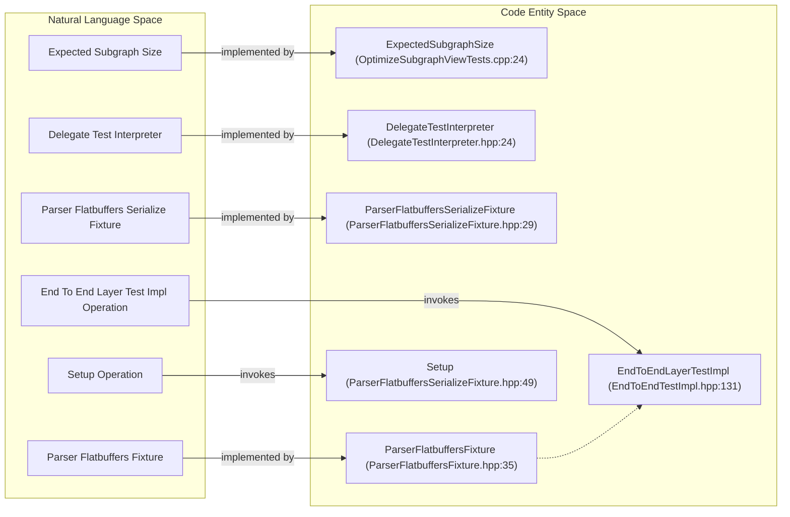
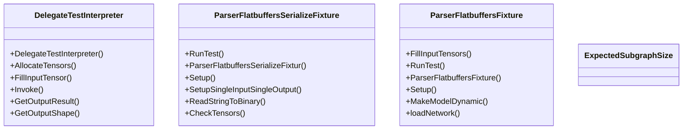
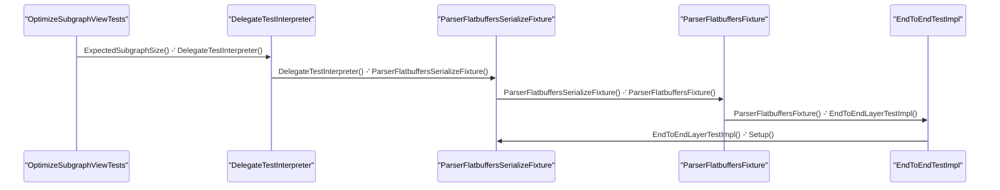

# 3-Source Context Packet (`git` + `CBM` + `llm-wiki`) for `4-testing-validation-and-profiling` — Testing, Validation and Profiling

- **Target Wiki File**: `wiki/4-testing-validation-and-profiling.md`
- **Archetype**: `Parent Hub Page`
- **Parent Page**: `None (Top-Level Chapter)`
- **Summary**: Architectural overview of Testing, Validation and Profiling, spanning 40 source files and 4535 code symbols across 1 subsystems.
- **Valid `[[wikilink]]` Neighbours**: `[[1-overview|Overview]]`, `[[3-backend-delegation-and-hardware-providers|Backend Delegation and Hardware Providers]]`, `[[3.1-backends-backendscommon|Backends Backendscommon]]`, `[[3.2-backends-reference|Backends Reference]]`, `[[3.3-backends-opencl|Backends OpenCL]]`, `[[3.4-backends-aclcommon|Backends Aclcommon]]`, `[[3.6-other-backends|Other Backends]]`, `[[5-runtime-execution-and-kernel-dispatch|Runtime Execution and Kernel Dispatch]]`

## 1. Relevant Source Files (`git` + `CBM`, use verbatim in `<details>`)
- `[tests/CMakeLists.txt](tests/CMakeLists.txt)`
- `[src/backends/backendsCommon/test/EndToEndTestImpl.hpp](src/backends/backendsCommon/test/EndToEndTestImpl.hpp)`
- `[delegate/common/src/test/DelegateTestInterpreter.hpp](delegate/common/src/test/DelegateTestInterpreter.hpp)`
- `[src/armnnDeserializer/test/ParserFlatbuffersSerializeFixture.hpp](src/armnnDeserializer/test/ParserFlatbuffersSerializeFixture.hpp)`
- `[src/armnnTfLiteParser/test/ParserFlatbuffersFixture.hpp](src/armnnTfLiteParser/test/ParserFlatbuffersFixture.hpp)`
- `[src/backends/backendsCommon/test/OptimizeSubgraphViewTests.cpp](src/backends/backendsCommon/test/OptimizeSubgraphViewTests.cpp)`

## 2. Grounded Code Symbols (`CBM`, use verbatim for `[file:start-end]()` pill citations)
- `ExpectedSubgraphSize` (Class) @ `[src/backends/backendsCommon/test/OptimizeSubgraphViewTests.cpp:24-29]()` [fan-in=0, fan-out=0] — // The expected number of layers, input and output slots in a subgraph after a test
- `DelegateTestInterpreter` (Class) @ `[delegate/common/src/test/DelegateTestInterpreter.hpp:24-173]()` [fan-in=0, fan-out=0] — 
- `ParserFlatbuffersSerializeFixture` (Class) @ `[src/armnnDeserializer/test/ParserFlatbuffersSerializeFixture.hpp:29-177]()` [fan-in=0, fan-out=0] — 
- `ParserFlatbuffersFixture` (Class) @ `[src/armnnTfLiteParser/test/ParserFlatbuffersFixture.hpp:35-288]()` [fan-in=0, fan-out=0] — 
- `EndToEndLayerTestImpl` (Function) @ `[src/backends/backendsCommon/test/EndToEndTestImpl.hpp:131-185]()` [fan-in=115, fan-out=10] — (INetworkPtr network, const std::map<int, std::vector<TInput>>& inputTensorData, const std::map<int, std::vect
- `Setup` (Method) @ `[src/armnnDeserializer/test/ParserFlatbuffersSerializeFixture.hpp:49-81]()` [fan-in=93, fan-out=5] — ()
- `GetOutputShape` (Method) @ `[delegate/common/src/test/DelegateTestInterpreter.hpp:149-163]()` [fan-in=48, fan-out=3] — /// Return a buffer of dimensions from the output tensor at a given index.
- `AllocateTensors` (Method) @ `[delegate/common/src/test/DelegateTestInterpreter.hpp:59-62]()` [fan-in=48, fan-out=0] — /// Allocate the TfLiteTensors within the graph. /// This must be called before FillInputTensor(values, index) and Invoke().
- `Invoke` (Method) @ `[delegate/common/src/test/DelegateTestInterpreter.hpp:99-102]()` [fan-in=48, fan-out=0] — /// Run the interpreter either on TFLite Runtime or Arm NN Delegate. /// AllocateTensors() must be called before Invoke().
- `Setup` (Method) @ `[src/armnnTfLiteParser/test/ParserFlatbuffersFixture.hpp:63-72]()` [fan-in=39, fan-out=1] — (bool testDynamic = true)
- `SetupSingleInputSingleOutput` (Method) @ `[src/armnnTfLiteParser/test/ParserFlatbuffersFixture.hpp:152-158]()` [fan-in=37, fan-out=1] — (const std::string& inputName, const std::string& outputName)
- `SetupSingleInputSingleOutput` (Method) @ `[src/armnnDeserializer/test/ParserFlatbuffersSerializeFixture.hpp:83-89]()` [fan-in=18, fan-out=1] — (const std::string& inputName, const std::string& outputName)
- `SubStringCounter` (Function) @ `[src/backends/backendsCommon/test/EndToEndTestImpl.hpp:117-129]()` [fan-in=9, fan-out=1] — // Utility function to find the number of instances of a substring within a string.
- `AddInputLayer` (Function) @ `[src/backends/backendsCommon/test/OptimizeSubgraphViewTests.cpp:72-81]()` [fan-in=8, fan-out=3] — // Convenience function to add an input layer to a graph
- `PartiallySupportedSubgraphTestImpl` (Function) @ `[src/backends/backendsCommon/test/OptimizeSubgraphViewTests.cpp:1107-1248]()` [fan-in=0, fan-out=19] — // The input subgraph contaions both supported and unsupported layers // (but only convolutions are unsupported by the mock backend)
- `PartiallyOptimizableSubgraphTestImpl1` (Function) @ `[src/backends/backendsCommon/test/OptimizeSubgraphViewTests.cpp:1315-1463]()` [fan-in=0, fan-out=18] — // The input subgraph contains some unoptimizable layers ("unoptimizable" is added to the layer's name)
- `AddOutputLayer` (Function) @ `[src/backends/backendsCommon/test/OptimizeSubgraphViewTests.cpp:84-90]()` [fan-in=8, fan-out=1] — // Convenience function to add an output layer to a graph
- `CheckSubstitution` (Function) @ `[src/backends/backendsCommon/test/OptimizeSubgraphViewTests.cpp:149-189]()` [fan-in=5, fan-out=7] — // Convenience function to check that the given substitution matches the specified expected values
- `PartiallyOptimizableSubgraphTestImpl2` (Function) @ `[src/backends/backendsCommon/test/OptimizeSubgraphViewTests.cpp:1467-1587]()` [fan-in=0, fan-out=16] — // The input subgraph contains some unoptimizable layers ("unoptimizable" is added to the layer's name), // this is meant to test input slots coming from differ
- `GetOutputResult` (Method) @ `[delegate/common/src/test/DelegateTestInterpreter.hpp:128-146]()` [fan-in=3, fan-out=8] — /// Return a buffer of values from the output tensor at a given index. This must be called after Invoke(). /// Boolean types get converted to a bit representati
- `FillInputTensor` (Method) @ `[delegate/common/src/test/DelegateTestInterpreter.hpp:75-95]()` [fan-in=4, fan-out=5] — /// Copy a boolean buffer of values into an input tensor at a given index. /// Boolean types get converted to a bit representation in a vector. /// vector.data(
- `AddConstantLayer` (Function) @ `[src/backends/backendsCommon/test/OptimizeSubgraphViewTests.cpp:107-119]()` [fan-in=6, fan-out=2] — // Convenience function to add a constant layer to a graph

## 3. Grounded Source Code Excerpts (`git` Working Tree)
### `ExpectedSubgraphSize` in `[src/backends/backendsCommon/test/OptimizeSubgraphViewTests.cpp:24-29]()`
```cpp
struct ExpectedSubgraphSize
{
    size_t m_NumInputSlots  = 0;
    size_t m_NumOutputSlots = 0;
    size_t m_NumLayers      = 0;
};
```

### `DelegateTestInterpreter` in `[delegate/common/src/test/DelegateTestInterpreter.hpp:24-39]()`
```cpp
class DelegateTestInterpreter
{
public:
    /// Create TfLite Interpreter only
    DelegateTestInterpreter(std::vector<char>& modelBuffer, const std::string& customOp = "")
    {
        TfLiteModel* model = delegateTestInterpreter::CreateTfLiteModel(modelBuffer);

        TfLiteInterpreterOptions* options = delegateTestInterpreter::CreateTfLiteInterpreterOptions();
        if (!customOp.empty())
        {
            options->mutable_op_resolver = delegateTestInterpreter::GenerateCustomOpResolver(customOp);
        }

        m_TfLiteInterpreter = TfLiteInterpreterCreate(model, options);
        m_TfLiteDelegate = nullptr;
```

### `ParserFlatbuffersSerializeFixture` in `[src/armnnDeserializer/test/ParserFlatbuffersSerializeFixture.hpp:29-44]()`
```cpp
struct ParserFlatbuffersSerializeFixture
{
    ParserFlatbuffersSerializeFixture() :
        m_Parser(IDeserializer::Create()),
        m_Runtime(armnn::IRuntime::Create(armnn::IRuntime::CreationOptions())),
        m_NetworkIdentifier(-1)
    {
    }

    std::vector<uint8_t> m_GraphBinary;
    std::string m_JsonString;
    std::unique_ptr<IDeserializer, void (*)(IDeserializer* parser)> m_Parser;
    armnn::IRuntimePtr m_Runtime;
    armnn::NetworkId m_NetworkIdentifier;

    /// If the single-input-single-output overload of Setup() is called, these will store the input and output name
```

### `ParserFlatbuffersFixture` in `[src/armnnTfLiteParser/test/ParserFlatbuffersFixture.hpp:35-50]()`
```cpp
struct ParserFlatbuffersFixture
{
    ParserFlatbuffersFixture() :
            m_Runtime(armnn::IRuntime::Create(armnn::IRuntime::CreationOptions())),
            m_NetworkIdentifier(0),
            m_DynamicNetworkIdentifier(1)
    {
        ITfLiteParser::TfLiteParserOptions options;
        options.m_StandInLayerForUnsupported = true;
        options.m_InferAndValidate = true;

        m_Parser = std::make_unique<armnnTfLiteParser::TfLiteParserImpl>(
                        armnn::Optional<ITfLiteParser::TfLiteParserOptions>(options));
    }

    std::vector<uint8_t> m_GraphBinary;
```

### `EndToEndLayerTestImpl` in `[src/backends/backendsCommon/test/EndToEndTestImpl.hpp:131-146]()`
```cpp
template<DataType ArmnnIType, DataType ArmnnOType,
         typename TInput = ResolveType<ArmnnIType>, typename TOutput = ResolveType<ArmnnOType>>
void EndToEndLayerTestImpl(INetworkPtr network,
                           const std::map<int, std::vector<TInput>>& inputTensorData,
                           const std::map<int, std::vector<TOutput>>& expectedOutputData,
                           std::vector<BackendId> backends,
                           float tolerance = 0.000001f)
{
    // Create runtime in which test will run
    IRuntime::CreationOptions options;
    IRuntimePtr runtime(IRuntime::Create(options));

    // optimize the network
    IOptimizedNetworkPtr optNet = Optimize(*network, backends, runtime->GetDeviceSpec());

    // Loads it into the runtime.
```


## 4. Linked Official Docs (`llm-wiki` / `RAG`)
- **Tests** (`wiki/4.1-tests.md`, score=125.149, shared_symbols=['AddInputLayer', 'AllocateTensors', 'DelegateTestInterpreter', 'EndToEndLayerTestImpl', 'Invoke', 'Setup', 'SubStringCounter']): # Tests ↑ [[4-testing-validation-and-profiling|Testing, Validation and Profiling]] > Tests subsystem (`tests`), covering 40 files and 4535 symbols. Key symbols include `EndToEndLayerTestImpl`, `ElementwiseTestHelper`, `Setup`, `ComparisonTestImpl`. <details> <summary>Relevant source files</summary> The following files were used as context for generating 
- **Other Runtime Components** (`wiki/5.6-other-runtime-components.md`, score=59.998, shared_symbols=['EndToEndLayerTestImpl', 'Setup']): # Other Runtime Components ↑ [[5-runtime-execution-and-kernel-dispatch|Runtime Execution and Kernel Dispatch]] > Other Runtime Components subsystem (consolidating `ArmNN Optimizations`, `Armnntestutils`, `ArmNN Layers`, `Samples Common`, `Armnntestutils`, `Samples Objectdetection`), covering 28 files and 1895 symbols. Key symbols include `Run`, `FoldPadInt
- **ArmNN DeepWiki** (`wiki/index.md`, score=58.639, shared_symbols=['EndToEndLayerTestImpl', 'Setup']): # ArmNN DeepWiki Generated from `home-jason-Project-deepwiki-armnn` at commit `2b61cecc9df7` (2026-11-14T15:13:53+00:00). ## Pages - [[1-overview|Overview]] — End-to-end architecture overview of ArmNN: core subsystems, compilation/execution pipeline, entry points, and cross-module dependencies. - [[2-build-system-and-infrastructure|Build System and Infras
- **Glossary** (`wiki/7-glossary.md`, score=57.324, shared_symbols=[]): # Glossary > Definitions and technical context for ArmNN domain terms, acronyms, file formats, and core code entities. <details> <summary>Relevant source files</summary> The following files were used as context for generating this wiki page: - [src/armnn/Tensor.cpp](src/armnn/Tensor.cpp) - [include/armnn/Exceptions.hpp](include/armnn/Exceptions.hpp) - [i
- **Build Infrastructure** (`wiki/2.1-build-infrastructure.md`, score=57.324, shared_symbols=[]): # Build Infrastructure ↑ [[2-build-system-and-infrastructure|Build System and Infrastructure]] > Build Infrastructure subsystem (`build/infrastructure`), covering 28 files and 2092 symbols. Key symbols include `push_back`, `data`, `move`, `get`. <details> <summary>Relevant source files</summary> The following files were used as context for generating thi
- **Build System and Infrastructure** (`wiki/2-build-system-and-infrastructure.md`, score=57.324, shared_symbols=[]): # Build System and Infrastructure > Architectural overview of Build System and Infrastructure, spanning 28 source files and 2092 code symbols across 1 subsystems. <details> <summary>Relevant source files</summary> The following files were used as context for generating this wiki page: - [third-party/fmt/format.h](third-party/fmt/format.h) - [third-party/

## 5. Pre-Verified DeepWiki v1.9.9.5 Mermaid Diagrams
### Natural Language Space <-> Code Entity Space


### Subsystem Architecture Flowchart

```mermaid
flowchart TD
  subgraph sub_this["Testing, Validation and Profiling"]
    subgraph sg_0["tests"]
      n_tests_CMakeLists_txt["OnnxParserTest (CMakeLists.txt)"]
    end
    subgraph sg_1["src/backends/backendsCommon/test"]
      n_src_backends_backendsCommon_test_EndToEndTestImp["EndToEndLayerTestImpl (EndToEndTestImpl.hpp)"]
      n_src_backends_backendsCommon_test_OptimizeSubgrap["ExpectedSubgraphSize (OptimizeSubgraphViewTests.cpp)"]
    end
    subgraph sg_2["delegate/common/src/test"]
      n_delegate_common_src_test_DelegateTestInterpreter["DelegateTestInterpreter (DelegateTestInterpreter.hpp)"]
    end
    subgraph sg_3["src/armnnDeserializer/test"]
      n_src_armnnDeserializer_test_ParserFlatbuffersSeri["ParserFlatbuffersSerializeFixture (ParserFlatbuffersSerializeFixture.hpp)"]
    end
    subgraph sg_4["src/armnnTfLiteParser/test"]
      n_src_armnnTfLiteParser_test_ParserFlatbuffersFixt["ParserFlatbuffersFixture (ParserFlatbuffersFixture.hpp)"]
    end
  end
  n_page_3_backend_delegation_and_hardware_providers(["Backend Delegation and Hardware Providers"])
  n_page_4_1_tests(["Tests"])
  n_page_5_2_armnn(["ArmNN"])
  n_page_5_runtime_execution_and_kernel_dispatch(["Runtime Execution and Kernel Dispatch"])
  n_delegate_common_src_test_DelegateTestInterpreter -.-> n_page_4_1_tests
  n_src_backends_backendsCommon_test_OptimizeSubgrap -.-> n_page_5_runtime_execution_and_kernel_dispatch
  n_src_backends_backendsCommon_test_OptimizeSubgrap -.-> n_page_3_backend_delegation_and_hardware_providers
  n_src_backends_backendsCommon_test_EndToEndTestImp -.-> n_page_5_runtime_execution_and_kernel_dispatch
  n_src_armnnTfLiteParser_test_ParserFlatbuffersFixt -.-> n_page_5_2_armnn
  n_src_backends_backendsCommon_test_EndToEndTestImp -.-> n_page_5_2_armnn
  n_src_armnnTfLiteParser_test_ParserFlatbuffersFixt -.-> n_page_5_runtime_execution_and_kernel_dispatch
  n_src_armnnDeserializer_test_ParserFlatbuffersSeri -.-> n_page_5_runtime_execution_and_kernel_dispatch
  n_src_backends_backendsCommon_test_EndToEndTestImp -.-> n_page_3_backend_delegation_and_hardware_providers
  n_src_armnnDeserializer_test_ParserFlatbuffersSeri -.-> n_page_5_2_armnn
  n_src_armnnTfLiteParser_test_ParserFlatbuffersFixt -.-> n_page_3_backend_delegation_and_hardware_providers
  n_delegate_common_src_test_DelegateTestInterpreter -.-> n_page_5_runtime_execution_and_kernel_dispatch
  n_src_backends_backendsCommon_test_OptimizeSubgrap -.-> n_page_5_2_armnn
```


### Class Hierarchy Diagram


### Call Sequence Diagram


## 6. DeepWiki v1.9.9.5 Authoring Checklist for `wiki/4-testing-validation-and-profiling.md`
1. Keep YAML frontmatter at top (`id`, `title`, `parent`, `sources`, `linked_docs`, `bridge_symbols`).
2. Keep `<details><summary>Relevant source files</summary>` block immediately after `# Title`.
3. Start with `## Purpose and Scope`, then numbered `## 1. ...`, `## 2. ...` sections separated by `---`.
4. Include at least 2 ```mermaid``` diagrams (including a `Natural Language Space` <-> `Code Entity Space` mapping).
5. Cite code entities inline using `[path/to/file.ext:start-end]()` and end every `##` section with `Sources: [file:start-end]()`.
6. Run `deepwiki_cli.py build --enrich-only ...` and `deepwiki_cli.py validate ...` after editing.
