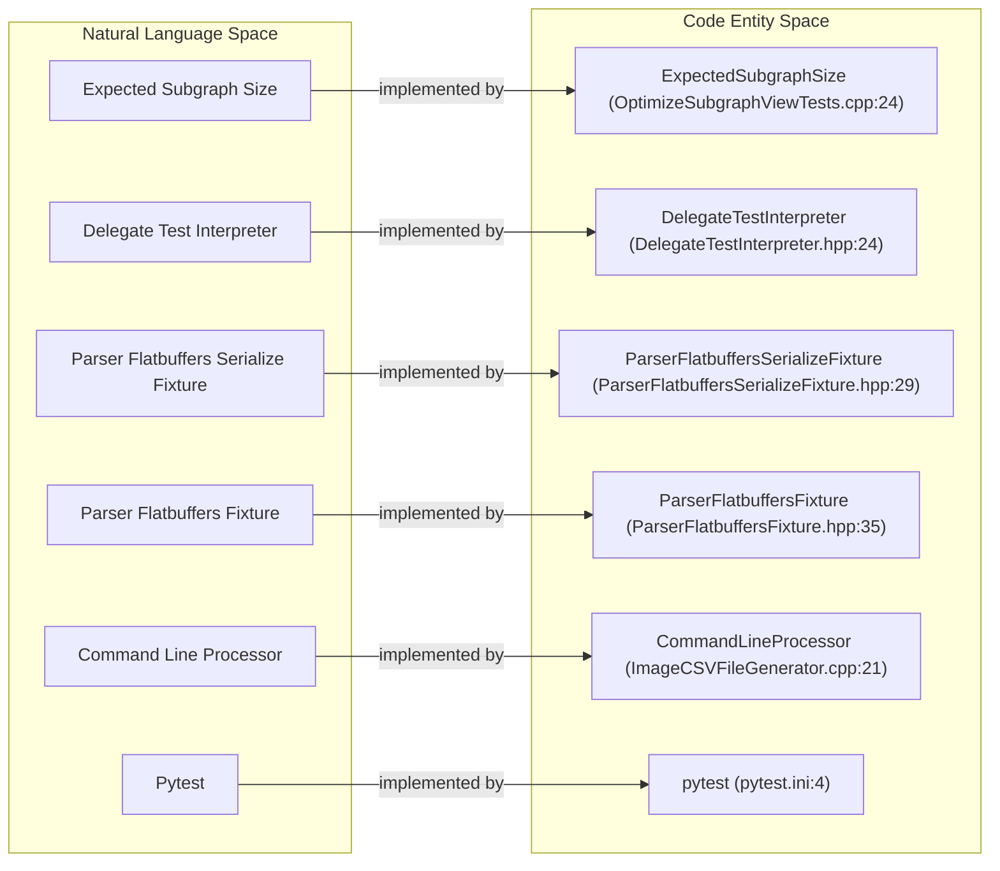
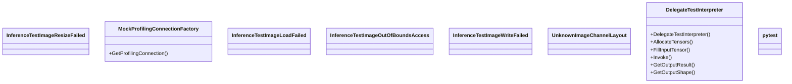
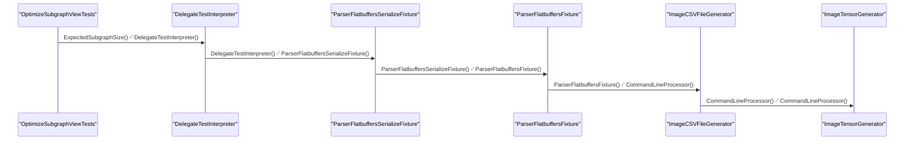

# 3-Source Context Packet (`git` + `CBM` + `llm-wiki`) for `4.1-tests` — Tests

- **Target Wiki File**: `wiki/4.1-tests.md`
- **Archetype**: `Leaf Technical Spec Page`
- **Parent Page**: `4-testing-validation-and-profiling`
- **Summary**: Tests subsystem (`tests`), covering 40 files and 4535 symbols. Key symbols include `EndToEndLayerTestImpl`, `ElementwiseTestHelper`, `Setup`, `ComparisonTestImpl`.
- **Valid `[[wikilink]]` Neighbours**: `[[4-testing-validation-and-profiling|Testing, Validation and Profiling]]`, `[[3-backend-delegation-and-hardware-providers|Backend Delegation and Hardware Providers]]`, `[[3.1-backends-backendscommon|Backends Backendscommon]]`, `[[3.2-backends-reference|Backends Reference]]`, `[[3.3-backends-opencl|Backends OpenCL]]`, `[[3.4-backends-aclcommon|Backends Aclcommon]]`, `[[3.6-other-backends|Other Backends]]`, `[[5-runtime-execution-and-kernel-dispatch|Runtime Execution and Kernel Dispatch]]`

## 1. Relevant Source Files (`git` + `CBM`, use verbatim in `<details>`)
- `[tests/CMakeLists.txt](tests/CMakeLists.txt)`
- `[delegate/common/src/test/DelegateTestInterpreter.hpp](delegate/common/src/test/DelegateTestInterpreter.hpp)`
- `[src/backends/backendsCommon/test/EndToEndTestImpl.hpp](src/backends/backendsCommon/test/EndToEndTestImpl.hpp)`
- `[src/armnnDeserializer/test/ParserFlatbuffersSerializeFixture.hpp](src/armnnDeserializer/test/ParserFlatbuffersSerializeFixture.hpp)`
- `[src/armnnTfLiteParser/test/ParserFlatbuffersFixture.hpp](src/armnnTfLiteParser/test/ParserFlatbuffersFixture.hpp)`
- `[src/backends/backendsCommon/test/OptimizeSubgraphViewTests.cpp](src/backends/backendsCommon/test/OptimizeSubgraphViewTests.cpp)`
- `[delegate/classic/src/test/DelegateTestInterpreter.cpp](delegate/classic/src/test/DelegateTestInterpreter.cpp)`
- `[delegate/test/ConvolutionTestHelper.hpp](delegate/test/ConvolutionTestHelper.hpp)`
- `[delegate/test/DelegateOptionsTestHelper.hpp](delegate/test/DelegateOptionsTestHelper.hpp)`
- `[delegate/python/test/pytest.ini](delegate/python/test/pytest.ini)`
- `[delegate/test/ComparisonTestHelper.hpp](delegate/test/ComparisonTestHelper.hpp)`
- `[delegate/test/ComparisonTest.cpp](delegate/test/ComparisonTest.cpp)`
- `[delegate/common/src/test/DelegateTestInterpreterUtils.hpp](delegate/common/src/test/DelegateTestInterpreterUtils.hpp)`
- `[delegate/test/ArgMinMaxTestHelper.hpp](delegate/test/ArgMinMaxTestHelper.hpp)`
- `[tests/TfLiteYoloV3Big-Armnn/TfLiteYoloV3Big-Armnn.cpp](tests/TfLiteYoloV3Big-Armnn/TfLiteYoloV3Big-Armnn.cpp)`
- `[delegate/test/ActivationTestHelper.hpp](delegate/test/ActivationTestHelper.hpp)`
- `[delegate/test/ControlTestHelper.hpp](delegate/test/ControlTestHelper.hpp)`
- `[delegate/test/BatchSpaceTestHelper.hpp](delegate/test/BatchSpaceTestHelper.hpp)`
- `[delegate/python/test/test_external_delegate.py](delegate/python/test/test_external_delegate.py)`
- `[delegate/test/BatchMatMulTestHelper.hpp](delegate/test/BatchMatMulTestHelper.hpp)`
- `[tests/InferenceTestImage.hpp](tests/InferenceTestImage.hpp)`
- `[delegate/python/test/utils.py](delegate/python/test/utils.py)`
- `[delegate/test/ArgMinMaxTest.cpp](delegate/test/ArgMinMaxTest.cpp)`
- `[delegate/test/BatchSpaceTest.cpp](delegate/test/BatchSpaceTest.cpp)`
- `[delegate/test/ElementwiseBinaryTestHelper.hpp](delegate/test/ElementwiseBinaryTestHelper.hpp)`
- `[src/backends/backendsCommon/test/layerTests/ElementwiseTestImpl.hpp](src/backends/backendsCommon/test/layerTests/ElementwiseTestImpl.hpp)`
- `[src/backends/backendsCommon/test/layerTests/ComparisonTestImpl.cpp](src/backends/backendsCommon/test/layerTests/ComparisonTestImpl.cpp)`
- `[delegate/test/BroadcastToTestHelper.hpp](delegate/test/BroadcastToTestHelper.hpp)`
- `[tests/InferenceModel.hpp](tests/InferenceModel.hpp)`
- `[delegate/test/CastTestHelper.hpp](delegate/test/CastTestHelper.hpp)`

## 2. Grounded Code Symbols (`CBM`, use verbatim for `[file:start-end]()` pill citations)
- `ExpectedSubgraphSize` (Class) @ `[src/backends/backendsCommon/test/OptimizeSubgraphViewTests.cpp:24-29]()` [fan-in=0, fan-out=0] — // The expected number of layers, input and output slots in a subgraph after a test
- `DelegateTestInterpreter` (Class) @ `[delegate/common/src/test/DelegateTestInterpreter.hpp:24-173]()` [fan-in=0, fan-out=0] — 
- `ParserFlatbuffersSerializeFixture` (Class) @ `[src/armnnDeserializer/test/ParserFlatbuffersSerializeFixture.hpp:29-177]()` [fan-in=0, fan-out=0] — 
- `ParserFlatbuffersFixture` (Class) @ `[src/armnnTfLiteParser/test/ParserFlatbuffersFixture.hpp:35-288]()` [fan-in=0, fan-out=0] — 
- `CommandLineProcessor` (Class) @ `[tests/ImageCSVFileGenerator/ImageCSVFileGenerator.cpp:21-193]()` [fan-in=0, fan-out=0] — // parses the command line to extract // * the directory -i to look through .raw files from (must exist) // * the name of the file -o the output CSV file path (
- `CommandLineProcessor` (Class) @ `[tests/ImageTensorGenerator/ImageTensorGenerator.cpp:27-280]()` [fan-in=0, fan-out=0] — // parses the command line to extract // * the input image file -i the input image file path (must exist) // * the layout -l the data layout output generated wi
- `pytest` (Class) @ `[delegate/python/test/pytest.ini:4-7]()` [fan-in=0, fan-out=0] — 
- `StreamRedirector` (Class) @ `[delegate/test/DelegateOptionsTestHelper.hpp:18-29]()` [fan-in=0, fan-out=0] — 
- `InferenceTestImageResizeFailed` (Class) @ `[tests/InferenceTestImage.hpp:33-37]()` [fan-in=2, fan-out=0] — 
- `ParseArgs` (Class) @ `[tests/TfLiteYoloV3Big-Armnn/TfLiteYoloV3Big-Armnn.cpp:312-484]()` [fan-in=0, fan-out=0] — 
- `InferenceTestImageLoadFailed` (Class) @ `[tests/InferenceTestImage.hpp:21-25]()` [fan-in=1, fan-out=0] — 
- `InferenceTestImageOutOfBoundsAccess` (Class) @ `[tests/InferenceTestImage.hpp:27-31]()` [fan-in=1, fan-out=0] — 
- `InferenceTestImageWriteFailed` (Class) @ `[tests/InferenceTestImage.hpp:39-43]()` [fan-in=1, fan-out=0] — 
- `UnknownImageChannelLayout` (Class) @ `[tests/InferenceTestImage.hpp:45-49]()` [fan-in=1, fan-out=0] — 
- `MockProfilingConnectionFactory` (Class) @ `[src/profiling/test/ProfilingMocks.hpp:166-174]()` [fan-in=1, fan-out=0] — 
- `InferenceTestImage` (Class) @ `[tests/InferenceTestImage.hpp:51-110]()` [fan-in=0, fan-out=0] — 
- `InferenceTestImageException` (Class) @ `[tests/InferenceTestImage.hpp:15-19]()` [fan-in=0, fan-out=0] — 
- `Broadcast1ElementTestData` (Class) @ `[src/backends/backendsCommon/test/layerTests/ComparisonTestImpl.cpp:258-278]()` [fan-in=0, fan-out=0] — 
- `Broadcast1dVectorTestData` (Class) @ `[src/backends/backendsCommon/test/layerTests/ComparisonTestImpl.cpp:280-334]()` [fan-in=0, fan-out=0] — 
- `ComparisonTestData` (Class) @ `[src/backends/backendsCommon/test/layerTests/ComparisonTestImpl.cpp:177-196]()` [fan-in=0, fan-out=0] — 
- `SimpleTestData` (Class) @ `[src/backends/backendsCommon/test/layerTests/ComparisonTestImpl.cpp:198-256]()` [fan-in=0, fan-out=0] — 
- `FullyConnectedBiasTypeForInputType<float>` (Class) @ `[src/backends/backendsCommon/test/layerTests/Conv2dTestImpl.cpp:149-152]()` [fan-in=0, fan-out=0] — 

## 3. Grounded Source Code Excerpts (`git` Working Tree)
### `ExpectedSubgraphSize` in `[src/backends/backendsCommon/test/OptimizeSubgraphViewTests.cpp:24-29]()`
```cpp
struct ExpectedSubgraphSize
{
    size_t m_NumInputSlots  = 0;
    size_t m_NumOutputSlots = 0;
    size_t m_NumLayers      = 0;
};
```

### `DelegateTestInterpreter` in `[delegate/common/src/test/DelegateTestInterpreter.hpp:24-39]()`
```cpp
class DelegateTestInterpreter
{
public:
    /// Create TfLite Interpreter only
    DelegateTestInterpreter(std::vector<char>& modelBuffer, const std::string& customOp = "")
    {
        TfLiteModel* model = delegateTestInterpreter::CreateTfLiteModel(modelBuffer);

        TfLiteInterpreterOptions* options = delegateTestInterpreter::CreateTfLiteInterpreterOptions();
        if (!customOp.empty())
        {
            options->mutable_op_resolver = delegateTestInterpreter::GenerateCustomOpResolver(customOp);
        }

        m_TfLiteInterpreter = TfLiteInterpreterCreate(model, options);
        m_TfLiteDelegate = nullptr;
```

### `ParserFlatbuffersSerializeFixture` in `[src/armnnDeserializer/test/ParserFlatbuffersSerializeFixture.hpp:29-44]()`
```cpp
struct ParserFlatbuffersSerializeFixture
{
    ParserFlatbuffersSerializeFixture() :
        m_Parser(IDeserializer::Create()),
        m_Runtime(armnn::IRuntime::Create(armnn::IRuntime::CreationOptions())),
        m_NetworkIdentifier(-1)
    {
    }

    std::vector<uint8_t> m_GraphBinary;
    std::string m_JsonString;
    std::unique_ptr<IDeserializer, void (*)(IDeserializer* parser)> m_Parser;
    armnn::IRuntimePtr m_Runtime;
    armnn::NetworkId m_NetworkIdentifier;

    /// If the single-input-single-output overload of Setup() is called, these will store the input and output name
```

### `ParserFlatbuffersFixture` in `[src/armnnTfLiteParser/test/ParserFlatbuffersFixture.hpp:35-50]()`
```cpp
struct ParserFlatbuffersFixture
{
    ParserFlatbuffersFixture() :
            m_Runtime(armnn::IRuntime::Create(armnn::IRuntime::CreationOptions())),
            m_NetworkIdentifier(0),
            m_DynamicNetworkIdentifier(1)
    {
        ITfLiteParser::TfLiteParserOptions options;
        options.m_StandInLayerForUnsupported = true;
        options.m_InferAndValidate = true;

        m_Parser = std::make_unique<armnnTfLiteParser::TfLiteParserImpl>(
                        armnn::Optional<ITfLiteParser::TfLiteParserOptions>(options));
    }

    std::vector<uint8_t> m_GraphBinary;
```

### `CommandLineProcessor` in `[tests/ImageCSVFileGenerator/ImageCSVFileGenerator.cpp:21-36]()`
```cpp
class CommandLineProcessor
{
public:
    bool ParseOptions(cxxopts::ParseResult& result)
    {
        // indir is mandatory, dir could possibly be changed.
        if (result.count("indir"))
        {
            std::string dir = result["indir"].as<std::string>();

            if (!ValidateDirectory(dir))
            {
                return false;
            }

            m_InputDirectory = dir;
```


## 4. Linked Official Docs (`llm-wiki` / `RAG`)
- **Testing, Validation and Profiling** (`wiki/4-testing-validation-and-profiling.md`, score=118.937, shared_symbols=['DelegateTestInterpreter', 'ElementwiseTestHelper', 'EndToEndLayerTestImpl', 'ExpectedSubgraphSize', 'ParserFlatbuffersFixture', 'ParserFlatbuffersSerializeFixture']): # Testing, Validation and Profiling > Architectural overview of Testing, Validation and Profiling, spanning 40 source files and 4535 code symbols across 1 subsystems. <details> <summary>Relevant source files</summary> The following files were used as context for generating this wiki page: - [tests/CMakeLists.txt](tests/CMakeLists.txt) - [src/backends/bac
- **Runtime Execution and Kernel Dispatch** (`wiki/5-runtime-execution-and-kernel-dispatch.md`, score=96.17, shared_symbols=[]): # Runtime Execution and Kernel Dispatch > Architectural overview of Runtime Execution and Kernel Dispatch, spanning 157 source files and 3718 code symbols across 6 subsystems. <details> <summary>Relevant source files</summary> The following files were used as context for generating this wiki page: - [samples/common/include/Audio/DataStructures.hpp](sampl
- **Glossary** (`wiki/7-glossary.md`, score=96.17, shared_symbols=[]): # Glossary > Definitions and technical context for ArmNN domain terms, acronyms, file formats, and core code entities. <details> <summary>Relevant source files</summary> The following files were used as context for generating this wiki page: - [src/armnn/Tensor.cpp](src/armnn/Tensor.cpp) - [include/armnn/Exceptions.hpp](include/armnn/Exceptions.hpp) - [i
- **Build System and Infrastructure** (`wiki/2-build-system-and-infrastructure.md`, score=96.17, shared_symbols=[]): # Build System and Infrastructure > Architectural overview of Build System and Infrastructure, spanning 28 source files and 2092 code symbols across 1 subsystems. <details> <summary>Relevant source files</summary> The following files were used as context for generating this wiki page: - [third-party/fmt/format.h](third-party/fmt/format.h) - [third-party/
- **FAQ** (`raw/armnn/FAQ.md`, score=71.927, shared_symbols=[]): Frequently asked questions ========================== Problems seen when trying to build armnn and ComputeLibrary obtained from GitHub ----------------------------------------------------------------------------- Some users have encountered difficulties when attempting to build armnn and ComputeLibrary obtained from GitHub. The build generally fails report
- **Build Infrastructure** (`wiki/2.1-build-infrastructure.md`, score=68.733, shared_symbols=[]): # Build Infrastructure ↑ [[2-build-system-and-infrastructure|Build System and Infrastructure]] > Build Infrastructure subsystem (`build/infrastructure`), covering 28 files and 2092 symbols. Key symbols include `push_back`, `data`, `move`, `get`. <details> <summary>Relevant source files</summary> The following files were used as context for generating thi

## 5. Pre-Verified DeepWiki v1.9.9.5 Mermaid Diagrams
### Natural Language Space <-> Code Entity Space


### Subsystem Architecture Flowchart

```mermaid
flowchart TD
  subgraph sub_this["Tests"]
    subgraph sg_0["Core Code Entities"]
      n_tests["tests/"]
    end
    subgraph sg_1["delegate/common/src"]
      n_delegate_common_src_test["test/"]
    end
    subgraph sg_2["src/backends/backendsCommon"]
      n_src_backends_backendsCommon_test["test/"]
    end
    subgraph sg_3["src/armnnDeserializer"]
      n_src_armnnDeserializer_test["test/"]
    end
    subgraph sg_4["src/armnnTfLiteParser"]
      n_src_armnnTfLiteParser_test["test/"]
    end
  end
  n_page_2_build_system_and_infrastructure(["Build System and Infrastructure"])
  n_page_3_backend_delegation_and_hardware_providers(["Backend Delegation and Hardware Providers"])
  n_page_5_6_other_runtime_components(["Other Runtime Components"])
  n_page_5_runtime_execution_and_kernel_dispatch(["Runtime Execution and Kernel Dispatch"])
  n_src_backends_backendsCommon_test_layerTests -.-> n_page_5_runtime_execution_and_kernel_dispatch
  n_delegate_common_src_test --> n_delegate_test
  n_src_backends_backendsCommon_test -.-> n_page_5_runtime_execution_and_kernel_dispatch
  n_delegate_test -.-> n_page_5_runtime_execution_and_kernel_dispatch
  n_src_backends_backendsCommon_test_layerTests -.-> n_page_5_6_other_runtime_components
  n_src_backends_backendsCommon_test -.-> n_page_3_backend_delegation_and_hardware_providers
  n_tests -.-> n_page_2_build_system_and_infrastructure
  n_delegate_classic_src_test --> n_delegate_test
  n_delegate_test -.-> n_page_5_6_other_runtime_components
  n_delegate_test -.-> n_page_3_backend_delegation_and_hardware_providers
  n_src_profiling_test -.-> n_page_5_runtime_execution_and_kernel_dispatch
  n_src_backends_backendsCommon_test_layerTests -.-> n_page_3_backend_delegation_and_hardware_providers
  n_tests_ImageCSVFileGenerator -.-> n_page_2_build_system_and_infrastructure
  n_tests_ExecuteNetwork -.-> n_page_5_runtime_execution_and_kernel_dispatch
  n_delegate_test -.-> n_page_2_build_system_and_infrastructure
  n_src_backends_backendsCommon_test_layerTests -.-> n_page_2_build_system_and_infrastructure
  n_tests_ImageTensorGenerator -.-> n_page_2_build_system_and_infrastructure
```


### Class Hierarchy Diagram


### Call Sequence Diagram


## 6. DeepWiki v1.9.9.5 Authoring Checklist for `wiki/4.1-tests.md`
1. Keep YAML frontmatter at top (`id`, `title`, `parent`, `sources`, `linked_docs`, `bridge_symbols`).
2. Keep `<details><summary>Relevant source files</summary>` block immediately after `# Title`.
3. Start with `## Purpose and Scope`, then numbered `## 1. ...`, `## 2. ...` sections separated by `---`.
4. Include at least 2 ```mermaid``` diagrams (including a `Natural Language Space` <-> `Code Entity Space` mapping).
5. Cite code entities inline using `[path/to/file.ext:start-end]()` and end every `##` section with `Sources: [file:start-end]()`.
6. Run `deepwiki_cli.py build --enrich-only ...` and `deepwiki_cli.py validate ...` after editing.
