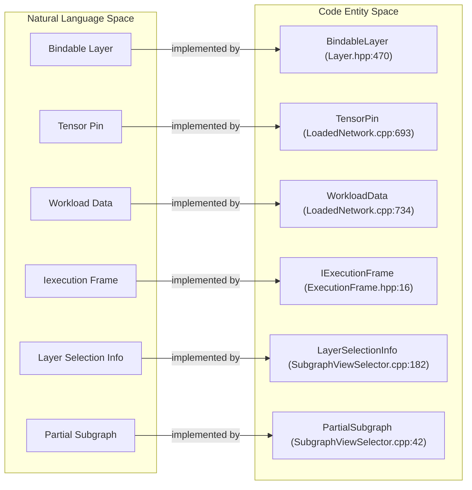
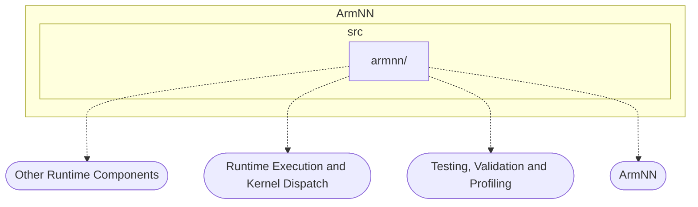
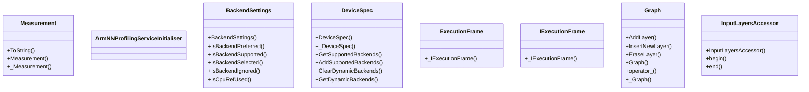
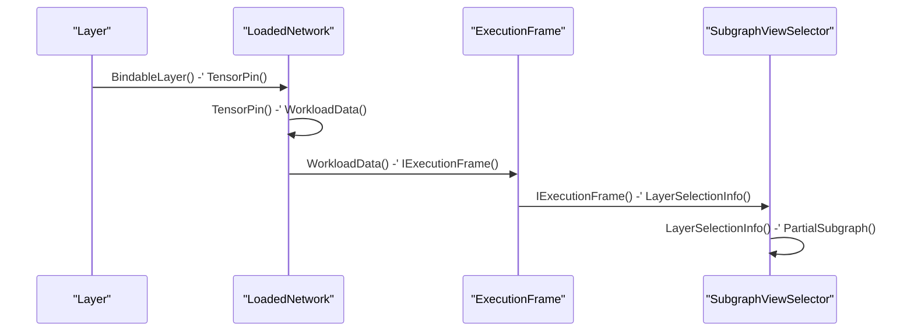

# 3-Source Context Packet (`git` + `CBM` + `llm-wiki`) for `5.1-armnn` — ArmNN

- **Target Wiki File**: `wiki/5.1-armnn.md`
- **Archetype**: `Leaf Technical Spec Page`
- **Parent Page**: `5-runtime-execution-and-kernel-dispatch`
- **Summary**: ArmNN subsystem (`src/armnn`), covering 28 files and 1007 symbols. Key symbols include `SetTensorInfo`, `Connect`, `end`, `GetName`.
- **Valid `[[wikilink]]` Neighbours**: `[[5-runtime-execution-and-kernel-dispatch|Runtime Execution and Kernel Dispatch]]`, `[[3-backend-delegation-and-hardware-providers|Backend Delegation and Hardware Providers]]`, `[[3.1-backends-backendscommon|Backends Backendscommon]]`, `[[3.2-backends-reference|Backends Reference]]`, `[[3.3-backends-opencl|Backends OpenCL]]`, `[[3.4-backends-aclcommon|Backends Aclcommon]]`, `[[3.6-other-backends|Other Backends]]`, `[[5.2-armnn|ArmNN]]`

## 1. Relevant Source Files (`git` + `CBM`, use verbatim in `<details>`)
- `[src/armnn/Tensor.cpp](src/armnn/Tensor.cpp)`
- `[src/armnn/Layer.cpp](src/armnn/Layer.cpp)`
- `[src/armnn/Descriptors.cpp](src/armnn/Descriptors.cpp)`
- `[src/armnn/Layer.hpp](src/armnn/Layer.hpp)`
- `[src/armnn/Graph.hpp](src/armnn/Graph.hpp)`
- `[src/armnn/Exceptions.cpp](src/armnn/Exceptions.cpp)`
- `[src/armnn/LoadedNetwork.cpp](src/armnn/LoadedNetwork.cpp)`
- `[src/armnn/BackendRegistry.cpp](src/armnn/BackendRegistry.cpp)`
- `[src/armnn/Graph.cpp](src/armnn/Graph.cpp)`
- `[src/armnn/JsonPrinter.hpp](src/armnn/JsonPrinter.hpp)`
- `[src/armnn/SubgraphView.cpp](src/armnn/SubgraphView.cpp)`
- `[src/armnn/Sme2ShapePolicy.cpp](src/armnn/Sme2ShapePolicy.cpp)`
- `[src/armnn/BackendSettings.hpp](src/armnn/BackendSettings.hpp)`
- `[src/armnn/DeviceSpec.hpp](src/armnn/DeviceSpec.hpp)`
- `[src/armnn/JsonUtils.hpp](src/armnn/JsonUtils.hpp)`
- `[src/armnn/BackendHelper.cpp](src/armnn/BackendHelper.cpp)`
- `[src/armnn/ArmNNProfilingServiceInitialiser.hpp](src/armnn/ArmNNProfilingServiceInitialiser.hpp)`
- `[src/armnn/Logging.cpp](src/armnn/Logging.cpp)`
- `[src/armnn/SubgraphViewSelector.cpp](src/armnn/SubgraphViewSelector.cpp)`
- `[src/armnn/ExecutionFrame.hpp](src/armnn/ExecutionFrame.hpp)`
- `[src/armnn/Instrument.hpp](src/armnn/Instrument.hpp)`
- `[src/armnn/IGraphObservable.hpp](src/armnn/IGraphObservable.hpp)`
- `[src/armnn/Runtime.cpp](src/armnn/Runtime.cpp)`
- `[src/armnn/ISubgraphViewConverter.hpp](src/armnn/ISubgraphViewConverter.hpp)`
- `[src/armnn/ArmNNProfilingServiceInitialiser.cpp](src/armnn/ArmNNProfilingServiceInitialiser.cpp)`
- `[src/armnn/LayerSupportCommon.hpp](src/armnn/LayerSupportCommon.hpp)`
- `[src/armnn/InternalTypes.cpp](src/armnn/InternalTypes.cpp)`
- `[src/armnn/Network.hpp](src/armnn/Network.hpp)`

## 2. Grounded Code Symbols (`CBM`, use verbatim for `[file:start-end]()` pill citations)
- `BindableLayer` (Class) @ `[src/armnn/Layer.hpp:470-495]()` [fan-in=0, fan-out=0] — // A layer user-provided data can be bound to (e.g. inputs, outputs).
- `TensorPin` (Class) @ `[src/armnn/LoadedNetwork.cpp:693-711]()` [fan-in=0, fan-out=0] — // Non-copyable class owning accelerator-specific tensor data.
- `WorkloadData` (Class) @ `[src/armnn/LoadedNetwork.cpp:734-779]()` [fan-in=0, fan-out=0] — // Stores data that needs to be kept accessible for the entire execution of a workload.
- `IExecutionFrame` (Class) @ `[src/armnn/ExecutionFrame.hpp:16-25]()` [fan-in=0, fan-out=0] — /// ExecutionFrame interface to enqueue a workload computation.
- `LayerSelectionInfo` (Class) @ `[src/armnn/SubgraphViewSelector.cpp:182-264]()` [fan-in=0, fan-out=0] — /// Intermediate data structure to store information associated with a particular layer.
- `PartialSubgraph` (Class) @ `[src/armnn/SubgraphViewSelector.cpp:42-179]()` [fan-in=0, fan-out=0] — /// Intermediate data-structure to store the subgraph that a layer has been assigned to. /// This is a "disjoint set" data structure that allows efficient mergi
- `InputSlot` (Class) @ `[src/armnn/Layer.hpp:42-98]()` [fan-in=0, fan-out=0] — 
- `Layer` (Class) @ `[src/armnn/Layer.hpp:230-467]()` [fan-in=0, fan-out=0] — 
- `OutputSlot` (Class) @ `[src/armnn/Layer.hpp:100-195]()` [fan-in=0, fan-out=0] — 
- `Graph` (Class) @ `[src/armnn/Graph.hpp:30-308]()` [fan-in=0, fan-out=0] — 
- `InputLayersAccessor` (Class) @ `[src/armnn/Graph.hpp:61-77]()` [fan-in=0, fan-out=0] — 
- `OutputLayersAccessor` (Class) @ `[src/armnn/Graph.hpp:80-96]()` [fan-in=0, fan-out=0] — 
- `Graph::LayerInGraph` (Class) @ `[src/armnn/Graph.hpp:358-377]()` [fan-in=0, fan-out=0] — 
- `Graph::LayerInGraph<ConstantLayer>` (Class) @ `[src/armnn/Graph.hpp:380-397]()` [fan-in=0, fan-out=0] — 
- `Graph::LayerInGraph<InputLayer>` (Class) @ `[src/armnn/Graph.hpp:401-428]()` [fan-in=0, fan-out=0] — 
- `Graph::LayerInGraph<OutputLayer>` (Class) @ `[src/armnn/Graph.hpp:432-453]()` [fan-in=0, fan-out=0] — 
- `Graph::LayerInGraphBase` (Class) @ `[src/armnn/Graph.hpp:312-354]()` [fan-in=0, fan-out=0] — 
- `NetworkImpl` (Class) @ `[src/armnn/Network.hpp:32-261]()` [fan-in=0, fan-out=0] — /// Private implementation of INetwork.
- `JsonChildObject` (Class) @ `[src/armnn/JsonPrinter.hpp:27-112]()` [fan-in=0, fan-out=0] — 
- `JsonPrinter` (Class) @ `[src/armnn/JsonPrinter.hpp:114-133]()` [fan-in=0, fan-out=0] — 
- `Sme2ShapeProfile` (Class) @ `[src/armnn/Sme2ShapePolicy.cpp:23-36]()` [fan-in=0, fan-out=0] — 
- `SubgraphView::SubgraphViewWorkingCopy` (Class) @ `[src/armnn/SubgraphView.cpp:381-394]()` [fan-in=0, fan-out=0] — 

## 3. Grounded Source Code Excerpts (`git` Working Tree)
### `BindableLayer` in `[src/armnn/Layer.hpp:470-485]()`
```cpp
class BindableLayer : public Layer
{
public:
    BindableLayer(unsigned int numInputSlots,
        unsigned int numOutputSlots,
        LayerType type,
        const char* name,
        LayerBindingId id)
    : Layer(numInputSlots, numOutputSlots, type, name)
    , m_Id(id)
    {
    }

    LayerBindingId GetBindingId() const { return m_Id; };

    void ExecuteStrategy(IStrategy& strategy) const override
```

### `TensorPin` in `[src/armnn/LoadedNetwork.cpp:693-708]()`
```cpp
class TensorPin
{
public:
    TensorPin(std::unique_ptr<ITensorHandle> handle, const TensorInfo& info, LayerBindingId id)
        : m_TensorHandle(std::move(handle))
        , m_TensorInfo(info)
        , m_Id(id)
    {
    }

    ITensorHandle* GetTensorHandle() const { return m_TensorHandle.get(); }
    const TensorInfo& GetTensorInfo() const { return m_TensorInfo; }
    LayerBindingId GetBindingId() const { return m_Id; }

private:
    std::unique_ptr<ITensorHandle> m_TensorHandle;
```

### `WorkloadData` in `[src/armnn/LoadedNetwork.cpp:734-749]()`
```cpp
class WorkloadData
{
public:
    WorkloadData(const InputTensors& inputTensors, const OutputTensors& outputTensors)
    {
        m_InputTensorPins.reserve(inputTensors.size());
        m_OutputTensorPins.reserve(outputTensors.size());

        for (auto inputTensorPair : inputTensors)
        {
            auto inputTensor = inputTensorPair.second;

            std::unique_ptr<ITensorHandle> tensorHandle =
                std::make_unique<ConstPassthroughTensorHandle>(inputTensor.GetInfo(),inputTensor.GetMemoryArea());
            LayerBindingId layerId = inputTensorPair.first;
```

### `IExecutionFrame` in `[src/armnn/ExecutionFrame.hpp:16-25]()`
```cpp
class IExecutionFrame
{

public:
    virtual ~IExecutionFrame() {}

    virtual IExecutionFrame* ExecuteWorkloads(IExecutionFrame* previousFrame) = 0;
    virtual void PostAllocationConfigure() {};
    virtual void RegisterDebugCallback(const DebugCallbackFunction&) {};
};
```

### `LayerSelectionInfo` in `[src/armnn/SubgraphViewSelector.cpp:182-197]()`
```cpp
struct LayerSelectionInfo
{
    using LayerInfoContainer = std::map<IConnectableLayer*, LayerSelectionInfo>;
    using LayerInfoQueue = std::queue<LayerSelectionInfo*>;

    LayerSelectionInfo(Layer* layer, const SubgraphViewSelector::LayerSelectorFunction& selector)
    : m_Layer{layer}
    , m_Subgraph{nullptr}
    , m_IsSelected{selector(*layer)}
    , m_IsProcessed(false)
    {
    }

    bool IsInputLayer() const
    {
        return m_Layer->GetType() == armnn::LayerType::Input || m_Layer->GetType() == armnn::LayerType::Constant;
```


## 4. Linked Official Docs (`llm-wiki` / `RAG`)
- **Runtime Execution and Kernel Dispatch** (`wiki/5-runtime-execution-and-kernel-dispatch.md`, score=51.684, shared_symbols=['Connect', 'SetTensorInfo']): # Runtime Execution and Kernel Dispatch > Architectural overview of Runtime Execution and Kernel Dispatch, spanning 157 source files and 3718 code symbols across 6 subsystems. <details> <summary>Relevant source files</summary> The following files were used as context for generating this wiki page: - [samples/common/include/Audio/DataStructures.hpp](sampl
- **Delegate Opaque** (`wiki/5.3-delegate-opaque.md`, score=50.425, shared_symbols=['Connect', 'Graph']): # Delegate Opaque ↑ [[5-runtime-execution-and-kernel-dispatch|Runtime Execution and Kernel Dispatch]] > Delegate Opaque subsystem (`delegate/opaque`), covering 28 files and 128 symbols. Key symbols include `GetTensorInfoForTfLiteOpaqueTensor`, `GetName`, `ValidateNumOutputs`, `IsValid`. <details> <summary>Relevant source files</summary> The following fil
- **Delegate Classic** (`wiki/5.4-delegate-classic.md`, score=50.425, shared_symbols=['Connect', 'Graph']): # Delegate Classic ↑ [[5-runtime-execution-and-kernel-dispatch|Runtime Execution and Kernel Dispatch]] > Delegate Classic subsystem (`delegate/classic`), covering 28 files and 114 symbols. Key symbols include `GetTensorInfoForTfLiteTensor`, `GetLayerName`, `Connect`, `ValidateNumOutputs`. <details> <summary>Relevant source files</summary> The following f
- **ArmNN** (`wiki/5.2-armnn.md`, score=47.425, shared_symbols=[]): # ArmNN ↑ [[5-runtime-execution-and-kernel-dispatch|Runtime Execution and Kernel Dispatch]] > ArmNN subsystem (`include/armnn`), covering 21 files and 440 symbols. Key symbols include `GetShape`, `InvalidArgumentException`, `GetNumElements`, `Exception`. <details> <summary>Relevant source files</summary> The following files were used as context for gener
- **ArmNN DeepWiki** (`wiki/index.md`, score=38.916, shared_symbols=['Connect', 'SetTensorInfo']): # ArmNN DeepWiki Generated from `home-jason-Project-deepwiki-armnn` at commit `2b61cecc9df7` (2026-11-14T15:13:53+00:00). ## Pages - [[1-overview|Overview]] — End-to-end architecture overview of ArmNN: core subsystems, compilation/execution pipeline, entry points, and cross-module dependencies. - [[2-build-system-and-infrastructure|Build System and Infras
- **Backends Tosacommon** (`wiki/3.5-backends-tosacommon.md`, score=34.02, shared_symbols=['Graph']): # Backends Tosacommon ↑ [[3-backend-delegation-and-hardware-providers|Backend Delegation and Hardware Providers]] > Backends Tosacommon subsystem (`backends/tosaCommon`), covering 28 files and 86 symbols. Key symbols include `GetTosaTensorShape`, `GenerateUniqueOutputName`, `GetUniqueTosaMappingID`, `GenerateUniqueInputName`. <details> <summary>Relevant s

## 5. Pre-Verified DeepWiki v1.9.9.5 Mermaid Diagrams
### Natural Language Space <-> Code Entity Space


### Subsystem Architecture Flowchart


### Class Hierarchy Diagram


### Call Sequence Diagram


## 6. DeepWiki v1.9.9.5 Authoring Checklist for `wiki/5.1-armnn.md`
1. Keep YAML frontmatter at top (`id`, `title`, `parent`, `sources`, `linked_docs`, `bridge_symbols`).
2. Keep `<details><summary>Relevant source files</summary>` block immediately after `# Title`.
3. Start with `## Purpose and Scope`, then numbered `## 1. ...`, `## 2. ...` sections separated by `---`.
4. Include at least 2 ```mermaid``` diagrams (including a `Natural Language Space` <-> `Code Entity Space` mapping).
5. Cite code entities inline using `[path/to/file.ext:start-end]()` and end every `##` section with `Sources: [file:start-end]()`.
6. Run `deepwiki_cli.py build --enrich-only ...` and `deepwiki_cli.py validate ...` after editing.
